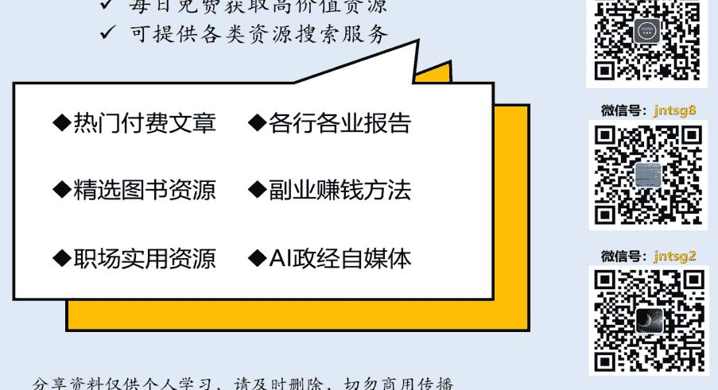
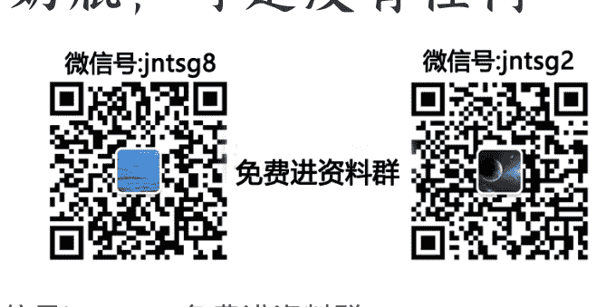
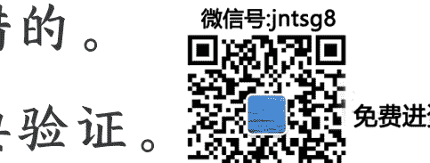
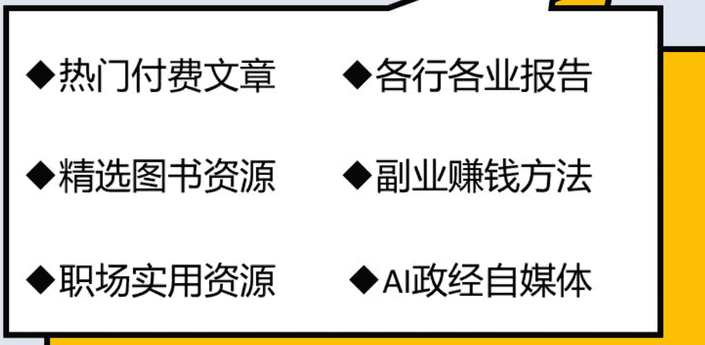

## 洞察力不是天赋，是套路：一个创业者的我的3步法

分享一个上周很有启发的事：都说洞察力重要？那些总能洞察用户的人，到底是怎么做到的？

如果在所有的商业能力中，选一个价值最大的，我觉得“洞察力”肯定排在前三。

关键是，谁能拥有洞察力呢？实实话，我一直觉得洞察力是天赋，就有、没有就没有。

直到上周，旁观了一个消费品创业者的洞察过程，我才意识到：洞察力也是有套路的，可练习、可学习，而且套路起来还真不复杂。

怎么做呢？

1. 当时，我们在一起访谈一个用户。

这位妈妈描述了她自己最近在喂奶，她试了大量的奶瓶，可是没有任何一款让她满意。

加微信号jtsg2，免费进资料群

想要的好奶瓶，主要是为了解决喂奶时的排气问题。

不能让宝宝连带空气一起喝进去，会胀气。

奶瓶 A，有个排气孔的奶瓶。但是，大小只有 60 毫升——新生第一周，一次喝 30 毫升，第二周开始就要猛喝 60 毫升，意味着这个奶瓶只能用两周。不划算。

另一个奶瓶 B，排气孔在瓶盖的侧面，半夜喂奶时，必须摸黑排气孔转到上方。只要不开灯，很难成功。开灯又会影响其他人的睡眠。

一个奶瓶 C，瓶盖是方形的，四角对齐才能扣上。有一半夜喂奶，自己睡得迷迷糊糊，以为扣上了结果没扣上，奶瓶倒过来准备喂，就啪咣啦扣了。是一瞬间，左手是宝宝的哭，面是一地等待自己清理的奶。

一个奶瓶 D，排气孔在瓶底，装了奶放在冰箱里，必须有东西塞住排气孔，不然很容易坏。

2. 这个时候，那位消费品的创业者忽然说：

“你对奶瓶体验的感知，是不是主要发生在半夜这样的极端情况？你心目中，一款奶瓶，是不是希望它尽量帮你减少一个操作、或者减少一个意外？”

这一瞬间，用户肉眼可见地被了。连说“对对对”。

那位消费创业者又说：“所以你希望奶瓶绝对可靠。如果你觉得一个奶瓶足够可靠，你就会买它。”

当听到可靠这个词时，所有人都都有感觉了。

很容易想象产品怎么做：排气孔不能在底部，容易坏。排气孔要在黑夜里也能方向正确，可以做一个不对称的造型，让排气孔的方向能被摸出来。盖子要在看不见的时候也能轻松盖。产品广告怎么打，也很容易想象出来：展示极端情况、手忙脚乱时，不需要看着也能操作。用各种样的元素传递可靠。这是找到洞察的力量。

3. 我回顾她的工作过程，其实很有意思。

用户在描述的，其实是自己对一个奶瓶不满意的“现象”。但是，现象本身，肯定不是洞察。

洞察是现象背后的原因，是我们找到的某种“做了就会有效”的东西。

所以，她在听懂现象时，一直在寻找现象背后共同的原因。

现象是复杂的。但是，原因是少的。原因背后的原因可以是少的。当她找到一个简短的原因，可以解释所有现象时，有一个可能的洞察就被发了。

不过，这个时候，也有可能这个洞察可能是错的。所以还需要验证。

怎么验证呢？

把找到的原因讲给用户，如果得到了用户“对对对”的认可，就完成了验证，自己也找到了洞察。

简单来说，这个过程就是三个步骤：

- 第一，听懂用户描述，搜集现象。
- 第二，尝试寻找原因，用更简单的原因，解释现象。
- 第三，把找到的原因讲给用户，让用户反应验证。

一旦验证完成，你就走完了一个搜集、归因、验证的循环。

好的洞察可能因此而发现。

## 免费 价值 及时 关注

扫码加入 知识星球 免费资源群

- 每日免费获取有价值资源
- 可提供各类资源服务

公号：知识星球TOP 微信号：jntsg8 微信号：jntsg2

分享资料仅供个人学习，请及时删除，切勿商用传播

加微信号jntsg2，免费进料群