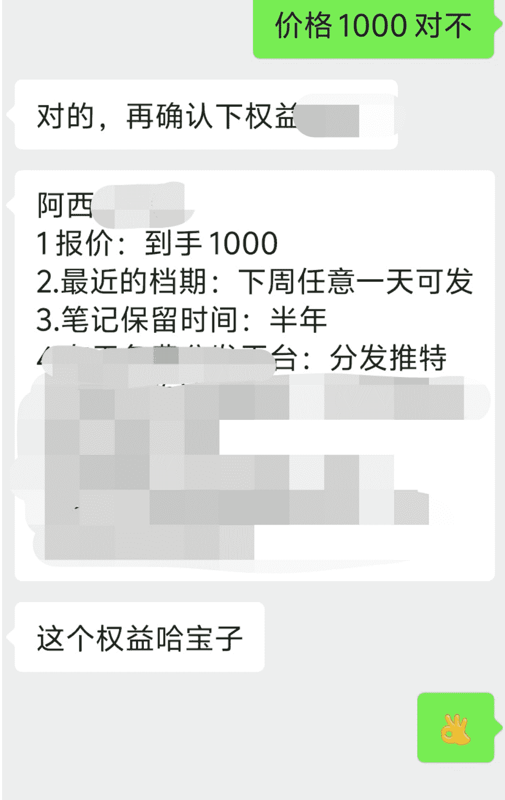
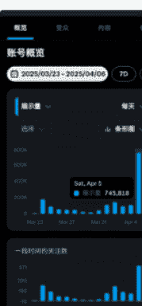
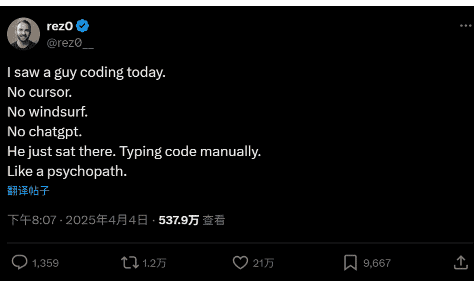
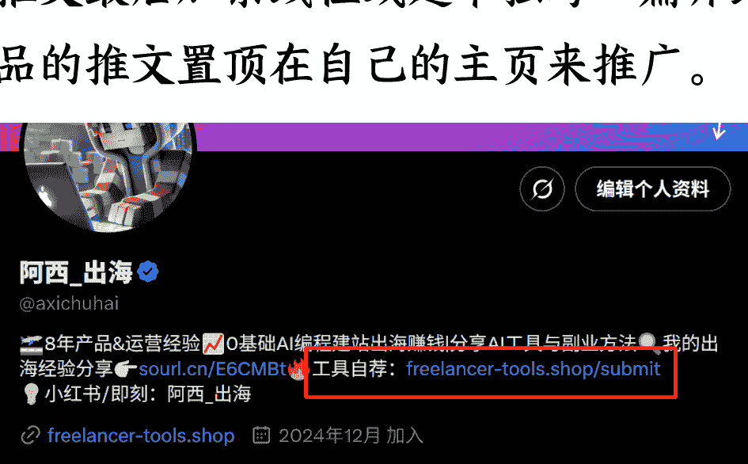
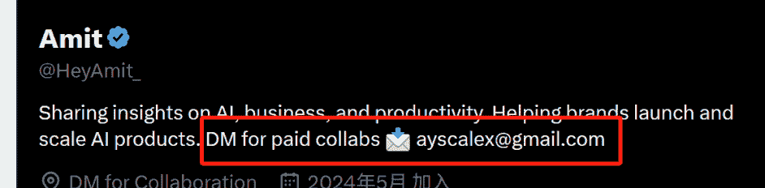
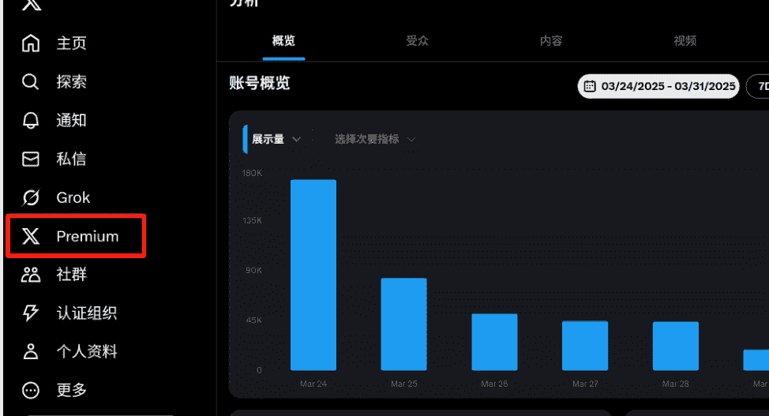

# 推特增长之路：我如何从 0-1 在推特平台起号完成变现

250506 财经精华

大家好，我叫阿西，多年互联网产品运营者，之前在生财写了《0编程经验》，我如何借助 Cursor 搭建 AI 出海工具站，评了精华帖，收获了140+个朋友的好评。我同时也在刻、推特、小红书运营出海内容相关的账号（名称：阿西—出海），分享出海、AI相关内容，输出多篇10w+浏览量的爆款内容。

这次我分享的是0 基础如何在推特快速起号、写出爆文，完成变现闭环。先说我做推特的起因，我之前一直在做出海网站工具，为了拓展用户流量，所以想做个推特账号触达更多精准用户。

我之前是从从来没玩过推特的一个小白，去年12月第一次注册推特，从0开始摸索这个平台的玩法。没想到无心插柳柳成荫，我不在推特里给我的网站带来了免费用户，而且完成了在推特的快速起号，涨粉速度，2万粉丝，10万粉丝，多篇10w+浏览，最高一篇65w+，浏览2000+点赞，最的是实现了账号商单变现。

| 显示量 | 喜欢 | 回复 | 转帖 |
| :--- | :--- | :--- | :--- |
| 659K | 2.1K | 37 | 532 |
| 182K | 699 | 6 | 210 |
| 173K | 1K | 25 | 217 |

这是我的爆文数据 ↑



对的，再确认下权益：
阿西：
1. 报价：到手1000
2. 最近的档期：下周任意一天可发
3. 笔记保留时间：半年
... 分发推特
...

这个权益哈宝宝

这是我的商单合作 ↑

加微信jntsg2，免费进资料群

在做推特账号的过程中沉淀了一些方法论，基本可以做到日曝光量基本稳定在 10w 左右。

## 即刻动态

阿西_出海
8年产品&运营经验|零基础AI编程建站出海嗨...

稳定，在突破。
现在X上单天曝光可以稳定在10w左右，基本盘的曝光量也也在提升。昨天单天曝光到了74w。
开始研究现在的工作流加上“知识库”能不能提升效率。



04/06 09:09

接下来我会详细介绍如何从 0-1 在推特平台搭建账号并起号，文章结构如下：

- 为什么要做推特？
- 借助 AI 梳理账号定位
- 如何在推特涨粉、获得曝光

## I、为什么要推特？

### I.1 推特的优势

#### 内容制作门槛低
抖音、小红书、youtube、tiktok这些图文、视频平台，要做视频、做精致的图片才能吸引用户，推特对于普通人来说最大的优势就是内容创作门槛低，推特相当是国外的微博，随手写的几段文字就有机会爆火。

像下面这篇低粉爆文，只有6万粉丝，纯文字内容，写了6行字获得了五百多浏览量：



在推特平台上只会写文字内容，也一样有机会做出爆款内容。

#### 创作者分成机制+美元汇率
推特对于粉丝量、曝光量达到一定程度的蓝认证用户，会开通作者分成机制（后文会具体介绍），简单的来说就是开通后推特的推文互动频率越高，你的分成收入就越高。相比广告，流量分成更可控、持久。另外，因为分成的美元相比人民币有7倍的汇率差，所以国外平台的分成收入天然更有优势。

#### 粉丝变现
玩推特的除了境外用户，科学上网本身本身一种门槛，推特上的信息更新更全，很多爆火的信息都会出现在推特，流量一般是：创业者、行业爱好者、专家等优质人士，从这个角度解释了粉丝用户还是价值高的。我也看到一些知识付费博主说推特的转化率相对较高。

### I.2 有哪些途径

#### 作者分成
开通作者分成的条件是：
- 1) 认证要求：必须订阅Premium（最低每月美元）。
- 2) 展示量要求：过去3个月内，累计至少500万次展示。
- 3) 粉丝要求：拥有至少500名Premium粉丝。

稍微难的是展示的要求，不用担心，后面会介绍如何提升自己的曝光。之前用自己的方法实践了两周的时间就达成了18万曝光，继续做下去的话，一个月就能完成50万曝光的目标。

| 展示量 | 参与率 |
| :--- | :--- |
| 1.8M | 88% |
| 2.6K | 36% |

#### 给自己的产品引流
如果你有自己的产品，比如知识付费或者是付费产品，就可以在简介里加上链接，或是单独写一篇介绍产品的推文置顶在自己的主页来推广。



阿海 @axichuhai
8年产品&运营经理 | 出海增长工具与行业洞察。我的经验分享：自荐工具、笔记：2024年12月加入

如果你希望推广的产品，可以在 freelancer-tools.shop 提交，我将用推文转化介绍：

Best Freelancer Tools in 2025
Discover the Best Tools to Boost Your Freelancer Career & Find productivity, marketing, and creative tools all in one place.
Just launched AI Tools for Freelancers

加微信jntsg2，免费资料群

如果是面向用户的独立开发者，可以做一个英文推特的账号，通过推特通过内容快速触达目标用户。

#### 商单合作
有几千粉丝账号就有机会接到商单，为了更积极地拥抱商单，你可以在账号里多个位置写接单，比如简介、推特。因推特不像小红书有官方接单平台，所以这部分相对比较野生，需要自行识别对方是否靠谱，这里给一些建议：尽量不接效果付费的广告，一口价广告如果金额大的话沟通对方先付金。

像下图这个账号就是在简介里挂了接单邮箱：



## 2、借助 AI 理定位

### 2.1 明确账号定位

在做账号定位前要先明确这几个问题：
- 1) 你要做中文还是英文？
- 2) 做哪个赛道？
- 3) 内容类型要选择哪种？通过什么方式盈利？

#### 中文还是英文？做哪个赛道？
这个问题每个人属于自己的答案，可以从自己现有的业务出发，比如本身是卖产品的就可以做养生赛道；如果目前没有业务，就是问问自己更擅长喜欢做哪方面。比如我本身就是做互联网产品方向的个人，喜欢独立研究AI 产品，所以我选择AI赛道。

也可以自己思考或者问问身边的朋友，认为自己平时有哪些特质，自己有些特别喜欢的事物。因为账号运营需要持续输出内容，最好是能根据自己的偏好来选择方向，这样才能更持久。

#### 内容类型要选择哪种？通过什么方式盈利？
我把这两个问题放在一起说是是因为：盈利方式决定了要做什么样的内容。很多人做账号、发内容，想着把粉丝做上去，内容火起来，看到曝光多、涨粉快，不如直接买。做账号之前要想清楚你要做什么变现。观察推特上每个赛道的账号类型，基本分成三类：

- **1) 专业类账号**：发布科普内容，面向业内人士，比如AI赛道为例，对专业要求较高。变现模式：适合知识付费。
- **2) 资讯类账号**：发布最新的资讯，这类账号比较好做，跟热点，粉丝越高。变现模式：适合广告、商单。
- **3) 娱乐类账号**：这类账号适合普通人，比如健康养生、情感等。变现模式：适合广告。

粉丝付费能力来说，专业类 > 资讯类 > 娱乐类。互动意愿越强，专业类 > 资讯类 > 娱乐类。

### 2.2 借助 AI 梳理定位和运营
我们可以继续使用AI来辅助你确定位置。

**步骤1：定位分析（使用 DeepSeek）**
提示词如下：
作为一名职业顾问，请帮我分析我的背景和兴趣，找出适合在推特发展的2-3个方向。
我的背景：[详细描述你的专业经验、技能、爱好]
我的优势在哪里？
我有独特见解？
我能持续产出什么类型的内容？
哪些领域有变现潜力？

**步骤2：竞品分析（使用 Grok）**
提示词如下：
选择3-5个与我的方向相似的成功账号，分析他们的内容分布。目前的情况：[描述你的个人限制，比如不擅长做视频、每天投入的时间有限]。

**步骤3：运营节奏梳理（使用 Grok）**
提示词如下：
我的目标：[描述你想通过推特实现什么，如实现知识付费达到万元]。我的账号赛道是XX，请帮我制定完整的运营规划，最快实现目标，运营节奏是怎样的，账号如何包装、发文频率多少合适，若其他内容需要补充，请一写入。

这三步完成后你已经基本明确了账号的方向，跟着Grok告诉你的方式写好简介后，接下来就可以制作推文了。

## 如何在推特涨粉、获得曝光

### 3.1 推特的流量机制
我在推特发布过关于推特源码里的推文排名公式，可以通过代码里不同的权重来评估推文的可见性和重要性：

```
Twitter Ranking Score =
75 * is_replied_reply_engaged_by_author
+ 27 * is_replied
+ 12 * is_profile_clicked_and_profile_engaged
+ 11 * MAX(is_good_clonked_convo_desc_favored_of_replied, is_good_clonked_convo_desc_v2)
+ 1.0 * is_retweeted
+ 0.5 * is_favited
+ 0.005 * is_video_playback_50
- 74 * is_negative_feedback_v2
- 369 * is_report_tweet_clicked
```

具体权重如下：
- 1. 推文作者参与与回复，推文权重+75分
- 2. 推文被回复，推文权重+27分
- 3. 用户点击了推文作者的个人资料并且进行了进一步的互动（如查看更多推文），推文权重+12分
- 4. 用户点击了推文的对话描述并且进行了点赞或回复，推文权重+12分
- 5. 推文被转发，推文权重+1分
- 6. 推文被点赞，推文权重+0.5分
- 7. 推文中的视频播放长度达到50%，推文权重+0.005分
- 8. 推文收到了负面反馈（如用户标记为感兴趣），推文权重-74分
- 9. 用户点击了举报，权重-369分

“+”就是正向权重，“-”就是负向权重，可以看到评论和回复都是加分的行为，要有意识在推文里引导评论。比如老外就会这样做：


### 3.2 获得大流量的4个秘诀

#### 3.2.1 坚持多推
涨粉最重要的一个方法就是多发，但是每天要发，一天最好多发几条。但注意不要连着发，两条之间建议1小时以上，否则容易限流。为了积累，用公式来理解：总浏览量 = 推文数 * 平均每条流量。一条推文可能就有几万流量，一天发一条一般几百流量，多推涨粉速度越快，账号资产就像雪球一样滚。

#### 3.2.2 爆文标准化模板
- **1) 什么是长线程？**：长线程是推特上的一种形式，就是发了一个帖子后不断追加评论，形成了一个长帖子，阐述一个完整的观点/故事/主题。下面就是一个长线程：
- **2) 长线程比普通帖子更容易曝光**：推特是信息流展示，普通帖子的内容很短，很容易扫过就完了，注意力争夺非常激烈，而长线程一般至少有10条，能产生深度内容。
- **3) 病毒线程的结构**：
    - **正文内容（第一个帖子）**：要抓眼，内容不要太多，目的是让用户点进来来看。
    - **主动引导动作**：因为长推文较长，用户看着可能会忘记互动，所以需要要有意识加上引导动作的文案，引导用户互动。我会在第二条就开始引导，因为越往后流失的用户越多，所以尽量早一点就开始呼唤：
    - **视频图片好，文字好**：通过测试发现，在线程里特别是正文里加上视频更容易形成爆款。如果实在没有视频素材，也可以加上配图。视频、配图的作用是为了抓住用户的眼睛，在你的内容上停留，吸引用户时间越长，平台越容易推流你的内容。
    - **结尾提醒关注**：用户看到一般说明对内容满意度较高，平台也大概给了较多流量，这时候就要承接这些流量转化成自己的粉丝，并且引导转发正文链接。以下我的结尾句模板：
        - 如果喜欢我（@xxxx），学习更多xxxxx知识
        - 1. 关注（@xxxx）
        - 2. 点赞+转发下面第一个帖子（这里放正文链接地址）

#### 3.2.3 多与行业大V互动
借力曝光在大V的评论区互动有两个好处：
- 1) 优质的评论相当于你的免费广告位，可以帮助你吸粉
- 2) 有助达成作者分成计划的条件

这里还有一个小窍门，你可以关注推特上的顶流大号，比如特朗普、马斯克、赵长鹏的账号，他们发文的量非常频繁，在他们发后第一时间评论也能带来不少曝光。建立圈子人脉：推特的行业圈子人群比较集中，阶级比较扁平，你发的内容优质的话就很容易出现在行业大佬的时间线上，链接到平时生活中完全不可能认识的大佬/大V，所以某种意义上推特的阶级相对扁平。努力找到行业大佬，主动在大佬的推文下进行有价值的讨论，输出有见地的评论，增进互动，但不让其他看评论的人注意到你的账号，还能跟大佬增进互动，积累行业资源。就像我的账号初期就是因为发布的内容被海圈的大佬转发了，完成了账号的冷启动。坚持每天5-10个行业大佬互动，这个方法成本低，效果明显，性价比高，非常建议。

#### 3.2.4 构建“素材库”，激发持续创作的灵感
只要这么高频的内容，就需要稳定的、大量的灵感来源。建议可以通过收藏建立自己的素材库。订阅了推特的蓝标识会员能拥有收藏夹分类的功能，分类功能比较有用。我的收藏夹分成两个标签：
- 主题灵感：这里收藏最近一些主题方向的内容容易找，这里告诉大家一个秘诀怎么看内容火不火看浏览量和粉丝量的比例，如果浏览量在6位数以上且浏览量是发布者粉丝量的5倍以上，那么这条推文就属于一条爆文。
- 模板灵感：帮助快速搭建高互动、高流量的爆文模板，比如上文说的长线结构就是一种高流量爆文模板，像下面这就是一种引导互动的模板，引导用户回复某个关键词：


### 3.3 数据跟踪

开通蓝标会员后才能看到账号的数据分析看板：



很多人可能会问：为什么要看账号的数据，不是只要看每篇推文浏览量不多就行了？

这里解释下能看到账号数据的 3 点好处：

- 查看哪条推文数据更好：爆过的主题能重复爆。通过内容看板，记录你哪些主题、哪些推文模板曾经爆过，隔一段时间后内容复用 AI 洗一下改写一遍可以再发一遍，大概率也能爆。

- 及时发现流量：推持续账号在成长为 V 的过程中，避免不了的一个问题就是被限流。通过看数据看板的数据曲线，如果被限流的话可以很明显的看到账号的每日浏览量下降过程。如发现被限流就要及时查找账号为什么违规，及时处理违规早点解除限流了。

为限流的问题解释起来会比较复杂，幅有限先不开展了。

看到账号的创作者分成达成情况数据看板会直接展示账号当前有多少认证粉丝、3个月内的总浏览量，这个功能对于想要开通作者分成的账号非常重要。

## 增加账号信任度

开通了会员的账号在昵称旁边有一个蓝标，相比于普通用户，蓝账号更具信任（毕竟花了钱的账号，看起来比花钱的账号靠谱）。


补充一点：我实际操作的时候发现移动端无法开通蓝会员，需要在PC端操作，支付需要visa/master卡。

## 4、写在最后

以上就是我在做一个推特账号过程中总结的经验，但并不是说用了以上的方法就能快速起号、快速写爆文，只是说用了以上方法可以帮你提高成功起号的概率、帮你排掉一些起号过程中的雷。

开以上的经验方法，如果你问我做推特账号最重要的秘诀是什么，那就是坚持，坚持每天天，坚持每天固定多少时间去刷推特，坚持每天互动。

我可以很自信的告诉大家，推特的商业价值巨大，除了上面我所说的在推特本身平台上的价值外，你在持续做过的过程中还会发现什么意外的惊喜。比如我在别的平台上的账号在接商家单时，甲方也会提出不能顺便带在推特上也发一下，于是商家价格也翻了2-3；又或者可以把在推特爆的内容，在别的社交平台二次发布，像红书、抖音等，大概率也能。

推特的价值远不止于此，期待你继续挖掘。请尝试注册的第一个推特账号、发布第一篇推文，然后坚持，去做，相信你也会遇到惊喜，祝你成功！

| 免费 | 价值 | 及时 | 专注 |
| --- | --- | --- | --- |
| 知识球TOP 免费资源群 | 免费获取有价值资源 | 可提供各类资源搜索服务 | |
| ◆热门付费文章 | ◆各行各业务 | | |
| ◆精选图资源 | ◆副业赚钱钱方法 | | |
| ◆职场实用资源 | ◆AI政经自媒体 | | |


