# RPA 自动采集小红书低粉爆商品（手把教程-附源码)

# 250610 生财精华

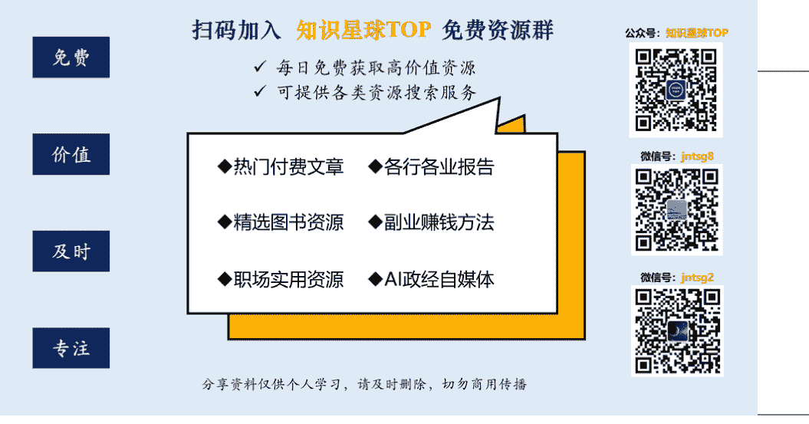

各位星球的小伙伴大家好，我是黄大路。目前正在专注于用 RPA 来一些业务解决方案。结合影刀 RPA，已经搭建了 150+ 自动化流程。也合作了一些小红书 MCN、电商团队/个人。帮助他们运营。

今天带来的实战项目。是一个小红书商家比较常见的业务场景：采集小红书低粉爆品（基于关键词搜索结果页 + 商品推荐页）。

最近机缘巧，有朋友让我做一个采集小红书低粉爆品 RPA 工具，然后发了一篇文档给我。我看是生财 2023 年的文章。是以文章作为参考，按照新版的小红书流程，以及自己的理解。写了 3 个基于小红书低粉爆品的 RPA 应用。索性也干脆把流程和源码分享出来。

下面是正文。

说下这个需求的缘起。

起源是伟豪在文章里，分享了如何去做选品的方法。其中提到一个选品方法就是：

低粉爆款法。原文描述大概是:

跟品，按照低粉爆款的思路去跟品，原则是：
对标模仿的小红书账号低于 200 粉丝，同时最近 7 天的单篇带货笔记点赞 100，同时该带货笔记商品销量大于 100。

这种爆款方法，本质就是找没多少粉丝但已经有品在爆的对手，去跟品！

低粉爆款四个字等价于六字，那就是粉丝少成交！

利用低粉爆款法去选品，你可以不依赖于灰度数据、考古等第三方工具软件去寻找当前崛起的账号当中，有哪些人最近 7 天带的品在爆。仅通过小红书发现页去刷就可以，不要怕麻烦！耐心一点，每天寻找三个品去测试。

另外，已经是低粉爆款的品，如果你的抄的时候没有抄到低粉爆款的笔记的封面，这个品也会出不了单。选品正确代表走完了 70% 的路，还有 30% 的路是封面+视频要抄的精准。

-- 书豪

这个选品方法里，一些关键的点：

为什么可以直接去小红书商品推荐，而不用爬堆、考加这些数据。还有一个原因在于，这些第三方数据，对于「商品销量」这个字段，一般都不会去拿实时数据（平台也不会给），而是离线数据。也就是说在第三方数据软件里看到的商品销量，往往是滞后的。

对于跟品来说，快一点，多赚一波钱。

只有小红书手机端商品列表、商品详情的销量数据是实时的。所以直接去小红书页面上拿数据，是实时数据。这里也引出来，为什么我们通过 RPA 去采集这些商品数据，会更有价值。

2、这个选品方法，就是去找“粉丝少，成交多”的商品。业务逻辑其实很好理解，所有的平台都这样找。除了可以这样找商品，也可以来找笔记、短视频。一样的思路。粉丝少，数据又好，就是异常值。

3、这个选品方法，本身具有重复性、同时需要持续执行。如果可以做到自动地、实时地，采集低粉爆款商品。至少在这个环节，就比同行更有效率。

接下来我会把一起 3 个 RPA 业务流程：采集小红书搜索关键词 - 低粉爆款商品、采集小红书推荐页面 - 低粉爆款商品、监控小红书商品销量。 详细分享出来。有 RPA 能力的朋友可以参考一下思路。没有接触过 RPA 的朋友，也可以帮给他们部署。这套流程是用影刀 RPA。

## 一、实现效果

- (1) 进入小红书 - 友好搜集，搜索商品关键词，然后在搜索结果页，采集低粉爆品。自己可以设置：
    - 商品搜索关键词：也就是每次运行，需要搜索的商品关键词；
    - 检测次数：小红书移动端，一屏大概是4商品。这里可以理解为手机屏幕滑动次数；
    - 商品销量大于多少才采集商品；销量和粉丝数，可以根据自己的行业情况来设置数量。

设置好了后，程序就会自动满足要求的商品数据，写入表格，最后支持导出本地 Excel。

- (2) 进入商品推荐页，采集低粉爆品。自己可以设置：
    - 检测次数：
    - 商品销量大于多少才采集商品；
    - 博粉粉丝小于多少才采集商品。

销量和粉丝数，可以根据自己的行业情况来设置数量。

### （3）监控小红书商品销量

自动获取商品销量，也可以设置为定时运行，这样就能把采集的低粉爆款，每天监控商品销量趋势。

| 商品名称 | 商品链接 | 商品销量 | 粉丝数 | 今日销量 | 2025年06月11日销量 |
| :--- | :--- | :--- | :--- | :--- | :--- |
| 欧式简约连衣裙 | https://www.xiaohongshu.com/item/6223 | 624 | 699 | | 460 |
| 女装精致新款 | https://www.xiaohongshu.com/item/6523 | 1354 | 800 | | 108 |
| Do Know Visual Magic | https://www.xiaohongshu.com/item/6723 | 6822 | 209 | | 1200 |
| OPEL 经典款 | https://www.xiaohongshu.com/item/6923 | 3443 | 200 | | 598 |
| 女装时尚连衣裙 | https://www.xiaohongshu.com/item/7123 | 3421 | 592 | | 627 |
| 连衣裙的连衣裙 | https://www.xiaohongshu.com/item/7323 | 3421 | 341 | | 687 |
| 连衣裙的连衣裙 | https://www.xiaohongshu.com/item/7523 | 8252 | 628 | | 3506 |
| 宽松风连衣裙 | https://www.xiaohongshu.com/item/7723 | 10000 | 188 | | 3607 |
| 女装新款上衣 | https://www.xiaohongshu.com/item/7923 | 8623 | 115 | | 911 |
| 纯棉T恤 | https://www.xiaohongshu.com/item/8123 | 3869 | 291 | | 1018 |
| ANTA运动鞋 | https://www.xiaohongshu.com/item/8323 | 5523 | 399 | | 1422 |
| 法式连衣裙 | https://www.xiaohongshu.com/item/8523 | 8252 | 1386 | 30 | |
| 宽松风连衣裙 | https://www.xiaohongshu.com/item/8723 | 12161 | 169 | | 1961 |
| 入门级连衣裙 | https://www.xiaohongshu.com/item/8923 | 9682 | 23900 | | 25000 |
| 碎花连衣裙 | https://www.xiaohongshu.com/item/9123 | 11523 | 118 | | 22902 |
| 其他新款 | https://www.xiaohongshu.com/item/9323 | 1158 | 679 | | 297 |
| 爆款连衣裙 | https://www.xiaohongshu.com/item/9523 | 5523 | 534 | 319 | 330.15 |
| 女士款连衣裙 | https://www.xiaohongshu.com/item/9723 | 2000 | 2882 | 726.65 | 541 |
| 简约连衣裙 | https://www.xiaohongshu.com/item/9923 | 3991 | 2888 | | 2962 |
| 宽松款T恤 | https://www.xiaohongshu.com/item/10123 | 2991 | 450 | | 450 |
| 针织连衣裙 | https://www.xiaohongshu.com/item/10323 | 7111 | 1605 | | 458 |
| 女装新款连衣裙 | https://www.xiaohongshu.com/item/10523 | 143 | 3427 | 6.9 | 3427 |

## 二、业务逻辑

先说说这套流程逻辑。

（2）采集小红书App - 友好市集、推荐页，同时满足商品销量、博主粉丝的商品销量、博主粉丝定义设置。这两个业务场景实现的逻辑其实一致。主要是商品列表、搜索关键词有一些区别。其中在商品列表、搜索结果页的数据直接循环获取，会出现重复的商品。但是商品卡片不在窗口展示，所以加入了商品信息的判断。这个细节后面的指令再详细说明。

## 三、RPA指令详解

### 三.1 环境配置

在讲解详细指令之前，这里说一下环境配置。整个手机自动化流程受到影刀 RPA 版本、Android手机以及系统、小红书版本影响。稍差就会各种报错，如商品元素获取不到、流程错误等等。所以需要仔细核对影刀 RPA客户端、手机配置和注意事项。这部分建议按照影刀官方文档进行配置；本文RPA流程的运行环境：

- 影刀 RPA 版本：影刀5.27.30创业版（32位）
- Android手机版本：Redmi Note 10, MIUI 14.0.10
- 小红书版本：8.85.0_f239cd1


加微信intsg2免费进资料群。如果一部手机需要长期用来自动化操作，建议稍微点的200元左右的机器，频繁打开关闭窗口导致卡顿，会影响自动化流程并且这种错误也不好排查。好了，如果这部分配置遇到问题，实在搞不定，可以找影刀官方客服或者找我帮忙。

### 三.2 指令解释

#### 三.2.1 搜索商品关键词，采集低粉爆品指令详解

先讲关键词，采集低粉爆品的内容。如果太熟悉RPA指令，可以先看看业务流程图以及最后的完整指令图。根据流程图来看指令逻辑。

1、初始化字段，连接手机、打开小红书。开始用自定义对话框，设置每次运行。

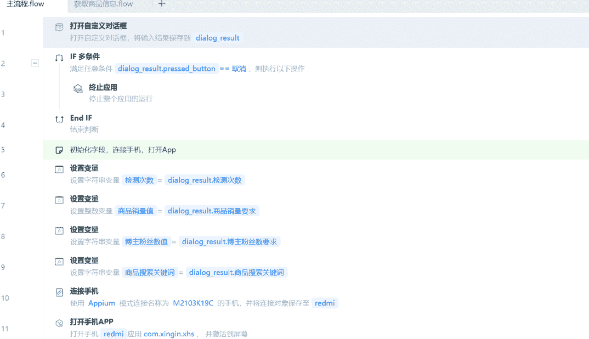

### 自定义对话框中，需要填入的字段信息。包括：加微信jtsg2免费资料分享

- 搜索关键词：也就是每次运行，需要搜索的商品关键词；
- 检测次数：小红书移动端，一屏大概是4个商品；
- 商品销量大于多少采集商品；
- 博主粉丝小于多少采集商品。

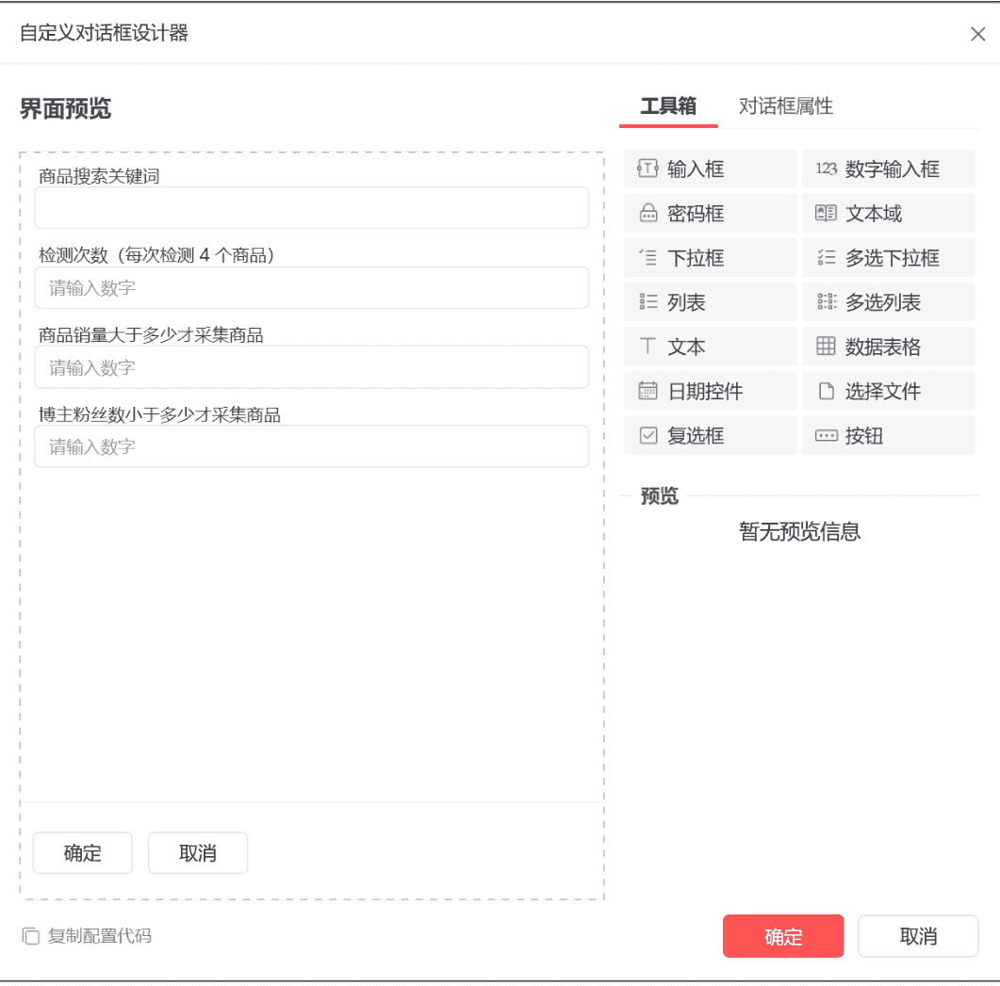

### 全局变量

| 变量名称 | 类型 |
| :--- | :--- |
| 博主粉丝数值 | 字符串 |
| 检测次数 | 字符串 |
| 商品搜索关键词 | 字符串 |
| 商品销量值 | 字符串 |
| redmi | 手机连接适配... |

RPA流程的全局变量，因为整个RPA应该封装成了两个流程。设置全局变量，方便流程调用。

2、进入小红书‘友好市集’页面，搜索关键词，进入搜索结果页。然后因为流程我是先把数据存在数据表格，最后从数据表格导出，所以在采集数据前，先写入创建了表头。表格表头：店铺名称、博主粉丝、商品链接、商品销量、商品价、到手价。

| 店铺名称 | 博主粉丝 | 商品链接 | 商品销量 | 商品价 | 到手价 |
| :--- | :--- | :--- | :--- | :--- | :--- |
| | | | | | |
| 某店铺 | 10w | [链接] | 500 | 80 |
| 某店铺 | 5w | //android.widget[@text="搜索"] | | |

流程里注意的是XPath路径。移动端的元素原则上使用XPath来写，这样元素比较稳定，不容易失效。如果你的小红书版本不一样，可能找不到元素。

```
//*[@content-desc='友好市集']
//android.widget.RelativeLayout[//android.widget[@text="搜索"]]
//android.widget.Button[@text="搜索"]
```

小红书268021EE，小红书号2628361498，IP属地:浙江。关注、粉丝、收藏。点击这里填写简介：

- 好友市集
- 我的订单
- 浏览记录
- 笔记
- 收藏
- 公开
- 私密
- 合集


- 发布
- 首页
- 热门
- 消息
- 运动鞋
- 我的订单
- 购物车
- 卡包
- 客服
- 关注店铺

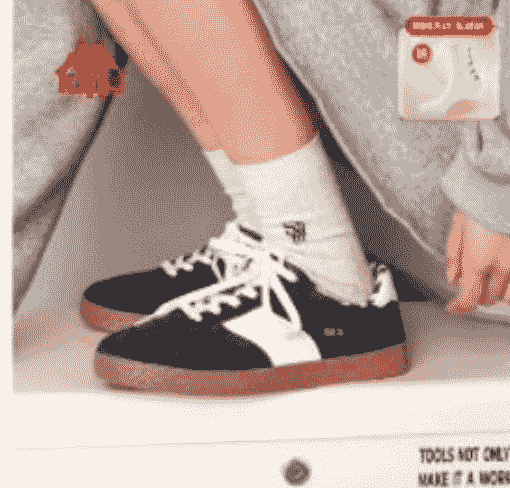


- 【沙丘】复古训底搭潮鞋 | 90天无忧 | 289 已售102
- 高尔夫裤春夏高腰微身长裤 | 180天最低价 | 338.3 已售1247

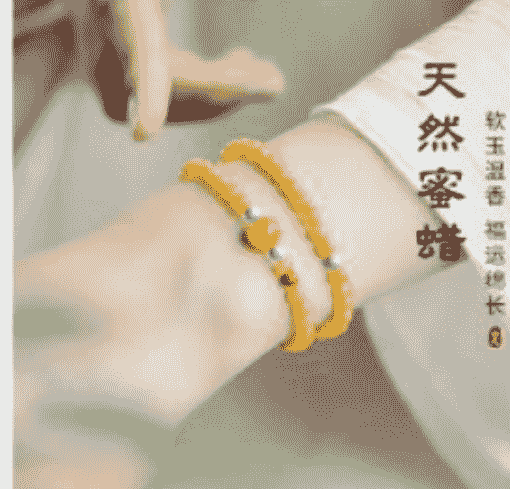


- 蜜蜂串串双层天然琥宝宝手链 | 限时46.2 | 261.8 已售505
- 露天美大樱桃现季 | 限时10.72 | 58.48 已售1.4万


- 历史记录
- 裙子
- 口红
- 直筒裙
- 猜你想搜
- 小风扇
- 防晒口罩
- jellycat玩偶
- 翻调盘的夏日穿搭 96.1万
- 盛夏初日系小白裙 93.2万
- 天就是穿染色半裤 90.8万


3、获取商品列表的整体逻辑。需要获取商品列表XPath路径，然后循环获取商品列表信息。获取商品列表信息，这部分在指令第33行折叠，一步说明。

先设置两个变量，用于控制商品列表获取限制（因为不可能无限滑动）。屏幕滑动次数，就是滑动次数，其实对应的检测次数；是否继续检测布尔值，用于循环何时停止。

## 循环获取商品，停止的条件（满足任意条件就停止）：

- 滑动次数 = 检测次数（也就是用户输入的输入的次数）。每次循环后+1，直到满足用户设置的检测次数；
- 是否继续检测 = False（如：搜索到底没有更多商品，就把这个值从True设为False）。

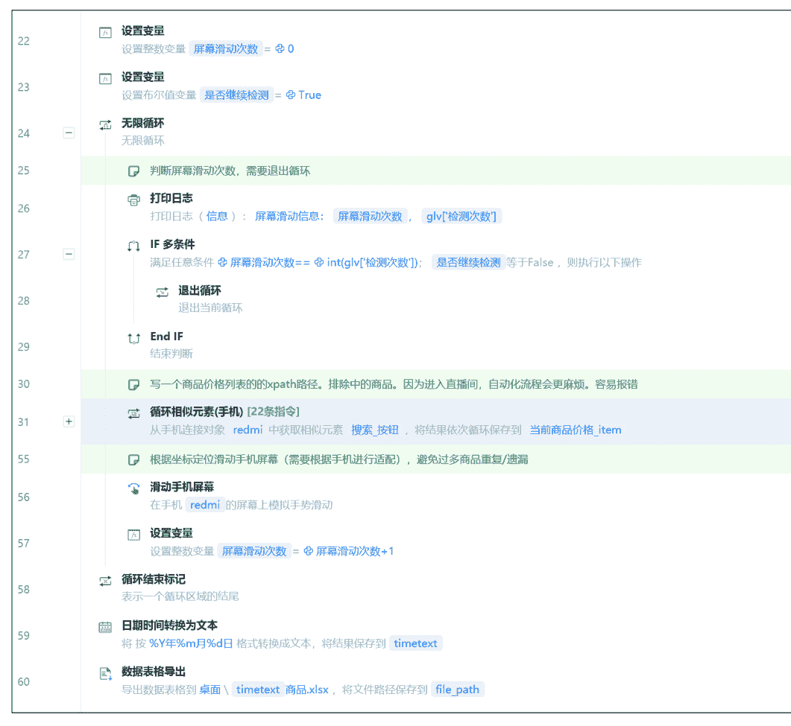

这部分流程还有两个关键细节。

搜索结果页 - 商品列表的元素定位。我们可以在搜索结果页可以看到，搜索出来的商品虽然都是卡片，但是分两种情况。

第一种是普通商品卡片，点击后跳转到商品详情页。如果退出详情页，回到商品列表；
第二种是直播商品卡片，点击后跳转店铺直播，然后弹出半屏详情页，退出详情页，回到直播间，退出直播间，最后回到商品列表。

这里考虑到直播间的各种动态元素变化（变化越多，RPA流程越容易异常），以及普通卡片的流程区别。所以我把这类直播间商品卡片过滤掉了，没有去判断是否采纳。根据我的观察，影响不大。因为通过搜索一些大词发现，目前小红书的电商直播间其实并不多。

然后，因为在商品列表的商品卡片里已经存在商品价格、商品销量字段。所以可以获取价格的相似元素列表。这样就可以作为点击元素去详情页。也可以获取销量信息做商品销量是否满足的判断。如果商品销量不满足要求，就可以不用点击去详情页了，提高流程运行效率。

所以，这个商品价格列表的XPath路径我是这样写的：

```
//android.recyclerview.Recycler
View//android.widget.FrameLayout[
//android.widget.TextView[startswith(@text, "¥")
```

and

```
not(.//android.widget.TextView[@text="直播中"])
]//android.widget.TextView[startswith(@text, "¥"])
```

关于这个XPath路径的解释（如果看不懂，可以直接用我上面写的）。通过手机UI树（不是专门讲XPath，这里知道商品卡片是个容器，里面有主图、标题、价格等元素）。先定位商品卡片的最层（如android.widget.FrameLayout），排除“直播中”；

```
//android.widget.FrameLayout
```

坐标定位的方式，这种方式可以尽量保证不漏、重复获取商品。

这里的起点和结束点，大概可以定义为出现在屏幕中的坐标位置。

这里坐标，是结合我的手机（Red Note 10, MIUI 14.0.10）来的，这里你可以根据自己的手机来定坐标位置。

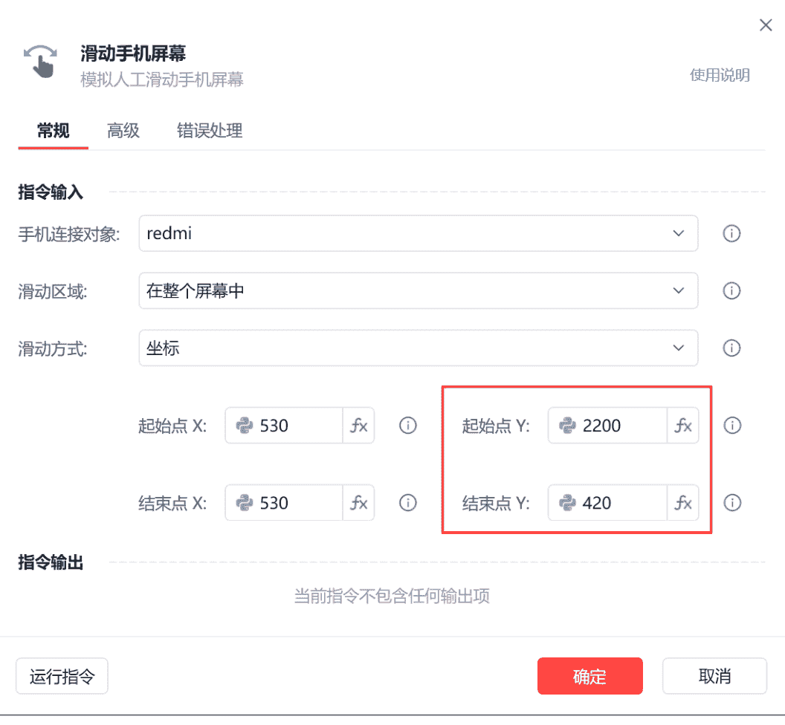

### 结束

退货包运费

慵舒适百搭棉裤牛仔牛奶奶

小个神裤~! 绝美当显边退货包运费

阔腿显个牛仔裤2025新春夏季

¥138 ¥149 已售1.1万+

¥152.15 ¥179 已售4721

李姐万岁的店 >

IIHAN的de店 >


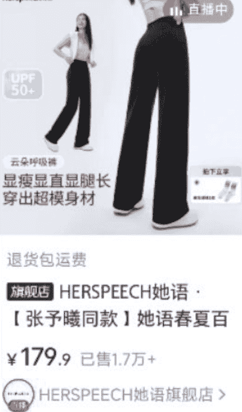

退货包运费

【月华】四色斜裁镂微

直长裤半身裤极简缎光

退货包运费

HERSPEECH她语 ·

张晓曦同款】她语春夏季

¥159.8 ¥188 已售1.5万+

¥179.9 已售1.7万+

激石枕流的店 >

HERSPEECH她语旗舰店 >


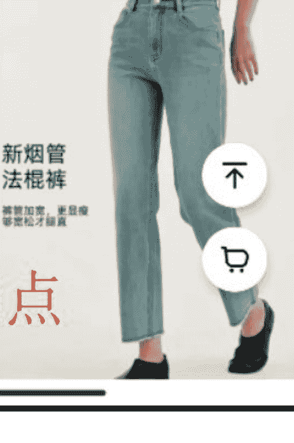

新烟管法锥裤

宽松加，显腰显瘦

梨形才显腿

### 起始点

4、获取单个商品信息，判断商品销量是否满足要求，如果销量满足要求。再判断商品价格元素，是否在手机窗口展示。如果在手机窗口展示，就点击商品价格元素，去商品页（账号粉丝数、商品链接都是在商品页中）。

### 接下来的循环体内的重点逻辑，展开讲一下。

第第一部分，是获取商品价格元素，然后去获取商品价格元素包含的商品销量。对商品销量做大小判断

以下是获取到的商品卡片里，商品价格元素的文本信息：

### 3 商品价格元素的文本信息
['#¥1698269.9 已售 7403','#¥120 已售 6352','#¥168 已售 1518']

需要写个正则表达式，提取销量值（上图第 34 行指令）。

### 提取商品销量的正表达式
已售([\s]+)

然后，小红书的页面显示逻辑里，如果商品销量 = 0，就不在商品列表显示销量字

懒人微信：lazyhelper
微信加jts2，免费进阶分享群

所以，也需要处理这个细节（上图第 36 行）。

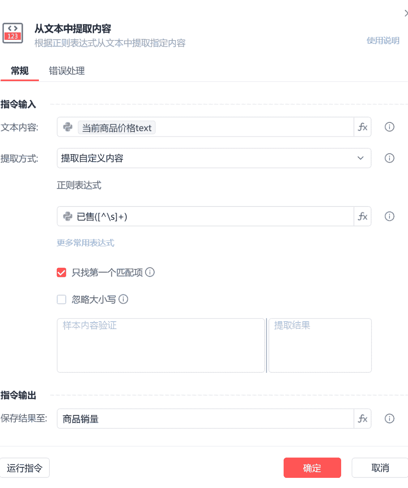

懒人微信：lazyhelper
加微信jtsg2，免费进阶资料分享群

退货包运费

旗舰店 aaa · Natur Wear 春新款甜甜美少女感韩毛衣

¥381 ¥499 已售707

an action a day旗舰店 >

退货包运费

旗舰店 AGAM STUDIO ·【官方专享】设计秋季斗篷

¥389 已售3

AGAM STUDIO旗舰店 >

退货包运费

旗舰店un了很多 · 09.19上

YUKIYXX · 韩系小小个子蓝色毛衣北欧复古极岛纯秋季

新【落肩领设计挺阔有骨

¥89.7 ¥109.9 已售3498

¥415.65 ¥489

Yuki迷星星的店 >

UNSPOKEN旗舰店 >

关于商品销量的格式处理，销量的格式是纯数字、1.3万这种格式。这类情况，我是写的一个数字处理方法，也可以直接用指令处理，都没有问题。这里就不不详细说明。

数字处理方法参考 微信：lazyhelper

```python
import re
def convert_chinese_number(text):
    # 定义中文数字单位映射
    units = {
        '+': 10,
        '百': 100,
        '千': 1000,
        '万': 10000,
        '亿': 100000000
    }

    # 正则表达式匹配数字和中文单位
    pattern = r'(\d*\?\d+)([十百千万亿]?)'
    match = re.search(pattern, text)

    if not match:
        return 0

    number = float(match.group(1))
    unit = match.group(2)

    if unit:
        return int(number * units[unit])
    return int(number)

### 示例
### print(convert_chinese_number("1万"))
### 输出: 10000
### print(convert_chinese_number("2.5万"))
### 输出: 25000
```

```python
print(convert_chinese_number("0")) # 输出: 0
print(convert_chinese_number("3千")) # 输出: 3500
```

第第二部分，关于价格元素Y坐标的判断。如果销量满足要求，就判断价格元素Y坐标是否在手机窗口。做这个判断是为了避免获取价格元素后，价格没有显示在窗口导致点击无效，然后跳转到详情页导致报错。这里的Y坐标也是根据窗口大小设置的，根据自己的手机来定。

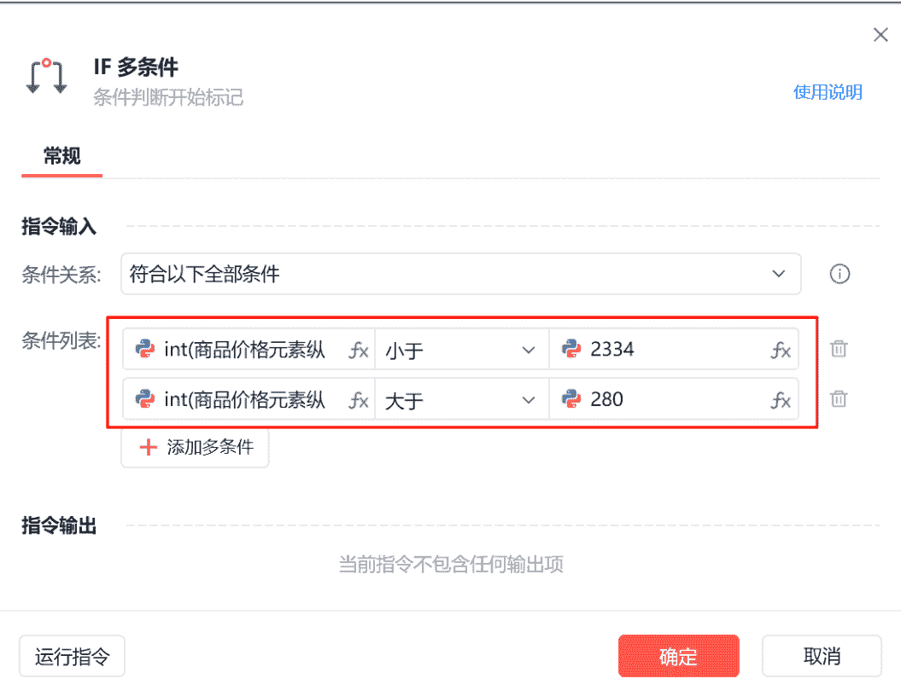

如果价格坐标在手机窗口的区间内，那么点击到详情页。获取商品信息，我是写的一个流程。最后是判断搜索结果到底。比如设置的搜索“裙子”，滑动100次，但是第21次到底了，商品没有。出现这种情况就退出。随便微信：lazyhelper

加微信jts2，免费资源群

进入商品信息流程，获取商品价格。先获取商品价格，向下滑动获取粉丝数。如果粉丝数满足要求，就获取商品链接；如果粉丝数不满足，就退出详情。

### ¥248 到手价 ¥198 限时减50后付2025夏季新款韩系西装裤九分裤 腰直筒

- 退货包费300+好评24小时内1000+加购个月内
- 预售14天内发货晚发浙江嘉兴包邮版速退款7天无理由退货2000+尺码合适合身，对小个女生来说长度合适，腰有点高，要是稍微低一点就好了。材质都不不错，好搭配再买一条深色的。店铺内其他评价350+穿搭精选。长期主义！窄版显瘦！这条裤子的版型我爱了，穿过...


购物车购物车立即购买

懒人微信：lazyhelper
加微信jts2，免费进资料群

大屿studio的店粉丝1.9万已售7.4万

| 全店商品 | 客服平均 | 物流平均 |
| --- | :--- | :--- |
| 好评率97.8% | 2秒回复 | 32小时发货 |

### 店铺推荐


2025夏季新款韩版星189 ¥229


2025夏季新款新款新款198 ¥299


2025夏季新款深蓝色259 ¥339


2025夏季新款直筒垂219 ¥299

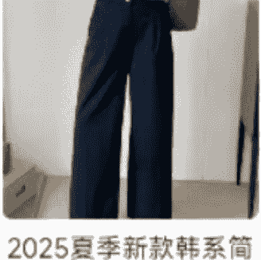

2025夏季新款韩系筒219 ¥299

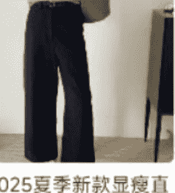

2025夏季新款新款锥直209 ¥248

- 图文详情

| 尺码 | 腰围 | 臀围 | 裤长 | 腿围 |
| --- | :--- | :--- | :--- | :--- |
| S | 66 | 100 | 93 | 60 |
| M | 70 | 104 | 94 | 64 |

获取商品价格的指令代码：

懒人微信：lazyhelper
加微信jts2，免费进群群

### 商品价格元素的XPath路径:

### 商品价格
/*[starts-with(@text,"\")]`

如果商品有参考一些活动，就会“到手价”，反之则不会显示“到手价”，这部分细节也需要考虑到。指令里使用try-catch来判断。

6、进入商品信息流程，获取账号粉丝数。这个环节里，账号粉丝数在商详页中间，位置不太确定（和商品评价等等关系）。所以用“进店”两个字来标识。也就是当滑动到出现“进店”两个字时，就停止滑动。然后就是同样的操作，获取粉丝数，处理粉丝数格式。粉丝数的格式处理方法，和上面商品销量处理方法一一致。

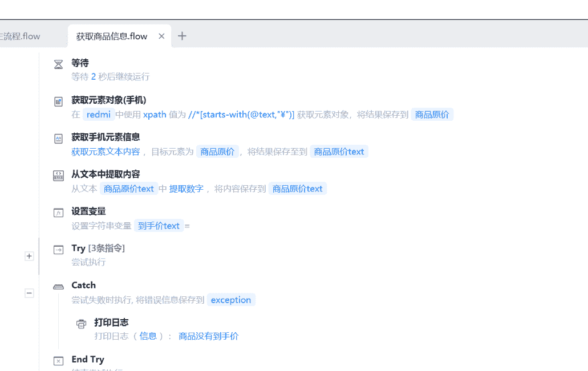

粉丝和粉丝数据要求，由于粉丝数据在筛选条件中，商品的粉丝数量差异，需要根据“粉丝数”字段过滤

- Try
  异常执行
  - 无粉丝在代码中使用remi跳转上
  - 捕获异常(粉丝)
    在代码中使用remi，报错信息
  结束循环
End If
- Catch
  尝试执行列表，如果失败则保存到exception2
  - 打印(粉丝)
    在代码中使用remi，打印异常
  结束循环
- 等待2秒

处理粉丝数逻辑

- 粉丝数匹配
  在代码中使用xpath//*[contains(@text,"粉丝")]对元素匹配并保存到粉丝数
- 粉丝数转换
  使用number_convert中的“文本”转为粉丝数
- IF 如果粉丝数也满足要求，这个商品符合“低粉丝款”，如果是的话，标记商品链接、店铺名称等

粉丝数的XPath路径：
//*[contains(@text,"粉丝")]

7、进入商品信息流程，获取商品链接及店铺名称。


### 店铺参数(数字)
在android:id="@+id/widget.LinearLayout" 获取参数，保存店铺名

### 店铺信息店铺名、店铺列表

### 商品选择
在android:xpath="//android.widget[contains(@text,"粉丝")"> 获取参数，保存商品列表店铺铺列表

- 无限滚动
- 动态加载（使用Scroll）向下滑动分页商品列表加载更多数据

在id中存在目标列表选择退出点击列表列表End

环境模拟显示店铺详细区域

### 商品选择
在android:xpath="//android.widget[contains(@text,"商品选择")"> 获取参数，保存商品列表店铺详情页

点击详情，保存商品链接

复制商品链接在数据源中查找，转化为商品列表、文本、单个商品

打印（复制）商品链接

### 结束
在id中返回键退出复制点击复制按钮

上面的流程里，先获取店铺名称，店铺名称的XPath路径：
//android.widget.LinearLayout/android.widget[contains(@text,"粉丝")]/../android.widget[text]

然后获取商品链接。在“分享商品”里需要进行复制。懒人微信：lazyhelper
加微信jts2，免费资料群

大屿studio的店粉丝1.9万已售7.4万店铺4.77分全店商品好评率97.8%客服平均2秒回复32小时发货

### 店铺推荐

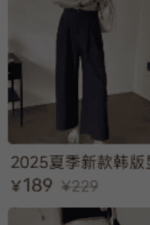


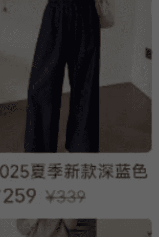

### 分享至私信好友微信朋友圈识图同款商城首页购物车订单卡券

懒人微信：lazyhelper
加微信jts2，免费进群群

大屿studio的店粉丝1.9万已售7.4万全店商品好评97.8%客服平均2种回复32小时发货

### 店铺推荐

2025夏季新款软版显瘦189 ¥229

2025夏季新款新款198 ¥248

2025夏季新款深蓝色259 ¥339

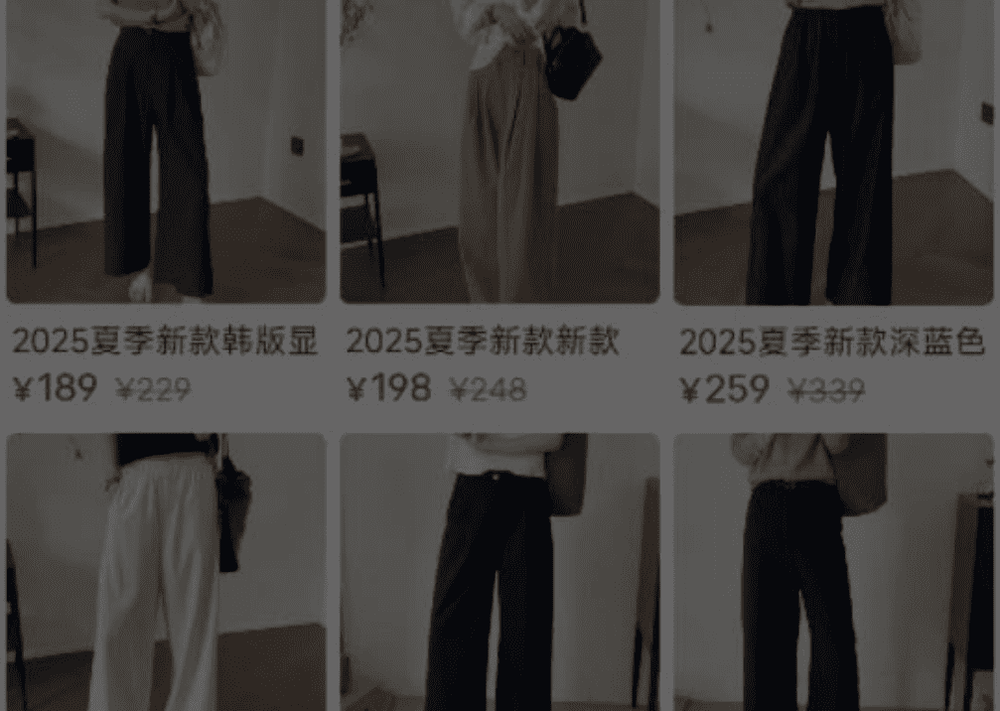

### 分享至私信好友微信朋友圈卡券心愿单举报意见反馈复制链接

这里有个细节，就是点击“分享商品”按钮后出现的底部菜单，“复制链接”按钮是在最后位置。需要滑动才能看到。所以需要底部菜单单向滑动（向左滑动），一直滑到“复制链接”按钮可见。

懒人微信:lazyhelper
微信ints2,免费资源分享

分享商品、复制链接的XPath路径：

```
### 分享商品
//*[contains(@text,"分享商品")]
```

```
### 复制链接
//*[@content-desc='复制链接']
```

获取链接后，再把商品数据写入表格，然后退出流程。这样一个商品的流程采集完成。然后去商品列表里直接重复判断就可以。

到这里，搜索商品关键词，采集低粉爆爆品的整体流程全部完成。

### 3.2.2 小红书推荐商品，采集低粉爆爆品

小红书账号养好了，系统推荐的商品也值得关注，推荐的很可能是同行爆品。所以也可以采集推荐页面的商品。满足XX销量且XX个粉丝的账号，就采集商品数据。这个场景和搜索商品的大体逻辑一致。区别是一个搜索结果页获取商品列表，一个推荐页的商品列表。


### 友好市集韩版九分工装

友好市集高弹力瑜恤运动限时立减

友好市集高弹力瑜恤运动限时立减限时立减18 90天最低价
¥69已售2.8万

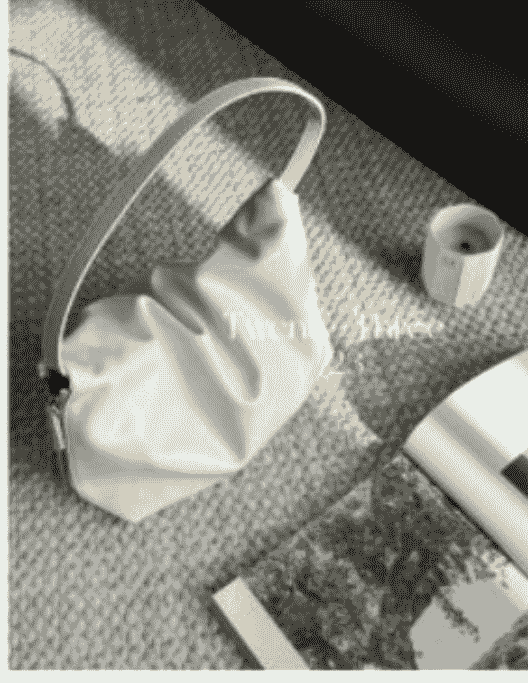

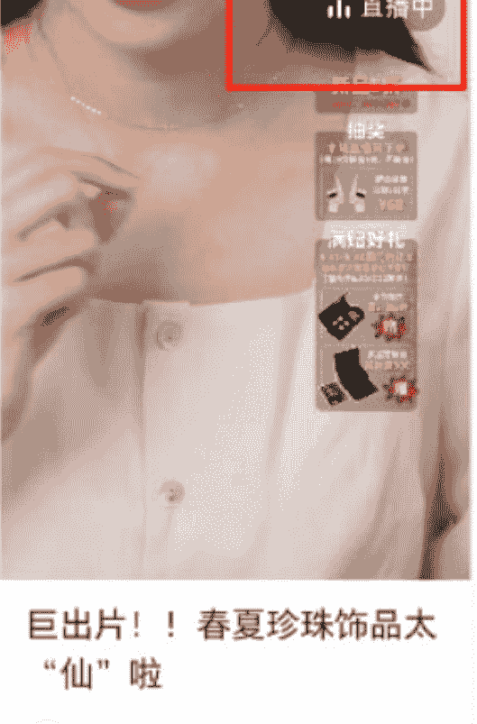

友好市集质感皱云羊皮限时立减6090天最低价
¥268已售125

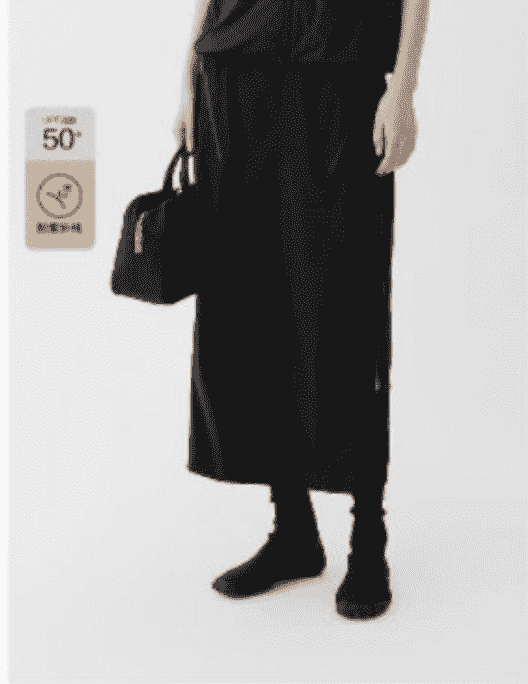

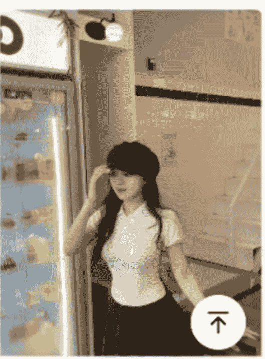

友好市集拼接学院T恤限时立减2160天最低价
¥119已售679

懒人微信：lazyhelper
加微信jts2，免费进群群

### 裤子

全部用户话题地点一问

- 友好集直播中退货运费亚麻棉裤


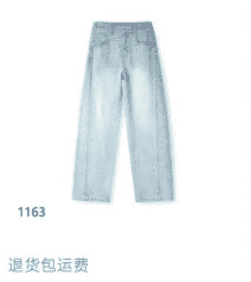

163

退货包运费

退货包运费

【WUGEE】汉麻天丝牛仔裤夏季享臀直版阔高腰

2025夏季新款韩系西装裤九分裤腰横线

¥169.9 已售8154

¥198 ¥248 已售9120

赛格女装的店

大屿studio的店

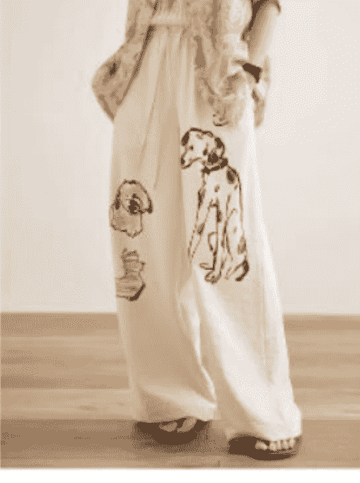


退货包运费

【月华】四色斜裁镂微长裙半身裤

退货包运费

¥159.8 ¥188 已售1.5万+

¥179.9 已售1.7万+

激石枕流的店

HERSPEECH她语旗舰店


“商家的价格元素列表，就可以比较快的过滤直播间、笔记卡片。

## 商品价格元素-列表

```xpath
//*[starts-with(@text,"\\)]
```

另外，可以看到一开始的产品流程图里，推荐商品没有判断商品列表的元素坐标，而搜索商品结果页有。原因是我实际跑下来，发现推荐页的刷新和获取元素，才不会出问题，所以不需要严格判断坐标。而搜索留页的商品元素，容易获取到手机口的元素，所以最终还是用坐标来约束判断。

其他流程，基本上和“搜索商品关键词集商品”的流程一致。这里就不再做演示了。

### 3.0.2 监控小红书商品销量

采集到的商品，如果需要每日监控商品销量，汇总商品列表。通过商品链接，获取到商品销量。

如：A-F 列，是采集到的低粉粉粉数据。G 列是每日监控到的商品销量。

| 商品名称 | 用户ID | 商品链接 | 价格 | 转化率 | 日期 | 销量 |
|---|---|---|---|---|---|---|
| 涤厕衣 Romantic_ececpage | 6588 | 9223 | https://www.xiaohongshu.com/item/474 | 76.5 | | 2023/11/16 | |
| Do Know 芷质生活馆 | 6822 | https://www.xiaohongshu.com/item/1534 | 1534 | 89 | | 1374 |
| 悦美生活 | 6555 | https://www.xiaohongshu.com/item/1009 | 1009 | 269 | | 1028 |
| OPEN HOUSE | 15888 | https://www.xiaohongshu.com/item/726 | 726 | 650 | | 2500 |
| 选蜜桃好物 | 2421 | https://www.xiaohongshu.com/item/862 | 862 | 649 | | 687 |
| 晨曦小物店 | 5028 | https://www.xiaohongshu.com/item/5028 | 5028 | 99 | | 5074 |
| 女生饰品店 | 3921 | https://www.xiaohongshu.com/item/1921 | 1921 | 329 | | 5500 |
| FITLIFT家居 | 15888 | https://www.xiaohongshu.com/item/2500 | 2500 | 725 | | 1068 |
| 宝物社 | 8252 | https://www.xiaohongshu.com/item/8252 | 8252 | 116 | | 1452 |
| 小薯物记 | 6332 | https://www.xiaohongshu.com/item/1380 | 1380 | 130 | | 1452 |
| 蜜糖生活馆 | 2169 | https://www.xiaohongshu.com/item/2169 | 2169 | 161 | | 1991 |
| 满满的杂货 | 9162 | https://www.xiaohongshu.com/item/23900 | 23900 | 199 | | 2807 |
| 其它的小物店 | 1158 | https://www.xiaohongshu.com/item/2087 | 2087 | 699 | | 307 |
| 暖心家居定制店 | 9087 | https://www.xiaohongshu.com/item/5511 | 5511 | 379 | 328.5 | 551 |
| ladyshaper | 7265 | https://www.xiaohongshu.com/item/2962 | 2962 | 1880 | | 847 |
| 宝藏好物 | 2090 | https://www.xiaohongshu.com/item/2962 | 2962 | 628 | | 115 |
| OPEN HOUSE | 15888 | https://www.xiaohongshu.com/item/726 | 726 | 650 | | 2500 |
| SCORRECT家居 | 2991 | https://www.xiaohongshu.com/item/1615 | 1615 | 1053 | | 368 |
| 优选好物 | 2991 | https://www.xiaohongshu.com/item/3890 | 3890 | 489 | | 1150 |
| 女生饰品店 | 143 | https://www.xiaohongshu.com/item/3427 | 3427 | 6.9 | | 3427 |

懒收藏：lazyhelper

微信关注ints3，免费资源分享

### 4.2 采集小红书推荐商品-源码

### (1) 主流源码

懒人微信：lazyhelper

加微信intjs2，免费进资源分享

### 4.1 获取商品销量-源码

| 步骤 | 描述 |
|---|---|
| 1 | 开始 |
| 2 | 手机号 |
| 3 | 格式 |
| 4 | 手机号 |
| 5 | 否 |
| 6 | 结束 |
| 7 | Try |
| 8 | 手机号 |
| 9 | 成功 |
| 10 | End Try |
| 11 | Catch |
| 12 | 手机号 | |
| 13 | 格式 |
| 14 | 输出 |
| 15 | 结束 |
| 16 | 手机号 |
| 17 | Try |
| 18 | 手机号 |
| 19 | 成功 |
| 20 | End Try |
| 21 | Catch |
| 22 | 手机号 |
| 23 | 商品信息 |
| 24 | 手机页 |
| 25 | 跳转 |
| 26 | 手机页 |
| 27 | Try |
| 28 | 手机号 |
| 29 | 成功 |
| 30 | End Try |
| 31 | Catch |
| 32 | 手机号 |
| 33 | Try |
| 34 | 手机号 |
| 35 | 成功 |
| 36 | End Try |
| 37 | Catch |
| 38 | 手机号 |
| 39 | 商品信息 |
| 40 | End Try |
| 41 | Catch |
| 42 | 手机号 |
| 43 | Try |
| 44 | 手机号 |
| 45 | 成功 |
| 46 | End Try |
| 47 | Catch |
| 48 | 手机号 |
| 49 | Try |
| 50 | 手机号 |
| 51 | 成功 |
| 52 | End Try |
| 53 | Catch |
| 54 | 结束 |

## 五、总结

3 个 RPA 业务流程都分享完成。如果你是做小红书电商业务，有类似这种方式的需求，可以按照流程来实现。

然后，因为手机自动化需要考虑的因素有很多（手机系统、硬件、App 版本等）。

所以在一些细节上，可以结合自己的情况，灵活考虑。
