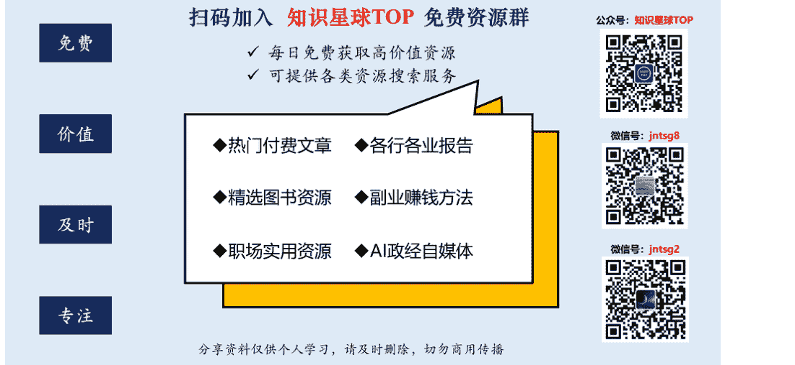
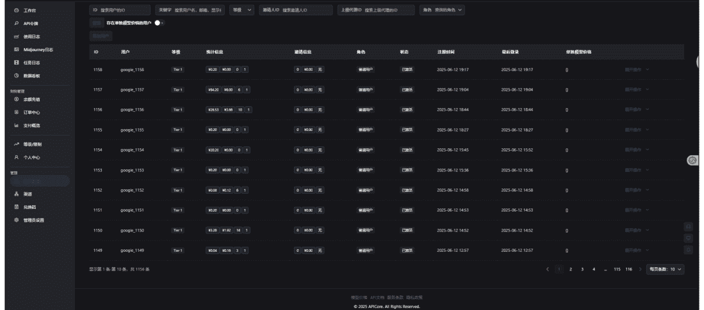
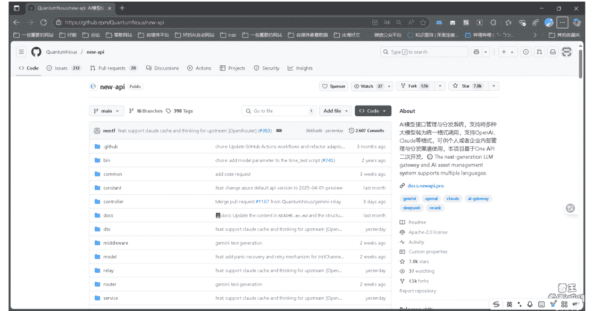
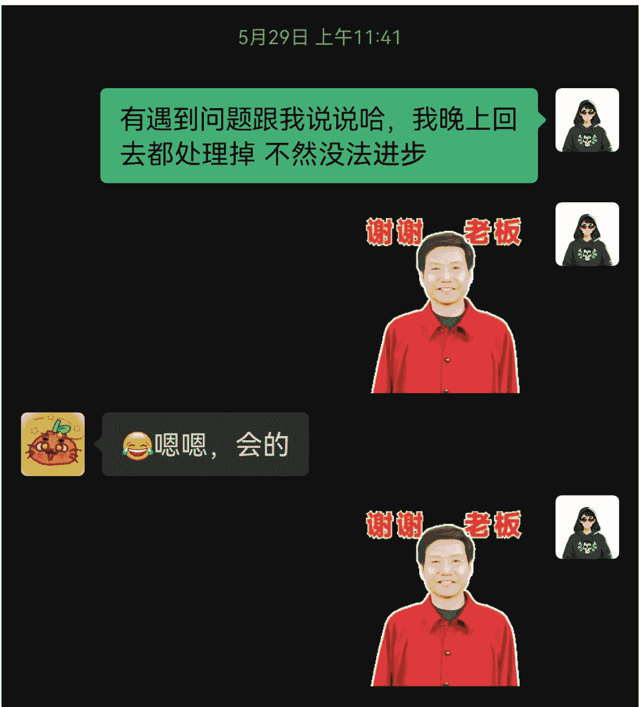
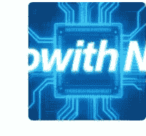

# 产品新人如何从0-1在1个月拥有1000+个用户

250616 生财精华



我是书虫，关于我自己的既往经历不再重复了，大家可以看一看之前的复盘贴

# 结缘

在418 生财直播的时候，有幸和小排老师、Albert哥、黄亮大哥、条形马老师一起在会议室里面聊了很久，都在交流产品的时候，因为我清楚我原产品安全上可能有点问题，小鸭也借机让他们给我们看，看了以后让我早点关掉吧……

```sql
select count(*) from login.used

结果1
select count(*)
404,625
```

这个产品用户量确实不小，总人数一共有40w+，目前还在续期的IW+，虽然还有其他项目的收入，但是这个还是占比比较大的，确实肉疼，还没放弃，现在不推广也不宣传就干干放着。这个产品也是一共有三个人一起弄的，自己也不是主发，没有完全的决定权~

和他们聊了一些以后，聊到之前3月底有个40o画图吉卜力特别火；有需要这个API模型，而我正正好，并且价便宜稳定，我就说可以找我。

我说价格0.02一次，都说那么低，后续有机会可以合作，也有幸在那会可以认识那多多大佬哥成功链接上，过了几天和Albert老师约了一顿椰子鸡，吃饭的途中也聊了很多人。

dan'da'du'dou'hen'man 单打独斗很慢 单打独斗

懒人微信：lazyhelper

我太习惯一个人单打独斗了，之前基本都是一个人，他就给我讲了一个例子，我印象真的特别深刻，他说如果你是一个年入百万的，就不要去做那些很基础的工作，你可以算一笔账：

一年工作 12 个月，每月 22 天，每天 10 小，那么你的时薪大约是 378 元。

那么做任何低于这个时薪的工作，都是值得的。事实上，绝大多数工作在 BOSS 直聘上都能找到人来替完成，真正的是，是要做那些无法替代的事情。

那时，我突然明白了，过去我总是陷入一个误区，觉得自己必须做所有事情，什么都想学，什么都想想。这种想法让我没办法从大量重复机械的工作里解放出来思考策略，思考发展，甚至没有时间出去交流，导致我错过了许多机遇。

一个时薪 378 元的人拿着时薪 40 的工作，在这些商业上其实是不道德。自己美其名日打独斗，其实就是不愿意付出金钱的成本去尝试，殊不知时间更贵！

创业者百分之七八的时间都在做重复琐碎的事情就没有必要；把一些重复劳动的，或者有专门的人可以替我去完成这件事情，那我在这一部分的工作就能释放出来。

聊完以后，set也没有闲着，自己那会想做的就是 AI 自媒体（公众号）一类的，还有根据他们的需求，我就重新做一个好的 API 集合站。能做这个产品也是刚好自己在这个行业等了久，23 年就开始了，有相关的资源；就像小老师的 Ai 图片站，他有他的 A100，自己之前思路没有跑通，跟他们聊完以后也算是思路整理完了，并且觉得做，就是就开始了~

上截图，到至今用户 1158。



## 1. 产品搭建过程

GitHub 自己的产品并不完全自己开发，自己是在 GitHub 上找开源的项目：https://github.com/QuantumNous/new-api，因为目前还没成熟的，自己就找了相关开源项目去进行改进，既然开源，那就肯定没有相关的人去专门给你服务，遇到问题基本也要自己解决，加了 QQ 群也没有人会特别给你服务。



## ② 使用 ChatGPT 和 Claude 辅助自己写一些代码，同时也用各种软件，ChatGPT 基本能够解决大部分的问题，自己花时间以上了；实在解决不了的，就按 Albert 说的找专业的人处理，自己一点去完善产品。下面是冰山角。

### 网页设计
- 首页
- 部署
- 路由
- 嵌入
- 语言集成
- 语言对应
- 语言支持

### API 调用
- 接口
- 限制
- 错误原因
- SDK
- 广告助手
- 创作
- 润化
- 博客
- 宝塔面板

### 方法一：使用 HTML 平台（适用于 HTML 平台）
- 博客
- 

### 方法二：使用 HTML

### 方法三：直接编写 HTML

还是最好直接编写 HTML 的：

```markdown
### 更新记录
- **2025-05-30** 已支持 Flutter "in-context"，图内模型，支持 dalle 等功能
- **2025-05-22** 已支持 Claude 类模型（http://example.com）
- **2025-05-12** 已支持可灵模型 H2.0（http://example.com）
```

> 注意：使用 ChatGPT 和 Claude 辅助自己写一些代码，同时也用各种软件，ChatGPT 基本能够解决大部分的问题，自己花时间以上了；实在解决不了的，就按 Albert 说的找专业的人处理，自己一点去完善产品。

技术人员首先从身边的朋友去咨询，哪些功能，找他们帮忙，做完以后，尽量好关系。

## ③ 不完美主义

在产品开发过程中，我越意识到和我之前做过的项目并没有太不同，关键还是要行动，先做出来。即使有很多问题，先让它运行起来，接下来慢慢修复。

在创业的道路上，最常见的陷阱就是完美主义。很多人因为产品不够完美而迟迟推出，结果错失了市场的风口。其实，真正的成功并不是一开始完美无缺，而是敢于行动，敢于冒险。完美的机会永远不会来，市场的需求永远在变化。你认为的完美，别人根本不需要。与其把时间浪费在无休止的优化中，不如把产品推出去，哪怕只是一个 Demo。当它进入市场，你可以从用户的反馈中不断迭代，不断完善。每次更新和改进，才是产品走向成功的关键。很多伟大的公司，都是从一个“不”的版本起步的。例如，Facebook 最初只是一个简单的校园平台，后来才发展全球最大的社交网络。它没有追求完美，而是勇敢地跳出舒适区，快速上线，边跑边调整。其实，不完美的产品同样可以运行、推广，可以开启第一波冷启动。“行动胜于完美”，只有开始了，才有机会改善；只有做出来，才会会有反馈。

客户的声音才是快速成长的捷径，自己预设的困难和问题大部分都是自己虚构的，真实的客户反馈才能让产品有核心优化点。



## 黄亮

嗯，要有一个统一的适配器方法。没有明确说明那个文档，每个模型都注明方法，就干脆没文档，用 OpenAI 的兼容方式，请求不了了，大家就放弃。

我在想，令牌的事情在头太乱了，模型太多管理起来。
黄亮：嗯，要有一个统一的适配器方法。
确实...
黄亮：每个模型都注明方法，就干脆没文档，用 OpenAI 的兼容……这么多模型，除非你自己完善一个 SDK。不过还是每个模型都完善的接口文档比较好。

okok，收到了，大黄哥！周二 20:22，明天起床就开始折腾完善。

## 2. 产品冷启动（如何获取种子客户）

### ①拆解对标
国外：
- https://openrouter.ai
- https://replicate.com/
- https://www.together.ai/
- https://fal.ai/

懒人微信：lazyhelper

# 免费 价值 及时 专注

# 扫码加入 知识星球TOP

### 渠道对比

| 维度 | 国外平台 | 国内平台 |
| :--- | :--- | :--- |
| 搜索 | Google | 百度 |
| 社交 | Facebook | 淘宝 (流量) |
| AI 工具 | OpenRouter, Replicate, Fal.ai | Kling, 通义等等 |
| 现状 | 占据领先地位 | 处于混沌阶段 |

- 免费资源
- 每日获取
- 知识星球
- 公众号
- 国际化布局
- 流量变现渠道

### ② 私域
- 客户画像：内容创作者、学生、教育工作者、老板、客服、职场人士
- API 画像像软件开发、独立开发者、SaaS平台提供者、自动化开发者、大型公司
- 接入平台

### 公域扩张
- 朋友圈
- 小红书发招募贴
- 寻找合适的写手
- 写手能力有什么要求
- 报价如何
- 试稿一篇
- 社群如果不满意的情况下，朋友圈再发一遍

## 【书虫】AI成长社群(253)

书虫：【深圳】

- 各种类型AI都有理解，包括AI文字、AI音乐、AI绘画、AI视频、Agent等，不要全会，后面需要的时候学会。
- 兼职类型，价格：1W阅读、5W阅读、10W阅读额外提成。
- 完全自己报价，看看是否合适，群里找不到我再去朋友圈吧。
- 公众号内容具体化一点，可以参考这些公众号。

然而，流量增长较为平稳，没有明显的优秀数据未迎来爆发式增长。不过，因为我以前大量的项目经历，我已经能够承受这种长期没有正反馈的过程。

懒人微信：lazyhelper

我知道这会是我拿到结果的一个必然周期。在下一个风口来之前，我需要足够的积累和准备才能够接住。例如过年期间，DeepSeek这一波风口，有很多成熟的团队就可以在一个现象级的事件面前原地起飞。

# 关注我的人
全部674 位，5 位新关注

# 排行榜
更新至2025/06/06
- 阅读最多
- 收藏最多
- 分享最多
- 留言最多
- 精选最多
- 赞赏最多
- 付费最多

## 发表
今天还有1次通知次数

2025/5/31 23:49
(附邀请码) 深度玩FlowWith Neo, 引爆2025无限智能新纪元! 原创



👁️ 310 💬 2 8 🚀 25 👁️ 2 ✏️

2025/5/28 17:26
(赠邀请码) Lovart.ai横出世


👁️ 425 💬 10 🚀 25 👁️ 6 ✏️

2025/5/21 11:54
重磅发布Gemini2.5pro


👁️ 171 💬 0 🚀 7 👁️ 1 ✏️

## 3. 流量增长与放大

### ①口播+转介绍
很多人最初认识我都是通过：
- 销售会员
- 口碑介绍
- 售后做得好
- 朋友介绍

清楚知道，稳定是最重要的，其次才是价格。如果不那么稳定，用户宁愿选择贵一点的。为了预防模型突然出现，至少有三个备用方式
- 自动轮询
- 及时处理

其次就是价格，我在这行两年，所以有非常多的渠道优势，重新整合了资源，找了很多朋友咨询才有了现在不错的稳定性和价格优势去争取客户。有机会链接很多大佬，他们使用不错，也会在群里直接拉人，或者直接推给朋友们，非常感谢他们。

### ②赞助推广
很巧，哥飞老师弄线下，招赞商，我还没看到这条朋友圈的时候，葱哥就把这条发了我。

懒人微信：lazyhelper

我现在就私聊一下。

OK，能上去肯定没问题的。


# 山术

17:30~17:55

## 小预算团队，如何投放海外kol

嘉宾介绍：某AI产品海外投放负责人

# 哥飞

18:00~18:40

## 过去两年我们验证过的有用经验

嘉宾介绍：SEO专家、哥飞的朋友社群创始人、出海AI工具创业者

- 晚上交流会
19:00~21:00
一起吃吃喝，任意组队交流

0607上海站，价格99元
限额150名，仅限社群成员报名

现场还有惊喜大包赠送给大家

赞助商：Paypal、AWS、Same.new、ShipAny.ai、nPPT.AI、TuningSearch.com、Ismaque.org、LXX.ai

然后我很积极的去把握机会，也成功争取到了。因为哥飞那边都是出海的玩家，结合主题，目前很多的出海玩家，几乎做的都是懒人套壳产品，所以几乎都会需要API，也给自己产品争取更多用户。

经过这一次勇敢去做这件事情告诉我，不要害怕被赞助很多高昂的成本。虽然成本是有的，但是可以通过计算，你做这件事情roi是多少，你付出5万块，你能从这件事里面收获多少，自己做这件事情目的是什么，能否达到，如果都满满足我们的目的，那就是合理的。

记得涛哥和苏铁跟我说过，不要害怕花金钱，亏进兜里了，就不再愿意拿出来，只要投资比是合适的，其实都可以尝试。

验证市场需求是至关重要的，而最快的方往往就是投入资金进行精准的市场测试。通过付费获取流量，能够快速收集到真实的反馈，判断项目的核心需求是否真实存在。如果发现是伪需求，尽早放弃不仅能省大量时间和精力，还能避免无谓的资源浪费。创业是一场试错的过程，花钱试错的成本是有有限的，而时间一旦浪费，再也无法追回。用买时间，用时间换未来的资源损失。这种方式不仅帮助我们更快地接触到真实的的用户，还能帮助我们在市场中做出更精准的调整与迭代。

真正的风险不是试错，而是低效的延迟决策和错误的坚持。

## ③ 公号投放

在我之前做 GPT 账号业务的过程中，我主动去链接了几乎所有的抖音博主，沉淀下了很多客户，其中还和一个公众号大 v 成了很好的朋友。在他来杭州的时候，我主动链接他并且一起吃饭聊天，他同意了接受我的付费推广。

懒人微信：lazyhelper

## AIGCrank：AI公众号排行榜
自媒体 2025年3月 数据支持：新美丽

| 排名 | 公众号 | 发布量 | 总阅读 | 平均阅读 | 总点赞 | 新涨指数 |
| :--- | :--- | :--- | :--- | :--- | :--- | :--- |
| 1 | 数字生哈卡兽 Rockhazic | 24/25 | 83万+ | 33148 | 26268 | 823.2 |
| 2 | 赛博心律 BinaryDoth | 24/24 | 37万+ | 15216 | 10420 | 774.7 |
| 3 | 蛋蛋AI线路 masterhimh | 18/18 | 14万+ | 7907 | 1826 | 714.3 |
| 4 | 探索AI gh_141736de90b | 27/30 | 15万+ | 4847 | 1270 | 708.2 |
| 5 | 琅坝AI WYin-AI | 23/24 | 14万+ | 5805 | 1794 | 708.1 |
| 6 | 错误处理 husuchenhengli | 5/5 | 26万+ | 52180 | 3235 | 702.1 |
| 7 | AGI Hunt AGIHunt | 86/58 | 15万+ | 1711 | 1683 | 698.1 |
| 8 | 藏藏的AI工具 opt741Bux | 26/26 | 11万+ | 4266 | 3949 | 696.6 |
| 9 | 快刀奔驰 kuardojqinty520 | 5/5 | 6万+ | 12712 | 753 | 690.4 |
| 10 | 花葵 WatsonBM | 16/16 | 9万+ | 5744 | 1543 | 689.1 |
| 11 | AI猛榜Prompt aixiumaprompt | 19/19 | 9万+ | 4729 | 1227 | 688.0 |
| 12 | AI信Gap itsnightgap | 64/64 | 12万+ | 1952 | 1391 | 688.7 |
| 13 | 哥飞 gefe7 | 23/23 | 10万+ | 4372 | 964 | 685.3 |
| 14 | 老蛋AI实地 xcm430 | 21/21 | 9万+ | 4242 | 781 | 683.4 |
| 15 | 云中树 LangGPT | 26/28 | 9万+ | 3318 | 2090 | 681.2 |
| 16 | 橘子罐 orangeAGI | 28/28 | 9万+ | 3224 | 1648 | 679.1 |
| 17 | 开源AI实地 edd66 | 21/21 | 9万+ | 3723 | 895 | 673.3 |
| 18 | 君人甲 smctde | 14/14 | 7万+ | 331 | 31 | 670.8 |
| 19 | 卡尔的AI天沃 LearnPrompt | 20/20 | 9万+ | 3669 | 1552 | 669.9 |

## 4. 产品优化

### ① 首页优化

如果你不想做一个草台子，而是希望做成一个头部，应该再用现在非常简陋的首页。域名、名字、用户体验、交互，这些自己都重新处理一遍。真正的风险不是试错，而是低效的延迟决策和错误的坚持。

### ② 用户体验优化

dc哥也告诉我，有很多不好的地方加大了用户的使用难度，都一点一点在优化。老大，在航海群里发现的一个帖子，然后自己看了，一个关于模型漏斗的词，不要增加客户的使用难度，每增加一步。

张一鸣一句话就把这个想法给拆碎了：计算一下，一个新用户打开你这个可以首页，要点多少关注，才能得到一个可以看的首页。这样来，有多少人能完成这些操作？漏斗有多大？假设我今天有1000新增用户：
- 首页
- 找专家
- 选择某些领域
- 关注

这么一来，最后有多少人有内容？这产品根本没有，这是简单的学术术语问题——这还觉得你有这么多领域的作者每天在东方自己……全算进来，这个产品机制不可能转。张一鸣说：你考虑产品到这一步是好的，产品经理应该考虑这些问题，不想考虑这些是不好的，但只能到这一步，只是这一步是不够的。关于信息获取，我在饭后（技术负责人的时候就在想，这个问题的结论是：只能靠推荐来解决，你不能让用户自己来解决这个问题。关于信息获取的问题，中国考虑最深的前几个人就在这里了。目前这个产品对用户体验并没有那么好，用户上手还需要学习，像国外的也要花时间成本去学习，但是会比我非常好，国外大哥走在前面，其实对我来说也是好事吧，有对标的对象。

懒人微信：lazyhelper

尽管一个产品是比较复杂的，但是仍然要可能的用户进来使用，要让他们上手就能使用，而不是需要花费时间来学习你产品，后面自己优化用户体验，也会尽可能的减少使用步骤。

---

## 5. 感悟与鸣谢

### ① 贵人相助

小鸭、小排老师、Albert、葱哥、葛哥、黄亮哥这一个月里面，他们像频繁在自己的视野里面，给了自己非常多的帮助。几乎遇到卡点，能够向他们请教学习，他们可以给你很好的建议和方向，能够有个路径可以走，少走非常多的弯路。

感谢各位老师非常无私、真诚、开放的帮助我，感谢生术这样好的平台，让我这样的小作坊接触到这么多热忱的大佬。短期做的还不错，那么快有正反馈，真的离不开他们提供的帮助！

# 持续努力中~
