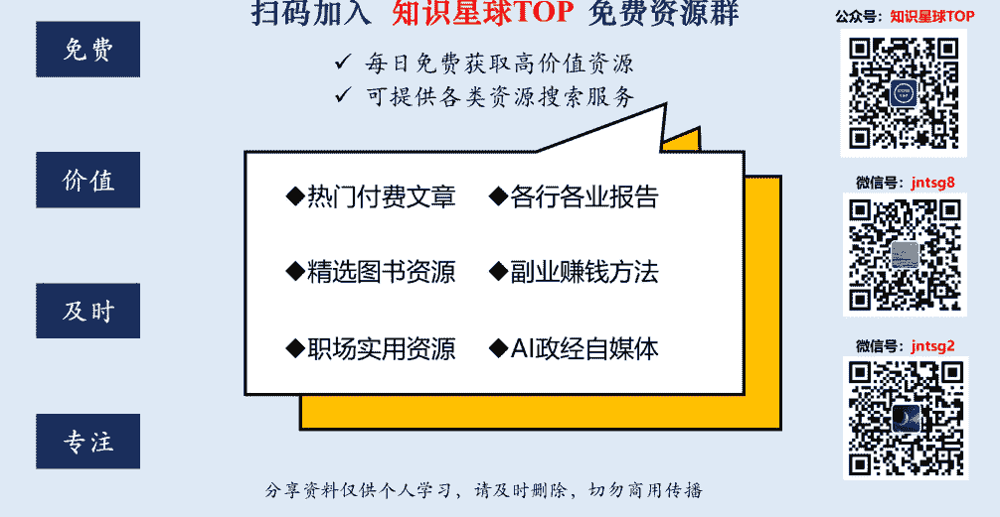

# 从0到1操盘知识付费项目4年两个亿，分享下我是如何做的

250618 生态精华

大家好，我是阿星，在广州，干了9年的知识付费，干过KPI、幼儿教育。目前是一家职业教育头部机构的业务负责人，负责职业技能培训的板块业务，从0到1操了一个技能培训项目，4年做了两个亿的营收，目前业务仍在。

第一次写文章和大家分享，主要讲下我们是怎么从0到1起跑项目的，怎么将营收放大100倍，真诚地希望能给圈带来一些启发和收获（其实也源于新圈友的打赌，不输出就要输钱hh）。

总之越分享越幸运。

## 一、项目背景

先跟大家说项目背景，我们这个项目原本是toB的，在19年立的，做的是一个数据分析课程。课程是非常详细的录播课，从Excel到Python开发编程都有，非常的大而全，但到B转化并不好。那段时间最火的不是AI，是Python，人都应该学Python的口号如日中天，做这个类当时最火的机构是风变，于是我们开始转型去研究C进行测试。

## 二、从011启动项目的核心分享

### 一、找对标很重要，对标的上下游藏有黄金

当时为了研究风变，买了小课进群体验，体验完被社群转化的模型征服，记得还挺清晰。当时带班的是酱酱老师（短发动漫女孩头像）160左右的群，在第三天转化的时候群接龙报名的有人3、40个，客单价接近2000，当时是20年初，并不算低。

给我的感觉非常震撼，大家伙都曾这么钱，么愿意为知识付费，to C有很大的机会。

2、找对标之后第一件事，研究和拆解，为什么他们做得这么好？

首先是产品，当时的课程的新颖，应该是行业里面第一个互动课程，而且内容收获感很足，每天的早晚分享内容却是持续的告诉大家，未来是大数据时代，得学Python，能更好的升职加薪。

关键是转化，用的低转高社群训练的方式去批量转化，前端投放获客，9.9的精准资，利用社群给学员有较强的社群归属感，销售更容易营造学习氛围，利用社群服务增强用户对销售、品牌的信任度，最终完成转化。

这确实是非常好的模式和产品，那我们应该冲进去直接对标于千呢？

### 3、找到对标之后应该考虑的第二个问题，我们要马上复刻去做吗？

我们首先去研究当时的市场和交付，学Python的大部分还是各行各业顶尖的那批人，特别是互联网方向的人，整体市场占比还是职场人的10%。

再说交付，虽然打得哑口可是0基础学会Python，但深入了解后想去学Python并不简单，毕竟是一门编程开发语言，还需要下苦功夫去学习掌握的，离普罗大众还有点远。

另外我们当下去做这个跟跟风直接pk是没有任何竞争优势的，没有交互系统的沉淀，没有课程产品的沉淀；那不是这个机会就放弃了，也不是不是的。

我们思考Python的上下游，上游是专业的编程，数据开发，下游是就业方向，客单5K到万元以上，当时也有比较较大的巨头，达内，黑马，但这个市场空间并不大，这个垂，更技术；

转看向游，下游是Excel、Power BI、业务分析，找了一圈好像没有特别实力的机构，比较多还是个人，工作室为主。我们发现Excel的打击面非常大，职场大部分办公室蓝领或多少都需要接触Excel表格，而且表格这东西，你一旦不懂就枉花时间去找法的，我相信这是我们的机会。

将这些结论转化同步给老板后，我提出我们的数分课是不是也可以做to C，就用社群低高的模式，老板很open，知道当时继续做B端效益也大大，试试看，成本不大。

### 4、确定打法和方向之后，接下来的就是推进执行，考验的是流量的能力

于是是自己快速的推动，策划大纲，跟老师对课，出品详情页，写社群SOP，关键还是流量。七零八凑去教职的众拉来了40个初始用户，第一期也没有的销售配合，自己就去忙把，40个学员好好维护，三天学习的完课还过半，最后的结果是出了2单，客单价只有1299，销售效果不好，单用产值是65，这产值上投放规模基本是亏的。

幸好了一些坚持作业的学员，学员还是愿意真诚的跟我聊，其中一个大哥发了语音跟我说，他是工地上的，课程很好，但他自己用不着。我都傻了，想笑有点气，你在工地上干活的，自己用用不着这么认真。

虽然这些话我敢，调研了还得找到合适的的用户，想到了当时职教的经济师，经济师也学习，三天学习的完课还过半，最后的结果是出了2单，客单价只有1299，销售效果不好，单用产值是65，这产值上投放规模基本是亏的。

## 三、月营收从0w到100w，我们是如何增长的

第一个阶段，月营收0w，我们开始调整到流量。

### 1、高成本的流量
- 渠道：抖音
- 投放：9.9元精准引流课
- 渠道：抖音
- 投放：8元低成本引流
  - 方式1：学员加微率是70%，私域成本=55元
  - 方式2：学员加微率是30%，私域成本=20/30
  - 方式3：学员加微率是90%，私域成本=55/90

| 日期 | 渠道 | 进量 | 转化量 | 激活量 | 激活率 | 辅导量 | 辅导率 | 成交量 | 成交率 | 成单量 | 成单率 | 销售额 | 转化率 | 留存 | 留存率 |
|---|---|---|---|---|---|---|---|---|---|---|---|---|---|---|
| 2023-03-01 | 抖音 | 938 | 16.0% | 155 | 16.5% | 342 | 54.5% | 221 | 23.8% | 568 | 60.0% | 999 | 0.0% | 0 | 0.0% |
| 2023-03-02 | 抖音 | 855 | 23.8% | 206 | 24.1% | 397 | 46.2% | 322 | 39.0% | 75 | 23.3% | 800 | 0.0% | 0 | 0.0% |
| 2023-03-03 | 抖音 | 913 | 18.8% | 172 | 18.8% | 338 | 19.7% | 169 | 28.2% | 52 | 30.2% | 567 | 0.0% | 0 | 0.0% |
| 2023-03-04 | 抖音 | 888 | 22.0% | 195 | 22.1% | 290 | 34.9% | 125 | 14.1% | 37 | 19.5% | 527 | 0.0% | 0 | 0.0% |
| 2023-03-05 | 抖音 | 946 | 21.5% | 203 | 21.5% | 386 | 49.0% | 196 | 29.7% | 64 | 31.5% | 538 | 0.0% | 0 | 0.0% |
| 2023-03-06 | 抖音 | 991 | 10.9% | 108 | 11.4% | 278 | 25.7% | 196 | 18.2% | 53 | 26.8% | 542 | 0.0% | 0 | 0.0% |
| 2023-03-07 | 抖音 | 933 | 23.3% | 218 | 23.7% | 306 | 34.1% | 224 | 24.9% | 47 | 22.0% | 563 | 0.0% | 0 | 0.0% |
| 2023-03-08 | 抖音 | 967 | 18.8% | 183 | 19.0% | 342 | 18.7% | 221 | 21.5% | 83 | 37.4% | 999 | 0.0% | 0 | 0.0% |

### 2、标准化的SOP

销售培训效率高的可怕，得益于我们的社群转化模型是一套完整的SOP，主要做好三个环节：
- ①接量添加
- ②服务辅导
- ③转化卖

当时我们还没有CRM系统，自己用墨塔搭建了一个，可以让销售看到每天进量多少，进量学员的手机号通过系统导出，销售通过用户加之后有个激活问题去收集，根据填写的手机号匹配。另外这套体系也可以让销售知道每个销售的加率和主动添加的动作和加率，作为管理。新人培训周期是3个月左右，最快是让新人一周就开始接量并且爆单。

### 3、转化优化

#### 一、目标优化
- 目标：提升效率
- 目标：转化成功的及时通知，防止无效投资，提高留存

#### 二、服务辅导
这一步也非常重要，因为我们做的是技能，在前三天学习完之后需要提交作业，过程中遇到各种卡壳，班主任应该怎么操作，学员之间加强粘性，塑造信任的方式之一，这里需要我们销售懂这三天的课程和作业，第一件事就是学，如果作业一天做出来，这个课程就会淘汰掉，大部分部分还是跟，积累经验，完善就可以。

#### 三、转化
第三步就是常规的转化，这个不过赘述了，核心还是做好用户洞察，了解学员提出的异议背后的原因，更多放权给销售经理和销售，内部做好培训和机制。

| 渠道 | 进量 | 转化量 | 激活量 | 激活率 | 辅导量 | 辅导率 | 成交量 | 成交率 | 成单量 | 成单率 | 销售额 | 转化率 | 留存 | 留存率 |
|---|---|---|---|---|---|---|---|---|---|---|---|---|---|
| 销售 | 262 | 210 | 84 | 78 | | | | | | | | | |
| 添加转化率 | 250 | 192 | 66 | 69 | | | | | | | | | |
| 留存率 | 211 | 170 | 66 | | | | | | | | | | | |
| 第一天活跃率 | 162 | 136 | 49 | | | | | | | | | | | |
| 第二天活跃率 | 68 | 63 | 25 | | | | | | | | | | | |
| 第三天活跃率 | 115 | 104 | 40 | | | | | | | | | | | |
| 第四天活跃率 | 55 | 53 | 35 | | | | | | | | | | | |
| 第五天活跃率 | 87 | 81 | 35 | | | | | | | | | | | |
| 第六天活跃率 | 50 | 51 | 20 | 20 | 15 | | | | | | | | | | |
| 七天活跃率 | 102 | 87 | 33 | 30 | | | | | | | | | | |
| 第二日出率 | 85 | 76 | 28 | 23 | | | | | | | | | | |
| 第三日出率 | 66 | 62 | 25 | 20 | | | | | | | | | | |
| 好友添加率 | 95.4% | 91.4% | 89.3% | 88.5% | 87.3% | | | | | | | | | |
| 转化率 | 84.4% | 88.8% | 88.5% | 95.7% | | | | | | | | | |
| 第一天活跃率 | 80.0% | 76.8% | 74.2% | 86.6% | | | | | | | | | |
| 第二天活跃率 | 54.9% | 51.2% | 50.6% | 48.5% | | | | | | | | | |
| 三天活跃率 | 40.3% | 44.7% | | | | | | | | | | | | | |
