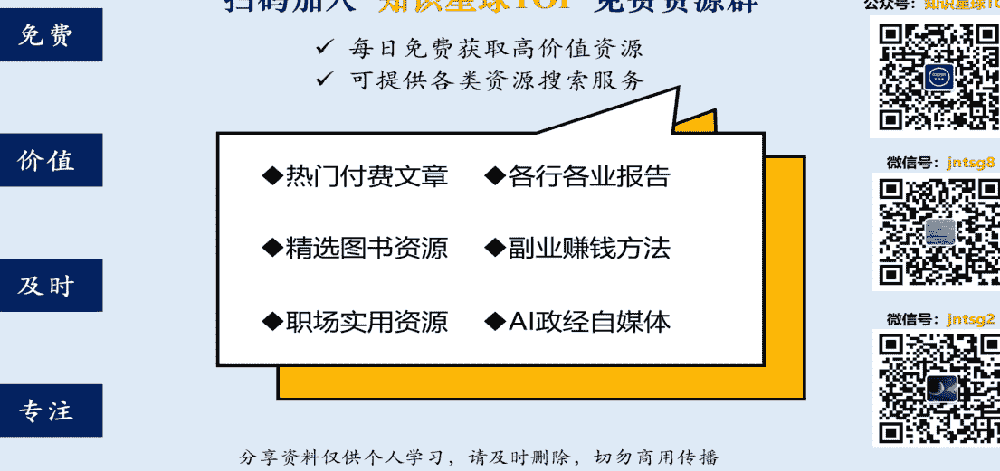
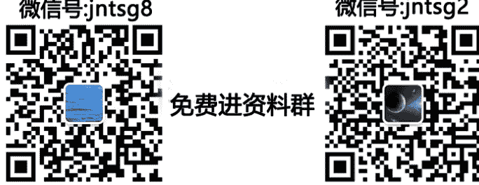

# 自制漫画周边在二次元领域赚钱：小红书
**0粉起步变现5w+实战分享

250620 生财精华

这是一个穿着就能赚钱的故事。

泛二次元行业是一个赚钱门槛很低，而天花板可以很高的行业。

请从你的热爱开始寻找，因为你懂用户。
无数个圈子里，有极高粘性的消费群，有未被满足的需求与变现机会。

> （版权所有，未经授权请勿转载）

大家好，我是零蓝，一个25+年的资深二次元爱好者，在小红书做过单涨粉1.3w的爆款视频，对新消费及泛二次元行业持续关注与洞察。

生财社群里很少看到跟年轻人情绪经济、二次元领域变现相关的实操内容。
作为一个资深二次元爱好者，我2023年在业余时间制作某日IP的周边赚过钱，很熟悉二次元圈子的人群和变现方式。

作为新手，我当时赚的钱很少，跟财社社区的大佬们远远比不了；

对我来说像打开了新世界的大门，身体力学会了普通从0到1的需求与做小生意的方法+实践经验。

在当前情绪经济的热潮高居不下，至少要持续20-30年的大环境下，类似的小生意依旧充满机会。

即使像我这样不会画画、不会写文、没有粉丝基础的普通爱好者，第一次做生意的素人，也能抓住机会。

分享当时的经历，希望都能帮到大家。

（历时6个月左右，共制作8款周边产品，总gmv 5万+）

## 一、项目思路
why - 市场 - 为什么要做，为什么在什么时候做？

2023年，某个在我国曾经火过的日本动漫IP的电影在国内上映。

我是该IP的老粉。在电影上映后，狂刷社交媒体，参加线下活动，与同的粉丝交流几句。

那是一个被粉丝们火一般的热情所围的夏天：

粉丝群自发组织的包场观影活动和其他线下与线上活动（“Only展”、角色应援、CP应援）在全国各地遍地开花，每周都有若干千场；

电影的上映激活了该IP原本的80至90后的老粉，同时也拉新了一批18岁~25岁的热情高涨、创作与购买欲望旺盛的年轻粉丝；

与上映前相比，电影上映后的1年时间里，各内容平台中（Lofter、微博、小红书）此IP的二次创作内容的数量指数级增加，数据大幅提高；

很多粉丝自制制售卖该IP的二次创作周边产品，做得好的有一定的销量（几十~几千件不等）；核心粉丝恰时购买二创产品销售额在九百-几千元/月；看到喜欢的制品就会马上买，因为知道喜欢的可能只做这一批，过了这个村没这个店；

粉丝购买自制周边的心理因素：

- 官方周边种类少且丑，群众需要高审美、多风格、多种、多生活场景使用的周边；

- 应援角色，与对角色和作品的认同感、信念感、展示/炫耀/举办等等

- 对二次创作作品的喜爱：圈子内有很多二次创作作文、画画、创作漫画的才华横溢的创作者（次元圈内“老师”），她们的作品提供了巨大的情感价值：审美好/有趣/感动

- 线下活动中的社交需求也是购买自制周边的原因：见面互换“无费”（即送周边作为礼物）是次元圈内潜在的规则与礼节；痛包展示（痛包即放了漫画周边制的包）；线下打卡拍照等等

我自己的粉丝买过的粉丝自制周边包括：手办、队服、球服、吧唧、透卡、色纸、明信片、小卡、卡套、卡册、立牌、同人本（小说或画集）、挂绳卡、海报、挂历、日历、棒球、T恤、卫衣、金属徽章、钥匙、发饰、毛巾、水壶、玻璃杯、骰子、包包、动物塑偶、棉花娃娃、衣服、贴纸、丝巾、收纳盒、御守、塔罗牌……

举几个普通人赚到钱的例子：

- 一位大学生做了一个角色玩偶，趁着热度高开卖，卖了数千件，利润5~10w左右；
- 一位审美很好的女生设计了角色名字丝巾，一共出了十几个，单价很高；
- 一位大粉丝画了二次创作周边，单单至少几百件，复购很高；
- 一位大粉丝在热度高的动漫IP圈中做了多款二次创作周边，以及举办各类线下活动，粉丝涨了10w左右。

## 总结:
短期内的需求：动漫IP粉丝黏性很高，电影上映及二创的发展拉新了用户；而这个热潮是有限的。

## 二、在二次元领域赚钱，与别的领域有什么不同？
what - 产品 - 普通的我能做什么产品？

在圈子里，我是一个普通的人：不会画图，不会写小说，不是圈内的“老师”，没有粉丝积累。在此以后看到需求，想要售卖产品时首先想到的是：关键在于精准找到用户聚集地，并向他们展示我的产品（即使是0粉）。

下一节和“实操经验”章节，会详细讲解我是做的。

我有优势是什么？

- 1、能简单的设计，有审美，用过稿。（后来90%的设计图都是自己画的，没花钱）
- 2、细节不麻烦，有执行力。（后来做定制图时，老板认为做不出）
- 3、在该子里混了几年，对“太太”们很熟悉，并且知道谁的文风/画风/设计风格为何会被喜欢、追随；尽管不写文字不画图，我在小红书和Lofter上写过几篇圈内数据不错的分析文章，知道什么样的内容受欢迎。

前两个指向做产品，最后一个对应做营销。在分析了市面上大家卖的制品后，我快速地制定了产品策略：

- 日常每天使用（show给别人看到）
- 有潜在需求
- 别人还没做
- 我能做的品类

从生产角度，很关键的一点：这个商品要在控制成本下，可以小批量定制。起订量1件~100件，最高不超过100件。最终做了几个大角色的周边和毛毯，后来又做了一款我推的CP的丝包，以及透卡、立牌等常见的动漫周边产品。选择的人群是圈子里购买最强的一批人。

how - 营销 - 人群在哪里，怎么营销？

上提到，我的Lofter、微博、小红书账号都基本没有粉丝基础，如何把东西卖出去？当时作为一个做生意的新手，我会做的是：在精准人群的地方，二话不说就是发（来混最重要的出来）；并尽可能宣传内容在视觉上做得更好看，在文字/标题/封面面上做得更吸引人。

根据我在该IP圈子里浸泡了几年的了解，当时的精准粉丝在下面几个地方：

线下活动：综合漫展（如Comic Up展），该IP的Only活动，线下观影活动，角色应援活动，CP应援活动。

- 微信群（线下活动群，线上活动群，观影活动群，聊天群，买制品群）
- 小红书（算法精准推送）
- Lofter（动漫二创内容平台，算法精准推送）
- 微博（可以到IP、角色、CP的超话广场里和相关bot账号里）
- QQ群（买同人本、角色的棉花娃娃购买群）
- 其他粉丝圈的内容平台（如爱发电、AO3）

思路大致决定了，我决定不想那么多了，就是一个干。执行力和速度很快重要。执行的具体细节在“实操经验篇”分享。

## 三、实操经验
### 一、产品生产
在二次元冲浪，可能会遇到很有意思的情况：如果想做生意，有哪些注意的地方？

一、不同之处：

- 情感驱动 & 粉丝属性：基于热爱和认同，而不仅仅是实用。口碑效应强。
- 对构图（画稿）极度依赖：画师知名度决定销量，定价时考虑成本、合理利润、粉丝承受力、稀缺性和审美等等。
- 时效性与热度绑定：电影上映、周年庆等活动是黄金期，热度下滑后需求锐减。
- “为爱发电”与商业化的平衡：定价过高或过度商业化引发粉丝感，这是一个灰色地带。

二、容易踩雷：

- 版权区：直接盗用素材、未授权使用、设计过于接近官方。
- 定价区：定价过高（被骂“割韭菜”）或过低（显得廉价）。
- 库存区：对热度判断失误，过多造成压货。
- 文化区：不了解圈内规则、黑话、敏感点（如CP位、角色争议），容易出错。

### 二、产品篇
几个月时间内，我做了不同类的周边：

- 围巾和毛毯
- 丝绸钻包
- 透卡及立牌

这些对我来说是非常用的通用经验：如何从无到有做出任何种类的实物：涉及产品设计、选工厂的原则和渠道、生产流程和货期把控。从0开始一个普通消费品，生产端基本是这几个环节：设计产品 - 选工厂 - 打样 - 做大货。

一、围巾及毛毯-设计与生产：

大致定好选品策略后，我在1688上找想做的种类商品的工厂。例如T恤、棒球帽、丝巾、卫衣、发饰、戒指、发标、绣标、收纳袋、帆布包、皮包、各种材质的围巾和毛毯等，看了很多品类和工艺。对0开始的小来说，以目标为向是最快的学习方式。已经是秋天，看到大家在某个微信群里的强烈要求，决定先做单色的围巾和毛毯。我快速地用Photoshop画好了设计图。拿着设计图问了几个圈子里朋友的意见，以及工厂老板生产方面是否有困难，又改了两次形成终稿。设计图是自己做的，没有花钱约稿（因为想省钱+认同自己的审美），作为i人实在是懒得当甲方去约图。对比了几家工厂的样品、能做的工艺、我想要的材质、工厂起订量、打样报价和大货报价后，给几家老板看过设计图，最终确定了一家能做我想要的效果和材质、报价不高，起订量也能接受的工厂，开始选择了纱线、选色、以及打样环节。我选的工厂做的质量挺靠谱，分给我进行设计图到生产对接的师傅也很细致，打样样品和大货的质量都很好。但怎么可能这么完美呢？我遇到的问题在另一个方面：正值深秋，工厂那边的订单很多，最终打样的工期拖后了一段时间；由于围巾和毛毯是季节性产品，对之后的销量有些影响。围巾和毛毯在二次周边领域属于hard模式，因此也没有人跟我竞争，而根据生产改设计图、催样、生产对接等花了不少时间。

1.2 丝绸钻包-设计与生产:

在第二年春天我逛逛淘宝，看到一款缎面仿丝绸材质、闪钻卡卡通图案的包包。黑色和粉色两个颜色，是很多女生喜欢的款式，价格便宜，显得高级，非常有性价比。我在1688找到了这款包的源头工厂，报价是几十块一个，起订量灵活。对于我来说，理想空间且定价不高，把包自带的闪钻改成我做的图案。我没有绘画基础，搜索并画了两个可爱版，打算印在包正面，背面印上CP名字，加上爱发电。

三、透卡及立牌-设计与生产：

这两类制品在动漫周边属于便宜又成熟的产品，生产很简单，淘宝拼多多随便找即可。由于不会画画，懒得盯稿，构图（画稿）是厚脸跟粉丝要求的授权。画稿费用大约是200-400元/张，粉丝不要。后续给她做了毛巾包和立牌等周边，也是粉丝之间的一种正向流动。

关于利润空间：
吧唧、透卡、立牌、色纸等几种类型的周边是大家做得最多的，利润空间很大。例如透卡一次做几十张的成本大概是1元，售价是正常范围。

关于约稿+自己开发制品模式：

自己不会画画的话，可以找画师约稿，之后再拿画稿做制品企划。画稿价根据画师水平，几十到万元/不等。在圈子里有很多创作者和画师靠这个赚钱。画稿成本是比较大的，剩下的大头是生产成本。所以更多的情况是作者用自己的画稿做了各种周边去卖，等于人力省了约稿，也会付出更多时间（设计产品、宣传等等）。有的可以是一张画稿做好几个类型的制品，即一鱼多吃，单类产品的成本就降低了。例如我最近买的一套IP粉丝自制周边，定价是100元/套不拆卖，里面是一张纸纹+一张卡片+一张明信片+一块流麻+一个吧唧。画图在该IP内一个很受欢迎、排期很满、官方周边也接同人的谷。她的画稿出的周边，很多人是直接盲买的（例如我）。因为能画角色神态表情很好看。画稿价格，无背景半身图在1.3w~1.5w左右，属于稿件价格高的。这类制品能卖出量的关键是图是谁画的、好不好看、稀不缺、是不是大家喜欢的类型，以及企划能力（比如整套周边的理念是如何设计的，对图的附加意义再设计）和营销能力。

产品生产-复盘：

对于小批量定制型商品，起订量及其报价是个特别关键的数据，决定了你一开始投入的成本高低，以及会不会亏损。大多数常见周边（吧唧、透卡、立牌、纸签等）都可以一起起订，量越大单价越便宜。如果你的目的是在二次领域赚钱且容易亏损，请从这些常规制品做起。这类制品图受不受欢迎、是准画的是最关键的。如果再选一次，我会先选棒球帽和T恤，这两个会比我先选的围巾和毛毯更好卖，生产对接环节也更简单。工厂在忙乱的出货时间是不准，生产肯定会优先量大的老客户。小批量定制产品的打样和生产请打出时间余量。工厂出货品质也有可能跟预想的有差别，请多问几家工厂，多要样品，多跟工厂沟通。产品做出来了，但是0粉，怎么让目标客户看到并愿意购买？这就是接下来“营销篇”要解决的挑战。

2、营销篇-素人红书0粉起步，怎么把东西卖出去

2.1 线下通道篇

在线渠道，我的策略很简单：发传单“地推”。那几个月赶上一些线下活动，比如综合性漫展CP30，上海的该IP Only活动，北京的活动。粉丝活动（PAGE 18）

在线渠道，我的策略是：发传单地推。
- 微信群（线下活动群，线上活动群，观影活动群，聊天群，买制品群）
- 小红书（算法精准推送）
- 粉丝圈的活动
- 粉丝粉丝数占了30%-40%。

2.2 小红书篇-素人起步

粉丝积累，我的策略是：发笔记，粉丝粉丝粉丝。
粉丝流量，效果好。

小红书上，每条营销内容大概是几十到几百个眼睛不等。

对我来说只有正反馈的事情是，每次发营销内容之后基本都有位数的的用户在询问产品并进群购买，虽然不多，但基本每次都有转化，转化率大概在 1-5%左右，非常精准。

### 视觉是关键：

前面说“把宣传内容在视觉上做得更好”，

当时为了给产品拍照，我简单学习了怎么布局，怎么打光、构图之类的类的，买了一些拍摄道具和设备，也参考了怎么搭配产品更好看等。

现在再看，得得很一般，不过小圈子里要求也不太高，做我这个的没什么竞争力，大家就凑合看看看也能卖。

第一次做，能力所限。如果再来一次，我会在宣、拍照方面优化，毕竟二圈子&小红书都是“颜值正义”。

后来过了几个月在给丝网包拍照时，就有经验多了，拍的照片搭配了买其他的周边和 CP 的棉花娃娃，视觉上很好看且明晰（同好一眼就能看出）。

### 文案怎么写：

我会玩一些爱好者知道的梗，以及设定一场场景来角色的梦（例如写一些同人角色的未来发展的场景），结合到带货文案里。

### 标签怎么打：

基本不是很讲，正常打作品、角色、cp以及自制周边相关的就好，小红书会精准推送这一小撮粉丝的

### 2.3 其他线上渠道

我当时使用的其他线上渠道：

- 微信群（线下活动群，线上活动群，观影活动群，聊天群，买品群；这部分人数多的，一般都是在群内相互介绍的方式，要跟群主老师提前打招呼是否允许宣传流量产品，一般都是可以的）
- Lofter（动漫二内容平台，算法精准推送）
- 微博（可以自己微博带tag，也可以发到IP、角色、cp、棉花娃娃的超广场，和相关的bot账号里；有些bot是非常活跃的，能拉来不少人)
- CPP 软件展会活动主办做的app，可以po制品到相关话题标签下，以及可以把对应售卖的制品关联到线下活动里
- QQ 群（买同人群群、角色的棉花娃娃买群等这些群里人蛮很多的，注意宣传的话先问下群众是否允许）
- 其他粉丝会引起的内容平台（例如爱发电、ao3、奇谷米等等，都可以发）

## 四、总结

这是一个由爱好转为认真做小生意的项目。

作为普通人，我“0粉起步赚钱”的关键步骤：

洞察需求 -> 发挥自身优势选品 -> 解决生产难题（小批量）-> 精准渠道（线上+线下）+ 高价值内容营销（尤其小红书）-> 做好基础服务（售后发货等）

“为爱发电”是我的初心，找到“爱好”与“生意”的平衡点，合理的商业逻辑让这份爱变得更远：满足同好的需求，合理定价，做好服务。

5W+ GMV 对各位大佬不多，但对一个利用闲时间、0粉起步、尝试新领域的新人来说，是非常好的起点。

从个人收获的角度，这件事我累积到了 4 点：

1. 作为生意初学者，用非常少的成本，跑通了做一个小生意的产品+营销的全流程
2. 掌握了从0开始任何实产品的流程，例如女装、开发硬件产品等等，大体的流程一致，只是领域与速度、细节粒度不同。
3. 对小红书的算法、推送逻辑、什么内容受欢迎有了“体感”，为我2024年在另一个领域起号时打下了基础：在那个号上我做的第一条视频就是爆款，当天涨粉3w。
4. 学会兼具“生产者视角”与“用户视角”，去看所有的泛次元/年轻人情绪经济生意。

如果你有冲动有热情，且发现了机会，请立即行动起来，
从细分领域的“小”需求出发，从“小”处着手，
（比如二次领域就从简单的卡、吧咖啡开始，）

在行动中不断学习与迭代，积累属于你自己的长坡雪。

## 五、结尾的需求征集

近期打算更新一个文章系列：

泛二次元生意：你看不懂的年轻人世界，n努力发财

微信公众号:jntsg8

免费进资料群

微信公众号:jntsg2

加微信信号jntsg2，免费进资料群
