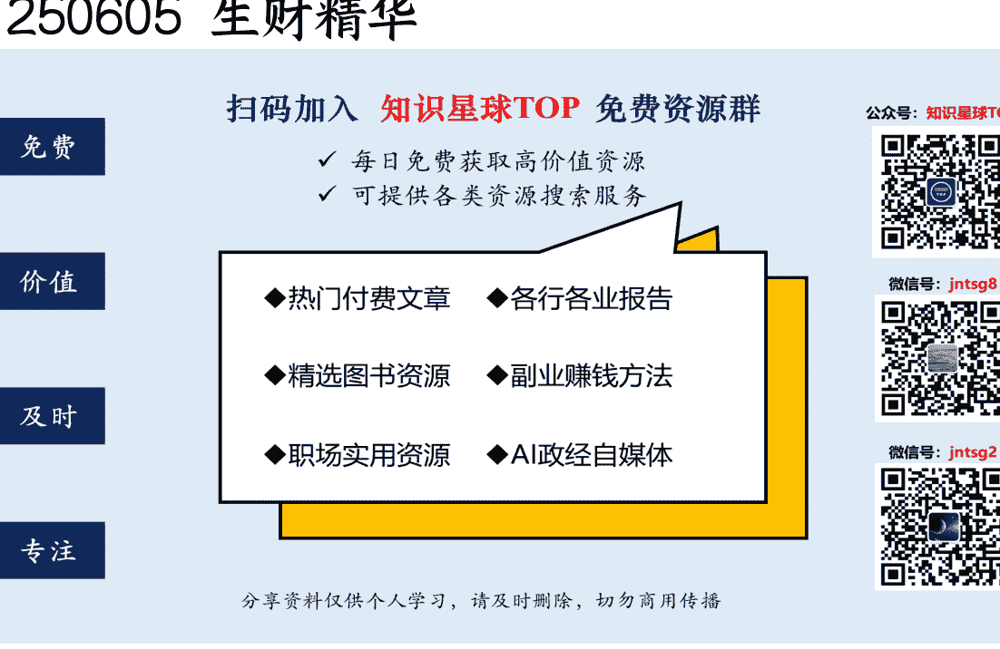

# 2025，分享4个中国消费市场可以关注的趋势方向

## 250605 生财精华

大家好，我是黄嵩，疯投圈的理人，最近对于有一篇关于中国消费趋势的内容，咱们生财小伙伴反馈很不错，邀请我来给大家分享下。本文源自己管理团队的内部培训享，文章相比比享有细节处理。

中国消费市场经历着前所未有的结构性变革。人口结构、经济发展以及营销渠道和消费场所都出现了重大变化。这些变化不仅重塑了商业竞争格局，更预示着未来十年的增长机遇。基于最新消费研究，本文将深度解析四大核心趋势，为企业提供战略决策参考。

### 一、银发经济：活力老人的消费新趋势

第一大趋势就是银发经济。中国老龄化进程正在加速，2025年将迎来1964年出生高峰群的退休潮。这一群体约60岁，拥有稳定的退休金和充足的时间，成为消费市场的新主力。

与传统认知不同，真正推动银发经济的并非八九十岁的高龄老人，而是五十十岁的“活力银发族”，他们经历了改革开放红利，具备较强的消费能力和消费意愿。

根据最新数据，中国目前 65岁以上人口比例已达 15%，相当于日本 1995 年的水平。值得注意的是，中国老龄化速度将显著快于日本：日本从 15% 老龄化率到 30% 用 30 年（1995-2025），而中国预计仅需到 2040 年 65岁以上人口比例将突破 30%。

在消费能力方面，尽管中国缺乏直接数据，但日本经验显示，老年群体在财富积累上有显著优势。日本 60岁以上群体拥有现金占比高达 35%，平均金融资产超过 3500 万日元（约合 150 万人民币）。

这一现象在中国具有相似性——中国老年人普遍有房产且无负担，退休金稳定，其消费决策往往影响家庭整体支出。

日本经验显示，老龄化社会中，老年消费呈现社交化、健康化和情感化。在中国，也开始有企业瞄准银发族，满足他们的社交和情感需求。例如，我投资长沙的茶馆项目“东茅街茶馆”，为老年人提供了社交第三空间，通过复古装修吸引目标群体，成为他们日常消遣的重要场所。

虽然店内提供茶水、简餐等基础餐饮服务，但核心卖点是为了老年人打造了一个社交平台。许多老年人在在此打牌、聊天、消磨时光，甚至形成了固定的社交圈。该项目通过收取餐饮费用作为商业模式，人均消费不高，但凭借复购率和稳定的客流量，已经实现盈利，并在区域内复制扩张。

### 二、低成本缓解焦虑：消费成为情绪解药

第二大需求，则是缓解焦虑。在经济增速放缓与不确定性加剧的背景下，中国消费者通过消费寻求情绪抚慰，并倾向于选择低成本、高性价比的解决方案。这种“向内看”的消费心理产生了多个细分领域的爆发式增长，企业通过精准捕捉消费者对“小确幸”的需求，在逆境中开出新赛道。

比如，嗅觉经济成为悦己消费的低成本入口。与奢侈品相比，嗅觉类产品入门槛更低，成为消费者悦己消费的首选。中国香氛市场规模在 2024 年突破 200 亿元，增速为全球市场的 3 倍。例如，主打“东方香调”的国产品牌通过线上营销迅速崛起，以百元价格带占领年轻群体市场。这类产品强调“自我疗愈”功能，通过柑橘、木质等自然香型营造舒缓氛围，满足都市人对情绪调节的需求。

睡眠质量成为现代人的普遍痛点，推动睡眠经济市场规模在 2024 年达 4955.8 亿元，预计 2027 年将增至 6586.8 亿元。亚来酒店通过“睡眠场景”实现业绩突破，其自有品牌枕头、垫等产品销售额接近。

还有一类是单身化趋势下的宠物经济。对于单身人士来说，宠物是情感陪伴。我们看到，日本宠物市场规模超过 2000 亿元。在中国，宠物食品、智能食器、宠物医疗等正快速增长。

文化消费成为低成本情绪治愈的载体。消费从年轻人向老年人渗透，例如，B站推出“银发计划”，针对 50岁以上用户活跃度同比增长 120%。国漫 IP 衍生品，《哪吒之魔》等动画周边销售额超 10 亿元。这类内容通过情感共鸣和文化认同，为消费者提供了逃离现实的港湾。

### 三、圈层消费：精准定位与垂直

第三大趋势就是圈层经济。消费者加速细分，企业通过精准定位实现突围。小红书、抖音等平台的算法机制，让每个圈层形成独立空间。

例如，山姆会员店通过“品质家庭”自有商品策略，2024 年会员数量突破 800 万，营收超 1000 亿元。这种“少而精”的策略降低了供应链复杂度，提升了用户粘性，创造了巨大的市场。

另一个圈层——单身者，数据显示，单身占比 35%。一个很有意思的例子是“宠物专用酒”这一特殊品种，专为主人下班后酌用，弥补情感空缺。

圈层经济的本质是社交关系重构。传统家庭结构弱化，大群体成为服务机会。例如，日本老年旅游品牌 Club Tourism 通过上万条线路（涵盖摄影、温泉游等），占日本老年旅游市场 1/3 份额，营收超 10 亿人民币。其成功印证了：在细分赛道中，深度挖掘用户价值比盲目追求规模扩张更具可持续性。

无论是品质家庭还是文化爱好者，企业都需要通过产品设计、场景体验和情感共鸣建立深度连接。

### 四、非标价值：健康化与体验溢价

第四个趋势就是非标价值。也就是，除了标准性的产品功能之外，在高度内卷的市场中，功能性产品陷入价格战红海，而非标价值成为企业突围的关键。

比较突出的价值趋势就是健康消费领域。过去健康消费似乎是“伪需求”，但是经历过疫情的消费者又面临老龄化的趋势，健康消费已经变为“刚需”。我们看到，农夫山方树无糖茶饮凭借健康标签成为百亿单品，2024 年市场份额接近 50%。霸王茶姬推出的“原叶轻茶”主打低卡路里，成为行业首家主动标注路里的品牌，2023 年销售额同比增长 300%，门店突破 5000 家。

健康化成为消费者愿意溢价的核心。运动户外行业同样呈现非标价值趋势。lululemon 通过“健康生活方式”品牌定位，2024 年中国市场营收增速 40%，其“瑜伽裤+运动休闲”的产品矩阵满足了消费者对功能与时尚的双重需求。新兴品牌 Vuori 则为“男性 lululemon”定位，设计简约的大地色运动服饰，通用健身房和办公室场景，2022 年进入中国市场迅速崛起，获机构 50 亿美金估值。

日本经验显示，健康消费在经济低增长长期仍能保持增长。过去 30 年日本基本没有停滞，但健康类支出成为少数显著增加的类别。运动旅游也属于低成本健康类消费。日本经验显示，经济下行期运动行业有望增长。日本运动户外市场规模已超过 7000 亿日元，近年增长复合率约 5%，远超同期 GDP 增速。在中国市场中，慢跑、骑行、露营等入门级消费成为主流。

中国消费市场的浪潮正在重塑商业未来。从银发人群的崛起，到年轻人的焦虑消费；从圈层化的精准渗透，到健康化的价值重构，这些变化构成了未来十年的核心逻辑。

对于企业而言，唯有动态视角捕捉外部变量，同时修炼内功，将外部趋势与内部能力结合，才能在激烈的竞争中脱颖而出。

感谢大家的阅读，有任何想讨论的欢迎在评论区留言。
