# 高客单副业《酒店代订》全网全攻略【补充版】

250606 生财精华

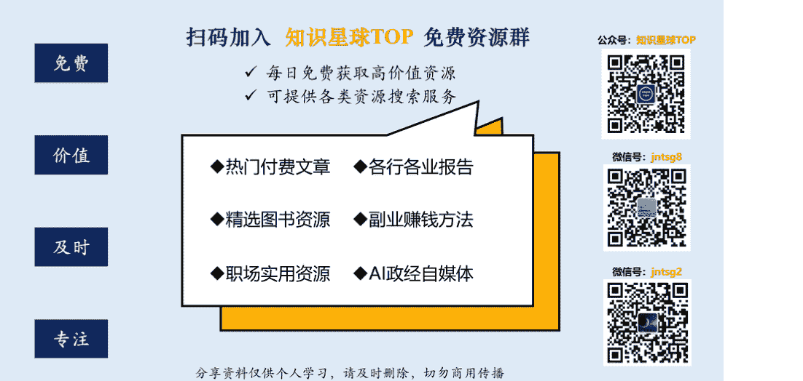

## 前情提要

这可能是全网第一次有人系统性的将酒店代订这个项目放在面上讲，应该会得罪不少人。

我知道，有太多普通人正急着找一个靠谱的副业。别说创业了，就算是多赚1000块，也能缓一口气。

这个项目，不用囤货、不用发快递、更不用露脸。
哪怕你不打算做这个生意，自己出去旅游、出差、住酒店也能省下不少钱。
更重要的是，它没有你想的那么难，也没有那么卷。只要一部手机，嘴巴不笨，就能试一试。

感谢 @萧墨 | 生财鱼丸 很有耐心的帮你审稿

本文核心内容是告诉你市面上酒店代订的所有渠道和原理，以及如何用“旅行社协价”在小红书和闲鱼引来获取酒店佣金。

## 酒店的品牌与分类（科普一丁）

在你正式学会怎么靠“酒店代订”赚钱之前，咱们先把酒店这门生意的门槛降低。毕竟你得先知道客户想住什么，你才能知道怎么赚他们的钱，对吧？

我们可以把酒店按“段位”来分个级，来比方：

### 【1星~3星】经济型

这类就像节奏店，住得起，用得上，讲究的是便宜干净。

比如：如家、汉庭、7仔、7天、锦江之星、格林豪泰

客单价：100-300 元/晚

### 【3星+~4星】中档酒店

有床、有桌、有窗，适合出差和短期旅行。

比如：全季、桔子、亚朵、怡程、酷咖啡

客单价：300-600 元/晚

### 【4星+~5星】高端酒店

带调性，适合小资情侣、商务宴请、时尚住客。

比如：希尔顿欢朋、万达嘉华、美居、华朋、皇冠假日

客单价：600-1200 元/晚

### 五星+豪华酒店

品牌响、服务好、硬件顶，住进去你会觉得：我人都上上人了。

比如：香格里拉、洲际、瑰丽、悦榕庄、W酒店、英迪格

客单价：1200-3000 元/晚

### 【顶奢天花板】一晚一个iPhone

这类酒店，一次就能在朋友圈绕一年，你赚的差价也大得惊人。

比如：宝格丽、安逸、文华东方、四季、丽卡卡尔、半岛酒店

客单价：3000 起跳，8000+很正常，假日上万也是常事

## 酒店术语

看懂这些术语，你就比 80%的人懂酒店了。做酒店代订，懂行是基本功，下面这些词，你得搞明白：

- BAR 价 (Best Available Rate)：通俗点说就是“门市价”，是酒店官网或 OTA 上给普通客户看到的最公开的价格。
- 协议价：给大客户、旅行社、代理的专属价。
- 房型术语别混：
  - 大床房：只有一张大床，适合情侣或单人旅行。
  - 双床 / 标间：两张单人床，适合闺蜜、基友或拼房出行。
  - 套房 (Suite)：有客厅、有卧室，有的厨房，适合商务接待或“重要时刻”。
  - 行政层 (Executive Floor)：带专属酒廊、早餐和下午茶，很多人士会选。
  - 家庭房 / 三人房：适合一家出行，有时有上下铺，适合遛娃家庭。
  - 无窗房：一般价格便宜，但住起来可能像“密室逃脱”，谨慎推荐

## 房态术语

- 尾房：酒店临时降价清库存，聪明的代订人时刻看着这些机会。
- 封房：节假日满房，不接受预订，但有时你能拿到“隐藏资源”。
- Overbook (超卖)：有些酒店会超额接单，常住老客户反而有更大概率被“升级”。

## OTA (Online Travel Agency)

线上旅行社，也就是你熟悉的：携程、飞猪、去哪里、马蜂窝、同程...等等。代理的核心竞争力，就是比比这些平台“更便宜”、“更灵活”。客户的第一反应永远是“你比携程便宜吗？”

## PNR / 酒店确认

客人订房会收到一个“确认”，也叫 PNR。这是你和客户之间的“信任锚点”，尤其你不是平台，又露脸直播时，一串编号比你发 10 语言都管用。

## 酒店常用语

- CI / CO: Check-in / Check-out, 入住 / 退房。
- No Show：订了房却没来，“鸽了”。
- Upgrade：升级房型。通常需要会员或加钱，也有操作空间，技巧可以后讲。
- 含早 / 不含早：有些酒店早餐比房还贵，订的时候看清楚有没有早餐。

## 代订有哪些渠道

想靠代订赚钱，第一步不是苦，而是搞清楚手上拿到什么、凭什么比别人便宜。懂行，越懂底气。

### 高级会员 / 房卡

很多酒店的高级会员每年都有入住次数，有些人没时间去，他们把这些房挂在网上卖。因为会员福利太香了：除了折扣优惠，还有免费升房、免费早餐、延迟退房。有些酒店查得比较严，必须会员身份到前台办理入住，订单后把房卡交给客户，直接上楼。

### 世界 500 协议价

就是那种“高大上”公司专享的内部福利，最低能打 5 折左右。这种协议价不是谁都能拿到的，它是通过一些全球合作，专门为员工提供的超级房价。酒店前台的比较松，有些代理直接用员工身份去前台登记，以房卡的形式交给你，赚一点快。

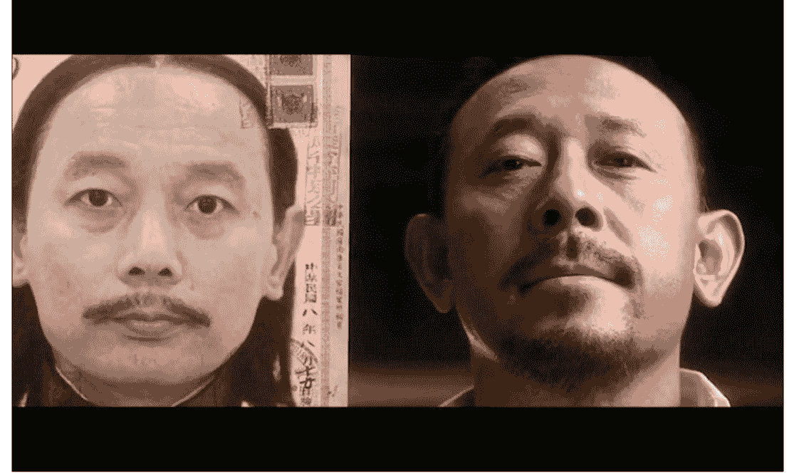

### 会员房

说白了就是酒店搞活动，原理其实简单。你在酒店里轮梭一次，系统就会给你上一积分。这种积分不是超市会员，但可以换房。这时候，传说中的“叠码仔”就登场了。他们就像酒店的中介人，掌握着大量客户的“积分资源”。资源就会被廉价拿出来卖，夸张点说，价格近乎无限，哪怕几十也。因为积分过期就贬值，今天不用，明天还能掏单。叠码仔的职业道德……看人品，有靠谱的，也有跑路的。因为这些房源跟你抢的人太多了，它不像正规平台那样，更像一场小型拍卖。

### 各种 OTA 的包房

如果你把酒店比作一个演唱会现场，那 OTA平台（像携程、飞猪、同程这类）拿到的“包房”，取决于黄牛提前捞。OTA 们提前和酒店谈好一个批量价格，比如：“我一次性跟你订 100 间房，能不能给我个友情价？”酒店想，这批房反正短期卖不完，有愿意付现金，当然好说！

这些房被 OTA 拿来打架，自由组合，再做个“特价限杀”，加点“含早/延迟退房”小 buff，就成了你眼中“捡漏价”的来源。如果经常在携程订酒店的话，你一定看到过某些房型上会有标“代理”字样，这些房的来源就是这里。

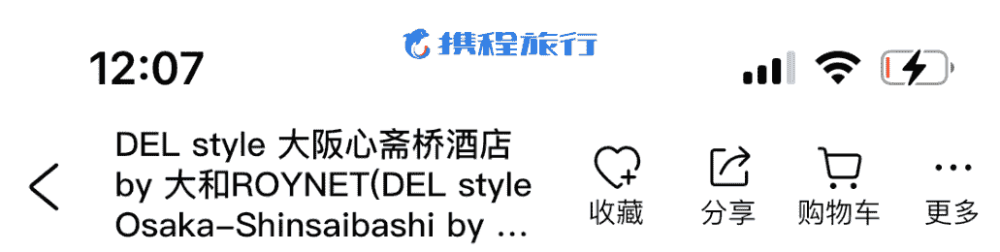

## 订购优惠 春季特惠最高减80 领取

| 周一 | 周二 | 间数人数 |
| :--- | :--- | :--- |
| 5月26日-5月27日 | 共1晚 | 1间0人 |

海外入住人费用，请确认选择房间和儿童数

- 三床房 - 双床房 - 含早餐 - 大床房 - 免费取消 - 筛选

吸烟中型大床房 代理1张1.54米大床 2人入住 21㎡ 可吸烟 无早餐 当地时间05月23日 12:00后免费取消 立即确认 最晚次日02:00办理入住 ¥1269 含税/费后¥1406 预订

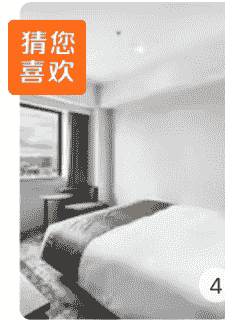

禁烟中型双床房1张1.54米大床 封闭窗 ¥1186起 含税/费后¥1315 2项优惠626

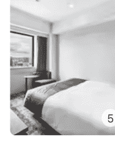

吸烟中型大床房 代理1张1.54米大床 21㎡ 可吸烟 无早餐 ¥1269起 含税/费后¥1406

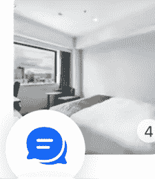

禁烟中型豪华床房 1张1.54米大床 4㎡ 封闭窗 ¥275起

## 房券

简单来说是酒店界的拼多多，为了拉新、销量销量做代订，经常和各种平台、信用卡公司搞联合促销。或者忘记了有人低价收券，转手卖出，赚差价。你看到很多酒店在某些平台、团购、看着像亏，其实是回血。

## 旅行社议价 (重点)

代订圈里的“正规军”，不押金不跑路，自带福利。正规入住，正常开发票，合法缴税。如果说澳门像赌场，那旅行社议价就是海底。标准、服务、小字。运通白金卡、黑金卡，高端用户不仅有优惠，还送早餐、升房、延迟退房，消费度非常高。

## 进阶分享

很多高端酒店不需要卡，只要一个链接就能订到原本攀不起。这套报价系统覆盖全球100+酒店，但不限于：四季、安缦、华尔道、柏悦、瑞吉、文华东方、丽思卡尔顿、瑰丽、凯宾斯基、洲际、W、艾迪等。最重要的：无需垫资，没有压力。

## 100%正规

全流程透明！你帮客户下订单，客户自己到酒店前台付款，用自己的名字查到订单，天然有信任感。遇到任何问题也方便和酒店反馈，售后也无需你操心。客人住得安心，你赚得安心，谁都不亏。赚钱！

## 我是怎么发现这条渠道的

其实一开始并没有打算做酒店订购这件事，就是喜欢玩信用卡，尤其是那些带我的酒店酒店。信用卡论坛里总是有旅客在分享他们的酒店体验，我也慢慢变成了“酒店控”——无论是出差还是旅行，酒店成了我旅行中最重要的“第一需求”。很多信用卡提供不错的顶奢优惠和待遇。

后来有一次，我在闲鱼上发现，有人订酒店，价格和我用高级信用卡拿到的价格差不多，甚至还低。我当时就懵了，后来想了，明白了可能是有返回的机制，于是我的好奇一下子就被激活了。

接着，我就开始深挖这个渠道。这些酒店优惠原来是酒店达成了协议，然后几家旅行社把这些协议接下了，等于我通过这些旅行社的渠道下单，给我们返回的就是CPS（按销售返回）模式。大家开心——我能找到便宜的酒店，旅行社和酒店也能赚点，简直是三赢！甚至很多人用这个渠道开公司做长期托管的业务，你在小红书、闲鱼上到的高端酒店，八成都是来自这。

还有一个小的矛盾点，那就是这些渠道是不可能在淘宝、闲鱼、小红书上公开卖的，传统的OTA平台更是没戏。旅行社们名字都不在公开场合提，酒店找他们麻烦。用这个渠道订，要缴纳一些押金，如果不小心触了规则，佣金没了就算，最严重的是你可能被罚款，押金也直接没收，甚至被黑拉，以后用不了这个渠道了。

别问我为什么，血和泪的沟通足够清楚，结果客户到酒店时，由于我和客户登录登记时，自己没忍住直接自爆家门：“我是在闲订的！”被酒店晾在大厅，闹的很不愉快。酒店直接找旅行社麻烦，旅行社又要找我麻烦……你可想象那时的有多尴尬……

后来只能换身份证，继续用这个渠道操作了……这个渠道可以称为“隐秘协议价”。这类顶奢酒店比较珍惜自己的羽毛，怕影响品牌形象，但话说回来，因为酒店的空房都比较高，酒店还是愿意我们这个渠道帮忙销售的，前提是“偷偷”。只要被酒店查出来，就会被投诉。所以新手不要就冲，风险系数太低。

## 运营流量数据

| 观看数 | 互动数 | 新增粉丝 | 访客 |
| :--- | :--- | :--- | :--- |
| 6.8万 | 5万 | 3万 | 1万 |
| 14% | 55% | 38% | 160% |
| 18万 | 57 | | |

## 小红书流量运营

- 发布笔记
- 探店
- 合作
- 流量中心
- 账号增长
- 点赞
- 收藏
- 评论
- 关注
- 私信
- 回复

## 新手适合做什么

新手强烈建议从家中端酒店入手，品牌，如：华住系、锦江系、亚朵系、东星系。这些酒店价格相对便宜，新手有很多。
- 酒店代订
- 官方App
- 积分体系
- 积累积分

## 酒店代订怎么订

以华住会为例，高等会员能享受85折+双人早餐+免费升房。一间房能赚百块差价，由于价格较低，按平均一间房20-30收取服务费。

## 案例二：亚朵酒店

“文艺中产代表队”，号称书香气息洗净旅途。亚朵分为：

- 亚朵 S（高端定位）
- 亚朵 X/优选（偏设计感）
- 普通亚朵（商务为主）

会员系统确实很香，高卡可以打到8折，且经常送早升房。去年还能通过接码平台无限注册新号码来低于折订购，当时订单跟疯了一样来！

和华住会一样，也是通过闲鱼/小红书来引流，利润也没太大。不过亚朵与会员之间的链接更紧密，回头率非常多，亚朵积分不仅能换房，还能换洗衣液、咖啡杯、酒店同款，其中最名的2024全年销量突破380万个亚朵枕头。

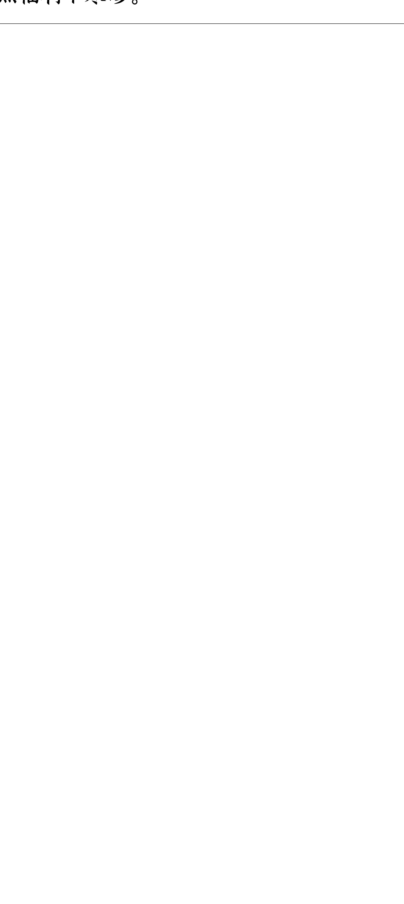

## 推荐更多

More to Know

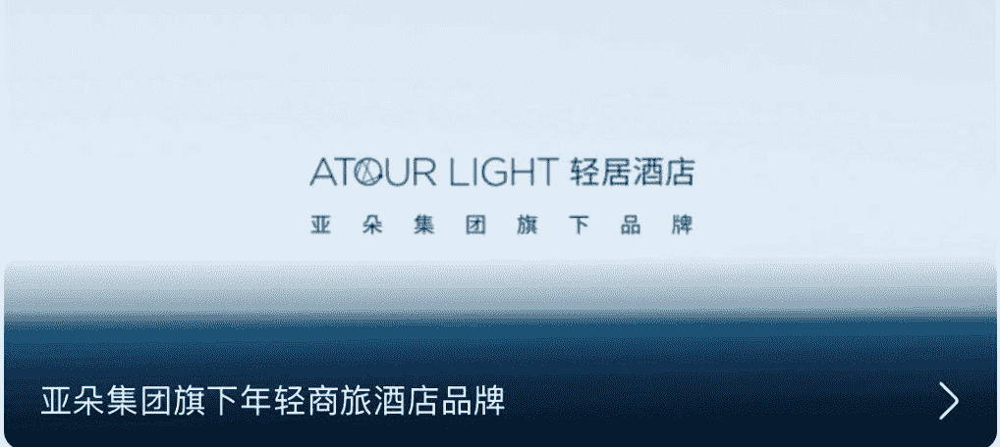
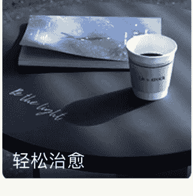
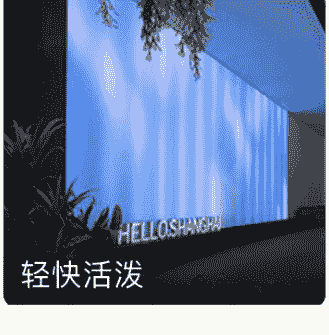
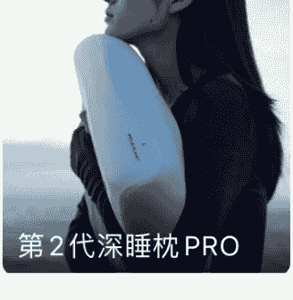

一单的利润高、粘性强、容易转介介绍——一稳到不行。

这类高端订单渠道，也正是市面上那帮做“酒店代训练营”收费 1999、2999的核心内容。

他们怎么包装的呢？

标准台词大概是这样：

“我在酒店行业十年，和某某牌区域经理是朋友……”
“这渠道是我朋友在万豪做副总裁的时候私下给我的……”
“市面上根本没人知道这种内部资源，今天只给你听……”

他们不光收你训练营费，后面还要拿你的佣金抽成。

但到底，他们说的，就是我们现在聊的这个——

顶层协议系统、以及配套佣金结算机制。

唯一的区别是：

他们用“神秘”来收门票，我——用“常识”把门打开。

而你只要听懂前面的逻辑：

知道哪里有佣金、活动是怎么来的、客人为什么愿意找你订...

其实，你已经比那些交了学费、还一头水的学员懂多了。

白了，代订是个服务业，拼的是细节、资源、和持续的专业度。不是你学一节“如何潜懂酒店”的网课，就能装成酒店教父。

我一直觉得，真正牛的人不会把知识藏着，而是用自己的经验帮别人走得更稳一点。

所以如果你看到这，怕怕只是心动了一点，记得把这篇收藏好，说不定哪天你就能靠它走出自己的第一步了。

## 那条赛道到底赚不赚钱?

答案是：一单赚的，可能是你在华住跑十单的利润。

价格越高，佣金越高。服务好了，回头率几乎 100%。

这些人可不是旅游一年一次的“小白”，他们常常一年住几十晚，出游的第一件事，不是去哪玩，而是“订哪家酒店”。

只要你拿下一个，就像开了个“酒店ATM”。

我这说一点不张，是真实实体。再告诉你一个让人忍不住偷笑的点，像这种顶奢酒店，经常有“住三付二”、“住四付三”的活动，以曼谷文华东方酒店为例：

4月24日-4月27日，3晚，携程价格12087.33 元
4月24日-4月 27日，3晚，渠道价格10957.88 元

差价差了129.45元！！并且我们渠道还有100美金的消费额度赠送，免费升房！！

这些活动只有这些高端特定渠道才能订到，普通 OTA是看不到的。

你在内部小程序里帮客人下单，客人自己去现场刷卡结算，退房后，系统会自动根据房费给你结算，通常是 5%~7%。

## 曼谷文华东方酒店

奢华尊贵房（双床）环球优选价 住3付2

| 入日期 04月24日（周四） | 2位成人/3晚 | 退房日期 04月27日（周日） |
| :--- | :--- | :--- |
| **专享礼遇** | | |
| - 赠送双床：入住期间每日免费双床 | | |
| - 房型升级：视房态免费升级房型 | | |
| - 升级仅限同类型房型，客房无法升级至套房 | | |
| - 消费抵扣：入住期间仅可享受100美元酒店消费抵扣 | | |
| - 每天入住期间仅享受一次，挂房销 | | |
| - 使用范围仅限酒店实际安排 | | |
| - 延迟退房：视房态延迟退房 | | |
| - 提前入住：视房态办理入住 | | |
| **温馨提示** | | |
| - 无论是否订单、更换房型，同组入住日期连续入住同一间酒店均视为一次入住，享受一次礼遇 | | |
| - 关于房型升级、提前入住、延迟退房，具体安排需以当日酒店前台最终确认为准。 | | |
| **入住信息** | | |
| 入 | 姓(拼音) | 名(拼音) |
| :--- | :--- | :--- |
| ¥10,957.88 CNY (含税502.35费) | | |

简单算笔账：如上面这个订单总价是10957.88 元，如果佣按 6% 算，你这单就赚 657.47 元。

如果是住四付三、住五付三这类活动，总价更高，赚千八百的都不是事儿。

## 只是“订房”，而是信任和依赖

说得再直接一点：你不是订代，是在做他身边的“酒店觅秘书”。

有时候帮他们搞定一天紧急满房的套房，或者提前 check-in 赶飞机——那种“终于有人懂我”的感觉，是无法用钱衡量的。

我见过太多客户，第一次合作后直接微信，“下次去哪个城市你帮你看看”。慢的就成了朋友圈里唯一的“酒店顾问”。

也许你现在会觉得，“这些都是听起来有点玄”，但当你真的做了一两单，体会到被信任、赚到第一笔钱、收到客户好评的那种满感……你大概就懂我为何一直说这条渠道值得好好经营了。

## 独家渠道

这个渠道放在最后，不是因为它不重要，而是因为它太重要了！！不能随便。这类资源也是最难获取的一个渠道，不是你翻网页能找出来的，也不是加几个代理群就能搞定的，更不会在朋友圈流转。

只能靠一个——“靠”。

靠的，是长时间的信任积累。你跑得久，配合得稳，足够专业、足够细致，还能不麻烦。是那种出了问题，你宁愿自己贴钱，也不让酒店添一点麻烦的程度。有机机会被酒店经理记住，信过你，愿意在合适的时候，给你开一扇别人看不到的门。

因为你知道，这些资源之不易：天时、地利、人和，差一样都成不了。而且这种东西，一旦失去一次，就再也拿不回来。

我现在手上能拿到的独家价，大部分就是这么磨出来的。你要细节处理得像刀一样精准，才能换来一句：“这个价格，只给你。”

你得自己走到门口，才知道这道门后还有一层门。

## 结语

我知道你刷到这里，不是为了听道理，也不是只只想学点钱的招儿。

你更像是在找一种可能性：有没有什么办法，让生活变得轻松一点，自由一点。

分享的这些，没啥道理，就是我亲身试过的、踩过的路。如果刚好给你打开了一扇窗，哪怕只有瞬间觉得，你已经比那些交了学费、还一头水的学员懂多了。

白了，代订是个服务业，拼的是细节、资源、和持续的专业度。不是你学一节“如何潜懂酒店”的网课，就能装成酒店教父。

我一直觉得，真正牛的人不会把知识藏着，而是用自己的经验帮别人走得更稳一点。所以如果你看到这，怕怕只是心动了一点，记得把这篇收藏好，说不定哪天你就能靠它走出自己的第一步了。

## 2025年6月代订骗局补充

很多圈友都不知道，了，一单的利润高、粘性强、容易转介介绍——一稳到不行。

这类高端订单渠道，也正是市面上那帮做“酒店代训练营”收费 1999、2999的核心内容。

他们怎么包装的呢？

标准台词大概是这样：
“我在酒店行业十年，和某某牌区域经理是朋友……”
“这渠道是我朋友在万豪做副总裁的时候私下给我的……”
“市面上根本没人知道这种内部资源，今天只给你听……”

他们不光收你训练营费，后面还要拿你的佣金抽成。

但到底，他们说的，就是我们现在聊的这个——顶层协议系统、以及配套佣金结算机制。

唯一的区别是：他们用“神秘”来收门票，我——用“常识”把门打开。

而你只要听懂前面的逻辑：知道哪里有佣金、活动是怎么来的、客人为什么愿意找你订...

其实，你已经比那些交了学费、还一头水的学员懂多了。

白了，代订是个服务业，拼的是细节、资源、和持续的专业度。不是你学一节“如何潜懂酒店”的网课，就能装成酒店教父。

我一直觉得，真正牛的人不会把知识藏着，而是用自己的经验帮别人走得更稳一点。所以如果你看到这，怕怕只是心动了一点，记得把这篇收藏好，说不定哪天你就能靠它走出自己的第一步了。

## 那些代订骗局案例：

很多圈友都不知道，了，一单的利润高、粘性强、容易转介介绍——一稳到不行。

这类高端订单渠道，也正是市面上那帮做“酒店代训练营”收费 1999、2999的核心内容。

他们怎么包装的呢？

标准台词大概是这样：

### 很多骗子总结的套路：
- 赠送双床：入住期间每日免费双床
- 房型升级：视房态免费升级房型
- 升级仅限同类型房型，客房无法升级至套房
- 消费抵扣：入住期间仅可享受100美元酒店消费抵扣
- 每天入住期间仅享受一次，挂房账销
- 使用范围仅限酒店实际安排
- 延迟退房：视房态延迟退房
- 提前入住：视房态办理入住

### 1. 信用卡刷卡（主要手段）
- 骗子手上有非法获取的信用卡。
- 用这些黑卡去官网正常下单。
- 入住成功后，退房时发现信用卡被盗。
- 银行会把钱退回，订单取消。
- 骗子早已消失。

### 2. 假员工工作证/邀请函
- 骗子假装掌握某牌（比如LV、Chanel、Dior）的内部折扣。
- 临时发送伪造的工作证或邀请函。
- 让客人以为自己是受邀请的。
- 前台发现问题后，骗子表现出一副“无奈”的样子，要求客人赔偿。

### 3. 假造工作邮箱
- 最后要求客人用他们编造的酒店邮箱发邮件。
- 前台发现问题后态度也非常差。
- 真是两面受击到尴尬的不能自己。

### 心理分析：
- 你不是订代，是在做他身边的“酒店觅秘书”。
- 有时候帮他们搞定一天紧急满房的套房，或者提前 check-in 赶飞机。
- 这种“终于有人懂我”的感觉，是无法用钱衡量的。
- 我见过太多客户，第一次合作后直接微信，“下次去哪个城市你帮你看看”。
- 慢的就成了朋友圈里唯一的“酒店顾问”。
- 这种骗局本质就是赌博，赌你的无知、赌酒店的奢华、赌自己的运气。
- 这种骗局看起来像专业代理，但其实是典型的单边博弈。
- 骗子根本没做努力，也没有任何风险，一切靠脸皮和运气。

