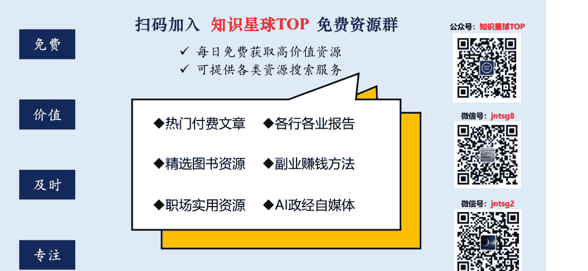

# 在 AI时代，详细拆解如何低成本启动一个全球化产品

250716 生财精华

## 一、为什么现在是 AI 产品出海的最佳时机

### AI时代带来的天然优势
现在是一个非常好的 timing 做出海产品。首先，AI时代把技术门槛降低了，大家其实挺容易做一个看上去是同质化的产品。第二，因为大家天天在用 ChatGPT，所以天然对海外的一些生态是有理解基础的。

天然的，大家如果做一个产品，只要它是面向全球化的，比如因为 AI，现在也很容易做一个全英文的产品，所以其实天然适合在 Day 0就开始面向全球，然后可以去撬动一些海外的流量的产品。

### 海外市场的付费优势
天然的海外用户的付费意愿更高，因为有汇率差，一美元相当于7块钱人民币。如果你只面向国内用户，其实天然大家付费意愿虽然在逐渐培养，但是没有海外那么高。

其次，海外有非常多国家和地区，比如欧美，他们非常习惯给一些工具或 AI 服务付费，天然的付费意愿更良好。你面对的是一个十几倍或者大几倍的市场，所以哪怕你做的是一个比较小的切口，也可以赚到很多的钱。

我举个例子，比如有一个非常著名的工具叫 bitly，它就是把一个长链变短链，就这么一个很小的功能，它每年能赚几千万美金。因为你面向的是全球范围内 100 多个国家和地区的用户，当你的需求被放到全球人民面前，然后你再去做流量的获取，或者尝试提高留存，其实都会活得很不错。

### 独立开发者的成功案例
我认识的另一个独立开发者，他自己做了 6 个产品，每个产品他也不怎么用心去做增长，就放在那里，一开始做一小波努力，然后源源不断的，每个可能单个产品也能赚几千美金。对于一个独立创作者/独立开发者来说非常快乐，但他非常重视用户反馈，所以他产品的质量是高的。

## 二、冷启动的核心认知误区与正确思路

### 最关键的认知转变
这里最关键的冷启动认知，大家现在都很迷恋用户获取，就是流量的获取。

但是，其实一整个链路，你能赚到钱的链路，它是一个 AARRR 模型：第一个是流量获取，第二个是激活，第三个是留存，第四个是付费，第五个是推荐。但是大量的 founder 他们只聚焦在怎么搞流量，搞了海量的流量，但是后面没有接住。这其实是一个很大的误区。

### 正确的冷启动顺序
我现在都会要求他们先去做注册到付费的转化，你必须把注册到付费的这个比例先拉上去。比如 ToC Benchmark 其实最好达到 1.5%，但在早期来说，头 1,000 个用户，我会建议至少达到 5%到 8%。如果一个 ToB 的 SaaS 产品，我会要求最好达到 10%到 15%，这个也是行业的标准。

你把后面的你怎么搞钱这个东西跑通，然后你再去说我会去搞流量，不然的话你绝对会死，因为你没有多的钱去卷海量的投放费用，你也卷不过大厂。Startup 怎么能够活下来？一定就是尽快地发现，尽快地赚钱。

### 避免伪需求的陷阱
其实有一些非常低成本的办法，先去撸海外比如 10 个用户，你真的和海外的人、老外聊上了，你真的跟人家把访谈做了，你真的知道他对当前的这个场景是他怎么理解的？到到底这个产品是对它产生了什么价值?我觉得这个才是更加关键的东西。

## 三、找到真正的种子用户：用户访谈的艺术

### 成功产品的共同路径
我通常会举几个著名的例子，比如 Notion、Gamma、HeyGen，我总结他们三家其实是一致的增长路径的。他们一开始都不会特别急着地做流量获取，反而是有了第一波小曝光，圈进来比如 1,000 多早期用户，然后创始人团队会花至少半的时间去把这 1,000 个用户去做访谈。

1,000 左右的用户访谈。比如 Heygen 早期的做了 900 多场访谈，然后 Co-founder 可能又做了 900 多场，加起来做了 1,800 多场访谈。

### 用户访谈的具体结构
目前总结比较好的访谈分两个部分：
- 第一部分：问当前用户使用了哪些竞品？理由是什么？在使用竞品的过程中中有哪些卡点？
- 第二部分：问如果他已经在用你的产品，或者打算用你的产品，最关键的点是什么？一定要让用户共享屏幕，看看用户是如何使用产品的。

访谈至少花 1 个小时，现在在 AI 时代应该更加高效。

### 高价值用户的定义
大量的 Founder 做产品，他们没有了解当前场景的高价值用户。通常说找到可能 10 个用户，对同一个高价值用户做多次访谈。

## 四、不同类型产品的增长路径选择

### ToB vs ToC 的根本区别
| 维度 | ToC 路径 | ToB 路径 |
| :--- | :--- | :--- |
| 核心逻辑 | 靠内容传播 | 靠内容运营 |
| 渠道选择 | 广告投放、红人营销、社媒运营、社区运营 | 生态渠道、口碑、SEO |
| 信任背书 | 社交影响力、公信力背书 | 开源项目（GitHub Star）、行业认可度 |

### 开源作为增长手段
开源主要是一个 marketing 的手段，它是一个市场的手段。对于 ToC 产品来说，是非常有效的。如果你是一个知名的开源项目，有很多 Star，大家会认为这是一个行业认可，这种公信力和影响力其实很有价值的资产。

### 开源商业化的路径
开源商业化挺确定的。如果你是 ToB 的产品，很多团队跑出来的商业模式是：自己只提供标准化的部署版本，然后所有的定制化服务合作生态伙伴，由生态伙伴去承接。但是真正高客单价的定制化单子（比如一个功能 10 万美元），团队还是会自己来。

## 五、低成本启动的具体执行方法

### 第一步：确认价值主
第一应该是确认全球范围内可理解的价值主，一句话介绍非常重要。太多的人说不清楚自己是干嘛。我会建议大家先去确认全球范围内目标三个竞品是谁，去看这三个竞品的官网，把官网的首屏放在一起，因为全球化产品他们的官网做的挺好的。

他们的一句话介绍，如果已经是你范围内最强的竞品，不是建议找那些还没长大的，去找现在最赚钱或者最知名的三个竞品。因为他们是被市场验证过的，他们的一句话介绍是被市场验证过的，是能被用户理解的。

从这三句话介绍中你一定能抽象出来一些可能是整个行业或者整个用户达到的行业关键词。在这个行业关键词的基础上加上差异化优势，基本上第一版本的一句话介绍就能出来。

### 第二步：找到早期用户
第二步就是开始去找全球范围内的 10 个早期用户，直接让用户去使用。这里有一些办法，比如我刚刚提到的定义了行业场景关键词，然后去 YouTube、Medium、Reddit 相关的帖子下面去摸一个目标用户，然后批量地和他们私信、建立邮件。

说竞品，因为你已经定义出来你的三个竞品，天然竞品用户应该是你的用户。去和这些竞品的社区，泡到他们社区里面，你看这个社区里的这个人他今天吐槽这个知名竞品，然后假如你做的产品恰好就是解决这个目标竞品的痛点的，你就赶紧去联系他，他就是你的目标用户。

### 连接的具体方法
早期用户 10 个或者 20 个就足够了。通常大家比说我在做一个 AI 产品，基本上是 Cursor 这种，在 Twitter 上去发私信。

### 社区建设和私域运营
建议大家尽早开始做社区，特别是在 AI 时代，维护一个更深的信任壁垒。私域运营有很多工具，比如 Discord、Telegram 等，功能丰富。

### 不同平台的特点和选择
| 平台 | 特点 | 适用产品 |
| :--- | :--- | :--- |
| LinkedIn | 活跃、专业 | ToB 类型产品 |
| Reddit | 社区属性、真实 | ToB、开发者相关 |
| Twitter | 创始人 IP、人设 | ToC、软件类 |
| TikTok | 短视频、内容营销 | ToC 视频类 |
| Instagram | 视觉驱动 | ToC 视觉类 |

## 六、规模增长的杠杆和预算分配
Product Hunt 打榜的组合拳，红人是一个比较好的渠道，而且红人很便宜。建议大家如果前面都准备好了，搭配 Product Hunt 或者搭配红人做小发布，可能 1 到 2 万美金能够转化几千个客户。

预算分配优先级：
- 冷启动预算（500 美金）：批量建联工具，比如 Phantombuster、领英会员以及一些 Twitter 私信工具。
- 10 万条私信：哪怕 1% 的漏斗转化率，也可以找到早期目标用户。

### ROI 优化的关键
最核心的，不管是 Product Hunt 还是早期的冷启动，大家还是在打泛流量。核心依然是能不能从流量到一个垂直的精准流量，就是定义细分人群（某个行业、某个场景、某个地区），这样钱就能花在刀刃上。

## 七、避坑指南：创业路上的三大陷阱

### 第一个坑：过早追求流量
要在流量获取之前一定要想清楚怎么变现，及时变现。传统互联网时代要圈地跑马，海量流量扶持免费铺量。但 AI 时代成本真的很贵，很多免费的 Credit 背后都是高成本，建议早期认真算账。同时，流量获取一定要匹配，看是不是高留存的用户。很多创业只重视注册数，但注册数不代表任何东西，只有留存的、真实用的才是关键。如果已经是高留存用户，一定要让他付钱，不要让他白嫖。

### 第二个坑：商业模式不清晰
开源产品有一种方式是：同时做开发者生态和 ToB 生态。开发者在传统概念里没钱是对的，他们比较抠，喜欢自己研究。做开发者生态的本质是让开发者帮你宣传，你不想自己花钱宣传，开发者就帮你宣传，以此换取流量或口碑（Badge）。大家要搞清楚底层逻辑，再靠 ToB 去赚钱。

### 第三个坑：战略不聚焦
在战略上建议早期 ToC、ToB 都要聚焦。
