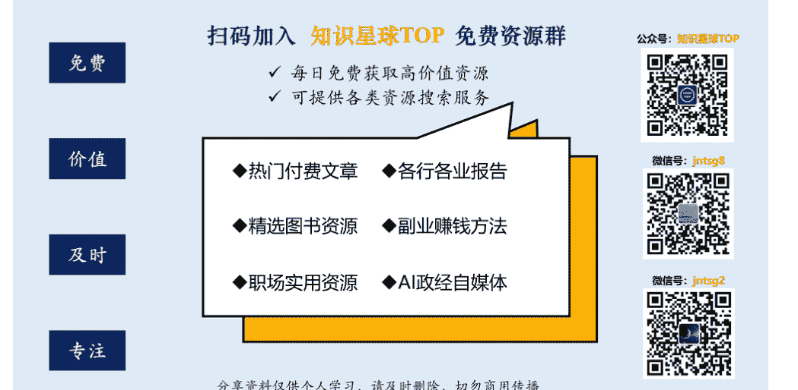
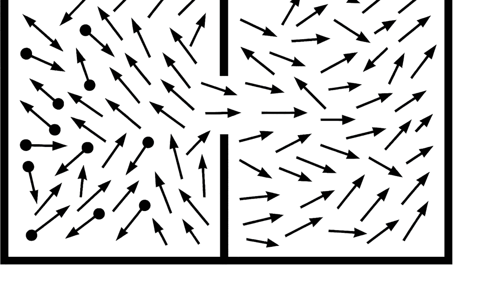
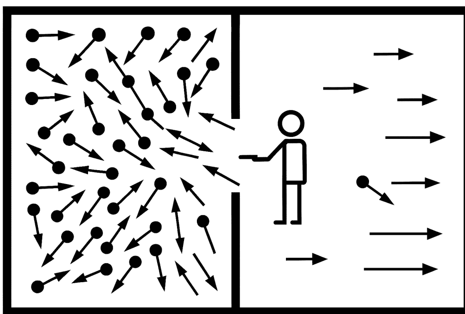
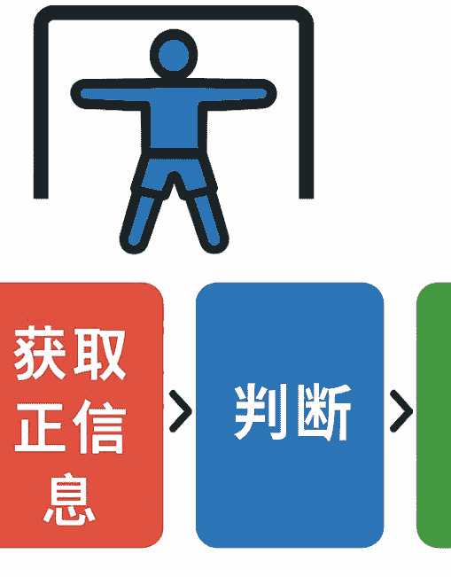
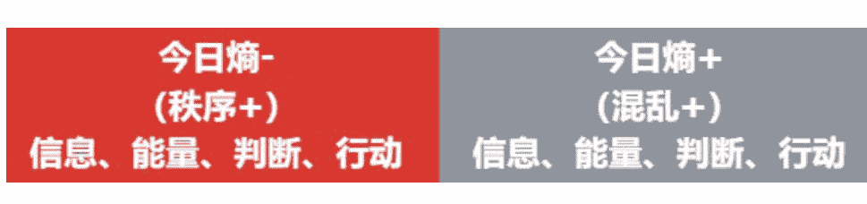
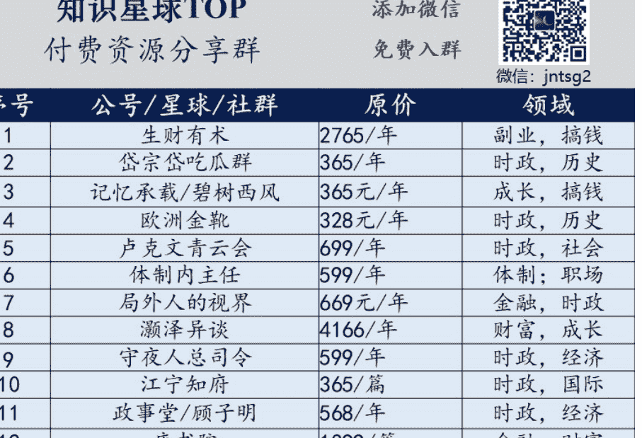

[/content]

# 如何系统地提高成功概率?

## 250717 生财精华

有没有一个公式，可以帮助创业全过程的决策？

大家好，我是包子

在过去的两年，我裸辞转到了一个完全陌生的领域，一个人在家里做到了赛道头部IP，具体的心路历程可以参考生财的这篇文章：

AI+IP，一人公司，如何狂奔到垂类赛道TOP10
https://mp.weixin.qq.com/s/C2DTG9WobnlPwM2eeTsncA

创业中找方向和坚持是最难的，所以大家都要强调早取得正反馈。而在高考志愿这条赛道，高考每年都一次，填志愿就没几天，其他时间别说正反馈了，连反馈都没有。

其他时间，全靠自己不断的调试方向，那如何持续修正方向？做出合理的决策呢？

作为一个理科生，我希望找到一个公式或思维框架，能够应对创业中的全部情况。

没想到真被我找到了！这个公式不仅可以应对创业，我已经把它运用在了生活的方方面，都取得了很好的效果。那就是【熵增律】的麦克斯韦版。

# 系统为何走向失败/成功

任何系统，在没有外界干预的情况下，都会走向混乱，混乱导致失败。
这个世界的大，小，都是系统。“管理一个集团”、“做出出一桌好菜”、“养成一个好习惯”，都是系统。

放在户外的自行车，过一年车身就会锈斑斑，轮胎会漏气干瘪。
公司无论大小，只要没人干预，任放自如，就会走向混乱，走向破产。
孩子的学习，如果没有自己、老师和父母的刻意干预，就会越来糟糕。
房间只要没人收拾，就会越来越乱。

......

可能很多朋友，这就是中学物理基本常识而已，没什么特别的啊。

其实这条定律也可以反过来：

任何系统，在合理干预下，都可以走向秩序，秩序通向成功。
把自行车放进室内，定期维护，过几年都可以保持很新的状态，甚至会更好骑。

公司上下团结结心，目标明确，不断迭代 SOP，业绩大概率会变好。
孩子和父母沟通顺畅，学习认真，作业工整，成绩大概率会提高。
定期打扫整理房间，屋子就会很整洁。

......

我用这个视角观察世界已经两年多了，还没有发现任何例外。毕竟是基本物理律，人类认知世界的巅峰。如果你发现了例外，一定和我说一说。

创业也是一个系统，如果这个系统的秩序程度不断增加，那么成功的概率就会增加。
那么问题就来了，既然系统会自发的走向混乱，这和我们的预期恰好相反，如何避免混乱，走向秩序呢？

通过阅读科学史，我找到了物理巨擘麦克斯韦的思维实验。这个实验大的震撼了我，时隔两年还记得当时内心的澎湃，这就是我一直寻找的“成事心法”。

# 麦克斯韦的思想实验

整个宇宙也是一个系统，根据熵增定律，宇宙的结局就在走向热寂和衰败，这让物理学家无法接受。

如何让系统走向秩序呢？麦克斯韦提出了他的想法。

（以下叙述经过我的加工，更容易理解，并非麦克斯韦的表达原版）

这是一个混乱的系统，系统中的箭头方向各异，随机移动，毫无无序。

我们在系统中间增加分隔，左侧是外界，右侧是内部系统。虽然增加了分隔，目前左侧的外界系统和右侧的内部系统都是同样混乱的。

如果我们要在右侧的系统，只保留向右的箭头（秩序），那么可以在隔板开一个小门，并派一个人守在门口。

当“守门员”发现来自左侧的【向右的箭头】想要去右侧系统，就放它通过。
当“守门员”发现了来自右侧的【不是右的箭头】想去左侧，也放它通过。
其他情况都不予放。

那么，随着时间的推移，右侧系统的向右箭头会越来越多，也就是说，这个系统走向了秩序。

很显然，核心就是这个守门员，只要守门员保持正确工作，那么右侧系统就会走向秩序。

守门员代表了各种身份，创业者是事业的守门员，父母是孩子的守门员，自己是健康的守门员，只要有系统，就有守门员。守门员通常不是某个具体人的，当一个在系统前的“自动门禁系统”更理解守门员想要【正确】工作，只需要四个动作：

1. **获取正能量**：有正能量才能干活。薪酬、流量、吃饱饭、好情绪，都是正能量量，反之坏情绪、生病，都是负能量。
2. **获取正信息**：生财的运动航海，推荐大家都参加。知道什么箭头是对的，什么是错的。判断信息质量很难，总体来说，付费信息比免费信息质量更高，大佬的信息质量更高。
3. **判断**：判断的箭头是哪种。这一步在创业圈一般称为“认知”或“决策”，判断质量非常依赖前两步。
4. **行动**：放行/不放弃。执行计划。

# 守门员四步法

说起来容易，这其中坑也挺多。正能量让人充满动力，负能量就不想干活了；正信息帮助正确判断，负信息导致错误判断。讲得太抽象，用案例来解释吧。

# 案例做IP过程中的一些决策

一个人在家做IP，每天都在做决策，怎么根据这套框架来做决策呢？

## 视频如何做到行业标杆

自媒体都想做爆款，那么如何做出爆款视频呢？

从麦克斯韦的角度出发，怎样让【做爆款视频】这个系统更加秩序？

**系统名称：做爆款视频**

- **获取能量**：能涨粉，有认可，有正反馈，自然有能量。
- **做这事**：
- **获取信息**：拆解赛道，获取头部IP的知识，也要掌握优秀的视频表达形式。
- **判断**：哪些是我能做到的。
- **行动**：调研了全部，写了3万字的稿子，做了专业视频，通过不断重复步骤，我的视频成了行业教材。

（注：由于原文OCR存在大量重复和乱码，此处根据语义还原了核心逻辑框架）

---

# 直播起号过程中的决策

在直播间起号过程中，有不少机构招募，甚至出了百万薪，当时我的收入是0，那么该怎么决策呢？

**系统名称：直播间目标做到头部**

- **获取能量**：早进入机构，会消磨直播的热情，属于负能量。
- **获取信息**：机构带货，对直播间没有信息输入。
- **判断**：机构带货，对直播间做到头部是负作用。
- **行动**：拒绝了机构，按照自己思路打造直播间，三个月就到了道头部，收入超过了机构。

（注：原文OCR极其严重，此处根据语义还原了核心逻辑框架）

---

# 高价值IP应该做课程吗？

从麦克斯韦的角度出发，做课程对高价值IP有什么影响？

**系统名称：高价值IP**

- **获取能量**：花费太长时间在课程上，是负能量。
- **获取信息**：学习费曼法，我对AI的理解更深入。
- **判断**：是一个趋势，也是短板。
- **行动**：主动摄入信息，做课程属于打造。

（注：原文OCR极其严重，此处根据语义还原了核心逻辑框架）

---

## 如何让自己精力充沛

创业这个过程，精力充沛是最基本的要求的。通过这套思维框架，可以很好的提升精力状态，也是我自己实践的成果。

**系统名称：让自己精力充沛**

- **获取能量**：吃高纤维、高蛋白食物，多吃蔬菜、少吃碳水、多运动、充足睡眠、保持积极情绪（负：高糖高油食品、不规律作息、负面情绪、不运动）。
- **获取信息**：大佬的健康计划、精力管理、健康睡眠的书籍、资深的运动教练（负：咖啡续命、乱七八糟的保健品）。
- **判断**：根据以上内容制作精力管理计划。
- **行动**：坚持执行计划。

按照这个框架，【让自己精力充沛】这个系统会不断秩序化，精力越大越好。

# 新事业从0到1怎么做

开启新事业，从零到一是最难的，很多圈在这个环节，要怎么做呢？

**系统名称：完成新事业从0到1**

- **获取能量**：找到赚钱的圈子，会发现形形色色的人在包罗万象的世界里赚钱，让自己也充满能量。参加航海，先赚到1块钱，获取正反馈，就有正能量了。
- **获取信息**：先浏览全部内容，重点关注官方内容，因为官方内容是经过筛选的，信息质量更好。找到每个赛道取得成果的大佬，向他们请教。
- **判断**：找几个自己适合的项目。
- **行动**：多参加航海，躬身入局，把项目弄实。

# 线下课 vs 线上课哪个更好？

在《如何提高成功率》中，已经给出了：顺势而为。这里有两个，一个是优势，一个是趋势。哪个更重要？

许多人完全同意他的看法：优势为趋势更。

从麦克斯韦的角度出发，按照哪个趋势干活，让你的系统秩序化越高。

- **优势**：贸然进入一个陌生的行业，你的系统就是一片混乱，积累的过程慢。
- **趋势**：这个系统会不断带来正能量，秩序程度不断提高，哪怕躺平也可以跑过行业平均水平。

所以在大部分情况下，应该根据优势干活。那么，如果要根据趋势干活，要注意什么呢？某个行业有不可挡的正能量输入，不要上班的工作。比如2005年的房地产，2010年的移动互联网，现在的自动化+AI。

相反，如果你的系统持续不可抗力的负能量，那就赶紧撤离吧。比如2018年后的房地产、基础建设、教培，就被一大堆不可抗力的负能量打了。老龄化和低生育率，未来也会给部分行业持续注入负能量。

# 最后的建议

| 阶段 | 任务 | 耗时 |
| :--- | :--- | :--- |
| **第一阶段** | 调研、需求 | 2天 |
| | 筛选适合自己的产品 | 1天 |
| | 准备账号 | 0.5天 |
| | 完成账号与定位 | 3天 |
| | 获取优质产品并上线 | 1天 |
| **第二阶段** | 制作脚本 | 4天 |
| | 参考优秀，制作笔记 | 4天 |
| | 持续更新，每天3篇笔记 | 0.5天 |
| | 选题、交付 | 0.5天 |
| | 持续优化，开启迭代 | 14天 |
| **第三阶段** | 规模化 | 4天 |
| | 有反馈后用AI生成 | 3天 |
| | 每天发3篇笔记获取流量 | 14天 |

# YouTube Shorts

| 阶段 | 任务 | 耗时 |
| :--- | :--- | :--- |
| **第一阶段** | 了解平台、准备账号 | 2天 |
| | 了解平台素材 | 1小时 |
| | 了解YPP并开始剪辑 | 1小时 |
| | 准备器材、注册账号 | 1小时 |
| | 完善基础、开始发布 | 1小时 |
| **第二阶段** | 确定赛道、掌握技巧、发布第一个视频 | 2天 |
| | 了解热门、确定爆款方向 | 2小时 |
| | 学习视频剪辑技巧与发布方法 | 3小时 |
| | 在实战中找到规律并迭代 | 3小时 |
| | 使用AI工具制作第一个Shorts | 1小时 |
| **第三阶段** | 规模化，通过YPP获取收益 | 12天 |
| | 建立内容流程，每天更新1~2个视频 | 8天 |
| | 优化内容质量、提升增长率 | 3周 |
| | 达到YPP通用后开启变现 | - |
| | 了解拆解与运营策略 | 2周 |

这套思维框架，我已经用了两年，定期记录近期的秩序/混乱变化。

如果发现近期信息摄入不足，就会主动获取信息。
如果在某个事情上想太多，做得太少，那就多行动。
如果是能量问题，那就好好调整饮食，运动，睡眠和情绪。
如果是判断失误，那么大概率是正面信息摄入不足，还不足以支撑判断，也就是认知问题，多摄入信息吧。

不想记录也罢，在生活中的大小决定中，哪怕说一句话，也可以想想：这会为我的系统注入正能量还是负能量，会带来正信息还是负信息？

荣说，当你的潜意识还没有进入意识，那就是你的命运。

我的理解：生活由无数个下意识的行为组成，这些行为对各项系统输入能量/信息，命运的轮车就此而转动。

感谢阅读，对你有帮助更好啦😉

+   + 图书、报告、课程等各类高价值资源，不再列表

+   ⭐ 免费 每日分享资源

+   ⭐ VIP 每日分享所有资源（日均20+），75/
