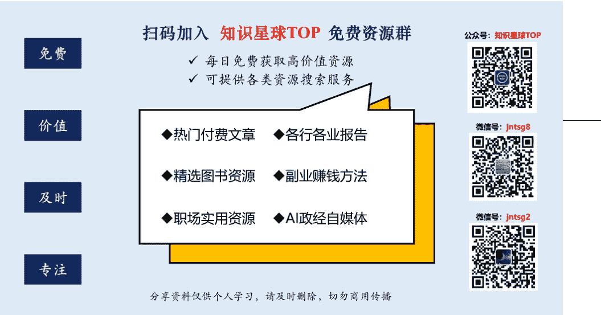
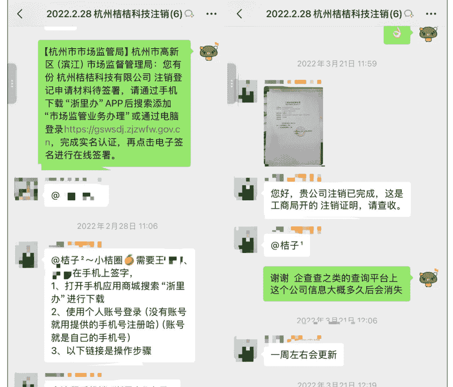
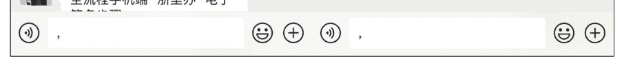
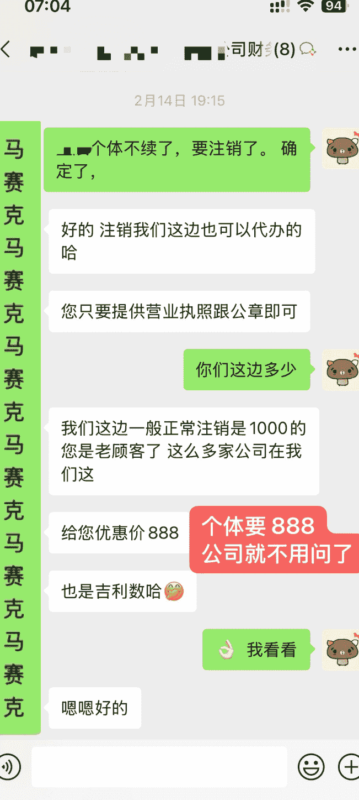
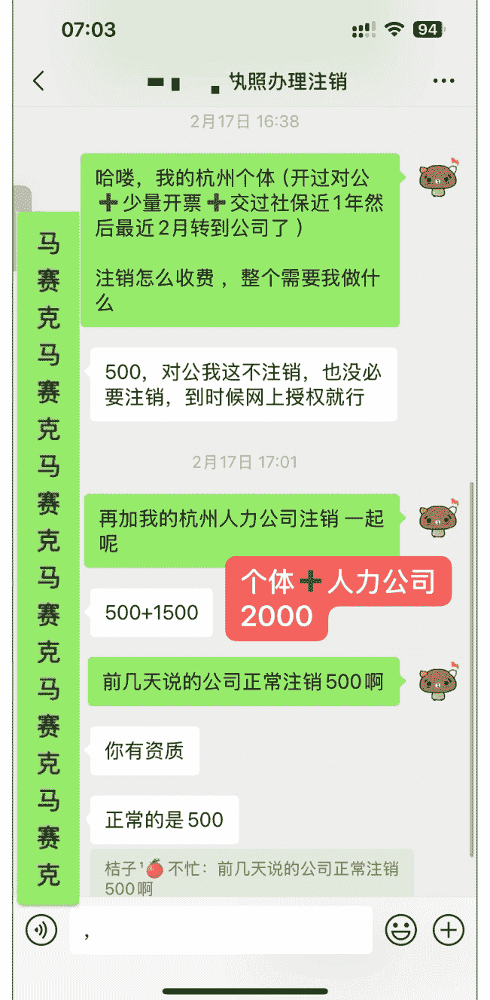
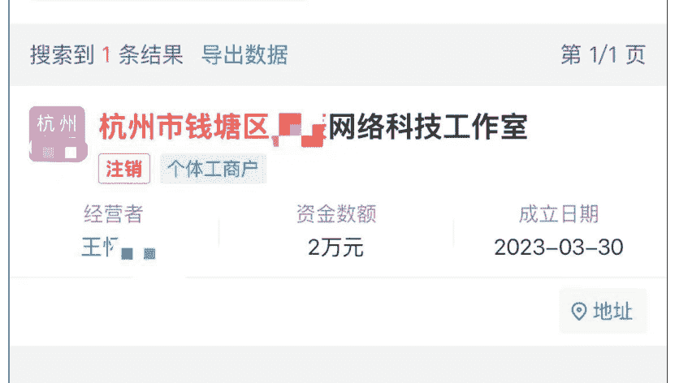
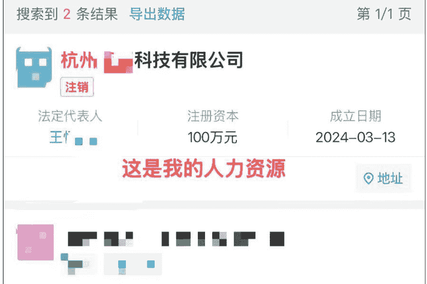
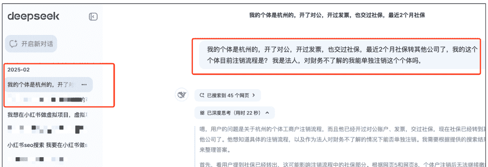
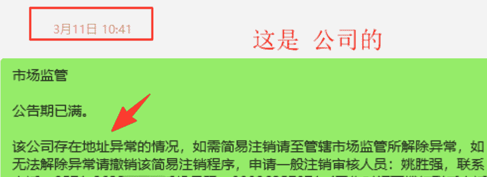

# 开了对公户的个体/公司营业执照 成本注销攻略

250717 生财精华

个体营业执照注销，最低要500？公司最低要1500？土豪老板不用看，执照不在自己本地/附近地区的也不用看，今天完整讲解如何0成本注销已经开了公账户的个体/公司营业执照。

我知道这篇揭秘文章会对各位财务公司圈朋友（帮代注销）造成一定损失，但我还是得写出来，在生财，就应该有信息差。

# 前言

今年1月底，要注销个体与公司时，我就在生财（目前付费星球我只在生财）专门搜索个体注销 公司注销 执照注销等除了代注销广告外，我没有获得任何注销指导全流程的帖子（可能我太弱，没搜到关键词）。

我那时候暗暗发誓，我必须自己全程跑出结果，然后写个和我一样的新手看了就能自己去操作注销的帖子，省下一笔钱。
时隔几个月，我的2个执照都已经注销成功，我有资格愣了！

# 一、我曾经花 1500注销了公司营业执照（我是大冤种）

我第一个公司是2020年办理与开对公，为了可以批量注册 50个公众号（需要时间，累计近半年），找的杭州比较大的财务公司0办理+付费代账，2年后，我觉得不需要了，想注销，咨询了要 1500，就是让他们代注销了。

注意：我当时根本没有意识到，其实个人是可以可以自己去注销的，根本不需要别人来代劳（土豪或不在本城市不方便过去的）（没想过也没人告诉我）。

微信|intsg2 资料分享

# 二，新办的个体与人力资源公司营业执照需要注销

因为业务需要，我办了杭州的个体执照与杭州的人力资源公司执照。

其一，这个杭州个体，开了对账户，开过的票，交过社保后转移到我其他公司了。

其二，这个杭州人力资源公司，开了对账户，有人力资源资质。

今年2025年2月份，因为业务探索失败，执照挂靠地址又要续费了（很多钱）这2执照用不到，都需要注销，如果是你，你是不是和我一样，觉得自己的执照有过那么多东西（对公 发票 社保）存在，只会找财务代注销？

没错，这就是我当时的想法。

## 注销价格

微信登录进料分享群

我咨询了公司与个人，这是分别是的报价，2个加起来最低2000（我第一次公司注销1500，所以这次报价我也能接受）但是，我当时时间比较空，突然灵光一闪，我为什么不自己注销？？！！！

PS:当你想不到或无人告诉你的时候，就是信息差。

于是我直接找AI查询，然后小红书查询【杭州对公账户如何注销】【杭州资源公司执照怎么注销】之类的，然后尝试了下，只花了了自己的路费就搞定了（相当于省了至少2000😅）。

加微信intsg2，进资料分享群

## 时间太久了，有些和ds聊天内容找不到了，我的方式就是先问AI，再查小红书或抖音，相互佐证，还有疑问就对应区域的工商如市民之家的电话。

以上这些都是2月份看不懂的我操作的，现在看了帖子的不用视这些啦看下面。

杭州个体经营执照开设对公户后，要注销个体工商户，需要先处理银行账户，然后再办理。以下是线下注销流程：

### 第一步：处理银行对公公户

- 先要到银行网点或通过银行的企业办理对公户
- 准备营业执照、身份证、银行许可证等材料
- 确保账户内余额清，未处理业务

### 第二步：线上注销个体工商户

浙江政务网（www.zj.gov.cn）：
1. 登录“浙江政务网”
2. 选择“杭州市”-个体工商户注销
3. 填写《个体工商户注销申请》
4. 上传所需材料：对公户、营业执照副本

## 杭州个体经营执照开设对公户后，要注销个体工商户，需要先处理银行账户，然后再办理。以下是线下注销流程：

### 第一步：处理银行对公公户

- 先要到银行网点或通过银行的企业办理对公户
- 准备营业执照、身份证、银行许可证等材料
- 确保账户内余额清，未处理业务

### 第二步：线上注销个体工商户

浙江政务网（www.zj.gov.cn）：
1. 登录“浙江政务网”
2. 选择“杭州市”-个体工商户注销
3. 填写《个体工商户注销申请》
4. 上传所需材料：对公户、营业执照副本

## 杭州个体经营执照开设对公户后，要注销个体工商户，需要先处理银行账户，然后再办理。以下是线下注销流程：

### 一、线上注销个体工商户完整流程

主要步骤：
- 登录“浙江政务网”（https://www.zj.gov.cn/home）
- 使用“浙江企业登记全程电子平台”
- **重要**：首次需要“核验”。
- 搜索“杭州公司注销流程”
- 想注销的伙伴，先去线上体验。
- 如果写错了、填错了没关系，会有专门审核人员驳回并告诉你哪里有问题。
- 如果看不懂，可以直接打电话咨询任何财务人员。
- 遇到税务问题，跑去钱塘那边税务局，市民之家服务人员帮我一次搞定。

### 二、具体操作步骤

1. 手机登录
- 打开“浙江政务网”APP
- 在首页搜索“企业办理”
- 选择“杭州市”作为办理区域
2. 点击“我的申请”
- 查看指南、相关信息
- 提交“企业注册申请”

### 三、办理完成

1. 提交“企业注册申请”
2. 等待合规人员进行审查并通过
3. 各业务部门受理后，申请人在用户中心查看状态

提示：未在工商登记机关完成主体信息变更的可以继续办理注销，公司公告后、合并、解散注销需变更后办理注销登记。

## 杭州个体经营执照开设对公户后，要注销个体工商户，需要先处理银行账户，然后再办理。以下是线下注销流程：

### 第一步：处理银行对公公户

- 先要到银行网点或通过银行的企业办理对公户
- 准备营业执照、身份证、银行许可证等材料
- 确保账户内余额清，未处理业务

### 第二步：线上注销个体工商户

浙江政务网（www.zj.gov.cn）：
1. 登录“浙江政务网”
2. 选择“杭州市”-个体工商户注销
3. 填写《个体工商户注销申请》
4. 上传所需材料：对公户、营业执照副本

## 杭州个体经营执照开设对公户后，要注销个体工商户，需要先处理银行账户，然后再办理。以下是线下注销流程：

### 第一步：处理银行对公公户

- 先要到银行网点或通过银行的企业办理对公户
- 准备营业执照、身份证、银行许可证等材料
- 确保账户内余额清，未处理业务

### 第二步：线上注销个体工商户

浙江政务网（www.zj.gov.cn）：
1. 登录“浙江政务网”
2. 选择“杭州市”-个体工商户注销
3. 填写《个体工商户注销申请》
4. 上传所需材料：对公户、营业执照副本

## 杭州个体经营执照开设对公户后，要注销个体工商户，需要先处理银行账户，然后再办理。以下是线下注销流程：

### 第一步：处理银行对公公户

- 先要到银行网点或通过银行的企业办理对公户
- 准备营业执照、身份证、银行许可证等材料
- 确保账户内余额清，未处理业务

### 第二步：线上注销个体工商户

浙江政务网（www.zj.gov.cn）：
1. 登录“浙江政务网”
2. 选择“杭州市”-个体工商户注销
3. 填写《个体工商户注销申请》
4. 上传所需材料：对公户、营业执照副本

## 税务区有几个工作人员，说是解答辅助，其实全程帮我们操作，去了两次市民之家（主要是税务问题和一般注销）搞定的。
PS: 

我问：代注销的人会操作流程吗？对方：哪里会，都是我们操作的。明白了吧，代注销只是跑腿（税务有问题，必须到现场解决），适合土豪老板和其他地方的执照（自己不去算）。

## 因为注销了，浙江政务网也登录不了，所以没法截图相关的情况。真的不用担心，直接干，按照我说的流程走只要你提交了线上，就会有人审核你，所以你不用咨询任何人。

只要你要注销，不管你的个体或公司因为各种问题（地址过期税务异常等），直接先提交，专业的人来辅助我们。要不然你去问财务或代注销公司，他们都会说这个问题比较严重，注销加钱之类的，你不信去问。前周六去财务总部参加局，回来路上和小伙伴们起了这事，没想到他们俩不知道自己可以注销个体/公司的事，都以为财务公司代注销，所以我这天天着急写文章，希望帮助更多像我一样资金比较薄弱的伙伴，把钱花在项目上不香吗？

PS: 已经写的很详细，不用专门找我咨询。感觉对自己用的伙伴点个赞吧~

# 增加个体注销实操，新鲜的

我的杭州个体/公司都注销了，还有一个杭州的公司目前在减资，无法演示注销，我用一个之前网上办的几十块的海南省海口的个体来注销，今天是7月15日。

## 海口区个体营业执照如何上登录详细步骤

我从来没有提交过海南注销，我也是第一次，刚刚找AI才知道的海南执销的网站。过程中我就花了十多分钟，不用怕自己提交信息对不对，会有审核人员给你反馈，哪里需要调整再去调整，主要是要有胆去做。其他地方的伙伴，和我一样，去AI搜索网站，然后操作就行，每个地方注销流程都是差太多了。

### 先问AI

海南海口区的个体营业执照怎么上登录，帮我查询缴

我来为您介绍海南海口区的个体营业执照如何上登录的详细步骤：

### 一、手机登录

海南政务服务网，下载APP，搜索“企业办理”，根据企业类型选择“个体户”并点击实事办理。

### 二、具体操作步骤

1. 手机登录
- 打开“海南政务网”APP
- 在首页搜索“企业办理”
- 选择“海口市”作为办理区域
2. 点击“我的申请”
- 查看指南、相关信息
- 提交“企业注册申请”
3. 办理完成
- 提交“企业注册申请”
- 等待合规人员进行审查并通过
- 各业务部门受理后，申请人在用户中心查看状态

提示：请核对您的银行账户，确保填写的银行账户准确无误。

## 基础信息

### 1. 基本信息

企业注册信息
- 注意事项：停止注册
- 提示：已注册 停止注册

委托代理人

| 委托代理人姓名 | 身份证号码 |
| --- | --- |
| 张 | |

填写委托代理人信息，请确保填写信息无误。

联系电话

| 电话类型 | 手机号 | 状态 |
| --- | --- | --- |
| 手机 | 2025-07-15 | 不意愿 |
| 座机 | 2025-10-14 | 不意愿 |

确认企业信息的准确性，确认委托代理人的联系方式。

### 2. 银行信息

- 提示：请核对您的银行账户，确保填写的银行信息准确无误。

| 银行基本账户 | 状态 |
| --- | --- |
| 未开立银行账户 | 确认 |

（注：此处根据OCR内容进行了逻辑去重修正）

### 3. 证照注销

是否可以同步选择许可证即可：
- 注意事项：可注销
- 基础许可证可注销
- 商品许可证可注销

### 1、上传资料

### 2、电子签

### 3、提交

## 14、注销成功

| 企业名称 | 海口琼山区...科技工作室 |
| --- | --- |
| 统一代码 | 92460Q...PG2Y |
| 执照密码 | |

> 执照已失效！请“删除执照”后重新下载执照！

昨晚晚上提交，今天上午就注销通过了，登录直接显示失效了（这个是网上的普通个体，没有开公账号）。刚被注销的，是查不到的，我们可以3-7天去查询。微信小程序：企查（免费）或国家企业信用信息公示系统 https://shimxt.gov.cn/（这个我的谷歌浏览器查询不了，能进去刷新，我用的其他浏览器查）。

公司减资预告
PS：公司减资外面要码吗500-800以上，我也提交了公示，已经45天满了，下面流程也跑通了，在整理书中

杭州公司减资线上操作流程：
1. 打开国家企业信息公示系统，选定“浙江”，依次进行企业信息填报-公示公告-企业减资公告，然后选择电子营业执照登录或者数字证书登录。登录后选择减资金额，点击保存公示。一定要把公示截图保存好，后期在政务网查看截图。
2. 公示满 45 天后，登录“浙江政务服务网”，选择企业变更-注册资本变更，并按要求填写。
3. 网报材料通过后，在“浙里办”。

# 知识星球TOP付费资源分享群

添加微信 免费入群
微信: jntsg2

| 序号 | 公号/星球/社群 | 原价 | 领域 |
| :--- | :--- | :--- | :--- |
| 1 | 生财有木 | 2765/年 | 副业，搞钱 |
| 2 | 怂容怂从吃瓜群 | 365/年 | 时政 |
| 3 | 骏树风 | 365/年 | 副业，搞钱 |
| 4 | 欧洲靴 | 328/年 | 时政，历史 |
| 5 | 卢克文会 | 699/年 | 社会 |
| 6 | 体制内主任 | 599/年 | 体制；职场 |
| 7 | 外局人的视界 | 669/年 | 金融，时政 |
| 8 | 灏泽异谈 | 4166/年 | 财富，成长 |
| 9 | 守夜总司令 | 599/年 | 时政、经济 |
| 10 | 江宁知府 | 365/篇 | 时政、国际 |
| 11 | 政堂/顾子明 | 568/年 | 时政、经济 |
| 12 | 唐书院 | 1399/篇 | 金融、财富 |
| 13 | 大树乡谈 | 199/年 | 时政，成长 |
| 14 | 水库欧大 | 1000远 | 房产、经济 |
| 15 | 洪灏的宏观策略 | 4376/年 | 经济、搞钱 |
| 16 | 金政通鉴/北海道南山 | 4576/年 | 股票、行研 |
| 17 | 猫豹的世界 | 299/年 | 时政、社会 |
| 18 | 飞沫 | 3600/年 | 股市、经济 |
| 19 | 米联储见闻 | 599/年 | 经济、金融 |
| 20 | 鉴茶财经院 | 330/年 | 房产、股票 |
| 21 | 赢在八小时之外 | 365元/年 | 成长、职场 |
