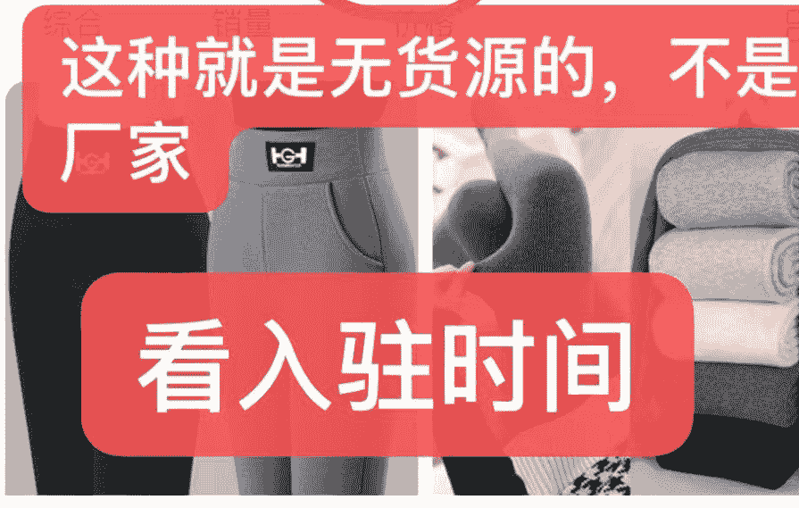
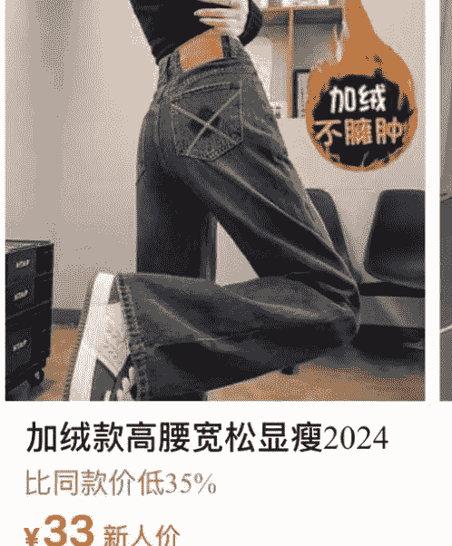
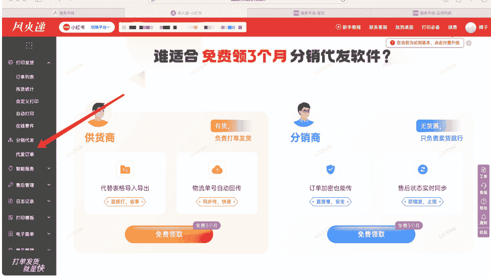

# 电商卖保姆级实战手册（个人玩法/团队玩法 0-1/1-10 必看）

250717 生财精华

《97年女生，13年做过的20种赚钱方式：我靠穿戴甲、肝单、客服、跨境一路闯出来》

先做一个自我介绍，Hi 我是晴子，97 年女生，今年 29 岁。

我是今年 6.18 加入生财的，首先感谢吴泽承老师带我加入生财有术。同时也感谢北京的圈友们悦享厅的小伙伴们，王子冯老师，和戴巍老师鼓励我从家里办公向办公室哈哈。

内容比较长，全文有2 万字左右。

我从 2012 年初读书的时候就开始赚钱，我一路手机流量卡、肝单、美甲、直播、电商、外贸、实体踩坑，再到今天探索更长期可持续的事业，这个过程是我不断错、不断进化的成长轨迹。

## 我的赚钱起事 (2012-2013)

起初是初暑假，我想去做暑期工，然后我妈给我找了一个做楼下乡的工作。工资一天 20 元+销售提成，工作时间就是早上 7 点-晚上 8 点这样，我就干了两天，因为受气，也觉得给人打工赚不到钱。就不做了。现在回想，那时倒是不敢开口说话，不敢跟别人推销产品。

2012 年靠卖手机流量卡开始赚钱，证明了 2G、3G、3G+、4G 的互联网发展。为什么卖手机卡，我不太记得了，可能是我家里比较信玄学，那时候有数字学，什么手机号尾 13131 好的，所以那时候玩贴吧，就找卖手机号的，然后后来看到别人在贴里卖流量卡，我就加了那个供应商的 QQ 号，然后我就开始了赚钱之路。我手机卡的获是通过贴吧，那时候好像也有陷阱，“附近的人”是通过这种渠道卖的，我家也支持我，我上学的时候有人过来拿手机卡都是家里人帮忙送出去。

2013 年做淘宝钻单，一开始是我姐做，后来变成了我放假做，然后就一点点的从钻手到主播到自己开团，自己开团可能有七八百个会员，我们有 20 个主播，还都是需要跟我们付费的，一个主播收 600 块。

那时用的 YY 语音，我记得放寒假，我住在家里单放，从早上十点起床到凌晨四五点，每天重复，做主播挣钱的时候一天一千块，应该持续了一个寒假。后来结束，招主持，主持的来源都是这些刷手，然后就把客户的单子分出去。说到这个，我觉得我们人缘可能恰好一点，很有多转介绍的客户，那时一天能接几百单。单子多一样，我都把单子订单组合打包给会员，打包单子佣金可以给低一点，那多出的钱就自己赚了，积少成多，大概这个过程：

## 美甲生意（2014-至今）

我做微商比较早，肝单就是做微商后做的，那个产品我记得涵涵瘦腿、瘦脸、排毒什么的。不知道还有人知道这个产品 😊 这个微商获客有软件可以加客户到微信上，128 元加一两千人，但是真可以卖出东西，就是别人主动加你，我们也加满了几个微信。

2014 年底，2015 年，2016 年美甲贴纸，这个是做微商，微商也是我姐开始做的，然后我做。这个美甲贴纸叫何色，我们就一个月做了最高等级，卖了几万贴出去，这个美甲产品就是天一天一冷，就好卖，冬天是最赚钱的时候。

2016 年底做穿戴甲，为啥能接触穿戴甲，因为我那个时候就开始付费进圈子的，有一个叫质质哥做外贸的，别人找他发朋友圈广告，我看到了，就加了微信。然后我越看越喜欢，所以我和姐说试试，一开始做，后来让我姐说不做，最后赚了百万。这个生意改变了命运的穿戴甲。

## 短视频 & 直播（16-至今）

2016 年做快手，2017 年做抖音，2018 年快手直播的时候我都做，每次都上了风口，拿到了一些果。2019 年后遇到疫情，接触了外贸，所以我就做了跨境电商。一开始做快手的时候，短视频引流，让我姐去做，因为总是动不动封控，这个决策救了我的。我记得是 2022 年 1 月全面开放吧，那时候我就决定不做工厂了。闲了搬运国内视频，然后 TikTok 也涨了很多粉丝，一天赚了万。

## 开工厂+实体踩坑

我自己也开过穿戴甲工厂，这里我也踩过坑：具体讲一下，是在疫情那几年做的，其实疫情让行业加速发展，也让跨境电商加速发展。那时候决定开工厂也是出口订单特别特别，那时候想赚笔钱，开始的时候供不应求，后来货做越多的。再加上疫情封控，国外客户发出去，面临违约的风险，那几个月天天失眠睡不着，真的压力大。

为什么能扛下来：就是做了风险分流。我找几个关系好的厂家商量，我说能不能货发出去一些，减少一点风险。就是自己仓库发不了，就让另一个仓库发。

后来不做工厂了，把库存全部低价出掉。运气好的是，这个事情没有亏钱，但是没多少钱。而且后面市场越来越卷，当时决定不做是对的。2023 年我还是继续零售的，因为相比重资产 ToB，零售更灵活，轻资产，风险可控。

实体踩坑经历：2023 年 10 月在中关村接了一家别人转让的美甲店，做了一个月，迅速转出，一来去亏了五万块钱。亏损原因就是想当然觉得能赚钱，没有实地坚持一段时间，头脑一热就做了，实打实的亏钱了。实体店要坚持一段时间市场考察才能考虑要去。

## 其他项目：外包客服团队

我在 2018 年也投资过一家外包客服的公司，接待各电商平台的售和售后，现在也一直在做，如果需要这方面资源的可以联系我。我们不是价格最低的，但是服务上我觉得还可以，是市面正常的价格。有的客户会跟我说的比较多，很多我都经历过，所以我会力所能及提出的建议，基本都有一些收入上的增加。有外包客服需求的圈内可以找我联系我。

## 我的现在和未来

这些年做过很多行业的 0-1，但是没有发展团队！！这个是认知上的不足，因为我是小城市生活的，全靠自己琢磨做事，也幸运中抓到一些风口，赚了一些钱，有了一些积累。

我也很清楚：过去靠的是“敏感+执行”，未来要靠“认知+复利”。目前正在重新打磨自己，探索长期、稳定、有复利的事业模式，也希望和更多朋友、圈友一起交流、互助、成长。

以下是正文：写这个内容的背景，今天有个妹妹和我聊天，她是做服务类型的，现在多了一个卖货的想法，但卡在了发货、客服这些电商后端流程上。我觉得这个电商后端应该是人人都会的！！！！没想到她入百万大姐，居然不懂这个流程，这份笔记专门来拆解电商后端流程，包括订单、客服、发货、仓储、盘点、财务和一些经验分享。

### 一、我的观点：电商卖货并不复杂

我觉得卖货很简单，刚开始觉得很难。最关键的是不要边做边错，理清每个环节、流程和预期，配合一些靠谱工具，就能卖货得很松。

### 二、订单系统与自动化

如果你做了多个平台，比如抖音、小红书、淘宝、拼多多，怎么实现合并发货？使用第三方系统，它可以同步多个平台的订单，非常方便。如果平台不多，也可以一个后台操作。建议使用 ERP 系统，提升一些效率。

### 三、客服体系搭建：标准话术模板

因为客服很受气，容易结结，所以我建议把常见问题整理成标准话术。一些常见问题：
- 什么时候发货？
- 快递偏远运费多少？
- 产品规格（如尺寸、颜色、材质等）
- 库存情况，是否有货？
- 商品质期（如食品、美妆等）
- 商品与描述是否一致，是否存在瑕疵？
- 退换货政策（期限、条件，是否支持理由退货）
- 退货流程（如何申请、是否承担运费）
- 商品质量如何处理，是否可以补发或维修？
- 店铺优惠活动规则（满减、折扣、赠品等）
- 订单号查询等

这些问题是覆盖大部分产品的，从选购到售后，你还需要梳理自己做一个 Word 文件，方便随时查看。

### 四、外包客服的好处

这是我几年前写的一个使用外包客服的好处，以及外包客服能提供什么服务。你可以参考你这样的烦恼，比如回复率，只要满足 3 分钟回复，市面上有很多便宜的外包客服，咨询少的 400-600 元一个月就搞定了。便宜的资源我没有，我们的客服是以服务为基础的，售前起步价格是 800 元，仅参考哈。

别人赚的钱自己搞内容，提高产品销量才是王道。现在各平台考察回复率比较严格，如果超时回复扣钱。如果你打算咨询量一天超过 10 个，并且利润不错，那我就建议使用外包客服，别自己受这个累。如果你已经在做电商，并且咨询量比较多，是自己找的员工，那也建议外包。这样的客户我见过很多，长期的员工需要上社保，周末至少休息一天，有的公司是休息两天，那么这两天的工作量谁来做？要不要别的员工替补，要不要老板下场。但是外包客服是一天服务 16 个小时的，全年无休，你想想这个时间做什么不好。有的老板觉得外包客服服务不好，这点我觉得不需要怀疑，其实外包客服可能比自己还专业。自己回复客服比较受气，而且客服是流动性较大的行业。

### 自己招聘时客服要考虑：

1. 白晚班工资，员工到位问题。
2. 水电网费，办公设备配置。
3. 招聘费用，培训时间。
4. 是否要吃住，提供住宿的问题。
5. 资金费用/节假日宿舍等问题、年终奖。
6. 员工安置费用。
7. 五险。
8. 员工流动性大、流失率高，店铺难以稳定的问题。
9. 公司管理成本较高，客服周边绩效等等。
10. 客服月休息 4 天，休息时产生的工作量，需要增加公司运营成本，养成人才。
11. 节假日大促客服不够的问题。
12. 夜间值班。

### 发货流程详解：自己发货 vs 工厂代发

你要先决定你是自己发货还是一件代发？

#### 一、自己发货要做的事：

- 谈快递价格：找当地快递网点谈，一般可以到 2~3 元一个件。
- 买打印机，买盒子或者气泡袋，还有胶带、记号笔、小刀等常见工具。
- 发货过程：检货+打包+贴单。打印快递订单 -> 按照订单去仓库检货 -> 打包 -> 发货。
- 如果产品价值高，可以增加一个质检，二次检查产品。打印单 -> 按照订单去仓库检货 -> 质检 -> 打包 -> 贴快递订单 -> 发货。
- 退货处理：客户回来就寄到你这边的仓库，检查一下是否还能二次销售。能卖就恢复库存；不能卖就登记损耗，记下产品的成本和运费。

#### 二、一件代发的流程：

- 怎么找厂家？建议去 1688 找超级工厂/实力商家，因为这类店铺大多自有工厂，供货稳定，没有中间加价。
- 代发成本多少？我这边经验来看，代发打包+快递一般控制在 3-4 块钱以内是合理的。
- 退货处理？跟厂家提前确认退货地址，客户退货直接退给工厂。二次销售由厂家判断，你只需要记录就行。常规流程是拉群发货对接，有退回的产品，工厂客服会直接把退款发出来，扣掉运费。比如产品成本 23，运费 3，客服群里说退款 20 元，下次付款抵掉就行。
- 产品成本怎么谈？可以在 1688 谈，也可以加上厂家的微信，如果你已经在做内容，比如你的小红书订单截图、账号主页发给他看也行。

# 长沙市天心区巨亿贸易商

主营：女装 入驻1年 综合服务3.5分 30%回头率 履约率87%

湖南南天区开丰街道南大桥安居工程9楼114房-T509

+ 公司介绍 推荐 商品 1.6k 新品 分类 严选

德绒冬季加绒加厚底裤¥23.5 新人价

打底裤女外穿薄绒螺纹显¥19.7 新人价

新款时尚美式纯绒领辣妹¥23.5 新人价

### 三、如果订单多，怎么自动化?

如果你每天有几十甚至上百单，不建议你去1688一个一个下单，你可以使用第三方平台工具（比如小红书→服务市场→找到可以同步给工厂的一个软件→购买服务→一般一个月20块钱）同步订单给工厂，然后工厂发货，你的后台就自动发货了。

或者工厂打单号，你需要你自己手动点一下发货。（这个软件参考一下，别的软件也可以用）

### 四、和工厂交道的建议：

我作为一个开了 8年1688店铺的商家，我愿意配合别人代发，但你别太麻烦。我很多人上来就问价格、细节、授权、售后、一大堆问题，其实我订单量不高的合作我不是太愿意聊太多的。不忙的时候跟你聊聊还可以，忙的时候根本没空接待！！

所以你要做的就是（我的个人见解）：
把想聊的问题提前整理好，集中沟通，建议可以打个几分钟电话，谈完了就好了。不要一上来就压价；工厂给出一个合理的价格即可。

厂家愿意合作，一定是你让他看到你长期能出单的潜力；

开始让他们多赚点钱没关系，商家看到你有订单之后，后期谈价价格降了才好谈。

所以你有稳定的供货厂家，就一心去搞内容，价格高点没关系，一般也就多几块钱成本，先做起来，尽快提高订单量。

你有了单量和谁去谈价格都好谈，再给一个提示，就是一个产品会有好多家工厂去做。这个我建议你们多储备几家工厂，就别把鸡蛋放在一个篮子里，少多少对方有利一点利润，让其他工厂眼熟你。如果一个爆品你代发的工厂没现货了，那你不完了了嘛。所以这就体现了储备其他工厂的好处，不至于让你眼前一抹黑立刻找备工厂就回了。

或者爆品厂家突然加价格，你也可以找备选工厂，不至于被人拿捏。

### 五、厂商分销方式值得考虑：

你可以直接问厂家：“你在抖音/小红书有店吗？能不能帮你分销卖，你给我佣金？”

这样你售后都不用管，还能赚差价。非常适合新手、内容博主或精力有限的创业者。

## 五、仓储与库存管理：怎么管 SKU 和滞销商品?

如果你的 SKU 比较多，建议：
每 1-2 周盘点一次；然后同步更新产品库存，这样对产品有一个很好的掌控力，基本上也不会出现卖空的情况。

如果库存出错（比如卖超、发错）就会很影响发货，如果遇到你库存卖超，厂家也没有现货的情况就尴尬了，这时候你货发不出去，会特别影响消费者对你的信任以及店铺补销。

所以你掌控库存情况，一旦出现产品增加但是你没有现货库存的时候，也可以及时改预售，能有一个应对突发情况的准备。

✔️ 滞销商品怎么处理?

- 首先你可以当赠品送出去；比如他买了两件商品，你给他放一个赠品。
- 还可以引流促销，低价卖出去。
- 或者打包成「组合装」变成新产品。总控制数量，控制成本。

## 六、财务与记录

电商不是卖得多就赚钱，而是把每一单的真实成本和利润算清楚，才能知道自己值不值得。你可以选择每天记账，或者每周汇总一次，关键是要有账单落在表格里。要记录的费用项但不限于：

- 产品成本
- 仓储费用（不管是租仓还是外包仓）
- 快递费用（每单平均）
- 包材费用（胶带、纸箱、泡袋）
- 人工费用（打包）
- 平台扣点（如小红书、抖音服务）
- 推广费用（如投流、达人佣金）
- 仅退款损失（退货直接退款）
- 成本（包括运费+商品）
- 运费险（如有）
- 杂费

虽然不能算清楚，但是要有记录，全部合计后再拉一张表，看自己每个月的利润是多少。

怎么算利润：
你卖的订单数量 × 价格 = 总金额

## 七、售后与纠纷处理

电商一定会遇到售后问题，如果你按照上面提供的信息，减去所有的支出，最后得出利润。

#### 2. 退货与损耗

退货部分不要忽略，每天登记，看着很多，才亏了。我的办法是：
如果退来的产品还能用，就重新入库再次销售；
如果不能用了，登记成“损耗”，并计算这笔损耗（产品+运费），同时更新库存。

#### 3. 案例

如果产品单价比较低（如10~20元的产品、饰品、小工具）建议直接送给他，因为你成本可能就几块钱，然后再补一份新的产品。这样客户满意、口碑好，你也省去跑腿麻烦，最后总体上你还是有的赚。

### 售后流程：

#### 一、退货退款流程（含无理由退货）

如果你在意处理速度和客户体验，那建议：在客户退回的商品有了退货物流时，就直接给他退款，不要拖延。很容易被薅羊毛，你发给客户的是产品，他退回来的时候，包裹里装的却是破布、泡沫或者根本不是你的产品。这种贪便宜的情况特别多，做久了一定会遇到。

所以我建议：一定要有退货验收环节的录像或监控！建议仓库安装一个监控，或者每次收货时用手机拍摄一段视频，这些证据可以在平台申诉时上传，保护自己被乱退款。

如果来的货物不能二次销售？这种情况我一般给客户退款；这类损耗我已经习惯了，尤其是快递量多了之后，这种情况挡不住，处理效率更重要。

#### 二、换货流程（发错货/破损/错颜色等）

换货这件事，完全看你的商品价值来决定策略。

#### 三、快递途中破损或发错怎么办？

- 快递破损：让客户拍照包装箱子和产品是否损坏。如果部分损坏，就重新补发。如果客户不接受部分补发，你就只能全补发了，不讲理的客户比较少，也会遇到。
- 发错货：你可以选择交给客户（当赠品）+再发一次正确的；或者让客户退回再补发。
- 如果快递丢失了：你可以找平台赔付。

#### 四、投诉、平台仲裁应对？

这个问题非常重要，因为你再认真，难免遇到恶意投诉，平台申请后直接退款给他。所以你要做的就是：每天定时检查，看有没有出现“仅退款”记录；如果有，把监控视频、照片等证据上传。

## 八、团队做大后的发货与外包建议（含云仓策略）

当你从一个人卖货走向一个团队的阶段，你会发现：人力跟不上、订单不稳定、售后多、麻烦、客服回不来……部分环节外包是必经之路。我结合自己的经验，分享一下团队做大后应该怎么选择云仓、外包客服、代发等解决方案。

✔️ 什么时候适合云仓?

我的经验总结：云仓不是一开始就适合用的；只有你有稳定爆品+每天固定出单+人力成本开始吃紧，云仓才会发挥它的作用；否则，小卖家用云仓反而容易花钱。

### 云仓适用标准：

#### 云仓收费结构是怎样的？

- 发货服务费：通常在2元~2.5元/单，如你的单量大、结构简单（比如1个 SKU），可以谈到低于2元，轻小件100g以内。
- 仓储费：如果你有稳定订单，一般云仓不收仓储费；如果你单量少，那云仓会收仓储、SKU管理费等杂费，大概按平方参考，一平方几十，如50-80。
- 附加操作费：如果你需要赠品、小卡片、多 SKU组合，多一件就需要加收0.1-0.2元；一件单 SKU是最便宜的，组合越复杂越适合云仓。贴条码是一件五分钱。
- 退回费用：退货回来检查+入仓基本要2-3元的价格。

#### 谈价格的时候要怎么聊？

你跟云仓对接时，提供你的数据。

## 九、定价与利润对比：别卷价格，卷毛利！

### 一、拼多多模式下的“看似赚钱，其实在亏”

我身边有一个朋友，他就是典型的“看起来卖得很多，实际不挣钱”。我给大家复盘一下拼多多卖货流程：

产品售价：10元，产品成本：5元（货不好，退款多的），运费成本：2元（商家包邮），推广费：2元。
表面利润：10-5-2-2=1元。每天出单1000单，一家人从忙到晚发货，但是人工成本没算，打包物料没算，售后损耗没算（例如仅退款、破损、退货不能二次销售）。
拼多多平台经常通知商家就直接退款，有时退来的不是商品，是破布/垃圾，单损耗接近10元。实际情况：每天出单1000单，看起来火火，实际根本不赚钱，甚至在亏钱。

### 二、如何重新规划盈利型流程？（我实操帮朋友改造）

我后来帮这个朋友把产品搬到了小红书，做了一整套调整后，利润大幅提升，下面是改造后的流程：

小红书盈利型流程：
- 选平台+内容发布：把同一个产品同步到小红书，定位人群，不投流，靠内容出单（节省推广费）。
- 重新定价策略：售价提升至29.9~35元，对应客户接受的溢价：体验感、内容信任和包装感。
- 精准核算每一单成本：我把这个产品提高了质量，所以产品成本：8元。

实际利润计算：平均售价：29.9元，实际毛利：约16元，毛利率：约53%。
数据反馈：每天出单50单左右，不投广广告，每月净利润接近2万左右。

### 对比流程：赚钱模式 VS 卷死自己的模式

赚钱模式：高利润、稳定、高效率。
卷死自己的模式：低价、量大、出错率高。
