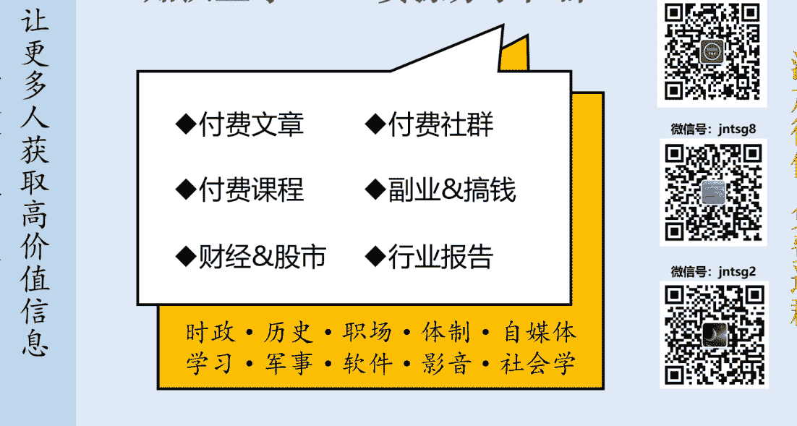
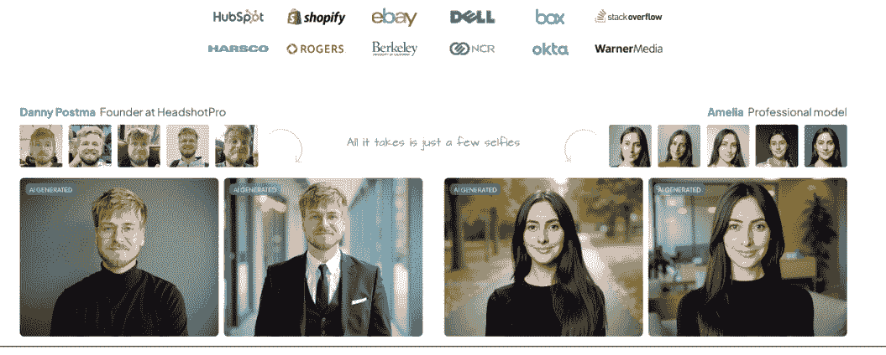
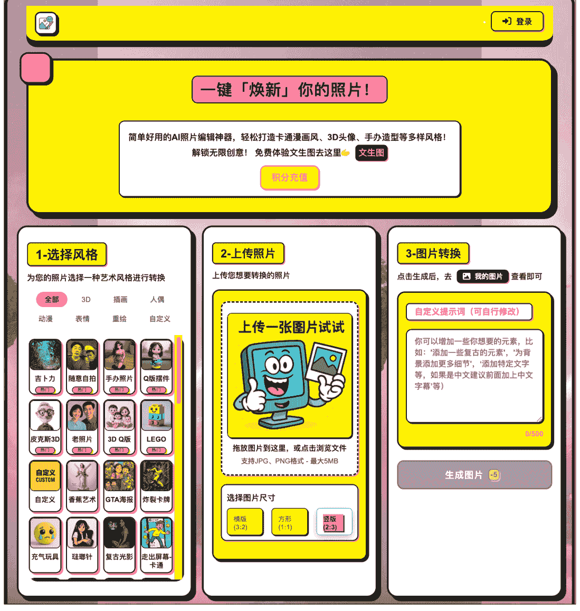
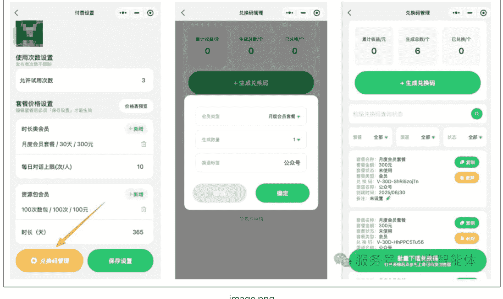
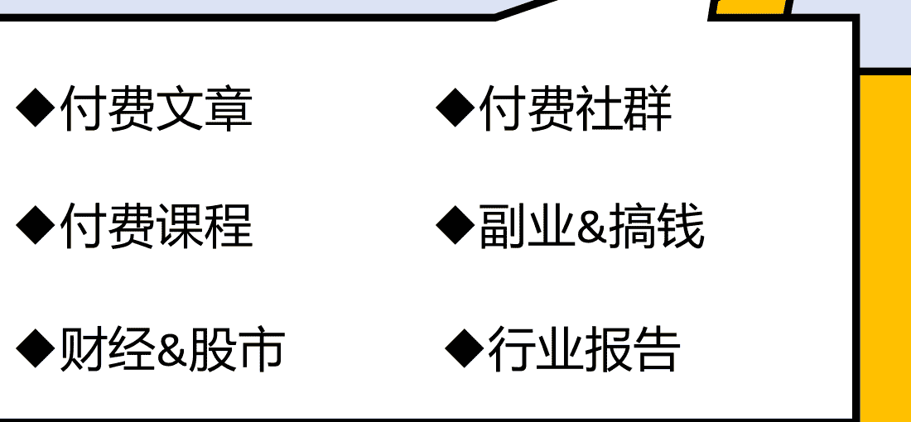

# AI 图像变现调研：普通人如何抓住红利，两大模型全解析

## 250704 生财精华

知识星球TOP 资源分享群

## I. AI 图像生成，让普通人也能掌握主动权

GPT-4o 发布后，我最大的感受是：AI 图像生成这个曾经需要专业技能和昂贵软件才能玩的领域，现在彻底成了咱们普通人的“免费午餐”。

过去，一张商业海报、一个产品 Logo，耗几百上千。现在，你只需要对着手机几句话，AI 就能在几分钟内“吐”出十张风格各异的专业作品。它把创作的门槛，几乎从珠穆丽玛峰降到了你家门口的台阶。

你还记得吗？二十年前，很多人看不懂淘宝，结果错过了电商时代；五年前，很多人看不上短视频，结果错过了流量红利。历史总是在重演。

AI 图像这波浪潮，不再是少数客的自嗨，而是指名给咱们这些“没背景、没资源，但有执行力”的普通人准备的新机会。如果此刻你还在错过的可能不是一个风口，而是一个能让你弯道超车的时代。

问题来了：风口就在眼前，我们怎么才能抓住？普通人真能靠 AI 搞到钱吗？

答案是肯定的。但关键在于，你不能只做一个刷图点赞的“消费者”，而成为一个“淘金者”。市面的 AI 玩法很多，但经过我反复对比和拆解，最终锁定了这两条路。它们是目前看来确定性最高、最适合我们普通人快速上手的 AI 变现路径，手把手带你少走弯路，直接开干。

路线图清晰：

- 模型一：“卖铲子人”模式。打造一台 7x24 小时帮你收钱的“AI 赚钱机器”（网站/小程序），做的是复利生意，天花板极高。
- 模型二：“淘金者”模式。直接用 AI 做图、做内容卖钱，主打一个“零成本、见效”，当天上手，当天就能看到收益。

接下来，我们把这两种模式拆开揉碎，配合全球爆款案例和国内落地玩法，保证你看看到就能上手。

## 2. 模型一：“卖铲子人”——打造一台不下班的AI赚钱机器

这条路，玩的是什么？

白了，这条路不是自己下场“淘金”，而是给所有“淘金者”提供最高效的“铲子”。

你不再是一张张地卖画，也不是靠信息差或体力赚钱。你的核心是打造一个产品（网站或小程序），把某个 AI 能力封装进去，让千千上万的用户付费自助使用。你需要解决的，只是一个非常具体、非常刚需的小问题，如“AI生成商务头像”、“AI照片修复”、“AI智能证照”等。

这个模式最迷人的地方在于两点：一是“规模化”，二是“极低的边界成本”。

前期你把产品打磨好，一旦上线，服务 10 个用户和服务 1000 个用户，你需要投入的时间和精力几乎是一样的。它就像一台你亲手打造的印钞机，一旦开启，就能 7x24 小时为你工作带来真正的复利增长。门槛确实比直接卖图高一点，但它的想象空间和长期价值，绝对值得你下功夫深耕。

### 拆解案例给你看：HeadshotPro.com 如何年入百万金

为了让你看得更明白，我带你拆解一个全球最案例——HeadshotPro.com，一个专门用 AI 生成商务头像的网站。

# 17,943,292 AI headshots created for 102,207 happy customers!

Reviews & examples

- 它解决了什么痛点？传统商务照，贵、慢、还麻烦。去影楼动上千块，预约排期加修图得一两周，很多人还有镜头恐惧症。
- 它的解决方案有多完美？HeadshotPro 直接把传统摄影的效率提升到 1/8，小时内交货。你只需要上传几张生活照，AI 自动搞定，效果跟影棚一样，又好又便宜。
- 它怎么赚钱？模式简单粗暴：29 美元买 40 张头像，对比几百美元的套餐让所有人都没有压力。目前服务超万用户，流水百万金。
- 流量从哪里来？50%来自Google搜索（SEO），37%来自客户推荐。这说明什么？只要你的产品真正解决了痛点，流量会自己找上。

别光看，手把手教你在国内干。这里很多人可能会有现实疑问：用户付费意愿高，这种模式在国内真的行吗？国外案例证明了，市场虽然大，但不代表没有机会。已经少人开始尝试了，下面是一个真实案例。我们的打法，不是去追求 HeadshotPro 那样完美的平台，而是寻找一个“小而美”的入口。从 0 到 1 上手的路重新理一遍，第一步也是最重要的一步，就是找。

#### 第一步：找到你的“流量密码”——追逐市场的需求

那些已经被市场出来的需求，然后用 AI 把它产品化。怎么找？答案是：去流量最火的地方找感。

- 案例一：蹭热点，做“多巴胺风”头像生成器。还记得前段时间全网刷屏的多巴胺滤镜吗？如果你能迅速上线一个“多巴胺风”的小程序，哪怕只收钱，靠着巨大的流量缺口，一天也能轻松赚笔钱。
- 案例二：追潮流，做“Labubu合影”生成器。想象一下，如果你能做一个工具让用户上传自己的照片，就能生成一张 Labubu 的亲密合影，发到社交平台去炫耀。

核心方法论就是：紧盯小红书、抖音的热搜，看大家在什么样的图片和视觉风格。一旦发现苗头，你的产品方向就有了。我们不是在创造需求，我们高效地满足已经存在的需求。

#### 第二步：技术成本？在AI时代，这些都不是门槛

找到了一个明确的需求之后，我们再来谈技术和成本。在今天，这两个是最不成问题的题。

- 技术怎么解决？你根本不需要懂代码！Cursor、Cline 这些 AI 编程助手就是你的全天候技术伙人。你用白话告诉它：“帮我做一个上传照片、生成图片的网站”，它就能把代码给你写好。我在调研这个课题时看到一个很好的例子，作者也是用 vibe coding 的方式做了一个图片生成的网站，搭配了各种风格可以选择，采用积木的方式变现。

- 成本怎么算？你的生意本质上就是一道数学题：“用户单次付费金额 > 单张图片 API 成本”。只要你抓住这条，项目才有真正的挣钱空间。

目前，市面上主流的 API 选型路径主要有两种：

##### 方案 A——追成本极致的“游击战”打法
- 第三方 API 平台：比如 api.tuzi.com、kie.ai、圈友书的这些第三方服务，直接付费购买他们的 API 调用额度。
- 优点：接入方便，谁都能用，不用自己部署。
- 缺点：稳定性依赖于第三方平台，要小心“跑路”风险。

##### 方案 B——要做长线就走远“正规军”路线
- 官方 API：比如 Ideogram.ai 官方的 API 接口等。
- 优点：稳定合规、长期可靠，适合合规规模化运营。
- 缺点：成本比游击方案高，早期起量时压力会大些。

如果你还在项目验证期、想压低测试成本，建议可以先用“游击战”策略灵活迭代。等生意跑通、日上流量以后，再考虑应用“正规军”方案，这样既能快速启动又能长期发展。

### 终极打法：用Coze + 智能体跑通MVP

当你有了“多巴胺风”这个绝妙的想法，最容易犯的错误就是立刻开发网站或 APP，因为投入成本太高。我们可以用更便捷的方式验证需求是否真的有人付费。第一阶段：用 Coze 搭建一个可用的原型。在这里你不是写代码，而是在拖拽构建强大的工作流。你可以：

- 用“开始节点”让用户上传图片。
- 用“问答节点”给用户提供选项（如不同的风格）。
- 用“画节点”把素材合成在一起。
- 用“输出节点”把最终图片返回给用户。

通过一套工作流，你在半小时内把想法变成了一个可用的产品。

#### 第二阶段：用智能体变成小程序

产品原型做好了，关键的一步来了：用智能体发布小程序。整个变现流程是这样的：

1. 用户在小程序里完成免费试用。
2. 系统弹出付费提示，显示你的套餐。
3. 用户添加好友，直接转账。
4. 你在后台生成码发给用户。
5. 用户在小程序里输入码获得 100 次使用权。

这个模式的精髓在于：

- 零抽成：钱直接到你账上的，没有中间商赚。
- 沉淀私域：每一个付费用户都成了你微信里的好友，方便后续二次触达复购。

#### 第四阶段：精准投放，验证真实需求

现在你拥有了一个功能闭环、付费闭环的小程序。拿着这个小程序的二维码，去小红书、抖音、微信群里找到那些求“P图”的人，把你的工具发给他。接下来的你需要验证的就是：

- 到底有没有人愿意？
- 用完之后，到底有没有人愿意加你付 9.9 元？

如果在几天内，有 10 个人加了你付了钱，那么恭喜你，你用几乎为零的成本，验证了一个真实存在的、能爆发的市场需求。加微信号免费进资料料。

这时你再考虑投入更多资源，把这个小程序做成更独立的网站，或者开发更完善的功能。因为你后续的每一步都踩在了坚实的地板上。

#### 打法二：打造“风格信息差”，做第一个吃螃的人

大部分人还在用国内别人的风格，但你可以去全球 AI 艺术家的阵地“偷”灵感。

- 具体操作：打开 Midjourney 的社区展示（Community Feed）或者 Sora 的主页，按“Top”或“Rising”排序，看看全球顶尖的玩家在生成什么样的风格。当你看到一种画风让你觉得“卧槽，牛逼”，但国内还没做过，立刻把它“汉化”过来。
- 案例：可能是“复古胶片”风格的城市夜景，也许是“暗黑哥风”的婚礼照片。你只需要比别人快半步，就能吃到最大的红利。你做的不是产品，是信息差。

#### 提供“超预期服务”，产品可以被模仿，但体验无法复制

当产品同质化的时候，服务就是你强的护城河。

- 案例一：别人都说24 小时内交稿，你直接打上“1小时急速出图，超时退款”。对于急性性子的用户，就是必杀技。
- 案例二：别人只给一张头像，你多送一张配套的、同样风格的手机壁纸。这个小的“赠品”，让你的成交率高出一截。
- 案例三：把客户的返图和好评精心设计成一篇小红书笔记，这可是你的内容素材，也给了客户极大的情绪价值，他会更乐意帮你宣传。

## 总结一下：

在闲鱼和小红书，不要再傻傻地跟风卖“AI 像”了。用“需求交叉”找到你的精准人群，用“风格时差”打出你的独特性，再用“预期服务”构建你的口碑。这三把，任何一把都能让你在红海中脱颖而出。

## 4. 总结：你的 AI 淘金之路该如何选择？

下面用一张表格，帮你一目了然“AI 工具服务”与“AI 商品销售”两种赛道的核心区别，让你能立刻找到最适合：

| 维度 | AI 工具服务（卖铲人） | AI 商品销售（淘金者） |
| :--- | :--- | :--- |
| 投入成本 | 前期投入较高（开发/API） | 几乎零成本（只需工具账号） |
| 技术门槛 | 有一定要求（部署/搭建） | 无需代码 |
| 变现模式 | 自动化、规模化 | 单次交付、批量量 |
| 收益潜力 | 上不封顶，可持续 | 见效快，但依赖流量 |
| 运维难度 | 需长期维护、升级、客服 | 后期几乎无维护 |
| 适合人群 | 有基础、想高阶、团队 | 零基础、副业试水 |

## 模型二：“淘金者”——把你的创意变成即时收益

这条路，卖的是什么？如果说“卖铲人”模式是建立一座自动化金矿，那“淘金者”模式就是直接下场，用 AI 这把神兵利从河里捞金沙。

这条路不碰任何复杂的技术。你的核心就是一件事：让 AI 为你的创意生产力工具疯狂生成各种市场需求的图片、设计稿、内容，然后直接架各大平台卖钱。

优点极其诱人：

- 零门槛：不需要任何代码知识。
- 低成本：只需要一个 AI 绘画工具的账号。
- 见效快：今天上手，最快今天就能出单。

这条路特别适合快速拿到第一桶金，或者用副业试水 AI 领域的新人。

### 国外大神怎么玩？拆解 Etsy 两大爆款流派

想这条路玩多大，我们直接去全球最大的 AI 数字产品交易市场 Etsy 取经。我帮你总结出了两个最主流、最容易模仿的爆款流派：

#### 流派一：“大力出奇迹”的单爆款工厂型打法

核心玩法是不追求单品爆款，而是海量的 SKU 覆盖。今天流行什么“多巴胺风”素材，明天流行什么“复古风”素材。

定价策略是低，比如 9.9 美元的套装。流量怎么来？去 Etsy 搜索“art bundle”、“clipart mega pack”。你会看到海量的店铺名字通常包含“Digital”、“Factory”等词。

#### 流派二：“小而美”的精品打法

核心玩法是不追求数量，而是死磕一个垂直领域的 IP。

定价策略是高，比如 5-15 美元一张。用户买不仅是一张图，更是你的审美认可。流量怎么来？去 Etsy 搜索“custom portrait”、“nursery wall art”或“boho digital print”（波米亚数字版）。

这个模式的精髓在于：

- 零抽成：钱是直接到你账上的，没有中间商赚。
- 沉淀私域：每一个付费用户都成了你微信里的好友，方便后续二次触达复购。

资金宽裕、意愿长期深，可以同时投入，前期做商品快速回本，后期发力 AI 工具打造护城河。

# 结语：现在就上路，可能的赢家就是你！

不要等，不要观望，从0到1的门槛已经被 AI 彻底打破。你只需要迈出第一步，不需要完美的计划，也不需要复杂的技术——试试，尝试用 AI 生成几张图片，发到闲鱼或小红书开始，感受第一张“躺赢”订单的快乐。

更进一步，借助 Coze、小微智能工具，试着做一个自己的 AI“卖矿人”产品，把你的想法扔进市场试一试，做一次需求变现的验证。

AI 革命的大门已经打开，机会属于敢先行动的人。普通人也能利用新时代红利，开启属于自己的“无门槛掘金之路”。行动，就在此刻，预祝各位朋友都能握住这次技术革命带来的红利。

# 知识星球TOP 资源分享社群

汇聚全网付费资源
让更多人获取高价值信息

时政·历史·职场·体制·自媒体
学习·军事·软件·影音·社会学

公众号:知识星球TOP 微信号:jntsg8 微信号:jntsg2

添加微信 免费进群
