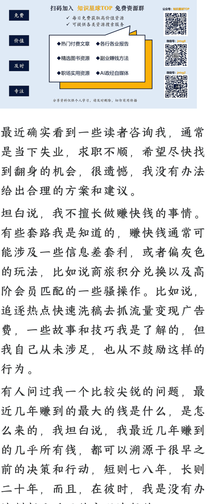

# 每一步都算数：赚钱的本质，是一场长期主义的修行

250520 生财 caz

微信intsg2，进资料分享群

我年轻的时候，曾经追求快乐钱，曾经试图用最短的时间实现最大的资产增值，然后决定走极端，最后亏了很多钱，交了很多学费。痛定思痛，我知道，那不是我能驾驭的。

## 第一：每一步，都算数

做有价值、有积累的事情，通过时间获得复利。

我是怎么赚钱的，我复盘一下：

- 其一，我在互联网巨头、创业公司都做过，自己还创业过不止一次，有足够的行业认知，业内实操经验丰富。
- 其二，我乐于分享，由于我实操经验丰富，所以我的分享价值也足够，获得的信任度足够高，而分享这个习惯起源于超过25年前，长期分享让我建立了影响力，认识了许多行业精英，同时通过沟通让我强化了行业认知，提升了分享价值，形成了正向循环。
- 其三，我乐于助人，虽然其实并不是那种重投入，非常耐心的助人，这我没有，但是举手之劳，一些而有效的建议，以及搭建人脉连接，这种利他行为我确实一直都在做。

那么这些和钱有关系么，有，这是我可以在知识付费领域有饭吃的基础，这是我可以低成本甚至零成本跟优质创业团队的基础，这是上市愿意无偿配给我一些亲友股份的背景。

在过去的几年里，我真挺靠自己（除了房产之外）赚到的钱，追根溯源无非以上这几条。所以我没办法让年轻人复制我的经验，但我依然会强调，当你坚持成长，坚持分享，坚持利他的时候，很多种子已然悄悄种下，开花结果需要时间，在前进的过程中，每一步，都算了数。哪怕犯了错误，交了学费。

有时候，欲胜则不达，越想激进的获和变现，越容易成为市场收割的目标。要认清自我，耐心成长，不要急于求成。

## 第二：输得，才能真正赢得

必须承认，想要获得较高的收益，通来说，适当的投入，适当的风险是承担的，完全损失厌恶，完全拒绝风险是没有机会的。

但这个尺度在哪里？

我年轻时候创业，我的机会成本也提高了，因为那时候我工资真的不高，我的机会成本也提高的，那时候托管费用非常高，而且我是真的押上了全部身家，但那时候也不怕，毕竟年轻，大不了白干两年，回去继续打工，总有饭吃。年轻时候，在不涉及债务或债务非常可控的情况下，胆大一点确实没关系。

但看我现在，我毕竟是不敢太大格冒险，毕竟上上有老下有小，自己大了，很难再去求职，对后续的持续收入也没有太大的信心，这种情况下，资产安全就胜过了追求回报率。

不过遵循的都是一个原则：只下输得起的注。

最近和一些创业者聊天，有利益有关，我没有少许股权的，对方焦急如何放大规模，但我却劝他们好好重视合规，合规之外是提升毛利率，提升毛利率的目标不是为了多赚多少钱，而是提高抗风险，此外账期管理，资金流控制，都是劝他们不要盲进，安全第一，不要盲目扩张，不要为了引入资金签不起的对赌。

如果站在纯粹的投资人角度，追求回报率，我应该鼓励他们 All in，快速扩张，如果他们成功了，我的回报就会扩大，反正他们出了事了，对我而言不是局部的小损失。作为他们的朋友，我必须说，安全生存下来才是第一位的。在这个牌局里，我输得起，但他们输不起。

我一直讨厌那些用极致杠杆的人，确实在市场机会出现时，可以让投资者获得最大收益，但只能保证每一次都站在正确的方向上。只要错一次，就是万劫不复。

不要做赌徒，一旦陷入那种情绪和心态，不论你多厉害，赢了多少次，终都是一个悲惨结局。最后最后一句，贪婪是无止境的。输得的时候，你可以去博赢机会。

## 第三：最重要的能力

我觉得有一一样是最重要的，所谓对的洞察力。这个话题说起来太大了，同理心，好奇心，对身边事务的敏锐度。

我以前讲过例子，我认识很多成功的创业者，他们是极度敏感的，到机场贵宾候机的时候，会看看电脑默认首页是哪个网址导航，上面放的链接有没有自己的网站，或竞品的。在洗脚城摸脚的时候，还会问小妹手机里装了什么 App 和游戏，平时是怎么用的。而且有的创业者随带小本子，喝茶聊天但我凡一个他不知道的产品或者企业，马上记录下来，晚上搜索后还会在线跟我们二次核对。

为什么这些人能成功？真的可以从这些细微感受到。

我之前遇到过一个案例，群里一个简单的截图，你能从中获取哪些有价值的信息，我经常从图中看到别人忽视的细节，所谓角的阅读，面对相同的内容，不同获取的信息截然不同，有的人只是看热闹，和作者的价值观纠结，有的人看到了更多和市场，商业，以及金融知识的信息。

具备洞察力 + 能够明确因果的底层逻辑 + 快速实践落地能力，三者结合，无往不利。

坦白说，我自己也达不到这个高度。但如果总是找借口，总是不去行动，那就永远也不到了。总要从第一步开始。

回到最开始那句话：每一步，都算数。

# 免费 价值 及时 专注

# 扫码加入 知识星球TOP 免费资源群

- 每日免费获取价值资源
- 可提供各类资源服务

| 热门付费文章 | 各行行业报告 |
| 精选图书资源 | 副业赚钱方法 |
| AI政经自媒体 | |

公众号:知识星球TOP 微信信号:jntsg8 微信信号:jntsg2

分享资料仅供个人学习，请及时删除，切勿商用传播
