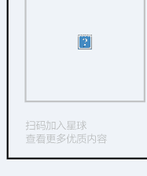

# 《内容要做流量》

来自：财经豆腐
幼幼
2022年12月26日 23:01

哈喽大家好，我是助勤，曾经20分钟产出过10万篇大文，1万粉丝变现20万。

听生小小小伙伴陪大家在读我之前写的一篇文章
《自媒体小白小红书做3个月，从0涨到8000粉，零变5万》

还有点不好意思，

说不多，今天来跟大家分享的《内容要做流量》。

为什么会想要分享这个主题呢，我有两个理由：

第一，在现实生活中，我发现我的那位拥有流量思维的朋友，感情生活一般都比较果躁，她们不会因为一个人等太久，如果另一个有坏脑头，她会立马结束这段关系，丝毫不拖泥带水。

拜拜拜拜，下个见。

而那些为了感情生活全交出，一心一为了另一半，甚至付很多的精力，结果总是遇到渣，一次被伤害。

第二个理由呢，在自媒体世界里，我也发现了很多认真做内容的小伙伴，他们的内容总是不温不火，花费四小时就是一整天的时间，用心做些条内容，结果只有几个。

而有些小伙伴，随手一发的内容，结果就是几千甚至几万的赞。

这就有了差异，你花了一整天的时间在对你准备了一个丰盛的独享晚餐，结果策划布置，结果晚餐什么都准备好了，结果你对信赖，反而更喜欢中午花10分钟给她点了星巴咖啡的人。

怎么样，是不是很气。

为什么别人懒一懒就赚几万赞，涨几千粉丝，而你却停留在原地呢？

没关系，不用生气，我们今天来分享流量思维内容，让你们变成自媒体世界的流量！

# 靠点，意犹未尽

漂亮就跑，只展示结果，要是你的目标用户就是意犹未尽。

有一个定律，叫做持续性：

如果在一段视频里的高潮和结尾，体验是意犹未尽的，那么整个视频的体验就是意犹未尽的。

这就说明，我们让目标用户在我们看的内容开头和结尾（中间无须提到），体验意犹未尽的，

她对我们的内容就会产生好感。
比如这一篇，展示了有钱的生活，无边泳池，高楼近望，封面吸引人，这是第一个开头优质点。

> “这大概就是有钱后的生活吧”
精彩极限世界 ❤️ 6.1万

结尾的时候顺利用美美的画面收尾。
尽管中间的内容很杂乱，甚至模棱不清，但这些都不重要。
重要的是开头和结尾的感觉。
我们搜到的用户的痛点，终端停止，维持延续，在情绪最高点停止，才能让人意犹未尽，印象最好。

# 截中痛点，产生追随

再比如这一篇，做个人IP的40个APP。

现在大家都想要做IP，但是不知道怎么用，这就是一个痛点。

我们亮完就走，除了痛点之外，还有一个就是痛点。

不过，截中就要，不能拖带水。截中就要，不能拖带水。

这篇内容，就是截中了“做个人IP”这个痛点，并且展示了40个APP的名字。

注意，只有APP名字，并没有告诉你APP怎么用，怎么下载，怎么用APP做个人IP。

如果你觉得长篇大论，用户想要听到到底怎么用APP做个人IP，步骤123，方法123，效果就会得其反，因为太长了，用户根本不会花你这么多时间。

这就是精准，精准就精准，让人感觉到了痛，好像给了他们解决方法，其实并没有什么作用。

这时候目标用户就会产生一种“你不仅会做个人ip”，而且还给了了一些资料和方法。

这种中准的感觉，就会对你产生好奇，从而关注你。

# 制造第二点：广撒网

流量怎么养鱼的？那是混在一个圈子里，他们在一个圈子里寻找自己的目标。

所以，咱们内容需要广撒网，提高自己的内容命中率。

有同学会问，咱们不是一直内容要垂直吗？为什么现在要广撒网呢，这就不重垂直了吗。

注意，虽然垂直，但是不是绝对垂直，不是说你做垂直领域，你就天天发领域相关的内容。

咱们垂直的群人。

你的是妈妈群体，那就是要考虑，妈妈会怎么圈子。

比高考圈、比妈妈圈、比家装整理知识圈，甚至婆媳关系圈、夫妻相处内容圈子等。

咱们广撒网做好3点：

## 1. 寻找多个目标鱼塘

广撒网并不是撒网，而是要寻找目标人群的鱼塘，只有这样才能提高命中。

## 2. 放下对应鱼群的诱饵

找到了目标人群之后，就要去思考她们在这个鱼塘里喜欢什么诱饵，把诱饵放到咱们的内容里。

## 3. 持续输出

（此处根据OCR文本逻辑合并后续内容）
