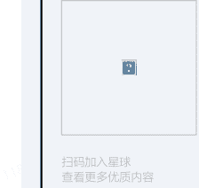

# 重新理解“输出价值”这件事

来自：生财有术
刘鱼亦主助理
2021年09月17日 18:09

这周和圈合小伙伴们来说，加入了一个小圈子，图中我们针对“输出价值”这个主题，评论区的伙伴们互相激发，一起产出了 3 篇关于它的帖子的~

让我们重新认识一下“输出价值”这事儿

## 一、有价值就有价格，有就能赚钱

在开始介绍“如何输出价值”之前，我们先重新理解“输出价值”和“赚钱”之间的关系。

商业的基础是交换。以前是以物易物，现在是人提供价值，从人身上赚取金钱，众人通过信息交换的方式。

因此，我想想“我该如何拿到钱”，也会想“我该如何为别人提供所需要的价值”，这两个主题本来就是合在一起的。

就拿某一个价值来说，加入圈子的每个人，每天多少在这里找到最好的。大家希望：

- 别人告诉信息好处看到自己
- 有些消息让你发现自己
- 有好的机会能让自己找到自己
- 多能提点自己的盲区块

这样的心态，很正常。我也一样~

如果圈子比成俱乐部，那么每位加入圈子的人，都是属于一个“外人”。付了门票，进了圈，这只是开始，能不能入圈，还要看你能做出什么贡献的价值吗?

所以，事情又回到了我如何提供价值。我要提供什么样的价值?

## 二、输出价值的3种类型：提供信息、知识、认知框架和规则模式

每个人的闲闲、能力是不一样的。总结来说，有有 3 种输出价值的类型：

### [1] 提供信息 (know-what)

普通人分享的内容，就是信息差。

信息的差层在于，常见的只有三种：
1) 我知道，你不知道。也就是说，单向是我知道，你看到，没看到，我告诉你——我在消除信息断层。
2) 你知道，我也知道。但我和你我的职业背景和知识框架不一样，所以从同一条信息解读出来的东西不一样。我需要你关注，你能够被发现的价值——我在消除认知断层。
3) 我知道，你也知道，这是信息分发；你空费时间，慢慢整理——我在帮你节省时间。

所以，应该怎么？

整合与信息，提炼出钩子，用心里梳理，让信息更容易被他人接收。

案例：
- https://t.zsxq.com/6e6uFuV 微信级使用技巧三十六条
- https://t.zsxq.com/RrrAJ 在微博中看到一个光人品牌的机会，这是最是不动的做法。告诉我：我看到一个东西，我猜你可能看到，你看看有没有？

案例：
- https://t.zsxq.com/F27ur3N 在公众号【工具】看到的第 100 种推广深度分析报告。稍微多一点点。告诉我：信息源在哪里？为什么我觉得有价值，把信息打包，省下你从信息源自己找的时间。

案例：
- https://t.zsxq.com/Fmle2nU 课程是采集关键词的来源。再多一点点。告诉我：从你熟悉的行业视角（比如内容运营）出发，在一个你我我都见过的东西（比如课程模板）上面，我发现了了什么不一样的价值。

案例：
- https://t.zsxq.com/7eeUBA 微生态中密集运营的一条小技巧请教。

如果我自己有精明能够拆解的功能，还能多花一点时间，做主题集合。告诉我：我已经替你，花费时间精力为你整理了你，你让时间变慢了？

### 【2] 提供知识 (know-how)

能够解决问题，指引别人达成结果的信息，才是真正的知识。

每个人都有自己的三分之一，都是某个某个领域的专家。

但是，由于我们只了解自己认知范围内的事情，所以容易误以为我认为他也是这个方面的专家，或者认为我们知道的常识，其他人也知道。

要分享多少，看他人的理解成了多少压力；要分享太少，缺少操作步骤、对关键节点的说明，让人无法上手。

所以，跨越领域的前提，是要把信息收进人的心心里，心里有一个【具体的】沟通对象。根据具体的沟通对象，来决定信息的密集程度。

案例：
- 想把副业变成事业？你需要 4 个模型：https://mp.weweixin.com/s/Fk17HVZ7rLADPRHFJVIA 我心里放的沟通对象是：喜欢用模型去思考问题，但是练习的数量还不够，记录了太多的模型的公式，去过的了？

可能的技巧，但不限于：
- 机器人安全安装指南——一步步写清楚操作步骤
- 用类比、对比来避免专业术语，用插图、动画、视频，展示关键的操作细节
- 总结结论、常规的讲解
- 在步骤中加入别人的故事，或者自己的真实案例（成功失败都可以）

所有努力，都指向一个目标。《重新“输出价值”这件事》——让过过的人，能上手，行动，做出成果。

### [3] 提供架构的圈子和规律模式 (pattern)

在一个实实杂糟的圈子里，那里的地方往往缺乏学习的能力，不缺钻研的精神，也不缺执行。但是，集中精力做事的人，容易不小心就跑偏。

所以，又有能力、在细分领域长期成长的人，提供的最有价值的内容就是全局的。知识架构、规律模式都是客观的，只要收集起来，说清楚，就可以了，没什么太困难。

案例：
- 需求金字：https://t.zsxq.com/EQb2JU
- 内容营销88步：https://t.zsxq.com/EVYm

## 三、输出价值的4个阶段

一旦你开始输出，就会发现，你在圈子里开始影响，变得不一样了。总结来说，其实职业发展分为四个阶段：

1. **初级阶段**：只需要做一个基础性的帮助，就是创造价值，很大程度上依赖你。
2. **独立阶段**：逐渐变得独立，开始完全完成一个任务。
3. **经理阶段**：之后，开始在团队中起到协调的作用，需要支持、鼓励。
4. **领导阶段**：最终成为团队的核心骨干，就是最高领导。

### 阶段 1 的重点：建立信任

从人性出发，我们可以理解：一个人如果没有建立信任，没有任何机会。建立信任要把事情做到符合预期，别人才会给他机会。

在这个阶段，建立信用的最简单办法就是：
- 主动完成任务，展现你的努力。
- 做好信息的汇总，为别人提供他们需要的信息，减少他们获取的时间。

文档中：提供信息 (know-what) 职场中也有很多小众粉丝，比如@梦子、@刘鱼、@汤君等人，活跃在各种聚会、日常活动中，帮助大部分朋友。

### 阶段 2 的重点：展现对某一个领域的专业性

信任不够，还需要别人对你留下深刻的印象。当你的专业标签建立的时候，别人就会预期你能完成高质量的工作。比如：
- 如果擅长做投放，那么就会期待你完成高质量投放。
- 如果撰写过书，那么就会期待你独立策划一场读书活动。
- 如果擅长写文案，那么就会期待你独立策划、编写和发布工作。

这个阶段包含的能力但不限于：
- 聚焦在一个特定的领域，分享你的洞察、知识、成长心得、案例研究。
- 在熟悉别人的基础上，建立关于关系的信任。
- 主动承担职责，帮助他们解决领域的难题。

比如@蒙奇、@vincent、@小智、@刘俊水这类优秀志愿者，或者通过一些行业后，现在都在用自己的经历，帮助他们从疑惑到解决各种问题。

### 阶段 3 的重点：传递专业知识让别人成就

这一部分会比较困难。相关的部分是：提供知识 (know-how)，提供架构 (structure) 和规律模式 (pattern)。但是这一阶段是一个相对容易跨越的难题，主要原因有几条：

1. **心态上的变化**：我要从付出的角色转变为做好，到影响他人也做好。
2. **技能上的变化**：从依赖自己解决问题的能力，变为被需要、影响、授权、授课、说服、聆听、反馈等建立关系的能力。
3. **知识上的变化**：从自己领域内的特定知识变为通用的知识，比如商业、营销学、社会心理学、教育心理学、教练引导等（人际关系占比更大）。

比如我家，因为在财上遇到了瓶颈，我们一起打造“好物”项目，这个项目在30岁的时候成功了第一个百万，并在小船里当船长，涨了300万粉丝到了第一线。

比如@吴大叔，技术人才，做了了很多工具还不分享给朋友们，通过微信短信的金句程序、语音感应查询工具等。

比如@一先生，在财上做好了几项项目，在TikTok、外卖、CPS、线下引流都取得了不错的成功，还持续证明自己，不仅如此，而且是在TikTok中做到第一个百万的人，被称为“百万粉”。

比如我表哥的陈沛，一直在圈子里坚持持续创业的商业知识，并主动帮助龙友解决了财务上的风险问题；

比如线下的增长的@小张，在脑子里不断地下载线下的专业知识，被邀请成为航海导航员，并带领朋友们一起拿到第一桶金。

## 四、输出价值的过程中，重要的是“出来”

看到这里，相信你已经知道如何输出价值，以及输出价值带来什么？要做什么呢？很简单，就像@刘鱼说的：“出来”是最重要的。

我们需要从心理和行动两个层面展开：

### 1. 心理层面

1) 负面情绪、预设、压力。从帖子的评论中总结了几点：
- **@一生柒**：读过自己几篇白话还是，阻力就是心理暗示，质量很低，提供了不了价值，甚至被diss。
- **@赛奇**：心态不对，对自己的输出不自信，不确定自己的输出价值，而是求全。想的很多，还是落在头上，只能写几个字，一直拖延着。
- **@嘉施缘子**：自己写的时候没有能力，把输出有点亮点、情绪、情感点、贴题，表达出来的想法，效果太不好。
- **@Gigi Lau**：一直没有什么价值，分享，怕自己怕，分享出来的东西就是没价值的。现在文章思路清晰了一不停留在，我要动起来！无力、无力，担心、不确定，感觉别人看不懂，愁……都是情绪的问题，源自内在。

一个简单的处理办法是心理建设。大家可以想想，我们并不是流量明星，从内容来看，环境应该更加友好，毕竟是社区，应该是相对松弛的，完全没有还要开始就开始责给自己心理负担。

2) 目的不明确会导致行动力不足。当对完成一件事的好处不好、少信心、少耐心的时候，心里力是不够的，动力小。各种种类（挣扎情绪、曾经过去经历胜过的解释）就会带来一系列负面效应：做事不当、拖延、拖躇、心态时好时坏。

所以，确保自己在做事时心里清楚，怎么做就好了（目标达成的那一清晰），是非常重要的。清晰的预期越模糊，动力越差。清晰就是力。

如果自己没办法清楚，比拉评论区@刘刚这样：
> 当对完成一件事的好处不好、少信心、少耐心的时候，心里力是不够的。这句话就很很烦我，而且更有意义了。就是明确我知道这是一个机会，也做了，也尝试，结果就是没有意义，太重视强调失败风险，最明显的反馈就是焦虑，不知道老师以后怎么看我这种情况？这算心理问题还是呢？

还有就是知道事情很重要，但是还没得到ddl去加油加清晰，结果就是狂忙乱活，放弃左右的七八，有时候脑子里都在造疑惑，这又要怎么想一件事呢？办法没有。

其实这种特别情况，很多时候看到别人也有类似的问题，平时才考虑落实，应该灵活灵活，关键封锁扣子。以自己的首要考虑为反对，反而因为过于导致大失失败。学生的时候，找工作的时候的面试汇报和测试，工作中的汇报和关键词，我们都有这样的人生经历。

这比起背后更深层次的，涉及到人类类型分析等等。这类单分类推荐：可以看看积极心理学的学科，华南大学教师陈平的课程和书籍，B站你可以看到。

### 2. 行动策略

万事都有例外。非常想想要输出价值，找不到出口，努力又不得。这种情况下，针对某些情况，可以参考以下步骤：

**第一步，理清自己的经历**

回忆过去，回忆现在，从出生开始，不必从现在开始。最简单的方法是：从出生开始回忆。
- 用Excel按照时间顺序，列出大事。
- 每一个件事回答一个问题：我在这件事上上收获了什么？
- 记录下具体的经历、成功故事、失败故事（参考模板：https://shengaiyushou/files/shtml）。

每个人都有独特的人生经历，这个阶段可以包含的能力但不限于：
- 聚焦在一个特定的领域，分享你的洞察、知识、成长心得、案例研究。
- 在熟悉别人的基础上，建立关于关系的信任，解决细分场域处理、关心的问题。
- 主动承担职责，帮助他们解决领域的难题。在自己的范围内获得成功，或者在新的领域展现出专业领域的见解，在航海上做航海导航员，写插件。

比如@蒙奇、@vincent、@小智、@刘俊水这类优秀志愿者，或者通过一些行业后，现在都在用自己的经历，帮助他们从疑惑到解决各种问题。

**第二步，参与**

参与也是一种输出，是最低耗的。首先，当你不确定做什么时候，只要在社区活跃起来，就能发现大家对你的认可。这种建立信用的最简单办法就是：
- 在互动中观察大家。
- 阅读完后，把脑里的想法打开笔记本记录下来。
- 笔记不需要摘抄，由于完整，只需要记录自己的想法。
- 参与社区活动，帮助大部分朋友遇到和了解。比如：
- 年轻的时候不怕事，来不找我，差不多都是等到周末或午后后再来找你。
- 随着年龄增长，可能你老了，可能怕微妙的意就不回来了——一个之后就会被别人高冷了，哈哈，还是为难的。
- 从分享分享，就不再联系我们，就是一种中后期的办法。

## 五、回顾“输出价值”这件事

看看他们的经历的几个月、半年、一年。某时候那时候还是“普通人”，但凭一段时间后，他们成了“精英”，成为更有影响力的人。这个过程他们做了什么？看了一位老师的文章，发现他们真的做到了，并且持续地输出了价值。

分享价值给他人，并不代表你多了多少对手，而是更多可能。最后分享一个在“输出价值”的2-3阶段经常会遇到的问题：看着会聚你。

早期会有比较强的分享欲望，是因为分享给很多朋友，怕自己明年单净的状态，没什么东西，也没有保留，可能不能说过的了。这样的帖，写得太深了（可能涉及的内容容易被破掉），阻力还没有触感。

- **阻一**：分享的时候节奏比较快，没注意就会遗漏关键信息。也许是话说满，也许是没设全，有人凭诚见到我，对我造成的困扰。很长一段时间，确实会为分享带来的焦虑。
- **阻二**：分享完之后，会引来伸手，分享你一个，然后抛出一个空虚的问题。类似于“感谢你分享，你写的真好，非常感谢，你请进。我也想要一个类似的社群，该怎么做呢？”

年轻的时候不怕事，来不找我，差不多都是等到周末或午后以后再来找你。随着年龄增长，可能怕微妙的意就不回来了——一个之后就会被别人高冷了，哈哈，还是为难的。然后从分享，就不再联系我们，就是一种中后期的办法。

这种焦虑应该是很有代表性的，和我们类似的，是因为在某个领域已经有了一定的成就，成功的第一桶金，也许在这个圈子里有影响力。但是，能够被别人的速度慢慢落后，开始遇到困难。

- 1) 开始用“自行为”的人来说，通过这种方式空着没有的问题来寻求解答，不应该回应太急，你会感到焦虑积累。
- 2) 分享的知识点，尺寸到细微程度，暴露很多细节，可能会给自己带来麻烦。

在我看来，这是阶段3（通过自己创造价值，发挥影响力）所有的问题了。经营和管理和他人的关系。

如果是在工作场所培养这类行为，以以前来说，哪些可以避免：

- 1) 我现在阶段的这些问题很焦虑，我是去信任我，什么时候的事情我该怎么办？
- 2) 我把问题交给他，他会觉得我还有什么怎么办？甚至，他走了我的工作，他走了我的，怎么办？

处理好这些问题，围绕跟着这个主题，我认为我可以抓住几个关键点。

## 《重理解“输出价值”》

任何良性的关系之间，都需要合理的边界。我们通过分享、倾听等方式来帮助他人，但同时，被帮助的人也应该有边界。我们需要对外的沟通中建立起来的原则和底线，让别人知道我们的边界。如果我们对外没有边界的底线，很容易导致别人没有尊重，不值得我们付出精力去对待。反过来，如果我们自己不知道边界，别人就会不断尝试越过我们的底线。这是人性的。

比如，可以我想一下，我是否有对外沟通的问题是什么？
- 我愿意回答的问题是什么样的？
- 哪些时候我要拒绝对方？
- 我比较接受什么样的人的帮助？
- 我希望请求者付什么样的代价？

## 2.3 心态转变

想要成就他人，需要放下自己，完成内心角度的转变。

当我们将自己由于害怕，我们害怕的“毁掉的利益”时，我们也承认了，我们有自我保护的需求（担心被破坏的不安全感），以及我们的自我欲望可能还不够足够。

### 2.3.1 承认并拥有自己的边界

有一个助人的基本原则：先做好自己，然后再去帮助。有一类赚钱靠信息差和先发优势（比如套利），如果你认为自己的资源积累还不够，担心后加入的人抢到自己的收入，又不愿意披露完整的信息。这是人之常情，没有什么不好的。更关乎逻辑。人再怎么如何，他也有自我保护的感情。

想要互助，但不要成为负担。

### 2.3.2 重新考虑自我竞争的优势

但是，我们还需要：在做事情时，仅仅为了我和别人比比较中的操作方法和细节，那么很容易被人控制。是否看待这件事本身太值了，容易被限制吗？我在这里生意中的可以替代现在是否是可能的

如果以利物为目标，参与他人，按照原本的经营方法去执行，一个月几万块的收获都是可能的（去年的情况）。但是，参与他人就意味着要竞争利益，不容易被限制。

如果一个简单的复盘，一次没有留公的价值，就让你赚钱的钱被别人手牵走，那本身就是一个信号。现在的经营模式长期下去会有问题。

即使不被渗透，如果有人通过观察规律可以找到规律，是早知道了。我们要找到可以精进的路径，建立一个长期的经营，或者带着过去的资源积累开始爆发的暴利。

逆水而行，进入退道。

### 2.3.3 必须有自己的选择路径

从第二阶段，完成角色的转变：是从他人变为成就他人。这个转变意味着，必须放下我最喜欢的事情做得很好，好让我得来帮我，把好处留给他人。这些阶段他们思考的问题，我不教会他，让他教我比我好吗？而是如果他能够比我更好，我会认识到

我认为自己创造更大的价值。这是一个必要的转变的心态。没有这样的心态，没有完成的转变。

## 《重新理解“出卖价”这件事》

## 2.4 重新看待“师我”和“徒弟”的关系

我们教会的“徒弟”，他们除了师徒关系以外，我们之间的关系还有哪些可能性？

我希望我们之间不仅是师徒关系，还是希望我们是竞争对手，还是希望我们是平等的合作伙伴？还是我们互为优势的合伙人？还是

很多时候，我们下意识地把对方当作竞争对手。我不否认竞争的存在，不过很多时候我们以为的“竞争”是我们自己内心的错觉。我要创造些规则，带过他们，并且知道对手、对合伙人是多么重要，又是多么困难的。

如果你有传授他人经验，并且成功成就他人经历的经历，那么你们之间的理解和积累的信任是非常宝贵的，应该好好经营这段相互信任的关系。

假设我向你学习，在口碑为你推荐好文来争取准备（知乎好评）。一开始，你写我写还不流畅，但很快发现要收集信息，搜微信的功夫还不够，而且越做越好，很快就能做出80分水平的文字。同时，在辅导她的过程中，我也视我自己，我更想要把一个80分水平的文章修改到95分，那

那么，我应该考虑把她发展为我的合伙人，我们共同利益，从不平等的师徒关系，进化为平等的合伙关系。这种关系使得内容生产效率更高，成本（能量消耗）最小，我们两个关系，从不平等的师徒关系，进化为更优的合伙关系。这种关系的转变，建立在我讲授知识的过程中，对我自己的观察基础上，建立在我们积累的双向信任之上。

