# 仓储会员店

# 抖音账号运营提案

# 有福气、懂生活

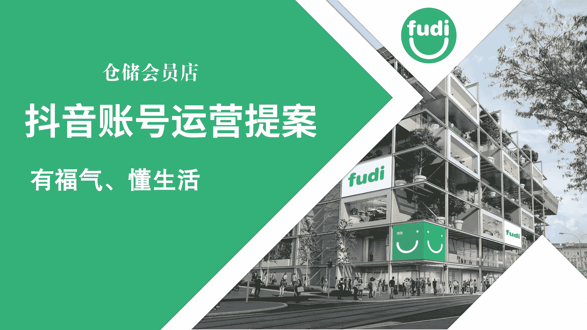

# 知识星球TOP 资源分享社群

公众号:知识星球TOP

汇聚全网高价值资源

打造一流资源共享群

微信信号:top286888

添加微信免费群

- ◆付费文章
- ◆付费社群
- ◆时政&国际
- ◆副业&搞钱
- ◆财经&市场
- ◆行业&科技

时政·历史·职场·体制·自媒体学习·军事·软件·影音·社会学

微信信号:top283888

# CONTENTS

01. 品牌项目分析思考
02. 抖音私域洞察
03. 账号内容策略
04. 账号运营规划

# PART 01

## 品牌项目分析思考

### 项目思考

### 品牌审视:
fudi仓储会员店，到底是一个什么样的品牌

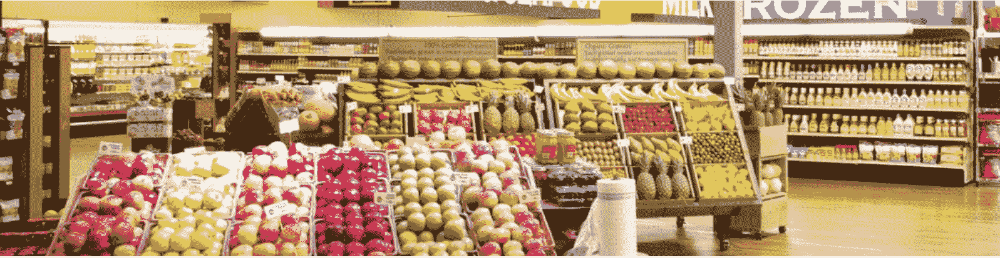

### 项目思考

### 是兼具线下一体的中国本土化连锁会员制仓储超市

作为中国自己的仓储会员店，致力于为中国消费者带来安全、丰富、高品质、高性价比的全球好物，同时为消费者提供生活日常所需的一站式超值生活权益；

接下来将致力于拓展门店到中国各个城市，逐渐成为都市饮食生活的风向标，以理念筑起中国人的“福气生活”。

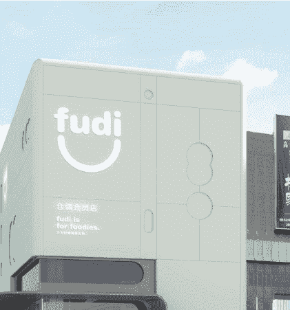

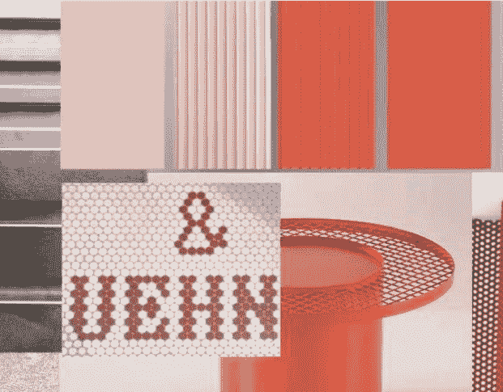

### 项目思考

品牌使命
Brand mission
用fudi构筑起中国人的福气生活

品牌愿景
Brand vision
引领未来都市饮食生活

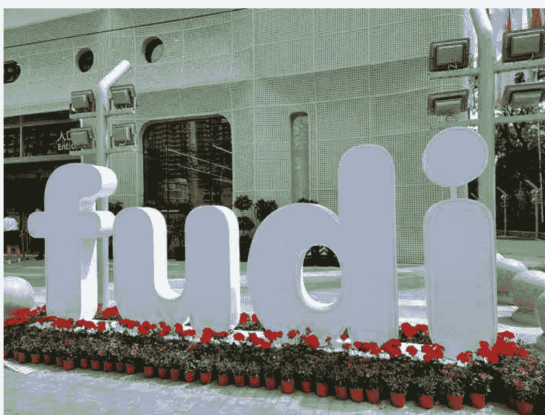

### 项目诉求

fudi 抖音蓝V企业账号在新媒体环境下，如何快速涨粉，提高互动量？提高关注度？

如何在精细化打造抖音账号内容的基础上，提高品牌声量？

### 项目目的

扩大品牌影响力
通过提炼的品牌特点及优势，打造和强化独特的品牌形象，输出品牌价值观、扩大品牌影响力

提升粉丝粘性
通过精细化、品质化的内容打造，吸引粉丝关注、积累粉丝，提高粉丝粘性和忠诚度

实现会员转化
通过长期持续不断的内容运营，激发粉丝群体的购买欲望，实现抖音粉丝的会员转化

## 项目挑战

### 抖音蓝企业账号面临四大挑战

### 如何建立有效沟通
在抖音人群普遍较难产生粘性的前提下，如何利用内容建立有效的沟通

### 内容如何引起客群关注
在抖音平台相对成熟用户相对理性的平台现状，如何引起客群关注

四大挑战：

### 如何确保粉丝信赖度
食品用品备受过病毒的产品质量信任危机下，如何确保粉丝对于品牌的信任度

### 如何实现终极转化?
如何通过强力互动，让积累的粉丝变为品牌忠会员，产生流量变现。

# PART 02

## 抖音私域洞察

### 宏观市场环境如何？

### 行业趋势

### “低价精选”的仓储模式逐渐兴起！

沃尔玛依然重视山姆会员店，推出云山业务，预计到2022年将会有40家开及再建门店；麦德克的会员店同时在北京、成都开业；盒马总裁表示，今年将新开10家会员店；永辉将门店改造仓储店尝试新的；同样扩张头部迅猛在中国多个城市注册公司；家乐福表示，会员店将在年内开业，仓储会员店遍地开花

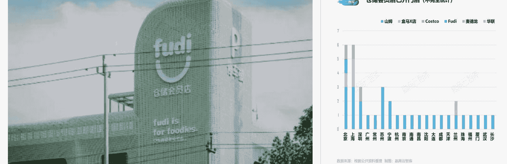

### 行业趋势

### 仓储会员店在电商发展处于较高水平的中国更占优势

由于本土参与者的通路，中国仓储会员店的竞争程度不断上升，如何基于本土环境进行一步的优化成为当前老牌仓储会员店亟待攻的问题。不同于美国“汽车经济”，中国社会发达程度较高，近年来为了顺应中国消费者习惯，山姆与京东到家进行合作，与此同时，山姆也尝试了自己的前置仓，进一步提升了配送的效率。

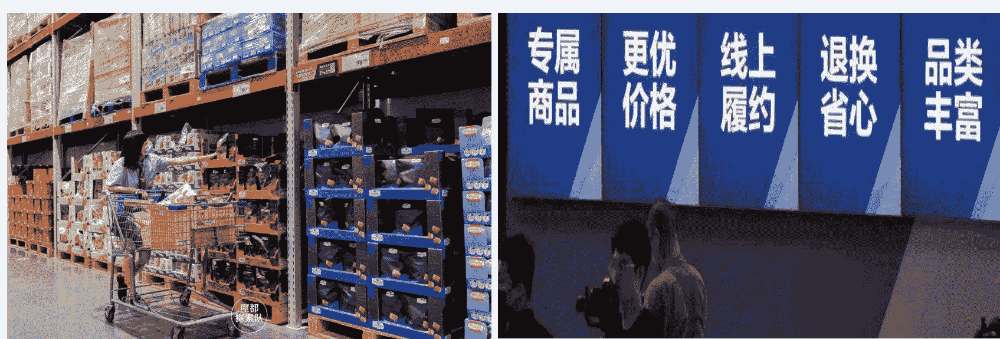

### 抖音平台

### 抖音电商时代，成为新宠

现在主流的购物平台是淘宝、京东、多多。从2019年开始抖音进入电商时代。首届电商大会上，泽宇曾表示，“未来一年将扶持1000个商家实现销量破亿，100款优质商品销破亿元”。真正让所有品牌能够强势发展。

### 其它仓储会员店竞品

### 山姆会员商店

山姆会员商店是世界500强企业之一。我们目前的对标抖音账号在运营方面，保持其一致。

山姆官方账号数据：
内容贯穿粉丝主题，以美食分享、视频拍摄、测评为主，内容方向不够有趣，无法形成更好的互动。

山姆直播间持续22小时。

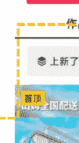

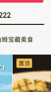

### 山姆会员商店 收藏列表

- 1 天气热，还有比辣更馋的夏天
- 2 谁说这款速食面真的绝了
- 3 我的火锅，休息一下，下午时光
- 4 翻开航空的海鲜沙拉，大部分人没有吃过
- 5 谁还不知道看这个？最近吃的
- 6 这个味道，也太好吃了

### 内容栏目:

视频内容较多，以集合形式出现，没有规划栏目，分类不明。瑞士商品类较少，未在带货转化上。

# 竞品分析

### 盒马会员店

作为仓储会员模式的新入局者，盒马在周边的苏州落地，在抖音平台的运作上也属于盒马阶段性。

- 账号数量:
  - 一个盒马官方主账号（蓝）
  - 一个盒马会员店，一个盒马先
  - 吉祥物账号比较活跃
- 账号内容:
  - 美食分享、以及美食菜谱为主，亮点是盒马先生吉祥的出镜。状态可爱的吉祥物形象非常具有吸引力，能够更多吸引关注度。

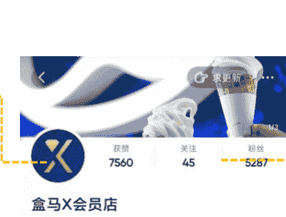

盒马X会员店
上海盒马网络科技有限公司
就是你想找的盒马X会员店
营业时间 门店地址 查地址

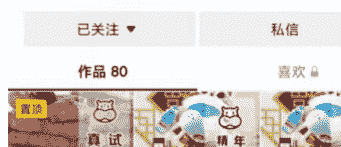

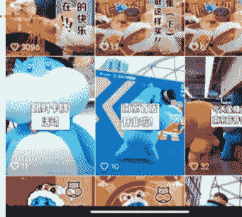

| 账号类型 | 粉丝 | 赞数 | 更新 |
| :--- | :--- | :--- | :--- |
| 盒马官方主账号（蓝） | 7.8w | 100万 | 全部 |
| 盒马会员店 | 36.9w | 309w | 每天 |
| 盒马先锋 | 52.8w | 77w | 每天 |
| 吉祥物账号 | 1.0w | 7560 | 每天 |

### 永辉会员店

永辉仓储持续在成都、上海、福州、天津等地扩张，目前面临外运营。账号内容方面，色彩缤异，也有人物的出镜。账号内容方面，新款的好物选择，点击下方，形成矩阵。

# 竞争分析

### 甘一精品仓店

集团立志做“中国领先的仓储式超市第一门店”。超万平米，品类涵盖生鲜蔬菜，日均200多种进口商品，3000多种国内商品，自有品牌多达100多种，全球30多个国家和地区，为消费者提供一体化服务。

数量：一个抖音蓝账号，没有形成矩阵。
账号内容以人物故事及产品推荐、促销发布为主，视频封面统一，但一般。

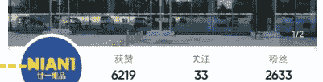

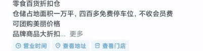

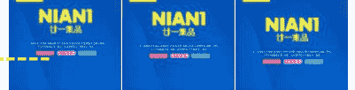

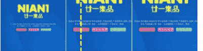

# 账号诊断

## 账号状况 账号数据

账号数据分析：

- 粉丝：3088
- 获赞：2507
- 视频数量：10个
- 获赞数量：100:
- 1000: 0
- 过万：0

最获赞：
点赞数明显低于粉丝数量，从点赞量也可以看出，视频点赞数量欠佳。说明视频内容对用户吸引力不够，且缺乏运营，无法持续吸引观众。

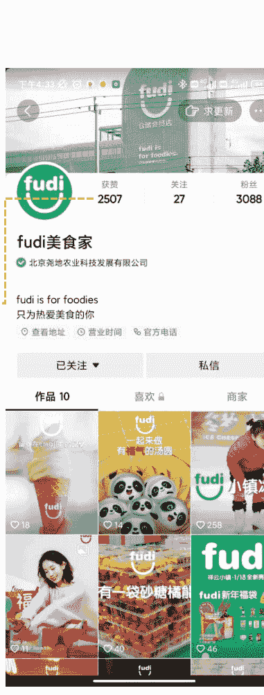
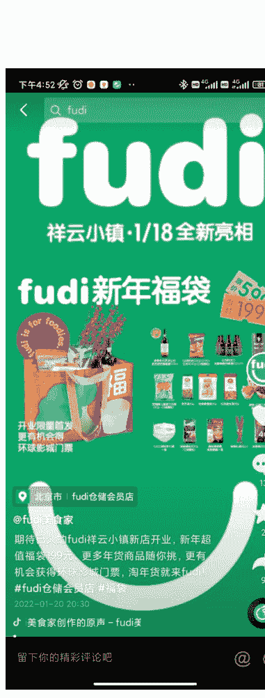

# 账号诊断

## 账号现状 账号定位

账号定位优点：

优点：
基本做到了账号定位的标签化，美食家的分享清晰，目标受众较为统一。

缺点：

- 账号定位不够突出明确。
- 账号定位不够个性和吸引眼球。
- 账号标签不够让用户识别、认识你，无法占据用户心智，增加粉丝黏性，留住粉丝。
- 账号标签还可以更清晰化。无法让算法系统知道账号会持续输出什么样的视频内容，无法让此类账户获得更多的关注。

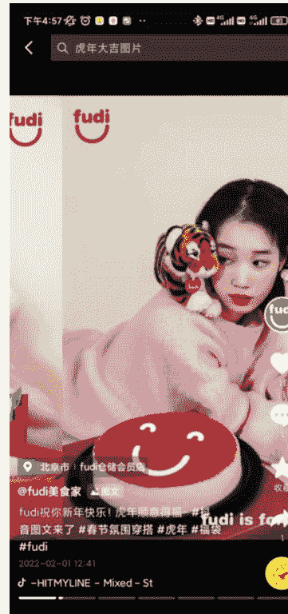
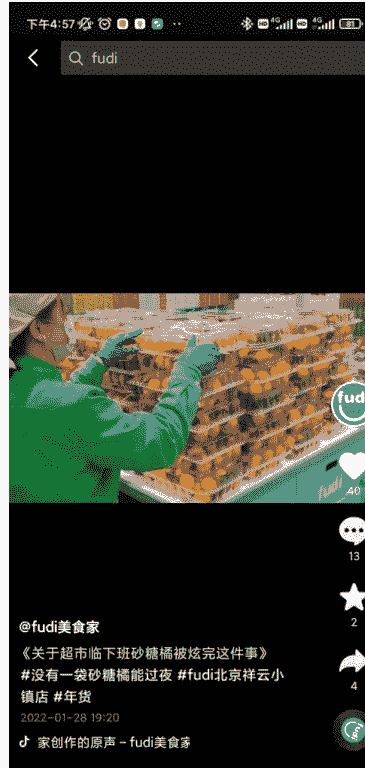
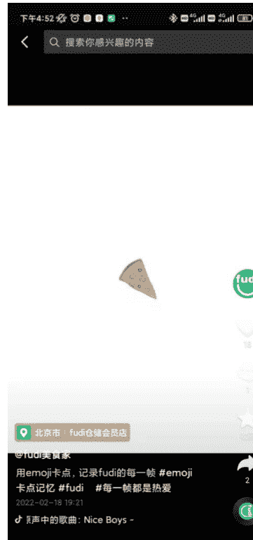

# 账号诊断

### 诊断结论——品牌机会点
fudi品牌在短视频领域缺少标杆作品，需要形成规划性、专业化运营。

1. 缺失内容规划，最忌“有什么发什么”；抖音是品牌和用户的内容社交平台，不单单是品牌的新闻窗口，消费者在不了解你的情况下，对品牌信息没有兴趣，更不用提了了解你的品牌动态；
2. 视频发布只是沟通的开始，粉丝互动、播放数据反馈、粉丝画像分析等的专业化运营才能让品牌账号走得更远，更具生命力；
3. 账号需要形成固定的主持人、明确内容方向，强化运营，增加账号活跃度，这样才能吸引目标观众持续关注，进而使粉丝粘性加强，并沉淀为私域流量。

# 人群扩张策略

### >>>>>>核心人群
- 30+ 罗北京富裕阶层及新中产家庭型用户（年轻夫妻或者有孩子家庭），有一定的购买能力，对于食品和生活用品的品质、购物体验有高要求的用户。

### 潜在人群
- 24-30岁 北京新兴白领阶层，对高品质食品及生活用品有着较强的兴趣及吸引，有着冲消费的可能性。

### 扩张人群
- 24-40 罗北京及周边新中产家庭型用户、高产家庭用户、白领及青年群体。

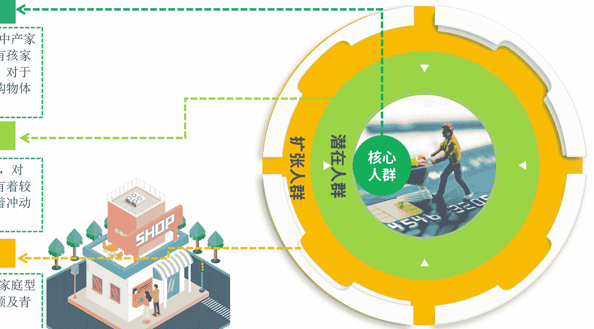

注重向年轻人群进行拓展，在消费层面上关注内心的向往和对美好生活的追求。

# 核心用户抖音喜好

## 抖音客群喜好内容标签
TA们喜欢在抖音观看健康类、美食类、文化艺术类、好物推荐为主的内容。

# 抖音偏好内容

# PART 03 账号内容运营

## 运营策略

### 确定账号定位
以产品卖点、客群喜好及需求出发，确定抖音的基本定位。

### 吸引客户
以策略为导向，创意丰富的内容吸引客户。

### 推广渠道及方式
利用有效传播、整合新媒体方式，做到声量传播。

### 推广：爆款打造积累
找到爆款方向，进阶式运营。

### 账号策略解读
以定位出发，品牌优势分析，找到账号运营规划。

### 包装：视频打法
#### 视频合理框架
- 按照品牌、店铺、服务、用户四大维度对内容进行精细化分类，最大化覆盖内容方向。
- 根据内容分类，有针对性的选择具体投放时段。
- 更加注重信息交互，互动落地。

#### 视频分类
- 实施季节化营销策略，以春夏秋冬冬为边界，结合每个季节的时令特点及热点节日，提炼不同动机的购买场景。
- 将fudi的应季爆款产品与季节相结合，以短视频形式在抖音进行传播。

#### 视频制作
- 专业化制作。
- 优质打造。

#### 视频互动
- 抖音放大。
- 品牌塑造。

#### 日常运营
- 持续不断，- 常规发布。
- 粉丝转化。

#### 品质 · 品效
明确且有效的传达主要信息：购物体验、商品卖点、核心权益、品牌气质、员工服务、会员活动、热点等。

## KEY ISSUE
- 通过日常运维，在全年持续声与用户沟通。
- 在大促、新店开业期间，吸引关注，为门店造势线下。结合全年时间节点（热点），传递品牌理念。

## 传播核心任务
当提到fudi时，消费者就会想到“新鲜”、“美味”、“品质”。

## 传递核心关键词
- 新鲜：fudi最直接的特性卖点，带给用户的直接利益。
- 美味：用户对于新鲜卖点的感知，由fudi带来的美食体验。
- 品质：基于快捷、新鲜和对于美食的体验，fudi全体系产品的品质认知。

通过一段时间的内容深耕与传播，用户对fudi的产品价值有初步认同，逐步建立信任感。新鲜内容的包装与证言，为新开店或增大促销进行蓄势。对于新鲜的期待与渴望，快速体验。快速结合热点，打造新奇内容通过上传播，吸引关注制造话题。重点品类与服务：以具有代表性的产品体现新鲜与美味，新鲜的内容与快速反应。

# 账号定位

### 核心形象
中国式生活构建者，都市生活的风向标。

### 延伸形象
美食、美好生活分享者，美好生活的倡导者、分享者。

### 核心主题
丰富生活的懂生活

# 内容策划 / 内容体系

### 传播节奏
- 按照品牌、店铺、服务、用户四大维度对内容进行精细化分类，最大化覆盖内容方向。
- 根据内容分类，有针对性的选择具体投放时段。
- 更加注重信息交互，互动落地。
- 实施季节化营销策略，以春夏秋冬冬为边界，结合每个季节的时令特点及热点节日，提炼不同动机的购买场景。
- 将fudi的应季爆款产品与季节相结合，以短视频形式在抖音进行传播。

### 全面拓宽内容维度
以季节、时令、热点为节奏点。

# 内容方向 / 内容分类

### 品牌强化
| 类别 | 描述 |
| :--- | :--- |
| 品牌态度 | 围绕“有福气·懂生活”，延伸强化品牌态度内容 |
| 品牌调性 | 为品牌主题衍生的系列视觉调性体现 |
| 品牌差异 | fudi电子标签、买回即卖等品牌差异层面的品牌展示 |
| 品牌卖点 | 提炼商品卖点，种草爆品，吸引用户关注 |

### 核心传播主题
“有福气·懂生活”

### 店铺引导
| 类别 | 描述 |
| :--- | :--- |
| 店铺促销 | 店铺日常促销活动推送 |
| 店铺活动 | 店铺活动告知圈、参与情况等内容推送 |
| 店铺爆品 | 店铺内爆品、单品等相关推荐推送 |

### 服务展示
| 类别 | 描述 |
| :--- | :--- |
| 购物体验 | 展示店内购物体验 |
| 会员权益 | 会员权益解读，体现会员性性价比 |
| 员工服务 | 体现员工服务的温暖，带着人意，为顾客着想 |

### 用户互动
| 类别 | 描述 |
| :--- | :--- |
| 日常互动 | 日常发布内容的互动，增加粉丝互动 |
| 粉丝运营 | 经营品牌私域，进行粉丝转化 |

# 账号人设

### 有福气的美家
通过一个精致生活家的形象，将仓储会员店的精致生活、精选食材为卖点，让更容易接受，通过直播和创造卖点。
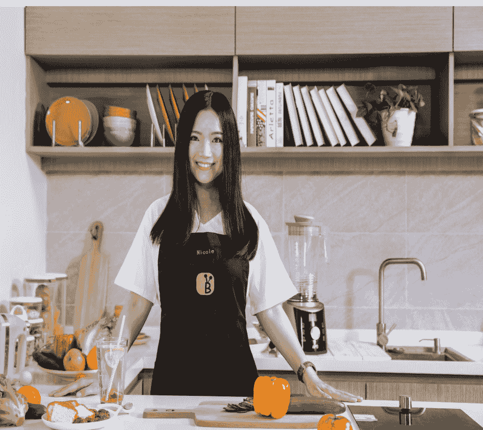

### 人设要求
- 形象：造型吻合账号定位。
- 亲和力：亲民、表情、肢体语言丰富。
- 正能量：爱笑、爱说、爱互动。
- 情绪控制：理智、善意。
- 积极：面对问题、积极处理、不懈。

### 人格化品牌
通过打造账号人设，直接将一个人的品牌、产品联系起来。打造有福气的美家人，通过长期视频包装，让粉丝真正记住形象，从而对品牌产生情感连接。
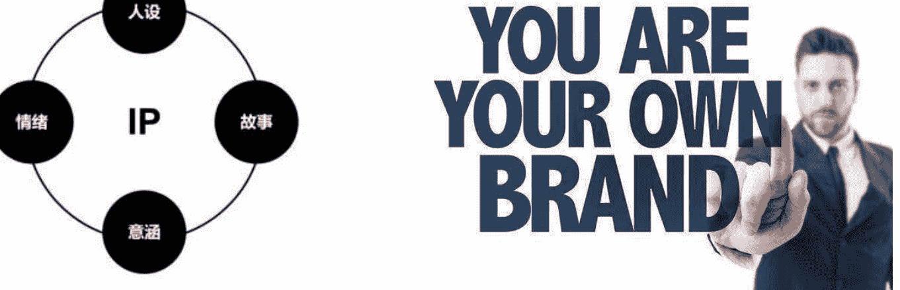

# 创意内容规划

### 3个有趣的创意栏目
以美食为主，呼应账号名称，同时最容易让人接受的美食视频作为主，以生活好物方向为辅，做到精致生活的三个方面：美食、生活用品、产品质量。

### 无美食，不生活：
1. 探店无死角
2. 深夜美食家
3. 被低估的食材
4. 十分钟精致美食
5. 应季美食

### 有好物、懂生活：
1. 超市未眠
2. 女神街拍
3. 好物故事集
4. 生活宝藏

### 有品质、有福气：
1. fudi档案
2. 从农场到餐桌
3. 品牌诞生记

#### NO.01 探店无死角
定期邀请热门网红进行仓储会员店的探店视频拍摄或直播。对于仓储会员店所受物品品质、品牌形象、品牌内容、食材等做精细化的展示，起到宣传作用。网红探店过程中，主持人可以出镜互动，以身份进行介绍和解答。

#### NO.02 深夜美食家
仿旧日本深夜食堂及孤独美食家的情节来源与人物设定，营造在仓储会员店每日闭店后，都会利用店内食材在现场制作美食的达人形象，每期一个特色菜谱。通过情景剧的方式将菜谱植入其中。
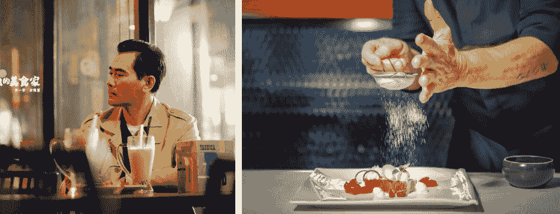
创意说明：视频创意可以模拟猫和老鼠的追逐模式，达人每次做好美食后，都会被超市安保人员追着躲藏，并在躲藏的过程中享受自己制作的美食，将搞笑有趣的元素植入其中，牢抓住粉丝关注。

#### NO.03 被低估的食材
以平常食物丰富营养成分为切入点，介绍常见及容易被他人忽视的食材中的营养及食用益处来开设主题方向。通过知识的方式，吸引对于生活有追求的精准客户关注，通过一系列的方式长期锁定目标客户的关注点，形成粉丝积累。
- 被低估的食材·玫瑰花
- 被低估的食材·一直低估的海带
- 被低估的食材·百搭小番茄
- 被低估的食材·被低估的治疗高手——生姜
- 被低估的食材·被低估的治疗高手——胡椒
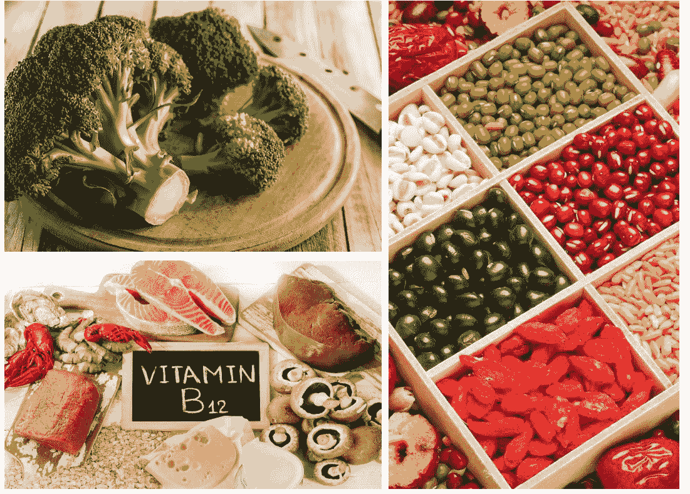

#### NO.04 十分钟精致美食
为了迎合城市紧张的生活节奏，开启十分分钟美食主题内容。通过简单食材的处理，在十分分钟之内做出的精致美食，从低门槛吸引客户，扩大粉丝。
- 十分钟美食·法式蛋吐司
- 十分钟美食·日式紫菜烩饭
- 十分钟美食·美式热狗
- 十分钟美食·西安篇番茄条
- 十分钟美食·成都篇水煎牛排
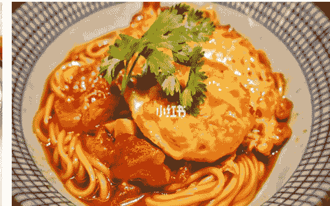

#### NO.05 应季美食
很多人都有这样的烦恼，到一个季节，以春夏秋冬为边界，结合每个季节的时令特点及热点节日，推荐季节上的美食，呈现季节化内容策略，激发线下销售。
- 应季美食·水晶白菜
- 应季美食·白桃乌龙糕
- 应季美食·嫩脆肉丝
- 应季美食·清炖羊肉
- 应季美食·苹果银耳羹
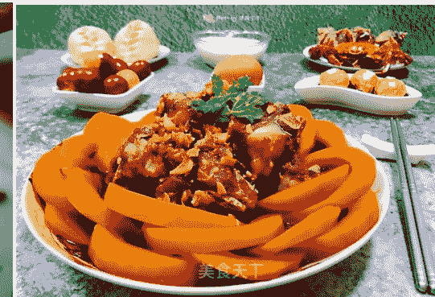
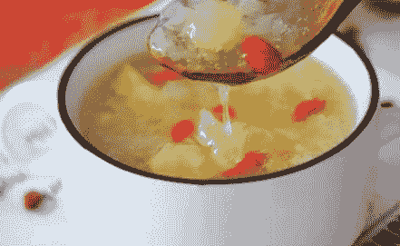

#### NO.01 超市未眠
仿真玩具动员的玩具拟人化，我们将仓储会员店的物品通过简单的装饰进行拟人化，通过吉祥物的对话演绎故事，传达产品质量及品牌力。拟人的形象化能够更好的吸引粉丝，同时物品拟人化也可以带来视频的幽默感和温度，将说教和信息传递娱乐化、情景化，更容易让粉丝接受。
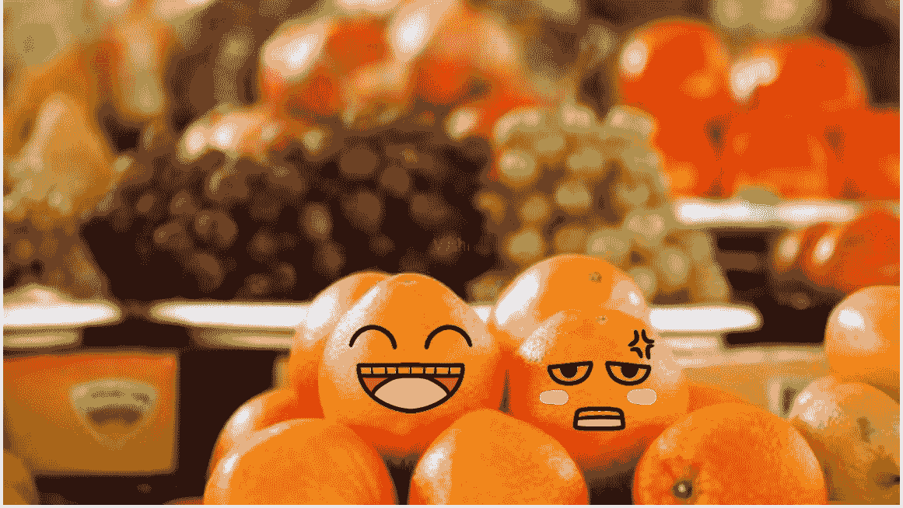

#### NO.02 女神街拍
爱美，永远都是人们之向往和追求。定期邀请不同风格的模特，在超市拍摄不同主题的街拍大片，通过女神与仓储会员店内的物品及精致场景的合拍，展示仓储会员店的形象，将品牌元素输出。以女神的颜值与仓储会员店做链接，从形式上做到粉丝的作用。
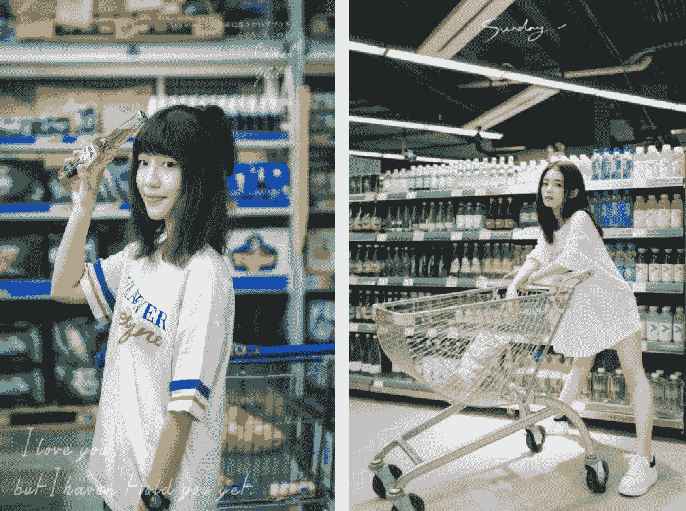

#### NO.03 好物故事集
那些感动、勇敢、坚定的瞬间，总有一些物品见证者。都有一段无可复制的动人故事，通过这些“专属物品”背后的故事发掘，将一些物品赋予文化和故事内涵，拔高品牌调性，沉淀品牌内涵的同时，积累目标客群。
好物故事·移动电源：它是跟插画师合作的，插画设计感外层是磨砂质地的，而且很薄，比我的手机差多少，随携带非常方便，每一款童话主题简直不要太可爱了！
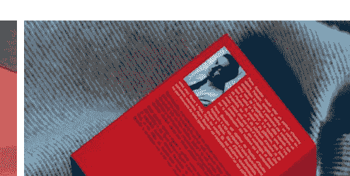

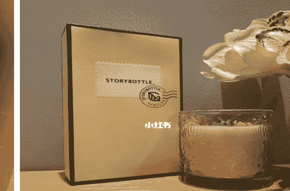

#### NO.04 精致生活
作为账号定位，通过仓储会员店的精致生活、精选食材为卖点，让更容易接受，通过直播和创造卖点，做到最大化。

- 靠谱水果
- 拥抱夏天的
- 店铺促销
- 店铺活动
- 店铺爆品
- 购物体验
- 会员权益
- 员工服务
- 日常互动
- 粉丝运营

# 创意内容规划

## 《有品质·好福气》：NO:03 品牌诞生记

## 栏目说明

- 详细介绍进入仓储会员店产品品牌的前世今生。详细解读品牌优势、发展、历史、标准、文化、故事等等，从而让客户对于供应商品牌有深入的了解和认识，从而间接地提高对于仓储会员店品质的口碑。

## 内容举例

- 品牌诞生记·食品篇·宫廷五五黄鸡
- 品牌诞生记·食品篇·壹力啤酒
- 品牌诞生记·食品篇·五粮液
- 品牌诞生记·物品篇·东芝
- 品牌诞生记·物品篇·原森

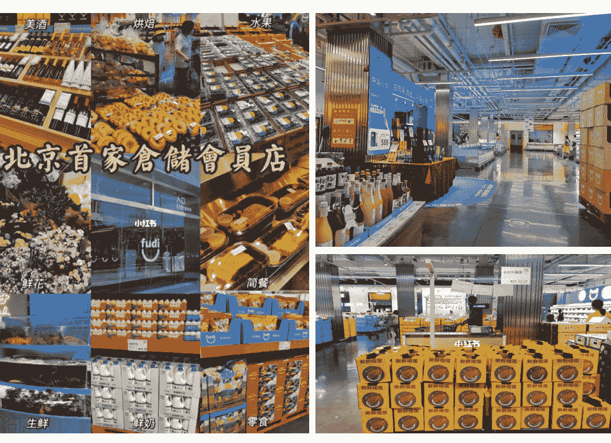

# 制作标准

### 标题
有趣，有梗，个性，真实，引发用户参与互动

### 封面
统一性，封面个性化，干净，清晰呈现人设

### 文案
真实，贴近生活，引发用户参与互动

### 造型
风格统一，鲜明，按自己人设改造，避免土土味

### 选题
多元化，抖音范，炫酷年轻，垂直清晰人设

### 脚本
垂直IP，分析受众，结合抖音和自己

# 推广手段

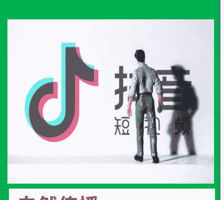

# 自然传播

靠创意文案和爆款视频或话题形成自传播，让粉丝，用户主动转发扩散，形成裂变，但需要弱化商业广告信息

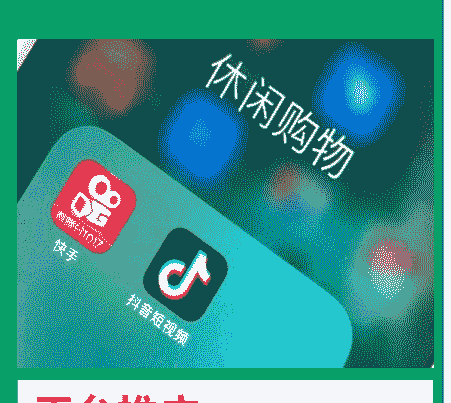

# 平台推广

抖音官方联合推广，抖音挑战赛、DOU+或是信息流推广，增粉和互动效果明显，可包含产品广告信息

# 内部扩散

发动企业内部员工、经销商，以及品牌合作伙伴，所有用户参与扩散，还可以通过官方自媒体平台进行导流。

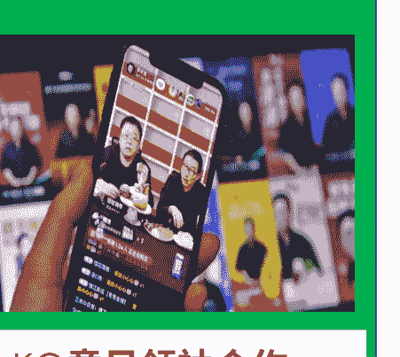

# KO意见领袖合作

邀请KOL意见领袖参与，形成导流，借助明星效益为平台和内容带来流量支持，盘活流量池，带来流量。

# PART 04

# 账号运营规划

# 运营节奏规划

## 储蓄期 (Savings period)
## 引擎爆期 (Detonating period)
## 运营期 (Operation period)

**阶段目标（储蓄期）：**
迎合平台规则，探索与平台的契合度，持续高清输出内容，不断优化视频拍摄与传播效率，以及分析和数据，改变策略。
- 阶段周期：3个月
- 更新次数：每周3-4更

**阶段目标（爆期）：**
链接相关热点话题，更为精准的客群分析和内容打造，提高爆号的活跃度，内容的转化率，完播率，精准的内容打造，促进粉丝快速增长。
- 阶段周期：3-6个月
- 更新次数：每周3更

**阶段目标（运营期）：**
持续优化账号内容，增加账号的传播力，稳定与粉丝的互动手段，有序的运营账号，使账号持续健康成长，将粉丝转化为私域运营。
- 阶段周期：6-12个月
- 更新次数：每周3更

# 运营节奏规划

### 第一阶段目标：探索与平台契合度

1. **做定位**：确定账号定位，根据定位强力输出内容。
2. **勤奋分析**：根据输出内容分析账号亮点点赞内容。
3. **看粉丝**：了解账号粉丝的基本特征，根据特征调整输出内容。
4. **持续输出**：在期内，持续输出视频，直至找到多个爆款视频的结构和内容方向。
5. **练团队**：磨合团队工作效率，提升各方面契合度。

第一阶段储蓄期
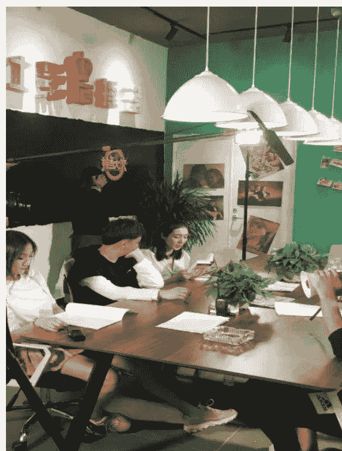

# 运营节奏规划

### 第二阶段：引爆期
#### 第二阶段目标：打造账号热度

1. **强人设**：找到账号定位，强化人设，让账号形象更清晰。
2. **推爆款**：持续发布爆款视频，验证相似性原理。
3. **勤互动**：积极与粉丝互动，强化粉丝与账户的粘性。
4. **控热度**：在期间内，抓住社会热点话题，扩充内容声势，做到传播最大化。
5. **增粉丝**：根据用户画像，进一步掌握粉丝喜好，积极增加粉丝数量。

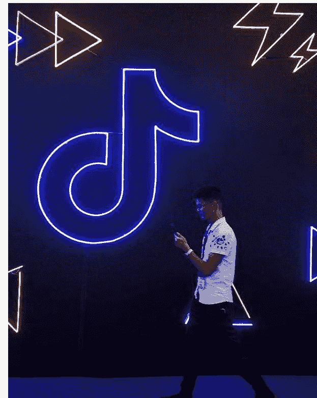

# 运营节奏规划

### 第三阶段：运营期
#### 第三阶段目标：多方位实现价值

1. **定主调**：确定好的内容方向，不易变动，增加内容统一性。
2. **多宣传**：通过各种渠道，抖音挑战赛、信息流、达人等方式进行宣传。
3. **强互动**：与账号稳定的粉丝群体进行互动，强化客群关系。
4. **推产品**：适时植入相应产品，通过带货或者实现价值的多方位回报。

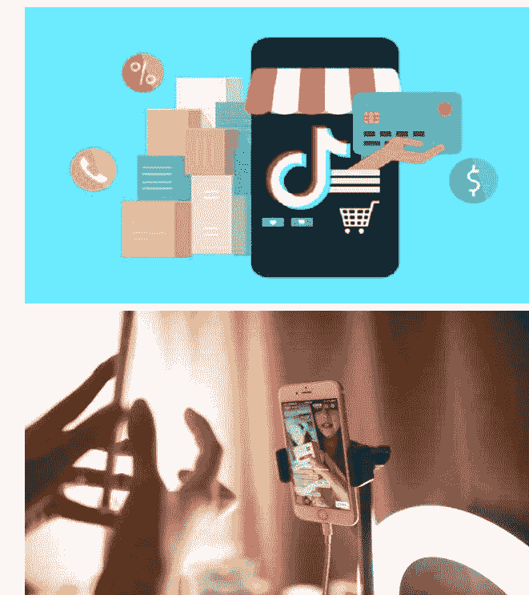

# 运营节奏规划

### 热点内容引爆
增加与抖音热点结合，借助流量发力，促进粉丝快速增长。

### 高频发布激活
持续高频率发布视频，提高账号权重，扩大流量池，实现账号转化。

### 稳定运营
- **稳定期（6个月）**：预期每月涨粉2w左右，12个月内保底2w粉丝。
- **爆发期（3个月）**：预期每月涨粉1.5w左右，6个月内保底8w粉丝。
- **储蓄期（3个月）**：预期每月涨粉1-2w左右，3个月内保底3w粉丝。

# 团队支持

**甲方**：拍摄场地、拍摄时间（每月若干次）。
**乙方**：策划、编导、演员、拍摄、剪辑、运营、拍摄棚、摄影师、化妆、工作人员。

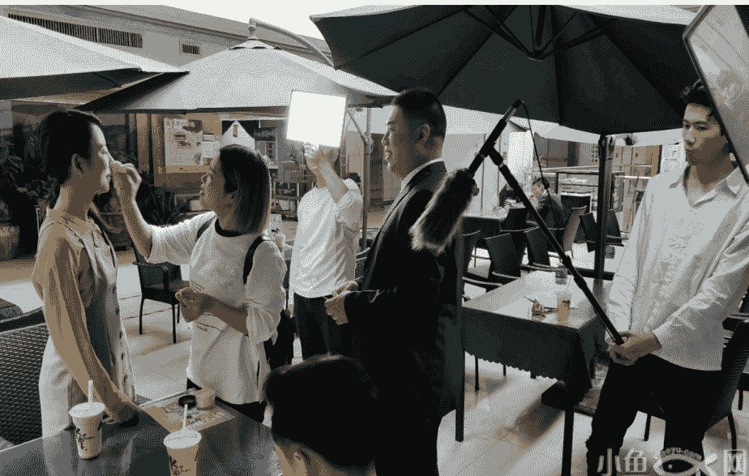

# 专业化账号运营

| 商务渠道 | 内容 | 效果 | 市场运营 |
| :--- | :--- | :--- | :--- |
| 客户对接 | 资源合作 | 策划 | 用户运营 |
| 商务接洽 | 统筹 | 策略 | 活动策划 |
| 版权购买 | 投流 | 文案 | 线上活动 |
| | 摄影摄像 | | 数据 |
| | 后期制作 | | 设计 |

# 运营效果预估

| 运营周期 | 12个月 |
| :--- | :--- |
| 视频数量 | 150条/年（12-15更/月） |
| 预期粉丝数量 | 保底2w（20-35w） |
| 预期总曝光量 | 保底2000w（2000w-3500w） |
| 费用总计 | 120w/年 |

# 抖音账号运营(12个月)

| 序号 | 类目 | 描述 | 单位 | 数量 |
| :--- | :--- | :--- | :--- | :--- |
| 1 | 账号装修 | 头像定位与复制 | 个 | 1 |
| 2 | 自动回复设置 | 私信自定义回复的文案撰写及设置 | 次 | 1 |
| 3 | 内容策划 | 短视频策划方案（每个3个内容方向），含内容方向建议，每两周进行线上/线下沟通 | 个 | 130 |
| 4 | 视频拍摄报告 | 每播拍摄脚本、内容策划精细化 | 个 | 130 |
| 5 | 视频拍摄支持 | 单期脚本撰写、摄像、剪片等拍摄人员成本 | 条 | 130 |
| 6 | 视频制作 | 短视频平台视频制作；时长60s，包含简单字体及模板特效 | 条 | 130 |
| 7 | 演员 | 含视频普通出镜，专业演员报价，以实际执行需求为准 | 次 | |
| 8 | 运营维护 | 工作内容日常撰写文案、发布、粉丝互动、评论回复 | 月 | 12 |
| 9 | 私信管理 | 根据客户需求处理相关信息并交付，反馈后回复 | 月 | 需另 |
| 10 | 增值服务 | 月报：账号月度运营报告，后续运营规划、粉丝流量维护等，每月月初提交 | 个 | 12 |
| 11 | 推广服务 | 资源对接：匹配客户需求提供流量助力推广（Dou+）、投放费的10%服务费（不含、可选） | 条 | 另议 |
| 12 | 账号互动 | 根据账号特性，选择人工进行评论、点赞等互动（依据客户情况、减少或增加权益） | 次 | 30次/月 |
| 13 | 其他服务 | 版权素材：BGM、字体：10套（不含、可选） | 条 | 另议 |
| 14 | 直播服务 | 基础端运营策略和深度直播运营（不含可视） | 次 | 另议 |
| 15 | 活动服务 | 根据策略、选题/策划/线上/线下活动执行（不含、可选） | 次 | 另议 |

# 谢谢审阅，期待合作

fudi仓储会员店
有福气、懂生活

2025.2
