### 世界

一四 卢克文著

见世界·二〇二四 SINO-CULTURE PRESS 单行出版社

# 免费 价值 及时 专注

# 扫码加入 知识星球TOP 免费资源群

- 每日免费获取有价值资源
- 可提供各类资源搜索服务

◆热门付费文章 |◆各行行业报告
◆精选图书资源 |◆副业赚钱方法
◆职场实用资源 |◆AI政经自媒体

公众号: 知识星球TOP 微信信号:jntsg8 微信信号:jnts2

分享资料仅供个人学习，请及时删除，切勿商用传播

# 目录

代自序 微光 /1

# 欧美篇

- 英国与日本: 两个岛国的全球战略/2
- 浅析当今世界地缘格局 /19
- 王不见王 /29
- 英国的逻辑/36
- 铁血残阳德意志 /54
- 俄罗斯是个怎样的国家 /81

# 亚非篇

- 食色日本 /116
- 韩国调查报告 /131
- 埃及调查报告 /168

## 国内篇

- 这样的北京 /204
- 上海是如何样形成的 /214
- 深圳·繁花 /226
- 夜行成都 /235
- 福建:向海而生 /243
- 浙江:云和山的彼端 /281

# 随笔篇

- 漫长的财政 /326
- 疲意的嘉靖 /332
- 李白的白 /342

# 代自序

# 微光

### 壹

2008年冬天，我们在东莞虎门，应聘了一家奇怪的童装公司。

确切地说，这家公司并不奇怪，是靠着中高端细分童装市场的，产品和SI（服务整合）都做得很用心，奇怪的是这家公司的话事。虽然我在那里只开了3个月，但间隔15年，还一直清晰地记得这位40岁头、满面油光的邓老板。

这是一家初创型公司，每个部门的人很少，但员工分外努力，大家常常主动加班到晚上九点，甚至十十点，把手里活儿计完才离开。

现在的年轻人，可能理解不了我们80后20多年时，为什么会主动免费加班？是一当年许多中小公司，普遍没有加班这个概念，处于一种模糊地带。

二是当时百业兴起，大家有一种“我多总能学点东西”的精神，为将企业提升进步。

那家公司工作辛苦，老板又是个完美主义者，一个小卡片的信封，都要反复修改十几遍，因此我们经常晚上十点班，周日很少休息。

同事们有着火热的创业热情，氛围很好，我也很快离开了公司，对老老板有着实有神经的老头。

我们在办公室忙得火朝天，每隔一周，这个邓老板会突然挺肚子子进来，将所有同事一个一个指着骂一句，他会将同事刚换掉的衣服放在手里撕掉，怒骂生产部门在生产垃圾，也会把拍好的画册扔在地上，怒责营销部门都是

## 观界·二二四

没脑子的废物，他是在办公室嚎得不休摇头皱脸地骂上一小时，才满意足地离开。

我一直怀疑他有狂症，否则他怎么总是经理理直气壮地侮辱我们这些废物为我们加班到晚上十点的打工人？除非他脑子病。

我对我这家公司印象如此深刻，并不是因为他是这个经理老板，而有一件小事，一直在心心里。

我进公司的时候是深缘，眼看着过了几年，有一天晚上，我们在宿舍里吃晚饭，我问他买的种毛线长什么，广东不用，阿发说要寄回老家给他舅妈。

我先说了“哦”，转过身，突然想起自己妈妈因为癌症已经去世多年了。

母亲去世时，我为她买过一条毛线，也没有为她买过几件衣服。

当我想为她买一点东西时，她已经离开了，我也再无法孝顺她。

曾经和她一起生活了二十多年的妈妈，她葬于黄土之上，说不在了就永远不在了。

母亲的笑容微笑，历历在眼前。同事也可以为母亲买礼物呢，我就买了毛毯，也没有人能收到了。

一股悲哀之意忽然涌上心头，我只有觉得说不出来的悲哀和难过，于是是一个人爬到冬的的宿舍楼，在角墙痛哭了一场。

多年以后，当我做生意想到第一辆奔驰，我也是一边在高速上开车，一边想起来母亲。

母亲这一生，是为了养活女儿，人一生都艰辛，曾经在东莞跑的流水线，每天工作十四个小时，为女儿挣学费生活费。如果她现在活着，能让她过好一点、吃好一点、穿好一点、买好一点、去好一点、旅游好一点。

手里拿着方向盘，心头却酸楚，突然变成个泪。那天在宿舍角墙哭，心里还有些感慨，便拨了一个电话给朋友，我说：“不要再分开了，我们在一起，不要再分开了。”

## 贰

2005年夏天，我进了东莞，找了一家服装公司，成为一名策划员。

那时候的工作很杂，我每天工作八小时，偶尔画画图。现在的年轻人，可能理解不了我们80后20多年时，为什么会主动免费加班？那是当时百业兴起，大家有一种“我多总能学点东西”的精神，为将企业提升进步。

那时候我记得2005年十一月，我遇到了那个女孩，她显得很巧，我第一次追求她，很快被拿下了。

那时候的恋爱谈两个月就结束了，我认识了那个女朋友。

那天在昆明郊区，她站在宿舍墙前，心里有些感慨，便拨了一个电话，我说：“不要再分开了，我们在一起。”

她在电话里说：“不要再分开了，我们在一起。”

## 参

2006年夏天，我母亲被查出癌症，全家因为疾病和巨额费用，开始了一段水火火的生活。那时候我工资全部寄家里给母亲治病，我自己再去钱度日，生活重压得我难以维持，常在深圳的廉价出租屋里喘不过来。

由于拮据，得想办法省钱过日子，我每天都要把生存成本到最低，点外卖买最便宜的菜，几乎没有社交，也不像我其他男同事那样主动请客。我在深圳工作一段时间后，被其他同事引起，说我像铁一样一毛不拔。那年我一直在借钱过日，等到母亲去世，安葬费还没有，还得打电话给网友借钱。一直到母亲下葬半年年后，我靠着微薄的薪水，陆续还了一些债，这时生活才有了点起色。

深圳是个没有任何人味的城市，我晚一点找房，就算交过押金，房东恨不得将我的行李扔到大街上。我没有在深圳住过一个月，晚一点找便宜的房，他们都是像房贼一样打量着每一位租客，每次退房时都要占便宜占便宜，想方设法扣押金才退，不跟你大吵闹一次绝不休。我那时被生活打得像落龟一样，就算被同事当众围，却解释的兴趣也没有了。

此时需要远尽，因为在天涯连小说，又吸引了一位女孩子找网来追我。便是上文的那位绍女友。这段恋情维持了两三年的时间，算是我20多岁时，唯一一次遇见的真感情。因为有了上一次的教训，我来先把自己的经济情况介绍了一番，但对对方像不是在乎金钱的问题，她只是好奇我是想写出这些奇奇怪的小说。

她叫小三，英语专业毕业，绍兴柯桥人，在当地一家做面料的外贸公司上班。因为我一直从事装潢行业，对对面有些熟悉，因此此一开始就能接上活。浙江人都很会赚，她在打工，但父母在昆明开公园，因此她打小就没为钱愁过，她的十几年后，就要抱着一担一捆的钱去银行存，家里早就建了六层楼的大别墅。

她没有生存危机，性子又阳光又活跃，对万物充满了好奇心，成天叽叽喳喳她话。我们从面面坐着，一直聊到办公室，每周两个小时，每天两个小时，每天两个小时，每天两个小时，每天两个小时。那时候，妈妈的电话在电话，我们在一起时，她站在远处，我上班公交车后，回头看到她叹了口气，仿佛撇掉了一个包。

## 肆

2008年除夕前，我找到了绍兴，见到了女朋友的父母。她家里有一个三岁的儿子，都能抱起来管我叔叔了。女朋友家里有一个强势的人，她妈，她爸。

进群微信后，女父母用冷意的眼神看着我，将我的礼物放到沙发，看都不一眼。他是一个没有表情的雕像，隔着我的世家介绍清楚楚，只问了一句，他脸上就满了寒意，转回头满愤怒的眼神看着自己。这种熟悉的场景再次出现，我顿时预感前程未卜。晚上在她家吃饭，整个饭桌上七八个人，却一点儿声音都没有，大家都不说话，只听到筷子和饭碗碰撞的声音。吃完饭，女朋友去她房间里闹，他们发生了激烈的争吵，吵完后，女友眯眼睛冲出来，拉着她的行李，跟我搭了一部出租车到柯桥上。她安顿。父母不意见这门婚事，在床上哭一声，我走过去一看，见她哭得满脸都是泪痕。但她看到我后，心情瞬间转好，擦擦眼泪，从床上翻起身，你说你滚开，我花咬了，不好。她带着我在绍兴躲了几天，没几天就要离她，她也不想跟父母谈太久，还。

在除夕前回回了家里。

2008年的除夕，我又是一个人，在柯桥一处静谧的小区度过。与上次不同的是，她一边看热闹春，一边在QQ上和她点评节目，还一边上天涯的直播贴帖跟我吐槽。她在努力维持着我和她家人之间的平衡。春节过后，我回到广东，迅速跟那位经理老启师傅，应聘上了一家女装公司的策划部经理。这时，我人生中第一次有了一些积蓄，经济上略有了好了，不用再以以前那种心用肺的生日。

夏天，她辞掉了柯桥的外贸公司，尝试去东莞工作，但她所学专业完全派不上用场，她等了一个月，父母催她回去管理家里的事，她只好转去昆明。在我们这家公司等到秋末，发现策划没什么前途，主动要去清闲，从此做了电器，年底我从这家公司离开，打算牵起老婆的手去广州创业。我都感到这段感情难以维系，但她还是劝我先去昆明，再尝试不跟家人下处。

### 伍

2009年除夕前，27岁的我坐着飞机来到昆明机场。她开着我买的新黑色雅雅来接我，我努力尝试沟通，陌生她跟我打招呼。她脸上没什么表情，不咸不淡地跟我说了两句话，将我拉回到他们的木园。进群微信。在浙江昆明开了大片片的苗木园，专门接政府的绿化单。城市的公园、绿化都需要。2008年开始搞建设，苗木。小叶杨、黄杨、四季桂、月季、杜鹃。小叶杨、黄杨、四季桂、月季、杜鹃。小叶杨、黄杨、四季桂、月季、杜鹃。小叶杨、黄杨、四季桂、月季、杜鹃。小叶杨、黄杨、四季桂、月季、杜鹃。小叶杨、黄杨、四季桂、月季、杜鹃。小叶杨、黄杨、四季桂、月季、杜鹃。小叶杨、黄杨、四季桂。我。想起病逝的母亲，想起和女友相处的细节，想起再没有人亲切叫我妻子，突然从心泛起，蜷倒在卧上，蒙着被子，全身哭得一抖。像暴雨里的小叶摇。

## 世界·二二四

2008年秋天，我。在凌晨，在无阳的苗圃中缓缓行，我穿过无数的小叶杨、山杨、黄杨，还穿过大片栽培的月季、玫瑰、牡丹。我看着朝日从正面缓缓升起，我看着太阳，一边走，一边哭。我走到了马路边，迎来了郊区的第一辆公交，坐到火车站，站了一张铺票。火车启动，我坐在窗里，想起这几年的往事，想起病逝的母亲，想起和女友相处的细节，想起再没有人亲切叫我妻子，突然从心泛起，蜷倒在卧上，蒙着被子，全身哭得一抖。像暴雨里的小叶摇。

### 陆

2010年春节过后，我去广州淘宝视频，半年后失败回到职场。

直到2018年底，我有8年时间，没有再写过任何东西。偶尔听前女友的朋友说起，才知道她第二年结了婚，后来生了两个女儿。我再也没有见过她。我2015年结婚了两个女儿，还靠淘淘，赚了不少钱。婚后，我常开车等红绿灯时，就不由自主地坐在那儿发呆，我妻子问我在想什么，我坐在方向盘上说：“我想写小说。”我还要充实说：“我的天赋一直是写作，虽然没有一个人相信我。”“将来我一定会写出来的，一定会的。”

(本文写作于2023年8月1日)

# 观世界

欧美篇

10二四

1800年，法国人口2950万，德国和俄亥，分别追赶到了2450万和3500万人，俄亥已反超法国。到1870年，俄亥涨到6700万，德意志涨到4100万人，而法国还只有3850万人，总人口降到欧洲第三，此后法国军队在世界军事史上的表现越来越趋弱。

欧洲各国人口都在飙涨，怎么法国就涨这么慢呢？它不是拥有全欧洲最好的土地吗？

1815年，法国小麦产量296万吨，土豆163万吨；到1865年，法国土豆产量略超出小麦，土豆常年保持在800万到1000万吨，小麦常年在700到900万吨。

而德国1846年土豆产量就到了705万吨，小麦产量142万吨；1870年，德国小麦产量241万吨，土豆产量增长2036万吨。

英国土豆产量数据我一个没找到，但光看英国人口增长速度，也猜出他们种土豆有多爱吃土豆。

法国人不爱土豆，可能是因为他们以前过得太好了，土豆在早期推广时，被视为一种低廉的贫民食物，法国人懂得早，把地位调高，吃起来来有理由，德国人和英国人就不理解这种逻辑，打得可怜。

土豆是一个跟全球环境十分适配的农产品，因为它能提供相当的蛋白质、维生素、矿物质，就是缺少维生素A和D，牛奶营养呢，而欧洲大部分地区是温带海洋，冬天又有北方西洋洋流，使得欧洲畜牧业发达，牛奶营养就不会形成问题，而是形成相互影响。

我去土豆旅游之旅别提，不管哪个国家，点什么菜都配一盘大番薯，那是他们的生活与土豆密切相关好百年的结果。

种土豆比起小麦的好处是，不仅产量高，还能持续土地，把大量农业用地改成工业用地，使用大量农业人口可以去工厂或参军。1906年，法国跟德国总人口差太大，但德国工人总数是595万，而法国工人人数是316万，德国工业反法国，工业产值更高，就是一个吃土豆，另一个吃土豆的后。

同样强力推广土豆的德国，1950年总人口将达到2.82亿，2000年将增长到6亿。俄人的故事，我在《铁血残闲德意志》中有过介绍，被德国人打得太惨了，第二次世界大战损失了3000万青年，打到俄罗斯现在有1.46亿，生活被打成了俄罗斯的国难。

对了，英国人菜之美味闻名世界，与土豆也有很大关系。

英国以前在全球开拓殖民地，收集了地球上的各种东西，饮食现在也是非常奢华的，他们的饮食出现过一次大转折。

是因为城市工业化太早。1911年，英国80%的人口住在城里，早期工业大都市，英国人每天花费14~18小时，顾不上吃口热饭，常常靠罐头度日，把平民食物给荒废了。

“一战”“二战”打起来，英国断了殖民地的优质食材，被迫配给，对土豆没有限制，英国人也可以在相对安全的领域，以前英国国内也容易吃不着鱼肉，是蒸汽火车把价格打下的。英国人仗时就吃土豆炸鱼，炸鱼，薯条就变成了英国黑暗料理的代名词，贫贵食物也给荒废了。

“二战”结束后，英国者华菜宣告失败，厨房失业，其他的菜系涌入富贵的英国，年轻人也不愿意做饭，英国人满堪崩溃，把食物当成最昂贵的。

## 贰

除了英国、德国、爱尔兰对土豆感情深情，爱尔兰对土豆，威尔士、苏格兰就是凯尔特人，英国人是盎格鲁-普鲁曼人，他们并不是同一个祖先。

英国在古代就不断扩张爱尔兰。1711年，四万爱尔兰人曾破坏柏林；1542年，王亨利八世为爱尔兰王国，开始向爱尔兰殖民，之后英国不断扩张并兼并爱尔兰的土地；17世纪中，克伦·威尔征服爱尔兰，将爱尔兰人口从150万减到100万。

此外，整个爱尔兰为英国人的奴隶，1652年，爱尔兰四分之一的土地、六分之五的房屋都是英国人的，爱尔兰则过着可怜的生活，住在没有楼和窗户的泥巴小屋里，每天穿着破烂衫下地给英国人种地。

到1775年，爱尔兰手里只有全岛5%的土地，全爱尔兰被被迫英国人打工，做他们的佃奴。

# 世界史·二二四

爱尔兰人信天主教，英格兰人信新教教会，英格兰人还想强迫爱尔兰人改教，但爱尔兰人拼死反抗，英格兰人更加不把爱尔兰人当人看。

发展到后来，英格兰人常常将爱尔兰的土地六分之五夺走，爱尔兰人会被活活死。在英格兰人看来，爱尔兰是奴隶，1652年，爱尔兰四分之一的土地、六分之五的房屋都是英国人的，爱尔兰则过着可怜的生活，住在没有楼和窗户的泥巴小屋里，每天穿着破烂衫下地给英国人种地。

到1775年，爱尔兰手里只有全岛5%的土地，全爱尔兰被被迫英国人打工，做他们的佃奴。

爱尔兰人信天主教，英格兰人信新教教会，英格兰人还想强迫爱尔兰人改教，但爱尔兰人拼死反抗，英格兰人更加不把爱尔兰人当人看。

发展到后来，英格兰人常常将爱尔兰的土地六分之五夺走，爱尔兰人会被活活死。在英格兰人看来，爱尔兰是奴隶，1652年，爱尔兰四分之一的土地、六分之五的房屋都是英国人的，爱尔兰则过着可怜的生活，住在没有楼和窗户的泥巴小屋里，每天穿着破烂衫下地给英国人种地。

到1775年，爱尔兰手里只有全岛5%的土地，全爱尔兰被被迫英国人打工，做他们的佃奴。

爱尔兰人信天主教，英格兰人信新教教会，英格兰人还想强迫爱尔兰人改教，但爱尔兰人拼死反抗，英格兰人更加不把爱尔兰人当人看。

发展到后来，英格兰人常常将爱尔兰的土地六分之五夺走，爱尔兰人会被活活死。在英格兰人看来，爱尔兰是奴隶，1652年，爱尔兰四分之一的土地、六分之五的房屋都是英国人的，爱尔兰则过着可怜的生活，住在没有楼和窗户的泥巴小屋里，每天穿着破烂衫下地给英国人种地。

到1775年，爱尔兰手里只有全岛5%的土地，全爱尔兰被被迫英国人打工，做他们的佃奴。

爱尔兰人信天主教，英格兰人信新教教会，英格兰人还想强迫爱尔兰人改教，但爱尔兰人拼死反抗，英格兰人更加不把爱尔兰人当人看。

发展到后来，英格兰人常常将爱尔兰的土地六分之五夺走，爱尔兰人会被活活死。在英格兰人看来，爱尔兰是奴隶，1652年，爱尔兰四分之一的土地、六分之五的房屋都是英国人的，爱尔兰则过着可怜的生活，住在没有楼和窗户的泥巴小屋里，每天穿着破烂衫下地给英国人种地。

到1775年，爱尔兰手里只有全岛5%的土地，全爱尔兰被被迫英国人打工，做他们的佃奴。

爱尔兰人信天主教，英格兰人信新教教会，英格兰人还想强迫爱尔兰人改教，但爱尔兰人拼死反抗，英格兰人更加不把爱尔兰人当人看。

发展到后来，英格兰人常常将爱尔兰的土地六分之五夺走，爱尔兰人会被活活死。在英格兰人看来，爱尔兰是奴隶，1652年，爱尔兰四分之一的土地、六分之五的房屋都是英国人的，爱尔兰则过着可怜的生活，住在没有楼和窗户的泥巴小屋里，每天穿着破烂衫下地给英国人种地。

到1775年，爱尔兰手里只有全岛5%的土地，全爱尔兰被被迫英国人打工，做他们的佃奴。

爱尔兰人信天主教，英格兰人信新教教会，英格兰人还想强迫爱尔兰人改教，但爱尔兰人拼死反抗，英格兰人更加不把爱尔兰人当人看。

发展到后来，英格兰人常常将爱尔兰的土地六分之五夺走，爱尔兰人会被活活死。在英格兰人看来，爱尔兰是奴隶，1652年，爱尔兰四分之一的土地、六分之五的房屋都是英国人的，爱尔兰则过着可怜的生活，住在没有楼和窗户的泥巴小屋里，每天穿着破烂衫下地给英国人种地。

到1775年，爱尔兰手里只有全岛5%的土地，全爱尔兰被被迫英国人打工，做他们的佃奴。

爱尔兰人信天主教，英格兰人信新教教会，英格兰人还想强迫爱尔兰人改教，但爱尔兰人拼死反抗，英格兰人更加不把爱尔兰人当人看。

发展到后来，英格兰人常常将爱尔兰的土地六分之五夺走，爱尔兰人会被活活死。在英格兰人看来，爱尔兰是奴隶，1652年，爱尔兰四分之一的土地、六分之五的房屋都是英国人的，爱尔兰则过着可怜的生活，住在没有楼和窗户的泥巴小屋里，每天穿着破烂衫下地给英国人种地。

到1775年，爱尔兰手里只有全岛5%的土地，全爱尔兰被被迫英国人打工，做他们的佃奴。

爱尔兰人信天主教，英格兰人信新教教会，英格兰人还想强迫爱尔兰人改教，但爱尔兰人拼死反抗，英格兰人更加不把爱尔兰人当人看。

发展到后来，英格兰人常常将爱尔兰的土地六分之五夺走，爱尔兰人会被活活死。在英格兰人看来，爱尔兰是奴隶，1652年，爱尔兰四分之一的土地、六分之五的房屋都是英国人的，爱尔兰则过着可怜的生活，住在没有楼和窗户的泥巴小屋里，每天穿着破烂衫下地给英国人种地。

到1775年，爱尔兰手里只有全岛5%的土地，全爱尔兰被被迫英国人打工，做他们的佃奴。

爱尔兰人信天主教，英格兰人信新教教会，英格兰人还想强迫爱尔兰人改教，但爱尔兰人拼死反抗，英格兰人更加不把爱尔兰人当人看。

爱尔兰人对土豆的依赖，是因为土豆产量是普通谷物的6倍，人口增加。从1760年到1840年，爱尔兰人口从400万猛增到800万，这种增长完全依赖土豆。

1845年，土豆晚疫爆发，法国、德国、荷兰也跟着爆发，但爱尔兰的情况最严重。由于爱尔兰种植的土豆种类单一，容易感染，导致爱尔兰人口在短短五年内达到了高峰。

爱尔兰大饥荒一半是偶然，另一半是故意的。这种结果，是因为爱尔兰岛上堆积了大量的鸟粪肥料。

英国政府为了多赚钱，从头到尾没把爱尔兰当人看，饿死多少都没有他们钱重要。奥斯曼土其说不要，英国知道后，居然海军还运粮给它，倒有一艘船成功到达爱尔兰。

英国政府不愿意处罚，粮商和银行大赚了一笔机会。发生饥荒时，粮价大涨，粮商和银行是赚的。他们把土地未来的收获，粮商再把期货售卖给投资机构，地主只要稳定，拿出低贷款，就可以到处找钱兼并土地。

这种金融链的危害是，发生饥荒时，这些粮食作为期货，地主只要稳定，拿出低贷款，就可以到处找钱兼并土地。

爱尔兰人反抗英国的方式比较特别，由于英国人已经深入爱尔兰的生活，他们并没有在战场上进行大规模会战，而是通过民工、军队开展游击战，对抗英国官员和警察日夜不休，平均每天袭击六次。

由于环境越差，爱尔兰的情况越严重。爱尔兰人只能种土豆，自然灾害是偶然，但祸是故意的。

爱尔兰人被称为“白贱人”，就源于这种悲剧。

英国在“一战”中损失了三分之一的国家财富和300万士兵，国力大不如前。爱尔兰在1919年宣布共和国，要英国人流亡出爱尔兰。

英格兰人手里有枪，爱尔兰人反抗原本没啥机会，直到1914年第一次大战，炮轰的英格兰人将爱尔兰青年赶往西线填壕，受过军事训练的小伙子们，打完仗顶着帽就回到爱尔兰家中痛打英国人。

爱尔兰一切痛苦的根源，来自英国人对他们的残酷剥削压榨，这深深大恨，爱尔兰人铁了心所要。

英国曾讲述过爱尔兰族分子的电影，就有《无间道风云》、《芝加莉肖》、《爱尔兰》等。

爱尔兰流落异地，没化资金，在美国什么都干了，除了有自由，价格上连黑奴如老，老实的搞黑奴去干一些危险工作，不老老的就搞黑社会团体。日后甘尼迪总统的胜利，就在1845年饥荒时，因为有了活路，乘坐廉价的“棺材船”逃命到了美国。

爱尔兰大饥荒持续了六年，直到1851年才结束，饿死了150万~200万爱尔兰人。

爱尔兰人当时要么饿死在土里，要么心存侥吃有毒土豆而死，要么被英国人以奴隶身份卖到澳大利亚，要么漂洋海去美国当黑奴工作。

## 观界·二二四

但不管算进去，爱尔兰这种死硬拒绝融入英尔兰的态度，会让英尔兰觉得是一个潜在的、危险的“反英”，英尔兰必须对其进行削弱，以保证主岛安全。

北美洲独立战争是在1775年，英国早从中取了管理殖民地的教训，能够柔和的尽量柔和，而爱尔兰大荒是在1845年，隔了整七年，英国人还爱尔兰往死里养，就是怕爱尔兰减少，能饿死就饿死，不饿死的，快快活去美国，这样才能“保证主岛不受威胁和损害”。

爱尔兰死就离英国太远，无法接近，永远是政治谋略的重要手段。日本是英国岛战略的延伸，他们的故事并不复杂，几句话就可以讲清楚了。日本没有英国重要，日本是英国的延伸。

## 肆

我们通常英国对海外殖民者，用“藩域”这个词，似乎更贴切一些。以前清曾有多个总理衙，原本名为“藩院”，意思是治理夷洋的机构，其实英国在全球扩张中，就有点治理藩域的意思。

英国将他们的领地分为两个藩域。

一种是加拿大、新西兰、非洲、澳大利亚，由英国民众抢过去建立政权，由于吃过北方的苦，这种地方英国不管管，喜欢哈哈闯去，长期不干涉，只要大事听他们的就行。

另一种是在19世纪70年代后期殖民地，由英国派出总督管理，受英国政府管辖，代表的是英国。对海外的管理分为两种，一种由英国绅担任高级官员，用当地人在各地任公务员，负责税务、治安、司法、教育等，养出一个印度阶层。另一种是间接合作，也是英国“用最小成本全球利益化”。

英国根据自身实际情况，对不同殖民地采取了灵活的殖民手段。这里有两个问题：第一，英国自身的实际情况？第二，具体殖民手段？

先回答第一个问题，英国的实际情况是：他们人口多、资源不多、夹在欧亚大陆侧的岛屿。总之，英国手头可用的人力、物资相当有限，全岛要多做加法，做少减法。英国必须在保证主岛不受威胁的情况下，尽量减少损耗的方式治理，用最小的成本实现全球利益化，并肃敌，而不顾一城一地的得失。上面这段话是本文重点，可以在这里多读。

英国对爱尔兰的残忍统治，就是“保证主岛不受威胁和损害”驱动的。资料显示，1845年，爱尔兰人口涨到800万，而英国人口240万。我在阅读英国人口数据时发现，有部分资料说英格兰那时只有120万人口，心中不得有一个疑问：英国1845年240万人口，是不是包含了爱尔兰的人？毕竟那时候爱尔兰属于英国直接管辖区域，算进去也没错。

## 世界观·二二四

英国不想欧洲统一，其实是为了经济利益，因为统一的欧洲国家，会对英国的海外贸易形成竞争，破坏英国生命。相反英国越扩张，就不会形成统一的市场，英国的工业品将不会遇到强大的贸易壁，可以扩张到欧洲各国。搞欧陆是要搞的，重点的是怎么省钱，还要做出效果。

英国在欧陆风云第一回合弱哈布斯斯王朝，是法国派出的西提比亚西班牙帝国，英国在这一优势中。第二回合弱法国，是普鲁士跟俄国乞将一样，跟法、奥、俄三国对仗，打出精彩帝国在欧洲赢得一世，打得普鲁士差点灭，英国在海外疯狂抢夺土地，其十分钟大帝国每年77万镑的支持。第三回合带头组织第七次反俄行动，削碰反俄的法国和新势力拿破，将法国彻底溃败。英国拿梗倒是靠老实出来，拿太平洋太平洋把英国陷入一困。第四回合在18—19世纪世界击速俄的俄罗斯，在西边联合王国和奥斯曼国战胜克里米亚，在东方扶清朝对抗俄失败后，终于靠扶日本镇住了俄东北的扩张。我们的另一个主角日本，写到这儿才出现，没关系，日本没有英国重要。

第五回合是发现德国崛起，又有统一的德欧的样子，却连续在“一战”“二战”中击德，法国年轻人打得几乎接近60%的战死，人死到直接接白旗；“一战”“二战”又把俄国光明明的5亿人口计划，打到今天只有1.46亿，打出了俄罗斯人的困难。这段期间，也顺送出了强大的美国和日本。

英国就是整个欧洲的一根刺，他们一直在用最低成本，捣乱整个欧洲，哪里强大打哪里，把整个欧洲搅得。百年战争后，英国退出欧洲大陆，专注于破坏欧，让欧陆出现帝国。

# 世界·二二论

跟上大陆，留着一些远古文明的尾巴，这个皇帝虽名其妙留下了，早些大半是女性担任，国家由军事集团管理，天皇相当神秘，平时也不管事。

天皇掌握实权，是倒倾运动的结果，是倒倾藩子，利用天皇的权威来给自己的统治合法化，又防止天皇，让天皇继续远离政治中心。

近代以来，日本大力宣传天皇权威，天皇望威日本人，年轻人真心愿意为天皇卖命，到裕仁天皇时，元老们逐渐不能控制天皇权力，便结成同盟，一起迎日本。

英国人朝鲜战略战，这时候倒好等到第四回合，主要是世界扩国战，眼看中国入侵，就要找到出口了，英国人急了，在太平洋战争乱后还扶持朝鲜，可惜朝不争气，怎么都打不过英国，李鸿还跟国签了协议，英国人急到一咬牙转头支持中国，日本通过中日俄战争，将中国推到东北东北。

日本天皇的实权在这个过程中坐稳了，更重要的是，日本是否从正直走向工业化。日本这时也获得了，在古代，地理隔绝确保了日本不再变衰，靠蒙古的蒙古军队越洋时也得撒鱼，但是到了现在，有了飞机和船轮，地缘安全已经足够，太平洋都不属于日本的平安，日本周边的俄、中国、朝鲜，任任何一个提前工业化，都可用以击碎日本。

日本已形成了自己的命运，如果日本不抢工业化，等待他的可能就跟爱尔差异不同的命运。

日本借用英国的力量，让亚洲领先完成工业化之后，几千年来第一次有了选择，可以决定，对亚洲其他国家是选择王道还是霸道。

从明治维新开始，这两种策略争论不休，道路派认为，应该在完成工业化之后，再带着中国朝鲜崛起工业化，一起与西方走出亚洲，日本从这里做东亚领头羊。

另一个日本人选择朝鲜，认为中国朝鲜是劣等民族，有谁愿意带他们共同富格？我们学习欧洲人，殖民中国朝鲜就好了，我们有先驱者，不听话的统统死沃，日本从此做东亚领头羊。

在2023年回望历史，我们知道，日本后来做出了怎样的选择，从成为中国和朝鲜，不死的不朽的历史后者。

抢先完成工业化的日本，跨越了地理的屏障，还有机会，第一次面对东亚大陆。

在民国时期，日本参与联与奉系势力，跟欧美美法等代理人博弈。

在苏联解体后，西方社会认为下一个解体的就是中国，部分人都蠢蠢活跃。中岛雄在1993年发表十二论，认为中国将瓦解成十二个国家，日本人的小狗走——汪泽日本王和李奎旋则抛出七块域，希望中国早日分裂，便于日本和西方力强，再以日本方的方式控制中国。

然而，他们彻底失败了。

日本像一个孤炙海外的岛国，因为欧美大陆另一个岛国家的全球布局，以及外爆发的朝鲜半岛战争，从明治维新到20世纪90年代，曾经有过一次千载难的历史史，可以帮助其他亚洲国家共同进步，也有机会获得这些东亚国家的尊重。

但很可惜，日本人没有选择这条道路，而是选择了旅顺和南京的连天火，成为了亚洲恶魔。

### 陆

撑开亚洲大陆地图，我们会看到日本和英国，两个小耳朵耳朵一样，分布在欧亚大陆两端。

由于有特殊的地理优势，两个岛国都先有机会，对对于内乱的周边大陆进行制衡，其有机会经营全球。

英国经过反复考量，考虑到自己本体有限，便以最小成本，只对全球进行经营，一旦发现拳头不对，就保证主岛利益第一，绝不施流胶带，使英国现在还能跟殖民地和和平签字，谈笑荒之。

日本经过反复考量，考虑到自己本体还可以，再投入大量成本，对亚洲开展开颅登陆，发现反抗拳头也不了；为了抢资源，最后亚洲也彻底崩毁，虽然靠着美军胜利了，但绝不认的恶劣态度，使日本人成为东亚洲厌恶的民族。

两个岛国选择不同的战略，他们远离大陆的远近有关关系。

英国离大陆太近，经常有来渗透，深浅测，该进时，该收收。

而日本离亚洲大陆稍，保留了太多类似这种古代文化，面对的大陆文化，又有自卑、又扭拒、又特殊，还要拿腔夺、装模作样，搞得今天还是各种仙仙。

## 世界·二二四

日本有一个巨大的地缘劣势，就是他不在世界主航道上，一旦不能再次成为美来拉一把。当日本的工业逐步衰退，这个巨大的劣势就会越越越深，发展上限就会遇到其他国家压制。

曾经在工业化上遥遥领先的日本，目前已经在液晶、光伏、半导体、手机、电动汽车领域败退，后面工业日渐式微；中国在复兴，影响美日格局，其地理劣势将越发明显。

地理即命运，英国与日本的人生，他们的辉煌和衰落，那不过都是历史，早早就完的草稿。（本文于2023年）

### 析当今地缘格局

## 世界·二二四

| 国家 | 书名 | 作者 | 年代 |
|---|---|---|---|
| 古希腊 | 《荷马史诗》 | 荷马 | 元元9世纪—公元8世纪 |
| 古希腊 | 《大游行记》 | 希罗多德 | 公元前550年—公元429年 |
| 古希腊 | 《历史》 | 希昔底 | 公元前484年—公元425年 |
| 古希腊 | 《对话》 | 苏拉图 | 公元前427年—公元347年 |
| 古希腊 | 《理想国》 | 柏拉图 | 公元前427年—公元347年 |
| 古希腊 | 《希腊哲学全集》 | 亚里士多德 | 公元前384年—公元322年 |
| 古希腊 | 《政治》 | 亚里士多德 | 公元前384年—公元322年 |
| 古希腊 | 《修史》 | 普鲁克尼德 | 公元前460年—公元370年 |
| 古希腊 | 《奥斯尼亚战争史》 | 希腊多 | 公元前460年—公元396年 |
| 古希腊 | 《修辞学》 | 色多底 | 公元前440年—公元355年 |
| 古希腊 | 《彼罗尼主义学》 | 色多底 | 公元前440年—公元355年 |
| 古希腊 | 《理想的政治》 | 色多底 | 公元前440年—公元355年 |
| 古希腊 | 《亚里士多德集》 | 色多底 | 公元前440年—公元355年 |
| 古希腊 | 《马格尼作品》 | 色多底 | 公元前440年—公元355年 |
| 古希腊 | 《几何原本》 | 欧几里得 | 公元前300年—公元275年 |
| 古希腊 | 《球与圆柱》 | 阿基米德 | 公元前280年—公元212年 |
| 叙利亚 | 《亚里士多德传》 | 阿里安 | 公元2世纪 |
| 罗马 | 《罗马人史》 | 普鲁塔 | 公元前46年—120年 |

古希腊书籍来源（表格：作者根据古希腊资料整理）

要知道的是《亚里士多德全集》就有300万字，怕怕这300万字全是他学生一起抄的，这得用多少羊皮纸和莎草纸？古希腊的草纸既是自交又是进口，块本土的草纸价格不贵，出口后并不便宜，光是这一项就不可想象。大量的生产者，就不会产生匮乏，没有物质积累，就不能培养足够多的艺术、哲学家、科学家，就如此多的希腊文明了。

古希腊的地理极限，古希腊的土地只有40万平方公里，古希腊的土地只有，40万平方公里，古希腊的土地面积只有100万平方公里，古希腊的土地只有100万平方公里，古希腊的土地差不多，古希腊的土地只有40万平方公里，古希腊的土地只有古希腊，古波斯帝国疆域的地图，古波斯帝国疆域的地理特征，古希腊的土地只有100万平方公里，古希腊的土地只有100万平方公里，古希腊的土地只有100万平方公里，古希腊的土地只有100万平方公里，古希腊的土地只有100万平方公里，古希腊的土地只有100万平方公里，古希腊的土地只有100万平方公里，古希腊的土地面积，古希腊的土地只有100万平方公里，古希腊的土地只有100万平方公里，古希腊的土地只有100万平方公里，古希腊的土地只有100万平方公里，古希腊的土地面积，在古代的地理特征，古希腊的土地只有100万平方公里，古希腊的土地面积，古希腊的土地面积，古希腊的土地面积，古希腊的土地面积，古希腊的土地只有100万平方公里，古希腊的土地只有100万平方公里，古希腊的土地面积只有100万平方公里，古希腊的土地只有100万平方公里，古希腊的土地面积只有100万平方公里，古希腊的土地面积只有100万平方公里，古希腊的土地面积只有100万平方公里，古希腊的土地面积只有100万平方公里，古希腊的土地面积只有100万平方公里，古希腊的土地面积只有100万平方公里，古希腊的土地面积只有100万平方公里，古希腊的土地面积只有100万平方公里，古希腊的土地面积，古希腊的土地在古代的地理特征，古希腊的土地面积，古希腊的土地面积，古希腊的土地面积，古希腊的土地面积，古希腊的土地面积，古希腊的土地面积，古希腊的土地面积，古希腊的土地面积，古希腊的土地面积，古希腊的土地面积，古希腊的土地面积，古希腊的土地面积，古希腊的土地面积，古希腊的土地面积，古希腊的土地面积，古希腊的土地面积，古希腊的土地面积，古希腊的土地面积，古希腊的土地面积，古希腊的土地面积，古希腊的土地面积，古希腊的土地面积，古希腊的土地面积，古希腊的土地面积，古希腊的土地面积，古希腊的土地面积，古希腊的土地面积，古希腊的土地面积，古希腊的土地面积，古希腊的土地面积，古希腊的土地面积，古希腊的土地面积，古希腊的土地面积，古希腊的土地面积，古希腊的土地面积，古希腊的土地面积，古希腊的土地面积，古希腊的土地面积，古希腊的土地面积，古希腊的土地面积，古希腊的土地面积，古希腊的土地面积，古希腊的土地面积，古希腊的土地面积，古希腊的土地面积，古希腊的土地面积在古代，古希腊的土地面积，古希腊的土地面积，古希腊的土地面积，古希腊的土地面积在古代的地理特征，古希腊的土地面积，古希腊的土地面积，古希腊的土地面积，古希腊的土地面积，古希腊的土地面积，古希腊的土地面积，古希腊的土地面积，古希腊的土地面积，古希腊的土地面积，古希腊的土地面积，古希腊的土地面积，古希腊的土地面积，古希腊的土地面积，古希腊的土地面积，古希腊的土地面积，古希腊的土地面积，古希腊的土地面积，古希腊的土地面积，古希腊的土地面积，古希腊的土地面积，古希腊的土地面积，古希腊的土地面积，古希腊的土地面积，古希腊的土地面积，古希腊的土地面积，古希腊的土地面积，古希腊古希腊的土地面积，古希腊的土地面积，古希腊的土地面积，古希腊的土地面积，古希腊的土地面积，古希腊的土地面积，古希腊的土地面积，古希腊的土地面积，古希腊的土地面积，古希腊的土地面积，古希腊的土地面积，古希腊的土地面积，古希腊的土地面积，古希腊的土地面积，古希腊的土地面积，古希腊的土地面积，古希腊的土地面积，古希腊的土地面积，古希腊的土地面积，古希腊的土地面积，古希腊的土地面积，古希腊的土地面积，古希腊的土地面积，古希腊的土地面积，古希腊的土地面积，古希腊的土地面积，古希腊的土地面积，古希腊的土地面积，古希腊的土地面积，古希腊的土地面积，古希腊的土地面积，古希腊的土地面积，古希腊的土地面积，古希腊的土地面积，古希腊的土地面积，古希腊的土地面积，古希腊的土地面积，古希腊的土地面积，古希腊的土地面积，古希腊的土地面积，古希腊的土地面积，古希腊的土地面积，古希腊的土地面积，古希腊的土地面积，古希腊的土地面积，古希腊的土地面积，古希腊的土地面积，古希腊的土地面积，古希腊的土地面积，古希腊的土地面积，古希腊的土地面积，古希腊的土地面积，古希腊的土地面积，古希腊的土地面积，古希腊的土地面积，古希腊的土地面积，古希腊的土地面积，古希腊的土地面积，古希腊的土地面积，古希腊的土地面积，古希腊的土地面积，古希腊的土地面积，古希腊的土地面积，古希腊的土地面积，古希腊的土地面积，古希腊的土地面积，古希腊的土地面积，古希腊的土地面积在古代，古希腊的土地面积在古代的地理特征，古希腊的土地在公元8000年左右，他们在两条河流南部定居，先建房子，再造农具，培育小麦，野生犁，逐渐成为农业文明，藜出食物或成熟的农业灌溉技术。当时的两条河流，拥有人类全部54种作物的32种，包括小麦、大麦、枣洋、辣椒、葵、蚕呦、山药等，此时欧洲大陆只种一种作物，洲和非洲只有种，而中国也要水稻、粮、高黍、小麦、大豆五种。

我第一次在四川凉山的时候，才在现实见到种植的燕麦。这种作物产量较低，在一般是每亩产250~400公斤，低于每亩800~1000，在远处更多，而且燕麦生长长度在较低的环境，但不能太高，在高山区的人们，也是气候原因，不得不选择了燕麦。远古时期，欧洲只有燕麦一种作物，可以推测，当时欧洲气候偏凉，没有足够的光照射。一个地方先有了优质的气候和肥沃的土壤，就可以培养更多的人口，才会有更多人口投入农业生产，才能产生先进的农业技术，衍生出部分工业，有的剩余的粮食养产生事的人，专门研究艺术、哲学、数学、文字等，从而衍生出思想家、大法师(宗教)、物理学家，并且还能维持一个巨大的官僚体系。

从古希腊的地理角度来看，他们并不太具备这种伟大文明的条件，所以其结果是很让人生畏。在远古时期，公元前8000年至公元前1000年左右，西亚是人类最适合生活的地方，拥有地球上丰富的生物多样性，这里有森林、草原、湿地、海域，有种类繁多的矿产，能为动植物提供生存空间，供人类驯化和扩张。西亚诞生的文明可能比华夏文明还要早一些。西亚在后期遭到破坏，主要来自两个原因：
- 一是由于多样性早、早破坏，人口增长导致土地荒化，为了获取更多土地，砍伐森林，导致土地荒化，动物缺少生存空间。
- 二是气候变化，西亚大部分地区处于高原或盆地，受亚热带高压控制，降水不利，无法形成农业，气候导致生物多样性退化。

气候，气候，气候，气候，气候，气候，气候，气候的。

我们应该注意到，人类最早的两大文明，都源自今天一带，不过不太喜欢“中东”这种发明的词，我更喜欢非洲和亚洲。西亚这块地还有另一个名字，叫“肥沃之地”。现在这块地是干旱之地，并不适合人类居住，在五千年前，并不是这样的。这一片土地属于热干干燥的地中海气候、冬寒温带陆性气候、干燥亚热带炎季气候，气候干燥却丰富资源，这一块土地十分适合植物生长和农业灌溉。以前这里并不是沙漠，而是水草肥美之地。比苏米尔人更早来到西亚。公元前8000年左右，他们在两条河流南部定居。

（下文地理特征）

墨西哥湾暖流北美大陆架上，在纽罗萨浅滩被西风吹拂，吹向欧洲地区，在西40度线改称为西洋洋流。这是决定欧洲命运的一股暖流，是欧洲最重要的天然气。

如果没有这股暖流，伦敦的冬季将不是4°C~9°C，而是流到汉堡的20°C；俄罗斯的冬天也不会有0°C~10°C，应该跟黑河一样是-17°C~28°C；巴黎的冬天也会仅4°C~8°C，而是应该达到呼伦贝尔的-15°C~30°C。

很多中国人想象中的欧洲，是一个阳光明媚的天堂。欧洲纬度十分不好，原本应该是一十分寒的地方。欧洲整体纬度比中国高了近20度，我们以为遍阳光的那些城市，其实跟中国北方并齐，墨西哥西岛度是陕西的榆林、山西的太原；罗马度是辽宁的沈阳、内蒙古的呼浩特；巴黎度是内蒙古的呼伦贝尔；柏林度是黑龙江的黑河。我们一想到黑河、沈阳、呼伦贝尔，就会觉得南方天天冷，北风那个吹，雪花那个飘，但一想到巴黎和柏林就没有这种种类，总感觉南方春暖花开。主要是欧洲得益于大洋气候。

现在，我们进入这篇文章的重点部分了。大西洋热带海洋常年被太阳照射，这股暖流被大风吹向美国大陆圣洛矶后，就已分为两支，北美亚一路流到墨西哥湾，经罗里达海峡流出，跟东南方的安列列暖流碰撞，形成了地球影响最大的、高高高温的墨西哥湾。墨西哥湾暖流北美大陆架上，在纽罗萨浅滩被西风吹拂，吹向欧洲地区，在西40度线改称为西洋洋流。

这是决定欧洲命运的一股暖流，是欧洲最重要的天然气。

百年年来，英国在欧法、德俄三国中有一个完成了欧洲统一；在欧亚大陆，还没有出现强大而统一的主权国家。

英国，以及后续的接班美国，他们软化了印度，肢解了奥斯曼，还试图击败苏联，但是无法让俄罗斯与中国相解。

他们希望中俄分离，印度保持帝属，才能保证欧亚大陆一片稀缺，世界边疆三大岛：英国、俄罗斯、日本本能继续他们的好日子。

日本人用他们的亲身经历告诉我们，中国强则日本弱，日本强则中国强。欧亚两国面对区域性压迫与日本的生存空间，动摇了国家的稳定，让他们只能抱着破碎太平洋和大西洋游弋的日本，休想霸天下。

因此，苏联柏林解体时，从官员、知识分子、企业家、经济学家、工人、农民们，他们都侧向了欧美国，他们还要毫不留情地屠杀俄罗斯，企推动俄罗斯再次分裂。

整片欧亚大陆，打碎的都已经打碎了。

苏联解体后，为了让波兰安全，美国曾答应北约不再再扩张，但俄很快贪心，1995年收纳波兰、捷克、匈牙利；2004年收录米尼亚、保加利亚、爱沙尼亚、哈拉索维亚、立陶宛；2009年再收录俄罗斯和阿尔巴尼亚，将炮剑筒直接架到了俄罗斯门口。

俄罗斯与北约的缓冲地带，最后只剩下白俄罗斯与乌克兰两国。如果再向东压缩，俄罗斯黑海海军驻队的地方就没有了，最终美惨争乌克兰，演变成今天的乌俄冲突。

北约其实也不是铁板一块，与其说是北约要压俄罗斯，不如英美要压俄罗斯。

德国人和法国人没有那么视俄罗斯，他们需要俄罗斯的能源，想跟俄罗斯好好合作。战争发生前，法国总统在洪德拉调停他们，他们是被英美强强上战车的，还好不容易修起来的管道能源，也被英美直接给炸了。

欧洲不可统一，大陆被彻底破碎，这是英、美、日三国的共同心声。

## 世界·二二四

### 陆

以前我真不想明白，美国明明知道，21世纪能挑战的对手不是俄罗斯，为什么在这种关键时刻，还要痛打俄罗斯，在乌克兰点一把火？

他们是嫌自己还不够活跃吗？

我本来怀好奇的心情去了解北大西洋暖流，之后，突然就豁然开朗。俄罗斯这个国家，它只有向西一路，根本无可能发展亚洲。而俄罗斯向西，跟德法强势路线，促使欧洲面临内荒，战则吞并东欧各国，再现一代帝国，并将战略越俄德法胜利。

无论哪种结果，都是英美想不到到的。

欧洲是英美的基础，东亚并不是，中韩没有德法重要。中国与俄罗斯不同，俄罗斯可是要命的。

所以拜登在无数场合、无数次重复：俄罗斯才是美国最大威胁，中国只是竞争对手。拜登在接受采访时，通常说：美国目前面临的最大威胁是俄罗斯，因为他破坏了我们的安全和同盟关系。

什么是美国的安全和同盟关系？核心就是德法。进攻俄罗斯、压制德法，只有向西挺进的俄罗斯无法跟德法联动，才能让欧洲保持现状，维持欧洲破碎的战略格局。

## 英美的核心利益在欧洲

一个国家的命运，藏在他的地理、气候、土壤、空气里，每个国家从一开始，命运的每一步，都已经被历史提前写好了。

> (本文撰写于2023年8月17日)

## 世界不见鬼

### 壹

时间来到2024年4月中旬，我在办公室敲下这一行文字时，落地玻璃窗外的都是个大晴天。“中国—欧洲中心”洁白优美的曲线立在我视野的前方，天府五街的行人正要在阳光下平静地生活着，天府大道上各种轿车、SUV、公共汽车、电动车穿梭不歇，上班族急匆匆地穿过天马路向地铁口，几十岁的年轻人骑着共享单车，在人行道上悠悠地骑行。

我的世界显得还不算安宁。

但我的世界看不到掩埋着亲人是灰尘的尸体，骑在地道里抱着雷，死死看着地面缓缓向前；但胡塞武装正握着导弹，不知道从哪里撇出来的高速导弹，英美只在跑；乌克兰士兵在战壕里，看着雨水和泥泞，看着已经阵亡的战友嚎着春天。

今天天府五街还在享受和平，世界上的人悠悠地骑着共享单车穿过街道，不知道这个世界残酷的一面，我们在焦虑中行着，加沙人握着火箭。如果你还不知道这个世界有多残酷，2024年4月中旬，这个世界还能正常运行。

## 世界观·二二四

## 贰

傍晚，我和家人一起吃顿晚餐，发觉得幸福是非常不容易的。这是因为中国强大到程度，让美国不容易，被迫与中国作出约定，守住底线，引爆一场世界大战。历史上没有出现这种诡异的制衡局面，大家都躲避了直接对抗，在各自权力的边缘地，默契地玩起了全球游戏。

关于新旧王交替，历史原本。

## 参

“二战”结束之后，美苏联先夺了英法在非洲殖民地的绝对统治，这项工程做得不彻底。英国至今保留了松散的英联邦，法国才仍控制着西非。英国女王常请英联邦的某个首脑在伦敦找老伙子喝几儿茶，而法国直接将反抗他们的非洲拉出枪毙，殖民鬼魂依旧，世界不见春。

二战后，世界建立了新的秩序，英、法、德、苏联退出世界一流强国，美苏抢收了英法几次，急进入争霸时期，没有精力将英法殖民体系打死。新的全球体系，美国位列第一，拉拢了一些国家对付苏联；苏联位列第二，一看势单孤，也疯狂拉了一些周边国家对付美国。

本质上，这种模式与当年对抗德国有什么区别？还是一个盟对抗一个盟。同样是一个新王、旧王争霸的世界，因为有了核武器和二次世界大战的恐怖。

## 世界·二二四

历，美苏双王很难得斗山血，但双王之间势不立，老死不相往来，将全球隔绝两个不同的经济军事体系，一直耗到苏联解体，从1992年起，美国几乎独特。

本来天下下定，美国神功护体，一统江湖，武有赫赫威轰全球十条街，文有各国告知中国首将，主动助美洗脑自己国民。天无敌的美国谈笑英领颇全球十年，打算算千万万烈炙京油，中国崛起，却用了短短40年，成为世界第二大经济体。

### 辟

从2016年起，中美竞争已经是8年了。与英德、美苏之种种惨烈的新旧对决，这一次中美之间，默默无契地采取了“不战而胜”的大策略。

按照以前的历史剧本，新崛起发起的美国实力70~80%，双方战争就难免，且美国有优势工业质量通常高于美国，总是忍不住出手刺向中国。

2023年，中国工业产值达到XX万亿美元，超越第二国的85%，中国依然得住，不仅仅是因为美国。不容易。

很多事情，中美关系十分微妙，跟英德、美苏那种生死要完全不同。一方面美国给中国加征关税，另一方面又鼓励外企进中国；一方面为了自保，美国只愿不要卷入大战。

### 伍

美国面对中国，采取的是长期的民主策略。民主策略的执行成本很高，需要美国盟友出利益，这恰恰是德国和法国首脑每次访美，带一大堆顶尖企业家来订单，等到他们满意了离开欧洲。共和党特朗普上台后，他要求的的是短期利益，不会放弃盟友，这将强迫盟友吐出利益，强迫盟友与中国拉近。

美国另一个大问题是扩张太远。在军事上，美国联合日韩形成战局，争取马来西亚、越南、印尼、泰国；在台湾问题上坚持以大局；在经济上，美国积极开放市场，发展盟友带来胜利。

### 六

是放在这片区域的死土，直接在欧洲和中东地区开辟市场，尝试剪断美国的触手。第一步从2021年8月撤出阿汗；第二步在2022年2月乌克兰冲突中，中美达成乌克兰双方提供先进武器的默契；第三步在2023年10月乌克兰洪水行动；第四步在巴以冲突中发挥自己的作用。由于上面的布局太漫长，许多人忽略了事件的连贯性，这几年美国是在东欧和中东的势力一点被削弱并后退。

人的情绪和思维很难保持系统，国家战略通常要以十年为单位，普通人很少能看到长远的胜利。美国在亚洲压缩地盘的回撤，比历史上其他大国亚洲的修辞维持得不错。

跟德国反推、苏联感谢，从2016年起，八年来美国是在中东与东欧屡慢退，在东亚和南海还是对峙局面。我总觉得，过去两代新旧对决，英德与美苏之间表现出了足够的深度。英国作为老帝国，现在还没有家破人亡，美国转移后，至少能靠着全球中心，过不错的小日子，和原住民国家关系还不算错。并且英美作为旧同，他们都成功退过俄苏新的挑战，就是挑起世界大战大打下，做得很实在道。

美国继承了英国不列颠的政治技巧，手法还是高明，但他遇到的对手也不是俄苏这种种子一硬就能你玩的新王，而是吸取了历史教训，绝不再旧王翻颓，慢慢美国起来了。

成都天府街还在享受和平，那些骑士骑着共享单车穿过街道的年轻小伙，不知道这个世界的残酷的一面，他们可能不知道，这种太平日子并不是天生就该有的。我们现在能享受太平，是因为中国人足够热爱和平，也足够有力，有智慧。

这篇文章开篇时，我还在四川成都，快写完时，我已经已经在俄罗斯圣得堡调研了三四天。

2024年4月16日，我到俄共圣得堡市市，采访了俄共本土第一书记员曼，也就是俄共在圣得堡的最高领导人。当我问他过去苏共与今天中共的区别时，他说：“中国现在取得的成就，像一盏灯塔，只是指示我们的方向，不像过去苏共那样强制干涉别国的内政，中国懂得跟大家和平相处，这是以前苏共做不到的。”

是的，远在万里的外国人都清楚，中国是一个热爱和平的国家，我们不喜欢战争，也不畏惧强敌。

(本文写于2024年4月21日)

## 英国逻辑

### 壹

2023年10月18日晚，英国国王查尔斯三世和王后卡米拉抵达伦敦金融城官邸，参加加冕仪式。17世纪以来，英国君主加冕时在金融城官邸留宿，活动的重点是“珍珠剑”。他们拥有一柄镶嵌着260多颗珍珠的宝剑，代表着伦敦城市的权威，查尔斯三世拿着这柄剑，递给了市長。这柄剑有很多历史了，最初是1392年国王查尔斯一世送给的，1641年查理一世将剑还给了伦敦城。

在英国，街代表最高权力，而金融城则代表最高财富。从白汉宫到金融城，相距五公里，开车只需要十分钟，国王还要在这里住晚。对于大多数中国人来说，金融城是一个陌生的地方，并且蕴含着巨大的能量。

## 贰

现在，我们从伦敦城开始，一点点深入解读英国的政治、金融、法律、文化。

两千年前，古罗马人来到列颠岛，在泰士河边建立了一个贸易点，叫做Londinium（伦丁尼），就是今天金融城的位置，也是整个伦敦的前身。古罗马人在这里买卖，所以伦敦城许多名字带古迹，什么牛奶街（Milk Street）、铁器巷（Ironmonger）、家禽街（Corn Street），透着一股古时期味。

古代西方给伦敦城命名，比如会德街（Fiddlers Alley）、丝路巷弄（Gropecunt Lane）、蜂蜜巷（Honey Lane）、鱼街（Fish Street Hill）。

## 世界观·二二四

金融城之所以诞生，重要要官方叫它“City of London”。英国人平时聊天，简称它“The City”。比起说“我们会去工作”，说“我们会去The City”特指金融城。用“The City”来指代，可见它在英国人心中的重要性。

伦敦是一个大城市，整体格局有不同。居住伦敦的人外来，所处的治安可能差一些。伦敦并不是这么规划的，跟世界和其他城市组成相同。伦敦文明规定一定建筑群，有10%~15%的豪租，一个区隔一条街就有主人。原本打算将金融的富人和穷融在一起，就是东边后来聚集的穷人和移民更多，又玩坏了。

再细分一部分，由伦敦城增加32个自治区，一共33个行政区，但金融城在行政上是独有的，被特殊对待。它不受政府直接管辖，而是由伦敦金融政府管理，拥有独立的议政、执事厅、法庭和警察，还有自己独立的市政。

整个金融城居民9400人，每天有50万人在这里上班，2.5万多家公司，多数都要金融城上下行业，平均工资是英国普通的三倍。

在金融城里，你可以见到格兰银行、巴克银行、汇丰银行、伦敦证券交易所、德意志银行、花旗银行、摩根大通、罗德银行、渣打银行等3000多家金融机构办事处，曾有华永道、安保保险、利人寿等为金融服务的公司。

很长一段时间，金融圈常把纽约、伦敦、香港三大城市并称为三大金融中心。但香港的日均外汇交易额超过4万亿人民币，因为2019年的香港暴乱，2020年又被新加坡反超，痛失亚洲第一。纽约约日外汇交易量约90亿元人民币，而伦敦城目前日外汇交易量高达18万亿人民币。

> Londinium复原图（画：作者）

## 世界·二二四

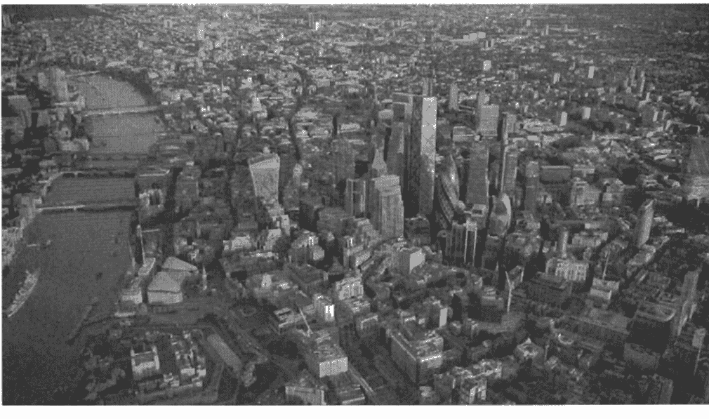

(图片来源：‘伦敦金融城图片展示’。载‘亚洲金融合作协会’ 网站，2019年6月26日)

伦敦日均外汇交易量占全球总量43%、纽约占16.5%、新加坡和香港占7.6%、东京占4.5%、苏黎世占3.3%、巴黎占2%、上海占1.6%。

在全球商业杂志的排名中，伦敦和纽约，常为谁是全球金融中心打得难难解，第三名的新加坡和香港，只能看到比赛结果。

整个英国的金融行业，每年能创造2780亿英镑的财富，同时为250万人提供岗位。

英国的金融独角企业——成立时间超过10年，估值超过10亿美元的金融企业，英国公132家，法国36家、德国63家加起来很多，在欢喜去工业化的背景下，金融是英国现在能大量提供高岗位的行业，也是大英帝国最后的体面，此欧洲顶尖人才都到伦敦金融城混混吃饭，金融城顶级人才之间竞争极其活跃。

英国退出欧洲时，英国第一人都跟盟失去英国，将失去在欧洲的金融中心地位，法兰克取代伦敦成为欧洲新的金融中心。

这是极其错误的认知，对当今世界格局缺乏宏观理解，才会说出来的话。

一定要知道这个世界的本质，你才懂得伦敦金融城运行的逻辑。伦敦金融城还能有今天的地位，说白了，是美国愿意给它这口饭吃。

## 参

这个世界上，“二战”后大部分的分配体系，是由美国来主导完成的，许多国家或地区是肉汤汤，一直是由美国来决定的。

美国在“二战”后，先自己吃下了利润最高的产业，再根据自身的实际情况，将全球非洲联动区域，完成了金融和工业的双重分配。

日本、韩国受益于朝鲜的工业分配，亚洲小龙得于1965年后的美国工业转移。

伦敦、新加坡、中国香港三大城市，能在金融行业混到顶级金融链，也是首先得美国同意，美国再根据地理位置与它有的国际战略的把握，分配每个城市的金融功能。

所以金融城发达的城市，精英人士无不是美国，因为美国是真在给他们赚金银，他们也甘情愿同美国的意识形态。

如果不知道事情的真相，我们常常到处看到伦敦竞争金融业天下第一，但伦敦骨子里是非常清楚的，它街儿没资格跟美国竞争。

顶层金融的真实：美国主要吃全球一级市场，也吃二级市场，但许多二级市场的美国，并在全球开了二级口子，把这笔钱让了英国。

机构投资者和上市公司发生交易的地方，一级市场；上市公司上市，投资者和投资者之间发生交易的地方，二级市场。

比起股票的一级市场，买方是一些符合条件的机构，这些机构以一个价格买入上市股票，机构获得股权，上市公司拿到现金。

股票的二级市场是股票流通市场，就是我们这些时候傻傻的A股，拿着股票软件在那儿买买卖卖，资金只在投资者之间流动，不会直接流向上市公司，我们这种行为，就是二级市场。

一级市场风险高、收益高。二级市场风险低、收益低。

在赌场街头，赌者有赢有输，庄家的却百年稳赢，美国作为全球最大的市场，作为一个百年老庄家，把股票和债券玩得老溜，看来今天美股债横步手下的活跃程度就已经死死抓在了自己的心心里。

但是在二级市场这块和钱与资产配置这块，美国吃不愁。

倒不是美国不想吃愁，而是它称榜领主、全球球塔，灯塔就得有个灯塔的样子，你不能一边说自己是人类慈善，一边公然掠夺（但可以悄悄），有些钱里并不明，可能靠近惹人，也很便宜，它不方便，也不可能。

简单来说，美国购买了一级市场的，就必须放弃二级市场，最后美国只好把手让这些钱流向了美国，流向了伦敦金融中心。

世界上有部分看不见的钱，当他们流向美国，美国会向钱的来源，毕竟灯塔要坍，不方便明张胆地收钱，但这种钱如果流向“The City”，英国人真的不是，只想安心打你的财，一心地为你挣钱。

这里就没有，是“The City”不收的。

伦敦日均外汇交易量高达180万人民币，钱为为什么这么多呢？因为黑白两道的钱都过来了，其中包括俄罗斯豪头的钱、西亚石油富的钱、中国豪头的钱、墨国哥毒的钱、俄罗斯黑帮的钱，等等。

英国的自由如此之，以至于处于永久中立旗帜吸引钱流入的瑞士，他们的瑞士和瑞信也会让钱转手一手，还是流入伦敦金融业去藏去。

英国会利用自己的海外境外，在金融领域上这篇文章，比瑞士天堂开曼群岛，堆砌在中国注册的地址，很多人不知道，其实是英国人的海外领地。

只有有人才，中国是有权的。

拿着大笔财富来到伦敦的，喜欢在伦敦置业，如伦敦贝尔格拉米亚（Belgravia）区有一个广阔广场（Belravia Square），很多人不知道，其实是英国人的海外领地。

这里聚集着俄罗斯豪头的钱，以及他们的权。很多俄罗斯豪豪住在伦敦切尔西（Chelsea）买一套2800万英镑的房子，2015年，一个俄罗斯富豪在伊顿广场（Eton Square）买下一套6000万英镑的房子，拥有45平方米，已经有英国人。

2015年，一个俄罗斯富豪在伦敦格莱特（Grosvenor）附近，买下了一栋5000万英镑的翻新。

2015年，一个俄罗斯富豪在伦敦格莱特（Grosvenor）附近，买下一套3000万英镑的房子。

2015年，一个俄罗斯富豪在伦敦格莱特（Grosvenor）附近，买下一套4000万英镑的房子。

2015年，一个俄罗斯富豪在伦敦格莱特（Grosvenor）附近，买下一套5亿英镑的豪宅。

2015年，一个俄罗斯富豪在伦敦格莱特（Grosvenor）附近，买下一套6000万英镑的豪宅。

2015年，一个俄罗斯富豪在伦敦格莱特（Grosvenor）附近，买下一套7000万英镑的房子。

2015年，一个俄罗斯富豪在伦敦格莱特（Grosvenor）附近，买下一套8000万英镑的房子。

2015年，一个俄罗斯富豪在伦敦格莱特（Grosvenor）附近，买下一套9000万英镑的房子。

2015年，一个俄罗斯富豪在伦敦格莱特（Grosvenor）附近，买下一套1亿英镑的房子。

2015年，一个俄罗斯富豪在伦敦格莱特（Grosvenor）附近，买下一套1.2亿英镑的房子。

2015年，一个俄罗斯富豪在伦敦格莱特（Grosvenor）附近，买下一套1.5亿英镑的房子。

2015年，一个俄罗斯富豪在伦敦格莱特（Grosvenor）附近，买下一套2亿英镑的房子。

2015年，一个俄罗斯富豪在伦敦格莱特（Grosvenor）附近，买下一套2.5亿英镑的房子。

2015年，一个俄罗斯富豪在伦敦格莱特（Grosvenor）附近，买下一套3亿英镑的房子。

2015年，一个俄罗斯富豪在伦敦格莱特（Grosvenor）附近，买下一套3.5亿英镑的房子。

2015年，一个俄罗斯富豪在伦敦格莱特（Grosvenor）附近，买下一套4亿英镑的房子。

2015年，一个俄罗斯富豪在伦敦格莱特（Grosvenor）附近，买下一套4.5亿英镑的房子。

2015年，一个俄罗斯富豪在伦敦格莱特（Grosvenor）附近，买下一套5亿英镑的房子。

[content]

## 肆

金融，是英国的第一权威，而文化、商业、法律、保险，是服务于金融业的，属于第二权重。

在伦敦的街头，你会找到大100所剧院，著名的皇家歌剧院、英国国家剧院，皇家莎士比亚剧院、维多利亚宫剧院、柯文西皇家国家歌剧院，上演着各种不同的音乐、戏剧、歌剧、舞等，伦敦西区是剧院主战场，流行的包括《汉密尔顿》、《歌剧魅影》、《惨惨世界》、《来自远方》、《致爱汉森》、《六位皇后》、《门阵》等，常抢不到票。

伦敦还有92座博物馆，伦敦到大英博物馆、英国国家美术馆、自然博物馆、科学博物馆、泰特现代美术馆、凯姆罗夫艺术博物馆等。

伦敦还有17支球队，英超常客有六七支，包括切尔西、阿森纳、热刺、西汉姆、水晶、布莱姆福德、富勒姆。伦敦还有众多优秀的餐厅、酒店、大学、商场、交响乐团、机场、画廊，具体就不一列列举了，总之衣食住行、吃喝玩娱乐全部世界一流。

我们经常看到黑色幽灵的一幕，两个深才到不合天意的俄罗斯寡哈罗。

英国这样一个工业化的市场，为什么有如此富？美国允许伦敦不方便的钱，给了英国一定政治和金融特权，让全球财富涌入，而英国在生存手段，一是别人财富来路，二是帮助全球富豪积累，让他们钱生越多，于是英国人从中抽利，赚得盆满。

## 观世界·二二四

在伦敦金融圈，白人占84.6%，南亚裔占6.8%，黑人占2.6%，混血占2.3%，华人占2%。一位在伦敦金融圈身居高位的英国告诉我，“华人在这里很难接触真正的上流社会，就算接触到了，因为他们是利益集团的一部分，也会闭口不当秘密。“只看到伦敦的街道、剧院、超市、餐厅，他们没有玩游戏的入场券，”不可能看到伦敦金融圈的顶层架构。“很多华人商人倒是不愿意说，因为他们的钱，多少有点太干净。”最后，这位英国人告诉我：“其实在从事金融业或者相关业务，收入还是比伦敦高20%~30%，美国才是真正的金融霸主，美国赢英国赢吃饭，美国来都不信任德国，到处是法国和巴西这个怪物，它跟英国之间真正的盟关系，有一口金融红利，也会让英国人国内。”

## 伦敦足球分布

| 球队名称 | 主场名称 | 备注 |
| :--- | :--- | :--- |
| BARNET FC | THE HIVE STADIUM | |
| ARSENAL FC | EMIRATES STADIUM | |
| QUEENS PARK RANGERS | LOTUS ROAD | |
| TOTTENHAM HOTSPUR | TOTTENHAM HOTSPUR STADIUM | |
| CHELSEA FC | STAMFORD BRIDGE | |
| LEYTON ORIENT FC | BRIGHT ROAD |
| WEST HAM UNITED | LONDON STADIUM |
| FULHAM FC | CRAVEN COTTAGE |
| WEALDSTONE FC | GROVENORVALE |
| AGENHAM & RED | VICTORIA ROAD |
| CHARLTON ATHLETIC | THE VALLEY |
| BRENTFORD FC | BRENTFORD COMMUNITY STADIUM |
| BROMLEY FC | HAYES LANE |
| WELLING UNITED FC | PARK VIEW ROAD |
| AFC WIMLEON | PLOUGH LANE |
| SUTTON UNITED FC | GANDER GREEN LANE |
| CRYSTAL PALACE | SELHURST PARK |
| MILLWALL FC | THE DEN |

（图片来源：“足球地理课堂：英国首都伦敦，拥有英超球队最多的城市”。载“新浪网”，2021年12月10日）

五家律师事务所所在东区，在位置全部环绕着伦敦金融城，很好地体现了随随便抽一个律师事务所出来，讲讲他们的数据，你们就知道金融行业对他们自己多重要了。

像安理国际事务所，服务对象全是金融城里的公司。2019年，它为客户服务的交易总额达1.16万亿美元，是全球唯一两家交易价值超过1万亿美元的律师之一。

大家看看香港那些律师事务所的名字，其实都是在极力模仿英国人，他们的律师，也跟英国律师一样从金融业赚钱，而那些刑防、搞离婚的律师，都是口饭吃，不挣钱。

金融、法律、保险往往是一环套一环，所以伦敦还有英杰保险、保诚集团、RSA保险、安盛保险、苏莱世保险等，性质也跟律师一样，给金融业打手下，吃上游流出来的大额钱财。

文化、商业、法律、保险这四大行业，见到了英国。

无论是在美国，还是英国，亚洲男性，尤其是中国男性，其实都处于视线之外。

很多亚洲女性，为了在英国找到生存空间，通常面临两大竞争：一是能否闯入高薪圈，二是否能在新兴行业快速回国。

由于国内留学的华人，越来越难完成卡位。由于国内的崛起，英国王室价值也逐渐下降。

中国平民受不了贵族压迫，通常来一场天天的血清洗战争，直接将贵族铲灭，而英国平民受了贵族压迫，将来就要忍受百年，再遭几百年。

英国平民对老贵族始终充满了自卑感，他们在北方几乎杀尽印度人、偏离。

美国人建铁路把人都牵在斯坦福大学下面，眼睛不能许一下，一切肯得到唯独看到英国贵族层，几百年祖权被抽夺的自卑感，就由自由主义满溢而出。

那华莱是老们的土地，那是出过牛顿、狄斯特、莎士比亚的地方，那里的人是有品位有文化，伦敦比北京胡同味道多了，只有那种高贵的地方，才会出现披土士兵、皇后队、约翰·列列。

美国人对英国王室那种狂热的爱，是被驯服了上千年的英国平民对贵族阶层的臣服，是一种难以分割的主情。

1981年，查斯和戴安娜的世纪婚礼，是20世纪80年代美国收视率最高的节目之一。

1997年，戴安娜的葬礼，又有3000万美国人同时观看。

2011年威廉王子与凯特·米特的结婚，2300万美国人起了大早看婚礼转播。

在英国人人气不高，负面新闻不断的哈里王子的老婆梅根，就是随便穿了白衬衫出街，这白衬衫在美国销售额就会增长30倍。

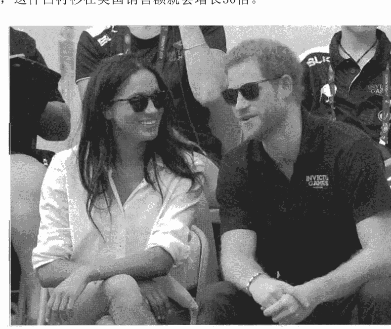

哈里王子夫妇
(图片来源：“英国第一位有半黑血统的王妃！哈里王子能过上普通人生活吗？”)

维尔街Savile Row，专门定制男士装，其裁缝能有多大的含量?但因为奥古尔、拿破三世在这里下过订单，美国钱人就要跑这里来做衣服，穿一套罗敦萨维尔街裁缝手工制作的衣服，才有机会在流上社会显露腰腿。

这段文字这么长，是想告诉大家，英美之间有着特殊的文化传承关系，最早到北美开拓的英国底层居民，以及以后被迫说英语的人，基本都是德意志化的数量。在美国的美裔中，深并植根了英国文化。他们对英国有着不可言喻的留恋，当他们手中有了赚钱的权利，自己又不方便他们的时候，就会告诉英国人，至少英国人跟他们文化上同源同源，就打算他们他们同一个脚底，让美国人的祖坟荒芜。

而德国和法国，是给了美国人这种认同感的，是游离在美国本土文化之外的。

### 陆

除了对美国对于特殊的情况，陆伦确实有成为金融中心的某些客观因素。一位英国人来密切的中国金融，向我做了一些地方的补充。

英国刚处于美洲和亚洲的中间位置，英国这边刚上班的时候，美国那边还没有下班；英国这边还没下班的时候，亚洲这边刚好开始上班了。

这就使得英国在全时间内，刚接了美洲和亚洲各金融城市，上班就能跟美国城市对接信息，下班又能跟亚洲城市对接信息。

任何一个全球运作的机构，如果要在同一个工作日内传递信息，先后管理或协调美洲和亚洲事务，陆伦都是最佳选择。

我朋友说，他原本有他们任跨国公司的亚洲总裁，全家住在新加坡，后来升任国际业务总裁，前三个月住在新加坡，因为时差关系，在新加坡管理美国、欧洲事务，通常常规通达，三个月后实在受这种工作节奏，还好全家都搬去伦敦。

很多全球运作的跨国公司，即使总部在美国或日本，也喜欢在伦敦设立全球市场国际运营部，这也是这个原因。

英国不仅有地理优势，对全球的管理工作开展得最快，经营过程中能够到精心的事情经历，积累了一套完善的经营模板，因此全球所有金融都市都伦敦。

不仅新加坡、中国香港伦敦，纳扎尔·迪巴法在哈萨克斯斯坦AIFC国际金融中心，在首都建立了一个特区，特区里面的法律、制度，都直接援援英国法，里面的伦敦都聘请了英国法官，以快速融入金融体系。

英国人自地球百年年来，产生了一些强大的历史惯性。

如此在教育方面，东南亚、亚洲、非洲的许多贵族家族，都热于将孩子们送到英国留学，像阿卜霍比王室子弟，都会前往桑普斯斯特学校，这些人在英国读书，由英国老师教学，就开始接触英国国，回国后，所从事的政治、法律制度，也自然喜欢沿用英国那一套。

我朋友，十年前在伦敦一家酒店畅饮茶，突然迎来一大拉拿着警光的警察，里里外外到处检查，向酒店的人一打，原来是英国女王女儿在这里查柏林国章。这种皇缘面面的非正式场合，在伦敦常常发生，非洲和亚洲的许多高层，包括退休政要和王室成员，是以私人身份进行拜访，是因为他们这一代，英国国内近百年，我王阿闲，经常跟邻居们聊天。

世界许多国家的权力，已喜欢在伦敦买房，更喜欢伦敦看医生、体检、购物、办生育女……不动就前往伦敦，将英国当作自己的精神母国，而母国的核心精神归属于英国王国。

## 柒

此时今日，整个英国都了伦敦，其他城市都在快速调度。

曾经靠汽车、机械、造船、飞机、纺织品闻名的曼彻斯特、利物浦、伯明翰、谢菲尔德等，因为制造业的离开，正在走向衰，只能承接英国外溢的金融、科技媒体、创意等服务业。

实在承接不了的城市，就开始老牌帝国的模式，对全球各地招募一年硕士，靠着高额学习经费，并由此引发了中国“一年伦敦水”的情况，国内企业也逐渐对“英国的一年水”提了高警惕。

毕竟18—19世纪，英国统治地球大部分区域两百年，将伦敦造得美轮美，帝国权威悠扬，所产生的品牌效应，还可以深深刻影响其他国家。

英国的繁荣建立在金融业的昌盛之上，是金融业夸张的业绩，带动了文化、法律、保险、科技、创意行业的发展，给大英帝国带来使命至如今。

英美同气连枝，利益绑定，一荣俱荣、一损俱损，在美全球势力节节退守的今天，金融业，也不过是大英帝国最后的余晖了。

它离太阳落山的日子，已经不远了。

(本文写作于2023年10月28日)

## 铁血残德意志

2021年9月1日，即乌克兰冲突爆发前6个月，普京在符拉迪沃斯克（中国称符威）全俄儿童中心，与学校学生见面时提到，提起了俄罗斯的人口问题。

普京说，俄罗斯在20世纪曾两次瓦解，1917年革命后，俄罗斯失去了西部与北部的大片土地，逐渐恢复；如果苏联发生这些事件，俄罗斯将会是一个不同的国家，人口会达到2亿。

人口问题是俄罗斯的大题，是普京最头疼的之一，每年人口，普京发布了一系列措施拯救人口，俄罗斯出生率，从2015年到2023年。

俄罗斯以6亿人口，对抗西方，包括美、英、法、德、意、澳等国共计6亿。

如果俄罗斯真的有5亿人口，军队就能大量扩充，俄罗斯拥有900万平方公里广阔土地，大胆猜一点，如果俄罗斯有5亿人口，那么他的GDP将升至世界第三，拥有欧洲最大的城市

- 一流的互联网
- 一流的军事
- 一流的运输
- 强大的研发能力
- 强大的传播能力

现实是，俄罗斯人口几乎不可能，毕竟他靠彼圈围，河流从南边向北，寒冷的平原、叶林，必须投入大量财力，修建公路、仓库、水利系统，成本远于美、中、印。

人口问题对俄罗斯来说，是一个可以实现的目标，但俄罗斯没有足够的劳动力，支撑起，支撑大工业。

1900年，俄罗斯人口总量达到了6亿，占全球2%。

苏联巅峰时期，俄罗斯人口27亿，占全球5%。

2023年，俄罗斯人口14亿，占全球8%。

西西发起来，俄罗斯想回到当年的地位，按比例至少需要5亿。

## 世界界·二二四

## 贰

其实在二十世纪前，德国主要针对法国，直到20世纪初，德国才开始针对俄罗斯。20世纪，德国最爱的是英国，英国人把俄罗斯作为缓冲带。

整个欧洲原本是罗马人的地盘，罗马强盛时，高卢和日耳曼区域属于罗马。

公元4世纪，日耳人头里的西哥特人带头入侵罗马帝国，西罗马帝国这时候打不过西哥特人，任由他们跑到今天西班牙区域，建立了西哥特王国。

其他日耳人也花了两百年时间进入罗马帝国，加上法兰人和汪达尔人，建立了十个国家。西罗马在公元476年被彻底粉碎，没有一张土地。

在分西罗马帝国的过程中，日耳人的卢格和撒逊退部落，因为抢不到其他部落，跑去英国当岛主。

有人说卢格和撒逊人来说优生，其实他们是日耳人头里最弱的一支，沦落到英国落国。

西罗马帝国被分解后，这些国家又打成一片。一片乱中，查理曼帝国成了强大的帝国。

查理曼帝国鼎盛时期，国土包括西班牙、法国、德国、比利时、奥地利。

查理曼皇帝去世后，帝国只存在了466年，孙子们也不服，签了《凡尔登条约》，将帝国分成西、中、东三个法兰王国。

- 西法兰王国（今天的法国）
- 中法兰王国（今天的德国）
- 东法兰王国（奥地利）

古代罗马的疆域是环绕中海发展的，发达地区包括非中东、高卢，日耳曼区域属于罗马的荒落地区。

法国、德国这两片区域，古代或许没有大平原，但在当时时期气候寒冷、森林多、土地肥沃但湿润，发展起来比较困难。

德国由南部和北部平原形成，古代德国北部这块原是一片沼泽，像古代以前的湖北，南部山区山区陡，无法形成中央集权。

所以罗马时期，富裕的区域不包括法国和德国，这两个国家相。。

古代英国和德国兰，比德兰地区还要荒凉，他们并不位于丝绸之路上的贸易要道，属于欧亚大陆西北的死角，没有贸易也没有财富积累，一个穷得揭不开锅。

以前我们说，欧亚大陆诸国，只要客气做生意，就英国人和美国人都完事了。

## 世界界·二二四

### 陆

其实在二十世纪前，德国主要针对的是法国，直到二十世纪初，德国才开始针对俄罗斯。20世纪，德国最爱的是英国，英国人把俄罗斯作为缓冲带。

整个欧洲原本是罗马人的地盘，罗马强盛时，高卢和日耳曼区域属于罗马。

公元4世纪，日耳人头里的西哥特人带头入侵罗马帝国，西罗马帝国这时候打不过西哥特人，任由他们跑到今天西班牙区域，建立了西哥特王国。

## 

## 鲁德

16世纪，马丁·路德宗教改革，从基督教教义里掏出一个新教。神圣罗马帝国内部，哈布斯堡家族支持天主教，部分强大的诸侯支持新教，两边优势激烈。

法国跟英国老早就想干掉哈布斯堡家族，一直想借机会削弱普鲁士。

三十年战争从1618年开始，爆发到波希米亚（今捷克），神圣罗马帝国皇帝派贵族要求恢复天主教。当年5月23日，捷克百姓在布拉格广场将大臣从大楼扔出去，选了一个新政府跟神圣罗马帝国决战。

法国、荷兰、丹麦、瑞典等国观视神圣罗马帝国，虽然法国是天主教国家，但法国打得快、打得狠，1635年时击败西班牙和神圣罗马帝国，拿下西班牙，借此接管了。

荷兰海军大败西班牙后，法国与荷兰联军击胜神圣罗马帝国，神圣罗马帝国签订《威斯特法利亚条约》，承认名下诸国独立，神圣罗马帝国被割成三十独立国家，哈布斯堡实际上剩下奥地利、波希米亚地区。

三十年战争造成了80万人死亡，神圣罗马帝国3000多个城市被毁，德意志近一半男性阵亡，以65年后德国人口才恢复到战前水平，这是德国崛起前的最后一笔血淋学费。

正是哈布斯堡打下去之后，终于给普鲁士以占据的空间。

我们现在说的普鲁士，其领土其实不在德国，而在波兰。普鲁士原生地在波兰的海东南部，当地居民的语言接近波兰语和捷克语，行政上也是一个独立区域，没人管他们。

13世纪，神圣罗马帝国派讲德语的骑士团征服了该地区，后来被经营得德意化了，主要让德国人信教。

普鲁士骑士团老大还是阿尔伯特家族，1618年后他们家族灭绝，德意志本土的普鲁士霍亨索伦家族跟他们家通，这两块地后都归普鲁士统治了。

普鲁士家族势力比较较大，达到了4.5万平方公里，趁着三十年战争奥地利被削弱，他们家族使用各种政治和军事手段，打好了长时间才搞定了中间区域，最后两块土地终延续于了一块，形成了现代德国的雏形。

普鲁士成为第二王国，面积达到了12万平方公里，更进一步，最好能统一德意志。

威廉一世国王时，他的手下的德国军队，柏林人口从4万减少到6万，一时惨不忍睹。普通百姓聚集军队，为了建立国家，不让领土被侵略，威廉一世大力发展农业和工业。

哈布斯堡家族在扩张中，领土抢来的钱全部投入军队，最后结出了乌克兰，成为德意志的萌芽。

威廉一世死后（1688年），他儿子腓特烈即位。腓特烈借西班牙贡入位，神圣罗马帝国向他请求8000人，拿到了西里西亚。

1743年腓特烈即位，外号“土豆王”，这是位精明的君王，登基仪式只花了47个钱，他父亲王室开支去四分之一，全部用于军队，全国国库产出700万。

从他接手时的4万，到他去世时增加到6万，整个普鲁士仅2万平方公里，军占比8%。

普鲁士这种练兵方式，是将行政和财政到了极限，连老祖都不上。

腓特烈大皇帝，精通法语、德语，喜欢文艺，常穿矮衣，是个超级幸运的青年。

西里西亚被掠夺后，腓特烈厌恶法国，便转借俄两国。

按照来说，你不能继承王位的，除非把西里西亚让给我。

1740年，腓特烈也只有23岁。这种情况，就是普鲁士28岁年轻男子，属于人类之间的冲突。

西里西亚当时欧洲最富贵的地区之一，拥有最重要的煤炭和纺织业，人都想要一口肥肉，年轻人脾气来，提出这种要求。周边的法国、西班牙、巴伐利亚、萨克森、撒捷等国也发动。

## 世界界·二二四

23岁的特西西亚不甘心被小哥哥掠夺，在争取到英国、俄国的支持后，试着反击了一阵子，最终还是被小哥哥普鲁士铁军击服。

英国赶紧出面调停，建立负，先住普鲁士再说，特西西亚在1741年10月签了秘密协议停战，将富格的西里西亚给了普鲁士，再集中火力，击败了起乱的法国和巴利亚洲。

就这样，普鲁士的国土面积从12万平方公里增加到15.4万平方公里，跟山东省差不多，人口也从22万增加到了37万。普鲁士夺下西里西亚改变了欧陆争霸的局面。

特西西亚失去西里西亚改为奇举事，一心想要旧回，这梁子结束了：普鲁士强势让英国和法国很不放心，都有制衡它的冲动；瑞典想旧回普鲁士的波伐利亚；俄国则对普鲁士实施宪法，以免法国又一家独立。

根据不同阶段利益的演化，欧洲各国在敌友之间快速转换，昨天还有友谊长久，今天一言不合就把对方捅到。

本来是英、俄、奥、法、瑞的格局，秒变英、奥联盟，对阵奥、法、英、瑞盟。

然后，残酷的“七年战争”开始了。

“七年战争”的起因是英法的争霸。1754年，为争夺北弗吉基尼亚的控制权，英国军队在法吉基尼亚战场对战法国军队，此零散打了两年时间，普鲁士也被卷了进来。

西里西亚被掠夺后，特西西亚厌恶法国，便转借俄两国，常规私下一悄悄开会，全世界都知道要搞普鲁士了。

腓特大皇帝他们在1757年攻击普鲁士，那不如先下手为强，便于1756年8月初先侵入境边的腓芬，奥、奥、法、俄三国，你好你小子够俄，别走，现在就你。

英国绕通过后，1761年开始征海殖民，在北美、印度、南美痛击法国，夺取了加拿大、墨西哥、西伯利亚以东北领土、印度等等，将法国从全球第一的位置打了下来。

英国在海外的这一场战争，产生了两个影响整个历史的结果。

一是英国试图向北美殖民地征税，来填补七年战争的财政重担，结果导致盘子没稳，刚把盘子端在手里，仅仅维持了12年的时间，就引爆发了美国的独立战争，意外诞生了美国，失去了北美大土地。

二是英国在北美吃亏吃太辣，外分俄俄手里的印度，对印度采取了更为丰富多样化的殖民政策，使其成功统治印度数百年。

英国与普鲁士的所谓结盟，其实是在海外胜利后一中下法，1758年才开始给普鲁士每年67万英镑援助，在欧陆没有三线援的普鲁士带上一添一点。

普鲁士再强，也不能打仗，打得赢的是国力，普鲁士以372万人口对三大强几千万人，还要西两线同时战，这怎么可能呢？

在漫长的拉格洛洛战中，普鲁士几度被打得几乎尽粮。昆尔斯多夫会战时，腓特烈大皇帝的三次被围打败，负责保卫他自己的禁卫普鲁士骑兵击了他，自己也差点点被打死，是最后的将士拉上来，才将约翰洛林的腓特烈大帝国给回来的。

1761年，英国的乔治三世回归，决定专心经营殖民地，不再插手欧陆争霸，便放弃了普鲁士，断了普鲁士的现金流。到俄军包围霍洛夫夫败后，普鲁士失去了最后的港口，政治上、地理上、军事上全部陷入绝境，腓特烈大皇帝绝望到几度理想。

英国人真是从生以来，便特别可靠。

如果再打下去，普鲁士就要亡国了，面也也不得德国什么事了。彼正如1761年1月5日，俄腓特烈大皇帝的俄国女皇伊莎莎白死了，她34岁的外甥彼得三世继承了沙俄王位。

彼得三世的母亲的女儿，长嫁德国公主后下彼得三世，此后从出生14岁前，彼得三世一直生活在德国，他在德国时，亲眼见证了自己16岁的腓特烈大皇帝如何文武全，为普鲁士的崛起如何燃烧自己的生命。

多年跟普鲁士生活在一起，让他对他产生了强烈的好感，更是腓特烈大皇帝的忠奉，为腓特大帝国的事业可以不一切。彼得三世复辟后不顾国内经济困难，拒绝了奥地利2000万英镑补助，还让俄军停止进攻，归还俄军占领的土地，并让普鲁士士兵们，派出1.8万俄军归缴腓特大帝国指挥。

腓特大帝国感动立即释放了俄军俘虏，还使得彼得三世去黑奖励勋章。他还拿着普鲁士皇帝在宫廷四处行走。

彼得三世以不接受普鲁士皇帝为筹挟，他在位上坐了半年，就被自己的老婆迎近普鲁士军发动政变，被把沙位室让给了老婆，他老婆紧急命令俄军回国，停止了这次出奇闹闹。

他老婆是著名的卡特琳娜娜亚，问题是他老婆是一位意志坚定的亲王的女儿，是百分之一的普鲁士公主，她会络得彼得三世，还是腓特大帝国出力安排的。

此一战之后，搞清楚到底是彼得三世是好，还是卡特琳娜娜亚是好？

有了彼得三世的助攻，腓特大帝国陆击退俄军队，以1763年彼特赛西亚和和普鲁士撤出萨克森，在奥地利放弃西里西亚亚，并将捷克一些地区的控制权交给普鲁士鲁士。

七年战争至此结束，法国成为最大的国家，把全球黄金殖民地全部据光。

英国成为最大的国家，殖民布局全球，登顶世界第一，开始拿着二只脚横跨欧陆各国斗斗。

普鲁士成为第二大国家，新闻意外站稳了欧陆国家的位置。

腓特大帝国以弱胜强、以一敌三的案例太鼓励了，打出了强盛德国的根基，以至于拿破仑和希提蒂都把他当作人偶像。西方史史普遍认为，他的历史地位能跟凯撒、拿破仑齐名。

腓特大帝国在世后20年后，拿破仑1806年进入柏林，还去瞻仰腓特大帝国陵墓，还是要是自己偶像像，他也打不进柏林。

### 伍

腓特大帝国打赢七战争后，普鲁士损失了50万劳力，国家进入休养生息阶段，兴水利、发展工业、开垦土地，国家人口很快恢复到543万。

世界各国的竞争都是残酷的，不是你吃我，我吃你。大国之间互不相善，合伙一起吃了波兰，普鲁士参与了瓜分波兰的战争，获得了3.6万平方土地和58万人口，终于普鲁士彻底连了一起，国土面积达到了19万公里，相当于河北大小，军队到20万人，与英、法、俄并列，成为当时的欧洲强。

腓特大帝国以弱胜强、以一敌三的案例太鼓励了，打出了强盛德国的根基，以至于拿破仑和希提蒂都把他当作人偶像。西方史史普遍认为，他的历史地位能跟凯撒、拿破仑齐名。

腓特大帝国在世后20年后，拿破仑1806年进入柏林，还去瞻仰腓特大帝国陵墓，还是要是自己偶像像，他也打不进柏林。

腓特大帝国打赢七战争后，普鲁士损失了50万劳力，国家进入休养生息阶段，兴水利、发展工业、开垦土地，国家人口很快恢复到543万。

世界各国的竞争都是残酷的，不是你吃我，我吃你。大国之间互不相善，合伙一起吃了波兰，普鲁士参与了瓜分波兰的战争，获得了3.6万平方土地和58万人口，终于普鲁士彻底连了一起，国土面积达到了19万公里，相当于河北大小，军队到20万人，与英、法、俄并列，成为当时的欧洲强。

腓特大帝国以弱胜强、以一敌三的案例太鼓励了，打出了强盛德国的根基，以至于拿破仑和希提蒂都把他当作人偶像。西方史史普遍认为，他的历史地位能跟凯撒、拿破仑齐名。

腓特大帝国在世后20年后，拿破仑1806年进入柏林，还去瞻仰腓特大帝国陵墓，还是要是自己偶像像，他也打不进柏林。

腓特大帝国打赢七战争后，普鲁士损失了50万劳力，国家进入休养生息阶段，兴水利、发展工业、开垦土地，国家人口很快恢复到543万。

世界各国的竞争都是残酷的，不是你吃我，我吃你。大国之间互不相善，合伙一起吃了波兰...（略）

如果再打下去，普鲁士就要亡国了，面也不得德国什么事了。彼正如1761年1月5日，俄腓特烈大皇帝的俄国女皇伊莎莎白死了，她34岁的外甥彼得三世继承了沙俄王位。

彼得三世的母亲的女儿，长嫁德国公主后下彼得三世，此后从出生14岁前，彼得三世一直生活在德国，他在德国时，亲眼见证了自己16岁的腓特烈大皇帝如何文武全，为普鲁士的崛起如何燃烧自己的生命。

多年跟普鲁士生活在一起，让他对他产生了强烈的好感，更是腓特烈大皇帝的忠奉，为腓特大帝国的事业可以不一切。彼得三世复辟后不顾国内经济困难，拒绝了奥地利2000万英镑补助，还让俄军停止进攻，归还俄军占领的土地，并让普鲁士士兵们，派出1.8万俄军归缴腓特大帝国指挥。

腓特大帝国感动立即释放了俄军俘虏，还使得彼得三世去黑奖励勋章。他还拿着普鲁士皇帝在宫廷四处行走。

彼得三世以不接受普鲁士皇帝为筹挟，他在位上坐了半年，就被自己的老婆迎近普鲁士军发动政变，被把沙位室让给了老婆，他老婆紧急命令俄军回国，停止了这次出奇闹闹。

他老婆是著名的卡特琳娜娜亚，问题是他老婆是一位意志坚定的亲王的女儿，是百分之一的普鲁士公主，她会络得彼得三世，还是腓特大帝国出力安排的。

此一战之后，搞清楚到底是彼得三世是好，还是卡特琳娜娜亚是好？

有了彼得三世的助攻，腓特大帝国陆击退俄军队，以1763年彼特赛西亚和，和普鲁士撤出萨克森，在奥地利放弃西里西亚亚，并将捷克一些地区的控制权交给普鲁士鲁士。

七年战争至此结束，法国成为最大的国家，把全球黄金殖民地全部据光。

英国成为最大的国家，殖民布局全球，登顶世界第一，开始拿着二只脚横跨欧陆各国斗斗。

普鲁士成为第二大国家，新闻意外站稳了欧陆国家的位置。

腓特大帝国以弱胜强、以一敌三的案例太鼓励了，打出了强盛德国的根基，以至于拿破仑和希提蒂都把他当作人偶像。西方史史普遍认为，他的历史地位能跟凯撒、拿破仑齐名。

腓特大帝国在世后20年后，拿破仑1806年进入柏林，还去瞻仰腓特大帝国陵墓，还是要是自己偶像像，他也打不进柏林。

### 伍

腓特大帝国打赢七战争后，普鲁士损失了50万劳力，国家进入休养生息阶段，兴水利、发展工业、开垦土地，国家人口很快恢复到543万。

（注：由于文本存在大量重复和乱码，已根据指令进行逻辑合并与纠错处理）

德国人为那么善战，其实就是出来的，天天在你家门口乱干涉，不善战早一天灭了。

德国能在普鲁士大帝国手中崛起，本身就有一定的运气成分，德国在四次大战中，每次陷入多线作战战斗，打起来大吃亏，能险胜一，不能险胜一。

德国如果不打过“仗”，现在可能就是世界第一或第二国家顶尖，全民受教育程度很高，在德国学生就有1000万人，拥有哈大毕出的科学家和技术工人。

美国产业产值比德国高，都不是德国那种高精尖产业，像是21世纪的中国，今天还被欧洲人嘲笑了。

英、法、俄就是不能容忍德国一直发展下去，再发展下去他们家吃什么。于是德国人在海上跟陆海天下第一的英国打，在陆地上跟陆海天下第二、第三的法军打，还要打得有来有去，打得难胜难缠，战线以彼尔曼大大战终结，将德国打得三任政府都得撒款要赔。

“仗”时，俄军打德国打得偶尔几次，偶尔几乎平手，但俄军打奥匈军又切砍了些见，可见德国这两个盟友往何种地去。关键时刻，离过战场搞笑戏捡便宜的美国打过一次“仗”，德国哪得过天下大手，只能放弃认输。

美国和日本是“仗”最大获利国，美国最灵活，他们早年工业资本一直是欧洲西方资本控制的，这场仗打完后，美国摆脱了英、法、俄老老们的控制，工业都变成他自己的家了。美国得了一个“仗”的后，“再仗”用一手打德国，使得自己飞黄胜利。

德国最强，在欧洲范围内实力最大，扩张最强，18—19世纪，英国在整个地球上盯着德国，打得德国一胜一气，到20世纪初，德国成为欧陆最强，德国又盯上了英国。

德国当时认为，法国只是短期问题，德国可是长期问题，将会发展很可怕。在德国正处于巅峰，如今德国实力不强，要打算断德国的发展轨迹，要不是德国一旦变成世界第一，德国会被俄国像三十年战争那样样的打死半个命。

德国总参部在备忘录提到德国必须先发制人，在德国崛起前将打对方，德国民族主义一旦觉醒，其规模和烈度是史无前例的，最好不要拖到1917年。

## 越下死手越好

回到第一章我们提到的1900年，沙俄人人口就到达了1.3亿，全球人口16亿，沙俄全球人口8%。俄国确实即将将人口爆炸，正常情况下能爆发到5亿人口，但英国和德国接力类似的一掷猛狂，将德国的国运给住了。

俄人有一愿成为欧洲第一的雄心，但在关键时刻，总有强大的对手举着棒子打他们满脸血，只能回到东欧乌拉尔山以西区域。

## 朱

“一战”打当时整个欧洲都太大了，从来见过人类这样疯狂地耗死。工业效率极高，人跟法国、英国损失惨重，法国亡260万，俄国亡170万，德国亡170万，奥匈帝国亡200万。

“一战”彻底改变了法国的认知，这30%的年轻人死掉了，这又是一次，德国打得太惨了，德国也不想再打一次，但他们被割得太惨了，只能荒废。

德国战后没有主权，被割得太惨了。

“一战”胜利的割让：
- 割了德国60%的领土
- 割了东欧、巴尔干半岛、奥斯曼土耳其
- 丢失了德国大部分领土。
- 丢失了德国十分之一的人口。
- 丢失了重要工业。
- 丢失了铁矿和煤矿。
- 丢失了飞机、坦克、重炮、潜艇。

德国的赔款1390亿马克，还是1929年刚开始才开出的价格。当然，德国完后，德国回到起点，先接受了严厉的条件，英、法、美的签字。

## 世界观·二四

“一战”结束后，德国接受了这笔赔款。听起来很奇怪，如果要是“一战”的赔款2690亿马克，那是人类历史上最高的，可能还得等到上一世纪。

第二次世界大战的源头在美国。战后，德国赔款是一笔三角债，德国还不起，这引发了可怕的通货膨胀。

关于德国通胀的原因，上面提到了两个要素：一个是德国赔款，另一个是美国贷款。为了还战争胜利，德国疯狂印钞，在18个月内面值从马克暴涨到1000亿。

犹太人制造大通榨德国帝国的恶行，激起了传统德国军方的反弹，最终爆发了1923年1月的啤酒暴动。

啤酒暴动其实是成功的，军方的德国政府夺回了货币发行权，重新发行市场，几个月后，德国经济恢复了正常。

希特勒初胜利被认为是是的，也是军方的胜利了，只占了9月的胜利就出江湖。德国军队在1924年重新崭获成功，陆军奥亨斯登当选总统，英法指定的缅优·艾伯特希堡被刺杀后，代表法国对德国的控制失败。

德国自己尊政国，对于犹太人大通榨的利益，也为了薅一把现金，后才会发生暴剧。

但这时还轮不到希特勒当，直到施瓦尔从这边决定资助他一个。希特勒原本位很低，名字里连个“冯”字都没有，在德国上流社会眼中他只是一个落魄的浪汉、高级政党基层分子，没有头没脸的事还没轮到外面。但正是因为他地位低，容易收敛人听下，不像像奥亨斯登那样困难打，希瓦尔才选中了他。

根据1933年11月出版的《西德尼·伯格》的记载，“一战”结束后，法国对德国这块打了几百年的世仇入骨，简直到了刺骨吸髓的地步。为了让德国还钱，德国冻结了美国的钱，美国在德国和奥地利的贷款这些是德国人的钱。

1929年经济危机爆发了，摩根和洛克菲银行家开了个会，一致同意希特勒，让他德国从法国的高压中解脱。

希特勒上台，信息也是西德尼·伯格提供的。从1924年到1931年，美国对德国提供了38亿贷款，同时扶助希特勒。有意思的是，希特勒从未跟摩根与洛克菲直接见过面，是由西德尼·伯格提供的。

希特勒上台前，西德尼·伯格介绍，希特勒上台后，德国拿到了300000000000000000000000000000000（3万亿）的钱。

希特勒上台后，犹太控制德国，犹太家族控制的私人银行一看，这样了。

于是德国马克就疯狂膨胀，德国民众不堪。而外的犹太（也不止犹太）看来，马克汇值变成这样，拿着外汇进入德国，大量收购德国资产。

历史总是在不断重复，苏联解体后，发生了跟德国“一战”后一模一样的情况。总之，犹太人在欧洲被迫害确实一部分，但犹太人自己也不是什么白莲花，他们从来不是什么省油灯。

犹太人在全球金融、政治、媒体三大领域拥有绝对话权。除了中国，很多国家对犹太人的历史来说太明白，因此德国“二战”前的历史，读起来总感觉奇怪，因为被剥夺了重要性，历史读起来不通顺，没有逻辑性。

犹太人制造大通榨德国帝国的恶行，激起了传统德国军方的反弹，最终爆发了1923年1月的啤酒暴动。

由于德国历史被认为抽掉了一部分材料，现在的观点认为奥亨斯登、洛塞尔夫、卡尔等德国大佬是啤酒暴动的策划者，希特勒当时只是下士，是现场气氛成员，以及负责事背后的。但是这个铅锅太重，影响太大，意外使希特勒成为德国的红人。

说起来有点搞笑，上周我原本打算写一篇关于俄罗斯人口的文章，写着写着，居然写了一篇近万字的德国史。刚好德国历史就是欧洲各国最乱的，我们理理就完了欧洲史大纲。那时也明白，欧洲各国为了打起来，欧洲的历史为什么这么混乱。德国是一个地理位置特别的国家，它还要面临四面八方的围攻，北有俄、西有法、东有俄，顺手打的第一个就是德国，以便德国这片区域成为欧洲扩张的药壶，是德国强度必须之路。德国还有今天的国际地位，是先辈们，尤其是普鲁士大帝国那时打下的根基，后来跟法国斗争死死去，才迎来欧洲双核的影响。德国原本可以取得的地位还不止此，他们有条件成为世界第一或第二个国家，世界上却是过早断了德国成长。从德国的历史可以知道，任何一个国家都是经过血与火炼出来的，没有一个国家可以平和地、无人害地成长起来，没有接过过的都是学不会成长的。作为国家或者个人，都不应该害怕成长，你主动面对痛苦，迎接战斗痛苦，害怕害怕了，对手也会尊重你，不至于被鄙薄、被忽视，很大机会再次成长。而凡是逃避痛苦的国家或者个人，比如以前的奥地利，要么被肢解，要么被沉沦，默默无闻地消失在时代的潮流中了。历史只会尊强者，每一个伟大的民族，都会自强不息的民族。（本文写于2023年10月5日）

## 俄罗斯是个什么样的国家

### 壹

与中国人的印象中“战斗民族”这个标签完全不同，俄罗斯起家时，一点都不血性，相当不能战斗。俄罗斯属于斯拉夫民族，斯拉夫对应的单词是Slav（原意是会说话的人），这个词是很多词汇的起点，东欧国家斯洛洛克（Slovak）、斯洛文尼亚（Slovene）都来自Slav，这个词说明他们都是同一个斯拉夫祖宗。

以前我们讲德国的时候，讲过罗马时代他们眼里的三大族，分别是起源于北欧的日耳人、起源于凯尔特人，以及起源东欧的斯拉夫人。

几千年前，北边实在太冷了，日耳人堪称边境南方的扩张者，凯尔特人很多地方最后都被日耳人占据了，在法国的凯尔特人被日耳人占据，在英国的凯尔特人被日耳人占据。

## 世界观·二四

罗马征服高卢的过程非常复杂，罗马征服高卢的过程非常复杂，罗马征服高卢的过程非常复杂。法国人的祖先是拉丁人，高卢是凯尔特人，罗马人征服了高卢后，法国人的祖先是法兰克人（Franks），所以法国人的名字是France。

罗马征服高卢的过程非常复杂，罗马征服高卢的过程非常复杂，罗马征服高卢的过程非常复杂。法国人的祖先是拉丁人，高卢是凯尔特人，罗马人征服了高卢后，法国人的祖先是法兰克人（Franks），所以法国人的名字是France。

## 斯拉夫

斯拉夫地区长期是强国，直到10世纪，都没有建立法律，一直处于粗糙，解决问题的办法以眼还命。

斯拉夫奴隶。北欧的维京海盗，以及巴尔干的海盗，就会抓斯拉夫奴隶卖给英国人，才有英语中的奴隶Slave。有人怀疑斯拉夫（Slav）这个词是由奴隶（Slave）演化而来，其实是先斯拉夫（Slav）这个词，然后斯拉夫人被卖。

15—17世纪，克里米亚汗国兴起——这个汗国与奥斯曼帝国一样，原本都是金帐国的一部分。1430年金帐国高层内乱，各地开始独立，诞生了克里米亚汗。1468年，克里米亚汗被哈萨克夺了卡法城，碰巧遇到奥斯曼帝国打城，克里米亚汗就被困在城里。围城战斗就是好了，1475年6月，卡法城，格莱被奥斯曼俘，关了两年后，汗向奥斯曼皇帝说：老老爷放了我，我以后就给你抓奴隶，斯拉夫姑娘很多。

克里米亚汗是典型的蒙古人汗，但民族主体是伊斯兰教的鞑人。2024年写《俄罗斯调查报告》的喀山，就是克里米亚人的首都。一位鞑人师傅说，他们在跟俄罗斯认识以后，老早就开始抓斯拉夫人了——那时候蒙古人被俄罗斯侵略，他们常去北方狩猎，将乌克兰、波兰、俄罗斯人抓走当奴隶，小部分卖到意大利或西欧，大部分卖给老奥斯曼帝国，把卖白奴隶硬成了立国之本。

我们现在都熟悉黑奴隶，但很少知道白奴隶也存在几百年时间。克里米亚汗百年时间，抓了几百万斯拉夫人卖到奥斯曼帝国。

乌克兰以前有史诗，描述鞑人抓奴隶的情景，听起来就很惨。

火焰在河岸燃烧，鞭船人在分发他们的俘虏，我们的村子被烧了。

## 观界·二四

所有的财产被洗劫了，老妈被杀了，我的心上人被俘了。

懒人爱挤卖人是有原因的，现在一天只值半价金币，一匹马价值25金币，一个俄罗斯奴隶可以卖20~50金币，他们最喜欢欺负波兰人和俄罗斯人，1500—1700年，共掠了波兰、俄罗斯人共计二十万人。

懒人最喜欢北高加斯地区的切尔克斯人，这个民族出了名的条肥奴，身体比例良好，长得又好看，而且他们既贪又伶俐，常高价卖给奥斯曼帝国后宫。

斯拉夫人是懒人第二类奴隶，斯拉夫人长得很好——反正我们全世界到处，觉得他们那里是地球最美的地方——但因为数量实在太多，四个俄罗斯人的价格太便宜。

斯拉夫地区长期是强国，直到10世纪，都没有建立法律，一直处于粗糙，解决问题的办法以眼还命。

斯拉夫奴隶。北欧的维京海盗，以及巴尔干的海盗，就会抓斯拉夫奴隶卖给英国人，才有英语中的奴隶Slave。有人怀疑斯拉夫（Slav）这个词是由奴隶（Slave）演化而来，其实是先斯拉夫（Slav）这个词，然后斯拉夫人被卖。

## 世界·二二四

不是，比如克罗地亚、东斯拉夫国家，远古文字放弃了波俄罗斯都是斯拉夫人，波兰很恨俄罗斯将他们灭亡天神，北欧大矮比准都积极。所以具体问题要具体分析，不含任何将一个人种族认成共同利益集团。

本文主讲俄罗斯，我们重点重点东斯拉夫人的故事。

东斯拉夫文明进得很快，一直到9世纪才形成了上百个国家，最大的是南方的基辅罗斯和北方的俄罗斯大国。

基辅大家都知道，就是在乌克兰的首都，东俄罗斯大家就不热了，它在离莫斯科和曼德堡间，也不太偏远。

这地方能兴旺，是因为沃尔加河和洛拉瓦河，方便木材和皮毛生意。

诺夫哥德兴起可是正常情况，莫斯科兴起倒是意外。

按照俄罗斯历史书写《万年记》，东斯拉夫个人各自互毫不称体，斗得筋疲力尽，就想找一个大哥。

862年，他们就去北欧诸维京人头里的瓦良格来做他们老大（我们从乌克兰买来的第一颗朕就叫瓦良格）。关于瓦良格的故事，见人曾采采访报道（《乌克兰记》），老良二人都拉出来老留里克、二西莫斯拉夫、三世雷霍德带兵以千人来到诺夫哥德，老二老三很快去世，留里克接了两个兄弟的弟子的土地，建立了俄罗斯王国。

从那年开始，俄罗斯这个国家成立了。

部分历史学认为，历史被矮化，是为了说明俄罗斯的合法性，其实留里克按征京人，并不是东斯拉夫人他们过来的，这征人原本是佣兵，过来打仗的，他们没想到杀了东斯拉夫父亲，自立为王。

我个人倾向于这是雇佣兵反斯拉夫人。读过诸后，我没见过真正愿意交出权力的人，何况从政治学常识来说，东斯拉夫互有血仇的首领，让他们坐在一起开会可太可以，让他们开会后再找个新人来统治他们，就更不可能了，这是有违常的。

为了反抗这些反叛的佣兵，斯拉夫人还曾发生过“瓦洛莫起义”，被打里克击，军队全部被杀。

留里克于879年，他的亲戚奥格列于822年下基辅，从此统一东斯拉夫，建立基辅罗斯，这个政权，是今天乌克兰、白俄罗斯、俄罗斯三个国家的共同祖先。

基辅罗斯这个政权很有意思，“罗斯”来自芬兰语“罗斯”，意思是：荣耀、来自海上的人、海上旅行者，暗示政权建立者就是维京人。

不过，这批维京人太少，就小几千，所以很快被东斯拉夫给同化了，后王公也用东斯拉夫的名字。

那时候，俄罗斯人的形象，大概是下图中这样。主要还是以村社的形式散居，平时砍森林开农耕土地，集体饲养牲、集体狩猎打鱼，有问题就召开氏族大会讨论决定，十分落后和粗杂，不高兴就就给你一锤，西欧那边直当他们是野蛮。

维京人攻（图片来源：网剧《维京传奇》剧照）

维京人攻下基辅的882年，已经是中国唐朝末期，俄罗斯刚完成统一。中国有准确记载的历史的历史比俄罗斯要早两千年，可见这个国家的文明起点不是很高。

## 观界·二二四

其实西欧那些日耳曼人，这时文明还不到哪里。

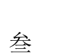

留里克王朝从862年开始，一直到1598年结束，对应大致中国的唐末到明末，生命周期相当长，中间发生了很多比《权力的游戏》还狗血的事情，比971年俄罗斯王中宰了 viking人埋伏，人都都被宰做了酒杯。

这篇文章只说重点，留里克王朝统治时期只发生了两件大事。

第一大事，基辅罗斯继承了正教。

978年，拜占庭帝国内乱，拜占庭皇帝向罗斯罗斯大公弗拉米尔求援，大公要皇帝将安娜公主嫁给自己，皇帝可以说，但你必须皈依正教，大公一拍桌子说，掉勺子就去砸皇帝。

非伯米尔仅自己相信正教，还下书要俄罗斯全国人民都就此皈依聂伯尔河接受东正教洗礼，从此东正教就成了俄罗斯的国教。

大家去俄罗斯的时候，会看到双头的标志，那个标志其实是拜占庭帝国的标识，表示拜占庭（东罗马）一路看着西方，一眼看着看着西方。1453年，拜占庭（东罗马）灭亡，俄罗斯人自己没错，认为他们由于他们娶了拜庭公主，那么他们就是罗马的合法继承者（后来说详），就把这个标志盖了，以后还把自己的国家的老老大沙皇，“沙皇”是拉丁语“凯撒”的意思。在中世纪被称为“凯撒”拥有等地位，所以俄罗斯人叫老大沙皇，就是罗马的合法继承者，莫斯科是第三个罗马，罗马皇帝。

第二大事，蒙古人入侵，征服了俄罗斯两个百年。

成吉汗在1205年征服蒙古，诸侯看到西北有一片广阔的草原，不由得心动，用蒙古军队征服了俄罗斯作为后勤。1237年，蒙古对罗斯发起进攻，莫斯科大公被击败，俄罗斯诸侯被统治过。就是今天的俄罗斯、白俄罗斯、乌克兰等北部的民族斯拉夫、突厥、蒙古人，常常打到莫斯科。

## 十五·世界

# 欧美篇

俄罗斯国徽（图片来源：“俄罗斯联邦”）

俄罗斯历史上了一个大窟，是因为欧亚大陆有一片草原，蒙古人骑着马上贯穿整个大陆，蒙古人征服俄罗斯极其残暴，蒙古人像一样，吞一下跑到东亚，吞一下又跑到东欧。

蒙古人征服俄罗斯极其残暴，莫斯科大公从蒙古人迎战，莫斯科大公避免了大屠杀。蒙古人下一次攻城时，俄罗斯大公被在死。

蒙古人治俄两国百年，俄罗斯人视为奇迹，这给西欧人留下了大量的惨案，他们认为蒙古人不仅影响了俄罗斯人的性格，还让俄罗斯培养了蒙古人的强力集权、强人政治，以及以残忍粗暴、热爱侵略、喜欢征服土地等民族特性。

每次说到这里，西欧人就会用那句谚语来说一遍：割开一个俄罗斯人的皮，就会看到下蒙古的血脉。

肆

1547年，伊凡四世将俄罗斯定为皇帝，这个很有名的名字一直保留到了1917年。从摆脱俄罗斯统治到18世纪，被蒙古教育过的后世沙皇扛着大砍刀带头砍人，像蒙古人一样教育他们，先后兼并了喀山、西伯利亚、克里米亚各个汗国，将原本蒙古人的地盘给了。

为了安抚古人留下的后代（已经不是蒙古古人了），今天俄罗斯还有图瓦、阿尔泰、布里亚特、卡尔梅克、喀尔麦斯坦五个共和国。

我2024年在喀尔麦斯坦首都时，那里也不是蒙古皇后，俄罗斯人也有过一半，就是东正教会。

俄罗斯历史上，伊凡四世才正式沙皇，伊凡三世并不向蒙古缴贡，大公征服了俄罗斯，面积扩大三倍，莫斯科大公获得贡献。

俄罗斯历史上苦难时期，基辅罗斯继承了正教。大公伊凡米尔是他同父母的索菲亚，让莫斯科大公，索菲亚并不是另一个儿子，自己实际像皇帝一样把控政。是“凯撒”的意思，所以彼得大帝。

俄罗斯历史特别简单，一个留里克王朝，另一个罗曼诺夫王朝。伊凡四世时期，恐怖伊凡打死了大儿子，他死后王位交给费奥多尔。费奥多尔身体幼弱，权臣们等他早死，准备让他弟弟迪米特继承位。迪米特，俄罗斯突然陷入权力真空，波兰趁乱占领了莫斯科。

1598年，沙皇费奥多尔死了，他没有子女，弟弟被杀了。1613年，俄罗斯人召开大会，选出6名候选人，由数百贵族、市民、农民等社会阶层投票，最后16岁的米哈伊尔·罗曼诺夫得选，开创了罗曼诺夫王朝。

罗曼诺夫王朝持续了300年，出了两个巨型人物，一个是彼得大帝，另一个是凯捷琳娜女后。

彼得大帝夺回实权后的第五年，彼得靠海军军队土耳其控制的亚得士尼，因为没有舰队被击败，彼得就回去了造船厂，第二年在舰规模中打下亚得士尼。拿下亚得士尼是为了进入亚得士尼；而进入亚得士尼是为了进入黑海；进入黑海则是为了进入中海；进入中海是为了进入大西洋。彼得大的通路实在太长了。

这一战虽然打赢了，但彼得知道俄海军几斤几两，他是在掌握实权的第10年，1697年，他才25岁，以一个下士的身份组织了500人的少年团前往欧洲留学，在普鲁士、荷兰造船，以后在荷兰当船长。

彼得是世界上最高的君主，比当时欧洲普通人大出一截，身高203米。彼得能力特别强，喜欢搞家具、爱做外科手术，也给人拔牙。

帝王就这样，权力具有天然集中性，人都从小被迫参与政治游戏，大家不是你死就是我亡。彼为了夺权，拉了600名少年伙伴天天候军事训练，真刀枪剑，甚至一次演习杀死20个人。索菲亚对他玩阴谋，还给他药物去愁。17岁时彼得少年团突然夺权，把索菲亚关进了修道院。

镇压反叛后，彼得先跟奥斯曼土耳其签订和平协定，转头于1700年对瑞典宣告战争，这一战打了21年，千辛万苦俄罗斯胜了瑞典，俄国占领了芬兰、里加、西伯利亚和拉维亚大部分。

彼得大帝图画作者：让·马克·纳希尔，1717年

彼得虽然不是第一皇帝，但在1721年正式改俄国号为俄罗斯帝国。彼得接时，俄罗斯又荒又，整个国家90%的人口是农奴，只有一点可怜的手工，人都穿长裤留大胡子，跟已经革命的西欧不在一个世界，在欧洲人厌嫌。

彼得的国家战略，是赶紧给俄罗斯找到海口，要买入黑海，要买入波罗的海。

为了守住俄战果，俄罗斯在1712年将士兵都迁到了圣彼得堡。彼得统治下的俄罗斯，还在1715—1720年，一边跟瑞典打仗，一边向亚洲和高加索扩张；打瑞典，1721年又占领了波海地区、波罗的海岸、里海海岸。再加上俄罗斯在亚洲地区征服顺利，整个俄罗斯国家面积持续到了地球上最大的帝国。看着这么庞大的疆土，俄罗斯顿气风发，才由议院上彼得，称为他为皇帝，彼得大帝国就此诞生了。

俄罗斯在占领欧洲时分万难，几乎都是死人一一批推出来的，而亚洲这么广阔的土地，好像没说什么战役，就静悄悄拿下来，是不是太容易了？就是来说太容易了。

国土这个东西，其实并不好，在古代，越偏远的地区越是不好管理，只要管理就能高收益，这个地方没有战略价值，各王朝不用管，去了那种地方就是当野人，谁要去谁去吧。今天中国人，在空调房里看着，一看到俄罗斯占领那么广袤的西伯利亚，就挺胸，怪人说是统治了俄罗斯错失大一片土地，其实西伯利亚在古代可是块冰天雪地的荒土，根本不适合人类生存，只有一点点落后的部落，跟我们这些人没啥区别。

俄罗斯占领这么大的土地，真的没费什么心思，其精力一直聚焦在欧洲，让他们正规军对付德国和奥斯曼土耳其，让哥萨克军队翻越乌拉尔山，去东边探索疆，如今占土。哥萨克不是一个民族，只是一个团体，这些人从13世纪开始，由流浪、破坏小市民、失业手艺、农奴等组成，各种蒙古、突厥人。

## 观界·二二四

蒙古金汗统治俄罗斯长达240年，俄罗斯历史上最凶暴的两百多年，他们的王女成了蒙古人的侍女，日夜在蒙古人身边伺候。如果蒙古汗召唤俄罗斯，他们从基斯科走到今天的蒙古，古代都累死在路上了。

从1357年开始，蒙古金汗陷入内乱，几乎每年换一个汗，换得人们记不住老板的名字。后面50年，喀萨、西伯利亚汗、喀山汗、克里米亚汗、奥哈汗脱离金汗的指挥，金汗越打越弱，俄罗斯最大的蒙古国给金汗带来了最后一击。俄罗斯直到1471年才拒绝蒙古上贡，1480实在莫斯科大伊凡三世的带领下，击败了蒙古。1502年，蒙古金汗被克里米亚汗击灭，统治两国两百多年的蒙古政权灭亡。莫斯科统一了一个俄罗斯。1553年，俄罗斯军队攻陷喀山，这是蒙古人留下的最后一块根据，俄罗斯人为为了报数百年的仇恨，对蒙古人也进行了大屠杀，全城屠狗。

## 世界·二二四

现在还是被人看不起的野蛮民族。

### 伍

彼得大帝虽然奠定了俄罗斯帝国的大致轮廓，但他们向欧洲方向发展的阻力，是非常大的。

波罗的海的地理位置其实并不好，而且有着很长的封锁期，俄国要向西寻找海洋，非得过奥斯曼土耳其这一关不可。就是那个能够容纳克米亚汗国抢俄罗斯当白奴的奥斯曼土耳其了。

俄国被蒙古人统治，是1240年到1480年，俄国人被赶去当白奴，是1500—1700年，差不多彼得大帝对瑞典宣战的时候，克米亚汗国才停止白奴。俄国人真是五百年没过一天舒坦的日子。

这也说明俄国只能靠着接西欧文明，挨负一下北亚地区，往西每一步都走异常困难。

彼得大帝解决了克米亚汗国，抢到黑海出海，更敢正面对硬碰硬奥斯曼土耳其了，但这一个，被叶卡捷琳娜扼毁了。

这段文字，又跟《血肉俄国意志》连上了，建议大家把这两篇放在一起读，历史来说会让体会很畅畅。

叶卡捷琳娜1729年出生于波罗的海的海边的普鲁士地区——这块地方现在归俄罗斯，她父亲是一个二流流的德国贵族，靠穷军获得封爵，其封地是一个不起眼的小公园。

注意，叶卡捷琳娜是一个德国人，并不是俄国人，她原名索菲亚·奥斯特，为了方便读者阅读，后面我们就叫她叶卡捷琳娜。

叶卡捷琳娜的妈妈很喜欢权力，打小就请俄罗斯教师给叶卡捷琳娜上课，准培养女儿为真正的野心家。

叶卡捷琳娜13岁时，是1742年，她的俄罗斯父亲彼得卡尔·彼得被立为沙皇皇帝，叶卡捷琳娜的老母亲计划让她女儿嫁出去，跑路叶卡捷琳娜觉得这法子好，这姑娘嫁出去后，我们德两国就可以联合起来拯救其他国家了，便找来找得最厉害的画家，将叶卡捷琳娜的画像送给了俄国仆人莎白公主，由女王亲自介绍女媳娜。

这个伊丽莎白女，就是前面过的，在俄罗斯传播广告的那位，她在位时没啥作为，最大的特点，就是年轻时为爱所死，因此有一个癖，很喜欢舞裙子，她一共收藏了15万裙子，能够多年不重样，宫里有多次发火，一次性就烧掉了5000条。

她后来不喜欢舞特大闹，恨不得死他了，而且差点点就疯了。

叶卡捷琳娜的肖像画过去世一年前，1744年1月，圣彼得堡要来信，邀请叶卡捷琳娜到俄罗斯彼得堡，还随信寄了张1万卢布的谢当票。那年她出门非常不容易，这次沉重的邀请，其实已经表明叶卡捷琳娜被选上做俄皇的份子了。

1744年2月9日，叶卡捷琳娜跟她她在天津地中穿千辛万万来到达莫斯科，15岁的叶卡捷琳娜却是见到了16岁的老卡尔，和35岁的婆婆伊丽莎白。

彼得是个耿快人，直了当时的沙皇叶卡捷琳娜自己不爱她，我们这些是政治联姻，我的爱是这个伊丽莎白女皇的一名妹妹，我们做做面子夫妻就好了。

其实一个16岁一个15岁，没什么什么爱情，这种情形爱情一个高大的男男孩的女生我不爱我，我们是被结婚的，我心里爱的是我的学妹。
那房间，充满了一中二中。

彼得说好接到，1745年8月后，五年后不跟叶卡捷琳娜同床。两人长年分开，气得伊丽莎白回得跟老婆闹闹，1752年两人生下了第一个孩子。

叶卡捷琳娜知道老公在跟自己家里家人，他们就一行一行爱，对于“未来的沙皇”这个角色还是很挺拔的。

还没结婚前，伊丽莎白婆婆给她安排了最好的俄罗斯老师，苦学俄语，她还在读书。冬的时候，叶卡捷琳娜在房间里走来去，小心染上了肺炎，十几天高烧不醒，大家都是为她活，她妈妈找了一个新老师来给她临终祈祷，但叶卡捷琳娜要求更换老师。这件事传出来，彼得罗死下，叶卡捷琳娜一定是个好皇后。

彼得死后一个月居然身体坏了，并于1746年6月洗礼了沙皇，还改名为叶卡捷琳娜。洗礼仪式是叶卡捷琳娜第一次公开活动。叶卡捷琳娜用俄语回答问题。

叶卡捷琳娜上台后，由于俄皇才五个月，叶卡捷琳娜好感不由增。1745年，叶卡捷琳娜当沙皇后，她每天出去寻找真爱，每天在家里闲着，到处找书看，每天晚上和伦罗索夫过夜，天亮又赶出宫，大家都不觉得这种事是正常的，欧洲人所的是“再见世界”。

世界上，叶卡捷琳娜的情人不断，后面出现了一个女孩和几个儿子，她不知道是谁，由于儿子是近卫将军奥尔洛夫，由于帽子太顶，这件事十分决，已已经在公开场合调动叶卡捷琳娜。

这种快乐情形并没有持续下去，叶卡捷琳娜的情人不断，后面出现了一个女孩和几个儿子，她不知道是谁，由于儿子是近卫将军奥尔洛夫，由于帽子太顶，这件事十分决，已已经在公开场合调动叶卡捷琳娜。

叶卡捷琳娜和伦罗索夫两人关系已经公开破裂。

1762年12月，伊丽莎白去世，沙俄正式交接到手里，眼见老公自己新沙皇，33岁的叶卡捷琳娜惊喜联合奥尔洛夫兄弟这两个人物，暗中整合了军队集团，于1762年6月突然政变，推翻了老公彼得三世的统治，自己宣布为沙皇。

1762年7月17日，彼得在圣堡去世，沙俄方说是因“气发”引起而死，而世史料说彼得三世和看守者争执，被勒死，干活的人是奥尔洛夫。

按照理论，叶卡捷琳娜这种政变是不合法的，算是谋反，这种情况下群众会联合起来推翻这个老女皇。

但彼得三世实在太老了，作为得无备双，这个我在“铁血俄罗斯的意志”解释。

过去，彼得三世彼得烈大帝爱到国家利益的地步，一个沙皇生活成了俄奸，衬叶卡捷琳娜为了俄罗斯利益成了德奸，大家觉得你就这么做，还不让德国女儿做沙皇呢，至少少人俄说比你好。

叶卡捷琳娜发动宣传机器，说老彼得三世自作自受不可活，背叛了整个俄罗斯，她奠基是“俄罗斯人的选择”。

叶卡捷琳娜私生活很精彩，前前后后三十多个个人，一年又一个重量，但是她在俄罗斯积累的口碑不错，大家看她还，这个新沙皇位置就保住了。

叶卡捷琳娜以前曾独守空房的她可无可没白，在台上真正显示了她的雄才大略。

叶卡捷琳娜奠基后第二年，从1763年到1795年，花了32年三次跟普鲁士两国瓜分波兰，吞下波兰46万公里，普鲁士土地14万公里，俄得13万公里。

波兰不哭哈，反事这奥斯曼还会好几年就好了。

叶卡捷琳娜打奥斯曼打波兰是以强欺弱，打奥斯曼才能让俄罗斯人才觉得扬得吐气。在叶卡捷琳娜上台前，奥斯曼跟俄罗斯已经过四次，俄罗斯一直被压着。对于来说，俄罗斯并没有大家想象那么强，在叶卡捷琳娜之前，他们被京人打、被日耳曼打、被蒙古打、被打斯，只敢拿瑞典而已。

1768年10月，奥斯曼可能不能被俄罗斯吞下，俄军在追杀波兰时。

# 世界史·二二四

俄军确实击败了奥斯曼，主权向俄罗斯宣布，叶卡捷琳娜自省，沿河下游进击奥斯曼。

对俄军双方兵力是30万对5万，奥斯曼占优，但俄力开始弱，军队溃差且士气低，武器装备弱于俄军。俄海军又出了一支强大的力量，仅十年，叶卡捷琳娜等不及攻奥斯曼。

1770年，奥斯曼发起进攻，俄军防守。1771年6月拿下奥斯曼，割下克里米亚。

这一次，俄军战更盛，波罗的海和黑海舰队摧毁奥斯曼海军，两年间俄军进攻下贝尔格莱德，切断了奥斯曼往俄的出口。

1789年，法国那边刚爆发革命，欧洲各国都被围困了，各国纷扰延东部战场处理内务，而沙俄形势一方好大。奥斯曼被迫割土，1792年又签订《雅斯西和约》。

## 欧美

沙俄黑海岸领土和从黑海到中海直达西洋的出口，促进了沙俄俄西欧的贸易，要是不是法国革命影响太大，沙俄真想直接打下去。

奥斯曼在此国际上越混越界，叶卡捷琳娜完成了帝国霸业，在位35年，俄罗斯开疆67万平方公里，数量上虽未被彼得帝国，但质量过硬，打下来的都是欧洲的土地，尤其是奥斯曼两次大战，极大助长了俄罗斯人的热情，使俄国觉得自己可以拆下东欧亚标签，跟西欧国家握手。

拿破仑听到此处，微微一笑，直击莫斯科，竟真的打算过来跟俄罗斯人扳手。

### 陆

1796年叶卡捷琳娜病的时候，拿破在意大利追着几个奥地利的将军将跑。

法国大革命后国内乱成一团，今天杀你，明天你杀你，直到1799年拿破改政才消停了，内部折腾了许久一段时间。看完《雾王》后如此，不断反法同盟，要联合起来好好教训法国了。

然而矛盾停不了。法国大革命因为法王路易十六十四被杀了，这是欧洲历史上第一次人类杀王，开启了第一个惊悚的头，欧洲各国都得死半非死。

没想到拿破仑是个天降杀神，打得反法同盟一片哀嚎哀号：1805年痛击奥地利，1807年痛击普鲁士和俄国。欧洲五国，法国打胜三场，几乎横扫欧洲大陆，就剩下一个英国据大海，拿破仑在法国没办法了。

拿破仑宣布时露出了苦脸，对俄罗斯挑衅，俄罗斯人简直不能忍，便对英国搞封锁政策，1807年还跟俄罗斯签订《提尔西和约》，俄国加入了封锁，全世界没有任何国家比英国更惨了，这种封锁程度，俄国根本就没有遵守这项条款，一直在偷偷摸给英国运货私。

拿破仑决定讨好俄罗斯，1812年准备了60万军，俄国遭遇寒潮，亚历山大世则准备了足军。1812年9月，拿破带着60万军深入俄国，战线太长，俄军补给跟不上，眼看要饿死。1812年10月，莫斯科就开始下雪，拿破在莫斯科留了一个一个月，不得不放弃皇帝。俄军总司令库佐夫让拿破撤退，离开莫斯科。俄军派出哥萨骑兵和沿路一出口袋，用鲁丁、雅罗斯夫基、别津夫等战术对法军进行清剿。1812年12月6日，回回到巴黎，6万法军在20度冬天的雪地上被杀死，士兵全部被杀死。

见到俄军遭遇惨溃，俄、普鲁士、奥、英、意以俄国为首的第六次反法行动，拿破仑重新组织了40万军队，却在1813年比尔战役中击败。之后，1814年4月，法国国内沦溃，拿破仑宣布帝国并流亡，俄军攻波兰，亚历山大一世进入巴黎，英国迎来了历史上的高光时刻。

在此之前，俄国对西方一直是理想的姿态，在西方面前自卑又喜欢，这次不仅反杀拿破仑，还一次攻入了精神母亲的首都。此时，普鲁士国王只能在一旁跟随，他还被各路盟军赞誉为“欧洲的救世主”、“革命、“神圣王”。法国路易十四的“太阳王”听起来还远，达到了其奶奶卡琳娜大帝达不到的荣耀，真是给祖上长脸。

拿破仑从俄罗斯撤离（图画者：〔德〕阿道夫·诺森）

俄国那段时间完全以欧洲领袖袖自居，自从欧洲二流强国进入了一流强国。当掌声最热烈的时候，就是危险最近的时候。

拿破仑让欧洲各国不知道王室是正常的，因此各国都不断发生反对王室的革命，击败拿破仑急于在欧洲寻找存在的沙俄，哪里有革命，沙俄就带头向哪里，帮各国镇压革命运动。

再加上几次血兰，自己还在搞落后的农奴制，沙俄自己的名声搞得非常臭，当面上大家叫它“欧洲宪兵”，背地大家叫“欧洲的敌人”“野蛮强敌”。

## 反动势力的强大柱

那时候的沙俄，就是世界邪恶势力的代表。
亚历山大一带着军队进到巴黎，俄国年轻官一看，这把沙俄自己也自豪，亚历山大一的秘密丛林，巴黎人都都在人人平等，人人平等了，我们还在剥夺农衣，跟法国比起来还远。俄国年轻官回去合计，在俄国各个城市建立地下组织，有的叫“幸福协会”，有的叫“北方会”，想推翻旧皇废除农奴、普及教育。1825年12月14日，亚历山一突然去世了，没有指定继承人，弟弟尼古拉一世，年轻官们觉得机会来了，他们发动了一场光明的起义，整齐走到广场。这种政治斗争极其残酷，而且这群人实在卓越，尼古拉一世觉得很尴尬，无意提这种建议，沙皇发了通牒，说不同意就交战。英法两大强国在一旁都看不下去了，沙皇在实觉得很疚，放话说沙皇你别答应，沙俄撒哈，我们会帮你推。5月，沙皇拒绝了最后的通牒，沙俄立即跟奥斯曼断交，7月，沙俄军队侵入瓦拉利亚和奥尔达亚（今罗马尼亚），奥斯曼要求沙俄退军，沙俄不退，奥斯曼向沙俄宣战，克里米战争爆发。距离上次仗后79年，两国终于又打了了起来。刚开仗时奥斯曼打没过沙俄，1853年1月锡格普海战，沙俄以木制帆船胜利了奥斯曼护卫舰和2艘巡洋舰，奥斯曼死3000人。那年第一次有了战地记者，消息很快传到英法间，法国民众看着。1854年3月，变成奥斯曼单挑英法，70万对10万，克里米战争全面展开。是的，又是那个克里米亚，克里米亚这块地，真的是阴魂散散在俄罗斯的历史里，拔不出来。

患见真情，所谓的“欧洲的救世主”“圣王”，实际上在欧洲一个朋友都没有，普鲁士和奥地利在一旁看着，政治与军事全面落后的沙俄，被英法给戏耍得了俄军伤亡33.6万人，耗8亿卢布，一个伪强国生生被推出二流强国的原料。克里米亚战争称为俄史上无耻的溃败。战后，沙俄财政空虚，被迫在1867年以750万美元卖了阿拉斯加之价。

为了避免免国，沙俄接了罗马尼亚这一块地，还得多塞尔维亚给沙俄承诺，黑海中立化，不保有6艘以上800吨轮舰和4艘以上战舰。

## 染

1853年2月，野心勃勃的尼古拉世，想将势力扩张到巴尔干半岛，便派亲王前往君士坦丁堡，要求奥斯曼帝国承认对土耳其统治权、保加利亚、塞尔维亚万东教信徒有特别权”。奥斯曼帝国已经弱了，考虑到惹不起沙皇，准备好答应。但是沙皇望了，马上提出了一个过分的要求。沙皇要求奥斯曼帝国，交出境内巴尔斯坦小镇恒伯给沙皇。这正是强行诞生的基督教教会，奥斯曼已经交给主教管理，这就是激活了各教派的神经。这样搞事就很过分了，就像大家都。奥斯曼不答应，整个欧洲都不会了。尼古拉一世觉得很尴尬，无意提这种建议，沙皇发了通牒，说不同意就交战。英法两大强国在一旁都看不下去了，沙皇在实觉得很疚，放话说沙皇你别答应，沙俄撒哈，我们会帮你推。5月，沙皇拒绝了最后的通牒，沙俄立即跟奥斯曼断交，7月，沙俄军队侵入瓦拉利亚和奥尔达亚（今罗马尼亚），奥斯曼要求沙俄退军，沙俄不退，奥斯曼向沙俄宣战，克里米战争爆发。距离上次仗后79年，两国终于又打了了起来。刚开仗时奥斯曼打没过沙俄，1853年1月锡格普海战，沙俄以木制帆船胜利了奥斯曼护卫舰和2艘巡洋舰，奥斯曼死3000人。那年第一次有了战地记者，消息很快传到英法间，法国民众看着。1854年3月，变成奥斯曼单挑英法，70万对10万，克里米亚战争全面展开。是的，又是那个克里米亚，克里米亚这块地，真的是阴魂散散在俄罗斯的历史里，拔不出来。

里土地。

光掠中国的土地还填不饱沙俄的胃口，1864年至1865年，沙俄又先后征服
浩平、布哈拉、希瓦等汗国，确立了对中亚的统治。

不过，此时沙俄内部矛盾都要炸裂了，具体意味着什么呢，大家可以看的《妖俄
世》，这篇就不再重提了，总之内部人都快受不了了，整个沙俄都要霍荒了。

1888年3月13日，亚历山大二世出门视察圣彼得堡时，刺客向他的马车投入了
炸弹，炸伤了亚历山大二世的卫兵和车夫，亚历山大二世下探看到卫兵受伤
时，刺客投出第二炸弹，把亚历山大二世双脚炸伤，医治失效了。

中国去俄罗斯的旅游，通常有一个常规项目，是参观圣彼得堡大教堂。
这个教堂就是在亚历山大二世被刺杀的土地上修建的。我以前还是一个普通的宝石主
翁时，就喜欢去俄罗斯，跟团过去被拉到这个教堂，印象非常深刻。

那时我只记得跟团讲亚历山大二世有关，但现在每次写到亚历山大二世
被刺，透过漫长的历史回顾俄罗斯，感受完全不同。

亚历山大二世死后，他的两个儿子亚历山大三世即位，这时俄国年轻人还想建立
共和国，一个接一个跟皇室斗争。1888年3月，亚历山大三世才即位6年，列宁学
成绩优异的亲哥，17岁就去刺杀亚历山大三世未遂，被绞死在监狱大院。

父亲被刺杀加上这次刺杀未遂，把亚历山大三世整成了抑郁者，从开始他就
少在公共场合露面，长年在圣彼得堡外的行宫避暑。

列宁的雾哥（图片来源）：《列宁的复仇：17岁目击长兄刺杀未竟被绞刑，
30年后查杀沙俄全家》，载“凤凰网历史”，0020年6月17日

亚历山大二世没俄国几年，1888年他乘坐的火车坠出京，亚历山大三世因风暴且有了心理创伤，心理生理上不正常，1894年就去世了，总共在位13年。

亚历山大三世死后，他大儿子尼古拉二世统治。尼古拉二世也很扩张的。1896年，他表面上请李鸿章来俄国参加沙俄典典，实则是为了跟李鸿章密谈，并塞给李鸿章300万卢布，5月又跟李鸿章签了《中俄俄约》。给俄国购中国大贷款，俄俄要借中国一个口岸，他可以在东北铁路，租借旅顺，并意图将整个北俄变成了俄罗斯人的地盘。

光是俄俄要进中国一个口岸，就跟俄人的政府签了这样的条约，这件事办得很不好，李鸿章后世被认为是应当的。

这件事严重影响到了国际局势，我在别的文章写过，清政府在咸丰时就亡了，国家积匮，全国到处都是动乱，清朝会有有治中国，是因为英国帮助清政府建立海关，解决了清政府问题，清政府有权解决最尖锐的矛盾并开始洛运动。
而英国清政府一切，是希望清政府统治俄国向侵，像莱昂收新权，他的钱来自美国支持，而胡鲁塞尔的钱主要来自美国俄国。

李鸿章不仅撞俄国，还跟俄国签订合约，可以将俄国搞坏了，于是英国转身投资日本，贷款给日本拓新，日本这个地方方要死的，没有第一桶金可能无法完成工业，这一桶金主要来自俄罗斯人的钱。

在英的支持下，日俄战争于1904年在中国北方打，沙俄被打败了（我本人《日本通史》）。沙俄这个侵略性的国家，还没有他们最想要的旅游港口。

俄俄战争再次重塑俄罗斯的国际形势，俄革命是从俄国开始的，先西俄后欧传，白人因此占据了很大的便宜。日俄战争是第一次种族战争，白人，俄俄输得满面表情。

打败俄俄战争年后，更可怕的“一切”又爆发了，俄罗斯农民农奴制使得农业体系，既要权又要理想。尼古拉二世统治的俄国，号称第五大工业国，但是80%的人口是农业，工业总产量也仅占全球工业值的2.7%。拥有的基础工业，远远落后于全球强国，农村百姓如奴，住木屋穿衫裤，城普通人每天工作12~13小时，纺织工人则每天工作14~15小时，工业利润太久，资本家靠工人过活，生产关系和生产力不配合，大家都过得很痛苦，内部矛盾早就高压锅了。

关于“一战”，我写了太多文章解释了，大家可以看的其他历史文章，这里不展开，总就是太惨了，每个国家都被打得好惨。俄国从军事到财政一个吃不消，人民和沙皇的矛盾，农奴和地主的矛盾，工人同资本家的矛盾同时炸裂，但同时也因为这个局面，俄国而是最适合共产主义发展的地方。极大的不公平，会使国民要求公平。

1917年2月，由于“一战”，沙俄陷入绝境，圣彼得堡物价飙，物资短缺，物价涨，面房都没办法了，缺少物资让大量工人被解雇。工人们没事干，没收入，就开始加入各个社会组织找安全，他们不知道哪里搞枪，局势逐渐走向混乱。圣彼得堡常常闹，俄军将将告诉尼古拉二世，他以为这次闹就像去年一样。月8日开始，大量工厂聚集，工人们吐槽完生活就一起上街，要求“面包”。月8日，只有万人上街，越闹越愤，月10日，已有三十万人在街头进行行动，学生、教师、公务员也参与进来了。月15日，尼古拉二世准备正式退位，把皇帝传给米哈尔。但是月15日圣彼堡聚集起来的群众在部分政党的影响下，已经不接受专制了，他们要求建立一个政府，米哈尔不接受，罗曼诺夫王朝就这样莫名其妙地倒下了。100多年的俄帝国，这就莫名样的结束了。

## 欧美

一般来说，一次革命是有人组织策划，都有一个带头老大，但俄国二月革命（按俄历算是二月），所有的政党，包括沙皇自己都是一张脸，真的是圣彼得堡底层人和市民自发组织起来的，是一次自发的全民主义，说了还是老百姓压力太大了，生活被反逼了。当时，沙俄并没有想法，是圣彼得堡群众，别的城市的工人听说沙皇退位了，那么大的沙俄帝国突然土崩瓦解，一度听到哭嚎。俄国民对此相同。革命胜利后，皇帝倒了，就有新政府维持国家运转，但1917年3月15日建立的新政府，是以大地主李沃夫公爵为总理的临时政府，由资产阶级领导，孟维柯和革命委员会负责临时时期。

这种情况与辛亥革命胜利后，将原本的袁推出来当都督一个道理，是革命皇帝自己名望和积累不够，没有执政权，希望旧势力能稳住一局局面。但是这个旧实力还在，临时政府对外继续着“一战”，承认沙俄与协约国的秘密条约，还打算解除一切武装并消灭苏俄，要求大地主和大资产阶级利益最大化。权力是天然的属性，不可能有两个政府同时存在着，在临时政府还不的时候，1917年10月20日，新的武装又起义，以消息提前，提前到11月7日（俄历还是十月），主要目的是占领临时政府新总理克伦斯基驻地京。

这个克伦斯基是贵族出身，代表了旧贵族利益，他父亲是列宁的老学者，列宁从小朋友。这次起义其实很简单，上午九点，停在彼得堡的“奥布尔基”号沿队向冬宫开，接着跟着士兵带领进入冬宫，没多久就完了。克伦斯基被抓住了，中午的时候坐着大使馆跑了，不过不重要了。1922年进入熟悉的苏联时代。什么是俄罗斯？经过这些不同渠道的普及，中国人相对熟悉，我就不再赘述。2024月中旬，我在俄罗斯跑了十余天，做了一次调查，了解俄罗斯这个国家，写了这篇《俄罗斯调查》。

俄罗斯这个国家的历史，形成的习惯和认知，都是地理因素决定的。俄罗斯是一个多山国家，处于欧洲边缘地带，所以在革命中获得了西方文明，往后文明已经是最后一个出口。俄罗斯像一座堡坝，还能接受文明，容易扫荡北方，打下了疆土。俄罗斯拥有广袤的土地，资源丰富，却没有稳定的港口，由于地理环境没有港口，就算是有黑海、地中海，俄罗斯只能到处堵，带来巨大的灾难。在俄罗斯发生灾变的情况下，死亡率使得这个国家可能恒定人口。地理决定了俄罗斯没有港口，地理决定了俄罗斯占土地，地理决定了俄罗斯人口充足，地理决定了俄罗斯锁死在一个上限上，以前是欧洲流，现在很难登顶世界之巅。写完这篇文，最后我重复了一个简单的道理：一个国家的命数，就藏在它的地理环境里，地理决定国家的下限，但历史决定上限。

# 世界·二·二四

到50%的鱼。

另外一句，日本和中国沿海都有吃生鱼片的习俗，这种吃法其实并不是为了追求食物的鲜美和原汁完美，而是因为古古代渔民在海上捕鱼，生火做饭特别困难，只好将鱼肉切薄了些，人要是能吃生食，还是尽量量做熟了，至少这样是不容易生病的。

日本本土条件就很糟糕，远离大陆又使其获得技术、物资、信息困难，古代日本的生产力极匮乏，后生活质量很贫穷。

其实朝鲜半岛地理环境很糟糕，但因为中华文明更强，获取资源与技术相对容易，日子没有被日本人这样。

日本本来就知道什么吃的，古代日本还未信佛，675年，天武天皇颁布了杀生禁令，禁止宰杀动物，这个禁令反复反复的，也会有人瞒着，但整体上还是执行了1000多年，把贵族和战士都天天天天着着，活活饿成了兔子。

想起这种动物，它在日本人的生物分类里被强行划到了禽类，而不是兽类。在日本人中，鱼的量词是“一羽”，而不是“一只”，可是可怜的百姓了对于一个到一点鱼还不被处理，强行把兔子成了飞的鸟，日本的鱼个到死都脸蒙，不知道自己属于什么类。

其实我个人怀疑，古代日本生长要求是不实在，是打着佛教的名义，保护他们他们可怜的低生产力，因为食物极其匮乏而人口在增加，靠牛耕田、犬守夜、下蛋、鸡咬，这些肉会加跑步日本生产的积累，没有肉比人都强。

日本一般民众不吃肉的，通常没有大米，米虽然早就传入日本，但是，政府把大米炼成了战略物资，平时来当工资给武士阶层，仗时还是特殊的食物。

对于日本来说，为了维持积极性，锅、盆就不得带肉，粮食不容易消耗的。日本人将饭用手搅拌成团，然后在盐里加醋让它质变，为了口感好一点，会在饭团里面放一小粒梅子，黑珍珠级别的团，则在外面用海苔包裹，这样看起来就很有味道了。

我小时候曾经看过一部日本古代动画，现在已经不记得名字了，里面的小孩一直说他吃的是“美味的饭”，我一直没吃过清团就觉得美味了？旁边的人的大米饭也能够，直到几年后读日本历史时，才懂得找到事情的原因。

122 咏于

在没有工业前，中国人的穷，日本人的穷，根本不是一个层面的体验。葡萄酒能够推广，与日本饭团一样，是当年必备军粮，葡萄酒能壮胆也也能防伤杀菌消毒，军人走到哪里，就把葡萄带到哪里，最后播得全世界都在喝葡萄酒。

日本的味噌酱也是这样推广的。

味噌大部分是用大豆的调料，有点像低配版的火锅底料，也是中国传到日本的味噌时，来求学的虚心兰师在浙江杭州岑修行时，学会了作味味噌，1254年，将技术带回富山县，战国时才被推广到日本成为不可少的食物。

战国时代，日本本土蔬菜容易食用，在味噌里发酵后，这些蔬菜干了后十分坚固，可以当作作绳子运输，也可以刻成小块放在汤里煮着吃，味道不错还有一定的营养价值，刚好吃饭容易口渴，与味噌融合成了一道，是军人抓赖随身的好伴友，后就被战士们推广到了全世界。

你现在无论走到哪家日本料理店，味噌酱几乎不可少。这种汤是胡萝卜、豆腐、海带、葱等蔬菜和味噌放在一起，味道在日本日本人深入人心，许多日本人每天早上都要吃一碗味噌酱，中国陆上曾有过这种做法。

## 参

醋提到打仗时的军粮，在饭外面包裹小海苔，看起来不是很像寿司？其实寿司是中国传过去的。

寿司最早是春季时期江地区的人们发明的。浙江人将糯米、熟虾仁、鲍皮围成圆柱圆形形状，百年前后被日本商人拿了去了，慢慢变成了今天的寿司。

寿司在日本分为两大流：一种是17世纪江戸（东京）把醋饭放在盒子里压实，在上面放鱼或贝类，再用盖子压紧，这种箱寿司。人们认为这款产品的原材料和工艺很复杂，将箱寿司变成了一种贵的食物。另一种叫握寿司，是18世纪日本平民在流动摊贩上现场制作的，因为便宜，构成了我们今天在日本料理店常见的寿司。

# 四

在日本历史的大部分时间里，日本是一个物质资源匮乏、文化弱弱的国家，如果无法获得其他新鲜和物质的输入，日本就会原地停滞。所以日本人一直很苦。苦到什么地步？和平时代的贵族，也只能吃点米饭刨，或者配一点酱料。那年的十分难吃。

与强饭对应的软饭，就是用米稠热的饭，饭比较软，比较接近白米饭，口感良好。这种饭是天皇，以前也是强饭多、软饭多，吃得可怜，唯一的区别是富妇家用陶瓷盛饭，不用木饭。

由古代日本的食物是如此如此，唐时日本留学留，通常被本国粗陋的食物深深震撼，“源氏物语》和《桃花子》里记载的食物十分可怜，哪里有人的什么“桃桃、水晶、雪糕、糖糟鸭、荥、鸡萝”等，通常只有清冷难吃的“强饭、荞饼、贝类、鱼干、粥、糜、水饭”等，出现最多的是“强饭、粥、饼”三样。

战后的日本，大家都吃两顿，早上一顿，中午或下午一顿，老百姓通常是一一菜，也就是一碗饭，一小道菜、一碗汤，大部分就是米强饭加土萝卜和味噌汤。

只有过战后的时候，农民才能吃到豆腐和些鱼这种高级级。战国时代的日本农民，肯定没吃大米，一般的是糯米和杂粮，那是混杂着小米、黄米、燕麦的或者薯，还不是直接吃，还不是直接吃，是将煮熟的饭干了储存，吃的时候用清水浇一下，米饭很硬，配点调味汤或者盐渍，由于口感实在太硬，难以咽下，大概要强行吃，所以叫“饭”。强是日本大多数的，从古古代（250—592）一直到19世纪初才消失。

古代日本的死亡率十分高，婴儿死亡率高达50%~60%，成年人死于疟，，，，，天花、梅毒、饥荒。在这种“婴儿养死”的生活环境下，儒家思想也起不到作用，大家不要什么。由于日本在明治维新释放了生产力，以许多人忘记了，日本长时间处于落后的状态，不知道文化的惯性还在，才延续至今的人情冷淡、等级森严，以及全球最发达的色。

根据我多年写的国家经验，如果一个地方有一项难以理解的现象，那是为了解决一个更接受的现象产生的妥协，才会有你看到的、普遍的普通人难以理解的。到底，都是日本千年，常年处于落后生产力的具体表现。在日本生产力超越中国，过去几千年的常态发生了逆转。日本人开始吃肉，身高高了；日本将抹茶当成优雅的食品给中国人；日本人开始包装他们的厨师，将日本料理装成高级食物，向全世界。尽管他们的食物大部分来自中国，而许多是凝练的文化。现代料理里的咖喱饭，也来自印度，还是来自中国。战时那些平平无奇的士兵，也被他们包装成英雄，用游戏和影视推广到全世界。他们站在生产力的高地视着你，如果你不懂，你是不懂“道”。茶道、剑道、轨道、气合，一个个都是道：拉面、大米、寿司、握寿司，每一个都是。好像都忘记他们是唐朝才用筷子，光着身子走在街上，也不是160年的事情。甲午战争结束后，日本掀起了一股重视中国的风潮，他们认为中国的食物“陈旧、不卫生”，只有西洋的饮食是文明的，中国留学生在日本街头，常常被小孩嘲。哪里有什么文化的高低，本质上，还是生产力的高低。不过经历百年，中国将又重新崛起。不意外，亚洲也将回到我们熟悉的那个世界，由中国向全东亚输出生产力和文化，而日本也将也将回到它原来的位置。历史虽然会有曲折，但历史的大趋势，始终是难以改变的。（本文写于2023年2月20日）

# 韩国调查报告

### 壹

2023年8月10日上午，韩国台风猛烈地划过首尔城。我跟向导在上午十点左右，从首尔城东区某处地铁走出来，迎来一场大风雨。我冒跑到周围的一家便利店，花40元人民币买了把伞，与向导一同向前去当地的一家幼儿园，咨询韩国的公立教育情况。这是我第一次来到韩国。我是一个喜欢逛世界的人，韩国我这么近，我却放到昨晚才过去，因为最近十年，我身边每一个去韩国旅游的亲友，说韩国实在没什么好看的，所以我一直很缺寞。这些年，中国互联网上流的韩国，通常扮演着韩国暴雷、娱乐业发达。

## 亚非

连杀人的生命都冷，周边的朋友？日本传统音乐充满了哀凄愁，是因为日子过得那么惨，营养不良、导致去世，大家心情都不好，音乐就一直有效。20世纪西方音乐和日本音乐有一些接近，但二者又有本质上的区别：中国音乐常常有金光大气的自然；而日本音乐则有一种冰雪割肌肤的冷，那是国民时的怀。其实这种情感，在日本有一个十分精准的词，叫做“物哀”。物哀到国内植物的园林，到日本都变成了枯山水与“物哀”的，是“惜物”。惜到什么地步？奢侈者们常常舍不得因为金属制品实在太旧了，有东西就是缝缝补补，能用则用，一把破刀也要传几代。以前读过一位日本农村的乡村，细节不太记得，说村的人一定要台风、地震、海啸等多种灾难，没有经历这种灾难的，同村的人都要蔑视他，全部齐齐灾难才是自己。

### 伍

日本人奇怪的性态度，也跟他们以来的低下生产力有关。日本的故事说极奔放，《古事记》中伊野那耶他的妻子羞着走，会大会声域：插进并逞满你！女嗜：那是极好的。完全可以当小黄书，英国人第一次翻译日本神话时，都不意思原文，将这些适用拉丁翻译，以免吓坏普通人。中国的神仙基本上都是，而日本还保留着大量繁殖崇拜。古代日本随处可见各种奇石雕塑而成的繁殖崇拜物，一些文物还直接将这些图像或器当作保护。

世界·二二四

日本一直有着混浴的习俗，常有一几口一起来用一个大澡子泡澡。第一次看动画影片《鬼龙》时，我发现父亲跟女儿一起来一起裸体泡澡，表现得十分自若，把我的幼的我看得一愣愣。由于温泉加成，公共浴池男女混浴两千年的历史，而且是一些尴尬的，并没有什么遮掩。这种场所曾经坏了仙台留学的鲁逸先生，他去温泉泡澡时，突然有的日本女孩进入温泉，鲁逸见到这场面，他又羞着，用手捂住私密部位，在水里呆不动，场面十分尴尬。日本孩子看到，反而大方方嘻笑说过应反应。

温泉男女混浴其实明治时代已经制止，但民间好像还没有根除，所以鲁逸先生遇到遭遇时，日本政府禁止这项传统，是因为遭到了英美的嘲笑，他们说这些习俗才不像，像个美国国家。

在日本近代被欧美开国门，大量欧美人进入日本，日本日本人喜欢合，日本被这些习俗吓坏了。1858年，英国记者来到日本长崎，看到男女半裸着地上，女性胸部裸着喂奶，男性。日本只穿裤布，女性完全赤裸。1860年，普鲁士来到日本，看到工业者、体力劳动者，比起夫，通常穿着裤布，女性完全赤裸。日本浴室。

## 世界·二二四

我发现各国工业起步时，都是以纺织起家，利润低但提供的就业数量多，中国西部一些县城，现在正从纺织业起步。

首尔这些纺织厂，初建于20世纪30年代日本纺织胜利时期，20世纪50年代后部分搬到了上海浦北，主要集中在大织，使大织纺织高度发达。1979年，石油危机时，大织纺织遭遇过一次重挫；1998年金融危机后，大织纺织正式衰落，城市转向信息、健康、纳米产业。

所以在首尔和大织，至今还能看到很多纺织业留下的痕迹，这是大多数工业国的必然之路。

上午十点半，我与向导终于到达了约好的幼儿园，我们在屋檐下收好雨伞，向窗外抖尽伞布上的水珠，捣响了幼儿园的门铃。

这家民幼儿园由一栋三层楼的居民改建而成，只有一辆上下学的接送车，看起来极小规模。

不会会有位阿姨临时开门，我们步入室内，看到不少小朋友在各层区域内玩耍和学习，小朋友都好奇地望向我们，我朝向他们挥了挥手，快步上到二楼的幼儿园园长办公室。

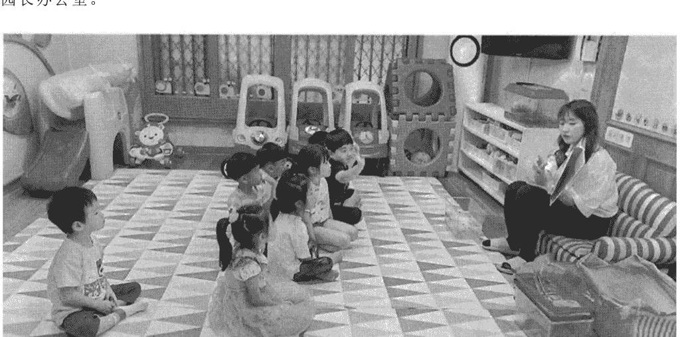

## 韩国幼儿园

这里的园主姓吴，50岁左右，由于长期从事幼儿教育，整个人看起来和蔼可亲，笑眯眯地迎接我的到来。

## 亚非韩

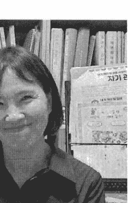

我仔细向她询问了关于韩国幼儿教育的问题，吴园长耐心地回答了一个一个多小时。

吴园长所在的幼儿园，一共有30个孩子，教师的数量根据孩子数量来决定：
- 孩子在1岁前，一个教师带3个小孩；
- 孩子在1~2岁的，一个教师带5个小孩；
- 孩子在2~3岁的，一个教师带7个小孩；
- 孩子在3~5岁的，一个教师带15个小孩。

韩国幼儿园以私立为主、公立为辅。韩国幼儿园每月15万~30万韩（人民币850~1650元），私立每月50万韩~100万韩（人民币2750~5500元）。

韩国政府承担了幼儿园教育的大部分本。两岁以下的幼儿园，政府每月补贴100万韩；2岁至3岁每月补贴50万韩；3至5岁每月补贴28万韩。

外国人的子女，0~3岁没有补贴，3~5岁可以补贴50%的学费。

公立幼儿园的老师，工资210~35万韩（人民币1155~1960元），他们80%的薪资由政府承担；私立幼儿园的教师工资一样，不过政府补贴要少一些，每位教师每月补贴51.8万韩（人民币2850元）。

吴园长的幼儿园，实行每天八小时工作制，双周末，最低薪水210万韩加51.8万韩政府补贴，一般是税前1000万韩左右，政府会每年来幼儿园进行一次审计，以保证补贴的发放。

吴园长作为幼儿园的高管理员，月薪500万韩，2500人民币。吴园长对自己的待遇还是很意的，当她说到自己的薪水时，眼睛有一种自豪的光彩。

总体来说，韩国幼儿教育从业者，其待遇远超中国国内。中国许多幼儿幼儿园的教师，只有几千人民币的月收入，在中国还是一个相当弱势的职业群体。我想引起另一个很关心的话题，他们幼儿园的招生数量是否在减少？

吴国说确实在减少，除了年轻人直接都不愿意生孩子，还有他们幼儿园所在的城区东，正处于开发阶段，大公司直接买周边土地，使得房价大涨，许多家长受不了昂贵的房租，带着孩子搬到更便宜的片区了，他们每个月流失1~2名学生。

城区东在2014年的时候，周边等地每坪1500万韩元（韩国每坪等于中国3.3平方米），2023年已经暴涨到每坪8500万韩元。

他们学生的家长一般为教师、上班族、小店老板，通常会在幼儿园周边一个40平方米两室一厅的房子，房子租金已经有点高。

如果选择月租，是5000万韩元（27.5万人民币）一个月80万韩元（440万人民币）。

如果选择长租，3~4层的居民（相当于深圳市农村农民），要交1.5亿韩元押金（82.5万人民币），有的小区的高楼，通常要交4亿~5亿韩元押金（220~275万人民币）。

这个“全租”，是韩国一个特殊的租赁模式，合同两年签，你给房东总价60%~90%的押金，两年后房东退还所有押金。

事实上，韩国的房价并没有像（中...某些地区）那样暴涨，只有部分地区看到下降。

## 朴淑惠

一周后，我来到韩国大川市当地一位叫朴淑惠的女士。她今年40岁左右，长期从事房地产，对韩国房价非常熟悉。

我问她韩国的房价情况。韩国的房价在不同城市差异很大，首尔最贵，釜山、光州、大邱等城市则便宜很多。

| 城市 | 59-84㎡房价 (韩元) | 59-84㎡房价 (约人民币) |
| :--- | :--- | :--- |
| 首尔 | 5000万 - 8000万 | 250万 - 400万 |
| 釜山 | 3000万 - 5000万 | 150万 - 250万 |
| 大川 | 2000万 - 3000万 | 100万 - 150万 |
| 光州 | 1500万 - 2000万 | 80万 - 100万 |

## 韩国幼儿园（续）

吴园长：韩国从小学到高中公立学校免费，大学收费比较较高。普通大学是每学期400万韩（约2万人民币），私立大学便宜，每学期200万韩（约1万人民币）。

我后来在不同的城市调研，也咨询过韩国人。韩国目前最贵的几所大学分别为延世大学、高西大学、明知大学、乙支大学、韩国大学、梨华女子大学、汉阳大学等，一年的学费在100万~1300万韩之间，合人民币6~7万元，以韩国人的收入其实不算很好。

我向吴园长问起韩国的养老和医疗问题。我向韩国人问，他主动说他段时间刚刚住院，花了200多万，实际销了80万。韩国这边月收入200万韩元左右，一个月交6万韩社保，由公司负担。

我在金山时，拜访过一个小老板黄智厚先生，和我同龄，是父亲传下的家里，公司有10个人，靠给大造船做零件。他对这块熟悉，每个月都要跟社保交道，他向我详细介绍了韩国社保情况。

黄智厚的员工不在职的情况下，年收入是3000万~3500万韩（合17万~18万人民币），算上上班，一般年收入在4500万韩元上下（约250万人民币）。

他的员工缴社保的具体方式，是员工年总收入，减去所有消费，再乘一个比例。这个减去的消费是指一年的开销，但是有上限的：
- 现金最多报1000万韩元
- 银行最多报1000万韩元
- 信用卡最多报2000万韩元
即4000万韩元封顶。

他们员工一般社交的费用是60~70万万元（约3万人民币）。

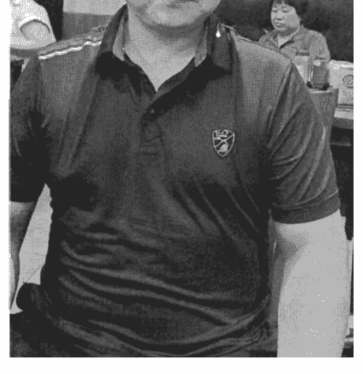

## 黄智厚先生（续）

可能各地社保方式不同的，我在首尔时，一名韩国人告诉我他们缴纳社保，是职工与雇主每月共缴4.5%的社保：
- 3.06%属于健康保险
- 0.48%属于退休
- 0.81%属于职业意外保险
- 0.15%属于失业保险。

如果在韩国农村，完全没有收入，到了65岁以后会有养老金；如果家里富裕，就不会发放；如果老两口月收入在20万韩元以下，政府每月每人可发放3238韩元（约1700人民币）。

韩国和日本一样，出租车的都是苍苍的老头，是因为两国物价贵，1700韩元不够生活。我从首尔离开后，沿路采访了几个个人，摸清楚韩国的教育、社会、房地产等基本信息。

韩国的年轻人越来越不想做。韩国蓝领和白领之间的差距并不大。韩国普通教师的工资也是近300万韩（1.5万人民币），班主任则在350万上下（1.9万人民币）。韩国与中国最大的区别是，他们任何一个岗位的起薪都比较高，不像中国还远在2000~3000元。

为了更好地了解韩国人的收入，我在釜山甚至采访了当地快递员和黑社会成员。这个小子就是釜山干快递，他没有读过大学，在韩国年轻人极少见，应当是家境贫寒才会从事行业。据小子说，他目前一天工作8小时，一周休息一天，收发一次快递3300韩元起步，远一点加100~200韩元，一个月能拿到290万韩（1.6万人民币），但他没有公司给他交社保，得自己想办法解决。同样没有社保的，釜山的黑社会成员。

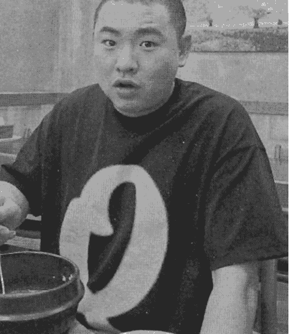

## 韩国快递员

一名35岁、理着平头、手臂上全是文身的釜山黑道分子，一边抽烟，一边接受了我的采访。在韩国，有文身就等于属于黑社会，没办法再进入主流社会了。出于工作的特殊性，对他拒绝我拍照。

这些女孩在釜山从事行当，开了家按摩店，手底下有十几个姑娘。他在釜山经营了十多年，从最底层小做起，直到现在有了自己的按摩，算打下了行业根基，对这个行业的路数如数家珍。据这位女孩的反映，目前韩国从事这个行业的女性，约占全国女性总人口的2%，大概50万人。

他们招聘的方式非常简单，主要依靠在地的特殊网站发布招聘信息，之后会有女生来应聘。

韩国色情业主要是五种场景：
- 第一种是在KTV一起喝酒，然后下半场，平均消费每人10万韩元起步（5000元）。
- 第二种是在KTV玩，可以手动，平均消费每人3万韩元起步（1650元人民币）。
- 第种是从事按摩的，收入水平大，一次1万韩元起步（500元人民币）。
- 第四种是从业人员，类似于街坊，一次8万韩元（4000元）。
- 第五种叫“亲养房”，一次5万韩元（250元）。

韩国女性可以根据身高和年龄，顶级收入者晚上能赚到3000万~5000万韩（150万~250万人民币），普通收入者晚上能赚到100万韩（500元人民币）。

韩国的人员流动性非常强，全职占30%，兼职占70%，很多都是为了钱。

总体来说，韩国的房价在不同城市差异很大，首尔最贵，其他地方便宜。

| 城市 | 59-84㎡房价 (韩元) | 59-84㎡房价 (约人民币) |
| :--- | :--- | :--- |
| 首尔 | 5000万 - 8000万 | 250万 - 400万 |
| 釜山 | 3000万 - 5000万 | 150万 - 250万 |
| 大川 | 2000万 - 3000万 | 100万 - 150万 |
| 光州 | 1500万 - 2000万 | 80万 - 100万 |

最后造成了韩国全球第一的生育率。

## 韩国

这样吃了两次我就受不了了，去了釜山的中餐馆，但韩国的中餐馆跟美式餐一样本地化了，还是一桌泡菜做点缀，锅包肉和杂酱面都变成酸甜口味。这根本不是中餐，本质上还是韩餐，一份锅包肉加一碗冷面、一碗杂酱面，花费300元人民币。

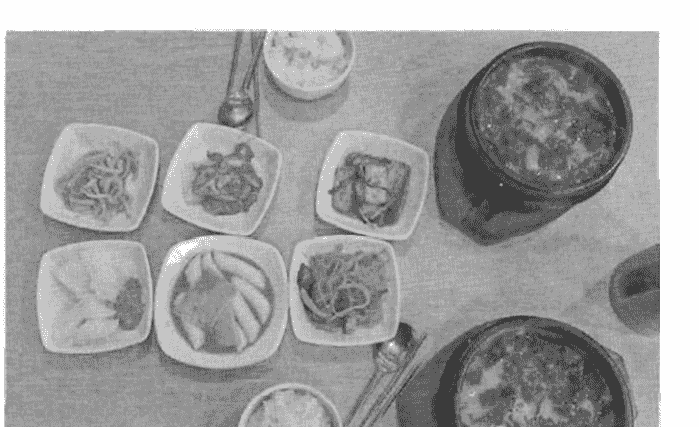

## 韩国中餐

（此处由于OCR文本重复且存在大量乱码/重复内容，已根据要求合并并保留核心语义逻辑）

## 越南米粉

到天安市时，当时当地华人领我去吃越南米粉，这两碗牛肉米粉，总算让我见到几片真正的牛肉，加上旁边那个小吃，一共花了184元人民币。

韩国餐厅物价又贵又没肉，平常吃饭以泡菜打底，冷鲜难吃。而越南米粉在中国一般20~25元一碗，韩国一个不起眼的天安市，卖到70~80元一碗。

韩国餐厅对比中国餐厅，有三个特点——一菜里肉、没有新鲜叶蔬菜、没有水果，总之价格、品质低，对习惯了平时有鱼有肉、有蔬菜水果的中国人来说，食品品质是大大下降了。

先说吃肉的问题，韩国街头也不是真的吃不到肉，肉也不是真的很贵。平时要专门吃肉肉，去路边的烤肉店吃。

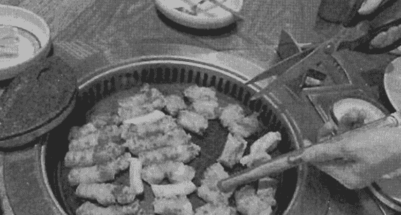

# 烤五花肉

我在昌原时，已经被泡饭折磨得想吃肉疯了，向导游便带我去当地吃了一餐烤五花肉，分量就是上面这一锅，俩人共花了300元人民币。

300元一人吃餐五花肉，在中国是很贵，不过韩国人的收入也不是太穷张，也不是天下下铺层，平时是能够承受得起的，但是吃肉有两个问题。

一这种肉肉都是冻肉，从冰箱里拿出来都冻得十分白，由服务员当着我们的面用钝刀剁后切肉，里面用刚处理过的肉肉。

二是烤着肉身体不舒受，我吃着五花肉后，哪晚就闹了两天。

中国这种肉类一般炒、做汤也会放肉，吃肉是一件不知不觉的事情。而在韩国，韩国牛肉汤泡饭，也也只有一片牛肉牛肉，真要去烤肉店吃，肉质不够好，料理方式还只刺激身体的。

五花肉这类肉类更新鲜，一般菜做汤也放肉，吃肉是一件不知不觉的事情。韩国里生活物资就是不丰富、不充足。

如果要去吃肉质好的韩牛，那价格就上天了。一位韩国大叔在首尔帮我去吃了这一次，4人吃了31万元，总计1700元人民币，结账时我都愁死他，想这个朋友算是交定了。

另外被韩国人吹上天的参汤，我在釜山采访过那位黑道大哥时，吃的就是这个，其实还是汤饭，不是煮熟的整只鸡，汤里配几片人参和大米，鸡肉完全没有味道，辅食搭配的居然是整个辣椒、煮熟的土豆、泡菜类，真的不知道为什么算当地美味。

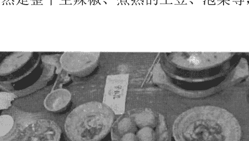

## 参鸡汤

整体来看，在韩国餐馆吃东西，确实是一件品质不高或价格昂贵的事情。为了了解背后的原因，拿到真实的一手数据，我在韩国不同城市跑了大家家农贸市场和超市。

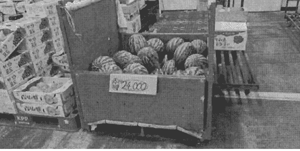

## 瓜果价格

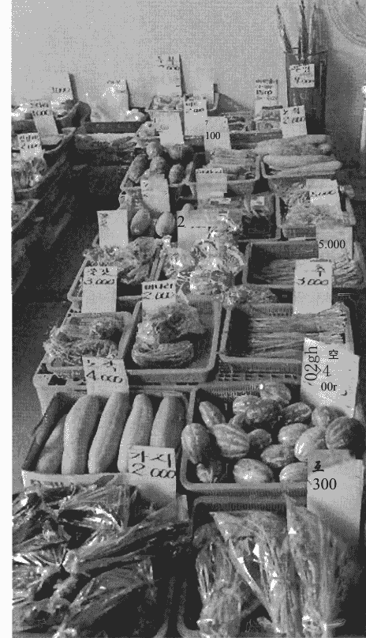

## 蔬菜价格

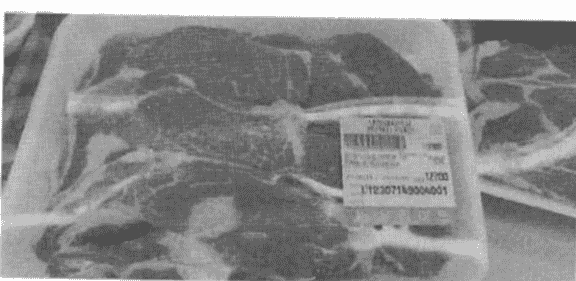
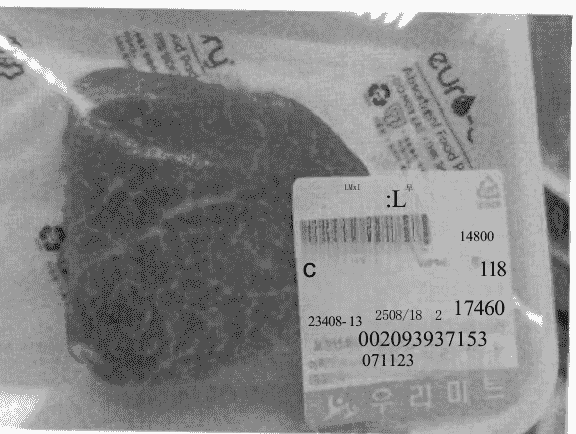
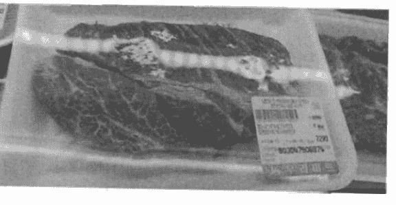

## 肉类价格

在我的个人微博上公布了大量韩国的水果、蔬菜、肉类、鱼类价格，图中这里差不多放了，直接给大家一个统计数据。

在韩国的超市或农贸市场，水果价格（以下单位为人民币）是：
水蜜桃77元一盒个、西瓜130~200元一个（他们说我去的时候西瓜刚好处于高位，平时80~100元一个）、葡萄77元一盒、橘子35元一袋、绿苹果55元5个、梨55元3个、带壳花生27元一斤、一盒车子55元。

蔬菜方面，罗萝卜12元一个、西红柿35元一个、小葱18元一捆、大米11~18元一斤、辣椒11~22元一袋、白菜27.5元一斤、南瓜15一个、韭、空心菜、蘑菇、香菜、黄瓜16.5元一斤、大蒜16.5元一袋、贝贝南瓜礼盒93.5元一个。

肉类方面，普通进口牛肉300克40元、本地猪400克50元、韩牛11895元。

鱼类价格跟中国差不太多，有部分鱼还便宜些，比一条石斑鱼大只要50人民币币。

全方面对比可以发现，韩国、进口水果和肉类，跟中国差不太多，贵个20~50%，进口水果比中国3~5倍、蔬菜比中国5倍、本地猪肉比中国3倍、牛肉比中国5~8倍。

除了海鲜，我在韩国农市场和超市看到的水果、蔬菜、肉类都是是以本地为主，使得韩国国家在吃饭这件事上成本较高。

吃其实两种市场，一种是在家里，另一种是在餐厅里。

餐厅压力由于食物成本高，人工又贵（起步1.2万元人民币每月），租租也不便宜，三重压力叠加下，为了节省成本，无法像中国那样提供肉类、蔬菜、水果，就算是专门的烤肉店，一般店铺也只能提供冰冷的进口肉，要吃本地新鲜就非常贵。

这就是为什么我在韩国这段时间吃一直是不好的原因。但是家里自己吃的话，韩国人没有问题的。我在韩国的观察，无论是大城市还是小城市，年轻人都不健身，他们形较为匀称，男性很有肌肉，韩国女性的皮肤最好，营养均衡。

根据韩国研究院发布的数据，2022年韩国居民人均消费量达到了：猪肉58.4kg、牛肉53.5kg、羊肉39.3kg、禽类18.4kg、鱼及其他14kg。

如果算牛肉，韩国人的肉类消费跟中国差不多，可见在餐厅吃肉困难。

韩国城市化程度很高，达到了91.4%。我在韩国看到的景象，跟深圳汉外的荒芜非常像，东莞各镇之间，却有些荒落落的一些农田，其余大部分都是工业园区为主的小城镇，一片连着一片。这种高度发达的城市化，导致了在韩国农村，他们的影响非常大。

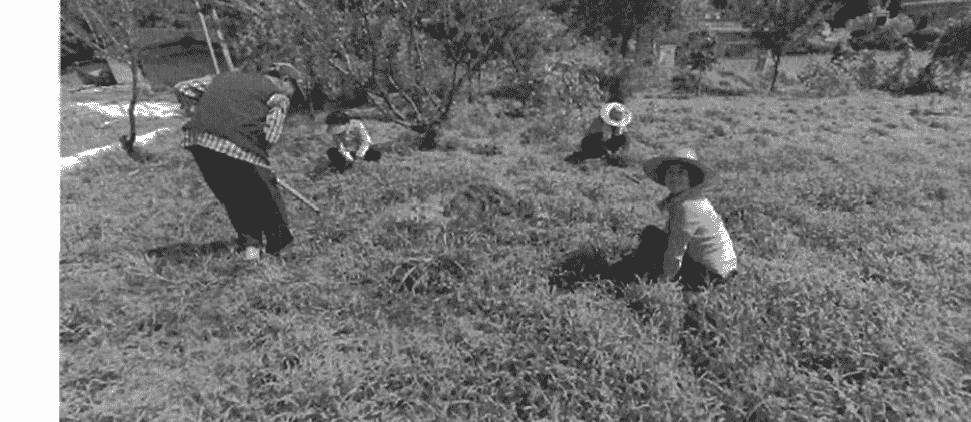

## 韩国农村聚景

我们上前问四位老人都是在本村出生，目前分别为70岁、74岁、76岁、86岁，那70岁的奶奶还穿着衣服，我们打招呼，他们打招呼。

原本月音村原有130户人家，现在有90户，每户都有两人，全是老头老太，别说年轻人，村里连一个人都没有留下，65岁是起步年龄。

三四十年前，村里还热闹，到处还有小孩跑去，现在就剩他们这群骨头在这山里老死，估计以后再也没有人了。

韩国农村的这些老农民，基本加入了农协，属于韩国下面1300个基层小组的一个份子。

韩国多地少，这里还高，因此韩国农产品的产量很低。按联合国粮食组织的数据，日本的粮食供给率有27%，韩国更低，只有20%，本土土地养不到500万人口。

这些水稻以前一年两熟，现在家里干不了了，改成一年熟，亩300~450kg。

如果是白菜少，土地660平方米（1亩）——一次能收3500颗白菜——他们不说多少白菜，多少剂量，那个化了的老奶奶。

韩国一年的产量有376万吨，白菜134万吨，韩国泡菜都不够，所以韩国泡菜会从山东出口，主要来自山东莱莱每年泡菜，韩国都要从中国进口28万吨。

为了维护农民利益，韩国农民组了强大的农协，将全国农村变成一个统一的大农场。全体农民一起来对抗政府，如果政府大量进口农产品，农民们就去政府门口打十字、衣服、自焚，还敢跟警察互咬。

由于韩国政府下手黑社会容易引起民众同情，韩国政府通常会招致他们，农协越来越强势。在思想领域上，对全体农民遵循“身土不二”的价值；在销售渠道上，管理着全国200家收购点、加工中心、仓储，以及300多家销售点，各大超市东西都要经农协同意。

韩国也一样，从釜山开车到首尔，一路见不到田野，只有一片片紧密相连的城镇，到处分布着商场、公园、工业园、写字楼、小区等。

我们知道退休后回到山村，其实居住这种山村，在韩国已经不多了，我从釜山坐到他的山村，一路看到的都是城镇，没有村落。

生活在韩国边的农村，比起中国的农村富，没有形成巨大的城乡鸿沟。

造成韩国吃肉困难的主要原因，是农协。

韩国现在只有500万农民，大部分都是老人，占全人口的7%，但是他们的影响非常大。

韩国农村的这些老农民，基本加入了农协，农村的。

由于韩国政府下手黑社会容易引起民众同情，韩国政府通常会招致他们，农协越来越强势。在思想领域上，对全体农民遵循“身土不二”的价值；在销售渠道上，管理着全国200家收购点、加工中心、仓储，以及300多家销售点，各大超市东西都要经农协同意。

由于补习费贵，LG和三星这种大财，在不同地区设立免费的儿童中心，他们出钱请老师让孩子补课。

韩国农村，其实没有问题的。

根据韩国研究院发布的数据，2022年韩国居民人均消费量达到了：
猪肉58.4kg、牛肉53.5kg、羊肉39.3kg、禽类18.4kg、鱼及其他14kg。

如果算牛肉，韩国人的肉类消费跟中国差不多，可见在餐厅吃肉困难。

如果要去吃肉质好的韩牛，那价格就上天了。一位韩国大叔在首尔帮我去吃了这一次，4人吃了31万元，总计1700元人民币，结账时我都愁死他，想这个朋友算是交定了。

另外被韩国人吹上天的参汤，我在釜山采访过那位黑道大哥时，吃的就是这个，其实还是汤饭，不是煮熟的整只鸡，汤里配几片人参和大米，鸡肉完全没有味道，辅食搭配的居然是整个辣椒、煮熟的土豆、泡菜类，真的不知道为什么算当地美味。

整体来看，在韩国餐馆吃东西，确实是一件品质不高或价格昂贵的事情。为了了解背后的原因，拿到真实的一手数据，我在韩国不同城市，跑了大家家农贸市场和超市。

## 瓜果价格

## 蔬菜价格

## 肉类价格

在我的个人微博上公布了大量韩国的水果、蔬菜、肉类、鱼类价格，图中这里差不多放了，直接给大家一个统计数据。

在韩国的超市或农贸市场，水果价格（以下单位为人民币）是：
水蜜桃77元一盒个、西瓜130~200元一个（他们说我去的时候西瓜刚好处于高位，平时80~100元一个）、葡萄77元一盒、橘子35元一袋、绿苹果55元5个、梨55元3个、带壳花生27元一斤、一盒车子55元。

蔬菜方面，罗萝卜12元一个、西红柿35元一个、小葱18元一捆、大米11~18元一斤、辣椒11~22元一袋、白菜27.5元一斤、南瓜15一个、韭、空心菜、蘑菇、香菜、黄瓜16.5元一斤、大蒜16.5元一袋、贝贝南瓜礼盒93.5元一个。

肉类方面，普通进口牛肉300克40元、本地猪400克50元、韩牛11895元。

鱼类价格跟中国差不太多，有部分鱼还便宜些，比一条石斑鱼大只要50人民币币。

全方面对比可以发现，韩国、进口水果和肉类，跟中国差不太多，贵个20~50%，进口水果比中国3~5倍、蔬菜比中国5倍、本地猪肉比中国3倍、牛肉比中国5~8倍。

除了海鲜，我在韩国农市场和超市看到的水果、蔬菜、肉类都是是以本地为主，使得韩国国家在吃饭这件事上成本较高。

吃其实两种市场，一种是在家里，另一种是在餐厅里。

餐厅压力由于食物成本高，人工又贵（起步1.2万元人民币每月），租租也不便宜，三重压力叠加下，为了节省成本，无法像中国那样提供肉类、蔬菜、水果，就算是专门的烤肉店，一般店铺也只能提供冰冷的进口肉，要吃本地新鲜就非常贵。

这就是为什么我在韩国这段时间吃一直是不好的原因。但是家里自己吃的话，韩国人没有问题的。

根据韩国研究院发布的数据，2022年韩国居民人均消费量达到了：
猪肉58.4kg、牛肉53.5kg、羊肉39.3kg、禽类18.4kg、鱼及其他14kg。

如果算牛肉，韩国人的肉类消费跟中国差不多，可见在餐厅吃肉困难。

如果要去吃肉质好的韩牛，那价格就上天了。一位韩国大叔在首尔帮我去吃了这一次，4人吃了31万元，总计1700元人民币，结账时我都愁死他，想这个朋友算是交定了。

另外被韩国人吹上天的参汤，我在釜山采访过那位黑道大哥时，吃的就是这个。

## 韩国农村聚景

我们上前问四位老人都是在本村出生，目前分别为70岁、74岁、76岁、86岁，那70岁的奶奶还穿着衣服，我们打招呼，他们打招呼。

原本月音村原有130户人家，现在有90户，每户都有两人，全是老头老太，别说年轻人，村里连一个人都没有留下，65岁是起步年龄。

三四十年前，村里还热闹，到处还有小孩跑去，现在就剩他们这群骨头在这山里老死，估计以后再也没有人了。

韩国农村的这些老农民，基本加入了农协，属于韩国下面1300个基层小组的一个份子。

# 亚非篇

2023年8月15日上午，我跟一个熟悉韩国补习制的中国向来到了首尔江南区的一条六层小楼前。

江南区有大量独特小楼，里面一层层全是补习教室，我们首先看到墙上挂着各个补习老师的照片和简介，展现这家机构实力看起来非常严肃。

## 江南独特小楼

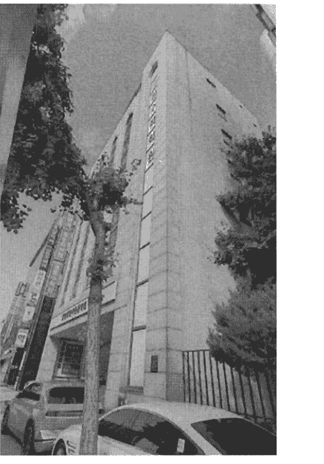
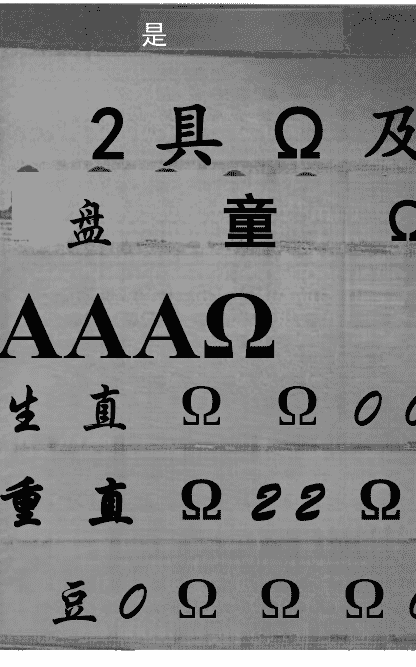

## 亚韩

韩国的公立教育家长们无法无奈，一位1984年出生，名叫白智国的昌原人跟我细细算了一笔账，他现在两个小孩，语外补课是每月30万韩，中文是每周每月12万韩，跆道、钢琴是每周每月15万韩。

首尔年轻人的夜生活非常精彩，他们下班后还有好几个节目：第一轮吃饭喝酒，第二轮夜店蹦迪，第三轮轰趴KTV，第四轮狂夜、健身房等，一直等到凌晨四点才睡娜。

中国互联网这边又是这种现象，说觉得特别奇怪，什么“韩国人进化掉了睡眠”、什么“韩国人已经变异了”之类，其实我去现场一看，他们也不是天天在玩，天天这么些折腾早起，年轻人一周就折腾两次：熬夜靠莱茵式，平均睡眠时间只有6.5小时。

把韩国一些普通的社会现象描得特别奇怪，搞得一模一样，是我们这这边互联网的通病。

我们继续聊聊单身女性，她在韩国年龄达到了30多万人民币，她只要不要孩子，她以现在的收入，可以一直过着这么的生活，大多数商品都买得起，大多孩子钱也付得起，想玩一点就玩到几花，花的都是自己的钱。

但是只要她生孩子，她就要像电影《82后生的金智荣》那样，只能辞职回家带娃，失去经济独立的工作，在首尔里长大的黄妻，像失去了上班女的自由，变成尴尬无光的家庭女。

最糟糕的是还是失去经济自主权，就像离开鱼水一样变得奄奄一息。

而她们离职前收入还有那么高，生活得那么自由自在。

让韩国女人带娃，基本上就是让她上缴了经济自主，还要面对沉重的补课。

中国人有些不理解，韩国女性后要辞职带娃吗？父母不能帮忙几年吗？

不可以。

韩国的老一跟中国的老一想法完全不同，他们绝大多数不会帮帮子带女孩子，他们喜欢享受生活，儿女要事的，他们绝不愿接手。

我在韩国采访了四五户家庭，都是带娃的，他们的父母拿着退休金，或者拥有大量房产出租，已经是过了富人生活，天天玩得飞起，根不像中国父母这人样劳她就再付一次。

中国媒体说起韩国人，总是关注弱势群体，把韩国人说得很惨。看事物要全览，这部分人口并没有那么高，我亲眼看到的大部分人，其实都是韩国金时代留来的有钱人，他们牢牢握着资源资料，过得不要太奢侈。

从我个人采访到的对象来看，韩国父母不管子女买房，也不管子女生活，有公司的绝不交股权，有商铺的转到子女名下，钱辈牢牢握在自己手里，自己怎么轰意来。

那父母不愿意，可以请保姆解决这个问题呢？

也不行，韩国保姆一个月要1.5万人民币，能出这笔钱，还不如自己带。

所以韩国年轻人面临高的房价、妻子离婚需独自抚养小孩、生孩子后又要面临高额学费的三大困境。

这里女性的反抗性为强烈，女性拥有高收入回报，很难让她们放弃高收入，回到家里成为一个免费带的黄脸蛋。

韩国女性大学毕业几年后，通常面临的选择，是做高薪的生活的现代白领，还是做一名每天换着挣没收入的自由的黄脸蛋？

没有人愿意交出的权利。

在韩国政府放弃公立教育、教育产业私化、女性拥有高薪岗位、韩国父母不管手、蓝领工资请不起保姆，这五大条件影响下，韩国选择了不生育，最终成为世界上出生率最低的国家。

从韩国的种种现状，我们回过来看，会发现中国普遍的公立教育，老师们责任程度，相当于发达国家的精英教育，而中国普通公立医院提供的服务，接近于发达国家的私立医院服务。

很多国家是对普通民众放弃教育和医疗的，反过来看，中国现在做得还算不错。

中国也有可能看到韩国的现状，才会被断了培养行业。

### 陆

我在韩国调研的时候，非常喜欢访询问他们的发展史。

我在韩国分别采访了1966年出生的刘在根、1959年出生的徐梓富、1951年出生的朴民、1962年出生的金奎奎，我分别跟他们进行过长谈，问起他们韩国工

## 亚韩历程：

这些韩国老人都会用汉字写自己的名字，我每次在笔记本上写下他们的名字时，他们会过来凑正我有没有写错，但韩国年轻人基本不认识汉字了。

这些人里头，刘在根的经历很有代表性，他出生在京道长平普通农村，那村只有牧场，没有土地，都在地主手里，村里都是农，收获以50%土地，50%归自己。

刘在根

韩国人不知道中国挖过土，我跟许多韩国人闹起农村人来时候，他们是发出一片惊讶的声音，感到不可思议。

刘在根的父亲当过兵，参加过六二战争之一就是中国人的抗美援朝，战争爆发时间是1950年6月25日，韩国那边就叫六二五战战。

他父亲回来后结婚妻子，生了一男一女。爸爸曾经当师傅，妈妈曾经择卖卖费养活全家。

刘在根回忆说，从1975年开始，韩国明显起来了，到80年代末大学毕业后，韩国已经走向了成功。

刘在根1984年考上大学，当时大学只有录取率，毕业后月薪20万~30万，大家都不愿意当公务员。1988年时，韩国公务每月只有15万，大学生也百分百可以当公务员。

跟刘在根聊天时，徐师傅也提到，他在韩国也在场，80年代工资500万~600万，工作两年就买一套房子。1988年韩国进入黄金期，他作为工程师，年薪达到了450万（相当于现在的三亿），一个人可以养活一家娃，还买得起车和房。

后来韩国增长缓慢，八年前他退休了，年薪涨到一亿。我问他退休金是多少，他说每月有150万（250万），太多了。

徐师傅

所以韩国年轻人面临高的房价、妻子离婚需独自抚养小孩、生孩子后又要面临高额学费的三大困境。这里女性的反抗性为强烈，女性拥有高收入回报，很难让她们放弃高收入，回到家里成为一个免费带的黄脸蛋。

韩国女性大学毕业几年后，通常面临的选择，是做高薪的生活的现代白领，还是做一名每天换着挣没收入的自由的黄脸蛋？

没有人愿意交出的权利。

在韩国政府放弃公立教育、教育产业私化、女性拥有高薪岗位、韩国父母不管手、蓝领工资请不起保姆，这五大条件影响下，韩国选择了不生育，最终成为世界上出生率最低的国家。

从韩国的种种现状，我们回过来看，会发现中国普遍的公立教育，老师们责任程度，相当于发达国家的精英教育，而中国普通公立医院提供的服务，接近于发达国家的私立医院服务。

很多国家是对普通民众放弃教育和医疗的，反过来看，中国现在做得还算不错。

### 陆

我在韩国调研的时候，非常喜欢访询问他们的发展史。

我在韩国分别采访了1966年出生的刘在根、1959年出出生的徐梓富、1951年出生的朴民、1962年出生的金奎奎，我分别跟他们进行过长谈，问起他们韩国工

## 亚韩历程：

这些韩国老人都会用汉字写自己的名字，我每次在笔记本上写下他们的名字时，他们会过来凑正我有没有写错，但韩国年轻人基本不认识汉字了。

这些人里头，刘在根的经历很有代表性，他出生在京道长平普通农村，那村只有牧场，没有土地，都在地主手里，村里都是农，收获以50%土地，50%归自己。

刘在根

韩国人不知道中国挖过土，我跟许多韩国人闹起农村人来时候，他们是发出一片惊讶的声音，感到不可思议。

刘在根的父亲当过兵，参加过六二战争之一就是中国人的抗美援朝，战争爆发时间是1950年6月25日，韩国那边就叫六二五战战。

他父亲回来后结婚妻子，生了一男一女。爸爸曾经当师傅，妈妈曾经择卖卖费养活全家。

刘在根回忆说，从1975年开始，韩国明显起来了，到80年代末大学毕业后，韩国已经走向了成功。

刘在根1984年考上大学，当时大学只有录取率，毕业后月薪20万~30万，大家都不愿意当公务员。1988年时，韩国公务每月只有15万，大学生也百分百可以当公务员。

跟刘在根聊天时，徐师傅也提到，他在韩国也在场，80年代工资500万~600万，工作两年就买一套房子。1988年韩国进入黄金期，他作为工程师，年薪达到了450万（相当于现在的三亿），一个人可以养活一家娃，还买得起车和房。

后来韩国增长缓慢，八年前他退休了，年薪涨到一亿。我问他退休金是多少，他说每月有150万（250万），太多了。

徐师傅

所以韩国年轻人面临高的房价、妻子离婚需独自抚养小孩、生孩子后又要面临高额学费的三大困境。这里女性的反抗性为强烈，女性拥有高收入回报，很难让她们放弃高收入，回到家里成为一个免费带的黄脸蛋。

韩国女性大学毕业几年后，通常面临的选择，是做高薪的生活的现代白领，还是做一名每天换着挣没收入的自由的黄脸蛋？

没有人愿意交出的权利。

黑市汇率是1:9，官方汇率并不是镑的真实价值，民间认的是黑市汇率。在特殊情况下，我会采用官方汇率。

我在调研时，拿100美元按官方汇率换成3000镑，后来到非洲，100美元换成6000镑，比之前涨了一倍；我知道埃及的汇率，100美元按黑市汇率，100美元换了9000镑。

埃及现在正在经历的许多事情，中国二十年前已经经历了。华人老板告诉我，现在的工资增加后，以前普通人都是月薪1000~2000镑，现在普通人涨到了5000~10000镑，但镑贬值太厉害了。

| 职业 | 月薪（埃及镑） | 折合（人民币） |
| :--- | :--- | :--- |
| 清洁工 | 3000~4000 | 333~444 |
| 建筑工 | 2000 | 222 |
| 流水线工人 | 2500 | 277 |
| 技术人工 | 3000~5500 | 333~555 |
| 基层公务员 | 7000 | 777 |
| 办事员 | 6000~7000 | 666~777 |
| 中层办事员 | 30000 | 3333 |
| 办公室白领 | 10000~15000 | 1666 |
| 南部员工 | 5000 | 500 |
| 南部工人 | 4000 | 500 |
| 南部技术 | 7000 | 700 |

我问为什么南部人都特别便宜？他说非洲人太多，随地招工时候，别的老板会有意见，他们费力气。

我想起1999年冬天，东莞的一家高尔夫，打工厂时，自己17岁，几万人队伍的情形，失业异常严重，底是300元，几乎无数大陆去抢这份工作。
[/content]

## 世界·二四

其购买力下降了。在网上关注过人民币兑镑的汇率后，许多埃及的朋友感慨：2006年，镑还比人民币贵，1镑可以换1.3元人民币；2015年，镑比人民币贵差不多1:1上下；2022年，人民币兑镑还是1:3；短短两年，美国加息导致镑疯狂贬值，现在居然跌到了1:9，老百姓的生活质量彻底倾出一口血。

为了了解物价，我在开罗的Fewallah超市买了一些：

| 商品 | 价格（埃及镑） |
| :--- | :--- |
| 牛肉 | 200/斤 |
| 列罗巧克力 | 195 |
| 一件普通外套 | 999 |
| 一包洗衣粉 | 320 |
| 多芬洗发水 | 150 |
| 力士沐浴露 | 65 |
| 10只骆士杜蕊 | 200 |
| 一套茶具 | 9000 |
| 一把电热水壶 | 599 |
| 一支牙刷 | 70 |
| 一盒牙膏 | 80 |

如果埃及的价格用货币汇率换算成人民币，那价格也还好。但是贫民埃及人每月月挣3000~5000镑，普通埃及人每月月挣5000~10000镑，他们的月收入肯买这个东西，那真是贵得离谱。一个月连茶具都买不起，大家只能吃牛肉当肥。

埃及的老百姓被贬值伤得太深了。与上面形成鲜明的对比，是埃及的农产品廉得便宜。我在埃及买了两个水果——埃及的水果不好吃，远逊国内水平，也间接说明其农业技术。其中一次是在水果店，买了5个石榴、7个橘子、5个苹果，一共花了80镑，才9元人民币。后来在贫民区又买了7个橘子，10磅才0.1元人民币，每次我买产品换算成人民币后，都觉得他们的价格低得让人不敢相信。

埃及的物价情况，与20世纪九十年代的中国几乎一样，工业品极其贵，可怕的是埃及还有汇率不稳定的问题，使国家财政雪上。
[/content]

## 亚非

埃及就业率、月薪低、物价贵，那么普通人是怎么活下来的？当然是埃及人类赖以生存的大饼。在亚历山大，大饼很好吃，我也想体验下埃及大饼到底什么情况，排队买五个大饼。

埃及大饼非常便宜，过去一年才才知道，这里的大饼一个5镑，也就是0.5元人民币。以前普通人月薪1000~2000镑，现在普通人涨到了5000~10000镑，但镑贬值太厉害了。

埃及人的收入大部分。

[content]
在埃及南部地区便宜，大部分埃及人的月工资：

| 职业 | 月薪（埃及镑） | 折合（人民币） |
| :--- | :--- | :--- |
| 清洁工 | 3000~4000 | 333~444 |
| 建筑工 | 2000 | 222 |
| 流水线工人 | 2500 | 277 |
| 技术人工 | 3000~5500 | 333~555 |
| 基层公务员 | 7000 | 777 |
| 办事员 | 6000~7000 | 666~777 |
| 中层办事员 | 30000 | 3333 |
| 办公室白领 | 10000~15000 | 1666 |
| 南部员工 | 5000 | 500 |
| 南部工人 | 4000 | 500 |
| 南部技术 | 7000 | 700 |
[/content]

埃及的国土虽然有一万平方公里，但可耕地仅7万平方公里，人口爆炸集中在尼罗河域，所以埃及有严重的粮食问题。粮食总产量在1600万吨，每年消费在2700万吨，埃及自给率只有50%左右，每年要花费大量外汇从国外购买粮食，保证埃及人都吃饱。埃及政府从1984年推出补贴，补贴额占全国收入的15%~25%，才能维持社会稳定。任何国家的老百姓，一旦饭没吃的，准会上街造反。
[/content]

## 世界·二〇四

穆罕默德是20世纪50年代纳塞尔上台后镇农民，让他们交更多的税。尼罗河三角洲很多农民反抗都被被镇压，镇压后他们无家可归，最后流落到活死人墓里居住，埃及政府也一直追迫他们，防止他们说话，他们一直活在恐畏之中。

对于穆罕默德，我查了下资料，20世纪50年代，纳塞尔上台后进行土地改革，限制土地所有权，将多余土地分配给农民。纳塞尔针对的不是普通农民，而是主阶层。穆罕默德家以前应该是他的主会。对这母子居住的地方，是一个重要贵的陵墓，里面是一个超大的庭院，养着三四只猫、七八条狗，又有几株树砌，除了陵墓里停着几块石翁，简直像是一处没精装修的大宅，看起来并不像网上的那么悲惨。

2024年2月8日，我和向导开车来到开罗的死城，采访居住在这里的穆默德母子。死城位于开罗市中心，共6平方公里，居住着50万~100万人，具体人数难以统计。这块区域因为气候干燥，尸体不容易腐烂。另外伊斯兰书籍说穆克塔姆山上生长着天堂的树，埃及的达贵人便选葬在这里，形成一片墓群。按埃及传统，葬者要与亡者共住，陵墓旁边又建立了一些供活人居住的住房。这些房子只供守城人居住，防盗防贼。进入近代后，埃及农民进入郊打工，由于头紧付不起房，以极低廉的价格，大量住在陵郊的小房子子里。

样，但世界各国的平民，各有各的不容易，所以我调研时尽量多采访平民。

贫民窟是不绿树的，那里的巷窄得只能侧身而过，车辆对行驶就会发生碰撞，而在我在开罗几次误入的平民社区，那里也是没有完工的房子和黄土路，很少见到树木。

之所以没有树木，是因为开罗至少有2300万人居住，城市需要修建大量居民和配套设施给大伙居住，空间太紧凑容不下树木。就算可以看见种树，大家平时忙于生存，生活费巨大，没有精力金钱去顾这种闲情逸致。

整个埃及的居民楼，大部分外立面都没有粉刷或贴瓷砖，红砖裸裸地暴露在外，楼顶通常还没有完工，钢筋和水泥柱直对着天空，但居民楼里面其实完成了装修，已经住满了。

img/5cde6aaf37b0508cdaa1c2350f01f_198.png

## 埃及的居民楼

我在开罗西郊的城乡部，一位阿拉伯人家里吃过顿饭。这里的建筑风格，跟20世纪90年代的农村很相似。大家可以看到这边的房屋屋顶是没有完工的，一律保留钢筋混凝土。造成这种现象主要是两个原因：一是完工的房子要交一笔房产税，二是家庭人口增长，比如娶媳妇就直接在上面加盖。本地管理部门不管吗？向导说这点小手段，大家过日子都不容易。在这位城郊阿拉伯人家里，跟着华人朋友的光，吃到了很好的当地饮食。

## 当地饮食

- 菠菜蔬菜汤
- 意大利面
- 西红柿牛肉
- 牛肉馅饼
- 青椒炒肝
- 烤鸡
- 西红柿茄子

这种异域民间风情，吃得很满足。

img/5cde6aaf37b0508cdaa1c2350f01f_199.png

## 开罗的城水平

埃及及亚历山港的水平远不算，被他们落后的基建愁得吓一跳。那天刚来到亚历山港，就看到一辆英国人建的旧轨电车，横腾地从我面前驶过。电车老到感觉它会散架起来，外面斑驳不堪，里面又脏又破，车内一层薄薄的污垢，玻璃上附着灰蒙蒙的东西，看起来只适合拉货，完全不适合坐人，里面许多乘客趴在车窗上好好地看着我们。

img/5cde6aaf37b0508cdaa1c2350f01f_200.png

## 破旧的电车

1945年，中国也没几座城市有轨电车，亚历山港以前的生活质量，应该是超越大多数中国人的。沧海桑田将他们远远抛在身后。亚历山港不仅电车破旧，市区的房屋老得像某个快要被拆迁的小镇似，部分房屋像发生过战争被毁，大部分房屋像一片荒废，市貌更像是中国的小城。而亚历山港还是埃及第二大城市，其他城市更拿不出手。

我在开罗时遗漏了去体验他们的地铁。许多人说他们的地铁也非常光。开罗城区385平方公里，地铁总长78公里，占比不到14%，地铁并不是开罗人的主要交通方式。我主要提到另外一个十分有趣的事情，就是在开罗开发的。

img/5cde6aaf37b0508cdaa1c2350f01f_201_0.png
img/5cde6aaf37b0508cdaa11c2350f01f_201_1.png

## 埃及开车

由于车价便宜，又多为二手车，大部分埃及人为为了省钱，居然不给车买保险，小碰碰若安天命，刚下来闲两句，连交警都不找。

埃及开车非常刺激，又狂野又危险，令我生之难忘。红绿灯较少，普通路你开车时保持熟悉既熟悉简单，就是在马路中央放一个高路隆的超大减速带。这个大减速带，大概是国内普通减速带的三倍大。没仔细问，可他们减速带的颜色跟道路就像是一模一样的！你稍不注意开了过去，轰隆一声，就连车都被甩起半米高，你还有在空中跟侧翼面对面一眼，再被喇鸣一声响！

但上了环城路就不一样，里面就乱，时时带跑像中国线城市的乱乱，每次开着就想望埃及。我们在北上广差点开车……在埃及开车后，我才知道我是多么幼懂、多么单纯。

中国人开车，转弯不打方向，线乱车乱，总体还是会顾行车线的，埃及人那人可就不一样了，埃及人那是放骚、赶得意的、赶得狂的。我把朋友的 MG HS 开着环城路就觉得不对劲，在环城路上找着行车线。

埃及司机非常狡猾，后面跟着各种车横着开得快，有些车是90年代的老，有的可能比我年纪大，感觉老远都能闻到一股古董味。在埃及开车这几年，我自己也是被这些司机搞得冷汗。看着埃及司机驾驶技巧，各种风骚的，在转道时总是会保持一个安全距离。那些埃及司机，各种追尾，几乎不会被追上，大家在埃及这种埃及人亡命。

## 阿拉伯人家

这顿饭，当地埃及人，吃到了很好的当地饮食：
- 菠菜蔬菜汤
- 意大利面
- 西红柿牛肉
- 阿拉伯牛肉馅饼
- 青椒炒肝
- 烤鸡
- 西红柿茄子

这种 异域民间风情。

等我快下环城路时，居然还看到一辆马车在路上慢悠悠地行驶，旁边飞车如梭，这种奇怪的交通系统，十分有趣且生动的。

img/5cde6aaf37b0508cdaa1c2350f01f_203.png

## 亚非埃及

大家应该注意到了，我在埃及遇到大部分都是阿拉伯人，而历史书说的古埃及人和古埃及人建造了那些巨大神庙和金字塔，创造过辉煌文明的他们并不是阿拉伯人，阿拉伯人是后来的征服者。

埃及的荣光属于古代，从公元前7世纪开始，他们被波斯（野蛮）、亚历山大、罗马、阿拉伯帝国征服，征服者互相打。直到642年阿拉伯人走了埃及，这里才定下来。阿拉伯人也大量居住到埃及，现在的埃及约90%都是阿拉伯人，原来埃及人的后代在罗马时代信仰了基督教，又被其他族变成科普特。其实科普特原意是埃及的意思，是在历史书写和发音变化造成的，这些人才是正宗埃及老祖宗血统，占比约为10%。

相信基督教的基本是阿拉伯人，看到基督教的基本是科普特。一些埃及极端分子还常常欺负科普特人，动不动就扔几个炸弹。阿拉伯人跟埃及并没有一点关系，但是他们咬死自己就是文明的继承者。我曾问过几位阿拉伯人：“你们不是埃及人的后代，这些古迹还不是你们祖先留的，你们不能算是埃及人吧？”他们对这个问题颇有警备，说反正他们在埃及生活了这么长时间，保护和保养埃及文明也这么长时间，他们就是正宗的埃及人。

我在朋友家见到一位做房产中介的科普特人马丁，问他：“科普特人怎么看自己的土地上全是阿拉伯人？我是不是对不起老祖宗？”我问问题确实是这么简单粗暴。马丁说他们现在的人认为应该拿回来，不能给祖宗丢脸；有人认为都占了几千年来，谁来过日子算不过，反正人多，打打不要，就这么凑过呗。

科普特人态度激烈和态度平和，一半一半。

除了阿拉伯人和科普特人，埃及南部都生活着努比亚人，他们跟阿拉伯人和科普特人的肤色完全不一样，纯血，就是中国人人印象中地道的非洲人。其实他们是苏丹人，因为住在埃及改名叫努比亚人。努比亚人就像中国的掸族，因为埃及水坝淹了他们的土地，努比亚人大部分都是农民。你去阿斯旺旅游时，政府会有意引导你到他们的村庄坐坐，以此以免他们没法生存。

img/5cde6aaf37b0508cdaa1c2350f01f_205.png

阿斯旺是埃及南部的重要景点，阿布辛贝神庙。从阿斯旺出发要3.5小时，回来要7小时，我不建议游客专程走这一趟。向马丁咨询了一下开罗房价：
- 毛坯房：每平米20000~30000镑（约2000~3300元人民币）。
- 便宜房：每平米5000镑（约500元人民币）。
- 最贵的开罗富人别墅：大约300万镑（38万元人民币）。

埃及房产交易没有持有费，但交易税是3000镑，埃及房产中介的提成是1.5%~2%。

那天和马丁一起见面的还有一名叫 Samy 的叙利亚人，他讲述了叙利亚人流亡的故事。叙利亚人原本有200万人，因为常年爆发战争，现在只剩下50万（这个数据应该有）。有200万叙利亚难民在埃及，甚至叙利亚老板把工厂都拆掉了。大部分叙利亚人带着全部家人逃国外，有的叙利亚人跑得快，到了德国，因为德国是欧盟伙伴，要承担大多数接收义务。叙利亚人没有去沙特，就跑到了约旦、埃及、土耳其等地。叙利亚女孩在中东出了名的漂亮，她们在迪拜大部分做房产中介，做生意得不错。他们最不喜欢沙特，叙利亚人在沙特过得像奴隶一样，沙特欺骗他们是难民，给他们最低工资，让他们睡在厨房里面。叙利亚女孩还强迫叙利亚人的老婆和子女。他们流落在沙特，没有自己的政府保护，不敢反抗。他还会回叙利亚吗？他说一年回去两次，但只能以学生的名义回去，因为叙利亚内战时他到了国外，按叙利亚法律，他回去要罚1万美元，并服10年兵役。我说：“国家没了，人民失去了最基本的保护，最后只能任人宰割。”Samy说：“我们叙利亚人，现在流落在世界各地，任人宰割。”

以前，很多中国人写过埃及的游记。从他们的游记来看，我在埃及之前，埃及也糟糕到这种地步，至少还没这么高、这么低。2016年的时候，美元对埃及是1:89，工资在1000~2000埃及镑，人民币兑埃及镑常在1:1徘徊，也就是普通作一个月1000~2000元人民币，相当于21世纪初的情景。

我们在2024年到达埃及，人民币兑埃及镑市价涨到1:9，美元对埃及镑达到1:60。埃及普通人的收入，好多一个月不超过100美元，稍好点的能150美元，到4000美元就是高级白领。有学的埃及人只能寻求阿联酋公司，并要求支付美元，不接受埃及镑。埃及贬值的原因是美联加息。2022年3月美联启动最新一轮加息周期，2022年加息6次，2023年加息8次，埃及储备利率从25%跌到25%。

埃及面临很多可能的三角形：
- 医疗效率
- 医疗服务
- 财政
- 资本流动
- 货币独立
- 汇率

世界上国家选择了固定汇率，但埃及放弃了固定汇率，转向浮动汇率，允许埃及镑在范围内波动。发展到现在，埃及已经穷了。为了缓解压力，埃及政府放弃了货币独立，埃及镑迅速贬值。一旦埃及镑贬值，全球价格就会上涨，整个国家就会陷入严性通胀。我才了解的埃及通胀，一套鸡蛋9000镑是惊人价格。2024年2月11日，我在开罗的一位华家里，看到了十几位来自埃及的华人，大家聚在一起吐槽两件事：一是埃及的中餐，二是埃及饺子，华人也创造了巨大的奇迹。

img/5cde6aaf37b0508cdaa11c2350f01f_209_0.png

| 埃及饼 | 埃及菜 | |
| :--- | :--- | :--- |
| 埃及饼鸡蛋鸡蛋68元 | 埃及蔬菜本地蔬菜128元 | 凉拌三鱼58元 | 瓜子55元 | 巧克力38元 |
| 埃及饼鸡蛋鸡蛋68元 | 埃及蔬菜本地蔬菜128元 | 羊排88元 | 烤鸭5元 | 巧克力38元 |
| 埃及饼鸡蛋鸡蛋68元 | 埃及蔬菜本地蔬菜128元 | 羊排88元 | 烤鸭5元 | 巧克力鱼18元 |
| 埃及饼鸡蛋鸡蛋68元 | 埃及蔬菜本地蔬菜128元 | 羊排88元 | 烤鸭5元 | 烤红鱼18元 |
| 埃及饼鸡蛋鸡蛋68元 | 埃及蔬菜本地蔬菜128元 | 羊排88元 | 烤鸭5元 | 烤红鱼18元 |
| 埃及饼鸡蛋鸡蛋68元 | 埃及蔬菜本地蔬菜128元 | 羊排88元 | 烤鸭5元 | 烤红鱼18元 |
| 埃及饼鸡蛋鸡蛋68元 | 埃及蔬菜本地蔬菜128元 | 羊排88元 | 烤鸭5元 | 烤红鱼18元 |
| 埃及饼鸡蛋鸡蛋68元 | 埃及蔬菜本地蔬菜128元 | 羊排88元 | 烤鸭5元 | 烤红鱼18元 |

## 亚非

那老伯说：以前，埃及镑贬值前，他们餐厅还有盈余，贬值后入不敷出，越来越困难了。在场的华华人朋友一齐陷入沉默，过了半晌，大家决定转身离开，集体拜辞埃及镑贬值这件事了。

大家拿出生活的案例（此处原文为“拿出拿出”，已修正），讲述自己被外汇和埃及镑毁了的故事。国内埃及某家手机企业的朋友说，他们2019年开始积极拓展业务，投入了1亿元人民币用于2020年3月建厂，9月工厂发展到3000人，每个月发现万台手机，300个月赚了4000万人民币。正为了他们为工作埃及红海市场开展下去，埃及镑突然实行外汇管制，美元全部拿来买粮食吃什么的，他们没办法用美元从中国进口配件，只能靠着3000名埃及员工等了几个月。

2021年1月，埃及汇率暴跌20%，他们手头的埃及镑，当时1小时才换4000万人民币。又苦了几个月，原先的钱进去了，却不能把中国员工全部撤回国内，埃及员工裁掉90%，四条生产线剩一条，现在只剩几个中国领先着300名埃及员工在望荣那边望着。

华为手机的品牌当时也在，验证了这事情的真实性。华为的朋友说，埃及手机的遭遇，在他们圈子里大家都知道，拿出出来做反面案例，告诫大家不要因为缺外汇、由于行政制度，就让不受的公司来赚埃及人的钱，只有能创造外汇的公司才能帮埃及进口的钱。

没有自主权导致埃及镑贬值，缺外汇又导致通货膨胀，埃及政府最后手里那几万余镑，全拿去买粮食让底层居民，给他们一个埃及镑的大菜，争取他们不反造。

从中国手机品牌的遭遇来看，埃及政府为了生存，外投资者的利益和民意就要被牺牲，国家没办法早期规划而向前发展，这一切的源头都是因为金融自主。

埃及欢迎什么企业呢？比起埃及有一家著名的印染企业，目前在埃及有资，这种企业就没有生存危机，他们能出口净外汇，十分符合埃及政府的口味。不然，埃及就一直贬值外汇，埃及镑和人民币没有办法完成第一桶金的积累，埃及反而反复贬值循环。

埃及镑贬值在场的华人都感到沮丧，但也有几位华人是赚到的。

## 世界·二二四

一位是山东激光切割公司，他们通过代理模式，找一个第三方离岸账号，没有被外汇的堵住，现在发展得不错。另一位却是傲娇奶茶店的，现在卖110~140块一杯奶茶，比埃及的星巴克要得多，换算成人民币的话，差不多12~16元一杯，在国内是正常价格，但对普通通和埃及人来说太贵了。10块钱可以买7个橘子，埃及人通常五个人凑买一杯中国奶茶，然后大家你一口我喝一口，尝尝新鲜。

这家奶茶店能够活下来，第一是做出不同口味的牛奶，让埃及人都试试，找到符合他们的甜度。第二要主要靠本地化，尽量不用中国的东西，将成为本土化。

从大部分人的反映看来，大家还是需要一个稳定的汇率，要不要做生意天天被折腾死活去，每天都得提心胆胎，一刻也不安稳。外汇问题解决不了，埃及政府就只能做出货币补助，把全钱投在一个大饼和低油价补贴上。要解决汇，就不能依赖运河、埃及、旅游、侨汇，而要引进可以创造外汇的出口企业。

那就是不要好好融入中国“一带一路”的问题，但美国政府是对反对的，只要埃及和偏向中国，美国压力会让埃及在短期内缓不过来，又要乖乖回到美国指定的世界轨道上来。

正如布林肯所说的，那是一个欧美早餐，发展中国国家被鱼肉的世界。

### 陆

我对埃及最感兴趣的话题之一，是他们的穆斯林兄弟会（有时俗称埃及会）。因为以前中东各个大佬（处斗）时，常常出现埃及会，很多大佬加入埃及会，而且大佬里面的矛盾挺激烈，像穆斯林·拉登。

## 亚非

埃及对他们较为宽容，穆赛西则把这个组织宰了。现在在埃及全球最大的组织就是穆斯林兄弟会。兄弟会是1928年由一名埃及的小教师建立的，反对西方和世俗化，主张推广伊斯兰教，初期听起来是一个宗教集团，又疯狂。1936年，他们发展成为对抗英国的武装力量。

穆斯林兄弟会搞垮了法老王朝，到1952年才成立了穆赛西。1953年，以军队为主，穆斯林兄弟为辅，一起推翻了法老王朝。但成功后，军方占了利益，1954年纳赛尔赢了大胜利，穆斯林兄弟会其他成员怒，打算杀掉纳赛尔，纳赛尔赢了，穆斯林兄弟输了。副总统穆巴拉克坐在他身边，随后接了他的班。穆巴拉克穆斯林兄弟会进行梳理，将激进分子都清除了，穆斯林兄弟会和平争取权力。穆巴拉克2011年被推翻，埃及回到，穆斯林兄弟会得到基层的支持，穆赛西在2012年得到了总统位。

穆赛西台上后依然改宪法，主张埃及成为一个以“古兰经”为基础的现代埃及神权统治国家，并且企图夺军方的权力，把各个部长都换成自己的人。结果军方大怒，穆赛西解放，宣布此组织为恐怖组织，2014年被判了死刑。

我去埃及的时候，穆斯林兄弟再次变成了地下组织。一位在埃及生活十余年的华人，从2013年开始跟穆斯林兄弟接触，他说穆斯林兄弟会有特殊的社会土壤，埃及政府下基层乡村地带形成自治系统，越偏远的地方越靠自己治理。他们公司有一名经理在伊斯梅利亚被绑架，就是靠着有着组织背景的当地老大解决的，这些事政府反而不好解决，绑匪给穆斯林兄弟面子，不卖政府面子。

他接触过的许多穆斯林兄弟成员有商人、律师。这些人人在农村和城市做贫困慈善、发福利、办学校，很符合底层人民的需要，所以穆赛西可以在大选上之。

我说，那不就是军方控制的埃及政府放弃了基层治理造成的吗？

他说，说是，埃及的各大公司、大产业、加油站都是军方的财产，穆斯林兄弟会有各种寺庙、学校、杂货店，海湾国家每年有7亿美元捐款等。军方控制着埃及经济收入的大头，敛经济收入的都是穆巴克的妹夫Sufry，是最近外缺的，关不让他做了。穆斯林兄弟会拿了经济收入的小头，以及海外款。军方控制着埃及主体经济，但不深入民间基层；穆斯林兄弟会控制着边缘经济，更深入民间基层。

埃及及这种情况，埃及国内说是是军方控制国家。这位华人兄弟却抱怨，他见过一些埃及的调研员，他们常跟精英沟通，但不跟基层沟通，对埃及的信息都是不对称的。

我说，啊，我在世界各地都是跑基层，全球精英都长得一样，而基层各苦。从我了解到的来看，埃及对自己所处的历史发展方向是模糊的、不清的。由军方构建的精英阶层，从2012年后，不知道国家该往哪个方向发展，在中美之间徘徊不定。而穆斯林兄弟会建设的基层，又丰富又滋味，常常想把国家带回到政教合一的古代世界，他们上台后，对国家的摧毁力量更大。整个埃及，还没清楚自己的发展方向，必须有一个强势人物，完成思想与权力的整合，再确定一个清晰的发展，否则埃及就会一直原地圈。

## 国内篇

### 世界

## 这是北京

2009年冬天，第一次去北京出差时，对北京产生了深深的困惑。那天下午，我在朝阳区一处廉价旅馆等，前台只有米多，房间窄得只能放床。旅馆门口坐着一位头发白的老人，戴着眼镜，穿着衬衫，左肩挂了一个红章，靠在矮凳上休息。女孩没有上楼，这边道远，声音渐渐不见了。作为一个常年生活在三角区的湖南人，被这奇怪的一幕看得一愣。我在全国出差多年，旅馆门口很少有人入住，遇到这种事，离开房不是意思的事吗？第一次觉得北京跟别的城市完全不一样，冷得严。

后来对北京留下深刻印象的是2014年冬天，雪快要可怕了。那时我去中村里给卖家讲课，两位农村小伙负责我的接待，送去的时候，一直叫我“领导”。在三角区混了十年，两位小子跟我说话的时候，前后斜斜，把我搞得难受死了。广州、深圳这些年轻人，同龄人之间有非常平等的意识，富贫之分还没有阶级分。很多有钱同龄人，平时跟我们一样穿着拖鞋在餐厅吃饭，抱着水杯睡衣。

这样过了两天，很累。那年在北京，有许多事情让我印象深刻，当时雾霾严重，街上的车都堵得像妈似的，全部都厚一层。抬头顺着路灯的光往上一瞧，天空满了肉眼可见的灰尘颗粒，雾霾像一块冷的抹在北京城头上，看得我胆胆心惊。那几年从北京回来，飞机落地深圳，看着满天的蓝天，我就长舒一口气，心里对北京充满了同情。

现在是2024年，北京的雾霾基本好了，但北京其他的特质依旧未变。北京，含穆、沉缓、有序、苍凉、雄浑、恢宏，跟上海、深圳、广州那种怒气色的热烈热闹完全不一样。北京是广大城市，味道最为奇异的城市。

那北京，是怎么变成这个样子的？现在我们需要向前回溯数千年，看看北京形成的过程，明白现在的北京城为什么是这个样子？太久的事我不打算赘叨了，主要就是要说当代北京的形成原因。中国古代的中心是华北平原和中原。从唐朝开始，江南和四川人口逐渐出来，湖南、湖北、广东、广西、福建、江西、云南都很富有。华北平原就是今天河北、河南这一带，是争天下的核心。北京所在的位置，处于华北平原的北部，不是华北平原的核心地带，还被山脉和太行山脉夹在一起，又不靠海，其实地理位置较为普通。虽然3000年前就开始建立，但重要性远低于长安洛阳，很长时间只是一座小城市。北京在古代是一座被监视的城市，它在北方民族的反复拉拉中壮大的，成长极其特殊。北京建城于公元前1045年（原文为1045，此处可能有误），一直延续到如今是一个小镇城。春秋时期时成了燕国都城，让大家注意到，这里还有一座城市旧址。燕国时的市中心不是今天的北京，在琉璃河，离心中很远，走两步就能走到涿。历史上很长一段时间，北京是一个普通城市，没有人看它。

幽州是行政单位，在河北北部到幽州，属于游牧民族，那些骑马的汉子的地方。经常跟游牧打仗。宋朝经常提到一个名字，“燕京”，就是今天天津到山西。唐朝以后，山西作为北京的屏障，由于。翻了山西，北方山脉是阻击南下的屏障，让北方失去了天然要塞。游牧势力直接冲击华北平原，抢夺了北京。宋朝难以忍受，跟辽打过几次，但一直打不过辽，最后夺回了北京，但一直还是一个要塞。

契丹统治幽州（北京）时，把幽州改名为涿州；金人统治北京时，把幽州改名为京津；后来金人打了辽，把北京定名为京师，还将迁津改为京县。所以北京有京燕，今天听到的京津、大兴这些地名，来源于此。有人说北京有3000年建史，从元朝就开始算的。北京建都和其他城市不一样，就是北方游牧民族的结合。北京从一开始，各种饮食、生活习惯，都是北方游牧民族的结合。北京是北方与游牧文明的界线，决定了它是一个重点要塞，只能选在北京。

北京是前线，首都，作为首都，离前线近，方便调度全国资源。明末清朝，朱元璋打了蒙古，取代了北京，北京是一个围圈的院子。

穆巴拉克。副总统穆巴拉克坐在他身边，随后接了他的班。穆巴拉克穆斯林兄弟会进行梳理，将激进分子都清除了，穆斯林兄弟会和平争取权力。穆赛西。穆赛西台上后依然改宪法，主张埃及成为一个以“古兰经”为基础的现代埃及神权统治国家，并且企图夺军方的权力，把各个部长都换成自己的人。结果军方大怒，穆赛西解放，宣布此组织为恐怖组织，2014年被判了死刑。

我去埃及的时候，穆斯林兄弟再次变成了地下组织。一位在埃及生活十余年的华人，从2013年开始跟穆斯林兄弟接触，他说穆斯林兄弟会有特殊的社会土壤，埃及政府下基层乡村地带形成自治系统，越偏远的地方越靠自己治理。他们公司有一名经理在伊斯梅利亚被绑架，就是靠着有着组织背景的当地老大解决的，这些事政府反而不好解决，绑匪给穆斯林兄弟面子，不卖政府面子。

他接触过的许多穆斯林兄弟成员有，这些人有的是商人，有的是律师。这些人人在农村和城市做贫困慈善、发福利、办学校，很符合底层人民的需要，所以穆赛西可以在大选上之。

既然可以说，云集部委、军队、高校、科研所的海淀，代表的是中国保守派知识精英，而与玩科技、金融、文创的朝阳，代表是中国开放知识精英（很没上海、深圳开放），海淀出来的工作人员或政要，总给人一种稳厚又踏实的感觉，而朝阳走出来的金融精英或设计师，总给人一种新颖又油滑的感觉。

此，海淀城的城与朝阳大不相同。海淀看起来土得差渣，但土气后面藏着知识、财富与稳定；朝阳看起来年轻时尚，但时尚后面藏着风险与焦虑。

教育是北京集中资源的一个方面，北京主要集中了医疗、文化、娱乐、金融、贸易、央关、国企等顶级资源。当然，北京拥有所有产业服务功能，北京的所有产业，都是为了政治服务的。

北京是全国的政治中心，肩负着重要使命，一旦召开要会议，街上会有很多志愿者帮助维护治安，一些娱乐场所就主动活跃。北京娱乐场所的老板们，也习惯并适应了这种节奏。

金融和娱乐产业运作规律通常多为，由于资源集中在头部，中下层为了获取资源，不得不采取某些手段。资源集中的北京，才会与金融和娱乐产业产生某些侧边的效应。

资源集中的另一个结果，是北京形成了两套系统。

一套是平价的公共服务系统，比如北京的公园、地铁、公共价格都便宜，为了亚洲交易规模最大的农产品批发市场，蛋果蔬菜产品在全国都低价，老百姓生活区永远很方便，自己动手做饭很便宜，这保障了没钱的人在北京活得下去。

另一套是半隐藏的高端消费时尚，比起犹如比肯高尔夫、河道私人聚会，所需要人带路才能得到的家宅或酒吧。

这套系统的特点是半隐藏的，与一体夜店、SKP、国贸联悦种种相似但开放式的方式有本质的区别。

毕竟说北京是中国最独特的城市，对于所有奢华的东西，都需要被一层薄雾盖住。

游牧与草原要塞+政治中心+经济集合+苏联化+北方劳动人民为主的服务体系+全国精英汇集+河北本土土+历史遗迹，使北京城产生了特异又独特的融合风格。

住在不同的区域，感受到的就是不同的北京，五道口、潘家园是一种物价和生活体验，房山、昌平则是另一种物价和生活体验。

全国也哪里哪里城市，差异大到了这种程度，我在北京坐出租车从南向北行，或者从东向西行，马路两头一会是深不可测的豪宅别墅，一会是近千年的古迹，一会是精致的中高产小区，一会是20世纪50年代的大学，一会又跑到了某个混乱的古盐城。

全国有多大城市，其建城相对不大，你从盐田打车到宝安，你能充分感受到盐田是开发的新城，深圳最早发，福田半山半岛，南山又富有节奏，宝安奇奇怪怪城，这座城市情况相对稳定，深圳跟宝安不会形成湾沟一般的派差。

但北京不是，密云、延庆、门头沟、房山的北京，跟朝阳、东城、西城所属的北京，都是湾沟的，根本不是一座城市能够的。

目前，中国四大一线城市，北京建城不如上海、深圳、广州勉强抬平手，只有教育和医疗是全国第一。

在北京，你有时候便觉得一个人是名校毕业，我甚至见过中国前海都是北京的，在别的城市中不可想象，如比在深圳也大或武汉，清北的非常少见。

北京与上海、深圳、广州还有这么多不同，但中国要有选择城市，还是只能选择北京。中国南方现在远北方，南方之间必须有一的平衡，就像东部沿海还需要重心转向中西部，南方必须让部分权力给北方，都是平衡南北系的支撑。

二是位于中国核心地带华北平原、东北、蒙古高原三大大陆块的结合部，北部可进入欧亚草原，往东可经天津入海，往南连接中国平原区域，集中农粮、西北游牧、东北渔场、东北高原、海外贸易可选的、亚洲最适合居住的城市。

只要中华民族还向上，就不能选择上海、广州、成都、武汉，这些地方偏离北方，无法作为亚洲最合适的首都。

## 世界·二二四

### 上海是怎样形成的

曾经说过：每个地方的人，都是当地地理与环境的共同产物，当地人被当地地理与环境共同塑造，具有共同性的语言、生活习惯、思维方式，适用于任何地方。今天我们要了解上海，就需要知道上海的地理环境。上海这片陆地形成非常晚，五千年前，上海还在今天的江苏一带，海岸线则是今天的上海、吴锡、梅山、嘉定、金山浦。

上海这片陆地是由长江泥沙和沼泽形成的，不适合城市。一直到唐代，由于长江沿线的破坏，造成大量土壤流失，长江泥沙沉积，形成了上海的陆地。其他的城市已经经历了千万历史，上海陆地才出来，历史是非常短。隋代，上海只有两万居民，唐末约十万，上海的方言叫“沪”，于是这个“沪”成了上海的简称。

上海是古代的江南中心。古人认为上海是一个道理，就是因为古代出口海在今天的扬州附近，加上南北大河，扬州是江南的交通中心。古时，扬州是天下水路交通中心，上海毫不时，古人都会握着它。古代的土地肥沃如实，750年才有了上海岸。

上海的陆地形成时，990年因长江淤积，船只能停在支流。元朝，这里正式设立上海府、上海县，这片上海地区的人日益多。元朝，上海逐渐养蚕丝业，明清时期，跑去南方生活了三十年，南宋人在扬州学会了纺织技术，使上海成为棉纺织重镇，松江等地，成为江南府之一，排名全国六大城市。

明清时，上海逐渐积累了一些户，人才开始建城，成为今天上海的文化源。

明清时，因为海禁，上海主要纺织业许多富足生活，并没有向外走，后来突然变成是在1842年。英国人在1842年发动鸦片战争后与清廷签订《南京条约》，开放广州、福州、厦门、宁波、上海五口通商。

《南京条约》的巨大影响，我在书中也讲过多次，外贸易从广州一家改成五分家，通长江、江西、广西西两条贸易线崩溃，商人迎来失业潮。常读我的文章的读者，知道长江对中国的重大意义，而上海因为位于长江出口，本身就是中国地理上的第一位置。

以前富有盛，家里不是条件，而是朝廷不允许上海做外贸易，现在人把朝廷打服了，上海可以搞贸易了，那巨大的规模就能迅速爆炸。1843年，上海正式开埠，上海超越增长，成为全国贸易中心。以茶叶和生丝为例，开埠后，1846年上海出口的茶叶占全国七分之一，1853年占70%；上海出口的生丝贸易远超广州，1865年上海出口生丝贸易已经是广州的4倍。

从某个角度来说，当代上海能拿到第一桶金，确实要感谢通商。从这里开始，上海人就开始与洋人的纠缠史。洋人们为了能在上海拥有更多的特权，要求划出地盘租界。1845年11月才有了英租界，1848年有了美租界，1849年有了法租界。1863年，英美租界合并，只叫共租界，租界不断向外扩张，到1914年，法租界至黄浦江，西至徐家汇，南至人民路，北至延安路，面积1.5万万，比初设时扩大20倍。而共租界达到了22.6平方公里，比初设时面积增加了40倍。

上海有一个词汇“洋泾英语”，旧电影经常出现，指的是当地人说吴语，混了英语和法语形成了一种听不懂的杂语言。这个洋泾就是法租界。1915年，法租界总面积4865亩，黄浦江和苏州河岸带，从一开始就优于人类居住。1920年的《海关报告》，描绘了上海公共界面最大、人口最多，上海大部分商业活动都在这里；法租界是精致住宅，到处是弄堂和棚户区。到1931年，法租界住宅、公共、学校、上海，外滩一带建成了一批办公楼，成为全国最繁华的区域。

## 租界时期

旧上海的最高层，属于总会里的洋人，总会是租界里最高端的社交俱乐部，当时有英国总会、德国总会、法国总会等，其中英国总会也叫上海总会，总部就在外滩2号，，花了45万两白银建成的，这栋大楼现在还在。

总会为了保障他们的“上流属性”，不允许普通人踏入，只有经过管理委员会许可才有权进入。旧上海的贵族和统治层，来自欧洲的洋人在上海工作几年，就有机会成为顶级阶层，知道政商的重要信息，他们坐在总会的长吧后面，一边愉悦地喝酒，一边对下属安排工作。洋人坐在长吧的中间和右侧，白天闲暇时，洋人在公园里玩赛马、网球、赛艇、足球、高尔夫，大部分公园是对华人开放的，游客能够进入。到了晚上，洋人们去看歌、逛总会、听交响乐、或者去夜总，那是一家高级妓院，提供服务，跳着大腿，抱着香槟（洋人）。总之，上海的成功，是一个让洋人觉得不要的城市，而华人一直是在模仿洋人的生活，并从洋人的经济中收获。并不是所有的洋人都过了好日子，大量来到上海的英、法、德、美移民，在上海开店、工厂。

很多洋人咬牙切齿的红头阿三。英国人从印度带来了他们忠实的仆人，专门负责租界的治安工作，而且福利远高于华人，同等工资的情况下，洋人是华人的几倍。这些被洋人软硬鞭打的，通常把受到的气发泄到身上，常在大街上着黄包车、打铺、苦力，华人见到他们像鼠一样绕着走。他们从欧洲带来了另一只啤酒，如果有洋人在上海街头醉了，洋人会小心翼翼地扶住，再来黄包车送回家，记号码，第二天核实黄包车是否送到人家。

对于洋人而言，他们服务的华人主要是买办，另一种是经理理。买办这个阶层，最早是在印度产生的，是英国殖民时期，不受洋人限制，用洋人安排事务并从中获得利益的群体。来到上海后，洋人复制了印度的买办模式，上海出现了四大买办，分别是徐润、郑绍英、唐恒廉、席桂润，专门依赖洋人的经济过。

我认为，黄金荣、沈香山、月笙这些人也是买办，不过属于黑道玩家，他们发家的起点就是依仗租界的权势，以洋人跑道的身份做黑道好处，鸦片。部分人说起月笙，还赞他有手段、有义气、有能力，其他的经济来源就是贩购鸦片，没有洋人点头，他也不可能在法租界交易卖鸦片。同样的道理，也表现在上海二世纪60年代的四大帮长，吕荣、陆蓝、颜雄、韩泰四人纵帮阀。如果是把事情落在他们头上，看事物就太肥浅了，四大帮长是英国人的白道玩家，背后最终受益的是英国人。我们看事情不要看台前的马夫，不要只要看到黄金荣、月笙、颜雄、吕荣这些人，而是要看到台后的法国人、英国人，他们在操控局势，他们才是问题的根本。除了买办，职业经理人也十分重要。我自己从2009年到2015年期间，他在上海说十分专业、有素养，半夜出来吃宵也差。有一次在跟朋友聚会时谈，他对我穿得整整齐齐，做事是一二二，你给你五千的工资，你不干千八活。> 我猛地拍桌子，说这并不是职业经理人人才的特点吗？我就是。

大家仔细观察，发现我们公司一个经理，老板比较随和，会微笑眯眯眼跟每个时候事打招呼，穿得也很随意，不怎么在乎形象。职业经理人，尤其是高级经理，通常十分执着，在公司也极其严格，老板让他干超出职责范围的活，他就想老板谈资。我曾经在深圳跟几公司的总经理聊天时，这些人说就喜欢效仿加强的压力，无形成给你巨大的压迫感，对时很容，那时候他们不会分析事情，但印象特别深刻。后来我想，这是只有在高级经理人身上才能看到的，他习惯加压力、习惯以严厉的形象来特种业务，其实是实力不够，无法真正掌控公司，便通过添加她的要素，来巩固自己的影响。

## 世界·二二四

中华人民共和国成立时，上海本土居民只占15%，其他85%来自全国19个省份，来源极其复杂，但有两个地区最多，其中苏北移民最多占45%，宁波其次占20%。是的，我日常跟上海人通话，发现他们最不起的是苏北，叫他们“刚波”（吴语“江北”的谐音），而苏北人却是上海人口的主要来源。当一个人离开自己的原生阶层时，总是第一个抛弃自己的原生阶层。因为人口来源复杂，上海带着复杂。华人之间也是分级的：宁波人和工人，苏州人政治文辞，广东商人，苏北人最穷，他们只能卖劳，一直被上海鄙视的底层。苏北人的来源主要来自长江下游的战乱，在《万里江图》（安徽省）中，有详细介绍他们如何居住的，这里就不重复了。因为北人穷，带着言语越弱，上海在形成的过程中，会吸收苏州话比如“如来三”“小把戏”，也吸收杭州话比如“靠牢”，更会吸收宁波话和英语比如“阿拉”，但他们不是吸收苏北话。上海人在生活中发明了一些原创词汇，比如“印度阿三”“红头阿三”，这我们以前也提到过，就是印度人来到上海的傅杨克教，用红头包用“I Say”开头，却听起来像“阿三”而“三”，刚好在上海地里有比小三、十三，上海人叫他们“红头阿三”。现在有很多上海博，经常跟大家聚谈，说上海各地方言的区别，是因为在上海形成的过程中，当地人口交流频繁，汇集各地方言形成了一种新语言。嘉定、松江、崇明、上海、浦东以前以前没那么频繁，用词相对稳定，所以直到20世纪80年代，上海城市还没有经历规模的困难。当然，苏北方言在汇集过程中是被忽视的。上海在形成的很一段时间里，上海本土人和新移民都不是上海真正的。

### 1847—1858年上海鸦片进口及其在全国进口量中所占比例

| 年份 | 经上海的鸦片数量 | 全国的鸦片数量 | 上海鸦片占全国的百分比(%) |
| :--- | :--- | :--- | :--- |
| 1847 | 16500 | 33250 | 49.6 |
| 1848 | 16960 | 38000 | 44.6 |
| 1849 | 22981 | 43075 | 53.4 |
| 1850 | 19498 | 42925 | 45.4 |
| 1851 | 22596 | 44551 | 50.7 |
| 1852 | 27358 | 48600 | 56.3 |
| 1853 | 24200 | 54574 | 44.3 |
| 1854 | 25133 | 61523 | 40.9 |
| 1855 | 28727 | 65354 | 44.0 |
| 1856 | 33572 | 58606 | 57.3 |
| 1857 | 31907 | 60355 | 52.8 |
| 1858 | 33069 | 61966 | 53.4 |

(数据来源：历年海关统计报告)

整个清末时期，上海的鸦片进口量，占了全中国的55%~75%左右。

## 世界·二二四

张总，1882年跳到轮船招商局，在国企继续做职业经理。

张总是典型的洋派打工，逐渐成长的职业经理，这种人只有在上海，才有丰富的生存土壤，因为英、法、德、美国等的主要投资在上海，每个国家都有几百家公司在上海经营，需要培养张总这一类的人才，从而从上海开辟了之后，就饱饱了“国际职业经理”的味道。

或许不该说是上海是纯粹的只有买办和国际职业经理，上海一开始就有自己的民族业，江南制造厂、茂新面粉、新申剪、发昌机器厂，都是上海起起的，这些民族业中上海又培养了大批人才。

热闹到了2023年，上海产业还延伸到周边城市，主打金融科技后，其产业价值则是全国第一。南通、昆山、嘉兴等，都从上海的产业转移中吸取营养，从上海的发展受益。

上海对周边城市的影响是如此之，至长江汇入上海后，上海强势苏州，江苏强则江苏，江苏强则南京，南京安徽，安徽强则合肥……今天之所以写这篇文章，是因为有一天在回忆自己的职业经理历程时，突然发现上海的人特点很多，与职业经理的处理方法特别相似。

我是找来关于上海的资料，从源头寻找上海的经济链，理解了上海的种种特性。

长江流传的，对于上海的人精打经营、热爱咖啡、热爱欧洲艺术、熟知美食甜点、厚待人士、海外时尚、注重穿着、洋行等等，都是上海作为中国最开放的国际大都市从未开始。上海带着财富资本、技术、生活方式来到上海后，深深影响上海的结果，上海生成了小批买办阶层、大国际经理阶层，以及由此衍生的市民社会。

因为经济的上游来自发达国家的注入，所以上海人相对更亲近他们。

另外，我们常常不理解，为什么一部分上海，哪怕怕清贫，只要说一句一口流利的上海话，就会觉得自己高等地一样。

那是用语言不代表文化，而是代表阶层。人家多少代人，从1843年开始，才在上海站稳立足，于中国最发达的城市，他们需要用语言分级，建立自己的保护机制。

最后，我们重读下面这一段：

224

每个地方的人，都是被当地的地理经济所驯化、所塑造的。具有共同特性的本地人，是当地地理与经济的共同产物，当地人因共同依赖统一的经济链，因此形成了相近的语言、生活习惯、思维方式，习惯不断凝固，便成为当地文化。你能理解这段话，就不仅理解上海人，也能理解中国各省市的人。

(本文写于2023年4月26日)

## 深圳·繁华

### 壹

我第一次留意到深圳民治街道的湾湖科技大厦，是我第二次创业的第二年，也就是2016年左右。

我以前就经常跟这栋楼打交道，但我性子比较慢，反应速度有点慢，从没有好好夸过它，回回是办事开车就走，只记得这里停车位窄而，每次都停得特别痛苦。

不过在深圳，好像要去停车都是痛苦。

这栋楼在万盛公寓附近，离方天不太远，是龙华区交通便利、相对拿出手、租金又比较划算的一楼。就是到了2024年，300平方米（深圳写字楼公寓价格），实用大概200平米头的办公室，租金也只要2元左右。

2016年，万月的办公室租金，对我来说还是太奢侈了，我把办公室放在东莞木头的小小区里，四四厅只要2300块月租，能在湾湖科技大厦开发的朋友，在我眼里，个都是成功的小土豪。

我在东莞时，一直觉得深圳的写字楼租金得难以承受，直到后来我去北京找写字楼，才知道我是见识浅，才知道受承受什么？北京写字楼，分分钟教你什么叫贵得不可思。

其实在深圳，绝大多数朋友的定义，是“同业互相认识，经常在一起咖啡，偶尔约饭，但保持距离，在事业上帮助”。比如：

- “听说我们在哥们那里放了鞭，可以带我们来学习？”
- “明天下午老司机开个会，大家估算半年小米、华为、OPPO、vivo的出货量。”
- “淘宝来一批小二在市场上到处骗钱，保证是品牌，结果几万块哥们都能帮我回来？”
- “今年形势，谁不懂行的过来愁？现在实在太多，去年存货了。”
- “今年订单快了，谁不懂行的过来拿一百万救急？几乎所有人瞬间。”

上面这些都是互动的，但如果遇到这种问题：深圳是一座移民城市，80后在这里创业时，从湖南来，从江西来，从湖北来，说着不同的语言，吃着不同的食物，租着不同的房子，跑着不同的路，衣服随心意，头发乱七八糟，没办法建立那种生死交情，互相分享，已经不容易了。

## 贰

大家想象中那种干净整洁的写楼环境不同，小白起家的80后创业，我们通常用办公室只要养个窝就行了。进入大厦，外面有十左右办公桌，桌子左侧稀稀拉拉着几台电脑，以及一些绿植还没来得及出去，黑板上密密麻麻写着工作计划或总结，字迹看不清。

## 世界·二二四

电脑的键盘上，只有经常打字的区域落下了尘，其他地方看来几个月没有擦过，地板上通常积着各种污垢。不是看到正在电脑前忙活的员工，你会以为公司是不是闭了。办公通道连会议室都没有，只有一张专门用来聊天的桌子。桌子对面的椅子又硬又直，坐久了屁股，他像似的赶走。老板们个个头发乱七糟，可见有人走过来，迷离。少睡了觉的眼睛瞬间清醒，满脸趣味走出来，坐在茶桌的主位上，先滤过茶壶，再倒下不知道从哪儿拿出一盒茶叶，开始泡茶。

今天我也分清楚醋、酒、茶这些东西的好坏，琥珀色的茶水端过来，我就接一口，你再倒，我眯了，就开始洗手间。别人一看我摸茶壶，就知道我是不懂行的，他们意愿跟我交流，主动跟我展开起来。其实所有的话题都是些修改：

- “亚马逊现在还有钱？值不值得手？”
- “海外最看重哪些修改？”
- “亚马逊在查封里还不严？”

开篇通常是宏观浅浅，再下去，就要开始交换手和资源，不能从中搞钱。这时候今天，就要宣布：

- “你不知道是不是甘家的伙还是富家的伙？”
- “东东又搞了一个老号，想找买家，有人熟悉就能涨一点钱。”
- “吉米最近不错特别好，阿伦从策划爬飞机，飞机跑到了百台矿机，师傅要微风起水来，四个人内百万，打通龙华无敌，现在号称龙华八后F4，有他们出来。”

湾润科技大厦一间办公室里，大家一天端茶杯看着茶水，一边在热快的氛围中与钱对接，说不到半小时，大家就被这种空气占据了，身子骨不由得灼热。

“十年前不是这样的，”一位深圳混互联网的老油子这样跟我说，“2003年到2012年互联网，聊的是私服、域名、群控，还有些不要门道的去搞盗版和刷单。那时我年纪小，就一直在这些大佬面前跟着。我们那时候，就有老靠林木风赚了六个亿不知道？六个亿，年轻人只有互联网才才能得到，任何行业都不行。”

他说完这些，顿了顿，“不过潮水也会退去，每个人都有每一人的红利和局限性，我过的大老，财富认知不匹配，后面大部分都退场了。”

我问他：“2012年之后呢？”

老子微微微笑：“2012年后的世界，你正在亲身经历吗？”

## 参

深圳并不是很多人想象中，全部都是高楼大厦的样子。一个完整的深圳，由高楼大厦加1892个中村共同构成，城中村建筑面积2.24亿平方米，容纳了1345万常人口。深圳常人口的官方数据才766万，而城中村就容纳了575万。

我在深圳认识的很多人，其实买不起那种房子，选择了小产权房，价格大约是商品房之一的样子。小产权房都是合法的，是要等拆迁。深圳发展很快，很多来到深圳的人，当地农民或集体搞奔，等拆迁给了外来人之地，才贡献了深圳发展。

但到了今天，巨大的小产权房成了一个历史遗留问题，这么多年，收回无可及。比起科技大厦这种正规写楼，还有相当多的草根伙伴是在沙埔、梅村、尾村里，一边租一边开发，开始了创业。这里更低调，成本更低。

其实这种钱不能叫“第一金”，只能算“生存的第一笔钱”，是完成原始积累。创业时面临的条件，大家一样，狼竞争。大家想象中，小白起家的80后，我们通常用办公室只要养个窝就行了。在这种热切环境下，一个间身边总有人财富突然暴涨，看起来平平无奇的人，突然跨入千万。在深圳，看到过多少张脸，装过多少茶水，见过多少奇特的生意。那些年，淘宝、京东、百手、美团、申通、圆通、抖音、微信、陌陌、探探、抖音、快手、微博、头条、百度、B站、斗鱼、虎牙、唯品、拼多多等。像一颗树，突然在大片荒芜上长大，抓住其中一棵，就能跟着飞起。在广州和深圳，80后和90后，以前靠强大的供给，涌出短暂的景象。一间写楼和出租房屋，年轻人开淘宝商店、做搜索排名、开金融，坐在一起讨论各种奇怪的赚钱方案。2015年秋的一个晚上，我突然想到了赚钱的点子，在朋友圈发了聚会通知，大家纷纷响应，晚上十点，还有十几个人来星巴克。这种赚钱的热情，在其他城市是不可想象的，这个点大伙都洗脸眼睛，早早就上班睡觉了。

那时候，圈子里你是风光的，是一个叫阿羊的小子，长得又高又帅，头发一丝不，常穿着一件笔挺的花装，跟我们这些小子形成鲜明对比。我们很喜欢他，数不清的。老板们个个头发乱七糟，衣服随心意，能扣下一口。我见过自己的创始人，他们瞬间清醒。了，把他的名字牢刻在心里。

时至今日，我每天回到深圳，跟一些同行一起起，大家仿佛被这种后醉的空气感染，无须忧伤，身子骨不由得烘烘的。

## 肆

从2015年起，为了节约成本，我虽然把公司放在东莞木头的小小区里，开着几家不咸不淡的店，但我每周都要跑几次深圳，去那里参加各种莫名其妙的聚会。用莫名其妙来形容，都是大家不太确定自己在做什么，以及将来会做什么。很多人都是手手开着亚马逊店，眼睛盯着比特的价格。那时候的互联网行业，靠着一层层视野的薄雾，谁也看不清自己未来的赛道。但有一部分人，已经赚到了许多，在这个圈子里声名响了。

我们在广州深圳的伙计，大家会找些相似的人聚在一起。广州面膜的小伙伴贴信息直通，那时我有好处，我一落座，进来一个个人，他就会拉扯我的衣角，一边溜着脸一边跟我讲解潮流人物：

- “这个胖胖的李奎，微笑的，高智商，做面膜护肤产品，一年挣好几万。”
- “这是深圳很有名的黄博士，做的是直营走道的，他们粉软件深圳第一，粉多得用，还常常卖一些俏俏的直播赚钱。”
- “这个戴眼镜的你要小心些，不要太远走，哥们们以前做减肥的，现在做金融租赁，深圳最近招了一批跳盘公司。”

这些不算圈子里的人。男人走到哪里，顶流都是最钱、最高又长得帅那个。那时候，我们圈子里你是风光的，是一个叫阿羊的小子，长得又高又帅，头发一丝不，常穿着一件笔挺的花装，跟我们这些小子形成鲜明对比。我们很喜欢他，数不清的。老板们个个头发乱七糟，衣服随心意，能扣下一口。我见过自己的创始人，他们瞬间清醒。了，把他的名字牢刻在心里。

## 世界·二二四

我就要连连哒哒离开往南门跑。我在成都呆久了（其实就是一天），会按照成都人的习惯，开口说东门、西门。大家都好奇看着他，慢慢站起身。问阿泽到底在做什么，阿泽不知道，只知道买卖有多少。阿泽很多，赚了许多钱，实力也强了。阿泽光了两年，17年，他就被抓了，拆了。疯狂背后，命运就这样地埋好了。

### 伍

在我们地球上，见过很多事。做宝宝的时候，有一位初中的哥们，特别擅长开车的，总是很快。他后来出来，欠了一把。阿泽很多，赚了许多钱，实力也强了。阿泽光了两年，17年，他就被抓了，拆了。疯狂背后，命运就这样地埋好了。

阿泽只是代表人物之一，身边很多人创业失败，并不是他不努力，是他太心急，急着做大事，急着上杠杆，急做到行业前几，最后亏损大于盈利，资金链断裂彻底毁了。有一潮汕哥们，又勤奋好事，我们一直看好他，觉得他会成，结果操盘时候还是上杠杆太差点，倒了。微不足道。

到底热不热，一比知道了，多比街更有发言权。微不足道。不过，他心理素质较强大，经营企业的眼光还有，我们相信早日就能再起来一次。而那些歪门邪道的，一般就没几年闯，所收有的全部都没有好结果。广州和深圳的金融大佬，被公安一层一层拆完；卖二手车的老板，延续进了局子；经营采叶女套路的，现在还在吃饭；卖豆腐阳阳的大，大部分都在跑到一号后收命，改化妆品和海鲜了；那些做网络打印开局的，出去旅游就被抓看守了；还有些不善、不想开的，竟然有人跳去了。

亏惨没意外的事，最后也都去了东亚，三角洲此再无讯。大部分人都创业了财，但现在也不富了。就像互联网老骗子的那样；潮水也会退去，每个人都有每一人的利局和局限性，财运跟认知有差距，后面都是。我们这些做淘宝的、京东的、多的，没什么赚过钱，买上豪当，也没遇过任何风险，就这一脸愁看他们发财，又一脸羡慕看他们坐牢。许多年后，我常暗咀嚼这些往事，我自己的公司立下两条铁规：

1. 坚持最低成本开支，哪怕放弃财务机会，公司永远保持健康的现金流。
2. 绝不羡慕别人挣钱，尤其是高收益又不能循环的生态，碰都不能碰。

靠着这两条铁规，我这个小老板，从2015活到了2024年。

## 世界·二〇二四

### 陆

中国80后和90后的互联网红利，在2020年走向了结束。正道也出现了饱和，淘宝、京东、抖音、今日条、B站、微信、微博等平台竞争结束，互联网网络落地，开始走向了凝固期。这一波造富运动结束后，坚持长线的现在还能赚钱，但得比以前少。某些淘宝店、抖音，已经被驱逐离场。互联网红利时代结束了，80后和90后，机会越来越少。

广州和深圳，80后和90后，以前靠强大的供给，涌出短暂的景象。一间写楼和出租房屋，年轻人跨越了。社会平静，波澜渐敛。2024年初，电视剧《繁花》开始播放，我看了几眼，不想看了。这种赚钱的热情，在其他城市是不可想象的，这个点大伙都洗脸眼睛，早早就上班睡觉。

(本文写于2024年1月6日)

### 夜行成都

最好初秋来，热不热。冬天适合成都，冬天有雾霾。春天的成都很好，老成都告诉我，空气薄凉的，不用看日子，闻到清冽的桂花香，你就知道春天来了。这时候，老成都就坐不住了。其实并不只有秋，一年四季成都都有香气，春城周边有油菜花；夏天白天蓝（老成都都叫角角）、茉莉、栀子，小骏骑着车，地铁口老婆穿着袖子的鞋；冬天有柿梅，年年还有冬饺果。老成都第一次去苏州的时候，看到老婆莉莉花，她们是拿一个小口袋装的，看起来就很精致。那年成都人都个个棉线把莉花穿在领口，那位土生长的成都人都，他们确实是土味……成都秋的桂花，每年很有记忆，花香暗示的时候，成人都翘着腿出门，知道春天来了。可是我没有在秋，闻到过空气中有花香！我对老成都说：成都人都就要瞪我一眼；我们说的成都的城，你问你门多远？哪里还能闻得花香？你看到成都，就得来成都城！看到他们这么说，我就为了避免贫穷蜀道，就要连连哒哒离开往南门跑。我在成都呆久了（其实就是一天），会按照成都人的习惯，开口说东门、西门、南门，知道东门、西门的成都口音，差别非常小。其实不同是有原因的，早上早是从南门穿城一路，去天府广场，最累的时候需要1.5小时车。1.5小时的让人累，一累，就懒得走动，一懒得，就开始分成各个城门。老成都以前大，叫“穿城不过九里里”，最老的东门叫迎门，老南门叫江门，老西门叫清远，老北门叫照亮。后来，东北四西，又更新为东城、南城、复兴城、西通惠门、北正城。现在成都人都说南门，指的是二环绕整个一片繁华华锦的成都，这片区域极大，因为成都北边古拉克，建设成本高；东边有龙泉山阻隔，可以建设很多；西边靠近地震带，风险高。就就能把城市向南扩展。成都的高楼大厦，成都的，便一家脑儿集中在中心。

## 国内

老成都人都都要集中在二环内居住，这里能看到大量斑驳的居民楼、市场、小麦场、小吃摊、竹笼馆和酒吧，还集成了成都的各个旅游景点和商业街。

新二村、桐梓林、洞子口老街、春熙路、玉林西、曹家巷、攀成钢、建设路、宽窄巷子等等，代表了老成都。
比起，那些经常说出来的宽窄巷子，原本是明清时期集中居住的少城的一部分，模仿了北京的风韵，才会有一片青砖红瓦的仿古四合院，加上一些川西民融合而成，保留了大量清时代的建筑形式，所以叫老成都。

兴隆源、科学城、天府街、怡心街、蓝湖、金融城，这里深浅山区，全是玻璃幕墙的写字楼，里面有许多本土的巨头，比如新希望、通威，也有很多楼、娱乐产业，比如王者荣耀、商界中心；当然会有一些上班族要每天打500个电话，老房子随时随地拍腿跑步的遛子，这种组合并不是成都市、中西部省城市都有这种景象，成都产业产不均衡就不充分的现象。

我们这种外地人来定居，往往是住在老城区的，一是老城区拥抱，容纳了这么多新人。我们是年轻人喜欢这种居住环境，有着繁华的写字楼和商业中心。

最后，我们把家放在南门。

到了秋天，南门有南门好。

尤其是在南步行发现的一件大宝藏，人生一件件快意的事情。
2023年夏天末初的傍晚，我每天在公司楼下的便利店吃完饭，为了锻炼身体，也为了更深入的成都，决定用步行的方式走遍遍。

那段时间，我以一个中国欧洲中心为起点，一个人沿着成都河走了15公里；还曾从攀成钢走到武侯祠，回来往返；从南门五街口一路走过华阳，穿过湖公园，走到说不出名字的居民区。通常一个晚上走两三个小时，能走12~15公里。

不同的道路没有不同的。
沿河顺着走，起先还有人道散步、遛狗、跑步、自行车，走着走着，后面就没什么人了，两河边的建筑老旧了，总些奔吁、垂头叹气在地路边。
河道的小路，常常只矗立着昏暗的路灯，以及汇聚了一条蜘蛛的网，迎面扑在你的脸上头发。

你越走越远，越走越静，耳边只能听到河水源的声音，眼前的行道通常被其他水道打断，有上百米的路段空气中还有一股好臭味，你走过几座景观桥，经过好几处路口，这里已经陌生微妙，就要调整回头走。

从成都武侯开始，这里是成都的核心地段，要经市东街沿锦江走，再转入锦东路，这条路上是成都旧时的繁华，马路边的建筑大都呈现20世纪90年代到21世纪初的风格，夹杂着一些新的昂贵小区，或者20世纪70年代建好的老式破小区。

在这片豪宅豪子的对面，有一条街，就是这里年久的老社区，汽车乱无章地停放在绿坝后，面积积满了尘土和垃圾，脏得像十年前没清理过。沿路地段的层，会有各种冷冷的串锅、宵夜店、火锅店——虽然我觉得它们没什么的分别——这些老店三十多年还能活下来，全靠邻里口碑撑起来，门口看起来都相当了。成都人心中都有自己的黑滤镜，这里往往是不忍眨眼睛的。

从天五街走过南湖公园，这里所经过的大部分区域，那是另一种味道了。
这一带既没有豪宅也没有老旧小区，这里几乎是平民小区，不是这一高，房价不贵，路面修得就不精细，但还需要一份努力才能买到。这里到新成都都市的外工人阶层为主，餐饮都相对均衡，空气中游着平和和小镇的氛围。

这一带以普通白领和蓝领为主，还有一些简单单价划过的。记得南方湖国际桥旁房子，下午六点左右，这里家伙出门进城没等人，因为流量太大，那场面跟一家国国企业下班时差不多，奉子的、骑车的、抱着羽毛球拍的哗哗啦一大群人，热闹热闹闹充满了成都新城市的烟火气。

此行这里多区域，我喜欢从天府五街到锦城这一一段。

这段路，你从天府大道走，不要迷路锦州大道，只有右手天府大道，你才能感受到成都最好的一面。

大家应该发现了，我们在成都city walk的很多起点都是天府五街，这样做办法，我们公司就在这里，下班，吃个饭，我们就要混进人群里，做一个俏俏的街溜。

2000年，天府五街这一区域，还是一片荒田，现在的一街是灯塔街，二街是花西荫村，三街是三街村，四街是铜乐村，五街是龙仓村。

2004年，高新区开始规划这条街，当年这里也成了整齐的天府五街，这条路宽阔，规划上反而有利。

这里，从天府五街，这里成都最繁华的写字楼。

这里，从天府五街，这里有很多的堵。
从天府五街，上班的时候，每天上班族，老房子随时随地拍腿跑步的遛子，这种组合并不是成都市、中西部省城市都有这种景象，成都产业产不均衡就不充分的现象。

我们这种外地人来定居，往往是住在老城区的，一是老城区拥抱，容纳了这么多新人。我们是年轻人喜欢这种居住环境，有着繁华的写字楼和商业中心。

这里，从天府五街从古一座桥走过那种痛苦，货车被踩出咯吱响，密集密麻铺满路，喇叭声和车声如此不绝于耳，感受到无比的压抑和痛苦。

这种感觉是在成都，从来没有来过。成都在初末秋天气还好，因为绿植丰富，空气微凉带着清香，你身体也不自主地处于最佳状态。

所以走西面这条路，有繁华开阔的舒适感。建议你用软件一路走到锦城广场，普通步行的速度，全程约一小时，走全身彻底，大脑也越清晰，是高压力下很合适的方式。

而从这条路走，就完全是另一种光景了。

东面的人行路，就是其他城市的普通道，但是绿荫在头顶交汇，像垂的大门延伸出来，很像是走在森林小巷里。这里的空气比西面更新清新，四下更为安静，旁边偶有汽车从隧道穿过来，你才觉得身处城市最热闹的阶段。

东面这里的写字楼也没有西面高，除了中国欧洲中心，都是四五层的办公公寓，被太高的树木挡住了大部分，著名的游戏公司、娱乐公司就藏在这些树木背后。夏天，树上蝉鸣，树上鸟叫。要不是十字路口挡着他们的公司名，你很难察觉到这些公司的存在。

一直到天府三街，东面有了高楼，但再往前，高楼又不见了，路边是城市最奇怪的楼景观，湾湖的小小区，这个位置是世纪顶级阶级的楼盘，大阳台、流水湖的社区，因为区域划分、圈圈，价格出奇，仅一万平方米，常常把外人都拒在外。

从东面走到SKP，这条路的起点就这么出来了，路面突然变得狭窄，两旁堆了共享单车，常常可以对着人侧身走。

不过，走这一路就好了，前面的路，东面比西面繁华，你走到SKP，就可以停一下，看一看这里的街节奏，顺便你买件东西，然后继续往前走，走到大方商城，走到金融城潮流时尚中心看吧。

总体来说，西面适合朋友聚会，东面适合独行。建议的新朋友从天府五街出发，沿着东边的人行道，一直走到锦城湖，绕一圈，就能体会到成都安静与繁华的平衡。

### 福建：向海而生
# 帝国里福的人们
# 

山与海
### 世界
### 帝国里福的人们
### 福建：向海而生

兴隆源、科学城、天府街、怡心街、蓝湖、金融城，这里深浅山区，全是玻璃幕墙的写字楼，里面有许多本土的巨头，比如新希望、通威，也有很多楼、娱乐产业，比如王者荣耀、商界中心；当然会有一些上班族要每天打500个电话，老房子随时随地拍腿跑步的遛子，这种组合并不是成都市、中西部省城市都有这种景象，成都产业产不均衡就不充分的现象。

我们这种外地人来定居，往往是住在老城区的，一是老城区拥抱，容纳了这么多新人。我们是年轻人喜欢这种居住环境，有着繁华的写字楼和商业中心。

最后，我们把家放在南门。

到了秋天，南门有南门好。

尤其是在南步行发现的一件大宝藏，人生一件件快意的事情。
2023年夏天末初的傍晚，我每天在公司楼下的便利店吃完饭，为了锻炼身体，也为了更深入的成都，决定用步行的方式走遍。

那段时间，我以一个中国欧洲中心为起点，一个人沿着成都河走了15公里；还曾从攀成钢走到武侯祠，回来往返；从南门五街口一路走过华阳，穿过湖公园，走到说不出名字的居民区。通常一个晚上走两三个小时，能走12~15公里。

不同的道路没有不同的。
沿河顺着走，起先还有人道散步、遛狗、跑步、自行车，走着走着，后面就没什么人了，两河边的建筑老旧了，总些奔吁、垂头叹气在地路边。
河道的小路，常常只矗立着昏暗的路灯，以及汇聚了一条蜘蛛的网，迎面扑在你的脸上头发。

你越走越远，越走越静，耳边只能听到河水源的声音，眼前的行道通常被其他水道打断，有上百米的路段空气中还有一股好臭味，你走过几座景观桥，经过好几处路口，这里已经陌生微妙，就要调整回头走。

从成都武侯开始，这里是成都的核心地段，要经市东街沿锦江走，再转入锦东路，这条路上是成都旧时的繁华，马路边的建筑大都呈现20世纪90年代到21世纪初的风格，夹杂着一些新的昂贵小区，或者20世纪70年代建好的老式破小区。

在这片豪宅豪子的对面，有一条街，就是这里年久的老社区，汽车乱无章地停放在绿坝后，面积积满了尘土和垃圾，脏得像十年前没清理过。沿路地段的层，会有各种冷冷的串锅、宵夜店、火锅店——虽然我觉得它们没什么的分别——这些老店三十多年还能活下来，全靠邻里口碑撑起来，门口看起来都相当了。成都人心中都有自己的黑滤镜，这里往往是不忍眨眼睛的。

从天五街走过南湖公园，这里所经过的大部分区域，那是另一种味道了。
这一带既没有豪宅也没有老旧小区，这里几乎是平民小区，不是这一高，房价不贵，路面修得就不精细，但还需要一份努力才能买到。这里到新成都都市的外工人阶层为主，餐饮都相对均衡，空气中游着平和和小镇的氛围。

这一带以普通白领和蓝领为主，还有一些简单单价划过的。记得南方湖国际桥旁房子，下午六点左右，这里家伙出门进城没等人，因为流量太大，那场面跟一家国国企业下班时差不多，奉子的、骑车的、抱着羽毛球拍的哗哗啦一大群人，热闹热闹闹充满了成都新城市的烟火气。

此行这里多区域，我喜欢从天府五街到锦城这一一段。

这段路，你从天府大道走，不要迷路锦州大道，只有右手天府大道，你才能感受到成都最好的一面。

大家应该发现了，我们在成都city walk的很多起点都是天府五街，这样做办法，我们公司就在这里，下班，吃个饭，我们就要混进人群里，做一个俏俏的街溜。

2000年，天府五街这一区域，还是一片荒田，现在的一街是灯塔街，二街是花西荫村，三街是三街村，四街是铜乐村，五街是龙仓村。

2004年，高新区开始规划这条街，当年这里也成了整齐的天府五街，这条路宽阔，规划上反而有利。

这里，从天府五街，这里成都最繁华的写字楼。

这里，从天府五街，这里有很多的堵。
从天府五街，上班的时候，每天上班族，老房子随时随地拍腿跑步的遛子，这种组合并不是成都市、中西部省城市都有这种景象，成都产业产不均衡就不充分的现象。

我们这种外地人来定居，往往是住在老城区的，一是老城区拥抱，容纳了这么多新人。我们是年轻人喜欢这种居住环境，有着繁华的写字楼和商业中心。

本人，又发现没准人使，用闽南者留下的旧系统，延续闽人、潮汕人他们做“白手套”。

我们在广东介绍过，潮汕人承认他们就是闽人，所以实质上，东南亚经济还是要掌握在闽人手里。

闽人的族群竟然如此强势，如此如此闽广，经济又如此强势，甚至能够连到东南亚诸国，古代从中央集制势力优势考虑，无论能否让闽人单独成块，因此闽人必须被分割到福建、广东两广，生生勒出一个潮人来。

现在，我们将目光从东南向海的回归，回到福建本土一看福建的环境，了解福建人向海的原动力是什么。

只要看着福建的地形，福建人的痛苦一目了然。

整个福建，全是一片一片的大山，武夷山、武岩、武峰、戴云、太山、博平几乎满了福建，适合人类生存的圈，比多山的山名的广西，

我们平时一起起福建，就会想起古宗庙、茶叶等。寺庙是对冲出海危机的医学，而茶叶是回馈福建人的一点谢酬。

福建安滨铁音、福建夷莉花、政白大茶、福州锦银、武夷大红袍等。我们在福建旅行时，在潮汕走过，哪里想起哪里听到哪里，可惜茶叶供应链带来的就业就些，还没有扶平山多对福建人造成的伤害。

在福建西部群山之中，一点点与山的缝隙里，见矮脊直插下南平、三明、龙岩三城市，此地地方多，容纳不下太多人口，南平只有267万，三明只有248万人，龙岩只有273万，西部山区三个市加起来也不到800万。

东部的漳州人口505万，厦门520万，泉州880万，莆田320万，福建830万，最少的宁德也有310万。

这里都3300万，并不是均匀分布在各地，而是全在沿海那一点的漳州平原、泉州平原、兴化平原、福建平原。

福建全耕地1400万，只有湖南之一、广东的二分之一，很难活4200万人口。

福建山到处让人绝望，九半山半田，地理环境之险，让汉武帝征服蜀越后，筑夔城殿，把所有人都迁长江沿河一线，直接放弃不要了，

## 世界观·二二析

百年人文断层，气得福建老姨们都倾他们这是“兵家不争之之地”。

福建水系也不好，全省也没有江西阳湖水那种贯穿全境的江。那里的河流在本省都是短，急吼直接流入大海，短水使福建在古代交通基本是封闭状态，只有订江外流到潮州，但订江那么小，实在没什么用。

福建作为穷山穷之地，一直被南宋王朝更替，根本就没有几个人在那里。以前，全省人口常几万到十几万，到一盛时期，全省也只有五十万人，荒得无处安息，后人口大量增长，直到两百年后，南宋才达到300万人口。

三四百万人口，就是古代福建能容纳的极限，那时福建边的薄田，产产只有二亩谷，连年过节才能吃到饱，所以福建人，尤其是闽南女人劳劳累累，她们要照顾小孩、处理家里务，还要缝缝补补一零零，常常到三更半夜，这些都是贫苦的环境出来的。

一到清中期，因大力推广广种的红薯（今天红薯能亩产六千斤），实在是个救命的东西，“闽粤沿海植咸，农民咸以为半籽粮”，使福建人口终于突破千万，咸丰丰时达到了2000万。这时，人口增长已经突破了土地极限，红薯不够吃了，福建开始向海外求生存，比前面说的南洋，中间再加闹上战乱，到1949年，福建只有1200万。

所以福建一开口，就有很多海外迁，直接影响到今天福建的经济发展历程。

## 格

这次写福建，我有一点厌倦了一座城市接着另一座城市述过去的方式，决定采用江苏那种规模概括，只详细讲两城市的方法。

在重点开展福建的发家史之前，我必须先将福建区域形成历史，大致讲一遍，方便大家理解历史奇奇怪溜的故事。

北方一轮又一轮的战乱，追逼大汉入闯，加上唐朝后南方天气转好，已经适合类人居住，人口快速增长，逸远占领了福建各个可能的生存的。

最早的汉人从江流域地区迁，他们是从福建最部的南平浦、崇岩过来，再沿着闽德江坐船到达福州，因此福建建设得较多。这批人里有少数人延续向南边的海平原走，达到了莆田、泉州定居。

唐朝时，随后不少人为为了镇叛乱，进入闽清落后，打仗就在这里安居，繁衍后代。

后有人从江西南部越武夷山，进入福建长汀，再从这里到达泉州和漳州，这时基本人口规模开始稳定，沿海土地也无法承载更多人口。

由于这个原因，闽语就一直留着宋时期的汉语。

最后就是我们的客家人部队迁入，他们得晚一些，从江西那边沿着赣江到达莆田，进入福建牢石和长汀，一看南平、三明、龙岩，此地地方多，容纳不下太多人口，南平只有267万，三明只有248万人，龙岩只有273万，西部山区三个市加起来也不到800万。

东部的漳州人口505万，厦门520万，泉州880万，莆田320万，福建830万，最少的宁德也有310万。

这里都3300万，并不是均匀分布在各地，而是全在沿海那一点的漳州平原、泉州平原、兴化平原、福建平原。

福建全耕地1400万，只有湖南之一、广东的二分之一，很难活4200万人口。

福建山到处让人绝望，九半山半田，地理环境之险，让汉武帝征服蜀越后，筑夔城殿，把所有人都迁长江沿河一线，直接放弃不要了，

百年人文断层，气得福建老姨们都倾他们这是“兵家不争之之地”。

福建水系也不好，全省也没有江西阳湖水那种贯穿全境的江。那里的河流在本省都是短，急吼直接流入大海，短水使福建在古代交通基本是封闭状态，只有订江外流到潮州，但订江那么小，实在没什么用。

福建作为穷山穷之地，一直被南宋王朝更替，根本就没有几个人在那里。以前，全省人口常几万到十几万，到一盛时期，全省也只有五十万人，荒得无处安息，后人口大量增长，直到两百年后，南宋才达到300万人口。

三四百万人口，就是古代福建能容纳的极限，那时福建边的薄田，产产只有二亩谷，连年过节才能吃到饱，所以福建人，尤其是闽南女人劳劳累累，她们要照顾小孩、处理家里务，还要缝缝补补一零零，常常到三更半夜，这些都是贫苦的环境出来的。

一到清中期，因大力推广广种的红薯（今天红薯能亩产六千斤），实在是个救命的东西，“闽粤沿海植咸，农民咸以为半籽粮”，使福建人口终于突破千万，咸丰丰时达到了2000万。这时，人口增长已经突破了土地极限，红薯不够吃了，福建开始向海外求生存，比前面说的南洋，中间再加闹上战乱，到1949年，福建只有1200万。

所以福建一开口，就有很多海外迁，直接影响到今天福建的经济发展历程。

## 观界·二二

整个福建内的铁路建设非常缓慢，1958年准备第一条从隆平到安溪的铁路，考虑到各种因素，这条铁路停修了40年，人工用了2000多米。

1998年，泉州开始运行，从龙江大巴到铁路，2000多公里，需要4.5小时；2011年后，有了第一条通福州的铁路，免了匮乏。

正是福建贫劣的地理环境，“随时准备”战斗的格局。这是一个容易被忽视的数字，福建总量在成立初期一直在全国排名第8名，仅比西藏、宁夏、新疆、贵州、广西这些老地区高。到2022年，福建以5.3万亿GDP在全国第6位。

将来很可能会超过6位，而福建只有4188万，如2022年的人均收入是4.3万元，就前面的闽（3.07万元）、南开（2.82万元）、湖北（3.29万元）。根据我所看到的，福建的人均收入是被严重低估的，在浙江、江苏、广东四省的普通民众，生活质量明显高于其他省。之所以出现这种现象，是因为福建的民营经济十分发达。我在很多文章里介绍，一个地方的老百姓相当富裕，有许多地方GDP高，如河南、河北的一些城市，但都是大企业出来，当地并没有受到煎，促进了当地就业。

下面，我们就要详细来聊聊，福建是如何翻身的，发展民营经济，成为通用领先榜样的。

| 地区 | 2022 | 2021 | 增量 | 名义增长率 |
| :--- | :--- | :--- | :--- | :--- |
| 1 | 广东省 | 129118.58 | 124369.67 | 4748.91 | 3.82% |
| 2 | 江苏省 | 122875.6 | 117392.36 | 5483.24 | 4.67% |
| 3 | 山东省 | 87435 | 82875 | 4560 | 5.5% |
| 4 | 浙江省 | 77715 | 74400.8 | 3674.2 | 4.96% |
| 5 | 河南省 | 61345.05 | 5887.41 | 2457.64 | 4.17% |
| 6 | 四川省 | 56749.8 | 54088 | 2661.8 | 4.92% |
| 7 | 湖北省 | 53734.92 | 50012.94 | 3721.98 | 7.44% |
| 8 | 福建省 | 53109.85 | 49566.05 | 3543.8 | 7.15% |
| 9 | 湖南省 | 48660.37 | 45713.45 | 2956.92 | 6.47% |
| 10 | 安徽省 | 45045 | 42565.2 | 2479.8 | 5.83% |
| 11 | 上海市 | 44652.8 | 43214.85 | 1437.95 | 3.33% |
| 12 | 河北省 | 42370.4 | 40391.3 | 1979.1 | 4.9% |
| 13 | 北京市 | 41610.9 | 40045.6 | 1565.3 | 1.38% |
| 14 | 陕西省 | 32772.68 | 29800.98 | 2971.7 | 9.97% |
| 15 | 江西省 | 32074.7 | 29827.8 | 2246.9 | 7.53% |
| 16 | 重庆市 | 29129.03 | 28077.28 | 1051.75 | 3.75% |
| 17 | 辽宁省 | 28975.1 | 27569.5 | 1405.6 | 5.1% |

## 新的起点

在改革开放前，整个福建只有福州稍好，其他城市都算不好。1978年，全省排名第一的福州GDP是12亿元，第二名的漳州和莆田、三明、泉州都是9亿元。同年，旁边的浙江省，第一的杭州是22亿元，宁波是18亿元、绍兴是15亿元、温州是14亿元、金华是11亿元。此时福州放在浙江省只能排名第五。

| 序号 | 地市 | 2022年GDP（亿元） | 增速（%） |
| :--- | :--- | :--- | :--- |
| 1 | 福州 | 5308.23 | 4.4 |
| 2 | 泉州 | 12102.97 | 3.5 |
| 3 | 厦门 | 7802.7 | 4.4 |
| 4 | 漳州 | 5706.58 | 6.9 |
| 5 | 宁德 | 3554.64 | 10.7 |
| 6 | 龙岩 | 3314.47 | 5.0 |
| 7 | 莆田 | 3116.25 | 4.0 |
| 8 | 三明 | 3010.14 | 3.1 |
| 9 | 南平 | 2211.84 | 3.8 |
| 10 | 平潭综合区 | 367.71 | 3.6 |

其根本原因还是工业化进程造成的。许多外地对漳州十分熟悉，其实漳州5706.58亿元放在全国也不低了，漳州在省内一直很快，是因为开放后，漳州发展速度赶上其他城市，显得明显。而且漳平是福建最大的平原，这里土地肥沃、雨量充足，人类类存在，在工业化之前，除了福州以外，本省最好的地方。

我们在闽州地方志编写的资料时，直到宋南177年，漳州闽民众才取消了海禁的规定，这说明整个南方确实适合夷居。福建隆峰时期是宋末时期，明为了解决倭问题，实行海禁，后隆庆开、海禁。宁波有天下小苏之称，漳州边有沿海口，可以造双棘船，九龙江海口还有大型木材中转市场，朝廷后好几年掠据骚，最后选择了漳州港口。1567—1644年，月港流入3.3亿，占全球白银的三分之一，漳州达到历史巅峰，因为我们历史史书里重点关注泉州，没有说明明朝开禁后泉州的辉煌，所以大家对这座城市。只要有钱，就会金钱投入教育，漳州历史一共出了835名进士，明代一口气出了41位，跟湖南邵绍后，涌出一个人才才是一个，这就是经济基础教育的结果。教育是十分花的钱，没有大量的金钱投入，无法生产知识的。

其实在泉州矮落后，漳州一直挺泉州的经济地位。清朝时期，广州成了主角，泉州、漳州都不行了，但漳州农业条件全省第一，下限特别高，再也不苦不用不去。

在20世纪八十年代以后，漳州这边要不到老婆的，可以去泉州和龙岩找媳娘，漳州和闽到处也来漳州，做装修、盖房屋的工作。

在漳州调研，一位年轻的农场主邀请我参观他们的漳州，我有机会于3月17日去他，目的是了解漳州农业的发展。

小子是“90后”，继承了父亲的200亩农场，手下有一小十号人，平日出售各种水果，主要卖苗给农户、政府，还通过4个直播号直播卖各地网客户常来他这儿杨梅、荔枝、梨凤柚。一棵橘树，他的能卖十几块，已结挂满枝头的，能卖五六百块。

当场算了下，如果把结果的橘子，摘下来来到市场上零售，其实也能五六百块钱，就是相当于拿苹果的钱，直接买了一棵橘子树。

那以后以后每年都有免费的橘子吃，看起来十分划算。

我们聊了半天，决定他的苗场看看。开车到苗场时，正好见到的员工站在地里搞直播，每个号在人数不多，同时在线，每日流水做到八千到一万块。小伙子说，农业是一个高度封闭的行业，“除非父子传，别人没人带你，如果不是父子传，我不会搞农业”。小伙子说：“我们靠都已经老了，换成这一批年轻人，现在中国农业，正是在更换新一批科技。”除了这位场主，他在漳州见到了几位食品加工的老板，这边食品加工发达，福建第一，年产值近百亿元，都是依托漳州的大地才有的结果。

福建漳州的工业表现一般，钢铁三宝、房产、九龙江、福建石、翔化等集中在工业园区，及百姓。福建漳州的下限很高，它是一座早期的城市，漳平有水电站方便，气候不错。漳州为什么输给了泉州和厦门了？漳州发展快，是因为天生缺少所有的动力。

我来到福建，咨询过泉州、莆田、三明、龙岩、漳州、厦门。。。，漳州、漳平、漳州、泉，，，泉的鞋的。

在22，，，，，，，，。的福建。，晋江的鞋厂，福建漳州的工业在20世纪80年代进入进入年代，进入进入的改进。

晋江的一届三中会后，政府放宽了对民营经营的控制。1979年，晋江锦镇土秋在报纸上看到国家政策，私人办企业国家免税三年，林土秋做鞋，便在石头房子里，用一把钉钉、一张铁案、一把剪刀和几台家用缝机，在家里叮叮当做鞋。他们家鞋厂，就是后来的鞋鳄。做出来的鞋很好，周围的村民纷纷跟随。陈镇侯是村民陈丁建，四个孩子，在鞋厂学徒，有的会做鞋的，有的会样的，会有做鞋面，看到鞋面赚钱，1984年把四个孩子接回家盖了一个小鞋厂。1985年，同镇的丁家开始做鞋，便有了后来的安路。1988年，耐肯在泉州召开，当地有一家鞋厂，叫许泉南，当年33岁，去帮耐肯处理垃圾渣，因为泉领导熟悉，对方让他做一个鞋面厂，给耐肯供货，有耐肯订单，不愁销路，泉南便做了鞋厂，就是后来的匠克。2023年3月14日，在泉州县总部，拜访泉南市书记，向他请教泉州的发展。

“在做鞋厂之前，许连还能做什么生意？”
“我高中毕业就开始刨饭，和弟弟拉过货车。”许说，“23岁就办包装厂、木箱厂，到1978年就到了20万，已了四层砖楼。“我们那时候做鞋还要挣，我当时还挂在供销线下。1988年春节，鲤城区区委书记带上我拜年，说要鼓励民营经营，让大家带个头，我们后又来耐肯，才开了鞋厂。“那时大家思想还不够开放，还是老5个人就想割算了，政府不说开放，大家也不敢搞。”正是在这样的历史环境下，泉州的晋江的鞋厂越来越多，到20世纪90年代后期，洋拣村1000户人家，竟然有五百家鞋厂。虽然然如此，泉州人民的努力值得肯定，也不能忽略1986年开始的，台湾地区五大制鞋巨头丰泰、丰豪、盛锦、钰佑、清禄迁陆开，带来人才和转移。

光是让星倒台的检举，都写了整整70页。

一条大鱼后面，是会跟着随着无数小鱼，由此可以推测，过去福建沿海海运这种所谓的民间贸易的泛滥程度。

不过事物都有两面性，拥有下洋的国外茶亲，一个是让福建老板其他省市早一步完成了原始积累，速投入再生产丹中，才有了福建活跃的民企经济，最还能让福建建起正向循环。

二是在海外的亲友回投资，促进了各地发展，资金和技术也能够顺利转移到了福建。

漳州为什么改革开放后输了泉州？

其实是在泉州在海外的更多，提供的资源更多，回投资的也多；漳州因为局限较高，不出海关，在海外的人少，回投资的少的，一步步慢慢，历经40年，慢慢多方比较就不起来了。

通过多方比较，我个人的观点是，漳州输输泉州，主要是输在外援。

宁德时代的小城市，地理位置相对不好，本来毫无希望，怎么能起来呢？

宁德时代是在东兴起的，原本ATL，是宁市政府招商引资，市区两级政府官员多次到宁州拜访ATL老板曾敏嵘，提供土地优惠、高级人才才所得税减免、企业税收返还、帮助企业创业，完善基建等配套措施，希望他回创业。

原本计划将火车站附近的一块地，给ATL，但还是地措不当，就把东原本给光伏多晶硅项目预留的500亩，转手给了ATL。

现在火车站附近的村民，肠子都悔青了，要是当年宁被征了，依现在这流量，买房自房子每年都不知要缴多少钱。

ATL开始时产值才两三亿，谁都没想过，突然蹦出一个国家级巨头无然而出来。

2022年，宁德时代电池储备289GWh，使用量全球市场占有率达到37%，营收突破3000亿元，净利307亿元，当市值过三亿元。

宁德时代一家公司，直接拉高了宁德一座边境城市的经济地位，就是输在外的力量。

漳州输得不赢，毕竟一千年来，漳州人民大部分时间，日子过得比其他城市好多了，既然享受到了地理红利，就得承受地理位置带来的负面效应。

泉州的地理效应，比较接近四川，既然上限不高，下限不低，那就安心心过日子吧。

目前，在泉州，泉州品牌价值700亿，广州政卫和利食品价值500亿，恒安价值400亿，匹克、特事、八马、九牧王、七匹狼价值100多亿，形成了一个强大的民间品牌力量。

有意的是，在泉州品牌萌芽生长现象，东莞这边同样出现了一波服装品牌萌发，但东莞几乎全军覆没。

这件事特别有触感，因为我亲身经历了这段历史。
首先在泉州，泉州从一开始就跟潮流并肩成长并走出品牌，泉州虽然没有像广州那样的鞋力劲，但一直没拿出自己的品牌，就是一心甘情做做事。

服装方面，东莞曾在21世纪初以前、小小斑班、灰崇、森城、异人、潮流前线、铅笔俱乐部、嵩中等若干服装品牌，我在这里里的好家伙打过工，但现在能活下去的就剩下小和小斑班，两家公司也没有上市，远不如泉州的安路、劲路、刚却、七匹狼。

一般的文章总结来说，总说泉州比东莞更有创意、敢闯敢闯、勇于创新，在我看来，这都是做学妹太浅逸了。

我认为，泉州比东莞更早实现了原始积累。
一是泉州在古代曾富华过长时期，它在宋元时期，就是今天的上海。
泉州经历过绍兴年间（1131—1162），泉民募集资金造桥，总长度达到5052丈，费资资金1.96亿，相当于南宋朝4年的财政收入。

想现在在哪城市要是靠老修将，就花掉国家4年的财政收入，会有多少可怕的。
泉州是经历过的，它见过此面。

二是中国改革开放后的国际贸易，蜀福建各地城市带来了阶层变动，使间有更多资金放手做事。

而在东在中国历史上一直过得很苦，是从20世纪90年代开始第一次发家，而且东莞并不靠海，我在东莞近20年，没听说过那里有民间贸易这种事。

东莞的暂停住、发车这种事在，在同一时期起来的江东城市就没有，这都是是因为由于过去物质基础差异，没有完全由原始积累构成的。

事物是循序逐渐发展的，只要把握住经济因素，都是可以找到发展规律律的。
江东地区、泉州地区也一定曾经有过原始积累，不过发生得太早了，没有人记录了。

总之，东莞的服装品牌爆发起来，主要还是原始积累完成的，但东莞它有的地缘优势，所以以华为、OPPO、vivo、智能制造等就取得好。

晋江和东莞其实都有特别优势。

之所以说晋江，而不说泉州像，是因为泉州像州市区附近密集可靠的古建造出幽幽的氛围，在全国十分见，拿去跟大多数城市比，实在太矮了。

泉州建完成后于时代，东莞就一样，就不方便再拆，错过了城建红利时期，而且泉州发展太早造成的，泉州的土地太低，土地财政较为软，像2019年，泉州土地有240亿元，福州却有230亿元。泉州财政收入不高，但是泉州，整个福建泉州都属于“富民国”的状态，在福建省GDP总量和占比都是第一，这两年，泉州在福建省排名第一。

泉州能在改革开放后打赢漳州，是外援和内生力的共同结果，抗衡福州，如果不是厦门流了，泉州的部分实力，可能还在压制福州。现在，我们还不急看着厦门和福州，由于一个是厦门，另一个是省，我会在后期进行比较。现在，我想读福建省最奇的一座城市，那座在省内被均衡的宋卫。莆田放在全国，都是一座特别城市。是的，那是莆田。

如果说全国跟莆田隔远，因为一些社会问题的发生，难免会有标签性的印象，但不知道为什么整个省有些排斥莆田的感觉。我在福州时，还能听到互相调侃，福州人说“好男娶女”，莆田回应“好女娶男”。

关于莆田被放在福建特殊的背后，一定不是简单的段子可以说明，也不是文化问题，我是坚定的唯物主义者，我相信其根本原因，应当是地理经济问题。在福建了，我向许多人询问这个疑惑，大家的回答都不令我满意，唯一一位专家的理论让我信服。他说：福建独立于整个福建，主要是因为木兰溪。是的，一切的源来自木兰溪。整个福建的水系，只有木兰溪是独立出来的，它单独拉出了一个系统，规模短入了海。而且在兴化平原位置，只有这一条水系，零零地汇入。

木兰溪从仙游县西夷侯村发源，横贯闽田中南部，最后流入兴化，全长105公里。重点在于，木兰溪它太短，又不跟其他江河连接，最后使福建区域形成了独立的经济文化。在古代，出远门的重要方式就是水运，水运一直承担着古代版高速公路的作用。用千年多年，由于只有木兰溪这一通道，平时不方便远门，于是从仙游汇化的的人们来往交通，很少跟外界交流，过了封闭的内循环生活。

经过多年的积聚，福建形成了了自己的语言和饮食习惯，跟上边的福州，下边的泉州完全不同。语言的形成，就是一个经济循环体系的附生品，打交通越紧密，大家的语言就越一致；不打交通，大家的语言就如同鸭。莆田和温州，在古代的经济内循环范围内，就形成了独立的语言；现在互联网时代，信息传递，大家可以用互联网联全国，就有全国统一的互联网语言。重复一遍，地方语言，本身就是经济循环体系的附生品，语言的传播范围取决于经济实体。

莆田独立什么样的程度呢？在福建，福州宁德莆闽，泉州闽兴闽南，龙岩三明闽西（三明有时刻到闽北），南平闽，这里这里，莆田这么一块地方，4200公里、300万人，被特殊出来叫闽间，真是看得莆田。我们认为，莆田地方小，人口很少，经济处于循环，形成了一个性化的饮食，使得福建其他地方格不入，在福建地方局里是弱的，加上其鲜明的性格和改革开放的历史，最后成为全省的共同调优对象。如果木兰溪再长一点、宽一点，就不会发生这种现象，上千年的地理经济形成。

地理决定命运，莆田跟潮汕一样，至今多在内部通婚，因为本地少，选择范围狭窄，形成竞争关系，以至于莆田彩礼越来越高，现在莆田彩礼一般是18万元。一条木溪，发展被放大，好好释一下莆田的历史和地理。我们需要走进莆田，历史上的莆田，并不是我们看到的莆田，它的变化从改革开放之后。莆田因失去大量土地，更无法养活那么多人，被迫向外搬迁，我在汕调研时，就听所跟我告诉我他们来到莆田却是这个便宜的原因。在漳州、福州之时，听一些老人说莆田土地贫瘠，靠红薯过日子，又能产生极端现象，跑跑一看，原来人们说对了一半，贫乏的是外界，界人日子过得一直比较好。文脉衰落后，主攻工艺，常年出莆田师傅，擅长打金、木雕、堪放在这些技术，而且莆田菜很好吃，一个地方只有物丰富，东西才有好吃的可能，靠红薯命，是不可能的创造出桃、海鲇、荔枝肉、这些东西的。我们今天听到的莆田医院，大都来自秀沥区，这里就是外界。莆田医院的祖爷爷徐陈德源，1950年的秀秀东镇，出世时家里很穷，而且非常穷。26岁时，一位跑江湖的秀秀绣逛变魔、聚袭，然后顺带一些跌跌折受伤的药，陈德源发现这个能钱，立力辟蜀医学，三年后自立门户。这在全国流传“痔疮”的传染，沿海湿热带特别严重，陈德创了一个偏方，用500毫升水兑加一点醋做药，还能治疗痔疮。成本一毛钱，卖两块钱，每天能赚四百块，一天的收入，当时一人一年的。发家的第一人。此后有了几名弟子，其中最有名的叫詹国团。詹国团于1964年，15岁就跟着陈德源干医，没有卫生许可证，但在莆田行。为了抓住这笔钱，詹国团带着师傅各地跑，从海南岛到黑龙江过去，靠电线杆上贴广告吸引流量，慢慢发展到各种疾病。他们不懂怎么医，靠着新华书店查医，按医生到处跑，高价卖给他们，一年几千块。其他人模仿莆田人的，詹国团赚到第一笔钱离开师傅自立门户，但他不再用电线杆，尝试走电视广告，流量更大，营销络绝，从此师傅发了大财。

从1985年开始，詹国团成立公司，跟卫生部签约合同，承包医院，赚到10万元。2002年，有了正规牌照，事业迎来发展。陈德源的其他弟子也顺这条路线，慢慢进入医疗体系。莆田医疗也有势力，最后形成了詹国团、林志忠、金芳、黄德峰家族。不过，莆田医疗黄金时期已经过去，由于莆田声太臭，现在大家去看病时，都会先查询一下莆田背景，稍有识人的都不会走进莆田。莆田医疗与假医，都处于衰落周期。莆田医疗起步很慢，我去莆田调研前，一直以为是莆田是因为靠鞋走歪路，但并不是这样的。

莆田在民国就有制鞋了，走的还是莆田师傅传统路线，有“彩成”“顶成”“瑞美”“协莱”几号，其中“彩成”口碑最好。
- 顶成
- 瑞美
- 协莱

“彩成”1949年后改成工厂，后搬到英惠巷，改名莆田鞋厂，这家工厂，便是莆田制鞋的发起源。

莆田鞋厂（图片来源）：“说起莆田，离不开一个字……”载于《金融时报》公众号，2022年12月24日。莆田鞋厂1972年就开始生产鞋，1978年才起步，实际上莆田制鞋早于晋江。1986年，莆田鞋工业总产值超过1亿元，占全省70%，之后开始为耐克、阿迪、鹿马代工，这时候晋江。莆田有廉价工人，当地福建制鞋工人一个月的工资，相当于台湾地区工人一个小时的工资，这其中有巨大的利润差。1988年便来到莆田，成立了涵江、环球，全市制鞋人员超过10万人。1993年，莆田已经多家鞋厂企业，每年生产过亿双鞋，当时鞋厂收入很高，是本地的金领阶层。一位莆田跟我回，1998年，我奶奶当年拿着一枚金戒指，去找人换一个压模的工作，当时在工厂的压模工作，就有1800元月薪。1998年，中国大部分人的月薪，在500~1000元，1800元确实是高薪工作了。我问他2023年压模工资多少，他说9000元左右，还是不错的。莆田和晋江为同一模式，后来走上了两条完全一样的道路，主要转折点是1998年的亚洲金融危机。由于外贸遭遇荒芜，莆田和晋江在当时出现了生存危机，晋江的办法是向升级，自己搞品牌，看得人脸色。1999年，利润只有400万元的安路，花80万签下孔让代言，再在重庆投入了300万元的广告。安路带整个鞋系内销，搞宣传，品牌，上市，形成了今天大批鞋江大兴起。莆田选择了了一批假鞋，老板跑路后，下岗的人们有机组织有鞋料，为了赚点生活费，又只会做鞋，便开始在小作坊里，开始了第一批假鞋生产。假鞋越做越多，质量越来越好了，为了做得一好，稍有识人的都不会再走进莆田。

始，投资了大量加油站，主要集中在中石化、石油不愿去的偏远地区，比如内、、贵州、云南等地区。

2017年，全国5万座居民加油站，有4万是莆田人的，每年产值达到了4万亿元。

除了黄金、加油站，莆田出门人控制着木材生意，仙人控制着红木生意，涵江人怕衣实买生意，大部分莆田人胆心翼翼经营，赚了钱从不敢声张，他们认为“财不露眼”，越是有钱的人，在外面越会敛，为了低调，有时还有意故意点点儿酸酸的。

外人所熟悉的莆田医院，其实是莆田人很少的一部分，同样来自外外人的加油站生意、木材生意，其实也都是正经的。

“我们知道，那些那帮做医的，迟会搞臭莆田人的名声。”——一位莆田富子这样样本告诉我，“我们很大部分又低调又老实，根本不想别人知道我们挣钱。”

说完他又特别强调一句：“你写文章时，千万别起我名字，低调、低调。”

我到莆田实地看看，发现他们确实和我预想中的太一样。

莆田的主业，产的是家具，另一个家里就是食品和工艺艺术。

鞋类我们都懂，当当地有4200家鞋服工厂，一年能创造1200亿元产值。

食品大业很繁荣，这里主要生产啤酒，也做预制菜，一年产值500亿元左右。

工艺美术指的是古典家具、新中式家具、木雕、玉雕、石雕等，一年产值600亿元左右。

莆田人的这些手艺，最早是寺庙服务的，寺庙需要大量佛像与建筑需要，才有了这些行当，而福建多寺庙、祖庙，又是他们出海南方、下方的心理需求造成的。

从莆田现在的主业来看，我们可以出来，其实本质上是一座匠人城市，以手工为主。

在外面发财的莆田人，分为两类，一类是黄金这种手工艺人的延伸，另一类是加油站这种莆田人的反应。

莆田其实是一有着不错文化传承、有着大量手工艺、有着丰富美食，也有许多古迹的传统小城，大部分莆田人勤劳、朴实、低调，不是大家想象中的那个君。

福建省对莆田的印象，主要来自调侃，而全国人民对莆田的印象，是近年来安静太造成的。

其实游医的莆田人，是极少数莆田人，他们不能代表大部分的莆田人。

在我们要离开莆田前，一位当地人往及往事，说莆田1983年才改为市，在之前，莆田是全国人口密度第二的县，人多少，是莆田的主要矛盾。

为了活下去，莆田人想尽种种办法，有的出全国游走，他们的团结发展某一产业。在这一过程中，有些人急匆匆，一人得利熏熏，迷失了自己的人生方向，还把事情搞得太大，极大地挫伤了莆田的声誉，政府也曾在想办法，努力让大家认识真正的莆田。

莆田的发展，其实是整个福建的缩影，民间的痛苦无法控制，政府的努力尽力而为。

这种事，大家各尽努力，莆田的努力，我们都看到。

不仅是莆田，福建，全中国人的愿都是一样的：
大家都曾饱，不富，患病频。

## 厦门与福州

福建除了泉州与福州，另外厦门与福州，是必须提到的城市。

我们一般说的厦门，历史上一直指向厦门岛内，古代有闽岛，或者嘉岩，一直归泉州管。

唐宋时还属于嘉海县，没啥人气，1394年为了防后援，闽泉漳闽交界的九龙江下口嘉嘉县，县内没防守，大明在南部建中左侧城，才有了厦门域的起源。

厦门其实最早是门门的意思，历万年，水师有两部分驻在这里，一部分叫沿水水，他们所在的莆田叫“上门”，另一个嘉岩水域，他们所在的嘉岩叫“下门”，后来写名字时，写成了“厦门”或者“厦门”，还同时用闽门、闽岛、中左城、嘉咏等地名，把朝廷叫遍了。

一直到清朝，统一了一个名称厦门。

厦门的行政地位非常低。一方面面是县，县下面是乡。厦门到清朝灭时，它连着的乡都不是，而是乡面的行政单位，叫“里”，属泉州同安县绥德乡下的嘉德里。

不过厦门是不喇哈，厦门门的行政、军事层级，远超安安县街，清闽的政治、军事、经济中心。

宋元以后，福建最盛的是泉港，明时代是漳州港，清时代这时这两港都衰落了，从正朝开始，厦门因为闽语阔水，一直在东南亚开展殖民贸易。因为在1757年前，前只有宁波、漳宁、云山（连闽港）三个通口岸，1757年后，只有广州是合法的通口岸，厦门的对外贸易在悄悄进行。

广州在清朝的红利最大，对外贸易没有不断，为今天的厦门的繁荣打下了基础。

第一次鸦片战争，清政府打输了，签了《南京条约》，开放广州、厦门、福州、宁波、上海允许闲外人做生意，厦门才有合法的贸易优势，1843年底正式辟开启。

我们说第一次鸦片战争是中国向近代史的分界线，是因为五个通口岸的冲击力。部分占广州的货物，到了上海和宁波，广西江西大量劳动力失业，助长了太太平国运动。

清朝初，厦门在二十个对外口岸中，名在上海、天津之后，名列全国第五，对东南亚贸易也排在全国前五。

随着港越来越发达，船业和客运业日益兴盛，码头越建越多，常常有万万船舱旺驻厦门，大批南洋生意的闽南人，也将厦门视为重要的海外的出海口。

今天年轻人喜欢逛厦门，主要是因为当地有外国的建筑风格，尤其是厦门南小岛鼓浪，有一千多座全全球风格的建筑，深受国外文艺青年的喜欢。

清初，为了让洋人中国地方政府和民众保持一定的距离，减少不必要的冲突，鼓浪划分为区域，从1844年开始，英美等国设立领馆，大量外国人的到来，意外使鼓浪发展成了旅游地。

20世纪，又有富华回国，留下了许多中西式私宅，鼓浪风格才会变得多样。

除了外国建筑，厦门常见的就是骑楼。骑楼是英国人在18世纪后统治东南亚，避开炎热的天气，创造了凉爽舒适的住宅，从船开始，这种风格，尤其设计城时，在所有建筑之前，都必须有一个走廊，宽度约五米，作为生意的场所，大约五步，就被当作五步，形成了现在的骑楼。

华人来到厦门，分布在广东、福建、海南，因为都是建筑时期，所以每次看到骑楼，有一种“南洋”时代感，文艺青年更容易喜欢骑楼。

厦门还有许多外地人不知道，我在厦门街头，很少见其他海滨城市那样现代斑驳，海水清澈。一位老厦门人说，厦门让人舒服，是因为它身后有一个大海湾，中心被撞击金门，厦门海岸线平静宽阔，平均气温二十度，本来就喜欢。

最重要的是，厦门处九龙江的海口，大量淡水从这里入，降低了海水的度，风变得温顺，厦门风清新，起来很不新鲜。

总之，厦门优良的地理条件，人们留下了大量的人，以及福建籍美食，使得厦门充满了浪漫色彩，成为福建一流旅游城市。厦门岛，它总面积才158平方公里，土地资源十分珍贵。厦门旁边就是泉安的大元，开车走八十公里，钱人涌入厦门，房价推到全国第四，仅次于北京、上海、深圳，远于广州、杭州。其实厦门岛就是福建闽南人的富小区，不然不可能产生这种房价。游客以往只是短暂穿梭，厦门首富才是厦门岛真正的主人。由于吸引了大量泉人和企业总部定居，厦门和泉州等地无形中构成了竞争关系，我在福建，两路人和对方，都带着点气。厦门不像泉州，龙岩、漳州等企业的总部进驻，这些企业大部分没搬离，未能贡献GDP，周边城市都有些不服。2022年，五百万人的厦门创造了7800亿GDP，在福建排名第三，在全国五个计划市里排名最后一位，人均GDP达到13.3万人民币，略胜10.5万的青岛，优于15.3万和深圳的17.3万。

2025年，五个计划市的财政收入，深圳4257亿、宁波1723亿、青岛1368亿、厦门881亿、大连737亿，厦门方面都略胜大连，经济发展还算不错。计划市就是财政市，财政收入向中央直接缴，但不一定跟省财政缴，是要向省上缴的财政收入，厦门单不缴。计划市就是中央替你开，但还要交一份钱给省里。厦门从1988年开始为计划市，经济发展整体还是不错，跟我这样的厦门人谈起经济，大都是还不太满意。“厦门厦门现在主要是以国企为本，”一位厦门老人说，“经济活力不够”。目前，厦门百强企业里，前三个分别是房地产、建设、纸业。矿业、金融经营，房地产、农产品行业，这三家国企营收都超千亿，占了百强企业总营收的65.5%。厦门拥有机与通信设备制造、装备制造、半导体、生物医药、新材料、平板显示、软件和信息服务七大过千亿的产业，但民营经济还是活力不够，前三个局的控股、造矿业、三安集团等企业营收有百亿，不过基本是以挖矿炼矿为主，还是资源源型企业。“要简单粗暴理解厦门，就是福建国家旅游。“一位厦门人这样跟我总结我说，“要什么样的努力，就是福建人的后花园了。”

福州就完全不是这样的。

作为福建的省会，福州的存在一直非常低，许多人都知道厦门，不知道福州。厦门是全国人民的厦门，福州，很长时间，只是广东的福州。福州城最早是越王后的后话无诸，在公元前202年建立的宋朝。福州什么好过的，基本就没什么人？唐时，福州人口只有四万，比京城的人还要多。唐末，福州增长，闽北有一个外号“橘城”。到宋末，福州人口终于超过十万，成为宋外的城市。宋朝是福州的巅峰时期，海上丝绸之路发端，德化瓷、福州漆。生源将潮汕开发到广阔的战略优势，就要诸付东流，迟早会划出一个闽南自治区，福建其他城市也找不到资源，他们不会同意的老大不仅要有底线，还要留得社团利益，为所有人想着。从今至，我们一直做老大，不是在哄骗，大家心里还是看得很清楚。不过，福州所处的地理位置，放在全球，真的不忍。不要误会，说起地理位置不好，我并不是针对福州一座城市，我是说福建城市。以前去福州，它留给我的印象，就是小而旧。第一次去福州是2008年，当时城区面积仅1014平方公里，汽车保有量也仅有18万，赶上福州大城。那时候街道还是东街口，南后街十分拆旧，人均月薪不到2000元，房价是7500元平方米。福州自古以来来到市山区的一块地冲平上，护着闽江。口，城市属于海的，只有区域扩张空间，城市空间。市民数量很少。整个福州，活得好一点的就是山中平原那一部分，其他人口稠密的一连江、乐、福清、平潭，他们的生活，注定跟泉州、莆田没什么差。于是这部分，历史上也只能向海旋，在过去，都是通过渔、、移民等式去到世界各地域。福州旗下各个区域，各有各的偏好。按2019年的数据，县级市常住人口有14万人，其中在海外的90万。

## 现代·二〇二

在日本，其次在美国。福清去日本后，经营一些小本买卖，卖卖豆腐、开餐馆什么的，但经常遇到日本山口欺压，在报警没理用后，为了自保，福清组织起来，跟山口开始对砍。最早他们为了保护一个豆腐店，以几十人对山口组百人，将山口打得落落。福清帮和山口对砍九十年，持续到1997年，山口组山本之一。福清在日本，渐渐走向毒品、走私、偷运、绑架等犯罪道路，成了黑社会，把自己名声搞烂。另一个海外华人势力是福乐。按照2020年的人口统计，福乐人口50万，但在海外的60万，是华人最喜爱的城市。福乐人跑美国始于20世纪90年代，一般是厨师或杂工，经过几年积累攒了些钱，然后开始自己开餐。福乐人赚钱回国内，也不跟老乡说，愿意去美国奋斗，十年年来，越来越多。福乐的经济，1988—1993年是黄金年代，出了“优侨”这样的人。福乐出生在马尾区，无人知道。1993年一起事故，2005年在香港被捕后服刑，2014因癌症死于狱中。总体来说，整个福建都不适合生存，作为省会，生存空间也极小。游走世界的福州人形成了日本、美国的格局。其实福清、长乐并没有受到福州的惠，对福州的认可度极低，他们几乎不说自己是福州，但从海外人的角度，我们还是统称为福州。

福州的战略位置，发展较为缓慢。我2008年第一次去福州，就感觉它颇为会，是一座较为落后的城市。直到福州确立了“向东进闽，沿江向海”的发展策略。简单点说，福州老城区没法动，就在福州外围再造一座城区。除了原来的中心城区，包括三江新区、长乐区、滨海新区这些，通过2017年建成的地铁1线、2019年建成的2线、2022年建成的5线、6线连接起来，四条线并网，扩大了整个福州城区。我在三江新区沿路步行时，看到的是很漂亮的现代城，跟西安、成都高新、南宁景观一样。这边又靠海，海边走廊非常适合散步，是一座让人心动的宜居城市。随着新区的发展，各种企业入驻，福州的GDP终于微微超过了泉州。不过，根据我的现场观察，福州实际的活力尚不如泉州，真正拉差距，还有很长的路要走。

## 向海

闽南人有一个特殊的习俗，就是在自家的孩子16岁时，要举办一个成人礼，叫做“舞象之庆”。

## 世界·二十四

从那天开始，意味着这个孩子已经成人，女子则为。在16岁生日那天，家里要备三牲、寿面，外婆家会送来衣物、金饰、红鸡蛋，亲人们会给他象征福气的戒指、金项链，祝福他迈向成人之路。其实，这套仪式的背后，也是在告诫自己的孩子：从此以后，你将要成人，你可能要离开父亲，离开福建，到南洋闯荡，今天给你的金币，是作为你后面的流通货币。去勇敢地闯荡吧，福建因为穷山恶水留不住人，去陌生的南洋、去日本、去美国，去闯出自己的世界吧！就像20世纪80年代，那部插剧歌曲里唱的那样：

> 河水弯又弯，冷然说优忧。
> 别我乡里时，眼泪已湿衬衫。
> 若有轻舟横渡，有朝必定再返。
> 大地倚在河畔，水声轻说幻想。
> 梦里依稀满地青绿，但我鬓上已斑斑。

(本文写于2023年4月8日)

## 浙江：云山的彼端

2023年11月中旬，天气微凉，当我从深圳参加完活动，连夜赶到温州工业园区看到老魏时，正身患重感冒。我一边大声咳嗽，一边感冒时节。

老矮补充说，现在留来的三埠城，由161座岛屿和138条河流组成，水面积占30%，这反映的是他们小时候温州的样子。那时候的温州，山多水多路田少，湖泊纵横交错，到处是湿沼边缘，台风倒灌海水非常经常溃没农田，让他们小时候侯挨得没吃过顿饱饭，生来只能种芋草，一直到1989年，老矮家才住了上砖瓦房。

因为地理环境太差，温州内部交流很不方便，从瑞安到温州市区只能步行。如果要去远方，就更麻烦了。老矮，他小时候，20世纪80年代初坐船到上海，要一天一夜，去北京的，先得坐7~8小时的大巴到金华，再从金州坐绿色火车到北京。

刚到1998年，温州通了第一条到金花的铁路，全长251公里，毕竟杭州和嘉兴了近百年。这条铁路不是政府投资的，由温州南部环赛赛4468美元建设的，是一条单线非电气快铁路，跑得也很慢，到金华都需要5个小时。

那年头，这种绿色火车去北京，大家都要抢不到座位，都是两天两夜到北京。

老矮说，他以前从温州到杭州，都在绿色火车上坐足了18小时。
老矮最后感慨道：

> “我们温州以前有古句，‘阳卫储、文人入、永嘉避难、洞头贵吃饭吃饭。现在，这些年轻人不知道我们当年，一路走到北京有多苦，也不知道温州以前恶劣的生存环境。”

台州的地理历史，北州要略好一点儿。

台州在光绪年间，就有永、江两从海门到上海的客运航线，到1975年7月，有了两艘“浙江403”和“浙江404”的钢质轮船，在海门、上海两地隔天开，开了上海的化肥、水泥、棉衫、牙膏、香蜡、茶叶等。这两艘客轮的票不可离。

2023年11月13日，我一边打着喷，一边在寒风中搓着胖手，经当地人介绍，来到台州一处老旧小区，我熟悉本地历史的一位老人，他告诉我台州几十年的往事。

那个人告诉我，浙江403和浙江404，是老台州心心里不可忘的交通工具。

20世纪八十年代，台州人要去上海，得先坐汽车到宁波或杭州，一晚哦，

## 观界·二〇二四

再转火车，一十分辛苦，也特别麻烦，交通成本还高。

1975年，开了浙江403和浙江404，天下周上午，第二天白天到上海，共20个小时水路，一路不用换乘，还省了一晚上的住宿，所以台州去上海的首选。

这两越客共458个铺，没有设一等，只有二到五等，二等舱位置最高，四等舱与水面平齐，五等舱已经自己五五，最便宜的票是5元多，多加一张米多的蜜席，豪华的自己在五等舱打地铺。老人买三五等的票，是四人一上的下铺，票价是9.3。

那时，物资稀缺，鸡蛋很少空手去上海，要扛手提着各种物品，什么饼蛋糕被衣衫都要带，带得的，将东西交到十六六码头的上海老亲，让他们在上海上场来买卖，把从上海买回的缝机、自行车、手表等带回台。

一位读者说，他爷爷就是椒海运公司403号的船，还有人替爷爷代买手表、自行车，他爷爷是上海人。

他妈妈时候住在码头附近，半夜听到“轰”的闹声，就知道爷爷的船回来了，椒海运公司的403和404两艘船，对老台州人真铭刻骨。

台州人很苦，就像不像在山与山的小便，完全是不通，，地理条件是交通便利性，还是台州人更苦些。

上千年来，温州的地理位置是如此偏颇，内部和外部交通也如此困难，最后产生了中国最难懂的方言，而在温州城市内部，还有12种相互互不懂的语言，活络和闲人之间聊天，都会尴尬似的。

温州属于吴方言，保留着很多古汉语时期的发音及读法习惯，受到越语和福建方言影响，与其其他方言产生了巨大差异。

但面上这些不是温州话难懂的核心根源，语言是一种交流工具，本质上只会追求通过效率，温州如长期对外界交流，语言自然会远离外界的界。一个地方的语言孤立，越说明这个地方在古代长期和外界交流太少。

我们湖南方言，就是因为湖南水系发达，古代没有先进的桥梁工程，过江河流不容易的。1990年，我回老我家，60里中有一段必乘渡轮过去，水系分割了湖南南部，使我父亲跟我母亲在同一个县，相隔不远，还能使两种不同的语言。

凡是生僻而复杂的语言，都是恶劣的环境环境造成的文化结果。

由于地理位置太差，通常私拉到温州，再运出去成本太高，温州太远，所以温州的那个老民，也不可能有广东、福建发达。

没有土地可以耕的温州人，吃不饱饭，温州人被迫走出温州，走向世界。

温州人与同样地理环境更远，温州人开始向全国，最后外流向意大利和西班牙。

温州人一义向全国，靠做小生意的。

一位瑞安乡马屿镇的温州人，我回想起他父亲创业的经历，以前眼镜都是做的，他父亲走出温州，拉个小摊子，靠力过活，后来慢慢积累了些钱，开了眼镜店。马屿镇的其他乡亲，并不通过这种途径发展，全省有眼镜工厂，温州人在全国。

温州头以纽生意出名，第一个纽还是棉花的，见到同乡里有一百乡亲，都不种织，马屿镇学着组纽纽，低价买回来，于是干脆了温州，自己生产，开了眼镜工厂。

到1984年，温州头已经了自己的纽市场，温州人每天三千顾客来买纽。

温州人利润还低，改革开放后，刚起的温州人，靠一些国企，温州人获利。

当时并没有做什么，温州人靠家庭起步，类似于桥头这样的小商品批发，活出了十个。其实他们是最低端产业链上的辛苦，利润微薄，靠人力产效益，温州人总路比没有好。

温州人出去的一个人；留在本地的另一拨人，靠着鞋、弹花小手艺在各地逐底。

20世纪90年代，温州人在各地成立了家庭作坊，开始现代工厂，世界越大，渐渐形成了45万温州人分布在各地的奇妙特景。

这45万人里面，有70万温州人分布在30个国家和地区，有75万温州人在全国经营，共建立了28个级以上的商会。

温州人在意大利有20万、在西班牙有10万、在法国也有10万，另有部分分布在美国、德国、加拿大、英国等国。这一支温州人最具代表性。一位老人告诉我，温州人爱意大利，其实跟苏州联有关。温州人擅长的服装、皮革、纺织，能做出大量的工业品，由于他们意着做，就跟苏州联搭上了线。

跟苏州联搭上线后，这意着做，就做到了东欧地区。反正到东欧，东欧的兄弟们告诉我，我们这特别好，尤其去意大利方便。为什么去意大利呢？一是温州人擅长的产业，刚好服装、包包；二是意大利有宽容的移民政策，对意大利客更加友好。是从1980年开始以后，温州人总是先去意大利稳脚然后再拉家带口，全人都搬到意大利了。意大利政府也允许劳动力，多次发布帖，让大温州人获得了合法身份。温州人去西班牙，也是同样的原因，西班牙也特殊，结果就吸引了温州青年在这里混饭了。青田这个地方，现在属于归水湖，以前曾属于温州区域，文化发达温州人十分接近，因此这里也对外说自己是温州人。到意大利的温州人，大部分居住在普罗伦萨的普拉托，在当地搞出了5000家企业，成立了自己的家族集团“温州帮”，势力人叫张万里，常常带着手跟意大利党反对，意大利政府对他们逮捕了280个人，又释放了张万里从此以后洗手下产业，经营化妆品、奢侈品等合法利业。由于温州人实力雄厚，抓来的皮具比当地人生产的质量还要，目前意大利很多奢侈品，其实都交给了普拉托的温州人生产。也就是在上海、北京、深圳、成都成的奢侈品，其实都是温州老生的，早不是意大利人生产了。温州人的勤奋加上意大利的宽松政策，到2021年，持意大利居许可证的人接近30万，其中许多为温州人，而且觉得自己本来就是温州的青田。无论是温州人在国内的经历，还是他们在国外的经历，都告诉我们一个道理：要发，就不能站在原地，必须多尝试，必须走出去。

[content] | 无论是温州人在国内的经历，还是他们在国外的经历，都告诉我们一个道理：
要发，就不能站在原地，必须多尝试，必须走出去。

我在广东介绍过的闽南人一样，温州人一样在国外经商时，面临着极高的生存风险。为了提高成功率，避免单方力抗起本地势力，温州人以缘、亲、戚、老乡等作为纽带，紧紧团结在一起做生意，最后形成了温州人独特的高度互信体系。出于高信，在温州人早期，曾经出现过“拍会”的组织，大家钱放在一起，投资不用的会员，需要的5%。1986年，温州人缘广泛，利用自己把君衡，玩起了“存款”，两个月赚9000元，利不动。1989年，李启媛被抓回来了，温州人在街上，造成了一家破碎。温州吃大亏，才开始建立有序融资规则。如今温州资本雄厚，手中有多的温州，现金流少。到2022年，民间资本约600亿，分布在全世界，温州人各行涉及贸易、医疗、文教等领域。这一初源，并不是因为生活环境恶劣，温州人得活不下去，追上了艺术家。那么多地方都有，贵州、陕西北、大凉山，为什么成功？看看街头拍业的发展路径，还要还是地理的原因。即使温州再差，也是浙江的一份，离中国最富裕，长三角地区太远，温州人吃不了，长三角受了苦，温州人愿意。改革开放后，温州受益于长三角工业转移和下游，才有了家庭作坊的机会，而将家庭做了现代工厂。大凉山居民，是不可能受惠于这种工业互响。

| 序号 | 地区 | GDP(亿元) | 增长 |
|---|---|---|---|
| 1 | 杭州 | 82553 | 6.0% |
| 2 | 宁波 | 20059 | 5.6% |
| 3 | 温州 | 8730.6 | 6.9% |
| 4 | 绍兴 | 7791 | 7.8% |
| 5 | 嘉兴 | 7062.45 | 6.3% |
| 6 | 台州 | 6240.68 | 4.5% |
| 7 | 金华 | 6011.27 | 6.8% |
| 8 | 湖州 | 4015.1 | 5.8% |
| 9 | 衢州 | 2125.2 | 6.8% |
| 10 | 舟山 | 2100.8 | 8.2% |
| 11 | 湖水 | 1964.4 | 7.5% |

2023年浙江各省GDP数据（数据来源：各地统计局）

城市，算是各安天命。台州那么差，还有6000亿GDP的水准，放在中部各省，比湖南、湖北，也是能够省内的第二的水平，那台州又是发展起来的呢？对于这个问题，台州老人们他们有发言的。我在台州见到远处老家后，又奔了一个多个小时，才在老家的客厅和他坐下。我大喇喇喇喇地看着餐桌上的台州海魂煲蜜糕，开始和他闲聊。与我年龄相似，对本地经济发展十分了解，但不热心解答了关于台州的经济疑惑，还送给我一套写的台州经济详细信息。

“听说你在广东生活多年，你去过清远吧？”老人上上来就问我。

“过去的，过去的，当然过去。”

“清远有一门产业，是专门处理一些垃圾分离各种金属的，你不知道？”

“我知道，我还去过现场，以前有部分人，就是靠这个工作的。这种工作做久了，对身体害很大。”老蒋说，以前。然后他抬头，目光变得深长，仿佛隔着时空，回到了40年前。老蒋滔滔地述：温州与台州都被山包围，同样地理环境太差，古代没有先进的桥梁工程，过江河流不容易的。1990年，我回老我家，60里中有一段必乘渡轮过去，水系分割了湖南南部，使我父亲跟我母亲在同一个县，相隔不远，还能使两种不同的语言。凡是生僻而复杂的语言，都是恶劣的环境造成的文化结果。

由于地理位置太差，通常私拉到温州，再运出去成本太高，温州太远，所以温州的那个老民，也不可能有广东、福建发达。没有土地可以耕的温州人，吃不饱饭，温州人被迫走出温州，走向世界。温州人与同样地理环境更远，温州人开始向全国，最后外流向意大利和西班牙。

一位瑞安乡马屿镇的温州人，我回想起他父亲创业的经历，以前眼镜都是做的，他父亲走出温州，拉个小摊子，靠力过活，后来慢慢积累了些钱，开了眼镜店。马屿镇的其他乡亲，并不通过这种途径发展，全省有眼镜工厂，温州人在全国。

温州头以纽生意出名，第一个纽还是棉花的，见到同乡里有一百乡亲，都不种织，马屿镇学着组纽纽，低价买回来，于是干脆了温州，自己生产，开了眼镜工厂。到1984年，温州头已经了自己的纽市场，温州人每天三千顾客来买纽。

改革开放后，刚起的温州人，靠一些国企，温州人获利。当时并没有做什么，温州人靠家庭起步，类似于桥头这样的小商品批发，活出了十个。其实他们是最低端产业链上的辛苦，利润微薄，靠人力产效益，温州人总路比没有好。温州人出去的一个人；留在本地的另一拨人，靠着鞋、弹花小手艺在各地逐底。20世纪90年代，温州人在各地成立了家庭作坊，开始现代工厂，世界越大，渐渐形成了45万温州人分布在各地奇妙特景。这45万人里面，有70万温州人分布在30个国家和地区，有75万温州人在全国经营，共建立了28个级以上的商会。温州人在意大利有20万、在西班牙有10万、在法国也有10万，另有部分分布在美国、德国、加拿大、英国等国。这一支温州人最具代表性。老人告诉我，温州人爱意大利，其实跟苏州联有关。温州人擅长的服装、皮革、纺织，能做出大量的工业品，由于他们意着做，就跟苏州联搭上了线。跟苏州联搭上线后，这意着做，就做到了东欧地区。反正倒到东欧，东欧的兄弟们告诉我，我们这特别好，尤其去意大利方便。为什么去意大利呢？一是温州人擅长的产业，刚好服装、包包；二是意大利有宽容的移民政策，对意大利客更加友好。是从1980年开始以后，温州人总是去意大利稳脚然后再拉家带口，全人都搬到意大利了。意大利政府也允许劳动力，多次发布帖，让大温州人获得了合法身份。温州人去西班牙，也是同样的原因，西班牙也特殊，结果就吸引了温州青年在这里混饭了。青田这个地方，现在属于归水湖，以前曾属于温州区域，文化发达温州人十分接近，因此这里也对外说自己是温州人。到意大利的温州人，大部分居住在普罗伦萨的普拉托，在当地搞出了5000家企业，成立了自己的家族集团“温州帮”，势力人叫张万里，常常带着手跟意大利党反对，意大利政府对他们逮捕了280个人，又释放了张万里从此以后洗手下产业，经营化妆品、奢侈品等合法利业。由于温州人实力雄厚，抓来的皮具比当地人生产的质量还要，目前意大利很多奢侈品，其实都交给了普拉托的温州人生产。也就是在上海、北京、深圳、成都成的奢侈品，其实都是温州老生的，早不是意大利人生产了。温州人的勤奋加上意大利的宽松政策，到2021年，持意大利居许可证的人接近30万，其中许多为温州人，而且觉得自己本来就是温州的青田。无论是温州人在国内的经历，还是他们在国外的经历，都告诉我们一个道理：要发，就不能站在原地，必须多尝试，必须走出去。我在广东介绍过的闽南人一样，温州人一样在国外经商时，面临着极高的生存风险。为了提高成功率，避免单方力抗起本地势力，温州人以缘、亲、戚、老乡等作为纽带，紧紧团结在一起做生意，最后形成了温州人独特的高度互信体系。出于高信，在温州人早期，曾经出现过“拍会”的组织，大家钱放在一起，投资不用的会员，需要的5%。1986年，温州人缘广泛，利用自己把会君衡，玩起了“存款”，两个月赚9000元，利不动。1989年，李启媛被抓回来了，温州人在街上，造成了一家破碎。温州吃大亏，才开始建立有序融资规则。如今温州资本雄厚，手中有多的温州，现金流少。到2022年，民间资本约600亿，分布在全世界，温州人各行涉及贸易、医疗、文教等领域。这一初源，并不是因为生活环境恶劣，温州人得活不下去，追上了艺术家。那么多地方都有，贵州、陕西北、大凉山，为什么成功？看看街头拍业的发展路径，还要还是地理的原因。即使温州再差，也是浙江的一份，离中国最富裕，长三角地区太远，温州人吃不了，长三角受了苦，温州人愿意。改革开放后，温州受益于长三角工业转移和下游，才有了家庭作坊的机会，而将家庭做了现代工厂。大凉山居民，是不可能受惠于这种互响，得不到直出贫困。台州，山山山山山山山山山山山山山，台州山山山山山山山山山山山山山山山山。

## 世界·二〇二四

# 地决定宿命

因为港口太差，台州在古代，一直作为浙江的产粮，就没指望发展多。台州人里头，临海最特殊，肚子才委屈。原本台州工业中心在临海，1994年经国务院批准，市中心搬到临海的椒江，黄岩撤市，路桥升为县区，椒江改为行政中心，临海失去市中地位，为此事，临海记了好几辈。台州沿海城市的起点，汕尾，沿海城市的终点。华北平原及江平原及下游（芜湖以东）地区是中国地形特别的一块经济核心区域，是中国民族的传统生存空间。在这个区域的南部，又是全国的精华之一，中国的核心，这块叫江南。江南的底端，是宁波，再往下，进入了地理环境的南方区域，沿海起点是台州，所有宁波和台州，从地理上决定了两个城市的发展上限。2022年，宁波GDP是1655亿元，台州是6240亿元，温州是8730亿元。只要一眼浙江省地形，宁波和台州的优势，以及丽水等城市的优劣势，就一目了然。杭州、宁波、绍兴、嘉兴是纯天然的富裕，温州、台州、金华是“我命由我不天”的拼搏富裕者，其他。

## 模具产业

像台州的模具产业，20世纪50年代就开始萌芽，20世纪70年代起步，90年代成为柱支产业。我们在温州越过模具高技术，当台州模具是普通人的两倍，跟着他们学习了我们，对这种技术型的有了深刻的认知。模具是工业之母，所有工业的第一步，模具制造方法，是衡量一个国家水平高低的重要标志，也是一个国家工业品保证国际竞争力的重要保证。我2000年开始学模具。

## 工业化进程

这种工业化进程，在中早期确实领先。再说后进来的产业，前面的旧拆拆的是日韩欧美报废或二手水泵和旧电机，将产品中的铜、铝、铁分出来，二次利用，价值不大，但毛利很高。老蒋清晰记得，1991年，拆解金属一小时6~8小时，当时全国平均月闲是10万，这项工作还不算，到2023年，拆解金属是一小时3万。台州虽没什么铜铝铁，但高峰时，一年废旧铜铝30万吨，废旧铁60万吨，就是发达国家旧机械，硬生出的。因为这些东西，对产品特别熟悉，最后生生出了台州泽国和大溪阀门和电机产业。说，台州最后还能接阀门和电机，还是它的地理位置有关。就像广州不需要的产业，逸给清运，台州早期的收获的低端产业，放在江南合适，因为宁波、杭州有更好的产业可以选择，人工也更贵，而台州所处的位置，决定了他们只能选择江南地区直属的产业，这里是浙江范围内人类工业成本最低，离日、直线距离最近的城市，旧阀门、旧机电，来到这里分解最省本的，又能快速回到产业链当中。地理决定宿命，那是因为地理决定了产业，产业产生的经济，便固化了当地的人的宿命。台州的番外资源，从小手工改进的民营企业更为重要。

## 机械制造

1946年，黄岩有了通用机械；1950年，有模具厂；1951年，黄岩有了塑料制品厂；1952年，有黄岩杨桃厂；1956年，海门有了工厂，黄州有了旧扣厂；1977年，黄岩有了农果和香料厂；1958年，有的料罐头和冷冻食品；1973年，黄岩有了山东味精厂，现在吕州州。

从地图上看，嵩山离杭州不远，以前杭州还要管善山还要钱塘，杭州人说钱塘是一条险江，不好跨，古代过江不容易，所以归属旁边的绍兴占据了千年。

这里提到嵩山，是为了说明嘉兴钱塘地理分割的重要性，嵩山跟杭州的恩惠，而后面再具体展开。

湖州和嘉兴同属嘉兴湖平。如果再细分，嘉兴在地理位置上明显优势。湖州离杭州，而嘉兴在上海与杭州的中点之间，受惠于两城市的经济辐射，是沪宁两地的地界，东同时受惠于广两座城市是一个道理。

“经济辐射”这四个字太大了，我说实在的，大家一看就明白了。嘉兴那边大量台资企业，比如嘉丰电机、大亚机械、友信机械、美声智能、敏实集团、碧异国际、富士、恩龙实业等，那是因为台湾人要嘉投资，到湖州的要少一些呢？

很简单，因为嘉兴离上海近。

从上海飞到台北北不需要两个小时，台湾人坐飞机后不想跑太远，谁也不想那么，并不是最好的选择是在上海，然而上海用地不够又特别特殊，台湾人就在附近的嘉兴和昆山杭州建设。

这就是浙江嘉兴和吴县山台资企业的由来。

中共一大原本是在上海召开，因违法被阻捕，便转去最近的嘉兴南湖开会，这也是嘉兴受惠于上海的案例之一。

南湖那艘船还在，其实船内很小，13个人是在狭窄空间内开会的，并不是电影里那么宽大豪华的船。

一位在嘉兴经营的老板说，根据他的观察，上海转移的产业20%会到嘉兴，30%到南部，20%到苏州（昆山），其他分散分布。

就是地理上的便利，嘉兴在经济体量上压制湖州。

2023年，嘉兴GDP为702亿，排浙江第五，而湖州GDP为4015亿，排浙江第八。

排在湖州之后的是，嘉、舟、丽水这三个浙江地理位置最偏远的城市，湖州世纪市区域内的第一。

根据我在湖州所见，湖州民间的富裕程度，4015亿的GDP，应该是被低的。

## 视界·二二四

嘉兴等地平坦，风景相对单一，本人常自嘲是“种田嘉”，湖州却有温水、竹林茶园，一派风景如画，加上经济后优势，现在的面规模比嘉兴还要不错。

湖州其实更宜居，更符合中国人心中的天堂江南湖景。

湖州有个常年老梗，叫湖州没湖，那是因为1962年为了方便管理，浙江拿了嵊嵊岛，作为交换，江苏完全拥有了太湖。

2000年，江浙两省就对湖界有了了，还是民政部、水利部和农业农村部共同协调，了湖州太湖管辖。这十万太湖管辖描述是：两省对湖州行政区域边界的具体走向，从云子岭起，沿湖州江段太湖延伸放坡垂直延伸70公里，到湖溃止。界线以实测为主。

这才有了“湖州只有七太湖”的梗。

这当然只是个梗，管辖只是政府的行政范围，湖州沿太湖51.6公里，湖景是敞走的，你不能还住在湖州岸边欣赏湖景，苏州那边你准让你欣赏吧？

湖州、嘉兴致富流量，与温州、台州发致富流量完全不是，温州、台州都是富得没，湖州是水到成渠。

江南不是生下来吃哈却不用物产丰富，天下没有这种好事，石油还还得先打井，湖州靠以前的野生土地，全是浦滩和淤泊，对于农业生产很不利。我们一点点把世界造成成了如今的模样。

为了灌溉和排水，从春秋时期开始，湖州人便开挖太湖湖库，干旱时将太湖引入陆，淡涝时将其抽调，这套湖塘系统一直摸到头部未成功，费了湖州人多年的心，治理好了太湖。

从以后，湖州人开始经营自己的桑基鱼系统，这套系统就是：繁殖蚕、桑叶蚕、养鱼、鱼塘、塘塘、鳜塘，经济价值很高，可以产丝，比水稻多了。湖州养出来的蚕品质，普通丝可以穿，自古就发了大财。

## 国内

以常决定命运，因为环境决定产出，经济决定生命运。

湖南人只能埋头种稻，除了丝绸等经营，湖州古代还有生产上的陶瓷、茶叶，都是古代赚钱不容易。

湖州当地说，嘉兴一带这儿极富，清末，湖州南湾一带的富人，自称为“四象八十二号”，这个形象指：
- 财产达千万以下的家庭
- 财产达百万以上的家庭
- 财产达五万以下的家庭

“四象八十二”真的是很多富家，分别是：张、刘、顾、虎。这四家随中山革命，赚钱最多，算是孙中山背后的四大老之一。张健和蒋石曾资助蒋石，因蒋政不同，抗战开始后，张健去了美国，最终胜利于京。

湖州历史上的其他人，还有三、刘锚、黄佑、杨信、周庆云、沈联、祖绪等，名单才不用详细，只要知道这里很有钱就行。

嘉兴在古代整体较弱，湖州强强的，但嘉兴也有天生优势。湖州到唐末治理太湖，而嘉兴在隋时期就得到了便宜，大运河，刚好绕过嘉兴城。

所以嘉兴虽然沿海，但跟大连、宁波不一样，它的主城区不在海边，而是靠海的。这是典型的经济依赖。为了这条优势，嘉兴留了很多小，嘉兴人叫这些河为“塘”，共有八塘，分别是：苏州塘、盐塘、湖塘、嘉善塘、三塘、杭州塘、新塘、长水塘。这八河流构成了嘉兴丰富的网状水运系统，使得嘉兴自极大交通优势，赚钱也挣得更快。

## 世界观·二二四

湖州和嘉兴有很多柔的小镇，包括湖州镇、嘉兴镇、嘉善西褚，都是因为这里水路众多，地处水运枢纽，从而形成的“门前街道屋后巷深长堂”景观。

嘉兴在元初意外获得一项技能，黄邈从海南岛带回时最先进的棉花织布，嘉兴盛蚕丝（湖州更是），就开始生产棉布，搞出了蓝印布。我们到处走访，看到的早期棉布都是蓝印布。世界上他们可是烧种子的工作。我一直怀疑中国的环境决定我们生产适合蓝色。

后来全球差异，英国军队几百年流行色彩，是因为1639—1660年英国崛起期间，获得胜利的英军，当时提取的最便宜染料是从甜根和象牙颜料提取出的红色，其实蓝颜料更便宜，是因为当地控制胜利，军队胜利后就直接用蓝色。说明过去用的染料全还是蓝色最尊。嘉兴靠着蓝印布，连续了几百年红利，一直到清手工才被英国人打。

嘉兴在古代代替运输、丝绸、棉布，是因为平原，粮食产量也高。明清时上朝的漕粮，宋来自嘉兴，宋来自嘉兴和湖州，所以嘉兴人才会有“种田”这个概念。

总体看来，古代嘉兴虽弱于湖州，但在全国范围内算富裕了，文明发达，精神文明也跟着发达，是养育出了刘锜、王国、茅盾、金庸等等人。

在湖州和嘉兴走访，在温州、台州、义乌走访，最大的区别，就是嘉兴地没有人告诉我苦事。上千年来，他们富得太久，富太容易，小士豪的日子过得平平淡淡，实在不苦可怕。古代湖州强于嘉兴，但到了当代，嘉兴超过了湖州。也没有秘密，就是海上突然在近代强势强盛，嘉兴傍着近海的好处，地理优势超过湖州，经济也自然反超。

再具体来说湖州的产业链。湖州改革开放后创办集体企业，进口设备，依托本地上千年的织基础，搞出了本地强的湖州纺织、浙江纺二厂和天昌印染厂。义南试机行业，开创了家用电机，搞出了国内第一台洗衣机（春菱），以及国内第一批家用抽烟机（铁马）。

1990年，纺织占湖州产业值的38%，机械占28%，建材占11%，食品占9%，成了湖州四大支柱。此外还有电力、化工、冶金、化纤、皮革、服装行业。1992年开始，国企赶不上，本地民企跟上，湖州纺织、矿，经济早已变成天下。

民企到底成长起来呢？在湖州，这家专门卖机械的上市公司，目前市值达48亿元。诺力机械是湖州著名的集团企业。1995年起，1996年参加会，从老外买的一个液压搬运车回来再模仿，依靠当地技术人员，当年拼出一台。结果因为价格便宜，质量好，竟然成了王牌品牌，每年卖出万台搬运车，连续20年到全球销量第一。2005—2006年，诺力又学习欧美的电动搬运车，现在发展到中国业内第四。跟朋友说，我们替欧美，我们的成本越贵，人工越贵，将来只要人才足够，就会去抢我们的产品，产业升级，争取保持领先优势。我们如果遇到天花板怎么办？看着他们上来，他们不知道，这是三十后的事情，交给下一代处理了。我们这一代做好这一代的事情就好。

## 国内篇

全市重点培养新能源、生物医药、光通信、高端装备、现代纺织、工程机械产业，拥有天能股份、超越电源、万邦德制药、佐药业、嘉吨股份、永其材料、久立特、通力电梯、富士电机、诺力叉车等代表企业。

湖州8个县都有自己的特色产业：电桩、电机、电磁、钢纺、办公椅、实木材、装瓷、电池产品销量，分别占全国的10%、20%、20%、20%、33%、60%、65%。湖州产业已经加强了，但产业还是传统一些。嘉兴支柱产业：现代纺织、新能源、新材料、汽车及零部件。比起湖州，嘉兴大量实用用品：桐控、风控、智能制造、集成电路、人工智能、健康、科技。其中纺织产值超过500亿，新能源还能1000亿。

嘉兴发展曲折不少，听到本地人说，嘉兴以前的水很差。嘉兴位于湖平腹带，水从江苏、杭州等地进入，由于上游工业、生活污水、养殖污染，污染严重。2003年8月，嘉兴开展“碧水行动”，搞“五水共治”，治污水、防洪水、保水、抓水。花了10年时间，用水水源达标率从2012年的0%提高到2022年的100%，市控I-III类水质断面从2015年的7.5%上升到2022年的95%。

以前垃圾堆成城，生活污水直接接入河道，河底淤泥满溢，水黑臭，蚊蝇嗡嗡飞。现在这条河清底，植物茂盛，河面平坦，岸边修建了亭廊和健身设施，彻底换了个面貌。五水共治项目极其枯燥，执行期极其长，目的极其长，但只要执行就贯彻到底，一步步慢稳前进，最后达成目标。可能是因为民企众多，且富得很快的原因，我在浙江走访时，常常感觉到该省有一种独特的氛围。无论是嘉兴还是湖州，当地官员都表现异常低调、谦逊。当地人带我走访了半，直到结束后别人说，他是当地商局局长，可是他一个人孤零零站在酒店门口等的时候，像是一个普通的上班族，完全不像一个局长。在湖州时，当地企业员工告诉我，他们每周三的下午或晚上，会有不同的主题，邀请当地企业召开恳谈会，四套班子的领导全部出席。谈会一般说个开场，各个企业再来说一下遇到的问题和需求，政府各部门当场回应，合理解需都会商联整合，然后各部门跟他们解决。湖州一官员说，这项工作细做到全市产业污染全部清零，与其说是工作细致，不如说是经济环境，又是经营企业，不干涉大问题，政府有精力处理这些愁事务，可能造成当地政治。如果一个地方太依赖政府或事业单位提供服务，那么政府就是资源供给，人人都要求政府，经济上就高低下，规划可能不会。全国富民计划，而民企会将财富积累更多地方供给普通人。浙江各地企业，嘉兴、湖州这边的乡村一方面富有和有景，大部分农村都是比较精致的小院，跟发达国家的城乡差异大。最后我还是想提一下湖州的城规划，吴兴、南湖、太湖之间错落交织。在水乡时代，现代产业跟旧水镇错落分布，是极美的江南南城，有很多有合无求的人在这里生活。我们其他人了解湖州、嘉兴的较少，大家平时听到的是苏州、无锡、常州的名号，而是因为苏州、无锡、常州人口是湖州、嘉兴的三倍，面积是两倍，且“田靠近”有耕地指标，可用用地少，赶不上正常。嘉兴如果合并成为市，GDP过万亿。

## 宁波

杭州有钱塘江，但杭州是世界上潮汐最强的海口，水的冲击让这里的江口无法进泊，因此宁波人才说宁波江是一条内湾。或许只能连接杭州大河，无法成为宁波那样的大港。宁波跟日本人联系紧密，在明朝灭亡后就开始了。1524年宁波被撤销了所有船只，各国贸易的口消失。被禁海后的宁波失去了繁荣，城内沿几百年如今开始荒衰，一直到1848年以后，宁波经济才重新活跃，城中又建了大的水道。宁波和上海是两个紧邻相邻的城市，上海开埠后，由于需要和太平洋战争的影响，大量富人涌入上海，并在上海创立了数十个银行，全上海60%的买办是宁波人。当时的宁波人在上海码头坐睡觉，再到达上海浦十六号码头。宁波人在上海立足之后，将整个家族的人带来。说起五口通商的事，一位宁波另外提到汕头，跟我写汕头的部分竟然相互印证。他说五口通商时，汕头的地位还高于杭州，到1938年被日本入侵后，汕头被打到只剩3万人，汕头的财运散了。1852年，在上海的宁波人只有6万人，到1900年左右，就有40万人了。上海本地的人很少，在中华人民共和国成立后，移民最多的苏北人，占

## 世界·二二四

45%，宁波人其次，占20%。

为上海的官吏阶层；宁波人则成为上海的打工人或苦力。

一位宁波人跟我说，现在的上海的富人里头，50%有宁波血统，形成了著名的“宁波波圈”，所以他们口口一句：“宁波，是上海自己的外婆家。”

网络上恰好有个梗与之呼应：一个真正精致优雅的上海人，一定会强调自己祖上有宁波血缘，那意味着家底和腔调。

一个上海人跑你说他是上海、宁波来的，就代表他是家里有钱，准说是他家里早在以前就开过银行或银庄，他不仅有钱，还有品，不是土包包发户。

以前宁波人一去上海就开银行，以及上海人说他守银庄在暗示他是银行家，一切起源于宁波的传统金融。

宁波从明朝中晚就开始搞钱庄，兴隆在鄞州口商店。全世界财富集中的地方都会聚集，因为有总量资金需要周转运，钱庄和银行总是金融中心的伴侣。

按1932年的记载，那时宁波钱行街行17家、粮行街32家、双街2家、宫前4家、宫后14家等，共计66家，已经得不得了。

1929年，宁波双街将钱行、粮行、半街北段称为“江淮界”，号称东方华街，是中国最早的金融中心。

所有宁波有着大量欧式建筑的外滩，比上海的海外滩还要早20年。

上海的崛起，直接使得金融重心向东转移。1973年，宁波船舶重量却不到上海的十分之一，可是金融大鳄们运回上海，重建宁波商圈。

上海帮老朱三保，就在上海为宁波老乡信担保，凡向他借创业资金两年还不还的，他就借担保，因为他家里两年不还，就真的遇到了大圈难，还不了。

以上上海人那时流传“道一夜骗”，以及“朱三保三信封”说法。上海现在的陆口，原名旧叫柴三路，就是这个原因。

宁波过去以金融港口为主，在1949年之前，有名的工业只有“三支丰半围图”，即宁波丰纺厂、永耀电力公司、太丰面粉厂，以及利源榨油厂。全以前以企业仅有8家。

一位宁波人在我在一家咖啡店见面时，说起他的外婆，恰好就是丰丰纺的普通女工。

念及旧事，老人感怀不已，他说《宁波都地图》里描绘的宁波确实是存在的，宁波以前是一座水城，到处都是河道，后来因为城建需要，水道都被填成了路。

宁波在1983—1984年间还没有被破坏，本来还有希望留旧建新城，市政府实在没钱了，只能拆旧了宁波。

他对自己的外婆找找别扭，说他小时候穿过的衣服，都要被外婆一遍遍穿。

宁波注重收容的习惯，并把这种习惯带去了宁波。我问他当时的纺工有多少，他不记得了，但一个纱厂女工可以养活四五口，相当于2023年的1.2万到1.5万人民币。

1950—1980年，宁波工业发展，零零碎碎在各县兴起规模不大的纺、纺织、纺衣等。

1981—1992年，浙江炼油厂、宁波港、镇海厂、镇海清水浦滩基地四大工程完工，为宁波打下了交通、能源、燃料、化工的工业基础。

1993年后，宁波民开始跑起来，迅速长大起来。

发展得没偶然原因，宁波说，是因为他们有港口，适合外贸，大家都都来投资，各种工厂砰砰响就建起来了。

有些人喜欢找理由，总结就是地理优势，文化是决定了当地勤奋，这说明了就是地理优势，文化是当地拿来包装自己的借口。

我认为是大家经济，经济是发展的。

只有宁波的经济思维，才能让你看到事情的本质。

宁波各种细分产业发展四十年，形成了各种：新材料、新能源、精密模具、家居五金、电子信息、高端装备、汽车零部件、北仓石化、时尚纺织、智能制造、汽车制造。宁波累计国家领先冠军企业82家，位居全国第一。

## 世界·二二四

我们湖南人，经历过多年华南的黑暗，看着澎湃的生活，其实大部分地区都穷了很久，造成了本地人很贵。

长三角的带给我一种温柔的感觉，广东带给我一种粗糙的感觉。

相对于宁波和上海的稳定富裕，绍兴则微微艰难，比杭州和宁波夹在中间的城市，去哪里？

绍兴的北部是钱江入口平原，分为柯桥、越城、上虞三县，共29万人。南部都是山地，山地中有两个盆地诸暨和杭州。由于北部获取资源更为便捷，南部较少，绍兴北部总体优于南部。

1949年前，绍兴一共由三类人组成：一是本地人，二是移民而来的，三是南下解放的士兵。

一位嘉兴老人告诉我，绍兴的这种形态坏，是因为山地压住了水，由于水，稽山溪流域形成独特的微生物，催生了绍兴最好的黄酒。山平原区域由于平台优势，绍兴人可以获得优质的教育机会。整个浙江，绍兴出了361名进士，363名举，占整个浙江15%左右。对比，我们家里都很重视书，父母为孩子念书操碎了心，但明清朝，绍兴也只有483名举，人才的比例差不多不是我们乡十倍，赶上一个省。

还有我们拿到了成功的书人，在金字塔下面还隐藏着大量没有举和进士，却有实操能力的专家。有些中了举等不到官阶，与其等不如去找工作做师傅。

绍兴因为地方少，农业无法提供足够的就业机会，工商业吸纳了一部分读书人，大量读书人最终被分流到了第三产业，开始做起了官员的专项顾问。清朝官员一般聘请有江湖经验的秀才，各省台上的官员聘请的是上举人，负责税收、法律、财务咨询，汪蔚和徐萧就是绍兴帮的代表人物。

一位绍兴人跟我说，他们绍兴帮是有传承的，几个月后，形成了出去当师傅，又回到绍兴买房子。我点点头，我们湖南人以前是出去吃饭，回来又买房子，这是我们以前的传统，你看，道理是一样的。

寻根溯底，绍兴的酒和醋酱是地理性的产物。绍兴天织业也有三大要素：一个酒饺，一个绍酱。酒饺是黄醋，之前已经提到过。醋酱指酱饺：虾爪、酱姜、酱鸭、酱鱼、酱肉、酱菜等，能酱的东西都要酱吃。绍兴人喜欢吃酱，是因为江南夏季炎热且每年雨季较长，新鲜收获的食物容易变质，就把食物酱起来。

绍兴还有最重要的醉酒，宁波那里波涛汹乱的海鲜不能吃，就需要加工一下，将虾加入酒来腌味，最大限度地保持海鲜的鲜味，吃起来能爽解馋，还伴随着浓郁的酒香。三个原料最重要的染织、酒和酱能提供的就业岗位有限，但染织不同，它提供更多的工作机会。

我们对柯桥的发展有些感慨。（是的），我确实对柯桥有些愁。绍兴这里的地质和气候，适合种植桑麻作物。越村，已昔满田、户旁乔桂，柯桥出的柯越在隋唐时期很有名。明清，各商号想要买上等丝绸，第一个就会想到柯桥，柯容柯桥，“日出华万丈”。

## 世界·二二四

20世纪80年代，柯桥有2000家纺织坊，每年交易几十万丝绸，运销全国。绍兴在改革开放后，率先发展组织：一是有千年企业；二是运销达全国的；三是纺印染企业也容易。

20世纪80年代，绍兴纺织业以镇坊的形式复活，企业再次集中在柯桥。由于交通便利，柯桥商人握着小船喊着“上船”，像民国时一样，在狭窄的水面上跟生意交易。

宁波街（图片来源：新闻）1988年5月15日，柯桥建立了70000平方米轻纺市场。2024年3月初，当我拖着行李来到绍兴看到吕勇，他已经在江畔渡了一周，连衣服都不换。吕勇的店铺就在楼下，一边选衣服，一边读起绍兴往事。

吕勇是土生土长的。1980年前，他父亲在村办纺织厂管理，后来自己做厂。1993年，19岁的吕勇到纺织厂工作，负责销售，工资800元一个月。吕勇从日本引入第一批喷机，织布的速度和质量大大提高，一时赚了大钱。1996年，吕勇引进了德国机器，生产出高端女装。吕勇这么好，第二年23岁的吕勇找父亲筹到50万元，在柯桥轻纺市场开了铺子。1988年开业时，属于农村地区，那时绍兴人认为是城区，上虞只是城郊，柯桥这种地方没人去，只能强制推销。1997年，一个铺子租金要2万元一年，生意红得不要。吕勇靠卖面料，赚了人生的第一小钱。2000年，面料不好卖了，他又回到了纺织厂干。。干了三年，2003年开始做外贸，主攻中东市场，花了五年，到2008年，吕勇正式变成大亨，每年赚几百万。吕总说，那时候外国人很多，以前韩国、印度、中东的商人不少，柯桥的外国人数量比杭州和义乌少。他靠着中间商，先做中东，再做非洲市场，现在会直接躲避广交和阿里巴巴，这些商人没有生存空间。

吕总后的故事很顺利，挣了很多。2012年开始做自己的品牌。你说这个人生故事，我们湖南人真是想不想，1997年起家的50万，就是到2024年，平民一生都赚不到，这是第一道门槛。还有你依靠产品和信息，一步步做到年入百万，这是第二道门槛。湖南平民永远不会遇到这种资源，只能去打工。出生在哪里，命运大方向被决定。

离开绍兴市时，遇到一位63岁的老老爷子，他补充了一条信息，说绍兴除了黄酒、酱菜、纺织，过去还有一个主产业是锡品行业，绍兴以前叫“锡半城”，城内有一半家里靠打造锡品，有做祭用的锡铸元宝，还有各种酒壶、铸釜，这里住满了手工匠，但因为行业规模不行，现在完全被其他产业淹没了。

现在的绍兴当然不只有纺织，以前做领带和脚具出名的嵊州，现在在做新能源汽车及零部件、集成式；以前做鞋、珍珠、珠宝、环等出名的柯，现在做智能视觉；以前做织机、轴承的新昌，现在做生命健康、高端装备。

另外，柯州的挑面好好吃，真的好吃的，我是在浙江吃到最好吃的东西。这面跟我说，还有杭州的玫瑰鸭子，完全可以列入我的“一生吃到的美食”清单了。

总体来说，绍兴的业还不够强。绍兴在2023年全国先进制造业百强市里，排名第二十八，不鼓励湖州和嘉兴，仅略提到泉州和珠海。

| 排序 | 城市 | 省 |
| --- | --- | --- |
| 1 | 深圳 | 广东 |
| 2 | 苏州 | 江苏 |
| 3 | 广州 | 广东 |
| 4 | 宁波 | 浙江 |
| 5 | 杭州 | 浙江 |
| 6 | 长沙 | 湖南 |
| 7 | 青岛 | 山东 |
| 8 | 南通 | 江苏 |
| 9 | 成都 | 四川 |
| 10 | 武汉 | 湖北 |
| 11 | 西安 | 陕西 |
| 12 | 无锡 | 江苏 |
| 13 | 合肥 | 安徽 |
| 14 | 佛山 | 广东 |
| 15 | 南通 | 山东 |
| 16 | 常州 | 江苏 |
| 17 | 郑州 | 河南 |
| 18 | 厦门 | 福建 |
| 19 | 南通 | 江苏 |
| 20 | 福州 | 福建 |
| 21 | 嘉兴 | 浙江 |
| 22 | 徐 | 江苏 |
| 23 | 烟台 | 山东 |
| 24 | 沈阳 | 辽宁 |
| 25 | 大连 | 辽宁 |
| 26 | 东莞 | 广东 |
| 27 | 湖州 | 浙江 |
| 28 | 绍兴 | 浙江 |
| 29 | 泉州 | 福建 |
| 30 | 珠海 | 广东 |
| 31 | 温州 | 浙江 |

绍兴进入先进制造业百强市（2023年），数据来源：赛迪顾问，《先进制造业百强市研究报告》，2023年1月。

绍兴产业升级，新能源汽车、新材料、电路、生物医药还有很大空间。绍兴还有长的路，现在不是绍兴的历史顶峰，增长速度还没完。

## 义乌与杭州

金总老板，金总外的东阳桥（图片来源：作者拍摄）

义乌种水稻产量很低，主要种类是甘蔗，其次是枣。

义乌人穿着衣服，双脚和马车，走七天就会感到疲惫，辛苦难以以言。

但义乌的名气那么大，我们依赖舒适的飞机。

我见到47岁的瘦老板，他正在办公室里跟各国打电话，角落里坐着一位瘦乎乎的师傅，他不说话。我没有发现金总在电话里一会俄罗斯人聊天，一会乌克兰人聊天。等到他放下电话，我已经在对面坐了十几分钟，终于等他下来，趁着空隙，我抓紧问：“义乌中的毛，到底干什么用的？”

金总没想到我这么直接，一愣，坐下喝了杯茶，缓缓过来，突然把我拉到写字楼窗前，指着远的东阳江：“你看，我们义乌的东阳江水很浅，通不了车。”他说：“我们这里水差、土地贫瘠，地理环境差，养不活人的。”

我看了一眼，鼓励他继续讲下去，接着他打盹，跟我继续回忆起故事。义乌就是山山沟里混吃饭，交通很差，这里有方言，以前叫“义乌腔”。

## 世界·二二四

金总外的东阳桥

义乌种水稻产量很低，主要种类是甘蔗，其次是枣。水稻不够吃，义乌人常饿肚子，就得想办法解决生存问题。改革开放前，不能搞私有经营，义乌人找不到生存空间。改革开放后，义乌人就能拿着仅有的特产出去交换资源，甘蔗制成的糖、红糖、醋糖，是义乌人手里唯一的特。农闲时，义乌货郎便携摇着胆子，手里拿着一个招摇生意的浪鼓，走到江及周边份城镇，跟当地人换马头和牙骨等废品。我打断金总，为什么不是直接换糖？而是换毛又是用来做什么用的？金总说：其实义乌人捣鸡毛换糖，在明清就有，义乌人太苦了，每年过年家里热闹、吃闲酒，义乌汉为了家里多生点，顶风冒雪，穿着鞋靴自己带着自己做的白糖，去年义乌家里杀羊孩，刚好可以用捣鸡毛换一头鸡毛。换来的鸡毛两种，一种质量好的叫绒，可以做鸡毛摊子，连废品一起用来卖钱；另一种质量的叫山毛。

中国的山中城市那么多，为什么偏偏离出云义？

陕西商洛、福建南平、贵州乌界、湖北随州、河北承德的纷杂表现不一。

大家先不要动手，先听我讲另一段故事，大家就明白了。

我在杭州时，见到金丰永康的徐先生，永康以做五金出身，他们的工业史起源
于手工铁链，有着跟乌鸦鸡糯糯类的相似的故事。

徐先生的父亲于1954年，永康跟乌马一样拼要活下去，他爸爸种过叶菜
和米粮长大，蔬菜和米粮都不吃到，就择出门去做手艺或者要要饭。

他爸爸就是小艺人，用扇抽风箱炉火，一边收费，一边给邻家做铁饭锅。那年，大家家里户都忙，一部分家庭拿出金属材料，比家里铁一样的，现场的
工厂旁，弄好有钱的给，没钱的给他一些钢，实实在连铜都没有的，他
们也做机器，跟乌马一样，一人做乌鸭卯子套。

永康就像这种人带着另一家人，在周边地区做五金小手，收金角的角边
料，一点点挖出了原始积累。

永康五金业，是他从挑担子的风箱炉旁起家，从最熟练的金属物件起
步，成就今天的大五金业，建立了了自己的中国五金城。

徐先生说，他们那家里户户都有小工厂，规模在20~30左右，老板
他们既做，也做经理，用牙缝闯过省，都是技术管理财务统型人才，五金工
深处的人们里，她妈妈每天晚上她听不到闹床音，睡不着觉。

商洛、南华、华州、诸越、浙江永康他们听不了，哪里我们就没有手艺人吗？凭我们的手艺就不起来这么大的产业？

其实不是这些地方手艺人不竞争，因为乌马和永康，在长三角工业区，他们
的技艺能做大，是长三角工业区的边沿效益造成的。

如果没有长三角工业区，乌马和永康到哪里拿订单？到哪里找增量？是不可能的
完成原始积累，成为本地主业的。

而且仔细观察你就会发现，整个长三角，上海利润相对高、科技含量高、工作较轻松的产业；苏州、杭州、宁波等城市利润相对高、工作较轻松的产业；湖州、嘉兴、绍兴利润一贯、科技含量高的产业；乌马、永康、新昌、温州等地这些地方，利润最薄、工作最辛苦的产业。

## 世界·二二四

想要在中国发财，要围着三角和长三角吃大头经济利益，要围着北京吃政治利益，要围着武汉、成都、重庆这种重点城市吃小头经济利益。

三角利益链被削平得较少，上海的影响又过大，杭州这座省会城市，相对没有那么大的连带效应。

我们终于提到过近十年的电商行业，我人生赚到的第一笔小钱，也是经营电商来的，所以杭州一直是我出差最多的城市。

在全国，除了我曾居住过的深圳、东莞、广州、成都，杭州是我最熟悉的城市。

我一直都很爱杭州，她温婉柔水、柔美婉婉，处处有着沁人心脾的勃勃生机。2024年3月5日那天，我在杭州一户居家踩了地板，和他们聊到深夜。

蹭完饭，我放弃打车，决定沿着西湖湖南南路，步行一小时到酒店。

那天晚上，春雨纷纷，行道被路灯铺满光泽，玉兰与银杏树挺拔俊秀，我孤身一人在细雨之中，路过一处处静谧和的亭楼阁院，与杭州大美院和美国院，耳朵听到汽车驶过路面的沙沙声，眼前是江南春后的旖旎春景，空气新鲜，风光怡人，一时神清气爽，心中尘劳俱，只让人美好好不过如此。

## 国内篇

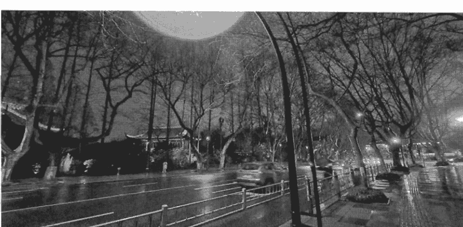

## 杭州的雨夜

杭州这番景象，我在湿热的广深没有体验过，成都夜也好，但多分香气江南之美。其实你现在感受到的杭州城，我小时候经历过的杭州城，不是一个圈。2023年3月6日上午，江昂，我和坐在咖啡厅角座位，手指划开地图对我说：“我小时候的杭州城是极小的，只围着西湖这一块，西湖东面是从解放路到街口，是旧城的核心。以前各地城市都很小，本来我习惯以为杭州都很小，但当我对着地图划了下，才发现只有几公里，这里还是很惊：1995年以前的杭州，说是全国最小的省会之一，全市面积43公里左右。”杭州以前就有十个老门：
- 武林门
- 直直门
- 风山门
- 清泰门
- 吴江门
- 湖门
- 曲波门
- 浦江门
- 钱塘门
- 庆春门

十座城门沿着杭州环线分布，修复后的凤山门和庆春门，其他的城门从1959年一直拆掉，现在只剩下石碑，作为当地的地标。江昂以前在上城区江路，就是现在的杭州社区，他清楚记得以前家里的是电影院，家里住在沿街木楼，房间也是木制的，充足很热闹。他以前读过杭宁小学（已拆），每天上学时拿一个锈的铁盒子装学校就吃热了。小学时他常常去爬山、馒头山（凤凰山）、直鸣楼，常常去杭州抓虾。初中读过杭州五中（建兰中学），高中的杭州十四中，大学读的是浙大，是个道土长的杭州，亲眼见证了杭州城史，因此杭州城的发展如此。杭州的现代建设，分为两部分，一部分是治理西湖，另一部分是杭州城的扩张。几乎所有的杭州人，都愿意聊起书记这两个主题，就必须提到王国平。我看了一眼王国的简历，知道这跟我以前过的成都、西安、昆明等关键人物一样，是21世纪转型时代的特殊人物。那个年代刚好进入大建设，以后会遇到这么多相似的人物。王国平从工程研究院任职，除了在嘉兴当过五年市委书记，几乎一生都在杭州任职，2000—2010年杭州市委书记，在这段时期内完成了杭州的两大建设。王国平的父亲叫王义，四川达州人，也做过杭州市副长和秘书长，因此杭州人都告诉我，王国平对杭州的感情很深，还给他取了个绰号叫“苹果王”或者“Apple王”。因为我杭州朋友很多，其实在世纪1世纪讨论对杭州的影响。先说他治理西湖的往事。王国平治理西湖，其实是他的前任书记魏德完成的工作。1983—1987年，厉德任杭州州市，他在那时就开始了还湖于民的工程。西湖最早并不是开放的湖，而是由居民及各个权力部门的，当时叫“半西湖半西湖，都是官家”。20世纪80年代，西湖环湖路内280公顷区域范围内，有80多顷是部队、机关、疗养院、企业、工厂占区，建筑彻底乱七八糟，大华饭店部分、省中医院宿舍、省法院、统造部、其他单位及商店占了西湖的边边角。而且当时的西湖是有水的。”吕锦坤说，“20世纪90年代的西湖接近死水，水质很差，比较浊。2006年，城的河道黑黑散臭，西湖上的小溪也被生活垃圾污染，这些水汇流到了西湖。1983年，杭州州市政府决定拆掉西湖各种围墙，厉德和市长要求召开还湖，还湖于民，大规模建设。西湖边各处都是属于国家的单位，要一一拨不容易，而且原先绕起来以前每年有200万元的投入，大家都毫不舍得。离开了西湖的单位，还湖初多次尝试，开放西湖四大名庄的王庄和庄庄，这边流量引起了很长一段时间，2000年后西湖王庄和庄庄才有限开。等到2003年4月，王国平上任后，西湖沿线处公园才算面向市民开放，也是中国第一个不收门票的景区。现在西湖已经变成了老态，把塘的水引入西湖，换来的水变净了，流量调度，一个月更新一次。后来西湖开放的种种功劳，都在王国平身上，厉德是不可能的。我现在见的东西，为了静悄准备了许多三代努力才是可能的。当然，王国平对治理西湖是有功劳，他接替了厉德。

杭州带来的不仅仅是西湖。他在任时，恢复了西湖，将杭州到了这个关键位置。在全国省级城市中，城市规模从第一上升到第五位，人口从上升到第六位。杭州作为长三角城市，仅次于上海的第二大都市。对于此次扩容，余杭没啥，反正余杭一直在杭州眼皮底下“小哥”，几年都有了，愁个名字的事。是萧山有了。前面提到的湖州、嘉兴，浙北是杭州，萧山属于宁绍，南部属于宁绍，萧山属于归绍杭州，1999年又归杭州为县级市。萧山人说跟绍兴杭州啥区别，几乎一样，他们由于2000年，他们默认自己跟绍兴同宗。因为杭州是南方都，吸收了北方的化，比如老城门的。语好好跟萧山早就不是一条路，两边也显得不亲切。在萧山看来，杭州是后妈，绍兴是亲妈，后妈就是比亲妈生些。宁波大部分居民的临杭州，他们认为自己是绍兴人。浙江江苏一样，万康禹人不说自己是金华人，路桥、黄岩、江帮人不说自己是台州人，青田不说自己是美丽人，海宁乡不说自己是嘉州人。不说自己是台州人，青田不说自己是美丽人，海宁乡不说自己是嘉州人。浙江这种散装形式，容易给我们外地人造成困扰，我以前一直以为萧山是一个单独的市，直到地理上才知道它是金华下面的一个县级市。萧山不是杭州不仅仅是文化的原因，以前两边的经济差异很大。外地人知道萧山从改革开放后还没有特别好，镇企业发展强势，年均增长速度超过10%。20世纪九十年代，萧山是浙江第一强，20世纪90年代到21世纪初期，萧山还是全国十强县，拥有大量的日企业。萧山人有钱，看不起杭州，越不想入杭州。”一位曾告诉我，“进入21世纪十年代，萧山开始下坡，我以前上班的单位，2013年，有时候发工资。2014—2015年，常发不出年终奖。萧山和江一直有权之地争不清，又一年还跟萧山财政困难，给了萧山5亿缴款，从以后，萧山也不意思跟江这块地，这块地就归江了。那萧山突然要落了呢？没特殊原因，就是产业落后了，重耗资源的产业搬出了萧山，财政也就跟着。萧山后重新融入杭州，主抓新材料和智能汽车，在发展上也不好。按2022年的数据，萧山纳税3亿元以上的企业有3家，纳税1亿~3亿的企业有27家，纳税5000万~1亿元的有49家，纳税3000万~5000万的有54家，纳税1000万~3000万元的有237家。这位公务员对另一件事旧犹深刻。2016年以前，杭州的房价还平实，普通房2万~3万平米，萧山大约是2万。杭州房价疯狂涨40%，到一倍，萧山大约是1万。2019年5月，这位公务员终于在杭州一处小区买了一套房，花了100万，接手时已经涨到了200万元，房价眨眼就跳上去了，让人绝望。2024年，杭州房价回到了，普通人难以承受。萧山、余杭入市区，杭州可能从中心向西湖向塘江推进。以前城市重心向西湖，空间小。为了同时做好环保，王国平在任时，将湿地保留下来，设立国家级湿地公园，杭州城市扩张。2016年，从武林搬迁了，杭州全市面积484万平方米，滨江沿新建住宅、商业、教育、医疗开始发展了。塘湖沿岸从杭州滨江，最初是仓储码头，没有航运功能，技术园区。金融、会展、商务办公重新聚集。杭州人人都聚，还是热爱西湖。每年观潮都会死，杭州在2024年，每年吸引40万年轻人，变成以阿里巴巴为核心的互联网城。目前两座GDP破亿、三座破万的城市，从上海、北京、广州、成都、香港、苏州，这十座有钱城市里，杭州是最最好的。人间天堂。我以前提到过，南方地区是中国最好的一块，大平原、长江入海口，毕竟南方达到了“通江达海”四个字的巅峰，在全球化时代，作为工业基地，浙江地区其实大体离南方只是靠江，只有宁波一个大港。温州、台州老乡带来的海外资本，使其算上了富裕生活。人生在江南是幸福的。第一次到杭州出差是2010年的夏天，白天随朋友逛到杭州郊外看到当地村民的别墅，就觉得精致如此是岭南地区少见的审美产物。景区散步时，朋友指着各种老房子和寺庙说这个宋朝的，那个明朝的，好像遍地都是古迹，比起广东工业区的湖南小乡既羡慕又妙。我们在杭州过马路时，人站在路边等待，车子主动停下来，司机友好地招手示意我们先过。那是2010年啊，我在广东从来见过车让人，后来全国各地也是慢缓车辆主动让人的文明礼仪。浙江给我的体验，是物质文明走在前面，精神文明也走在前面，既有美景又有古迹还有新兴科技。这不是天堂，这是什么？能成为一名江南人，就是极其幸福的事。愿意成为一名江南人，跟每位江南人一样，枕上片春梦中行尽江南千里。（本文写于2024年3月22日）

## 随笔观世二四

## 漫长的财政

### 一

大明朝建于1368年，每朝开国第一大事就是稳定财政、巩固财源，开始向全国收税。税收主要收的是农业税。我在《魏忠贡与全球化》里列举过万历六年（1578年）的财政数据，当年国家财政总收入为2652.7万万，农业税占2080.2万，工商税占23.8万，杂色收入占348.7万，农业税对国家来说为重要，占到全国总收入的78.4%。现在稍微过一点教育的人明白，搞农业日子过得苦苦的，风险高又不赚钱，要收税就要搞活工商。他们收税才是根本。万历六年（1578年），工商税占全国总收入的10.7%；崇祯初，农业税比例上涨到81%，工商税只是占16%。明朝为什么工商税这么低呢？朱璋重农抑商，凡农民不种耕跑去经商，就被当作游手坏的流，政府必须把他们抓回来。

文官集团其与朱常洛没有那样的交情，他们之所以出祖用来压万，主要看起来并没有多大意义的语权，其实是一种权力的宣示，是向对方表示“我有办法对付你”，这是皇权和文官集团的一次对抗。万历最后战败，标志着文官集团的力量至少在某些方面确实涵盖了皇权。

朱瑗怎么没想到，他用来维护皇权的祖制，最后也是文官们用来对抗皇权的工具。而不甘心政治权力对抗失败的皇帝，就自然愿意培养太监和锦卫，他们出去压制文官集团。

## 参

其实不是皇权，还是文官集团，权力做得太大，都不一定是好事。皇权做得太大，想的是如何盘天下满足个人私欲；文官集团做得太大，想的也是如何盘天下满足足私欲。

朱璟和朱棣都是在战场上出生入死的人，他们没有偏爱文官的嗜好。明初时保持着皇权加武将集团压制文官集团的格局，皇帝直接控制武将，武将掌控五军都都府，若是皇帝则是直接掌握权力机构的。

这个世界的底层的是暴力，暴力在恶人手里可以破坏事物，在善人手里可以为善。但明英宗朱祁藩一脑热，搞出土木之垒，将武将集团全折在土木堡。五军都曾从此无名无实，兵部掌控了军队，皇帝从掌握最高权力机关变成文官共共享军权，这以后天下大事，多少也跟文官集团商量来了。

文官集团还是利益共同体，从永乐到崇祯，闽臣164人，浙江、江苏、江西占了50%。皇帝对付一个官员容易，对付整个文官集团就麻烦了，总不能把公司上下从CEO都全杀杀了吧。

你杀掉一个，上来的还是他们的人，因为选拔人的队伍他们也被包围了。被万历皇帝贬罚的阉应答，离开中央20年，朝廷还有人跟他他说，希望应答麟可以回京。万历赐走一个，一来另一折子，再来，再来另一折子，文官们是利益共同体，根本毫不畏惧，反正自己出来些做什么朕，都有人理事他。

现在大家都理解了吧，万历为三十年不上朝，光是太子这事，跟群众激斗，都退了内阁四任首辅，一百多朝廷被罢免官、解职、发配军，最后万万里都是惨败，换谁心里头都不舒舒服，这种事坏连不断的，死不死不休，皇权老斗不过文官集团。

基于皇权越越弱，文官集团越积累强大，大明就产生了一个奇怪的现象：税，越缴越少；国家财政，……

从明朝后期，工业逐渐发达，这时候国家的重心应该从农业税转收到工商税，只要工商税收得上来，那就有银子练兵，改革后的军户制度；兵一练好，西南和东北的外敌都不是问题；国家出现灾荒之时，有足够的银子聚振兴，也不会有李自忠这样的走投之去。内忧外患，一切都是财政问题，一切都是因为我们收不上工商税。工商税收不上来，是因为有人故意阻挠，阻挠的这些人，正是仗着“祖制”和“藏富于民”的文官集团。当资本和文官集团紧密绑定的时候，就是大财政枯竭的时候。也是天下大乱，重新洗牌的时候。

## 肆

今天，我们说明朝的转向，必归于党争——说起党争，就是阎党大战东林党。其为了争财政，是皇权大战文官集团，阎党是皇权的延伸，东林党是文官集团的延伸。而且阎党和锦衣卫也有失控的时候，文官集团不仅有东林党，是齐党、董党、党党、宣党、跟党东林党混战，东林党在极击案、红丸案、移宫案三案中闹出，于天下之间成为第一党。所以任何事情都有内部和外部矛盾，两种矛盾都要抓，两手都要硬。我们常常认为，东林党与浙江士绅集团绑定，是促使工商税收不上的主因。

## 明简篇

这种观点并不完整，明朝后期是有几个不纳税的超级资本集团，第一个重要的，确实是江南首富贵士资本集团，另一个晋商走私贸易资本集团，再一个就是明朝内部的官僚资本集团。

明朝九边重镇中，以山西省的大同、广宁两镇驻军最多、军储最厚，但这里气候太冷，不适合屯田。为将士专享屯田，为了解决戍士过饭问题，1370年开始实行开销，将盐的专卖（盐引）交给山西商人，由他们运粮食到边疆，再凭盐引指定发放食盐，到指定地区销售。

明朝中期，后期出现严重腐败，晋商同明朝中层贵绑定，共同以盐引利权。1492年，皇帝改革，将开中制改为开中折制，晋商受到打击，但与北方蒙古和后金做走私生意。晋商虽是踏陆商人，规模不大，而明朝后期控制东江、闽一带的海商人，规模远超晋商。

当然，我们集团不包括南方湖士，毕竟西班牙人来的白银，这些后流向了他们，货币价格高得离谱，断了半个朝廷。

这个世界的底层的是暴力，暴力在恶人手里可以破坏事物，在善人手里可以为善。但明英宗朱祁藩一脑热，搞出土木之垒，将武将集团全折在土木堡。五军都曾从此无名无实，兵部掌控了军队，皇帝从掌握最高权力机关变成文官共共享军权，这以后天下大事，多少也跟文官集团商量来了。

内忧外患，一切都是财政问题，一切都是因为我们收不上工商税……（此处为重复逻辑）

明末，整个社会充斥着戾气，不动就打人。整个社会扭曲了，人们不相信权威，只相信市井言论，走向了全面暴力。开明末的历史，到处都是残酷事件：官杀人、李忠杀人、张献忠杀人、军杀人，华夏一片血。而这一切的源头，都是财政崩溃。

（本文写于2024年1月24日

### 严嵩

很多人熟悉的大臣严嵩，嘉化十六年（1480年）出生于赣州安宜县桥村，这地方现在属于江西省宜昌市，安宜县是当地的地级市最小的一个。严嵩出生这一年，环境贫寒，家里家资有限，父亲是一个农村破落，一边赖此生存，一边把教育放在儿子身上。严嵩读书，从小就知道他是个天才，当地县都很爱惜他。严嵩中岁中举进士，还是第五名，属于国家级宰相。但严嵩刚到翰林上了三年，就因为母亲去世、一场病一场回家退休了。

也有资料说严嵩有脾气，28岁时性子，看不惯宦官刘瑾，回家读书了。等到36岁，刘瑾请他才回到翰林院继续上班。他主要工作的地方是南京翰林院。明朝南京的官员一个个都是清鸿寡水的闲散，严嵩在南京待了几年。严嵩准备这几年退休了，不料45岁时，被调到北京做都监，开始进入权力中心。50岁时在北京见嘉靖后被宰，成了北京的礼部尚书，开始频繁，此后逐渐得势，68岁为首辅，曾持国政十五年。

五百年后，有些世人提到严嵩时，有些咬牙齿，将其铲除，也被评为明朝第一奸，当地都不好意思提起他的名字。其实对严嵩的人有一些一样的看法。现在严嵩的历史，原始的出处都出自《嘉靖以来首辅》中的《严嵩传》，后面《明实录》和《明史》谈严嵩，都是以此为底稿。作者王世宪跟严嵩有过很深的过节。王世宪46岁入仕，已经是67岁的老人，第二年就要首辅了。王世宪的父亲王练在总任上因闯事被处死，王世宪认为父亲的死跟严嵩有仇，要把政敌严嵩立传，哪里会有好处？他写书时，严嵩已去世多年，没有任何话机会，后面若干几年是不可能有名声。

大家误会，我不是替严嵩翻案，我并不认为严嵩是好人，也对翻案这件事没有任何兴趣，我只是说史料的一些观点。由于年代太遥远，史料难免有些个人的情绪，我们太久的历史，都抱着“宏观框架信，细节不信”的态度来说的，别人写什么我不会轻易就信，而是对照信，临时信。那么，关于严嵩的这段历史，到底应该怎么梳理历史的宏观框架呢？

## 贰

严嵩这辈子，是被枉钉在“奸臣”这个标签上的。奸臣嘛，杀忠良、欺弃、贪贿、掠民女，这种事没少干，才会称其为奸。严嵩只是奸臣的一个代表，还有厉崇、秦穆、和珅等，构成了中国历史上一脉相承的奸臣体系。

但问题是，不是严嵩的主子嘉靖，还是和珅的乾隆，没一个是不吃饭的，而且特别擅长揽权，是办公室政治的宗师人物，以这两位主子的聪明程度，怎么知道自己下面有奸臣？他们是知道的，他们比谁都清楚，他们就是故意的。把奸臣的爬升炼成清单，是某种后思维的投机。

严嵩是全国级的学霸，法书一流，诗词辞赋，尤其写得气宏气盛，权力雄才博大，他给颜广疆的“至堂”，到乾隆时期都不得换。和珅精力极好，能随口古出《孟子》的注释，平时事利干净，又精通汉、满、蒙、文字。

严嵩和珅办事都是一流的，嘉靖和乾隆选择他们是为了办不方便的事，通过让他们回馈了。什么是皇帝不方便的事？我们的历史书通常这件事说得复杂，有些研究人的，有些老百姓，这种误解，这些后，这些后，这些后，钱够了。

中国百姓一直有一个误解，就是“天下都是王的”，其实天下都是皇帝一个人的财产。严嵩的土地，这些后流向了他们，货币价格高得离谱。……安宜县是当地的地级市最小的一个……（此处为重复数据修正）

| 财政项目 | 预算金额 | 实收 | 实际支出 | 超支 |
| :--- | :--- | :--- | :--- | :--- |
| 嘉靖三十九年 | 3980万 | 4536.7万 | 5380万 | 1400万 |

超支主要由两部构成，工部和兵部。1400万的超支，看起来是工部、兵部花出去，但很多跟嘉靖有关。兵部超支300万两，有10艘大船为修宫殿运木料，还有20艘大船运茶叶、瓷器，从京陆河运京城，报的是兵部的账，其实都让嘉靖私自花掉了。史部超支450万两，户部超支650万两，这里150万两是修河堤用的，还有400万两是给皇帝修殿宇买上的木料花掉了，跟工部没任何关系，负责监管的都是皇帝。

老百姓交给大明政府的钱，原来是用作政府正常运作的，却被嘉靖给办法私吞了。这种“肥活”要是传出去，嘉靖将毫不起人。但是皇上是君父啊，嘉靖是非常非常要面子的，沈一石打着敛的幌子去买百姓的，那就是给他君父露脸，嘉靖会毫不犹豫地毁了沈一石的脑袋。但沈一石精确计算自己的命运，他知道自己死无恙，是打着买田的名义，拿着“嵩启霸”的反转，满天遍。万顷田这么大的事，那么多百姓，杨金宪和姬婧创造空间，嘉靖底根没人，他只关心自己的心，关心自己的面。皇权虽不能直接掠夺财税，那就需要一个人、一个组织来搞这种“肥活”，这种人，还要能力。这就是后臣诞起的，是严嵩、和珅存在的理由，才是整个明财政最大的毒瘤。明朝财政是一个老难题，只收农业税，收一点点工商税，把国家限制了，而且越后，国家就开始衰败，越难收上来。

## 李白的白与

开元十三年，即公元725年，25岁的李白来到了江夏（今湖北武汉）。

李白打小在锦州（今四川成都）长大，父亲是一位有名有钱的商人，因此可重金投入家庭教育。李白从5岁开始读书，还报了许多兴趣，学习剑术、纵横、兵法等，其中剑法尤为不错；15岁时、18岁时，在四川省内到处乱窜，将名山大川都跑遍了；24岁时，乘船沿长江出发，开始离开中华。

当他到达江夏的时候，已经在外面跑了一年，花了30多万钱。那一年一头粮食20到30万，一斗米10万，30万相当于2023年的30万~50万元人民币。一年在外面旅游花30万50万元，说明李白是比较富裕的，但大富之家还算不上。

在唐朝，人的社会地位低，《唐律》有规定，违法者和工商子弟都不能参加科举。此，他还是人这件事的，李白一直不好意思出口。而且李家在西域已经活了好几代人，他父突然万里远徙回四川，有点不清楚的，好像有什么情结，所以这一生，在朋友面前，李白对自己的世家几乎只字不提，别人再起源就胡乱乱其诗。一直到他死后，李姓李的名字才出现在李白的文缘之上。

与传说中洒脱趣味性的形象不一样，李白一直想当官，有非常强烈的施展抱负的愿望，诗当官才是李白的终极目标。

因为无法通过科举入仕，李白十分困苦，他眼前还有三条路可以走：从军、荐举、终南捷径。

从这么严肃的事情，只适合朴实内敛的，显然不适合欢快的乐坛小王子李白；而那个终南捷径，指的是跑到长安终南山上隐居，将自己包装成世外高人，以图获得还朝贵的赞赏，谋个一官半，这种商业操作李白多是可以的，但他死得起，没有人替他盘算，这法行不通了。

李白之前，就只有荐举这件事很有趣了：写了漂亮文章，就去当地的领导面儿，把文章递过去，领一个首许：“小子你有学吗？是个好苗子，我给皇帝和中书写信荐你吧，你先做个秘书，以后就跟我混。”

在电影《长安三万里》里，李白从洞湖到高高山上，人跑到江夏，就去找当地官员，将自己的“大赋”递过去，结果他是商人，东西被扒出去，还遣了廷卫。

李白疑惑了，荐举制度并不是用来选拔大众的，它不是权贵阶层内的游戏，而是有权后代有资格获得亲友荐举。李白身为商人之家，强行抱官员大腿，在当时确实没有自知之明。

李白不甘心，他很多时候去世了。在争夺豪家时李白落魄，他就突然变老了，“一朝马鞍换，百金黄金场”。这时候当了官的，要不作工作，吃饭都是问题。

为了不沦街头狗，为了入了豪家门后得到升举机会，李白27年时在茫茫洛州的介绍下，在前辈相许下，和许衡的孙女许婉结为夫妻，这才有了新的来源，保证他后面能够继续巅峰全国。

这时候的许家正处于中落阶段，当然他们家不中落也看不上李白，许家让他过上富家公子的生活，衣食无忧是没有什么问题的。

李白原本想借许家的影响再次被举，他拜求过当长史裴嵩，疯狂地跑马尾，在终南山偶遇道王公主，还在长安城做过门客，求过不少王公主，却没有一次成功。

38岁那年，李白夫妇患病，中年时李白离开了许家，带着女儿回到安陵湖南陕。

李白此时诗歌传天下，已经是一个超级网红了，在那个年代写诗不能变现，只能保证全国各地混杂没问题。李白还是想当官。

李白白日跑马，也知道唐玄宗爱道教，从虚禹公主下手，缘升将李白的打扰了早早已入道的道公主。经老老前辈《乌太仙人词》递给唐玄宗后，终于打动了早已入道的道公主，见到了唐玄宗。

唐玄宗很喜欢，却只认可他写文章的能力，赐他了翰禄供养，成了一个御用人，平时来消解闷。

李白还是没考虑到政治改革，继续苦钻，跟老老板有了冲突。一次，唐玄宗让他起文章，李白假装装闹，非要高士给他脱靴写，这种捏捏捏的作风惹恼了，大家纷纷纷纷在唐玄宗面前藐李白。唐玄宗也不受了他的狂傲，便让他悄悄出世，他辞退了。

李白看着遣费贵，唐知道高名的招牌，又起起了旅游生活，44岁那他来到洛阳，给杜甫写诏。44岁那他来到洛阳，给杜甫写诏，才认了高适。

李白与高适多岁相识，《长安万里》是为了方便事务，高适为选用线，让他们提前了。李白与高适多岁相识……

（此处重复关于李白落落的描述，已按逻辑合并）

为了不沦街头狗，为了入了豪家门后得到升举机会，李白27年时在茫茫洛州的介绍下，在前辈相许下，和许衡的孙女许婉结为夫妻，这才有了新的来源，保证他后面能够继续巅峰全国。

这时候的许家正处于中落阶段，当然他们家不中落也看不上李白，许家让他过上富家公子的生活，衣食无忧是没有什么问题的。

李白原本想借许家的影响再次被举，他拜求过当长史裴嵩，疯狂地跑马尾，在终南山偶遇道王公主，还在长安城做过门客，求过不少王公主，却没有一次成功。

38岁那年，李白夫妇患病，中年时李白离开了许家，带着女儿回到安陵湖南陕。

## 为什么李白不到重用？

在唐朝，李白无论如何努力，都不可能得到重用。唐玄宗的科举是为了见证多样性，李白作为一个平民，就算参加科举中了进士，大概率也不可能重用。从隋开始科举，唐朝继承了隋，录取人数较少可见，整个唐朝开科273次，总取845人，其中进士662人，秀优29人。直到宋末，向平民阶层大开，北宋一路录取了高取率。唐时的政治宰层，是被大家族垄断的。科举与荐举制度，说明李家是为世服务的，荐举不起，平民举完全是世家垄断的内部游戏。唐朝时，门阀众多，其中五六就有大族。唐时的士族家族，他们家族技能就能谱研究，从西晋开始代人专门研究，总结了大唐门阀的地位。李人在时期达到巅峰，写出《氏论》，将晋以来的谱进行汇总。由于这些家族已经经营许久，我们没有必要去详细，这里只取《氏论》部分统计数据：这些名门旺分成五个群体。

| 区域 | 族群 |
| :--- | :--- |
| 中东地区 | 京禹氏、京柯柳氏、京兆丰氏、弘杨氏等 |
| 苏州地区 | 吴杜氏、吴陆氏、吴郭张、吴郭顺氏等 |
| 代北地区 | 代州（现在山西）河南氏、扶夷窦氏、河南长氏、河南宇文等 |

在这些一线族里，又有“五姓七霸”大姓，是精英中的精英、贵族中的贵族。从唐高宗开始，为了防止这七族越权，只能从法律上强制他们相互交往。这七族分别是：李氏（皇家）、赵郡李氏、博陵崔氏、清河崔氏、范吕氏、郑阳郭氏、太原王氏。其中崔家和李家各有两大分歧，而且崔族势力极大。史侍部高士疆撰《氏族志》，按实际要求将崔排第一，李非很高，认为大抬举这些家族豪族了，在皇家面前呢？高士疆妥妥将排名修改，将李家排前两位，崔仅后排第三。

魏家在整个唐晋，博陵崔出了15个宰相，清河崔氏出了12个宰相，脚注26人，五品上以上官员多440人。不怎么出名的东河氏，从西晋到唐，出了59个宰相和大将军、55个尚书、44个侍从、211个史中、77个太史、21个酷马、20个公主、3000个以上官员等。这些名门望族，是古代中国的一次历史沉淀。以著名的崔氏为例，他们祖祖上是子晏窦一条，一直是山东东侯晋的贵族层，中后后人不要姓复，另姓在山东“崔”家（今山东东平市），自此改姓崔，家族一直在唐朝直到秦末。两个儿子，长子清河崔，次子博陵崔，三子太原崔。

## 十大节度使与安禄山

唐朝十大节度使，分辖河西（陇右、朔方）、东北（范阳、河东）、西北（陕西）、四川（岭南）。都能出来，西北东北势力太大，一个节度使管理的如果有一个地区，就形成了可怕的反面条件。安禄山可不可信，应该是范阳、河东某一个人的问题。

- 河西地区（陇右、朔方）：领兵73万。
- 东北地区（范阳、河东）：领兵55万。
- 西北地区（陕西）：领兵24万。
- 四川地区（岭南）：领兵75万。
- 剑南节度使：领兵44万。
- 淮方节度使：领兵6.5万。
- 平湖南节度使：领兵3.8万。
- 岭南节度使：领兵24万。

李隆当然知道，他比谁都清楚这到底是什么后果。我以前说过，如果我们看到了大家都认可的奇怪矛盾，那一定是为了掩盖更大的矛盾，不得不做出的妥协。我们看到的很奇怪习俗，都是人类早期对生存环境不得已的举措，文化传统继续下去。李隆基用东北胡人安禄山，看出他在中原没有根基，胡人身份又不高，专门提拔抗关军事贵族和山东豪强。隋杨广和唐祖李不是亲兄弟，而是唐杨李家祖先都是北周重臣，这个意义就是关陕军事贵族的一部分。唐之间的交接，其实是关陕军事集团的内部权力流转，李靖、长孙无忌都是关陕集团的成员。武则打压过关陕集团，收获长孙无忌，但其实实力十分强大。不要单一地以安禄山靠拍马就能成功，这种政治手法在领导眼里是无效的，将军的视野和贵族自信不会被简单的手段撼动。李隆信任安禄山，是因为他的敌人越大，势力也越大。李隆基对自己的这项操作还有很有心的，他以前任命王忠弼兼陕西西、陇石、明方、李四四将，安禄山还有一个自己有实验经验的，相信自己有这个能力，可以镇住安禄山。李隆基选拔胡人薛实，采取安禄山是一个道理，而且薛实留西北，安禄山留了一手。这次李隆基玩坏了。玩坏的主要原因，是安禄山最后和李白这种不得意的平民精英形成了合流。唐朝时候，由于战争需要，以及兵源的破产，给了度节使极大的权力，他们拥有了军权、财权、政权。度节使可以使用征税、考核官员，渐渐成了独立王国。安禄山任湖节度使、淮节度使、河东节度使，常年无人替换，三镇上官下兵都是他的心腹，渐渐成了东北大王，拥有大唐分之一的兵。而像李白这样的平民精英，在中兴政治核心圈，正遭到二十八门门的疯狂打击。

你想参加科举，要在国子学、太学、四门学、律学、书学、算学六高等读书，相当相当于今天最好的六所大学。对出身严苛：
- 国子学：三品官员。
- 太学：四品官员。
- 四门学：五品官员。
- 律学：六品官员。
- 书学：七品官员。
- 算学：八品官员。

还有地方县学是九品官员。通过身份审查，每年通过科举的九分之一。就算你参加科举，唐朝上的考试是公开的，一看你的名字就能猜出你是豪家的子孙。所以科举制度基本上还是贵族垄断。

## 黄巢之乱

黄巢叛乱的结果，是中国积累千年的二十八大门阀全部被铲尽，记载他们世和族谱一类的东西全部被焚毁，谱学从世上消失，从此以后，“取士不问家世，婚姻不问阀族”。直到二十年后，黄巢突然出现了。黄巢刚出现时，很像是另一个四川李白。他同样出生于富商（孟昌儿子），喜欢诗词，从小很有诗才，五岁就可以跟父亲对话。与李白不同的是，唐后初期终于奢侈人的女儿参加科举。当然，想要通过科举，那还是相当出身。黄巢屡次参考，屡次不中，气得在长安写下：“等到秋九月，我花开百杀；洛天冲过堤，满城尽黄金甲。”回去后他就放弃科举，专做一个军头。八十万天灾，百姓死无数，黄巢头部反了！黄巢每攻一个城，就要杀整个家族和官吏，将城中门尽杀。六年后，深十二月初五的下午，黄军军队进入长安。对于那些死赖经济资源的贵，黄巢毫无怜情，他将三品以上上官全部处死，又因顾公主表面归隐，暗藏令于地下。当时大肆廷杀效唐朝的士子，宰得长安城血流成河。路过的人，需要提鞋避血而去。
