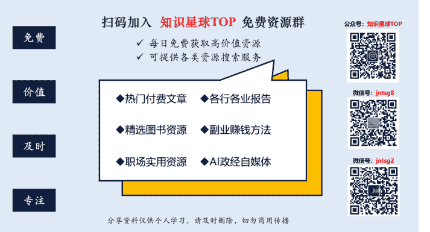

# 周五跌，下周如何
20250614 百年一遇超哥

大盘分析：近期本人反反复，这里是和3417和3413大概完成双顶，哪怕突破也是假突破波没意义，周五也是提早早上6.30就发文说个人观点看周五跳水，结局一样。

那么下周预期总体看我认为先下后会有几天反抽，然后再跃。特别注意6.23日-6.24日附近可能开始加速调整。未来底部时间本人依旧认为下半年，距离目前其实不算太远，一两个月足够，主要看后续调整等因素，这个具体后期我会说，目前谈太早，只能说调整时还早。耐心休息最好。现在有时间可以提前选择好行业方向以及未来反转行情类型比如第一块，上证指数如果未来反转，那么金融系的券保险行业以及优质互联网金融等可能有机会。

- 微信信号：jntsg8
- 微信信号：jntsg2
- 免费进资料群

加微信号jntsg2，免费进资料群

第二科技领域半导体芯片，最近都很弱科技也弱，说明在提前调整震荡中，未来低位时双底4.7日附近或者甚至极端新一下4.7日低位也是底部。

第三块，美元去年我说顶部，持续走，未来周期类型化工有色是不是逐步走强，调整后也是看机会为主，毕竟这个是长线类型。

所以有时间时先把未来分领域各个龙头选好，需要时候选择业绩好位置的不就好了。个人观点，仅供参考，不作为任何投资依据。

