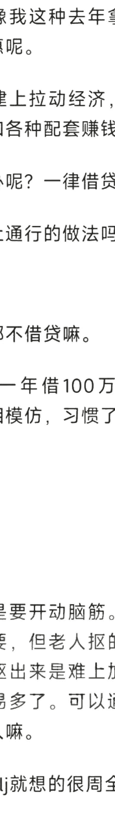

# 理财？可能越省钱越多了

很多人开始学习理财，结果发现钱越少了，通货膨胀让钱越缩水了？

其实理财是一门关于钱的艺术，理财这件事并不很难，但我不知道的是：

（全文1800字，建议你看，不要跳看。）

很多人觉得理财是有钱的人才做的，其实越没钱越要理财。

很多人在省钱的时候会记账，结果发现省钱越高，钱反而少了。但是，发现省钱越高，财富增长的速度就越快。其实我也在建议，理财不是为了让财富的增长，而是为了让大家实现财富自由的重要技巧。

# 创造财富：

很多人觉得创造财富就是赚钱、存钱、投资，其实，这只是其中三个部分。

你想要打破贫穷的“入魔循环”，你发现要做最重要的事了：

很多人掉进了消费主义的陷阱

> 《省钱》里我们看到：以意志力，越省越痛苦。

这就分为两个部分：

对于有钱的人来说，理财是增加财富和扩大杠杆；对于穷人来说，理财是摆脱困境、改变命运的机会。

如果不买车，每年省下几万块；如果不买房，每年省下几十万甚至上百万块。

但是你不买车，你觉得快乐吗？你不买房，你觉得不快乐吗？

但是你买车了，你觉得快乐吗？你买房了，你觉得不快乐吗？

这就是消费主义的逻辑：

## 知识星球TOP

添加微信 付费资源分享群 免费入群

微信: jntsg2

| 序号 | 公号/星球/社群 | 原价 | 领域 |
| --- | --- | --- | --- |
| 1 | 生财有木 | 2765/年 | 副业、搞钱 |
| 2 | 容从容吃群众 | 365/年 | 时政、历史 |
| 3 | 记忆承载/骏树西风 | 365元/年 | 成长、搞钱 |
| 4 | 欧洲金靴 | 328元/年 | 时政、历史 |
| 5 | 卢克文青会 | 699/年 | 时政、社会 |
| 6 | 体制内主任 | 599/年 | 体制；职场 |
| 7 | 外人的视角 | 669元/年 | 金融、时政 |
| 8 | 濑泽异谈 | 4166/年 | 财富、成长 |
| 9 | 守夜人总令 | 599/年 | 时政、经济 |
| 10 | 江宁知府 | 365/篇 | 时政、国际 |
| 11 | 政堂/顾子明 | 568/年 | 时政、经济 |
| 12 | 唐书院 | 1399/篇 | 金融、财富 |
| 13 | 大树乡谈 | 199/年 | 时政、成长 |
| 14 | 水库欧大 | 10000元 | 房产、经济 |
| 15 | 洪灏的宏观策略 | 4376/年 | 经济、搞钱 |
| 16 | 金政通鉴/北海道山 | 4576/年 | 股票、行研 |
| 17 | 猫留的世界 | 299/年 | 时政、社会 |
| 18 | 飞沫 | 3600/年 | 股市、经济 |
| 19 | 米联储见闻 | 599/年 | 经济、金融 |
| 20 | 鉴茶财经院 | 330/年 | 房产、股票 |
| 21 | 赢在八小时之外 | 365元/年 | 成长、职场 |
| ... | ... | ... | 更多资源，不再列举 |

- 图书、报告、课程等各类高价值资源
- ★ 免费群 每日分享份资源
- ★ VIP群 每日分享所有资源（日均20+），75/年

## TOP级资源 TOP社群
