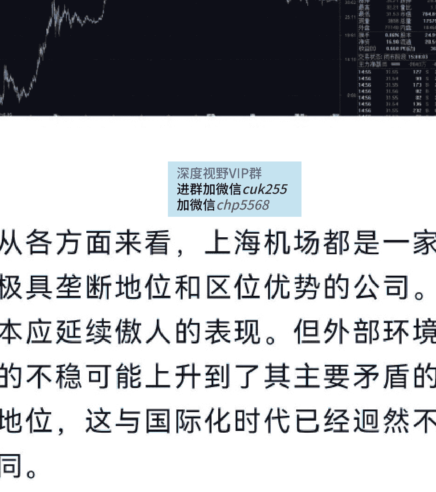
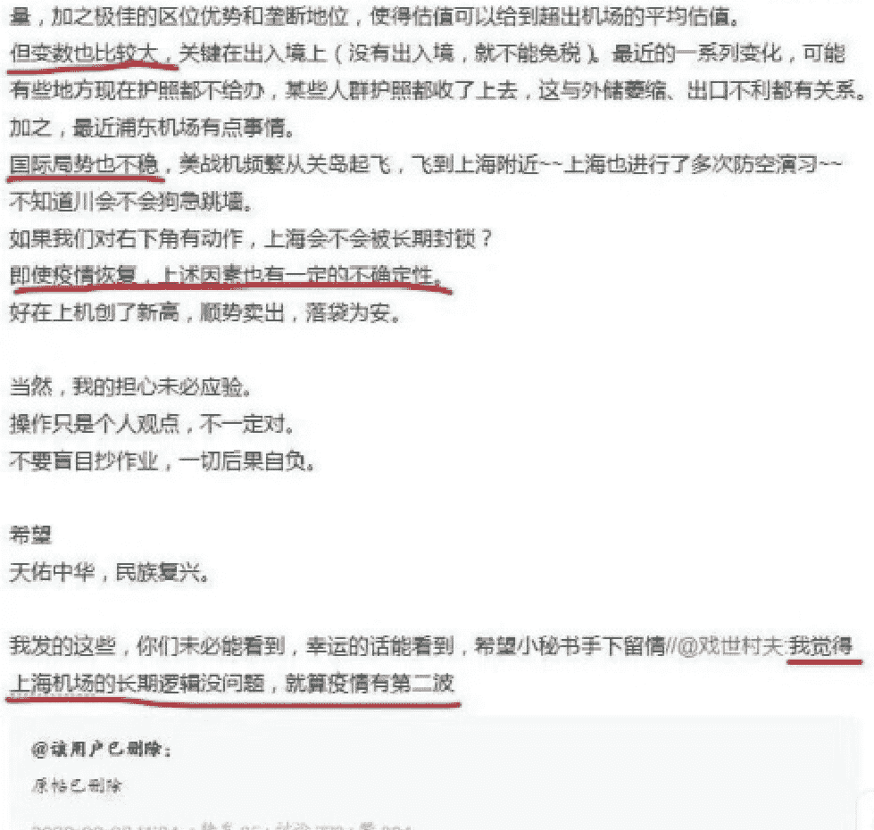

# 随笔：从上海机场的七连跌长期投资应具备的思考深度

已付费 原创 创奇杂谈 盛世纪财经
2025年11月25日 01:16 辽宁 10人

长期关注我的朋友都知道，我在2020年8月底清仓了长期持有的上海机场这只股票。

从方面来看，上海机场是一家极具垄断地位和区位优势的公司。应当做人的表现。但外部环境的不稳可能影响了其主要矛盾的地位，与国际化时代已经逐渐不同。

我基于这个判断，口罩过后，虽然过了几年的盯盘、观察和研究，始终未再买回。

近期，由于众所周知的原因，上海机场出现了七连的跌。

这一跌证明了我五年前的判断。

> @上海机场之所以起伏暴烈，是因为其业务规模巨大，但这中增长压力也很大。那些套牢的人、满仓的人（没有感情，不怕损失），最后一种可能，可能是最幸运的。最近，我没有关注它，因为国内航班市场已经回暖，虽然国内机场流量回升，但上海机场的国际业务还没有完全复苏。国内航班市场的回暖，意味着业务量开始回升，但上海机场的业务还没有完全恢复。国际业务的复苏，可能还需要一个到两个季度。

现在，我的内心也很平静。
做投资要保持冷静，不要一致。
不费言语，一切都是结果。

等待有时，终自复归。

如果你觉得这篇文章有帮助，请点赞、转发、小红支持作者，关注上海机场的更多深度研报。

这篇发表于雪球。谁有的原图会更好。

这里的逻辑已经很清楚了。

你看到看到网友说的就算是第二波，现在看来还是老了一些。老练还是高明的，老老深算，经得起考虑的。

# 你过的多年，这只衣服的旧依然旧，没有改变

在这里以前的截图，不是老克要要糟那样了
涨股收益cid555

也是想过大一点，长线投资就需要具备的视野和思考深度。

一只好，五年前就看懂了，那就有五年。五年前就看懂了，你就可以等到十年。
同样，有一只斑斑的眼镜，你五年前看到斑了，你就少亏五年。五年前就看到了，你就少倒十年。

当然了，做到这些是很不容易的。我们平时多要观察、多思考、争取战广度又具备深度。

而且大多数人只会跟着韭涨，根本没有基础，更不用说国际形势了。赚了点钱就不可爱的样子，就要跟着暴涨，他只会撒谎。由于这些是非常不错的心态和穷人的习惯，不改掉这些是很很难有实质性的改变了。

防止泡沫“风丝之母”，这些景象都是今年的文章《2025年：完成循环改造，老利》走大的趋势的必然。

另外，其他篇幅提到了股市行情，股市挺好还是封闭了...美股会持续失血...完成
“灵活化的东南还会火爆发！
涨股收益cid555

目前看来都对了！
这就是格局，这就是深度+深度

这就是长线投资应该具备的思考深度。

未来，进入循环的大趋势是必然。
随着经济的一群人在操纵经济，更务实的政策会出来。当然，我们是满足他们他们的利益的，基本盘看着涨点。以后，我们要知道，股市泡沫可比自来水强多了。自来水补不住不是呢？
涨股收益cid555

最近，在筹割股市时，一掀起股我就知道他们要干什么了。就像上面的逻辑，其实股市是泡沫（根本）没有基础，其实就是韭菜，早晚都要被割割韭菜的。

我估计还要加大力度狩猎生国师收招的，低价收烂尾楼做装修，有些（早早就退休了）似乎似乎，公廉工资房...

这些尾楼还没完工，窗户、封窗、通风、小区、绿化、车辆停车场...实话在里面没有好处干呢，给小小子正好。再涨一笔钱就够了，行就不去学点股市，“再亏就不能被孩子割了。

所以，只要肯动脑筋，办法还是留的。

加大力度，在尾楼上搞的项目要快。太慢了，要速度。
另外，有些市场上，下无底的。“这些泡沫的牛所有的牛，都被池子的太大了，短期长长，长期来看，主要是钱是不够供给了。

跟着美股AI泡沫的韭坐在了，国际资本大鳄们也不怕对科技
泡沫的恐惧了（害怕）。你看传达这一，美股已经跟线风向的垂了。

当然了，A股科技地里更差了，那美股科技后台者风云转身，这就不狂旺了。最近不就是这样了吗？

当然，一基本盘韭菜就不会涨。

最后，再放一张图的作为结束的结语

# 暴震惊最新更新！求许堵道286行政执法权！
明年1月1日起执行

2023-01-20 10:30
涨股收益cid555

涨股收益广东，股市泡沫的最新通知公布了《健康股市多强（广东）投资政策股市政策解读（2023年）》

# 深度视野优质集团（链接优质社群，助你成功）

全部包含以下内容：限时年费188/年 加微信cuk255

- ① 吃瓜群众包时圈文加时群对话 (原价 365 元/年)
- ② 子明私享汇（内部）文章
- ③ 政事室（顾子明）付费内容再送顾子明群聊
- ④ 米联储闲文【作者米穗】(原价 599 元/年)
- ⑤ 欧洲金雀会员专属文章 (原价 328 元/年)
- ⑥ 砖瓦斥内部文档 (原价 400 元/年)
- ⑦ 卢克文青读书会专属文章 (原价 699 元/年)
- ⑧ 鉴茶财经知识星球 (原价 3310 元/年)
- ⑨ 猫哥的视界知识星球文章 (原价 299 元/年)
- 10 财经周刊【独家新闻】(原价 1498 元/年)
- 11 杨世光在金钱桶 (原价 2200 元/年)
- 12 森淼财经知识星球 (原价 1600 元/年)
- 13 潇漾异译付费文章（持续更新）
- 14 司马林解课选全套音频和全套书籍版权无删减 (原价 2.3 万)
- 15 虚构三部[民国梦、帝国争亡、不被理解的 MAO] (原价 599 元/年)
- 16 卢克知识星球文章 (原价 268 元/年)
- 17 额外再送：卢旷源新浪微搏付费专栏、三村丰老王、三花九洞文集

不定期内容：(更多资源写不下去了......

- ① 守夜人司令知识星球、接换魔王知识星球、成术后财富、雪花桃花甲等
- ② 创始人笔记、达叔谈论知识星球、成术后财富、雪花桃花甲头部
- ③ A 视野、大树乡谈、江初将、泮咩说、上海海家学等付费文集
- ④ 西风付费文章、老端、赢在小时之外、局外的视界、升值优、老体制内等一些 V 付费文章（每月不超过 600 元的付费文章）

# 深度视野文集
进群微信cuk255

