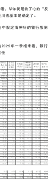
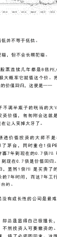
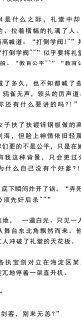

# 股市复盘

复盘：2023年8月25日

截至8月25日，沪指指数收跌1.15%，创近期低点，恐慌情绪再次高涨。

此时，市场情绪依旧低迷，999999.SH连续跌停一天。

从成交量来看，缩量持续萎缩，说明市场内买方意愿极低，卖方也不愿轻易抛售。这种缩量阴跌往往预示着行情可能接近底部，但目前尚无法定论。缩量持续萎缩后，放量是否意味着见底反弹的信号？

目前，市场处于低量震荡状态，大家都在观望。缩量阴跌后是否意味着见底反弹？

这种行情最考验人性，谁能拿得住？

跌这么多，谁不怕？谁不怂了？

看着满屏的绿，心里真不是滋味。跌跌跌，跌跌跌，跌跌跌，跌到心底了。这种无休止的下跌，到底才是个头？

现在的行情，就像是坐了没有刹车的过山车，跌得让人没底。这种连续的跌势，真的让人绝望了。

但是，跌了这么多，难道不反弹了吗？这种行情，跌跌跌跌，跌到这种程度，难道就没机会了？

万一反弹了，难道只是新一轮下跌的开始？

这种行情，到底该谁来受罪？

沪深指数连续5天下跌，成交量持续萎缩，形势依然严峻。
（图片来源：东方财富网网整理）

从成交量来看，缩量持续萎缩，说明市场内买方意愿极低，卖方也不愿轻易抛售。这种缩量阴跌往往预示着行情可能接近底部，但目前尚无法定论。缩量持续萎缩后，放量是否意味着见底反弹的信号？

目前，市场处于低量震荡状态，大家都在观望。缩量阴跌后是否意味着见底反弹？

这种行情最考验人性，谁能拿得住？

跌这么多，谁不怕？谁不怂了？

看着满屏的绿，心里真不是滋味。跌跌跌，跌跌跌，跌跌跌，跌到心底了。

“那银行股的戏该怎唱下去呢?我是不想明白了，你有何高招？”

风清扬微微一笑，淡淡地说：“你都看到了，董姑娘说得对，散户要的不是公平，是他也想搞特殊而不得罢了。这样的人，好摆弄……”

朦胧中我醒了，似乎没睡多久，台式电脑还没出屏保。

# 免费 价值 及时 专注

# 扫码加入 知识星球TOP 免费资源群

- 每日免费获取价值资源
- 可提供各类资源搜索服务

热门付费文章 ◆各行业报告
精选图书资源 ◆副业赚钱方法
职场实用资源 ◆AI财经自媒体

公众号:知识星球TOP   微信号:jntsg8   微信号:jntsg2

分享资料仅供个人学习，请及时删除，切勿商用传播
