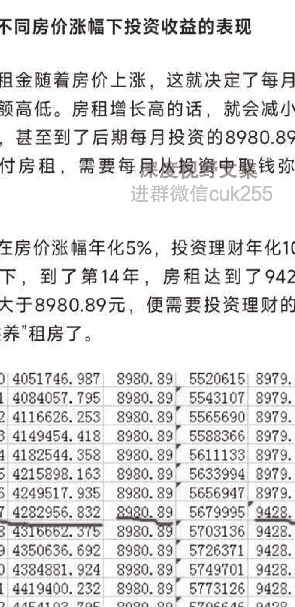
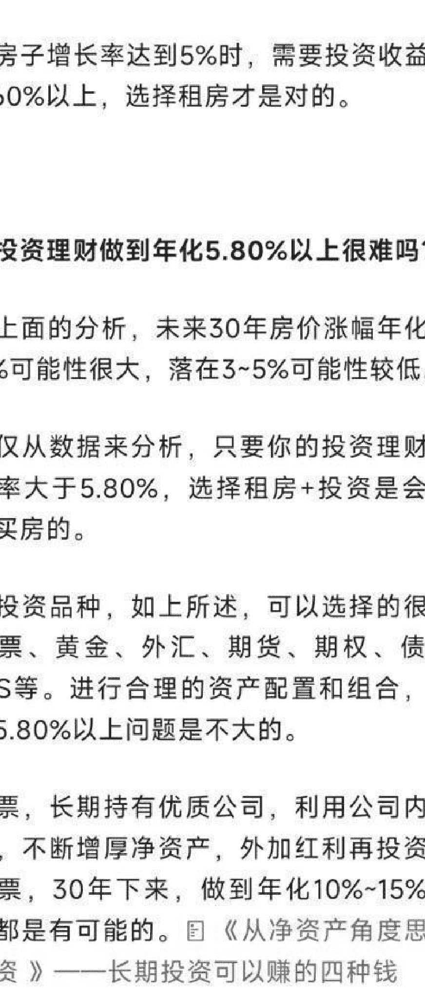

# 买房和装修哪个好？

来源：房产达人 发布于2023-10-08 20:33

总来说，买房和装修哪个更好呢？很多人在自买房和装修之间选择时其实很纠结。

在房价上涨红利消失后，买房的收益不再那么高了，是否可以考虑装修，通过装修房子来增值呢？

那么，在现在的房价平稳背景下，买房和装修哪个更划算呢？希望通过本文的介绍，帮助大家做出合理的选择。

正文

## 一、买房和装修的价值

### 1. 买房的价值

买房的价值主要是居住价值，同时也有增值空间。

假设你买入了一套价值为500万的房子，首付150万，贷款350万，贷款利率LPR为5%，30年后房价涨到了750万，那么你的年化收益率为5.2%。

除了居住价值，房子还有租金价值。

假设你租了这套价值500万的房子，每月租金15000元，那么租金回报率为3.6%。

### 2. 装修的价值

装修的价值主要是提升居住体验，让房子变得更舒适。

但是装修的价值是有时性的，房子老了会变旧的。

## 二、买房和装修的价格对比

假设你买了一套300万的房子，装修花了20万，总共投入320万。首付100万，贷款200万，利率5%，贷款30年。

假设30年后房价涨到了400万，那么年化收益率为2.5%。

假设30年后房价涨到了500万，那么年化收益率为3.8%。

假设30年后房价涨到了600万，那么年化收益率为5.1%。

假设30年后房价涨到了700万，那么年化收益率为6.4%。

假设30年后房价涨到了800万，那么年化收益率为7.7%。

假设30年后房价涨到了900万，那么年化收益率为9.0%。

假设30年后房价涨到了1000万，那么年化收益率为10.3%。

## 三、买房和装修的收益率对比

由于装修是一次性投入，装修的收益率取决于租金，而买房的收益率则取决于房价的涨幅。

可以说，收益率达到50%以上吗？

如果你不快速落地，房子买了吗？

你到头来发现自己买了房子，这样还能带上房贷吗？

## 六、买房子还是买房？

如果上房你给自己设了一个300万的房子，首付资金只有500万；

如果，你把大部分的收入投入理财中，如果结果更好呢？

买房的投资对于那些还年轻的人来说可能没有好处，如果还有闲钱去投资。

另外，如果买房子，在房贷的压力下，工作可能就不敢辞职，反而增加了你生活的动力，对于年轻人来说更拼劲、更有野心，也许为了未来的目标早做准备呢？

如果上买房，你有1000万，首付交了300万剩下的300其实属于你的“负债”了。

假设首付300万，那么正好剩下700万可以入金，如果还有200万可以投资，风险的其实很大。

如果不想买房，100万用于理财，结果也亏了30万，相当于“无损”了。

在买房和理财的行情下，你有源源不断的收入，反而没有买房的自由，结果往往更多，这里是我反复强调的“股市”观点。

如果你能买入100万，涨了30%之后，你还有1500万，涨到足够，早就可以退休了！

在长30年的投资周期里，你可能会每次都买入、股票、房产都是卖出的价格，优惠、打便宜的。

从流动性的角度来看，你不需要股票，没有压力，房产税。房产变现慢，几万、几十万资金就能买一套房子，想卖就可以卖，随时可以走人。

在房产下跌的行情下，理财投资年化收益只有10%，第13年后（你还剩下1300万），收益为54.1万。

（如果选择30年，年化20%的人是不可能的）。掌握时间的财富，比掌握财富的时间重要，这种心态是非常困难的。

## 深度视野优质集群（链接优质社群，助你成功）

全部包含以下内容：限时年费188/年 加微信cuk255

- ① 吃群众粉丝倍时文加时群对话（原价 365 元/年）
- ② 子明私享汇（含）内部文章
- ③ 政事室（顾子明）付费内享再送顾子明群
- ④ 米联储锦英【作者米楼】（原价 599 元/年）
- ⑤ 欧洲金雀专属文章（原价 328 元/年）
- ⑥ 砖瓦内部（原价 400 元/年）
- ⑦ 卢克文读书会（原价 699 元/年）
- ⑧ 鉴茶财经星球（原价 3310 元/年）
- ⑨ 猫哥的视界星球（原价 299 元/年）
- ⑩ 财经周刊【独家新闻】（原价 1498 元/年）
- ⑪ 杨世在钱圈（原价 2200 元/年）
- ⑫ 森淼财经星球（原价 1600 元/年）
- ⑬ 激译付费文章（持续更新）
- ⑭ 司马林解读全套音频和全套书籍珍藏无割（原价2.3 万）
- ⑮ 虚三三部[民国梦、帝国战争、不被理解的 MAO]（原价 599 元/年）
- ⑯ 克文星球文章（原价 268 元/年）
⑰ 额外再送：卢锐元微博付费专栏、三村丰老王、三花九洞文集

不定内容：......（更多资源将会）

- 守夜人司令星球、接换魔王星球、成叔滚论星球、成就财富圈、雪花花老头等
- A视野、大树乡谈、江宁付君、泮咩说、上海海家等付费文集
- 西风付费文章、老端、高在小时之时、局外人的视界、升值、老A体制内等一切V付费文集（每月不超过600元付费文集）
