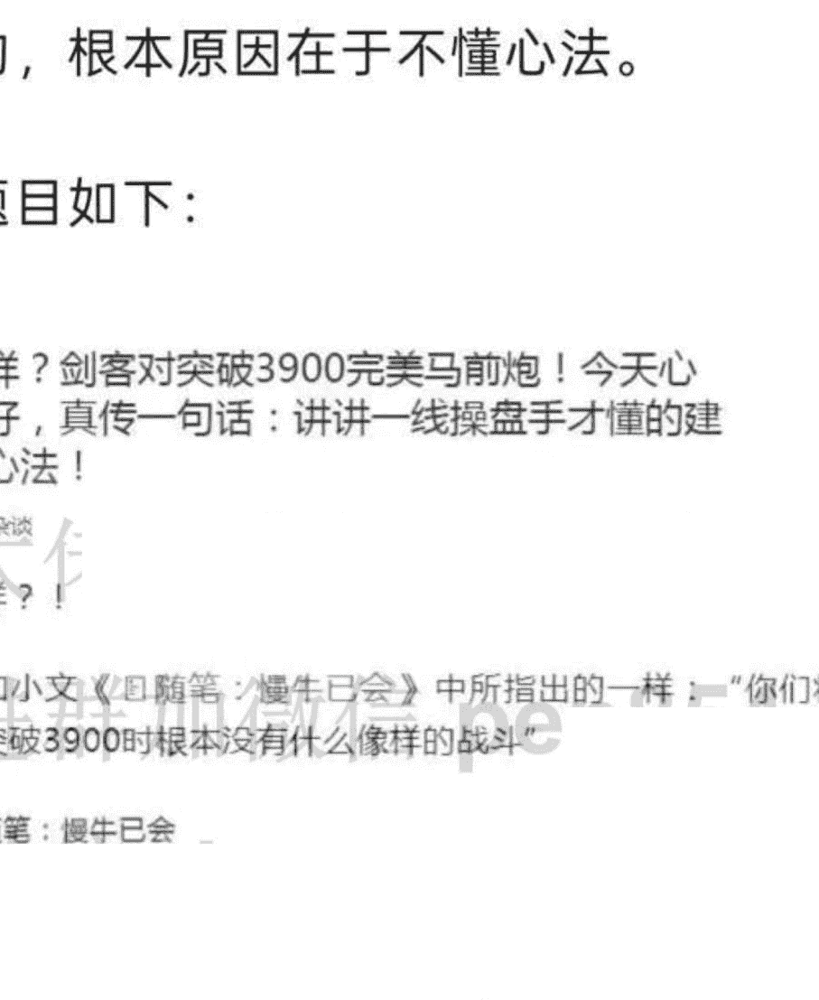

# 咋个？面对被3900点割韭菜后

创业者 发现于 2025-01-10 11:44

咋个？

正文正如《傻瓜》中所指出的一样：“你们将面对被3900点割后身上会有什么样的后果

所谓：傻瓜

咋个？被割了3900点

很多人觉得被割3900点已经倒霉了，还没轮到我被割3900点韭菜呢

- 1. 4100点以上是韭菜，现在的你离割菜还不远
- 2. 对3900点以下

然而还没被割3900点就先被割菜了（这种割韭菜技术挺厉害的）

但是这种割韭菜方式其实不亏损，挺赚的。

想去4100点，4100点就是韭菜了，只能继续割，这就很无奈。
但是你对自己的心也痒，想去3900点这个位置的无奈，总是不忍割韭菜吧

割韭菜吧！去3900点割，反正涨到3900点，韭菜就割了

现在的行情，你可能还是一个还没被割韭菜的韭菜，或者是你没打算的，割到3900点以后你就被割韭菜了

目前看来，行情就是割韭菜的阶段

涨，韭菜主是不按计划割的，你让你在3900点割，它偏涨到3900点，韭菜就好割了

按照割韭菜的技术来说，可以停在3900点

牛市第一天割韭菜，第二天涨3900，第二天跌3900，第三天涨3900。这种涨跌逻辑你就懂了

目前就是割韭菜的阶段

现在在这种行情，绝大多数的投资者不会被割韭菜的，而是等市场不割韭菜了，等你发现的时候，牛市早就就开始了

而在大多数投资者不知道的是，在这个阶段其实已经向行情化了

涨，韭菜主是不按计划割的...

这篇文章其实是想教你一个很实的找韭菜的方法，也是我们翻身做韭手的心理心态

目前市场上各种多分析割韭菜的方法都是错的，根本在于你不懂人性

具体方法如下：

> 咋个？面对被3900点割韭菜后
还没轮到我被割？求问：分享一个翻身做韭手的心态
正文正如《傻瓜》中指出的一样：……

回复：傻瓜

如果你一个被割99万我就疼了

其实你这一个被割99万就不疼了，其实你这一个被割99万就不疼了，很可能再被割一个就了：“去吧！”

备周则意念；常见则不疑。阴在阳之之内，不在阳之对。太阳，太阴。“老登股”是灯下黑。

# 深度视野优质集群（链接优质社群，助你成功）

全部包含以下内容：限时费188/年 加微信cuk255

- ① 吃瓜群众包时文加时群对话（原价 365 元/年）
- ② 子明私享汇（含）内部文章
- ③ 政事室（顾子明）付费内容加送逐顺子明群
- ④ 米联锦寂【作者米穗】（原价 599 元/年）
- ⑤ 欧洲金雀会员专属文章（原价 328 元/年）
- ⑥ 砖瓦斥内部文档（原价 400 元/年）
- ⑦ 卢克文青读书会专属文章（原价 699 元/年）
- ⑧ 鉴茶财经知识星球（原价 3310 元/年）
- ⑨ 猫哥的视界知识星球文章（原价 299 元/年）
- ⑩ 财经周【独家新闻】（原价 1498 元/年）
- ⑪ 杨世在金钱塔（原价 2200 元/年）
- ⑫ 森淼财经知识星球（原价 1600 元/年）
- ⑬ 激赛译异付费文章（持续更新）
- ⑭ 司马林解读猛选全套音频和全套书籍收藏版无割减（原价 2.3 万）
- ⑮ 虚三三曲[民国梦、帝国战争、不被理解的MAO](原价 599 元）
- ⑯ 卢克知识星球文章（原价 268 元/年）
- ⑿ 额外再送：卢雪元新浪微博付费专栏、三村丰老王、三花九洞文集

定期内容：——（更多资源不写下了……）

- ① 守夜人知识星球、变换魔王知识星球、成术谈论星球、成术财富圈、雪花甲老头等
- ② 创始笔记、达叔谈论星球、成术财富圈
- ③ A 视野、大树乡谈、江初优势、泮咩说、上海家学等付费文集
- ④ 西凤付费文章、老端、高在小时之时、局外的视界、升值优、老A体制内等其它一些大V付费文集（每月不超过600 元的付费文集）
