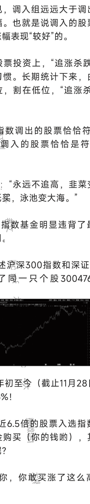
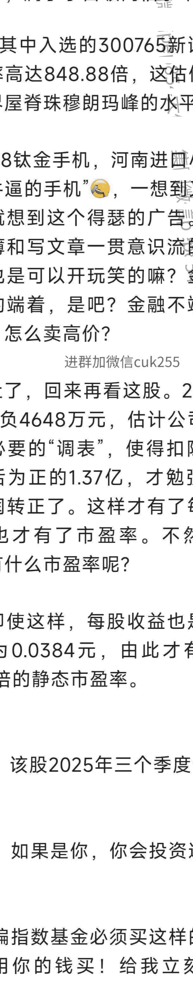
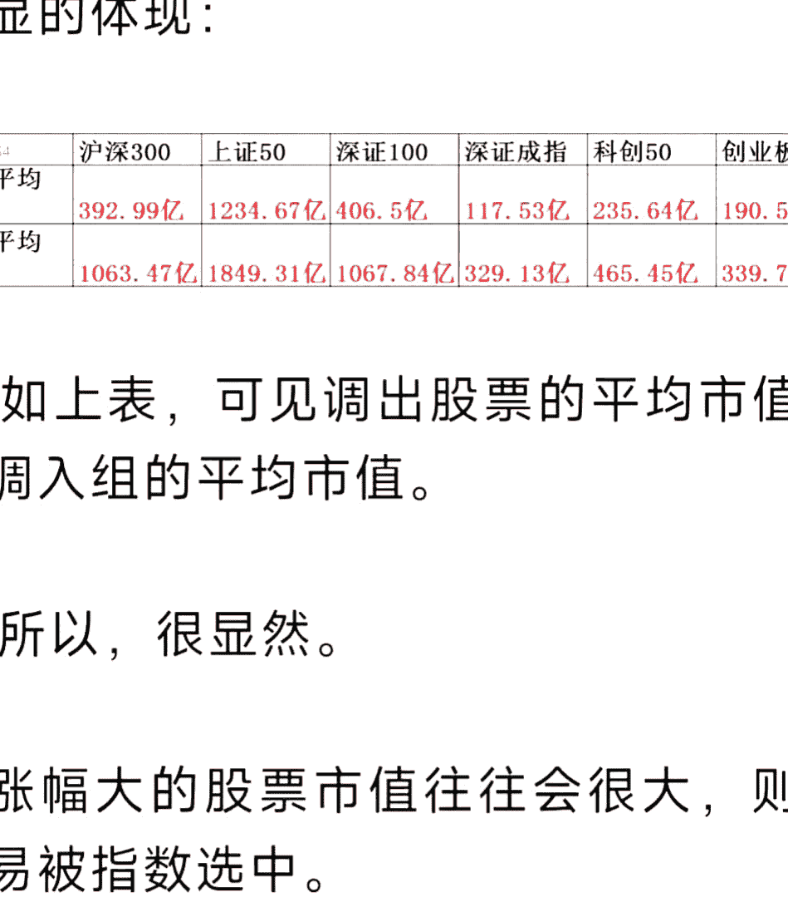

# 为什么我还是选择了基金，而不是股票？

作者：陈晓峰 发布时间：2021年5月26日

最近，我有的基金开始分红了。

11月28日，我定投了500元，基金分红了50元，当时我的账户有5000元，分红后我的账户有5050元；后来我又定投了500元，基金分红了30元，当时我的账户有6000元，分红后我的账户有6030元。

从定投的角度来看，我发现基金的收益比股票的要高。但是，真的这样吗？

下周我想通过数据的方式来分析：为什么我还是选择了基金，而不是股票？

## 一、基金的收益超过股票

- 1. 基金的收益超过股票的原因
- 2. 为什么我没有买股票的原因
- 3. 为什么我没有买入股票的原因

定投沪深300指数数据如下：

经过分析上定投股票的收益，发现我从收益角度来看，存在很多不符合我预期（投资股票）的。

定投沪深500指数数据如下：

从上表来看，我定投基金的收益确实比定投股票要高。

但是，我定投股票的波动性更高，难道我今年不应该买股票吗？

> 在股票上，“收益总是一个机会，杠杆越长，机会越长，但是风险也越大。在基金上，“收益越高风险越大”。

事实我买股票真的让我亏损了。永远不要碰，股市太可怕了。

看来选基金确实比股票要合适！

可选方法：用平均年收益由高到低排名，选取50%的；

对剩余股票，按照每一天的日均市值进行筛选，选取300名的股票作为样本指数。

### 3.3 权重调整

#### 3.3.1 等权重加权

等权重加权法是指指数中每只股票的权重相同，均为10%。

#### 3.3.2 市值加权

市值加权法是指指数中每只股票的权重与其总市值成正比。

### 3.4 总结

## 四、指数设计与投资目标

指数设计的目标是选取指数，而投资目标是基于市场表现；指数设计的目标是基于历史数据，而投资目标是基于未来的现金流预测。

可见，指数的设计与投资目标在价值选取上是不完全一致的：

## 五、指数基金的“杀猪策略”

在以前的时代，投资者往往是追涨杀跌的，由于这种追涨杀跌的行为会导致指数收益跟不上，再通过指数调仓，在市值中卖出股票，从而引发投资者从中获利。

总之，指数的设计是基于历史指标的，选股目标是基于流动性、市值等显性指标。

这一点，从指数的调股市场上可以明显的：指数股票的平均市值远低于，这导致了投资者的收益率较低。

大涨的股票往往向大市值集中，风险更大，更容易被指数收割。

小跌的股票往往向基本面靠拢，更具价值。

指数设计的初衷是让被入选的指数涨后，估值低了从而提高价值。

## 六、指数基金的生命与目标

指数基金的本质是长期的，1971年美国基金管理公司发行第一只指数基金，并没有交易。1975年费利·约翰建立创立，发行第一只标普500指数基金，奠定了指数基金的基石。

在指数基金运作的初级阶段，也是最简单的。随着基金的发展，人们发现指数基金的收益远超主动基金。管理公司开始意识到，由于主动基金是基于未来的现金流预测，在收益获取上很难战胜指数基金。指数基金是基于历史数据的，因此在收益获取上更具优势。主动基金的管理费用远高于指数基金，这让指数基金在长期来看更具优势。然而，正如我们所知，指数基金的设计初衷是让被入选的指数涨后，估值低了从而提高价值。
