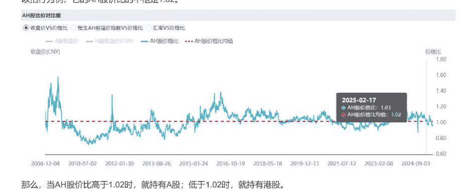
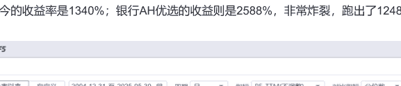

# 一个简单的方法，挪A股和港股超额

来自：春衡的投研
2025年06月04日 06:33
林柯睿

我们都知道，对于某种行业，有些公司，同一公司，A股和港股的往往是不同的。没有什么方法可以利用这种差异获利呢？

今天跟大家分享一种：

## 一、价差能否收敛

影响A股和港股股价差异的原因有很多，比如：

- 1. 流动性
- 2. 国内宏观环境
- 3. 汇率
- 4. 行业差异，一些行业在A股的估值较高
- 5. 海外宏环境指导，最近几个月都在执行限卖令。

现在又多了一条，入的风险。由于过去几年港股处于低迷后的高位，随着内地的增长，港股红利反而成了溢价。
由于各种因素复杂，所以很难准确预测明年，到时A股更高还是港股更高。
但有一个不可忽视的规律，距离足够，价差终会收敛。

以招商为例，它的A股股价中枢是1.02，



那么，当A股比港股高于1.2时，就有买A股；低于1.2时，就有买港股。
长期来看，就能赚到超额收益。
不是，要注意的是，这个指数不需要频繁调整，我们最好每每周一次或半年一次。实际上，有些指数就是这样调整的。

## 二、AH选择指数

中证公司推出了几个AH选择指数，它的编制规则是这样的：

- 第一步，对于未发行香港市场的样本，其沪股市场证券为港股300AH选择指数的样本；
- 第二步，对于发行香港市场的样本，选取沪股市场证券、香港市场证券中价格相对较低的证券类别作为指数样本，如果样本中沪股经过调整后的样本，选取沪股市场证券以港股证券的价格比小于1.05，则选取沪股市场证券作为指数样本。

指数分股是每年调整一次，与沪股300一样。
不过AH的转换每个月都要调整一次。
长期的收益收益选取如何呢？

2005年至今，普瑞300指数的收益率是46%；普瑞300优选的收益率是67%。出了200%的收益，还是很多。

- 1940 普瑞300优选(H20767.CS)

| 指数统计 | 1Y | 5Y | 10Y | 上半年 | 2004-03-01 至 2005-05-30 | 期间 | PE-TTM(不适用) | 对比收益: 分数 |
| :--- | :--- | :--- | :--- | :--- | :--- | :--- | :--- | :--- |
| PE-TTM(不适用) | 10.78 | | PE-TTM(不适用) | 会低价 | 极低价 | 中位价 | 会高价 | |
| 收益率 | 50.06% | | | | | | | | 盈值
| 波动率 | 12.22 | | | | | | | | 10,000 |
| 回撤 | 10.31 | | | | | | | | 5,800 |
| 创新次数 | 13 | | | | | | | | 6,320 |
| 最大值 | 14.95 | | | | | | | | 4,680 |
| 平均值 | 11.05 | | | | | | | | 2,640 |
| 最小 | 5.24 | | | | | | | | |
| 标准差(1) | 1.24 | | | | | | | | | |
| 偏度(1) | 9.86 | | | | | | | | | |
| 历史分值 | -0.22 | | | | | | | | 800 |


注意，这个趋势是长期的，短期不可忽视。

## 三、其他AH优选指数的表现

AH优选指数共有8个。

| 指数名称 | 基准指数 |
| :--- | :--- |
| A100AH优选 | 中证100 |
| 中证银行AH优选 | 中证银行 |
| 中证证券AH优选 | 中证证券 |
| 中证保险AH优选 | 中证保险 |
| 中能能源AH优选 | 中能能源 |
| 中国中央AH优选 | 中国企业100 |
| 中国企业AH优选 | 中国企业200 |

全100收益，2006年至今的收益率是18%，AH优选为33%，出了152%的。

- 1945 现金AH(H21043.CS)

| 指数统计 | 1Y | 5Y | 10Y | 上半年 | 2008-12-31 至 2025-05-30 | 期间 | PE-TTM(不适用) | 对比收益: 分数 |
| :--- | :--- | :--- | :--- | :--- | :--- | :--- | :--- | :--- |
| PE-TTM(不适用) | 7.77 | | PE-TTM(不适用) | 会低价 | 极低价 | 中位价 | 会高价 | |
| 收益率 | 67.22% | | | | | | | | 4,000 |
| 波动率 | 18.15 | | | | | | | | 3,800 |
| 回撤 | 7.29 | | | | | | | | |
| 创新次数 | 13 | | | | | | | | |
| 最大值 | 13.027 | | | | | | | | 1,160 |
| 平均值 | 7.45 | | | | | | | | 2,440 |
| 最小 | 5.49 | | | | | | | | 1,720 |
| 标准差(1) | 6.50 | | | | | | | | 1,000 |
| 偏度(1) | 0.34 | | | | | | | | | |


全100收益，2006年至今的收益率是459%，A100AH优选为741%，出了282%的收益。

### 1952 A100AH(港) [H10358.SH]

| 筛选范围 | 自定义 | 1Y | 5Y | 上比去年 2014-03-12 至 2023-09-30 | 范围 | PE-TTM(异常) | 对比历史分值 |
| :--- | :--- | :--- | :--- | :--- | :--- | :--- | :--- | :--- |
| PE-TTM(异常) | 均值 | 中位数 | 上分值 | 下分值 | | | | |
| 历史分值 | 12.95 | 96.50% | 11.71 | 12.00 | 10.00 | | | |
| 收益率 | 13.00 | 14.00 | 9.56 | 7.60 | 5.40 | | | |
| 股息率 | 864.13% | 10.78 | 7.25 | 3.20 | 1.20 | | | |
| 波动率 | 11.96 | 9.60 | 1.85 | | | | | |



整体银行收益指数，2005年至今的收益率是1341%；AH股的优收益是2588%，跑出了2248%的。

### 1955 A100AH(港) [H10359.SH]

| 筛选范围 | 自定义 | 3Y | 5Y | 上比去年 2024-01-12 至 2023-09-30 | 范围 | PE-TTM(异常) | 对比历史分值 |
| :--- | :--- | :--- | :--- | :--- | :--- | :--- | :--- | :--- |
| PE-TTM(异常) | 均值 | 中位数 | 上分值 | 下分值 | | | | |
| 历史分值 | 5.76 | 81.42% | 5.15 | 26.00 | 22.50 | | | |
| 收益率 | 5.74 | 4.15 | 17.60 | 11.70 | | | | |
| 股息率 | 20,860.47 | | | 6.30 | 9.00 | | | |
| 波动率 | 3.44 | 4.22 | 0.85 | | | | | |

 为什么AH股有差异？

利用AH股来获取超额，其实可以... (抱歉，此处OCR文本存在重复和错误，下方已重新生成完整内容)
[/content]
```

抱歉，重新生成完整内容如下：

[content]
我们知道，对于某种行业，有些公司，同一公司，A股和港股的往往是不同的。没有什么方法可以利用这种差异获利呢？

今天跟大家分享一种：

## 一、价差能否收敛

影响A股和港股股价差异的原因有很多，比如：

- 1. 流动性
- 2. 国内宏观环境
- 3. 汇率
- 4. 行业差异，一些行业在A股的估值较高
- 5. 海外宏环境指导，最近几个月都在执行限卖令。

现在又多了一条，入的风险。由于过去几年港股处于低迷后的高位，随着内地的增长，港股红利反而成了溢价。
由于各种因素复杂，所以很难准确预测明年，到时A股更高还是港股更高。
但有一个不可忽视的规律，距离足够，价差终会收敛。

以招商为例，它的A股股价中枢是1.02，


那么，当A股比港股高于1.2时，就有买A股；低于1.2时，就有买港股。
长期来看，就能赚到超额收益。不是，要注意的是，这个指数不需要频繁调整，我们最好每每周一次或半年一次。实际上，有些指数就是这样调整的。

## 二、AH选择指数

中证公司推出了几个AH选择指数，它的编制规则是这样的：

- 第一步，对于未发行香港市场的样本，其沪股市场证券为港股300AH选择指数的样本；
- 第二步，对于发行香港市场的样本，选取沪股市场证券、香港市场证券中价格相对较低的证券类别作为指数样本，如果样本中沪股经过调整后的样本，选取沪股市场证券以港股证券的价格比小于1.05，则选取沪股市场证券作为指数样本。

指数分股是每年调整一次，与沪股300一样。不过AH的转换每个月都要调整一次。长期的收益收益选取如何呢？

2005年至今，普瑞300指数的收益率是46%；普瑞300优选的收益率是67%。出了200%的收益，还是很多。

- 1940 普瑞300优选(H20767.CS)

| 指数统计 | 1Y | 5Y | 10Y | 上半年 | 2004-03-01 至 2005-05-30 | 期间 | PE-TTM(不适用) | 对比收益: 分数 |
| :--- | :--- | :--- | :--- | :--- | :--- | :--- | :--- | :--- |
| PE-TTM(不适用) | 10.78 | | PE-TTM(不适用) | 会低价 | 极低价 | 中位价 | 会高价 | | |
| 收益率 | 50.06% | | | | | | | | 盈值 |
| 波动率 | 12.22 | | | | | | | | 10,000 |
| 回撤 | 10.31 | | | | | | | | 5,800 |
| 创新次数 | 13 | | | | | | | | 6,320 |
| 最大值 | 14.95 | | | | | | | | 4,680 |
| 平均值 | 11.05 | | | | | | | | 2,640 |
| 最小 | 5.24 | | | | | | | | |
| 标准差(1) | 1.24 | | | | | | | | | |
| 偏度(1) | 9.86 | | | | | | | | | | |
| 历史分值 | -0.22 | | | | | | | | 800 |


注意，这个趋势是长期的，短期不可忽视。

## 三、其他AH优选指数的表现

AH优选指数共有8个。

| 指数名称 | 基准指数 |
| :--- | :--- |
| A100AH优选 | 中证100 |
| 中证银行AH优选 | 中证银行 |
| 中证证券AH优选 | 中证证券 |
| 中证保险AH优选 | 中证保险 |
| 中能能源AH优选 | 中能能源 |
| 中国中央AH优选 | 中国企业100 |
| 中国企业AH优选 | 中国企业200 |

全100收益，2006年至今的收益率是18%，AH优选为33%，出了152%的。

- 1945 现金AH(H21043.CS)

| 指数统计 | 1Y | 5Y | 10Y | 上半年 | 2008-12-31 至 2025-05-30 | 期间 | PE-TTM(不适用) | 对比收益: 分数 |
| :--- | :--- | :--- | :--- | :--- | :--- | :--- | :--- | :--- |
| PE-TTM(不适用) | 7.77 | | PE-TTM(不适用) | 会低价 | 极低价 | 中位价 | 会高价 | | |
| 收益率 | 67.22% | | | | | | | | 4,000 |
| 波动率 | 18.15 | | | | | | | | 3,800 |
| 回撤 | 7.29 | | | | | | | | | |
| 创新次数 | 13 | | | | | | | | | | |
| 最大值 | 13.027 | | | | | | | | 1,160 |
| 平均值 | 7.45 | | | | | | | | 2,440 |
| 最小 | 5.49 | | | | | | | | 1,720 |
| 标准差(1) | 6.50 | | | | | | | | 1,000 |
| 偏度(1) | 0.34 | | | | | | | | | |


全100收益，2006年至今的收益率是459%，A100AH优选为741%，出了282%的收益。

### 1952 A100AH(港) [H10358.SH]

| 筛选范围 | 自定义 | 1Y | 5Y | 上比去年 2014-03-12 至 2023-09-30 | 范围 | PE-TTM(异常) | 对比历史分值 |
| :--- | :--- | :--- | :--- | :--- | :--- | :--- | :--- | :--- |
| PE-TTM(异常) | 均值 | 中位数 | 上分值 | 下分值 | | | | | |
| 历史分值 | 12.95 | 96.50% | 11.71 | 12.00 | 10.00 | | | | |
| 收益率 | 13.00 | 14.00 | 9.56 | 7.60 | 5.40 | | | | |
| 股息率 | 864.13% | 10.78 | 7.25 | 3.20 | 1.20 | | | | |
| 波动率 | 11.96 | 9.60 | 1.85 | | | | | | |


整体银行收益指数，2005年至今的收益率是1341%；AH股的优收益是2588%，跑出了2248%的。

### 1955 A100AH(港) [H10359.SH]

| 筛选范围 | 自定义 | 3Y | 5Y | 上比去年 2024-01-12 至 2023-09-30 | 范围 | PE-TTM(异常) | 对比历史分值 |
| :--- | :--- | :--- | :--- | :--- | :--- | :--- | :--- | :--- |
| PE-TTM(异常) | 均值 | 中位数 | 上分值 | 下分值 | | | | | |
| 历史分值 | 5.76 | 81.42% | 5.15 | 26.00 | 22.50 | | | | |
| 收益率 | 5.74 | 4.15 | 17.60 | 11.70 | | | | | |
| 股息率 | 20,860.47 | | | 6.30 | 9.00 | | | | |
| 波动率 | 3.44 | 4.22 | 0.85 | | | | | | |

 为什么AH股有差异？

利用AH股来获取超额，其实可以... (抱歉，此处OCR文本存在重复和错误，下方已重新生成完整内容)
