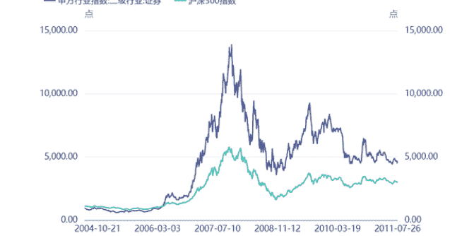
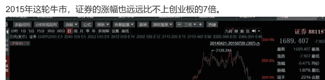
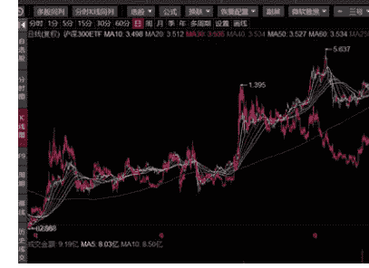
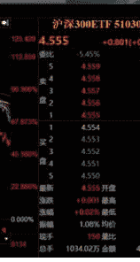
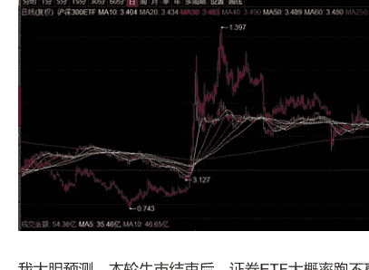
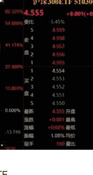

# 不要迷恋股票了！它再也不是牛手的师傅

来自：春期的投资

现在，很多客户仍认为股票是牛手的师傅。但随着金融结构、环境、制度和宏观经济的变化，很多观点都不适用了。今天我们来聊讲股票这个行业。我聚焦明表的观点是，它已经不是牛手的师傅了，不仅投资价值不够，连挂机价值都不够了。

## 股票的弹性大不如前

在2005年大市里，沪深300跌了7-8倍，沪深涨了10倍。直观来看，

| 上证银行指数 | 沪深300指数 |
| :--- | :--- |
| 15,000.00 | 15,000.00 |
| 10,000.00 | 10,000.00 |
| 5,000.00 | 5,000.00 |
| 0.00 | |

2004-10-21 2006-03-03 2007-07-10 2008-11-12 2010-03-19 2011-07-26

数据来源：同财富财经

2015年大市里，股票涨了3倍左，不过比沪深300涨，它只跌了1.5倍。注意的是，是2013年4月起，股票没涨，而创业板极跌了1倍多。这个时候，作为牛手的师傅的称号早已不名其实了。2015年这行情里，股票的收益也远不如行业标的。

2019到2021年的牛市里，股票ETF还亏损了沪深300ETF。

至于此，券商彻底不是牛手的师傅了。

2025年09月22日 06:30
微信进资料群

## 不要着急入场了它再不是谁的股市

中证指数在2024年一月就涨饱了，如果这个时候再入视为本轮的底部，ETF的涨幅相当的。

我大大预测，本牛市结束了，ETF大暴撤还远不跌沪深300ETF。
要知道，沪深300国家队将死守，否则不会像现在这样。

## 二、没投资价值，没投资价值

从投资的未来来看，由于行业的转型，所以估值不值得投资，主要看ROE。
去年证券的ROE只有6%，就是处于行业中期的2021年，ROE也只有9.07%。
现在的ROE，显然不是健康的了。
扣除影响性值后，在现在的估值并不低，更不上低值区域。
注意，投资者要的是企业的价值，而不是波股价值。
那么我们再从价值角度看，证券值值得买吗？
从估值的角度来看，一定是弹性的越好。

但是，证券的弹性这么低呢，甚至一个下来涨还不比沪深300，
为什么证券的ROE这么低呢？
由于产品服务同质化，变得很难看，交易手续费跌到万分之0.5。
去年，基金定开A转型股市，证券公司更累了。

- 第一，基金公司的管理和托管费大打折；
- 第二，IPO规模缩小，业务前景受限；
- 第三，募和业务限制；
- 第四，为了留客户，佣金更是缴。

为什么证券的弹性这么低了？

## 三、此时何时好

证券的弹性涉及多个方面：
- 第一，资金进要了。
- 以前，散户和资金高达80%。
- 现在的机构主要流动性资金已经高达40%。
- 这里，说是国家队，后面是私人和量化，然后再是外资。我们现在的行情不会暴跌，不要恋了！它摇动看着左右脸，崩溃了。
- 管理层又要A转型了，会导致中为主情的产生。
- 这并不利于证券的弹性。
- 这些行业增速快，没法精细操作。
- 以前是股票少，容易走出蓝市。
- 现在是股票多，钱少，更容易变成结构性。已经是结构性，券商自然就不会爆发。

## 四、券商会经历整合期

券商不是师傅了，但散户还在真实的世界里，还是爱券商。所有行业中，券商规模第一。

| 行业分类 | 融资买入量 | 融券业务 | 股票融券 |
| :--- | :--- | :--- | :--- |
| 单位：亿元 | | | |
| 1500 | | | |
| 1200 | | | |
| No.1 终端 | No.2 设备 | No.3 银行 | No.4 开发 |
| No.5 电电 | No.6 订单 | No.7 汽车 | No.8 白话了

由于券商已经没有弹性，未来券商更注重投资价值，而不是投机。管理层的逻辑也很明显，通过重组的方式却是华尔街头部的券商死活，只有未来可知。过去，金融行业就能挣钱，非常艰难。未来就那么轻松。这一块，追高很容易被。证券ETF可能会持续缩净。

## 知识星球

添加微信资源分享群免费入群
微信:top2868

| 序号 | 公号/星球/社群 | 原价 | 领域 |
| :--- | :--- | :--- | :--- |
| 1 | 生财有木 | 2765/年 | 副业，搞钱 |
| 2 | 众宗吃瓜群 | 365/年 | 时政，历史 |
| 3 | 记忆巷/裁树风 | 365/年 | 成长 |
| 4 | 欧洲金轨 | 328/年 | 时政，历史 |
| 5 | 卢克文青会 | 699/年 | 时政，社会 |
| 6 | 体制内主任 | 599/年 | 体制，职场 |
| 7 | 局外人的视角 | 669/年 | 金融，时政 |
| 8 | 溯泽异迁 | 4166/年 | 财富，成长 |
| 9 | 守夜人总司令 | 599/年 | 时政，经济 |
| 10 | 江宁知府 | 365/年 | 时政，国际 |
| 11 | 政堂/顾子明 | 568/年 | 时政，经济 |
| 12 | 唐院 | 1399/年 | 金融，财富 |
| 13 | 大树乡谈 | 199/年 | 时政，成长 |
| 14 | 水库联大 | 10000/年 | 房产，经济 |
| 15 | 洪灏宏观策略 | 4376/年 | 经济，搞钱 |
| 16 | 金通鉴/北海南山 | 4576/年 | 股票，行研 |
| 17 | 猫哥的世界 | 299/年 | 时政，社会 |
| 18 | 飞龙沃 | 3600/年 | 股市，经济 |
| 19 | 米联诸见闻 | 599/年 | 经济，金融 |
| 20 | 茶茶财经圈 | 330/年 | 房产，股票 |
| 21 | 赢在八小时之外 | 365/年 | 成长，职场 |

...... 更多资源，不再列举

+ 图书、报告、课程等各类高价值资源

- * 免费群 每日分享数十优质资源
- * VIP群 每日分享所有资源（日均20+），75/年

- 赠送付费资源集合，市场价数万
