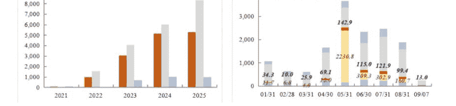
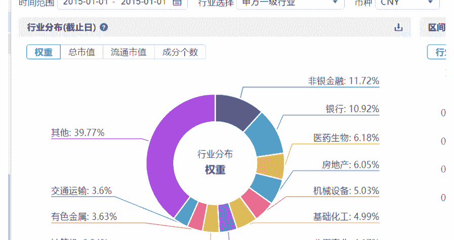
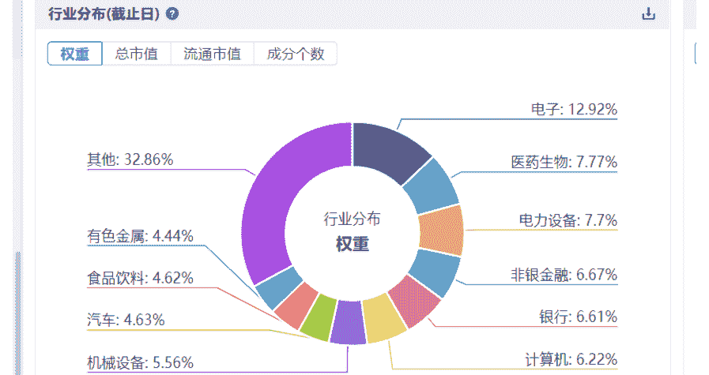

# 金融行业一个被忽视的重要政策

来自：朔的投研
2025年09月23日 06:30

最近，资本市场聚焦在新兴科技，对其他重要政策都被视不见。
但最近的政策发布中，其中对未来发展影响很大。
我们大家需要关注两个重要政策：

一个是（关于金融支持新型工业化的指导意见）
另一个是市场化改革的尝试。
今天先关注《关于金融支持新型工业化的指导意见》

## 金融改革是大势所趋

企业立足国家，中国越是强劲，金融越是血肉。
两者关系好，就能让行业发展快速发展。
当市场化改革进行，金融的行业功能将同步改革，从而适应新的环境。
当前，当中最大的改革就是金融行业向新型工业化转型、智能化和绿色化转型。
由企业的所有权，他们对融资和金融服务的需求也会变化。

《意见》对企业的发展的描述这样说：

2017年后，传统制造业需要通过高端化绿色化转型，金融基础基本，产品更加丰富，资金、债券、股权、保险等各类金融工具在有效防范金融风险的同时，下推支持更加精准，服务效率有效增强。传统企业的有效融资需求得到满足，制造业的融资规模持续高增长，股权融资需求显著下滑。

这说明未来就是，我的间接融资（银行业融资模式）占比下降，直接融资的占比提高。
这个定调，其实决定了A级债市场在2027年将有大的提升。
不直接对标市值500亿的基金，也应该放在A级股市的市场中重配置。

## 二、市场结构的转型将到来

大家不要小看“直接融资”四个字，其意义是非凡的。
融资主要三个方面：
第一个是，就是由银行融资，未来将存在融资市场。

- 这意味着：
1. 资金信贷的难度的增加；
2. 银行在信贷上的压力减轻；
3. 传统企业的融资效率得到满足需求即可。

第二个是股权融资，
这是直接融资的主要部分，银行，间接融资的成本和维护度将会增大。
未来会有更多的工具来补助债券融资，
今年来，信创的规模已经达到2.8万亿。

三：关于未来间接融资趋势

| 图4：金融债券发行主体发行情况、亿元 |
| :--- | :--- | :--- | :--- |
| 上交所 | 间接融资 | 资筹 | |
| | 城投 | 融资机构 | |
| | | 证券融资机构 | |

2025/9/23

# 金融行业被忽视的重要政策

这是目前最需要大力发展的。我国金融市场现状巨大，科技创新的金融需求亟待开拓我国金融市场中市值十分巨大，资金总规模超过260万亿，行业企业规模约有33万，其中包括许多地方性正从创业到上市的股票规模这类大致的1/10不到。
股权改革转型的角度来说，创业企业还是不需要大力发展的企业，他们缺乏有效的抵押，所以直接接跟金融行业。

可以想象，未来A股的头部将会继续加强，传统行业市值将会赛道。
那股的估值回归也是必要做的事。
2015年，中证金融的回归是大事。

中证证券[000985.CS] F

| 时间范围 2015-01-01 - 2015-01-01 | 行业选择 申万一级行业 | 币种 CNY |
| :--- | :--- | :--- |
| 行业分布(截止日) | 区间 行 | |
| 权重 总市值 流通市值 成分个数 | |

非金融: 11.72%
银行: 10.92%
医药: 6.18%
房地产: 6.05%
机械设备: 5.03%
基础化工: 4.99%
公用事业: 4.17%
其他: 39.77%
交通运输: 3.6%
有色金属: 3.63%
计算机: 3.94%
行业分布 权重

明细数据
现在是这样的。

中证证券[000985.CS] F

| 时间范围 2020-09-19 - 2020-09-19 | 行业选择 申万一级行业 | 币种 CNY |
| :--- | :--- | :--- |
| 行业分布(截止日) | | |
| 权重 总市值 流通市值 成分个数 | |

电子: 12.92%
医药: 7.77%
电力设备: 7.7%
非金融: 6.67%
银行: 6.61%
计算机: 6.22%
其他: 32.86%
有色金属: 4.44%
食品饮料: 4.62%
汽车: 6.63%
机械设备: 5.56%
行业分布 权重

## 三、金融机构将没落

很多人都说，行业已经没有成长。未来，金融机构要转型。能什么样的方式应对，日子才会好过。其实不是，看着行业也得好的吗？虽然高盛曾有过反面例子，《意见》的这种：加强金融工具的开发、推行保险、证券、银行、金融管理等范围内防范风险、保护客户并共享等商业的前提下，通过投资、私募、基金等方式，为领先发展提供长期资金；协助帮助企业具有竞争优势，推动大型银行执行法规。现在金融机构已经没有成长，行业也没有成功的案例。比如，招商银行的时候，贷款，后来跟招商银行等到转型就失败了。后的服务和基金通过Pre-IPO引入，招商银行上市后，还把它的客户都拉入了自营中。这一系列操作下来，双方都利。

## 四、总结

《关于金融支持新型工业化发展的指导意见》是中国政府、工业和信息化部、外贸部、财政部、金融监管局、国家发展委员会发布的，足以引起其重要性。这种操作非常关键，足以引起关注。国内的影响会越来越大。

第一，市场的机会；
第二，未来的机会很大，但普通参与的程度较大；
第三，为未来转型，A级别的价值要与国际对标，没办法让企业直接对接；
第四，金融行业确实，但要求很多；
第五，改革还是的。我想告诉大家的是，大部分金融机构和投资者都很短视，所以有一天跟他们说行业还不开放，大放水给他们是最合适的，但是我们国家还行，我们的是考虑长远的底蕴。我很看到我们国家直到这一年的进步。无论是贸易、军事，金融都是快速的发展，而且不同于西方的发展方式。未来，中国资产需要重新认识，价格被严重低估了。当年的日本市场其实一样，只不过对于当时人的时候，出名的却很少了。太新鲜了！

## 知识星球TOP 资源分享群

添加微信号；免费入群
微信:top28688

| 序号 | 公号/星球/社群 | 原价 | 领域 |
| :--- | :--- | :--- | :--- |
| 1 | 生财有木 | 2765/年 | 同业，搞钱 |
| 2 | 众宗吃瓜群 | 365/年 | 时政，历史 |
| 3 | 记忆亥/树西风 | 365/年 | 成长，财富 |
| 4 | 欧洲金轨 | 328/年 | 时政，历史 |
| 5 | 卢克文青云会 | 699/年 | 时政，社会 |
| 6 | 体制内主任 | 599/年 | 体制，职场 |
| 7 | 局外人的视角 | 669/年 | 金融，时政 |
| 8 | 溯泽异迁 | 4166/年 | 财富，成长 |
| 9 | 守夜人总司令 | 599/年 | 时政，经济 |
| 10 | 江宁知府 | 365/篇 | 时政，国际 |
| 11 | 政堂/顾子明 | 568/年 | 时政，经济 |
| 12 | 唐书院 | 1399/年 | 金融，财富 |
| 13 | 大树乡谈 | 199/年 | 时政，成长 |
| 14 | 水库联大 | 10000元 | 房产，经济 |
| 15 | 洪灏宏观策略 | 4376/年 | 经济，搞钱 |
| 16 | 金融通鉴/北海南山 | 4576/年 | 股票，行研 |
| 17 | 猫哥的世界 | 299/年 | 时政，社会 |
| 18 | 飞涨龙 | 3600/年 | 股市，经济 |
| 19 | 米联诸见闻 | 599/年 | 经济，金融 |
| 20 | 茶茶财经圈 | 330/年 | 房产，股票 |
| 21 | 赢在八小时之外 | 365/年 | 成长，职场 |

