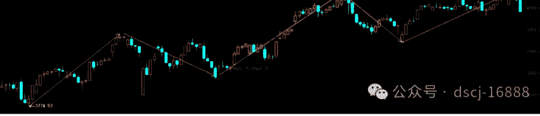

# 石建军（石天方）：4000点反复震荡意味着什么

原创 有缘逸 石建军 石天方 股海总航2025年11月14日 20:12 上海

## 前言

【专栏文章内容提要】

- 1、4000点三起三落是否在夯实底部阶段
- 2、目前位置处于3040点波段行情的什么阶段?
- 3、年收盘能否稳稳在4000点的上方？
- 4、科技股的调整是挤泡沫还是机会？
- 5、年内操作的方向和策略是什么？

用手机微信关注的这个公众号dscj-16888，点击文章，系统提示在微信里搜索微信微信来购买阅读服务。购买查找微信：点微信右下角的“我”，再点击上方自己的名字进入“个人信息”，看到下方菜单里的微信。

石建军，笔名石天方。

中国资本市场第一代证券投资分析家。九三学社上海金融专家委员会委员。华东大师国际商务硕士学位专业兼职博士导师。

## 深度视野VIP群 人工追踪50+大V 付费群加微信cuk255 微信chsp5568

1990年进入证券市场，1994为上海证券报专栏作者。作为最早的中央财经记者，曾在中央台、中央电视台、第一财经、湖北等财经媒体长期担任职责。是否香港报财经报择约访萧磊。水晶财经网2008、2019年获评第一名。在全国投资者中有着广阔的声影响力。

增长经济周期理论破解波动预测大胜利。增长结合国际产业政策导向和行业发展前景捕捉投资。创立和实战投资操作三言：1、大者赢大；2、主流品种选定投资；3、价值投资、趋势操作时。

具有丰富的证券投资管理经验。对国际主要股市和国际商品市场的运行规律有着深刻的研究。能够准确地预测了中国股市多个历史性的重要要点和底部。

本周上证指数是一根小明十字星，从K位置来看，周高在5周线3946点上方，周与10周线的排列头部仍然未变。但是，周五尾盘的盘中跳水，其实接近近期的走势蒙上了阴影。

我之前的文章反复提到，上证指数3374点之后的这段上行情，市场反复震荡徘徊。与其说是震荡回升所谓的“慢牛”，不如说是负重前行、非常重要。虽然近三周的周K线的高点都微微到4000点之上，但连续三周的最终收位置始终在4000点之下。显然，4000点以上的抛压在近期阶段是非常重的。

为什么会出现这样的情况呢？你可以将此景象乐观理解成为为了夯4000点平台而进行的震荡整理。在我的分析系统中，我看到情况却是大盘在构造一个向上倾斜并且具有收敛的矩形运行结构。而经典技术分析理论中早就明确指出：一段上行情的后期出现矩形运行结构，意味着这段行情已经步履蹒跚，其后将面临波质性的调整。

### 【上证60分钟矩形楔结构】

深度视野VIP群 人工进场50+ VIP VIP群加微信cuk255 微信vip5568

60分钟的分钟图上，指数9月以来的这个楔形上升结构表现非常清晰。非常明显从3774点之后，指数的这个楔形接近abc结构的构造。而且，每一秒的运行模式都是规范的三式。从3774点到4034点，可以看到，运行的模式为3-3-3-3-3。周五回底下的，恰好发生在最后一个子者的尾端。我不得怀疑，4034点或许已经成为4030点以来这段行情的相对高位置！至于大盘是否会在某种力量下再次出现，我无法预测。4034点或许已经成为阶段性高位置，这一点几乎没有疑问。长期跟踪的投资者朋友应该我在去年12月27日发布的前瞻《2025年A股大盘前瞻》，就提到：4000点将成为2025年的极底部。

为什么做这样的预判？推理其实很简单。我判断3774点之后是一个楔形运行，一旦形成楔形结构，其后的大盘将回到之前的低点支撑。即由3732、3774和3800点构成的支撑。由于时间已经进入1月，直到两个月内，大盘还会进行调整，指数还没有足够的能力再度回到4000点的上方。所以年内收在4000点下方的概率极大。这也是为什么我一直提示4000点以上必须谨慎操作的内在原因！事实上，多数投资者的市值在10月9日就开始持续震荡回落。进入四季度以来，指数在银行资源等板块压力下，整体活跃却下降了。而在4000点以上，市场的活跃性进一步降低。历史实证表明我是这样的，第四季度以来，科技股呈现出泡沫的言论并非没有，有关AI板块的发展将会影响世界。但我认为，科技是第一趋势。

## 深度VIP榜 人工智能50+D 付费加微信cuk255微信555

这对于投资者提供了极好的机会。从逻辑上，从走势结构上，科技板块作为未来有望科技七巨头的潜力股，经过调整，就在今年给投资者提供一次极好的低吸和增持机会。无论从国家政策导向，还是从几个代表运行结构上，我都能清晰看到：科技板块就会来了！在交易中，一方面想要清理持股，另一方面要寻找低吸的时机。请注意，逻辑清晰且有望为未来中国七巨头的龙头代表，才是我们的首选对象。我已经看到明年的春季，将是科技板块的又一次！祝大家吉祥如意！

## 【特别声明】：

本公众号只是作者观点分享，仅供参考。文中所示板块或个股，只是分析举例，不构成任何建议。请一定注意：分析预测并不等于未来实际。石建军（石天方/股海总航），dscj16888，我是我唯一的公众号。谨防假冒！证券从业业证书S001106205001

公账号 · dscj-16888

# 有缘则渡

> “有缘则渡，点石成金。”

喜欢作者 1261 人付费

作者提示：个人观点，仅供参考

留言 5

情歌 山东萨夫：此文价值千金！回复 17

## 深度视野VIP群 人工追踪50+大 付费进群 加微信cuk255 微信chp5568

小刘 上海：老师不知道吗？是海量信息，中国际，微公司（拓前科技），盛科通信，微博纳米，莱特科技，国君量子。

建石轩 石天... 作者：见仁。我认为，你这里至少有两个三个能够！

Jesse 山东：国君量子排除。

锦翠轩（癸玉）：很明显两光就是老师说的科技七巨头之一！

李逍逸 广西：感谢老师！双创从10月起优先开始调整波段，而认为为了人类多的上市选得比较慢，迟了多月才开始调整。按照这个逻辑，双创应该领先于上证见底，并开启春季攻势。不知道怎么理解对不对？

Zy 四川：老师师傅中科光算不算？

小刘 上海：曙光合海湾。

长波 重庆：工业富奇，中国际，海量信息，还要马上上市的两个。乐山水：老师师傅推荐一下。

黄德坤 山东：老师好，科技七巨头不是腾讯，阿里巴巴，百度，京东，小米，拼多多？

太极 江苏：明白，感谢老师，坚信科技是生产力，等待科技调整了。目前大盘再回调到4000点（5%）。科技不会回调了吧？

石建军：个人观点，仅供参考

## 深度视野VIP群 人工追踪50+大 付费加微信cuk255 微信ch5568

小刘 上海：老师好，，，，，，

。

P仙 四

：。

，

，，，，就是机会。

太极 江东：感谢老师，逻辑错误，

。

，，，，，，，，，，的涨的的？请您在忙之中给予感谢，谢谢！

月梦好 山东：感谢老师，买后ETF可以吗？

眼睛 福建：请老师再明示3只股票？

## 深度视野VIP群 人工追溯50+大 付费进加微信cuk255 微信ch5568

...下降了。在4000点以上，市场的活跃性进一步降低。历史实证表明，银行等权重蓝筹指数，涨者自然就会逐渐增多。石老师好好，问问在此次大盘及科技股调整阶段，可否通过投红利板块来获取一定的逆势收益，想听听您的个人看法。

深度视野VIP群 人工追踪50+大V 付费进群加微信cuk255 微信chp5568

## 深度视野优质集群（链接优质社群，助你成功）

全部包含以下内容：限时优惠188/年 加微信cuk255

- ① 吃瓜群众包信时圈加时群群对话（原价 365 元/年）
- ② 子明私享（568 元/年）
- ③ 顾事内部（顾子明）
- ④ 卢克文专属文章（599 元）
- ⑤ 欧洲会员专属（328 元）
- ⑥ 砖瓦内部（内部）
- ⑦ 卢克文读书会专属（699 元）
- ⑧ 鉴茶知识星球（3310 元）
- ⑨ 猫哥的视界文章（299 元）
- ⑩ 财经周刊【独家】（1498 元）
- ⑪ 杨世在金（2200 元）
- ⑫ 森淼财经星球（持续更新）
- ⑬ 司马林解课选
- ⑭ 司马林解课全套音频和全套书籍无损（2.3 万）
- XV 虚构三部曲[民国梦、帝国争亡、不被理解的 MAO]（599 元）
- ⑯ 卢克文知识星球文章（268 元）

额外再送：卢祺元新浪微付费专栏、三村丰老王，三花九洞文集

（更多资源不下了）......

- 守夜人司令知识星球、接换魔王知识星球、达叔谈论星球、成术财富圈、雪花花甲老头等
- 创始人笔记，达叔谈论星球、成术财富圈、雪花花甲老头等
- A视野、大树乡、江初优、咩咩说、上海海家学等付费文集

- 深度视野（付费文集）深度视野（付费文集）
- 深度视野（付费文集）
- 深度视野（付费文集）

