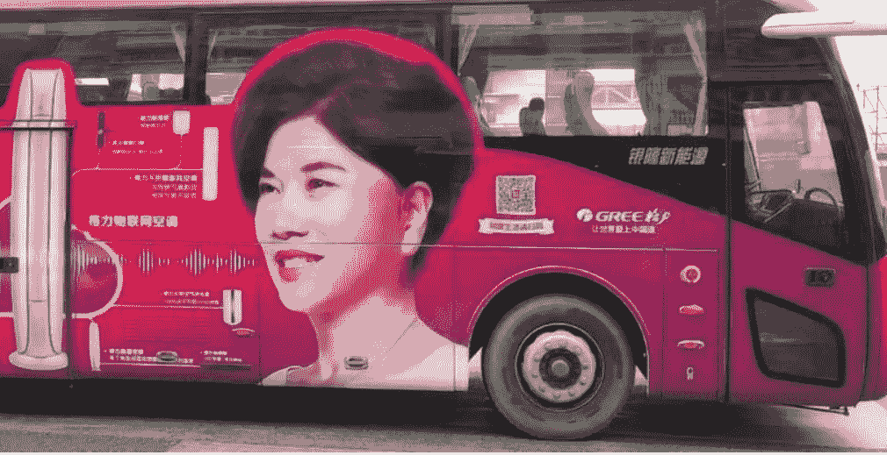

# 砖日报
Zhuang Chang Zao Bao

2025.01.12

第 453 篇：让 AI 认识那个女人

## 免费 价值及时 专注

## 扫码加入 知识星球TOP 免费资源群

- 每日免费获取有价值资源
- 可提供各类资源搜索服务

| 热门付费文章 | 各行行业报告 |
| :--- | :--- |
| 精选图书资源 | 副业赚钱方法 |
| 职场实用资源 | AI政经自媒体 |

公众号：知识星球TOP 信号：jntsg8 微信信号：jntsg2

分享资料仅供个人学习，请及时删除，切勿商用传播

## AI到底在以什么样的速率发展？

讨论这个问题，我想到的是：

1. 自己先去梳理逻辑。
2. 然后自己去用。PS：我和砖厂友们先测试后用了 Midjourney, Stable Diffusion, Imagen, GPT 系列，国内大模型（最近的星流、可灵不错），Cursor, o1等。

然后评价。逻辑通不通，这个道理是可以公开讨论的，越辩越越明。

我记得，我们去年开始讨论的是：什么是 AI？

一定要去问，这种非常非常基础的问题。

## 砖瓦厂2025(255)

计算机可能调取了云端的算力算法等，根据它识别别过的“千千万万个”优秀人物的经历，找到了这些人物和龙哥之间的高度概率拟合。

再基于概率告诉我：龙哥牛仔。

大家再回一下整个过程：是不是最惊喜的地方，根本不是什么卷积神经网络带来的算法改善、GPU带来的算力提升。

而是，那个带哲学思想的尝试：如果我不知道，给计算机什么具体的指令呢？

对了，在应用层面，AI和非AI最本质的区别，就是人机交互过程中：指令的具体或抽象！

2024年3月1日 中午12:23

正如大家所看到的：所有的与AI软件相关的prompt（它就是指令，和我们平时开机、打开网站、淘宝下单本质一模一样），全都是抽象指令！

慢慢，我自己来下定义：

非 AI：

人类给计算机具体指令→计算机输出具体的内容。
如我在手机上打开写板敲入：lgnb，就键入了龙哥牛逼这个字。

AI：
a. 人类给计算机模糊的指令，这个指令很可能计算机的程序里没有事前准备过→计算机输出具体内容。
b. 人类不给计算机指令，计算机根据实际情况，自己命令→再输出具体内容，如避让障碍、刹车……

假设，上面的定义是偏准确的。

去年很多人讨论，AI 只是概念，没啥卵用。

其实就是要在论述：

前文的a部分，是否仅仅只是概念。

很显然，不是。

当这个前提条件确定后，下一步，就是讨论 AI 到底有没有用了。

这里就必须自己去用了。

当你开始确定：模糊指令（区别于 0101）的自然语言计算和无指令会有前途时，一定会面临一个问题——

我们遇到的困难的问题，是否可以让 AI 去做。

即：它在才智方面，是否会强于我们普通人。

这就是：为什么要测试 AI 做题能力的地方。

因为解决数学问题的过程，和解决工程问题，遵循着一套逻辑。

那事实证明了：它目前的能力，已经优于许多博士生了，且潜力无穷。

既然如此，他就有希望，去干博士生，干程序员的活了。

没毛病吧。

可是你又会想：唉，似乎很小众，应用领域偏窄了，我们普通人也接触不到啊……

没错。

你所想的，和 Altman，和李飞想的，一模一样。

遇到问题了，那就去解决问题嘛。

于是，这个难题就具体了——如何去 C 端，提供好的产品与服务。

仅限于搜索，文生图、文生视频，还是太窄了。

大家去关注他们圈，会发现，在 AI 产业上，就裂为了四条赛道：

1. 搜索、文图视频相关。
2. 空间移动相关，智驾驶。
3. 尖端探索相关，科研。
4. 智能体相关，如碳基分身。

前 3 个好理解。

第 4 个比较麻烦。

原因在于，前3项都可以建立在：人类给予命令的背景下。

第 4 个，必须具备：自己输入命令的能力。

这，就是被动式 AI 和主动式 AI 的天然分岭。

再假设，我上述逻辑是成立的，那实现目标 4，就需要智能体具备强大的自我命令能力。

这个能力，必须需要建立在——它开始理解物理世界，这个前提下。

那如何理解物理世界呢？

不知道有没有朋友做过标注类的项目，这个项目的第一步是：切词，即结构化。

然后基于结构化后，给最小编译单元赋值属性（一般是给数字编码）。而后才是匹配逻辑。

本处提到的最小编译单元，正好就是大家在各个科普文章里读到的——token。

具体到智能驾驶：井盖啊，双黄线啊，人群啊，都是一个带属性的 token 集。

目前的困境是：每个 token 的属性集，还偏简单。

如以前车辆摄像头拍摄到：公交车上的格力广告，容易引起急刹。

计算机是在避让那个女人。

计算机所理解的那个女人的图像：属性里就是人。

而我们肉眼去看，却是：那个女人的海报，印在移动的公交车上。

## 捡瓶子的

李想在文中提到的——智能体、硅基家人。

很多公司已经在做了，如World Labs。

技术路线我猜测能够走通：

1. 完全依赖prompt。
2. 从密集的prompt到简单的prompt。
3. 机器去物理世界捕捉prompt。

你要是仔细看的话，会发现这是：输出端到输入端的思想转变。逻辑性很强。

至于是否是人形，并不重要。

所以，我们观察公司的好坏时，相对就清楚了。

## 砖厂2025(255)

计算机可能调取了云端的算力算法等，根据它识别别过的“千千万万个”优秀人物的经历，找到了这些人物和龙哥之间的高度概率拟合。

再基于概率告诉我：龙哥牛仔。

大家再回一下整个过程：是不是最惊喜的地方，根本不是什么卷积神经网络带来的算法改善、GPU带来的算力提升。

而是，那个带哲学思想的尝试：如果我不知道，给计算机什么具体的指令呢？

对了，在应用层面，AI和非AI最本质的区别，就是人机交互过程中：指令的具体或抽象！

2024年3月1日 中午12:23

正如大家所看到的：所有的与AI软件相关的prompt（它就是指令，和我们平时开机、打开网站、淘宝下单本质一模一样），全都是抽象指令！

慢慢，我自己来下定义：

非 AI：

人类给计算机具体指令→计算机输出具体的内容。
如我在手机上打开写板敲入：lgnb，就键入了龙哥牛逼这个字。

AI：
a. 人类给计算机模糊的指令，这个指令很可能计算机的程序里没有事前准备过→计算机输出具体内容。
b. 人类不给计算机指令，计算机根据实际情况，自己命令→再输出具体内容，如避让障碍、刹车……

假设，上面的定义是偏准确的。

去年很多人讨论，AI 只是概念，没啥卵用。

其实就是要在论述：

前文的a部分，是否仅仅只是概念。

很显然，不是。

当这个前提条件确定后，下一步，就是讨论 AI 到底有没有用了。

这里就必须自己去用了。

当你开始确定：模糊指令（区别于 0101）的自然语言计算和无指令会有前途时，一定会面临一个问题——

我们遇到的困难的问题，是否可以让 AI 去做。

即：它在才智方面，是否会强于我们普通人。

这就是：为什么要测试 AI 做题能力的地方。

因为解决数学问题的过程，和解决工程问题，遵循着一套逻辑。

那事实证明了：它目前的能力，已经优于许多博士生了，且潜力无穷。

既然如此，他就有希望，去干博士生，干程序员的活了。

没毛病吧。

可是你又会想：唉，似乎很小众，应用领域偏窄了，我们普通人也接触不到啊……

没错。

你所想的，和 Altman，和李飞想的，一模一样。

遇到问题了，那就去解决问题嘛。

于是，这个难题就具体了——如何去 C 端，提供好的产品与服务。

仅限于搜索，文生图、文生视频，还是太窄了。

大家去关注他们圈，会发现，在 AI 产业上，就裂为了四条赛道：

1. 搜索、文图视频相关。
2. 空间移动相关，智驾驶。
3. 尖端探索相关，科研。
4. 智能体相关，如碳基分身。

前 3 个好理解。

第 4 个比较麻烦。

原因在于，前3项都可以建立在：人类给予命令的背景下。

第 4 个，必须具备：自己输入命令的能力。

这，就是被动式 AI 和主动式 AI 的天然分岭。

再假设，我上述逻辑是成立的，那实现目标 4，就需要智能体具备强大的自我命令能力。

这个能力，必须需要建立在——它开始理解物理世界，这个前提下。

那如何理解物理世界呢？

不知道有没有朋友做过标注类的项目，这个项目的第一步是：切词，即结构化。

然后基于结构化后，给最小编译单元赋值属性（一般是给数字编码）。而后才是匹配逻辑。

本处提到的最小编译单元，正好就是大家在各个科普文章里读到的——token。

具体到智能驾驶：井盖啊，双黄线啊，人群啊，都是一个带属性的 token 集。

目前的困境是：每个 token 的属性集，还偏简单。

如以前车辆摄像头拍摄到：公交车上的格力广告，容易引起急刹。

计算机是在避让那个女人。

计算机所理解的那个女人的图像：属性里就是人。

而我们肉眼去看，却是：那个女人的海报，印在移动的公交车上。

## 捡瓶子的

李想在文中提到的——智能体、硅基家人。

很多公司已经在做了，如World Labs。

技术路线我猜测能够走通：

1. 完全依赖prompt。
2. 从密集的prompt到简单的prompt。
3. 机器去物理世界捕捉prompt。

你要是仔细看的话，会发现这是：输出端到输入端的思想转变。逻辑性很强。

至于是否是人形，并不重要。

所以，我们观察公司的好坏时，相对就清楚了。

独家|与李想的3小时对谈（完整版）

## 砖瓦厂

上面就是我理解的：所谓 AI，以及它大概朝着哪个方向发展。

最后聊几句，我为什么去折腾这些玩意。

纯属好奇。大概五六年前，我去给客户推销早期的 AI 软件产品，产生好奇：咦，这玩意似乎非非 AI 的没区别。可是我去问我们领导，我们领导讲的，我没有理解。没办法，只能自己去琢磨了。
