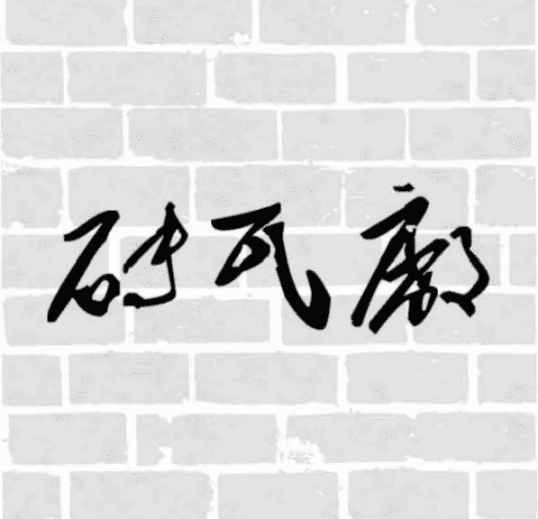
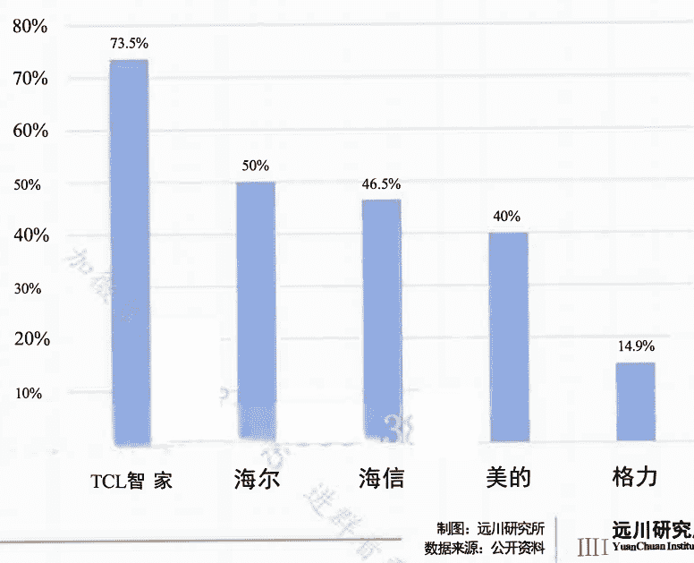

Zhuan Chang Zao Bao

2025.06.10

第482篇：请向外折腾

关于要不要折腾这件事，对内折腾，还是向外折腾。

有群友提到：折腾是某个子体系向大体系索取资源（能量）来对抗系统熵增过程的努力。因此，要区分不同层级的子体系、团体。

赵阿Q：

- 1. 为了延续，子体系需要不断的迭代版本。
- 2. 局部的熵减少，往往带来整体的熵增。

第一条，对应着主席所讲的：改革，七八年来一次。第二条，对应着，在不能做大蛋糕时，维系某个阶层的待遇，一定是其它阶层更多的代价。

第一条，会发现：保持阶层流通的相对通畅，是维系子体系长期稳定的必要条件。

所以，一些朝代科举把举辈舞奸的责罚力度，定得极高，参考明南北榜案。

而再来看协和的4+4，其社会危害性，是极其严重的。那没有可能，子体系不依靠掠夺周围环境的能力，来实现物质文化的繁荣呢？

两三个世纪前，漂亮国的棉纺工业的突飞猛进，离不开黑奴贸易。

西方工业文明的爆发，走的是通过剧外部的熵增，来实现自身熵减的路径。PS: 当然，他们后来实现了工业革命，也做大了蛋糕。不是从始至终的人类命运共同体。

工业革命的伟大，在于人类不再仅仅通过剥削同类，利用机器，创造文明的物质量。学会了利用自然规律，学会了把势能转换为机械能，再转化为电能。人类第一次大规模的从人力、畜力之外的环境中，“榨取”能量。

加微信：pep458获取文章

人类第一次大规模的从人力、畜力之外的环境中，“榨取”能量。

有没有可能，子体系不依赖掠夺周围环境的能量，来实现物质和文化的繁荣呢？

从意识到这里开始，许多优秀的人类才惊讶的发现：把人类的奋斗方向，不局限于“与人争斗”时，人类文明的轨迹也发现了变迁。

换句话讲：当优秀的人类（哲学家、数学家、物理学家们），把人类奋斗的主战场，从一城、一域、一国，重新定义为——海洋、蓝星、太阳系……后，我们所能获得的能量，将千、万倍于“奴隶贸易”。

戴老板讲过：对一家企业来说，“战场定位能力”是所有战略能力里面最重要的一个。怎样的战场，决定怎样的未来。

当格力把战场定位在与米的口水战时，把主战场定位位于海外市场，美的跟随在身后，就只是时间的问题了。

## 各家企业海外销售占比情况

因为，能在国内市场所能获得的能量（销量），已经进入瓶颈期了。

过去一年，小米股价的突破，也与雷军重新定义了小米的战场关系密切。

而不能的战场，意味着不同的增量资源和想象力。

鲍尔默治下的微软，即使年化利润增速达到到惊人的16.1%，市值也是几乎腰斩。盖茨换上了印度人纳德拉，押注云云计算和AI，市值翻倍了十倍。因为，再从Windows和Intel里找增长，能量有限，维系庞大的微软十分困难。

当获取的能量小于系统的熵增增量的时间过长，帝国就会崩塌。

回过头，再来看阿里。过去十年做的最正确的决定，无疑是赌性坚强的支持新的蓝海——云计算。这也是他没有走百度市值之路的主要原因。

企业如此，国家如此，个人可能也是如此。

## 知识星球TOP

添加微信 付费资源分享群免费入群
微信: jntsg2

| 序号 | 公号/星球/社群 | 原价 | 领域 |
| --- | --- | --- | --- |
| 1 | 生财有木 | 2765/年 | 副业、搞钱 |
| 2 | 怂众从吃瓜群 | 365/年 | 时政、历史 |
| 3 | 记忆承载/雯树西风 | 365元/年 | 成长、搞钱 |
| 4 | 欧洲金靴 | 328元/年 | 时政、历史 |
| 5 | 卢克文青会 | 699/年 | 时政、社会 |
| 6 | 体制内主任 | 599/年 | 体制；职场 |
| 7 | 外局人的视角 | 669元/年 | 金融、时政 |
| 8 | 濑泽异谈 | 4166/年 | 财富、成长 |
| 9 | 守夜人总令 | 599/年 | 时政、经济 |
| 10 | 江宁许府 | 365/篇 | 时政、国际 |
| 11 | 政堂/顾子明 | 568/年 | 时政、经济 |
| 12 | 唐书院 | 1399/篇 | 金融、财富 |
| 13 | 大树乡谈 | 199/年 | 时政、成长 |
| 14 | 水库欧大 | 10000 | 房产、经济 |
| 15 | 洪灏的宏观策略 | 4376/年 | 经济、搞钱 |
| 16 | 金政通鉴/北海道南山 | 4576/年 | 股票、行研 |
| 17 | 猫豹的世界 | 299/年 | 时政、社会 |
| 18 | 飞沫 | 3600/年 | 股市、经济 |
| 19 | 米联储见闻 | 599/年 | 经济、金融 |
| 20 | 鉴茶财经院 | 330/年 | 房产、股票 |
| 21 | 赢在八小时之外 | 365元/年 | 成长、职场 |
| ... | ... | ... | 更多资源，不再列举 |
