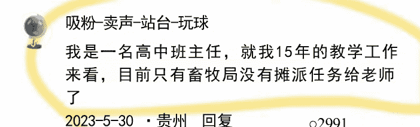

# 厨房日报

Zhuang Chang Zao Bao

2025.06.15

第483 篇：组织已经买过单了

我也是后来才想明白的。

想明白：组织给我们的很多行为与动作，已经经付费了。

比如：要频繁参加不想去的会议，要坚持搞组织活动，要遵守一些偏严的纪律，要离一份现编的发言稿，要扶贫，讲政治……

以前部队流传着一个讨论：招聘博士去拔草，究竟为何？

我进部队的第一个师傅，是中科院某所的博士，他在部队里，有漫长的时间，就是在“拔草”这样的事情上度过的。

多数人站在他的处境里，大概是烦得很。加上那几年，某矿业形势（我们专业）又好得不要不要。

体制外的诱惑非常之大。

大概是六年前，他以42岁左右的年龄，办理了——自主择业（和退休很像，他们差不多是最后一届），现在部队给他一个月发是2w+。

我看他自驾，快把中国跑了个遍。

我比较熟悉的年轻一点的享受相同同遇的战友，是04从东华理工大学毕业的。也就是说：16年不到的工作年龄，换得了退休的待遇。

站在这个视角，再去看他们当年拔过的草，心态就不一样了。

同理，很多党员或体制内的员工，自然是想遥遥自自在些，想更多的精力投入到务实的工作。

但抖不过，最终还是参加了。

原因同上：大家经过理性分析后发现——按照领导要求来，性价比最高。

大家非常明白：一时的难受背后，对应的，都是对待。

没有被裁员的危机，就是我言对待的一部分。

组织规则，天然的是：文山会海，会高频次的动、演练~这些，会与我们熟悉的“现实意义”非常遥远，异常消磨年轻人的志气。

团结严肃活泼，是理想状态。

所以，对抗、蛐鼬、YY、麻木、习惯~会贯很大一部分体制内基层人员的职业生涯。

而部分人，通常情况是：我们这个社会，生活质量很高的群体。

特别是退休待遇方面。

我舍友，技术八级退的，40多岁，现在一个月退休金差差不多在2.4万，每天的主要时间，是给上高中的女儿做后勤服务。

我们团的总工程师，非常强的一个人，现在也是类似的生活。

我还有一个老战友，技术七级退的，来武汉找我喝酒。告诉我，他退役后，去一家福建的饲料厂工作。要知道，他和他夫人（他夫人是40多岁，按30年的工龄退休的）双双退休了。

退休金加起来是三万+，他说，闲下来心里就发慌。

看到他们的状态，我想到的不知道在在哪（哪里）不知道在在哪看到的一段话：很多事情——吃吃好吃的、玩好玩的、到处走走走看看、等条件成熟了再去做，可能就没有那个个心性了。

等着时光到来，就终不像，少年游了。

再说回正题——体制内人的许多不得已，组织已经买单了。

例如，老师这个职业，现在还有一个头疼的事情——非教学任务多多起来了。

一定程度上，教师被当当做是（区县政府的）的行政人员在用。里面，既包括在编的，也包括合同制的。

## 上饶广丰区部分学术强行安排教师暑假期间巡巡

官方回复：核查发现个别学校安排了部分地区教师参与巡河巡水工作，现已责令整改到位。今后广丰区教体局将进一步规范防涝水宣传的方式。

# 碎瓦

我是一名高中班主任，我就我教的15年的教学工作来看，目前只有畜牧岗没有派任务给老师了。

2023-5-30 · 贵州 回复 02991

准备了吗，劳动技能课可以养鸡鸭。

2023-6-18 · 广西 回复 15

我们这这里附近厂招都喊老师指挥，导致这个事情的原因有点些酷——教师目前并不高高的定价（与市场的定价相比）被高估了。

举例子：二线城市的许多教师，全年收入约8万，看起来不高。

但是，二线城市的许多教师，全年收入约8万，看起来不高。

但是来说，很多教师的工资是3K。

## 知识星球

添加微信：付费分享。

| 序号 | 公号/社群 | 原价 | 领域 |
| :--- | :--- | :--- | :--- |
| 1 | 赢在八小时之外 | 365/年 | 成长，搞钱 |
| 2 | 咪联见闻 | 599/年 | 经济，金融 |
| 3 | 大树乡 | 199/年 | 时政，成长 |
| 4 | 欧洲金 | 328/年 | 时政，历史 |
| 5 | 卢克文会 | 699/年 | 时政，社会 |
| 6 | 体制内 | 599/年 | 体制 |
| 7 | 外局人的视角 | 669/年 | 金融，成长 |
| 8 | 投资基金 | 4176/年 | 财富，成长 |
| 9 | 守夜人总 | 599/年 | 时政，经济 |
| 10 | 江宁宁 | 365/篇 | 时政，国际 |
| 11 | 政堂/顾子明 | 568/年 | 时政，经济 |
| 12 | 唐书院 | 1399/篇 | 金融，财富 |
| 13 | 水库欧大 | 10000远 | 房产，经济 |
| 14 | 洪灏的宏观策略 | 4376/年 | 经济，搞钱 |
| 15 | 金政通鉴/北海道南山 | 4576/年 | 股票，行研 |
| 16 | 猫留的世界 | 299/年 | 时政，社会 |
| 17 | 飞沫 | 3600/年 | 股市，经济 |
| 18 | 鉴茶财经院 | 330/年 | 房产，股票 |
