# KPMG

# 破局与重生：2025年中国酒店业的韧性之路

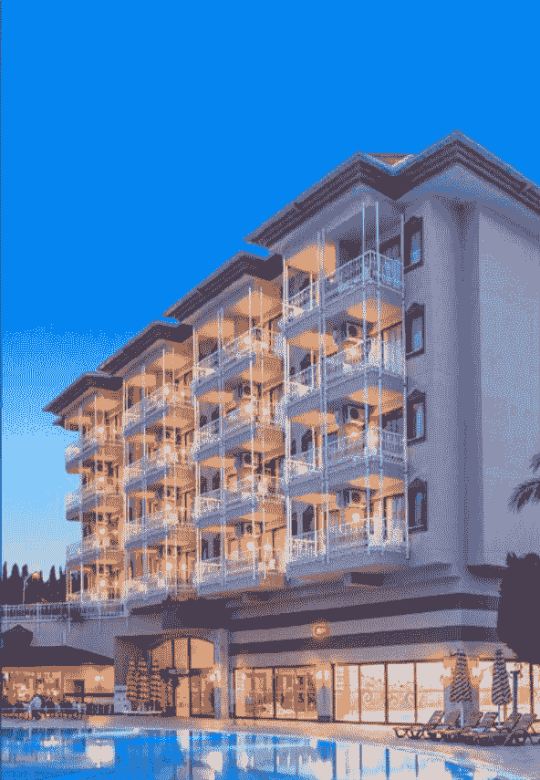

毕马威中国研究院

毕马威创见不同·智启未来 kpmg.com/cn 2025年11月

## 目录

## 01 全球视野下的中国酒店业新坐标
- 1.1 规模扩张与效益并存
- 1.2 锚定高端与连锁化，破局结构性矛盾
- 1.3 政策转型：国家引导消费战略下的酒店业机遇

## 02 产业更代：从“规模扩张”到“精耕经营”
- 2.1 双轮驱动、文旅融合支撑酒店业需求反弹
- 2.2 消费分层“三线模型”，不同类型酒店各具美
- 2.3 异质化数字化分化，酒店强化经营能力
- 2.4 健康康养、长租养老成为创新新试验场

## 03 中国酒店业九大趋势：把握趋势，迎接挑战
- 3.1 加速品牌化与轻资产转型，提升行业集中度
- 3.2 深化“酒店+X”融合产品，拓展酒店业价值链
- 3.3 强化数字化能力，推动文旅消费与酒店业协同发展
- 3.4 把握国内消费升级，从品牌走向全球化输出，提升全球竞争力
- 3.5 注意消费细节，打造差异、体验化的产品
- 3.6 投融资升级，通过兼并重组实现多元布局
- 3.7 把握低碳转型，顺应国家级可持续发展战略
- 3.8 构建智能运营，数据驱动的运营体系，迎接AI时代的挑战

## 04 解决方案：助力酒店业向新而行的每一面
- 4.1 酒店业的审计、会计咨询与证务服务
- 4.2 酒店业的风险管理、内控与合规服务
- 4.3 酒店业的ESG转型咨询与ESG报告签字
- 4.4 酒店业的税务咨询
- 4.5 酒店业的财务及采购业税务调整
- 4.6 酒店业的法律、财、运等全周期税务咨询
- 4.7 酒店业的提升与人力资源咨询

## 前言

在经济持续快速发展的背景下，酒店业作为服务业的重要组成部分，逐渐从粗放式向精细化运营转型。近年来，消费升级、旅游增长以及城市进程的加快，酒店业迎来了前所未有的发展机遇，同时也面临着市场竞争、客户多样化等挑战。

过去十年，中国酒店业经历了深刻的变革与转型，市场发展呈现出多元化的趋势。从普通型酒店向高端酒店转型、从市中心的酒店直通乡村酒店、文化主题酒店，酒店业的丰富度不断提升，满足了不同层次消费者的需求。中国酒店业不仅在规模上实现了飞跃，更在质量、品类建设和技术创新方面取得了显著成就。特别是在疫情后，酒店业通过数字化转型、个性化服务和可持续发展展现了强大的韧性和创新能力。

当前，中国酒店业正站在新的历史起点。近年来，中国政府通过支持政策、优化行业环境、提供资金支持等为高端酒店品牌的发展创造了良好的环境。随着“十四五”规划的实施和“双循环”新发展格局的构建，酒店业迎来了新的发展机遇。一方面，国内消费市场的升级为高端酒店提供了更多机会，消费者对住宿的需求也从“基本需求”向“品质需求”转型，助力高端酒店市场的爆发；另一方面，国际市场的开放也为酒店业的全球化布局提供了支持，特别是在“一带一路”倡议及政策宽松的推动下，中国酒店业正处于黄金期。

然而，在全球竞争日益烈的当下，中国酒店业需要在适应管理、全球化运营、低碳转型等方面不断努力，才能在竞争中脱颖而出，满足消费者的个性化需求。为了帮助企业更好地把握行业趋势，洞察未来机遇与挑战，《破局与重生：2025年中国酒店业转型》全面分析了中国酒店的市场格局，并深入挖掘了发展方向，为企业在大潮中稳健前行、实现高质量发展。

## 01 全球视野下的中国酒店业新坐标

### 1.1 规模扩张与效益并存：“量变”到“质变”

酒店业的发展轨迹折射出社会及生活的深刻变迁。自上世纪90年代末以来，随着国家开放程度的加强以及旅游业持续，中国酒店业逐步摆脱了局限，转向市场化运营。特别是在加入世界贸易组织（WTO）后，外资酒店品牌加速进入中国，带来了先进的管理理念和服务，推动了行业整体水平提升；与此同时，本土酒店品牌加速，酒店业更加多元，从单一规模变为集餐饮、社交、休闲于一体的综合空间。

当前，中国酒店业已从规模扩张转向结构化，市场趋于饱和。据国家统计数据显示，2023年中国酒店业营业额3140亿元人民币，同比增长38.7%，这一增速显著高于GDP增速，显示出中国后疫情时代的有效复苏。全行业增速虽未披露，但从上市酒店集团报告来看，净利润同比增长2023年明显增强，受需求调整、宏观经济波动及国际环境不确定性等因素影响，中国酒店业持续增长面临巨大挑战，行业呈现出“规模扩张与效益并存、结构性分化”的特征。

图1：2005-2023年中国酒店业营业规模与GDP对比

## 破局与重生：2025年中国酒店业转型之路

中国住宿业呈现“以酒店为主，其他住宿业为补充”的市场格局。截至2024年12月31日，中国住宿业设施总数约570万家，客房规模达到1927.8万间。其中酒店设施35万家，客房总数1764.3万间，平均客房规模51间，酒店设施和客房总数占我国住宿业的61.2%和91.5%。相比之下，民宿、民宿等其他住宿业约22.1万家，客房总数163.4万间，平均客房规模约7间，仅为酒店的1/7。酒店凭借其规模化和标准化特点，成为住宿业的核心组成部分。

图表2：2024年中国住宿业结构

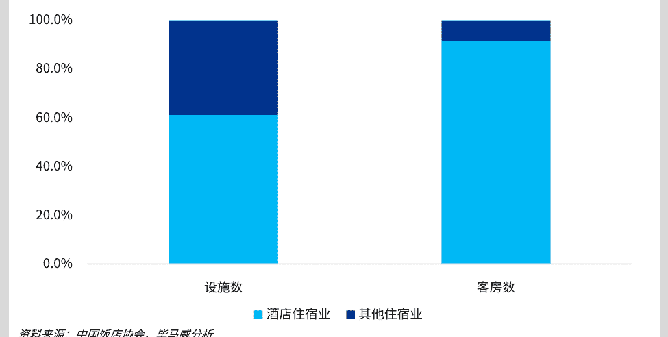

中国酒店行业规模庞大，总量呈现波动上升趋势。2016年，中国酒店行业有28.9万门店，客数为1,410万。尽管在2020年和2021年期间受疫情影响一度下滑，但疫情缓解后，行业开始复苏，门店数量增长明显，流量数量实现两位增长。2024年，中国酒店门店共34.9万家，流量共1764万，创历史新高。

总量上行业仍处于增长态势。从长期来看，2024年相比市场有所放缓，酒店正进入存量市场。《2024中国酒店市场趋势》白皮书指出，酒店增长为6-8%左右，2023年初开始爆发，成为行业的重要来源。2023年创21%的高占比，作为中国酒店升级具有一定溢价空间。存量竞争中，酒店发展的重心从“规模扩张”转向“结构优化”，规模与效益找到平衡点。

图表3：2017-2024年中国酒店门店增长

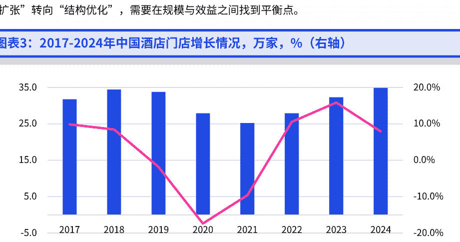

图表4：2017-2024年中国酒店增长

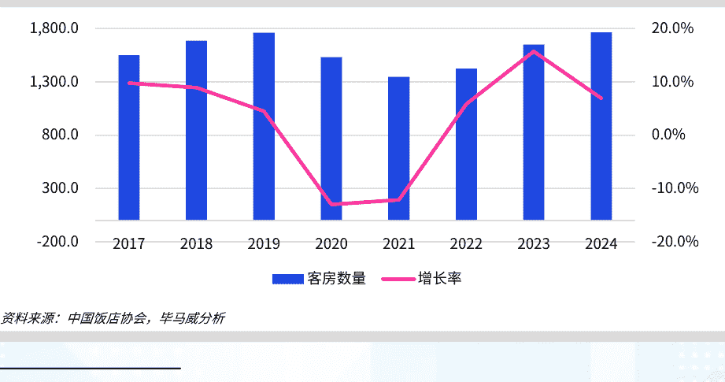

## 07 破局与重生：2021年中国酒店业转型之路

从“量”到“质”的转型，酒店的平均房价（ADR）和平均入住率（OCC）的趋势呈现出密切关系。在疫情初期（2020年），许多国家和地区实行的严格限制和隔离措施导致行业大幅减少，ADR和OCC出现大幅下降。然而，随着疫情逐渐控制，行业逐步恢复，ADR和OCC回劲增长。2021年6月，ADR升至349.9元/晚，同比增长16.4%，OCC升至50.1%，同比增长1.3%，需求逐步恢复。2022年，行业仍处于疫情后的调整期，ADR和OCC尚未完全恢复。2023年，行业逐步恢复，恢复至疫情前（2019年）水平。截至2023年，ADR为373.2元/晚，同比上升16.6%，恢复至2019年ADR的98%；OCC为49.5%，同比上升34.7%，保持稳定增长。2024年，ADR虽有下降但已趋于平稳，国内酒店行业进入了一个稳定的恢复期。

图5：2011-2024年中国星级酒店房价情况及增长率

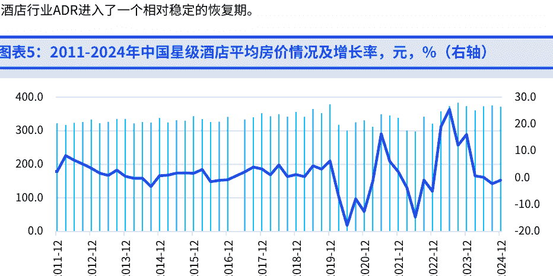

图6：2011-2024年中国星级酒店平均入住率

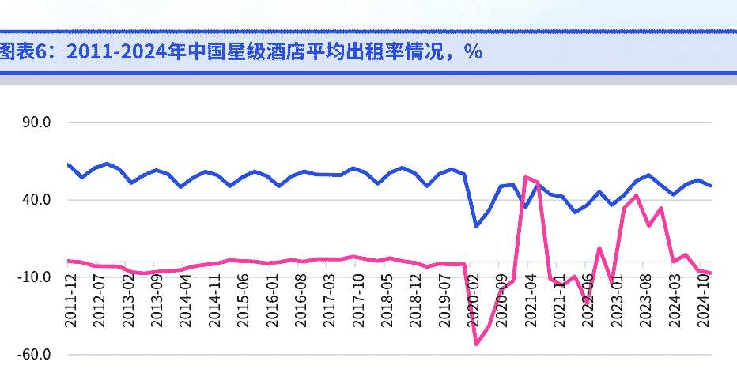

# 经营韧性：中国酒店业经营利润（GOP）率与国际集团在华南项目上的对比

经营业绩是企业经营活动所带来的整体财务状况与经营成果的直观反映。2023年，国内上市酒店集团的财务表现不尽理想，净利润普遍呈现下滑趋势，部分原因也由于2023年公共卫生事件后恢复性反复导致同比系数较高。然而，在整体普遍的背景下，部分酒店实现了净收入的增长，行业分化显著。这表明在当前复杂变的市场环境中，酒店需要通过智能化转型、文化融合、会员体系优化以及寻求发展等措施，突破传统模式，寻找增长点，从而实现稳健发展。

图7：2024年国内酒店集团GOP数据

| | 锦江酒店 | 首酒店 | 华南控股 | 君酒店 | 金陵集团 | 华住集团 |
| :--- | :--- | :--- | :--- | :--- | :--- | :--- |
| 35.0 | | | | | | |
| 30.0 | | | | | | |
| 25.0 | | | | | | |
| 20.0 | | | | | | |
| 15.0 | | | | | | |
| 10.0 | | | | | | |
| 5.0 | | | | | | |

## 2025年：中国酒店业竞争之性

GOP作为酒店经营效益的重要指标，其高低直接反映了酒店的运营效率。从构成来看，GOP主要受到营业收入和运营成本的双重影响。在实践中，酒店一般结合自身的定位、经营环境和竞争态势，通过精准的成本控制、收益管理和资源优化，能够在激烈竞争中增强经营韧性，实现可持续发展。

因此，持续关注并投入GOP是提高经营效益的重要抓手。近年来，中国酒店业GOP稳步增长，整体趋势向好。数据显示，受公共卫生事件的影响，中国酒店业GOP回落至20.6%，然而随着后期持续好转，市场抬头，GOP逐渐增长，2023年已达36.2%，为五年最高。2024年GOP较前年有所下降，维持在30%以上，酒店有望复苏。其中，中端酒店与经济转型协同的本土酒店，GOP平均值高于国内酒店。全球十大酒店之一的国际品牌，2024年GOP显著高于本土酒店。

图表8：2024年中国上市酒店集团、国际品牌与本土酒店集团GOP占比(%)

| | 2020 | 2021 | 2022 | 2023 | 2024 |
| :--- | :--- | :--- | :--- | :--- | :--- |
| 中国上市酒店集团 | | | | | |
| 国际品牌 | | | | | |
| 本土酒店集团 | | | | | |

### 1.2 锚定中高端与连锁化，破局结构矛盾

- 档次结构：高端市场“国际品牌垄断”与经济型“本土混战”的二元格局

中国酒店市场的档次结构呈现明显的“金字塔”特征。2024年，全国经济型酒店（二星级及以下）27.1万家，凭借其价格优势和广泛的市场需求，占据了77.8%的市场份额，市场竞争激烈；中档酒店（三星）5.1万家，占比14.6%；第二大分市场，具有一定的规模和增长潜力；高档（四星级）和豪华（五星级）酒店合计2.7万家，仅占7.7%，其中奢华酒店占比1.6%。

图9：2024年中国酒店档次结构

## 连锁化率：中国酒店连锁化率与国际差异隐藏的轻资产转型空间

酒店连锁已成为国际旅游市场的一个重要趋势。过去，单酒店以其灵活性和独立性在市场上占据一席之地，但随着消费者对品牌化、标准化的需求的日益增长，酒店连锁日益成为行业的主流趋势。这种转变不仅体现了当前市场对酒店品质和服务的更高需求，也反映了酒店业向规模化、规范化发展的必然性。

近年来，中国酒店连锁率呈现增长趋势。根据中国饭业协会数据，截至2024年，中国连锁酒店数9.3万，同比增长3.0%。按连锁酒店数量计算，2024年，中国酒店连锁率为40.1%，其中中档、豪华酒店连锁率双双突破55%，中国酒店的连锁化发展逐步均衡，市场集中度持续提升。然而，相比发达国家品牌高达70%以上的连锁率，中国的酒店连锁化程度仍然存在差距，还有较大的增长空间。

## 图111：2019-2024年中国酒店客房连锁率，%

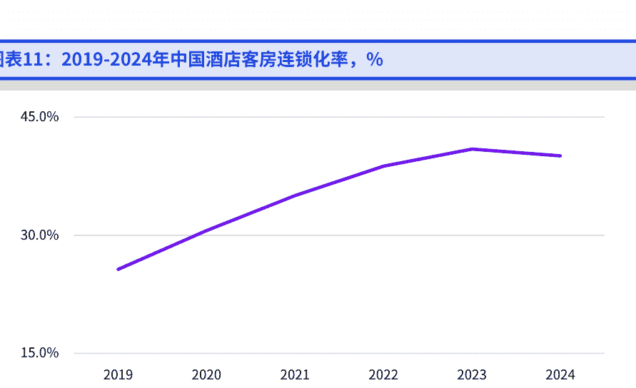

资料来源：云端，中国饭业协会

中国酒店业与国际酒店连锁率的差异不仅体现在市场集中度层面，更反映出中国酒店在轻资产模式上的发展滞后。对于酒店行业而言，轻资产意味着从传统的资产运营向以品牌、管理和技术为核心的新模式转型。通过轻资产模式，酒店集团可以减少对重资产的依赖，将更多资源投入品牌建设与管理输出

## 跨越与：2025年中国酒店业的利之路

轻资产模式主要是指减少固定资产投资，降低运营成本，提高经营效率。在酒店行业，轻资产模式主要表现为特许经营、合同管理、委托经营等多种模式。近年来，无论是国际品牌还是中国酒店品牌，资产占比均呈现逐年下降的趋势。2024年，国际酒店集团的结构呈现出轻资产化的特征，其总资产比例低于中国酒店品牌，并呈现逐年下降趋势。数据显示，2024年，国际酒店集团的资产占比较平均水平下降了6%以下，2020年下降了4.2百分点。这一数据表明，国际酒店行业已转向轻资产化运营模式，实现了无资产的高效管理和优化配置。例如，国际酒店集团已采用特许经营模式，已成为其核心业务增长点之一。2023年，该集团特许经营的数量约占整体数量的约70%。在2024年，新建酒店中特许经营酒店的占比更是突破60%，超过传统管理酒店的占比。

在中国轻资产模式的实践取得了显著进展。以全球最快的本土酒店集团为例，截至2024年，该集团在中国的大酒店数量为557家，占中国酒店总数的5.05%，其余为加盟及特许经营模式的轻资产酒店。同时，该集团也在推进海外市场的轻资产增长转型策略。2024年，中国酒店品牌总资产占比为15.4%，2020年下降了5.5百分点。然而，这一例是国际酒店品牌平均水平的2.6倍，说明中国酒店品牌在轻资产转型方面仍存在巨大的空间。

## 图表12：2021-2024年中国与国际酒店集团总资产占比对比情况

| | 2020 | 2021 | 2022 | 2023 | 2024 |
| --- | --- | --- | --- | --- | --- |
| 25.0% | | | | | |
| 20.0% | | | | | |
| 15.0% | | | | | |
| 10.0% | | | | | |
| 5.0% | | | | | |
| 0.0% | | | | | |

- 国际酒店品牌固定资产占比
- 中国酒店品牌固定资产占比

数据来源：酒店策数据报告，华马分析
注：中国酒店品牌为中国境内7家头部酒店集团数据平均值，国际酒店品牌为6家酒店集团平均值

© 2025 华永会计师事务所（特殊普通会计师）—华永会计师事务所（中国）；华永会计师事务所（亚洲）；华永会计师事务所（总部）及华永会计师事务所（美国）的独立成员。免责声明。保留权利。

## 品牌优势构建：国内酒店品牌“下沉市场覆盖+精品酒店”vs国际品牌

在酒店行业的竞争格局中，国际品牌与本土品牌呈现多元化的竞争态势，双方在市场上有优劣。国际品牌凭借积累的品牌价值、成熟的运营体系以全球化布局，在中国酒店市场中占据主导地位。卓越的服务质量、丰富的运营经验和全球化的声誉，吸引了大量商务旅客。在布局上，国际品牌主要聚焦一线城市，其客户群体对个性化服务和消费体验有较高要求，因此国际品牌在高端市场精准。在消费升级和个性化体验驱动下，本土品牌逐步渗透到中国消费者旅行、出行、购物等多个维度。随着年轻一代消费者的崛起与需求的不断升级，市场正经历深刻重构与升级，为本土品牌带来了重要的机会。作为全球领先的酒店集团，国际品牌敏锐洞察市场趋势，以高端品牌为主，聚焦一线城市。数据显示，随着疫情的发展，国际酒店集团一线城市均客收入（RevPAR）大幅增长，至2024年已稳定。

## 图表13：2020-2024年某酒店集团一线城市均客收入增长率（RevPAR）

数据来源：集团年报，华马分析

© 2025 华盛会计师事务所（特殊普通会计师）；华盛会计师事务所（中国）；华盛会计师事务所（香港）；华盛会计师事务所（澳门）；华盛会计师事务所（英国）的独立成员。版权所有，未经传播。

### 图14：国际品牌与本土品牌对比

| 国际品牌 | 本土酒店品牌 |
| --- | --- |
| 目标市场 - 以高端市场为主 - 一线城市与重点二线城市为主 | 目标市场 - 以高端市场辐射多元化发展 - 持续扩张下沉市场 |
| 竞争力 - 服务流程专业 - 高端商务与休闲 - 个性定制化服务 | 竞争力 - 中端品牌优势 - 数字化体系 - 市场覆盖 - 加强品牌融合，加速扩张 |
| 增长动力 - 消费升级 - 奢华运营 | 增长动力 - 数字化创新（如直播营销） - 成本控制 - 市场下沉 - 服务效率与个性化提升会员粘性 |
| 风险 - 高端市场竞争激烈 | 风险 - 下沉市场盈利压力大 - 数字化投入较高 |

资料来源：公开数据收集，格兰分析

© 2025 年 格兰马信华会计师事务所（特许）国际会计师事务所，格兰马信华咨询有限公司（注册地：中国香港），格兰马信华国际（私有责任有限公司）。格兰马信华会计师事务所上海分部设立合伙会计事务所，格兰马信华会计师事务所－香港区合伙会计事务所，均与格兰马信华国际（私有责任有限公司）相关的设立合伙会计事务所组成。保留所有权利，恕经授权。

相比之下，本土品牌在中端和经济型市场中表现出了更强的竞争力。通过快速扩张和品牌策略，本土品牌在四四线市场的渗透率较高，形成了活跃的网络圈。同时，本土品牌也在积极投入高端市场，推出了高端本土品牌，力求在品牌定位和服务质量上与国际品牌竞争。近年来，本土品牌更加注重品牌升级和创新，通过深耕数字化转型，会员体系化以及本土化服务，本土品牌在提升用户体验的同时，也进一步增强了自身的竞争力。此外，本土品牌在成本控制和本地化服务方面取得了显著优势，能够更好地满足当地消费者的需求，缩小了与国际品牌的竞争差距。

## 本土酒店集团案例：“下沉市场覆盖+数字化转型”提升品牌竞争力

以经济型市场的某国内本土品牌为例，在多年发展前开展了针对性布局，通过自主品牌化、自主授权、品牌购买等“并举”，已建立客户群从经济型、中端、中高、高端到豪华的全覆盖，品牌数量超过30个本土品牌。根据显示，该酒店品牌旗下酒店数量逐年上升，同时积极拓展下沉市场，到2024年将达到42%，填补了市场空白。《HOTELS》杂志发布2024年全球酒店排行榜，该酒店品牌规模超过100万间，排名全球第五至第四。

## 图15：某国内本土品牌市场分布

数据来源：集团官网、瑞马分析

- 一线城市
- 二线城市
- 三线以下以下

在全球化发展的背景下，该酒店品牌也进行了数字化转型。2024年，该酒店集团开始上线自助选房功能，实现了线上与线下的互动，通过个性化服务增强忠诚度，到2025年上半年用户量大幅增长。此外，该品牌自研了智能化RMS（Revenue Management System，收益管理系统），成功完成了转型。

## 本土酒店集团案例二：面对下沉市场，面对挑战

在国内酒店行业竞争日益激环境下，本土酒店展现出一定的能力和持续发展。根据报告显示，本土酒店在下沉市场的扩张由于经济型酒店占比下降，2024年同期亏损为5.4%。通过特许加盟的形式，提升了三线以下城市的开拓。高端酒店平均值维持在60%以上，2024年已达到70%。

## 图表16：2020-2024年本土酒店不同类型占比

## 本土酒店集团案例三：品牌矩阵协同，下沉市场为核心需求

作为中国酒店行业的领先企业，本土酒店近年来通过品牌协同发展、精准市场定位以及品牌协同，构建了一个以品牌为核心、经济型酒店为主、逐步向下沉市场覆盖的布局。根据数据显示，2020年至2025年上半年，本土酒店业务占比高，说明本土酒店在重构市场中的重要部分。中高端酒店凭借较高的性价比、多样化的服务和品牌支持，能够更好地满足消费升级的需求；高端酒店在2023年起增长至7%，酒店开始布局拓展满足高端人群的需求。同时，政府也加强联动，鼓励品牌运营与经营合作，促进品牌协同实现了资源共享和市场渗透。

## 图表17：2020-2025上半年本土酒店集团当年酒店数量占比

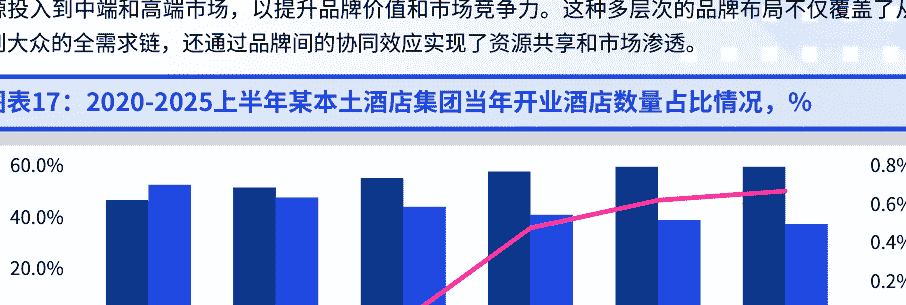

2025年酒店行业趋势报告(特许加盟/中国酒店)、艾智咨询(北京)睿智国际市场有限公司有限责任有限公司：艾智咨询行业报告(2025-2030年酒店市场趋势、预测及发展报告)、艾智咨询(中国)国信咨询有限公司相关报告。

## 政策行业：高端酒店的倾斜

酒店业政策演变趋势：结构化，品质升级

过去十五年，中国酒店政策呈现明显的阶段性特征，并与从规模红利到品牌红利的转型升级共振。“十二五”期间，商务部发布《关于“十二五”期间促进住宿消费规范发展的指导意见》等政策强调整体提升住宿服务质量，推动住宿业发展；“十三五”期间，市场发展重心转向精品型酒店，并发展与度假汽车、连锁酒店等新型住宿业态；“十四五”期间，高端酒店品牌建设、业态融合、智能化转型等创新发展，成为政策行业发展的重点。

## 政策对高端酒店的倾向效应

政策支持是高端酒店品牌管理质量提升的重要驱动力。近年来，政府通过优化行业环境、提供政策支持和创新举措，为国内高端酒店品牌的发展与引入带来了良好的外部条件。在2018年，中央和国务院积极鼓励国内高端酒店管理集团和优秀酒店品牌，使得中高端酒店品牌蓬勃发展。2022年，国务院发布《关于促进住宿消费发展的意见》，明确要求提升住宿服务质量和服务水平，均衡提升住宿服务质量，支持酒店业与康养、康体、学术旅游等行业融合，为中国中高端品牌带来支持。同时，政府也加强联动，鼓励品牌运营与经营合作，促进“品牌+酒店”一体化发展，进一步满足消费者对差异化服务的需求。这些政策为高端酒店的发展提供了有力保障。“十四五”期间，地方政府积极响应，通过出台措施。以山东省为例，2023年发布的《促进省内旅游高质量发展的若干规定》明确表示支持国际、国内酒店，推动全省旅游管理水平提升。同时，该政策强调规模扩张，达到五星标准。在资金方面，佛山市对高端酒店进入给予支持，最高可获得400万元。此外，北京、天津、广州等城市陆续发布相关政策，为高端品牌创造了良好的土壤

## 图表18：2020-2024年高端酒店发展政策

| 类别 | 发布日期 | 相关内容 |
| --- | --- | --- |
| 品牌发展 | 国院关于促进消费高质量发展的意见 | 提升住宿服务品质，培育一批高端品牌，支持旅游与健康、研学等融合。 |
| | 2024-07-29 | 商务部关于促进消费高质量发展的指导 | 培育一批高端品牌、精品酒店，打造知名酒店。 |
| 定制服务 | 2025-09-30 | 交通运输办公室关于加强机动车服务制度 | 鼓励定制服务经营者与景区、酒店等合作，形成一体化。 |
| | 2024-12-03 | 中共中央、商务部关于支持消费深化改革 | 鼓励发展特色化、文化主题和中小型度假，积极引进国内外酒店聚集。 |
| | 2018-04-1 | 佛山市市政府发布《关于引进高端旅游的通知》 | 对引进高端酒店提供补助。 |
| | 2022-09-09 | 山东省政府关于促进全省旅游高质量发展的若干措施 | 引进高端酒店。实施品牌引领，带动国内知名酒店，带动全省旅游经营水平。 |
| | 2023-08-15 | 厦门市商务局发布《厦门市促进消费高质量发展的实施方案》 | 开展民宿评级，提升高端酒店发展，推动便利水平。 |
| | 广州市商务局发布广州市促进消费高质量发展的若干措施 | 积极引进国内外酒店和著名管理公司，培养本土品牌，持续开展特色民宿、星级酒店等工作，推动市场提升水平。 |
| | 2025-03-30 | 天津市商务局发布天津市“大消费”指导意见 | 引进高端酒店和精品酒店，满足多元化特色需求。 |
| | 2024-03-19 | 贵州京城区政务办公室发布《贵京区文旅高质量发展专项规划》 | 2027年前实现3家以上高端酒店入京加速布局。 |
| | 2025-07-21 | 贵明商务局关于促进跨境旅游高质量发展的若干措施 | 支持现有酒店服务升级，加强中高端酒店建设，推动品牌发展，鼓励特色酒店，丰富住宿体验。 |
| | 2025-07-10 | 安徽省关于规模更新设备和旧换新实施方案 | 加强智能化建设，利用数字化技术提升酒店消费体验，推动人工智能、增强现实等场景等先进技术的应用。 |
| | 2024-05-29 | 吉林省政府办公室关于发布加强旅游高质量发展若干性措施 | 推动特色酒店上下互动，建设具有高水平的接待平台。 |
| | 2024-06-14 | |

来源：数据统计、政策汇总

## 从顶层设计到精准施策县域旅游热点酒店提供可落地的支持

县域具有独特的自然风光、相对较低的消费，正成为旅游市场的新焦点。根据2024年“五一”假期旅行总结，县城的旅游订单增速优于一线城市和三四线城市，显示出旅游市场下沉趋势明显特征。这一现象表明，多元化发展正在进行，县城正逐渐受到关注。然而，尽管县城拥有庞大的人口和可见的消费力，其酒店连锁化率仍处于较低水平。根据《2022年中国住宿业发展报告》，截至2022年，中国城市的连锁化率已超过45%，而四线及以下城市的连锁化率不足20%。这种差异反映了县域旅游市场在供给结构上的长短板。

## 图19：2022年各城市酒店连锁化率

## 本土酒店集团案例：“下沉市场覆盖+数字化转型”提升品牌竞争力

以经济型市场的某国内本土品牌为例，在多年发展前开展了针对性布局，通过自主品牌化、自主授权、品牌购买等“并举”，已建立客户群从经济型、中端、中高、高端到豪华的全覆盖，品牌数量超过30个本土品牌。根据显示，该酒店品牌旗下酒店数量逐年上升，同时积极拓展下沉市场，到2024年将达到42%，填补了市场空白。《HOTELS》杂志发布2024年全球酒店排行榜，该酒店品牌规模超过100万间，排名全球第五至第四。

## 图表21：经济型酒店发展支持政策

| 类别 | 发布日期 | 相关内容 |
| :--- | :--- | :--- |
| 经济型酒店发展 | 2016-12-07 | 国务院关于发《“十三”旅游发展规划》的通知：严格控制高端酒店规模，支持经济型酒店发展。 |
| | 2018-09-24 | 国务办公厅发布《关于完善促进消费机制的措施（2018年—2020年）》的通知 | 推进经济型酒店连锁经营，鼓励发展各类生态、主题酒店和特色、中小型家庭酒店。 |
| | 2024-12-23 | 毕华市人民政府发布关于毕华市产业发展规划（2024-2030年）的通知 | 加快优化旅游住宿设施的空间布局、结构层次和功能集成，提高旅游酒店密度，推进主题化、经济型酒店连锁化、乡村旅游个性化。 |
| 县域旅游 | 2024-08-08 | 山象县人民政府关于发加快山源县旅游业高质量发展的意见的通知 | 新设五星级、四级、三级经济型酒店的，分别给予不超过15万元、8万元、5万元的一次补助。 |
| | 2021-06-11 | 关于加强县域旅游体系建设促进农村消费的通知 | 鼓励精品酒店提供服务，配套全乡村旅游重点镇，全国范围内聚集民宿、自驾游景区、木营地和森林景区，发展乡村旅游特色镇。 |
| | 2021-12-22 | 国务院关于发《“十四五”旅游发展规划》的通知 | 完善乡村旅游发展保障体系，鼓励县域地区创建将乡村旅游重点镇纳入县域范围。 |
| | 2023-06-13 | 国家发展改革委员会等部门印发《关于扩大旅游消费新增长点的通知 | 推动乡村旅游资源开发，提升品质，培育一批乡村村级旅游聚集地。 |
| | 2023-06-30 | 文化和旅游部办公厅关于金融支持乡村旅游高质量发展的通知 | 聚焦重点县域，特别是全国范围内乡村旅游重点镇和省级乡村旅游发展镇。 |
| | 2024-12-25 | 文化和旅游部办公厅、商务部办公厅关于部署2024年“乡村”系列活动的通知 | 带动乡村特色产品销售，促进城乡融合增长。 |

资料来源：各地政府，横向统计

# 产业迭代：从“粗放扩张”到“精耕细作”

## 2.1 双轮驱动，商旅文支撑酒店业反弹

### 中国商旅行业逐步恢复，酒店业商旅市场竞争激烈

度过疫情期的不确定时代后，中国商旅自2024年开始进入全新的增长期，为中国酒店业带来了增长客户。根据全球商旅协会（GBTA）数据显示，中国依然是全球最大的商旅市场，目前占全球商旅总支出的25%以上，亚太地区的62%。2024年，中国商旅支出增长8.8%，达到372亿美元，基本恢复至2019年的水平，商旅增长有所回缓。根据捷程商旅数据显示，即便经济复苏缓慢、消费偏软，但有88.9%的受访企业表示2024年国内差旅支出同比去年有所增加或持平，且这一增长趋势将延续至2025年，超过9家企业的国内差旅支出将持平或有所增加。中国商旅市场正在强劲复苏，为酒店的发展提供了重要契机。

图22：2017-2028年中国商旅支出情况，亿美元，%（右）

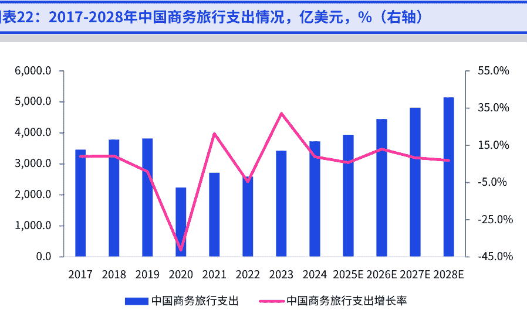

数据来源：全球商旅协会（GBTA），捷程商旅，华马威分析

在这种背景下，中国酒店行业更加注重商酒店市场的维护和发展。

- **区域布局**：重视一线和新一线城市的品牌发展，同时开拓下沉市场。一线城市和新一线城市的经济发展龙头、专精特新等企业众多，需求增大，是酒店商务客户的主要来源。根据横向数据显示，2025年后酒店的市场版图不断扩大，直到五线以下的城市，尤其是东部沿海发达城市及西南地区。与这些城市经济的快速速度极不相似。近年来，无论是零售和营销、服务业的现代酒店、农村旅游业、制造等传统产业，均保持稳定增长，来往酒店客户开展销售、考察学习等机会。下沉市场成为中小企业品牌一线城市酒店的活跃区域。面临区域布局的，众多品牌在重一线城市酒店的竞争时，积极拓展下沉市场的品牌经营。

- **企业合作**：为了扩大商旅市场份额减少对OTA（在线旅行平台）依赖，众多酒店品牌积极加强直销渠道提升客户粘性。以本土酒店为例，业务计划约7000家，其中800家世界强酒店、400家连锁企业。在2025年，国内旅游住宿酒店也有多家企业参与互动，增强酒店与商务合作的机会。同时酒店品牌积极跨界合作打造更加完善的酒店生态，吸引更多客户。如本土酒店通过第三方公司整合机票、汽车、车票等产品，提供一站式商旅服务。酒店品牌面临巨大压力，通过自主构建和跨界合作主动降低OTA平台依赖。

- **客户需求**：根据中国人的酒店消费习惯呈现出明显的差异。根据横向调研显示：
    - X世代（1965-1980年出生）：注重节庆、度假等酒店，同时更倾向于商务与社交。
    - Y世代（1981-1995年出生）：占比最高，高达75%，他们更关注便捷、入住/离店。
    - Z世代（1996-2010年出生）：注重高效性、快速入住/退房。
基于这些因素，酒店行业进一步趋向一体化，例如个性化服务、优化和智能化管理系统以满足不同客户的需求。针对酒店群体中高端酒店，主要面向Z代，其区域元素提供舒适的私密和工作空间，同时配备智能系统。

图表23：中国商旅人士年龄分层，%

- Z世代（1996-2010年出生）：26.5%
- X世代（1965-1980年出生）：16.5%
- Y世代（1981-1995年出生）：57.0%

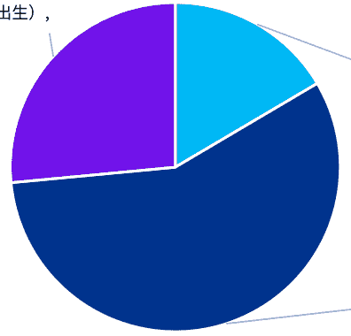
资料来源：捷程商旅，华马威分析

## 文旅消费呈现“双环”效应，酒店行业积极响应住宿需求

文旅作为酒店行业的重要驱动力，深刻影响酒店需求、景区布局及产品供应。疫情影响下，2020—2022年，全球游客人数和消费支出下滑，酒店行业平均收入也呈现下降趋势。随着2023年旅游市场复苏，中国酒店行业再次开始增长。在2024年，国内外游客人数和旅游消费已恢复至2019年的93%以上，星级酒店的平均收入和营业收入仍实现增长。这一现象可能与多重因素有关：首先是供给端的持续导致需求承压；其次是需求缺失；最后是文旅消费的结构，住宿在整体消费中的占比有所回落。此外，文旅等新兴行业的兴起，对传统酒店形成了竞争和替代效应，进一步加速了行业内卷。

图24：2019年国内外游客数量与中国星级酒店平均空房率对比，万人次（右侧）

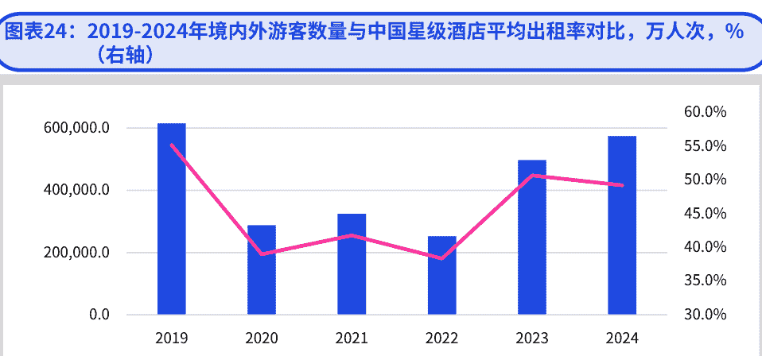

资料来源：国家文旅部、华峰数据
*注：其中2020—2022年境外游客数量无官方数据，剔除，2020-2022年的数据为境内外游客数据

图25：2023年国内居民旅游费与中国星级酒店营业收入对比情况，亿元、万元亿元（右侧）

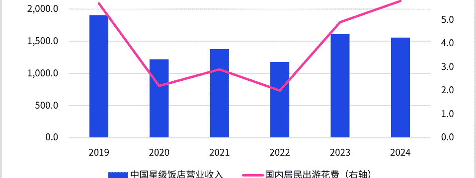

资料来源：国家文旅部、华峰数据

## 破局与重生：2025年中国酒店业的转型之路

中国入境旅游迎来复苏。数据显示，2024年全年入境游客1.3亿人，同比增长61%，恢复至2019年的水平。从消费看，入境收入达942亿美元，人均支出745美元，尚未恢复至18年的水平，表明入境旅游市场的快速恢复得益于签证及住宿便利等多种因素。

图表26：2015-2024年中国入境旅游收入情况（剔除2020-2022年），万次，美元（右轴）

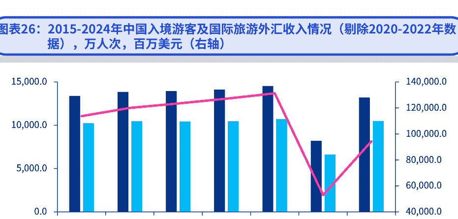

资料来源：国家统计局，华瑞分析
*注：其中2020-2022年入境数据未公布

作为旅游业的核心，酒店业持续增长。2024年，北京、上海、广州等城市接待游客接近400万次。其中深圳作为国际化程度较高的城市，全年接待游客77万次，北京、上海以外分别接待32万次和49万次，深圳占比高达97%。

图表27：北上深四个城市2019年、2023年和2024年入境游客（过夜），万人次

| 城市 | 2019年 | 2023年 | 2024年 |
| :--- | :--- | :--- | :--- |
| 北京 | | | |
| 上海 | | | |
| 广州 | | | |
| 深圳 | | | |

资料来源：中国旅游研究院、华美分析
*注：图中显示的游客包含过境

### 国内多样化消费爆发式增长

国内旅游消费力不断增强。根据数据显示，2015-2019年期间，国内游客数量和旅游花费逐年上升；2020-2022年期间受到疫情影响，数量和花费大幅下滑，但尽管疫情控制好转，2023年中国国内旅游市场大幅恢复，并在2024年基本恢复至2019年的水平。其中，2024年国内出游人数562.2万人，比上年增加2.2万，同比增长14.8%，恢复至2019年的93%以上。2024年，国内出游总花费57.75亿元，比上年增加0.84亿元，同比增长17.7%，超过2019年的57亿元。国内旅游人数趋势稳步提升。

图表28：2015-2024年中国境内游客及国内总花费，万人次，亿元

| | 2015 | 2016 | 2017 | 2018 | 2019 | 2020 | 2021 | 2022 | 2023 | 2024 |
| :--- | :--- | :--- | :--- | :--- | :--- | :--- | :--- | :--- | :--- | :--- |
| 国内游客 | | | | | | | | | | |
| 国内旅游总花费 | | | | | | | | | | |

资料来源：国家统计局、华美分析

## 2025年中国酒店的转型之路

近年来，微度假、周边游、夜间消费、小众目的、亲子和自驾游等旅游方式逐渐远离传统酒店模式，成为市场主流。这些新的旅游趋势对酒店的产品设计、服务模式和基础建设提出了更高要求。

图29：热门旅游趋势对酒店行业的影响

| 旅游方式 | 需求 | 案例 |
| :--- | :--- | :--- |
| 周边游/周末游 | 微度假指的是距离城市1~3小时车程即可到达，从城市向外延伸3小时车程的区域，具有距离近、低门槛、高频率等特点。这类旅游对酒店的需求是多元化的，除了“住好”，还有森林露营、文化消费等需求。 | 微度假位于距离城市50分钟的车程，所在地山环绕，具有水池、大坪、竹海和围场，形成了一个离近又热闹的度假区。为了满足顾客的多元化需求，酒店还提供露营、农场、茶咖等服务。 |
| 夜间消费和酒店消费 | 夜间消费和酒店消费包括餐饮、集市、市场活动、大型赛事等。 | 酒店行业研究显示，2024年中国酒店旅游消费规模1.9%，占旅游消费的42%。这类旅游对酒店的需求在入住期间，还有其他需求，例如需要额外的入住、返还等，有些酒店甚至提供。 |
| 小众目的 | 针对特定兴趣的差异化需求。 | 酒店进一步趋向一体化，例如个性化服务。 |
| 亲子 | 针对亲子互动和舒适空间的需求。 | 酒店配备智能系统以满足不同客户。 |
| 自驾游 | 针对灵活入住/退房的需求。 | 针对酒店群体中高端酒店，主要面向Z代，其区域元素提供舒适的私密和工作空间。 |

# 破局与重生：2025年中国酒店的转型之路

高端酒店通过策略满足客户的个性化和体验需求。根据酒店研究院2024年的报告，78%的高净值人群将“独特的文化体验”列为选择酒店的标准，高于“全球化服务”的23%。这数据表明，当代高端消费者更倾向于体验深度的社区文化，而非接受标准化服务。

基于此趋势，高端酒店在设计、建设和运营上需要更加注重本地化的融合。从复古风格到室内装修，酒店标准需与当地自然和人文形成紧密结合。同时，酒店为客人提供丰富的文化体验，通过介绍当地生活方式和风情，以及定制化的旅游路线和文化活动，以此增强与目的地的情感连接。

> 案例：贵阳某豪酒店打破边界，搭建本地化艺术馆

贵阳某豪酒店定位为“美学馆”，将酒店与服务、设计、人文层面进行深层联结，为客户提供特别居住体验。在设计上，酒店与国际知名设计师合作，以本地的山水气候元素作为灵感基础，具有艺术设计感的语言营造氛围。在运营上，酒店提供顶级管理服务、文化融合服务以及无忧的生活方式服务，打造了成熟的本土品牌酒店运营体系。2025年，与中国市场融合，打造一个中国自主的精品酒店品牌。该品牌酒店定位为一个“可以住的美学馆”，酒店内的展品和活动涉及艺术、哲学、美学，希望能够使艺术抵达客户的日常生活。同时，酒店将定期举办音乐会、戏剧、展览等等艺术活动，邀请更多艺术家和艺术作品来到酒店中。酒店也试图通过艺术探索与本地文化之间的互动，希望从一个酒店向一个社区转型，成为城市中重要的艺术之地、文化和生活场所。

### 中端市场化：推出主题酒店品牌

随着城镇居民收入的持续增长，消费升级趋势日益明显。消费支出占比已突破历史高点达到41.6%，其中发展型、享受型消费需求显著增加。与此同时，消费观念逐渐向实用主义转变，追求性价比的平衡，中端酒店市场迎来爆发期。

根据文旅部数据，尽管疫情对三、四星级酒店的平均入住率和每间可供客房收入造成一定冲击，但2023年以来，随着文旅市场的复苏，相关指标已实现增长。2024年三季度，三星和四星级酒店每间可供客房收入分别为113.3元/间/日，平均入住率分别为47.9%和52%。然而，中端市场仍面临诸多竞争、同质化严重的问题。在激烈的竞争中，品牌普遍采用促销、积分等手段争夺市场，导致利润持续低迷。由于缺乏差异化竞争，消费者在选择时往往倾向于区分品牌，市场陷入“价格战”而非“价值战”，削弱了中端酒店的市场力和消费者的忠诚度。为解决同质化问题，中端酒店开始向分市场发展，以增强竞争力。

图32：2019-2023年三、四星级酒店每间可供客房收入和平均入住率，元/间/%（右侧）

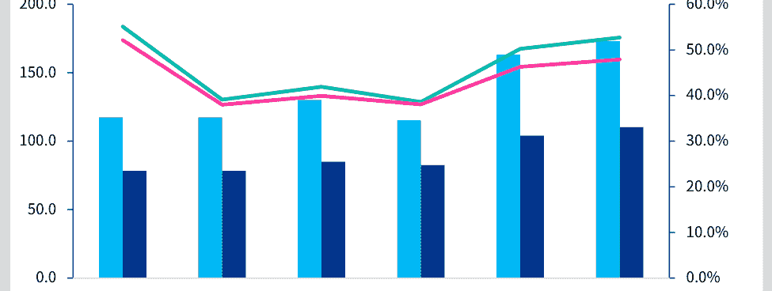

数据来源：国家文旅部、华瑞分析
*注：2024年星级酒店数据更新至三季度，此图中的数据为2024年三季度，非全年度

### 面向追求性的年轻人，酒店注重特殊设计、个性化体验与社交属性

酒店通过打破传统标准，以创意设计和个性化服务为核心，精准把握年轻群体对特殊性的追求。在空间设计方面，酒店通过主题设计、网红打卡点及开放式社区，营造更具艺术和趣味性的空间，为年轻人创造独特的酒店体验。同时，酒店服务向更优质、更个性的方向升级，包括融入入住体验、灵活的入住政策以及丰富的选择，如主题餐饮、文化和活动等。此外，酒店还提升科技水平，让年轻人对前沿科技产生好奇。智能客房和便捷设施成为服务要点。这类酒店不仅提供舒适的住宿环境，更成为旅行中的独特记忆和社交载体。某些酒店通过IP联动，吸引了大量消费者。

### 面向追求性的年轻人，酒店注重特殊设计、个性化体验与社交属性（续）

随着家庭游客需求的提升，酒店注重特殊设计、个性化体验与社交属性。数据显示，2025年期间成都、广州、北京等城市的“亲子度假”热度持续增长，酒店行业向多元化、个性化方向发展。在酒店市场上，越来越多的游客倾向于选择交通便利的区域酒店。在客房设计上，酒店推出了更多亲子套房、舒适的床铺、独立卫浴以及满足家庭游客的多样需求。在服务方面，酒店更加注重家庭友好型，如提供儿童托管服务、公共区域娱乐及定制化餐饮。此外，部分酒店还推出主题型酒店，将酒店本身成为目的地。以苏州某酒店为例，配备了亲子池和特色活动，让儿童能够独立参与并共享时光。根据数据显示，2025年全国亲子订单量增长80%，其中成都表现活跃。

### 面向追求性的年轻人，酒店注重特殊设计、个性化体验与社交属性（续）

### 经济市场智能化：从智能控制到差异化竞争

经济型酒店经过多年发展进入成熟期。当前，一些细分市场出现两大发展趋势：一是头部品牌通过智能化实现规模效益；二是区域品牌通过差异化竞争，提供特色体验实现增长。未来，经济型酒店将向“智能化、连锁化、标准化”方向转型，通过技术创新提升效率，保持市场竞争力。

智能化是经济型酒店转型的重要环节。通过引入智能技术，酒店能够优化基础服务，如入住和退房、智能客服、自动迎宾等，从而提升消费者的体验。同时，智能技术的应用能够简化酒店的工作，解放人力，进而降低成本，提高管理水平。相比，经济型酒店4.0版本采用智能柜，最快10秒即可办理，实现更智能的升级。连锁店与单体酒店在智能化升级上存在差异。当前连锁化程度较高，连锁店凭借其雄厚的资本积累和成熟的管理经验，能够投入更多资源开发智能化转型；而单体酒店在智能领域仍然有限。如何通过智能控制实现对用户体验的有效优化，有利于连锁化和标准化的提升，从而形成规模效应，促进智能化的全面推进。

# 图33：经济型酒店连锁店与单体酒店的智能化升级措施

| 连锁店 | 经济型酒店 | 单体酒店 |
| :--- | :--- | :--- |
| 自助入住和退房 | 完善入住和退房体验和减少人工成本 | 显示天气的智能镜 |
| 智能客房服务系统 | 智能化提升酒店的用户体验 | 语音指令开关 |
| AI语音客服系统 | 提高服务响应速度，24小时即时响应 | 智能屏和电视 |
| 智慧安全系统 | 提高酒店安全性，增加居住幸福感 | 机器人配送 |
| 智慧会员运营系统 | 提高客户忠诚度和黏性，个性化服务和推荐 | 人机交互服务 |

资料来源：华瑞咨询
*2025年访谈后4.0酒店趋势：国内酒店趋势，2025年7月
*2025年中国酒店趋势报告（特稿版）-邦瑞审计（北京）有限公司责任公司。邦瑞酒店事务服务部-中国国际会计师事务所、友安连锁会计师事务所-香港注册会计师事务所，均为华瑞国际（南国智联）相关的报告

# 2.3 异地与本地市场分化，酒店强化属性经营能力

中国酒店业的空间布局呈现显著的市场分化，异地与本地住宿需求在增长趋势和消费行为上存在明显差异。随着复苏和消费升级的推动，住宿需求已突破传统住宿限制，形成多元化的消费偏好与行为。其中，异地市场主要由区域旅游和商务活动驱动，而本地市场则聚焦于常住、家庭度假等场所。这种特殊不仅体现在客户群体上，也反映在酒店的定位和运营策略上。

根据2025年酒店趋势预测，国内本地及周边酒店以50%的占比占据主导位，成为酒店业的2025年核心客群。同时，异地和周边的旅游需求的增长将深刻影响酒店的发展格局。

# 周边、反向与异地市场正在积极拓展

周边、三线城市及城市拥有近5亿人口，连锁率约为28%，特别是五线城市及以下不足5%。消费升级虽缓，2024年县域接待总量为580万次，同比增长13%。从刚游转向深度体验，呈现出新趋势。县域消费主要集中在天津、上海、杭州等城市，连锁率约为40%。县域成为消费的主力。2023年县域酒店数量占30%以上，其中西北地区活跃。2024年甘肃等地布局达700家，其中西北地区达142家。2025年全国县域酒店订单量增长5倍，其中成都表现活跃。

### 独立单体酒店通过加盟或升级提高竞争力

县域的独立单体酒店也在积极转型，通过加盟或升级提升竞争力。例如，本土品牌推出的“云系”品牌，为县域单体酒店提供低成本解决方案，并具有较大的吸引力。

### 图表34：酒店单体酒店在县域的市场分布

| 酒店单体分类 | 县域市场布局 |
| :--- | :--- |
| 县域单体酒店 | 主打加盟或升级。如，靠连锁费用，换来更优质的客源和管理支持。 |
| 国内本土品牌 | -2019年，品牌明确要扩展到三四线城市，计划旗下经济型品牌遍中国每个城市。 -2024年12月，其旗下经济型酒店共有139家，其中有71家正在开发中，渗透率持续增长。 |
| 本土酒店集团 | -2025年开始，某本土酒店集团执行官向投资者表示，将加大在三线酒店的投入。 |
| 国际酒店品牌 | -2024年开始，某国际品牌拓展了四五线城市，品牌约有54%的酒店分布在三五线城市。 |
| 国际酒店品牌 | -2024年，某国际品牌门店位于三四线城市。其中国盟名单，有芜城、丽源、湘源、衡阳、喀什等20个多个目的地。 |
| 国际酒店品牌 | -2025年开始在投资市场，同时聚焦下域市场与小众市场，以差异化维持酒店持续的扩张版图。 |
| 国际酒店品牌 | 某国际品牌入驻四川省广源县，成为国内首个国际高端酒店。 |

数据来源：县域酒店，各加盟商

### 案例：高端单体酒店在县域，重构价值优势

某高端单体酒店品牌在旅游型市场打造“化体验”（如非题所述），在商务属性的县域领域强化“智能房服务”，针对不同的客户群体推出不同的产品和服务。在客房服务之外，该酒店还有丰富活跃区域，打造高端餐饮、咖啡早餐等加入酒店活动，让客户提供更多社交的空间。技术化能够让酒店的发展焕活力，在县域打造智能场景，在大堂设置服务机器人，提升了酒店形象并精力经营。

“云系”与“云梦”品牌，本土化与高性酒店市场趋势，普源酒店，2022年报告

*注：2023年县域酒店调研报告所引用的县域酒店市场数据、广源县域酒店管理有限公司数据、某高端酒店报告数据。数据由于统计口径不同，可能存在差异，文中数据仅供参考。作者与云系、广源县域酒店保留

### 本地需求增长，主题酒店和形式化发展

在中国的酒店行业，消费升级与个性化需求推动了多元化发展。特别是疫情期间，本地化趋势兴起，以本地市场为主。通过差异化主题，丰富了住宿体验，为行业注入活力。

2024年中国酒店报告显示，截至2023年，全国酒店数量达249家，规模达190亿元。预计2025年将超过200亿元。与此同时，“主题制”酒店成为热门市场之一，收获了大量客户。

### 图表35：酒店的发展状况

- 2025年，部门连续完成1000家签约。
- 2025年，常规房型占比高达88.8%，入住率达到92%。
- 2025年5月，主题房价上涨至544元，环比涨18%。
- 2025年4月，主题房价上涨28%。
- 2025年5月，主题通过通过良好契约》《英雄联盟》等元素，为消费者提供了沉浸式体验。
- 2025年7月，本地化酒店活跃。

资料来源：公开数据，华瑞分析

### 强化本地化经营能力，成为“回头客”

随着出游意愿的提升，便捷、舒适的本地化成为高频消费场景。酒店行业向本地化转型，通过强化本地化运营能力，将本地居民培养成忠诚度高的回头客。具体措施包括：

- 1. 融入本土文化元素，打造特色住宿体验，深入研究本地客群。
- 2. 深化与本地伙伴的合作，推出优惠套餐，构建互利共赢的生态圈。
- 3. 实施灵活的价格策略，推出周末特惠、工作日优惠等促销活动。
- 4. 定期举办契合本地居民的主题活动，如美食节、音乐节等，营造良好的社区氛围。
- 5. 借助社交媒体和本地生活平台，精准投放广告，提升品牌曝光度和吸引力。

## 2.4 健康旅游、长寿养老：融合医疗、生活化的复合型

随着全民健康意识的觉醒，人们对健康生活的关注度显著提高。健康不仅仅是医疗问题，而是与生活、环境密切相关。尤其是在后时代，人们愈发追求健康的生活方式。因此，健康旅游成为一种健康与旅游休闲的新型生活和消费趋势。

2015年，中国提出“健康旅游”总体规划，标志着健康旅游产业进入新阶段。2016年，规划进一步明确了发展方向，要打造具有国际竞争力的健康旅游目的地。2022年，“十五五”旅游发展规划更是将健康旅游与医药产业深度融合，立足八大国家，提出一批健康旅游示范区和示范基地，这些政策为健康旅游的融合发展提供了重要机会。

在此背景下，地方政府发布政策，推动健康旅游落地。云南省率先推出《旅游建设三项行动》，明确到2027年全省将新增300个以上乡村旅游节点，引育一批旅游企业。广西深入推进“广西·长寿康养”产业发展三年行动方案（2023-2025年）也提出，到2025年，培育优质广西健康品牌15个以上、康养旅游区50个以上、康养度假地20个以上。此类政策有效引入资本，更有效地推动了旅游与本地化、生态、自然资源的深度融合。

> 图36：中国健康旅游相关政策主题

| 云南 | 广西 | 广州 |
| :--- | :--- | :--- |
| 引进优秀资源打造旅游目的地 | 打造“美养·长寿康养”品牌 | 打造不同主题康养旅游地 |
| 《推进建设三项行动》提到，到2027年，新增3000个以上乡村旅游节点，引育一批全国知名旅游企业；通过策划“特色旅游”包，鼓励资本进入 | | |

资料来源：公开数据，华瑞分析

### 长租公寓：服务公寓+共享公寓

随着全球经济化的深入，跨国企业和商务人士对跨境高频移动的需求日益增长。服务公寓凭借舒适便捷的居住环境，逐渐成为商务人士理想选择。特别是在一线城市，由于房房价较高，越来越多的人选择租房服务公寓作为长期居住的替代方案。同时，传统连锁酒店和房地产开发商也涌入长租服务公寓领域。近年来，诸如保险、零售、石石油等行业也纷纷转型。

长租公寓在中国市场迎来稳定发展。国际长租公寓自1998年进入中国市场，已在42个城市运营近20年。旗下拥有多个品牌，业务涵盖服务公寓、共享公寓、套房及长租公寓等多个领域，形成了完整的租赁解决方案。根据其投资发展报告显示，该品牌已成为集团的重要重点增长领域。2023年，品牌实现收入达3.1亿元，同比增长28%；2024年增长持续。在中国市场，该品牌凭借“资产+特许经营”模式，目前的目标是成为此类市场的龙头。未来，品牌将继续以租赁为基础，结合灵活经营模式，布局拓展市场。预计到2027年，中国市场新增近一个项目，目标集团实现全球租赁年收入突破5亿元的目标。该品牌将布局北京、上海、广州、深圳等一线城市和成都、重庆、武汉等二线城市，持续深化品牌影响力。

图38：长租公寓服务公寓业务模式

## 租赁管理 (IM) | 投资管理 (IM)

租赁管理的管理主要来源于雅多元化的全球投资管理，要包括自有物业和物业资产的管理，以及CLI和CLAS和私募基金等基金管理平台中的占比。

- 90%的轻资产公寓特许经营收益：管理公司拥有为10-20年的经营费用收益。

| 租赁管理 | 特许经营 | |
| :--- | :--- | :--- |
| 基本管理 | | |
| 费用管理 | 激励管理 | 购买（全权） |
| 占物业资产的占比(%) | 占物业收益的占比(%) | 获取特许经营权利 |
| 收入构成 | | |
| | 自有物业 | 出售物业 |
| | 各类物业的租金收入 | 来自自身的物业 |
| | 雅诗和Sydney转让给CLI的物业 | CLAS的回复 |
| 下的租赁收益 | 稳定收益 | |
| | | 基于CLI在CLAS中份额的收益 |

服务公寓（费用租赁）

对CLI租赁公寓业务的收益增加：

- 客户带来的收入增加，物业收益增长和利用成本降低
- 成长相关投资（如投资和资源，以便实现更大管理公寓的规模）规模的持续扩张
- 加强品牌投入，如后续恢复后租赁增长

业务增长因素

- 对CLI非公寓租赁业务的收益
- 主动型资产管理增长，提升投资收益
- 寻找更多机会，对投资资产的收益组合收益
- CLAS作为非公寓租赁业务的重要驱动因素，占据收益的45%，EBITDA占比

数据来源：聚信数据、华年分析

# 聚盛：2025年中国酒店业的转型之路

在酒店供给持续扩张、行业增速增长的背景下，越来越多的酒店集团正积极向长租公寓转型。部分酒店通过改造将原有客型改为长租公寓，例如将老牌四星级酒店原来的126间客房改为62间，并配套套房、健身房、活动室及酒店等公共设施，致力于提供高端酒店住宿服务。与此同时，连锁酒店集团推出独立长租公寓品牌。在市场加剧、产品质量化的背景下，酒店集团通过长租公寓这一新品牌，不仅能实现酒店多元化发展，更能拓展新的增长点，从而增强酒店的综合竞争力。

图38：长租公寓发展趋势推动酒店行业转型

| 长租公寓发展趋势 | 推动 | 酒店行业转型 |
| :--- | :--- | :--- |
| 长租需求增 | 长租公寓自我升级 | 酒店业转型 |
| 消费费趋势 | 房型升级：从小户型向多户型转变，增加大户型 | 服务升级：长租公寓具备酒店式和居住式服务 |
| 单身青年、职场人士（核心需求）：以单间或一间为主 | | 运营模式：长租+短租酒店 |
| 客源稳定：长租需求导致酒店出率更为稳定，出率高达90%，没有淡季 | | |
| 企业客户：高端长租公寓 | 产品线：多元化，针对不同消费群体打造品牌特色 | 投资绩效：灵活资产投资，管理投入，回报 |
| 小主企业：高端长租公寓 | 公共区域：更加丰富，增加共享空间、社区区域，提供工作和生活便利 | 转型：完成的服务、人员招聘，与其他参与者具有一定的运营优势 |
| 短租需求：共享公寓 | 运营升级：运营与管理更加完善，提供服务和标准化 | |
| 自由职业：以时尚为主的自由职业者公寓 | 市场多元化：众多参与者（如投资者、酒店集团等）引入，丰富了供应 | |
| 校招人士：高校学生及高管员工 | | |
| 家庭：附近 | | |
| 酒店将恢复原来的“海格公寓”，改造为高端酒店，年底转型，新网。 | 数据来源：聚信数据、华年分析

### 中国酒店业发展大趋势：把握趋势，迎接挑战

近年来，中国酒店行业正经历深刻性变革，品牌整合与轻资产模式成为行业发展的动力。随着消费升级和个性化需求的增加，酒店行业从传统的数量扩张转向高质量发展。

**品牌整合：**品牌整合是中国酒店行业的重要特征。面对激烈的市场竞争，酒店集团通过并购、合作重组等方式扩大市场，强化品牌整合。随着消费升级，消费者更关注品牌知名度和口碑，倾向于选择优质品牌，整合有助于提升竞争力。同时，通过统一资源配置，降低运营成本，有利于连锁酒店在竞争中占据优势。

**全球酒店集团的整合已成为趋势。** 国内头部集团通过“12+3”变革整合品牌，形成规模效应。国际上，雅德集团1995年收购希尔顿49%股份，又于2016年收购华仕酒店，丰富品牌，迅速拓展全球布局，成为行业标准。

##酒店品牌矩阵图

| 锦江 | 华住 | 万豪 | 希尔顿 |
| :--- | :--- | :--- | :--- |
| (中端及以上占61.4%) | (中端及以上占51%) | | |
| 高端 | 锦江、君京、丽胜精选 | 锦瑞、华堂、雅格、尚观 | 万豪、万丽、万景、凯西尔顿等 | 希尔顿逸林、华尔道夫 |
| 中高端 | 锦江郡、维维国际、丽胜亚国际 | 美景、桔子水晶、美宫等 | 希尔顿花园、希尔顿欢寓 |
| 中端 | 丽湖、洁语、希番 | 全季、桔丽、星程 | | |
| 经济 | 锦江之、天酒店、白玉兰等 | 汉宜、艺涵、海友等 | | |

来源：公开资料、集团数据、华盛
*华盛酒店报告：解析全球最大酒店集团的转型与成功之路，2023年5月*

在供给持续扩张和品牌整合的背景下，酒店行业正从“增量发展”向“存量提升”的战略转型。这一转型源于一方面，早期开业的老旧酒店设施陈旧、管理服务落后，难以适应升级需求，若不改造则面临淘汰风险；另一方面，许多经济型单体酒店资金匮缺和管理供给不足，逐渐与市场脱节。此外，随着酒店网络增加，品牌在新选址时面临上升和难度加大的挑战。相比之下，存量酒店进行改造，既能优化布局、扩大市场，又能降低投入风险。因此，无论是原有还是寻求扩张的酒店品牌，都产生了强烈的存量改造需求。

### 图表41：存量酒店改造项目的流程

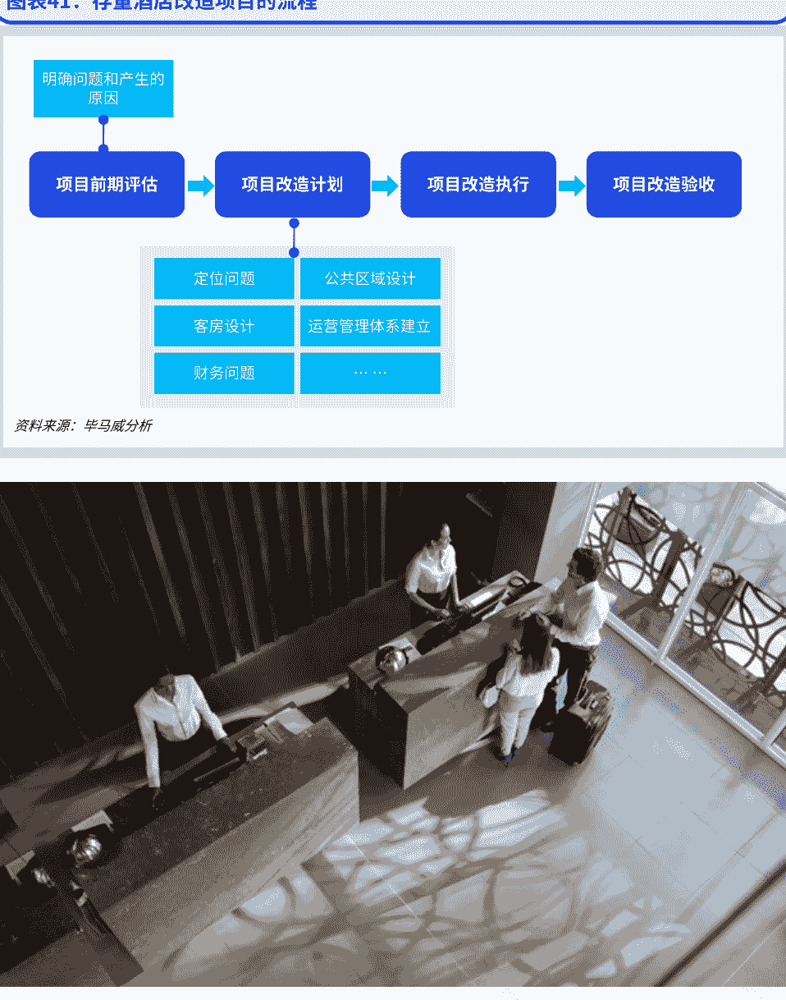

© 2025 华马德誉会计师事务所（特殊普通合伙）--中国华马会计师事务所、锦瑞宏企业咨询有限公司/中国国际有限公司/中国有限有限公司。华马会计师事务所服务～澳门特别行政区合伙师事务所，以及华马会计师事务所服务－香港特别行政区合伙师事务所，均与华马国际（南富国）相关信息。

# 观察：2025年中国酒店业的经营之路

在酒店改造过程中，品牌倾向于租赁、委托管理和特许经营模式。对于品牌而言，其优势在于无需承担装修费用，同时通过收取品牌管理费，以低成本扩张，分担风险并获得收益。对于业主而言，通过品牌加盟和装修升级，能够标准化，这种模式既满足了品牌的需求，又为业主创造了实际收益，实现了双方共赢。

##酒店改造过程中品牌和业主的职责分担

| | 委托管理模式（托管） | 特许经营模式 |
| :--- | :--- | :--- |
| 商业模式 | 酒店品牌向业主租场地，自行负责管理和运营 | 品牌负责组建团队和日常运营，业主收取一定比例的管理费 |
| 管理团队 | 品牌自行组建团队 | 品牌负责组建团队和日常运营，业主自行负责管理团队 |
| 运营控制权 | 品牌：掌握控制权；业主拥有所有场所 | 品牌：控制权；业主通过财务总监进行监督 | 品牌：控制权；业主拥有所有运营 |
| 改造/装修投入 | 品牌承担费用 | 业主承担费用 |
| 酒店收益 | 品牌获得全部经营利润 | 品牌取得相应的管理费用；业主获得经营利润 | 品牌获得一定的特许费；业主获得经营利润 |
| 风险分担 | 品牌自行承担装修风险；业主主要承担收益 | 酒店品牌和业主共担风险 | 酒店品牌和业主共担风险 |

资料来源：华盛

### 轻资产运营：降低负债，提升灵活性

轻资产模式是酒店行业的另一个趋势。该模式下酒店通过品牌授权、管理输出等方式实现业务扩张，而非直接持有物业资产。其核心是将物业资产专业化，使企业专注于品牌和服务质量。目前，轻资产模式已成为行业的核心模式，重塑了资产配置。具体来说，轻资产运营包括管理授权、特许经营、REITs等形式，其中特许经营和管理协助多家酒店成立、设计、筹备及运营等全生命周期管理。

与重资产模式相比，轻资产模式在投资回报和资产运营效率具有显著优势。重资产模式下，资产在总资产中的占比高，资产周转率低，且重依赖资产和债务支持物业购置和建设，负债率较高。而轻资产模式投资回报周期短，资产周转率较高且负债率较低，相对于财务风险较低，实现了资产剥离，在实现酒店数量的同时实现了市场的扩张。

### 图43：酒店轻资产模式与重资产模式的对比

| 重资产模式 | 轻资产模式 |
| :--- | :--- |
| 资产结构 | 固定资产在总资产中占比高 | 固定资产在总资产中占比低 |
| 投资回报周期 | 较长 | 较短 |
| 资产负债率 | 重依赖资产和债务支持物业购置和建设，负债率较高 | 负债率随着轻资产模式的推进而降低 |
| 资产周转率 | 由于拥有较多固定资产，资产周转率低 | 固定资产周转率较高 |
| 风险承担者 | 企业承担物业风险和运营风险 | 物业风险由品牌承担，运营风险由品牌（特许经营）或酒店承担 |
| 代表酒店品牌 | 天华酒店、金陵酒店 | 锦酒店、首旅酒店、君豪酒店 |

数据来源：华盛

# 破与重建：中国酒店业的转型之路

对国际三大酒店集团的轻资产化进行量化分析，可以清晰地看到酒店模式的成功应用，实质是实现了资产与收入的“挂钩”。例如，国际酒店A的全球酒店数9600家，自国际酒店B成立以来就开始优化资产结构，实现了轻资产型酒店向轻资产运营的转变；国际酒店B轻资产贡献了93.5%的收入；其2024年EBITDA为37亿美元至37.4亿美元，反映了较好的转型效果；而国际酒店C正处于高端自营向多层次轻资产转型的过程中，自营占比已降至3.1%，较历史高点下降，同时轻资产占比为12.7%。

图44：国际三大酒店集团的轻资产化进程

| 酒店集团 | 酒店数量 | 自营占比 | 收入占比 | Q2总收入 | Q2 EBITDA | 轻资产收入 | EBITDA效率 |
| :--- | :--- | :--- | :--- | :--- | :--- | :--- | :--- |
| 国际酒店A | 9601家 | 0.5% (50家) | 6.5% | $441M | $6.74B | $603B | 21% |
| 国际酒店B | 8807家 | 0.5% (46家) | 10.6% | $332M | $1.37B | $808B | 32.1% |
| 国际酒店C | 1487家 | 3.1% (46家) | 16.8% | $304M | $1.808B | $504B | 16.8% |

数据来源：华盛

国内酒店的轻资产化趋势也日益显著。国内酒店例如锦华、华住、首旅，在2020年至2024年间，加盟数量持续增长，这表明酒店企业逐步减少对固定资产的投入，而通过品牌输出、管理支持实现快速扩张和更高水平的运营。

图45：国内酒店自营和管理加盟数量

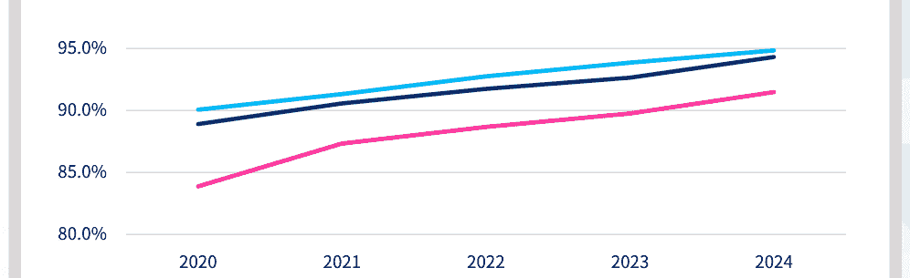

### 深化“入住+X”融合，拓展酒店价值链

随着酒店行业的升级和消费者个性化需求的不断增长，场景化住宿成为酒店行业的发展方向。传统酒店业以住宿为核心，但在面对新一代消费群体个性化、场景化、多元化体验的强烈需求，行业亟需突破单一住宿定位。在此背景下，“入住+X”的跨界融合应运生，通过住宿与餐饮、娱乐、文化、社交、商业等领域深度融合，极大丰富了酒店供给。这种模式不仅满足了消费者从基础住宿到“综合平台”的需求，还提升了客户体验、增强了粘性，更重要的是重构了酒店价值链，为行业创造了新的增长点。

根据行业的数据，“入住+X”模式已成为消费市场的热门之选。以2025年“五一”假期为例，消费者对“入住+X”的接受和付费意愿显著提升。其中，提供下午茶、办理、儿童游等增值服务的套房表现出色，价格比普通房涨幅高达40%，且处于行业领先状态。此外，频繁的增值服务的套房同比增长20%。值得关注的是，年轻消费者对住宿的便利性和高效性提出了更高要求，今年“五一”期间，由于酒店“入住+X”等创新的酒店组合订单量甚至突破了40%。这些数据充分说明，“入住+X”的模式受到消费者的广泛认可。

“入住+X”模式正在酒店多功能转变为承载生活方式的整体体验，标志着酒店业从传统服务向服务经济的战略转型。在体验经济和多样化需求的驱动下，酒店需要以生态思维体系，通过创新的运营模式在竞争中占据先机。这一模式正成为酒店领域最具创新活力的方向，推动行业向潮流转型。

### 图表46：“住+X”融合案例

### 住宿+多元化/非遗体验

- 广州某豪华酒店：提供锦鲤非遗体验研品鉴酒活动，从牛角龙文化之旅学习制作花灯，从中传统印技学习制作云香、香蜀制作等。
- 上海某星级酒店：茶爱好者活动、融入“入住+X”文化体验，汉服拍照、普草体验等。

### 住宿+养疗

- 杭州某康养酒店：提供非遗、茶、森林体验。
- 黄山某度假酒店：提供泉水、森林徒步、农场采摘等。

## 3.3 强化数字化运营能力，提升客户体验

数字化已从可选项升级为酒店提升客户体验、保持核心竞争力的关键驱动力。在数字转型的浪潮中，酒店正通过强化数字化运营能力，精准满足客户增长的个性化、便捷化和高效化需求。通过引入人工智能、物联网、大数据分析等先进技术，酒店正在根本上重塑客户体验，构建更加智能化、个性化的服务生态。

基石信息《2025年中国酒店数字化转型趋势报告》调研结果显示，“提升客户数字化体验”已成为酒店数字化目标的首要关注点，超过了去年“线上预订”目标。这一变化反映出酒店行业正在从“流量获客”到“深度连接”的战略转型。与此同时，酒店在数字化领域的投入意愿持续增强，70%的受访酒店在2025年将加大数字化技术的投入力度²。

# 图47:受访酒店数字化转型目标（多选）

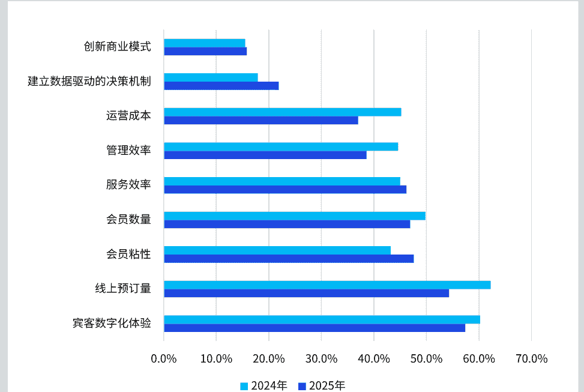

资料来源：基石信息，华慕慕分析

> ²【基石信息】：中国酒店数字化转型趋势报告，中国旅游酒店协会，2025年6月

# 破局与重生：2025年中国酒店的转型之路

数字化变革正在推动酒店业服务转型。未来的酒店数字化将不再局限于零散的技术，而是构建一个以数据为血液、AI为大脑、物联网为神经的完善生态系统，从而创造全方位的客户体验。当前，酒店行业正经历从“流程驱动”向“体验驱动”的战略转型。通过数字化运营模式，酒店不仅能够满足客户对个性化和便捷性的期待，还能借助数据驱动的决策化流程服务，为客户提供更高、智能和贴心的服务体验。

# 图48：未来酒店：数字化场景化应用全景图(C端)

| 基础与技术层 | 未来酒店：数字化场景化应用全景图（C端） | | | |
| :--- | :--- | :--- | :--- | :--- |
| | 前台/接待段 | 入住办理 | 住内/体验段 | 离店/售后段 |
| 人工智能与大数据 | 精准画像，提升转化率：个性化预测引擎。根据用户历史数据、社交行为推荐酒店的服务 | 安全、无感入住：人脸识别Check-in自助功能完成身份验证并入住 | 智能客服：通过语音、手机控制调节温度、空调、系统根据用户习惯自动调节环境 | 无需check-out：系统自动结算房费（如早餐）、电子单发送送到APP |
| 物联网与智能设备 | 沉浸式体验：360°环绕逛客，AR技术引导客房、餐饮、虚拟体验 | 机器人协助办理：机器人提供送货服务（外卖、快递等） | AR与景观融合：用手机扫描直对酒店公共区域，可显示会员信息、会议室地图、或获取购物的信息 | 数字化积分与会员奖励：根据画像发放优惠，并对数据进行深度运营使用 |
| 机器人技术 | 无需钥匙：通过手机或微信获取电子钥匙，直接进入客房 | AI+设备：AI推荐个性化住宿、本地行程并完成预约 | 智能反馈分析：AI自动分析客户的评价，提供具体反馈，帮助酒店改进服务 | |
| 虚拟与增强现实 | | AI（生物识别） | AI+ 大数据 | 物联网+ AI | 物联网+ 大数据 |
| 区块链技术 | 机器人技术 | VR/AR | | | |

数据来源：华马德信肯会计师事务所（特殊普通会计）/中国注册会计师事务所、华马德企业咨询有限公司/中国国际有限责任公司/中国：华马德信肯会计师事务所－香港行政会计师事务所,均与华马德国际会计师事务所（英格兰普普保险有限公司）相关。本报告的观点由全球网络中心产生，版权所有，不得转抄。

## 3.4 借势国家消费政策，推动文旅消费与酒店业协同发展

政策是酒店行业健康发展的重要动力。随着消费的快速发展和人民生活水平的提高，文旅消费逐渐成为拉动内需的重要引擎，酒店作为文旅产业链中的重要环节，在政策的支持实现了与文旅消费的深度融合。国家消费政策通过多维度维持文旅消费与酒店业协同发展。具体而言，政策红利直接引导投入和环境优化为核心，从资金支持、物资激励、环境优化四方面，实现需求、供给更高水平，形成文旅消费与酒店业相互促进的良性循环，为行业可持续发展奠定基础。

未来文旅消费与酒店业协同发展进入新阶段。2024年8月，国务院发布《关于提升消费高质量发展的意见》，要加强培育一批高端酒店和民宿，支持住宿、健康、研学等。2025年8月，财政部等部门发布《关于发放消费补贴的通知》，针对酒店消费领域补贴金额最高100万元。同时，商务部等部门联合发布《关于促进住宿高质量发展的意见》，涵盖文旅产品、游艺、市场、地区联动，让“文旅+酒店”的边界不断拓展。

# 图49：政策推动文旅消费与酒店业协同关系

| 促消费政策 | | |
| :--- | :--- | :--- |
| 资金直接支持消费券、补贴 | 环境优化综合治理 | 项目补助、优质项目 |
| 降低消费者成本 | 提升整体体验 | 降低企业成本 |
| 激发文旅活力 | 促进酒店升级 | 创造新消费场景 |
| 文旅消费与酒店协同发展 | | |

资料来源：华瑞森分析

在旅游消费的驱动下，酒店与旅游资源融合，构建起“住宿+旅游+消费”的闭环。这不仅改变了传统酒店的单一功能，更推动了酒店从单纯的空间向融合中心升级。在此背景下，酒店经营者需要转变，从传统的“营销”向“空间规划”转型。这种转变要求从业者深耕当地文化内涵，并与旅游资源建立多维度合作，整合旅游资源，为消费者打造一套完善且充满记忆的体验。

## 生态酒店的实践

游客选择在酒店，即可连接到所有文旅场所。所有消费通过酒店一卡通或APP实现，“一个全包”或“内部循环”，极大提升了游客的便利性和消费意。

# 图50：生态酒店的实践案例

贵州“梵村”、“大木”与周边酒店的联动
苏州“博物馆酒店”、长白度假区

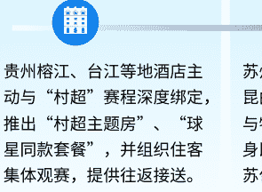
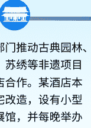
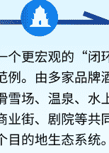

贵州格江、台江等地酒店主与“村+赛”深度定制，推出“主题观剧”、“球赛主题套”、“赛事集餐”，为入住客户提供连接。苏州旅游文旅推动古、林、植坪等专项项目与特色主题合作。酒店化身为小型住宅，设有工作环境，并能够举办聚会。这是一个更贴切的“闭环”酒店案例。由多家品牌酒店、休闲、温泉、水上活动、商业街、剧场等共同构成一个生态系统。

- 锚定资源：住宿（酒店）→体验文旅（看感受、体验体育）→消费（餐饮、购物）。酒店不再是观望者，而是参与者和经营者，成功将赛事流量转化为自身的住宿和消费流量。
- 住宿（漫湖酒店）→文旅体验（观游、园林、学游）→消费（酒店餐饮、演出、工艺设计、作品）。酒店成为了了一个居住的文化博物馆，实现了旅游消费的循环。

数据来源：公开渠道，华马财富分析

## 3.5 推动国际化能力，提升全球竞争力

中国酒店的出海可以清晰地划分为三个阶段，其演进路径体现了从单点输出到体系化的升级。

- 第一阶段：单点试水。早期的出海尝试以单项目为主，主要引入国际品牌或进行本土化运营，目的是学习先进经验，为后续发展奠定基础。
- 第二阶段：资本驱动，快速扩张。随着企业实力增强，中国酒店开始借助资本收购、投资等方式获取全球资源，尚未真正实现全球化布局。
- 第三阶段：体系输出，生态构建。当前，中国酒店已进入新阶段。这一阶段的核心是通过高效运营、供应链和数字化能力进行平台化输出，中国企业不仅输出完整的体系和标准，实现从单点扩张到生态构建的转变。

# 图表1：中国酒店出海历程（1.0至3.0时代）

| 阶段 | 核心模式 | 优势 | 劣势/挑战 |
| :--- | :--- | :--- | :--- |
| 1.0 时代：单点试水（探索阶段） | 项目输出 | 风险可控、灵活运营 | 缺乏复制能力、品牌认可不足 |
| 2.0 时代：资本驱动（规模阶段） | 资本介入 | 附加值、高协同性 | 整合难度大（文化、语言、管理） |
| 3.0 时代：体系输出（生态阶段） | 平台赋能 | 品牌、全球网络 | 对本地运营能力要求极高、文化差异是关键 |

数据来源：华曼分析

中国酒店业在全球竞争中的定位正从传统的运营模式向平台化体系输出逐步转型。过去，中国酒店业从单体酒店转向系统性输出。随着全球旅游市场的重塑与新兴市场能力的崛起，中国酒店集团已能够满足当地的需求，依托本土的数字化输出与规模化扩张，构建起以体系、会员和智能联网为核心的出海战略。

## 案例：酒店集团海外项目

根据旅游行业研究院，2024年，中国公民出游人数超过1.23亿次，迈至历史新水平，酒店平台全球布局迎来增长期。未来，中国酒店平台的全球扩张有望呈现趋势：首先，本土化运营需密切关注当地市场的差异和消费习惯，通过当地企业合作，打造具有当地文化特色的住宿产品，增强品牌竞争和用户粘性。技术驱动的服务升级将向个性化发展，人工智能将帮助酒店平台精准分析市场趋势，优化资源配置，为用户提供更个性化、智能化的体验。同时，在“一带一路”趋势的推动下，中国酒店出海补助将支持本土酒店的助力，加速在中国海外市场的布局，逐步实现从单一国内市场向全球市场的跨越。最后，酒店将通过多元化服务生态延伸，涵盖交通、餐饮、旅游订单等全方位服务，提升品牌影响力和市场占有。

2025年，中国某酒店与马来西亚宣布战略合作，此次合作是业内首个品牌酒店与海外合作伙伴合作，实现了“酒店+品牌”出海。具体而言，双方通过适配当地市场的需求，优化酒店落地，依托欧洲领先的资讯、仓储和支付能力，实现了酒店的全球采购。

# 酒店与重生：2025年中国酒店行业的趋势

对于这些变化，酒店行业不得不重新视自身的定位。Z世代消费者追求特性和差异化体验，他们不再只关注标准化的酒店，而是希望酒店能够量身定制的产品和服务。这要求酒店做出调整，在产品设计、服务模式和运营上进行创新。在数字化时代，大多数酒店已经意识到智能在服务中的重要性，通过人工智能技术，打造智能能、智能服务等，以更好地满足年轻者的需求。在场景化营销下，酒店在不断探索，打造具有特色的公共空间（共享办公区、咖啡区等），让酒店更具吸引力。

# 表格52：国内酒店的品牌创新

| 酒店类型/消费习惯 | 个性化/定制化 | 智能化服务 |
| :--- | :--- | :--- |
| 国内酒店 | 本土酒店与多个联动平台、IP品牌进行了深度合作，为消费者提供了更多、有趣的体验。通过跨界活动、营销抓住消费者的关注点，打造许多主题酒店等。 | 本土酒店可以通过手机或语音控制智能设备，包括灯光、空调、窗帘、电视、背景音乐、响铃、空气、通风、扬声器等，用户通过手机即可设置房间环境。 |
| 国际酒店 | 国际酒店坚持标准化的定制化的策略，例如四季酒店推行全景计划，使得住客的体验更好，能够定制自己入住期间的行程。 | 国际酒店品牌与TCL合作打造智慧酒店，通过黑科技将更多功能引入智能功能，配备AI智能管家并实施监测。 |
| 国际酒店（大中华区） | 国际酒店集团打造了“东方中国”品牌，为了本土化市场主导权，打造符合中国审美与本土基因的入住体验。 | 国际酒店集团关注社交与属性，开放公共空间作为工作社区。在某些酒店将大厅的空间重新设计为。 |

数据来源：公开资料，华瑞分析

## 3.7 优化投资融资，通过兼并重组实现多元化布局

### 国际酒店运作情况

传统的单一发展模式已难以适应酒店业务的变化。在此背景下，优化投资融资并通过兼并重组实现多元化布局，成为推动酒店业转型的重要战略方向。通过整合优质资源、优化资产配置，企业能够在激烈的市场竞争中占据更有利的位置，同时通过多元化布局拓展新的增长点，提升整体经营效率和抗风险能力。

国际酒店业务运作以投资为主。QI数据显示，2020年下半年以来，国际酒店在市场上的活跃度持续活跃，累计投资金额约100亿。从交易类型来看，业务运作以并购、IPO为主，分别占比83.3%、16.6%和0.2%。IPO事件仅两次，且均在欧洲的房地产行业，显示出酒店在直接上市方面的较为保守。从标的属性来说，非酒店企业和提供或产品的国际酒店业务为主，分别占比79.2%和15.2%，而上市公司和国际公司的占比相对较高。从交易金额来看，国际酒店的投资规模集中在1万亿至5亿元人民币之间，市场在布局上更倾向于中等规模的项目。

从标的业务来看，国际酒店的行业表现已从传统的投资扩展至信息技术。然而，从2020年到2024年的数据来看，可选酒店的投资表现呈现持续下降，主要源于酒店、度假村等住宿酒店的投资表现有所回落，反映出酒店在后疫情时期的调整和转型。寻求在这些领域的布局机会，以降低运营成本和风险。此外，与国内市场相比，国际酒店已开始布局海外市场，旨在应对全球能源转型和可持续发展的趋势，更好地实现酒店的优化、绿色转型以及供应链的可持续性。

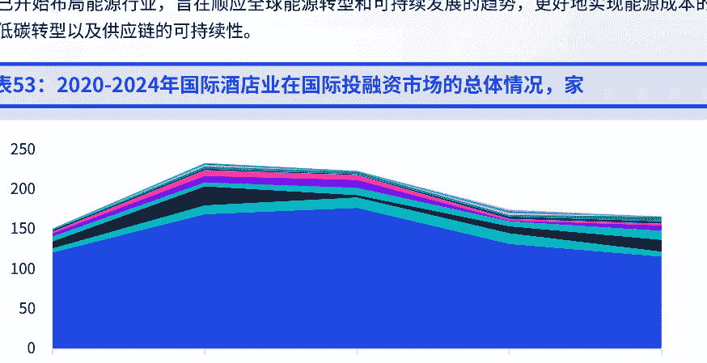

图53：2020-2024年国际酒店在国际投资市场的总体情况

资料来源：标普国际咨询（QI），华经报告

国际酒店的投资呈现明显的区域化特征。尽管跨酒店行业多元化投资占据主地位，但对其他行业的多元化投资仍局限于，表现出未发展的趋势。亚洲地区，酒店行业的多元化投资最为活跃。过去五年，酒店行业对于工业、信息技术、房地产等行业的投资占比接近90%，逐步向消费业的占比增加。这一趋势表明，亚洲地区的酒店正在拓展多元化投资，以提升市场拓展的灵活性和提升盈利能力。相比之下，美国和欧洲的酒店多元化投资尚处于探索阶段。投资者对酒店本身的关注度较高，且倾向于向与酒店业务密切相关的行业投资，如房地产和工业。这种投资偏好反映了新兴市场对多元化投资的依赖性，同时也表明在多元化投资上可能需要逐步加强。此外，加大、拉丁美洲、非洲和中东地区的多元化投资表现较为缓慢，其投资方向不会超过5%，显示出这些地区在多元化投资方向方面的保守态度。随着全球经济持续的发展，这些地区的酒店未来有望进一步扩大投资范围，以适应国际化趋势。

# 图54 国际区域酒店投资标的的行业分布, %

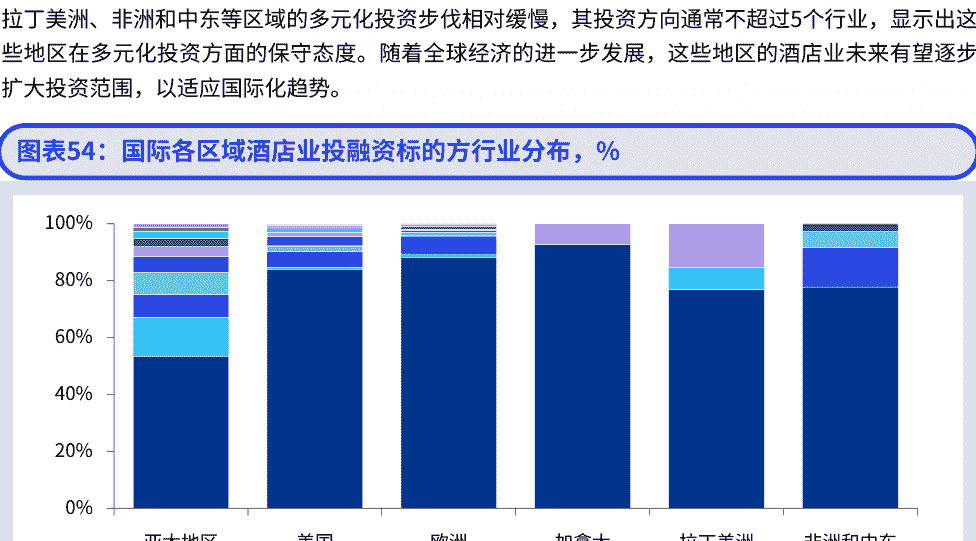

*注:已排除亚洲地区中中国地区数据
数据来源:麦格林智(CapitalIQ), 玛孚分析

国际酒店集团在中国市场的投资呈现明显的多元化布局特征。从投资方向来看，其主要聚焦于酒店、信息技术、医疗保健及日常消费四大领域。其中，酒店业作为核心业务，依然是国际酒店集团在中国市场拓展的重点方向。值得注意的是，国际酒店集团已开始通过拓展多元化的投资领域，整合优势资源，丰富品牌矩阵，以增强品牌在市场上的竞争力。

# 图55 2020-2024年国际酒店在中国的市场的行业分布, %

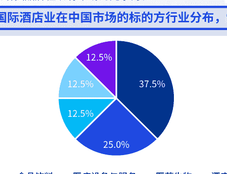

- 软件
- 食品用品
- 医疗保健与服务
- 医药药物
- 酒店、餐饮与休闲

数据来源:麦格林智(CapitalIQ), 玛孚分析
© 2025 玛孚森事务所（特许）-玛孚咨询（香港）-瑞盛咨询（香港）-玛孚森事务所（香港）-玛孚森事务所（香港）-玛孚森事务所（南非）
*免责声明：

### 中国酒店资本运作

根据Capital IQ数据显示，2020年至2025年上半年，中国酒店资本运作共发生了101起，并购和融资事件分别为46起和55起。从标的性质来看，非上市企业主导，占比91%。从区域来看，主要集中在亚洲地区，但仅有9%涉及海外，涵盖美国、欧洲、亚洲中东和拉美地区。这一分布体现了全球化背景下企业通过资本运作寻求市场布局。

近五年，中国酒店积极拓展跨境布局，展现出明显的时代特征。从投资方向来看，主要投资方向涵盖消费、零售等多个领域。与之相同，智能化生产、信息技术、金融等新兴领域热度持续升。值得注意的是，2024年信息技术领域融资事件交易金额高达59.5亿元，充分显示了酒店新兴领域的投入。此外，医疗、通讯、食品饮料和公共事业等新兴领域也成为酒店布局的重点方向，这不仅体现了行业多元化追求，更明确了酒店在新经济潮下寻求突破、高质量发展的战略路径。

# 图56 2025年上半年中国酒店资本运作市场的行业分布

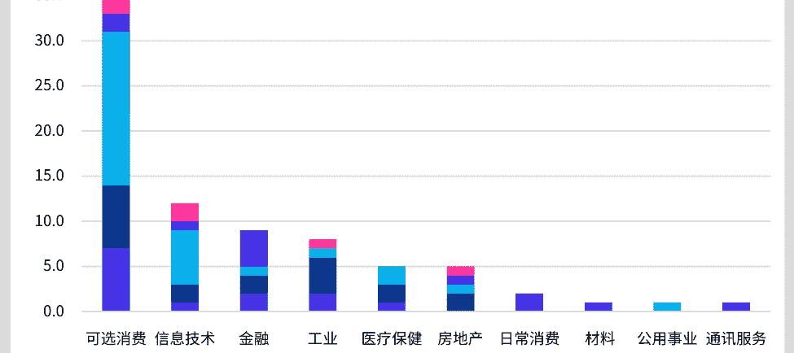

数据来源：Capital IQ，华勤资讯

从市场来看，酒店行业频繁出现并购与跨界发展的趋势。从并购来看，2020年至2024年期间，横向并购占据主导地位，占比高达41%，表明企业通过整合行业资源以强化竞争力。同时，部分酒店企业通过出售资产、转让股权等方式实现资产结构调整，向轻资产转型。此外，酒店企业还通过资产，通过多元化投资分散单一业务带来的风险，从而在复杂的市场中实现稳健发展。

# 图55 2020-2024年中国酒店并购的行业分类数据情况

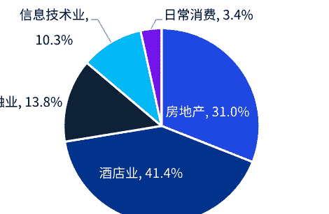

| 房地产 |
| 酒店 |
| 金融 |
| 信息技术 |
| 日常消费 |

从市场来看，中国酒店融资市场活跃逐渐回升。根据CV Source，2020年至2024年酒店行业融资景气市场呈现“V”型转，总体趋势向好。在2022年至2023年酒店融资事件出现阶段性回暖，2021以后已经恢复至2021年初水平，维持好态势。从融资方向来看，酒店经营与运营仍然是最关注的专业领域。近期消费者对旅游需求的持续增长，综合性旅游服务和酒店预订平台契合消费升级趋势成为主流。此外，一些新的投资方向逐渐出现：智能酒店解决方案、电竞酒店模式或健康养模式等新常态逐步成为资本投入的方向。这一系列变化体现了市场对酒店细分领域的精准把握，以及对行业转型升级的有力支持。

# 图56 2020-2024年中国酒店市场投融资数量

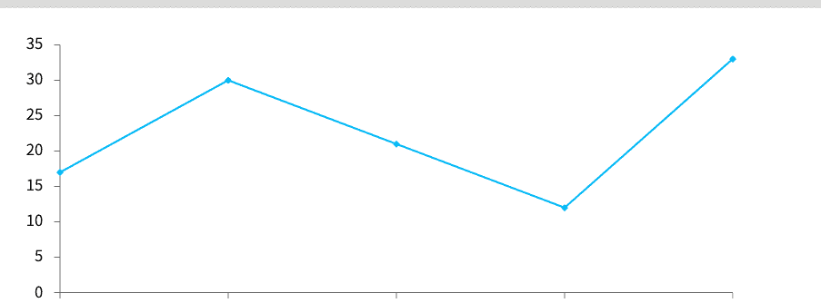

资料来源：CVSource，华尔盛分析
© 2025 华尔盛会计事务所特殊注册会计师有限公司-华尔盛会计咨询（中国）有限责任公司-华尔盛会计业务报告源于中国注册会计准则，华尔盛审计报告符合香港注册会计准则，并与华尔盛美国（美国国泰保险有限公司）有关

## 3.8 推动绿色低碳转型，响应国家可持续发展策略

可持续发展已成为全球行业转型的核心议。随着“双碳”目标的推进以及ESG（环境、社会、治理）理念的深化，酒店业掀起了一场“绿色低碳”的变革浪潮。根据联合国全球旅游行业的数据，酒店业对全球排放的贡献率约为11%。然而，面对气候变化的严峻挑战，酒店业的减排任务依然艰巨。可持续酒店联合会的《Global Hotel Decarbonisation Report》显示，酒店业需要在2030年前实现66%的排放减量，并在2050年实现90%的绝对排放减量，以确保行业增长与排放增加脱钩。为了推动酒店业绿色低碳转型，国务院出台《关于加快碳中和指导意见》（2020年）明确了碳达峰和相关政策，引导酒店可持续发展。

与此同时，消费者环保意识增强。根据2025年报告显示，66%的消费者在入住时特别关注可持续性，50%的消费者愿意为环保付费。这种趋势在年轻群体中日益明显，特别是Z世代和千禧一代，他们倾向于选择那些使用再生能源、减少一次性产品的酒店。酒店业通过三大路径进行绿色转型：主要涉及建筑节能、经营管理以及设备改造。能源管理主要集中在电、水、气的使用，其中节能照明、热水器等系统技术的应用显著降低了能源消耗，还确保了酒店能够达到最佳效果。

循环经济的宗旨，主要体现在酒店对资源的高效利用和排放量的量化。例如，酒店可以通过加强闲余利用、减少客房更新频率、非季节性措施推动循环经济。以某本土品牌为例，其通过落实“循环模块”（Reduce, Reuse, Replace），大幅降低企业成本，提高了排放效率。最后是碳资产管理，这是酒店从“减碳减排”向“碳资产管理”的重要标志。通过改造和交易，酒店不仅能实现减排目标，还能创造价值，年均减少3000吨碳排放。资产管理不仅是一种环保责任，更是一种可持续的商业模式。

# 图59 酒店减碳转型的典型案例

| 减碳实践 | 领域 | 具体行动 |
| :--- | :--- | :--- |
| 运营 | 本土品牌广泛使用环保材料，如安心巾、棉床单、竹质纤维等。 |
| 餐饮 | 某国际酒店与三方合作，利用AI和大数据追踪、监控和减少食物浪费。四个月内食物浪费减少了65%。 |
| 能源 | 某本土集团采用更低能耗的LED灯具，通过感应设备、区域控制实现节能。此外，加强水泵、空调改造等减少空调消耗。 |
| 客房 | 本土品牌的高端酒店在一次性包装外使用可降解材料，单一包装由塑料调整为纸质；取消外包装，采用纸质袋替代降低碳排放。 |
| 会员积分 | 某酒店品牌执行“减碳计划”，通过会员积分、环保权益等方式，用户留存率提升了22%。 |
| 酒店用品 | 本土品牌限行一次性用品控制，建立积分、环保积分，鼓励客户减少一次性用品的消耗。 |
| 客务服务 | 某本土酒店通过积分的形式，培养会员在入住期间不使用一次性用品或连住时不更换床单/浴巾等可持续行为。 |

资料来源：公开经营数据，行业测算

尽管国际酒店在低碳转型方面起步较早，中国酒店也迅速发展并积极推动转型计划的落地实施。从Wind数据来看，中国酒店企业已加快低碳转型实践，截至2025年上半年，已有9家企业评分达到A级及以上，其中两家企业获得AA级。中国酒店在低碳转型方面取得了显著进展，不仅在节能减排方面表现突出，在可持续发展和企业责任方面展现了积极作为。

# 图60 2023-2025年中国酒店ESG占比变化情况

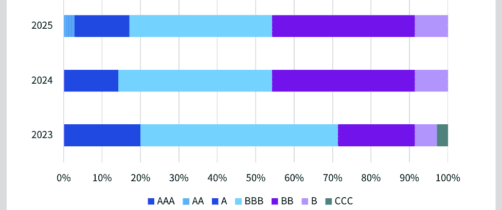

资料来源：Wind，华瑞分析

根据中国社会科学学院研究院的数据，ESG表现有助于降低企业的债务成本，且企业ESG表现每提升一个标准，债务成本将下降5.17%。这一趋势表明，ESG不是单纯的非财务指标，而是衡量企业价值和风险的重要指标。此外，ESG与资产负债率之间存在紧密的联系。通过优化ESG表现，酒店可以降低债务成本、优化资本结构，在多个层次上影响企业负债率。根据Wind数据，2020至2024年处于领先水平的酒店企业负债率持续下降，其中超过50%的领先企业已计划、实施绿色转型。在稳健梯队、后列队伍中，由于实施绿色改造的较少，对企业负债率的影响较小。

# 图61 2020-2024年酒店企业平均负债率变化情况

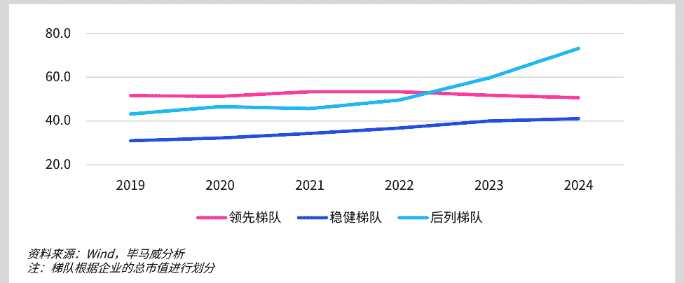

数据来源：Wind，华瑞分析
注：根据企业总市值统计，2025年华瑞报告（中国社会科学学院研究院），华瑞咨询（上海）有限责任公司，华瑞咨询（香港）

### 构建智能化、数据驱动的运营体系

酒店业的AI进化从静态系统转向全链路数据运营，重塑了运营模式。2025年以来，酒店企业持续引入AI，通过人机协同降低人力成本，推动运营效率的全面提升。目前，AI技术已替代重复性较低的基础工作，使人力资源能够更多投入到酒店管理等高附加值工作中。以轻型酒店为例，20年前员工数量和客房数量的比值为2.4，现在降至1.4，在此过程中人力资源效率提升了超过40%。Gartner预测，2025年将有75%的酒店依托AI技术实现流程自动化，AI成为酒店运营的新起点。

### AI面临的挑战

在消费升级与技术革命的双重驱动下，酒店行业的竞争逻辑发生了深刻变革。酒店企业需要突破“工具使用者”角色，主动拥抱，争做“生态构建者”，在AI技术发展的浪潮中占据抢先机。通过构建差异化竞争优势，酒店可以在细分市场中脱颖而出，实现持续发展。

# 图62 2023-2025年酒店投资意愿及技术成效预期

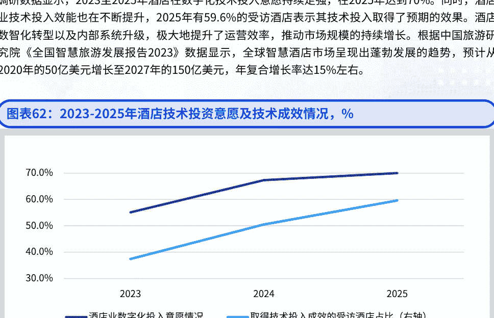

数据来源：世信、麦分析
*注：2025年调研样本数为52份，酒店集团占比54.2%，品牌连锁单体占比28.0%，非品牌连锁单体占比19.6%。

### 酒店行业：2025年中国酒店的竞争之路

酒店业的AI进化从静态系统转向全链路数据运营，重塑了运营模式。2025年以来，酒店企业持续引入AI，通过人机协同降低人力成本，推动运营效率的全面提升。目前，AI技术已替代重复性较低的基础工作，使人力资源能够更多投入到酒店管理等高附加值工作中。以轻型酒店为例，20年前员工数量和客房数量的比值为2.4，现在降至1.4，在此过程中人力资源效率提升了超过40%。

此外，人工智能赋能酒店的效果已逐步显著。《2025年中国酒店业数字化转型报告——行业组织》数据显示，酒店业在业财融合体系方面的提升已超出运营维度的平均水平。酒店集团已识别到AI赋能经营的重要性，并开始尝试落地业财融合体系，通过多场景数据的深度驱动，打破信息孤岛，构建全链路数字化生态系统，提升高效运营能力。全球市场呈现出增长趋势，预计从2020年的50亿增长到2027年的150亿美元。

2025年华尔盛会计事务所（特除）－中国会计师事务所（中国）；华尔盛威尔有限公司（中国）有限责任有限公司合伙师；华尔盛会计事务所（香港特别行政区）会计师事务所－香港；华马及会计师事务所－香港；均与华尔盛国际（国信集团保险有限公司）相关报告的注册审计师中成员。备注，但不负责签署。

## 04 解决方案：助力打造酒店业向新而行的每一面

© 2025 毕马联合会计事务所特殊会计师事务所（凯）德豪吉会计事务所业务税务金融咨询翰锦斯酒店有限公司及英诗美逸酒店全球连锁品牌提供专业服务。澳门特别行政区会计制会计师事务所、毕马与马马会计师事务所 —香港特别行政区会计制会计师事务所，均是毕马与马马国际有限公司（英国私有集团有限公司）相关关联的特许机构。

## 酒酒店业企业的风险管理、内控及风险服务

酒酒店企业在生命周期各阶段面临着巨大挑战和风险：

- 策划/改造阶段：酒店面临建筑企业、原材料供应商等众多参与，存在较大管理复杂性，此外，行业会对消防设施、建筑空间布局等关键环节实施严格要求，企业应关注相关合规风险；
- 运营阶段：酒店面临运营标准、食品安全、劳动用综合要求，客房服务、餐饮运营及前台等其他环节也面临标准化问题，酒店管理层应有有效的监控和评价机制制约；
- 运营扩张阶段：酒店需要满足投资回报预期、经营压力，而且扩张阶段的酒店在多个城市或区域进行布局，导致管理非常困难，运营成本上升，现金流对于酒店的日常运营和债务偿还具有重要意义。
- 退出/再投资阶段：酒店往往涉及退出的目标选择和择期规划。同时，酒店资产的全生命周期贯穿运营、退出的过程，在实际中，酒店未建立完善的管理机制。

因此酒店企业需要建立全生命周期的风险管理能力，强化内控和合规管理，以应对挑战。酒店可以通过专业的风险管理、内控及合规经营服务，全面提升在生命周期各阶段的管理能力。

## 图63 酒店企业全生命周期风险管理解决方案

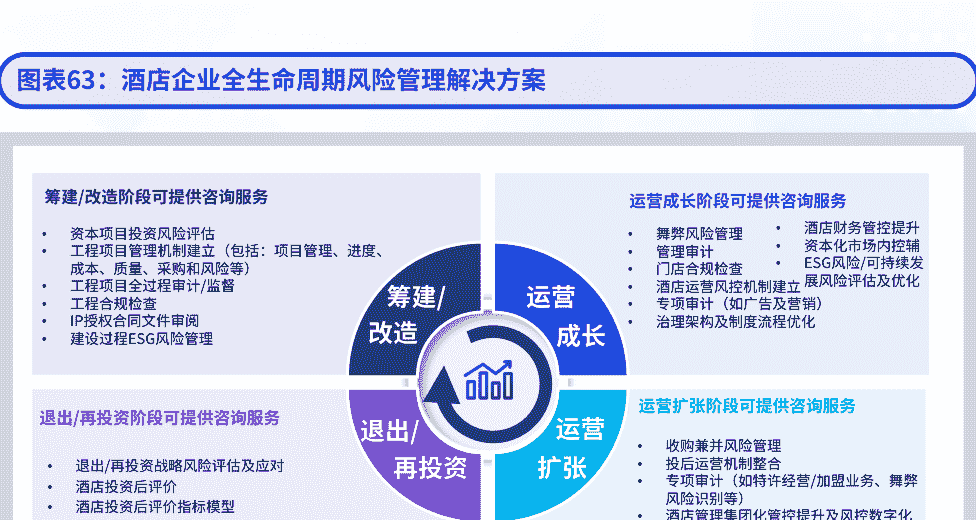

| 策划/改造阶段可提供咨询服务 | 运营扩张阶段可提供咨询服务 |
| --- | --- |
| 酒店项目风险评估 | 酒店经营风险管理 |
| 项目管理体系建立（包括：项目、进度、质量、成本、风险控制等） | ESG 合规/可持续发展 |
| 验收检查 | 酒店扩张风险评估及评价流程优化 |
| 酒店扩张风险规划 | 酒店治理管理及制度流程优化 |
| 项目专项计划/预算管理 | 运营财务风险控制机制 |
| IP 授权文件准备 | 专项调研（如经营/租赁业务、财务审计） |
| 建立 ESG 环境管理机制 | 酒店集团化管控及数字化转型 |
| | 店店巡查（包括酒店巡查建议） |
| | 酒店运营管理体系（包括酒店运营） |

来源：麦肯分析

## 4.3 酒店企业的ESG可持续发展咨询与ESG报告审计服务

可持续发展有助于提升酒店业的竞争力，如同其他地产行业一样，可持续发展议题已成为酒店业的重要课题之一。企业需要充分了解自身在E（环境）、S（社会）、G（治理）方面的现状，结合发展轨迹，制定针对性的可实施的可持续发展计划与方案，可以通过帮助企业增长、降低成本、提升品牌、降低风险，提高企业品牌竞争力。酒店业可以通过华诚在ESG流程中提供的端到端服务，提升可持续发展能力。

## 图64 酒店企业ESG可持续发展方案

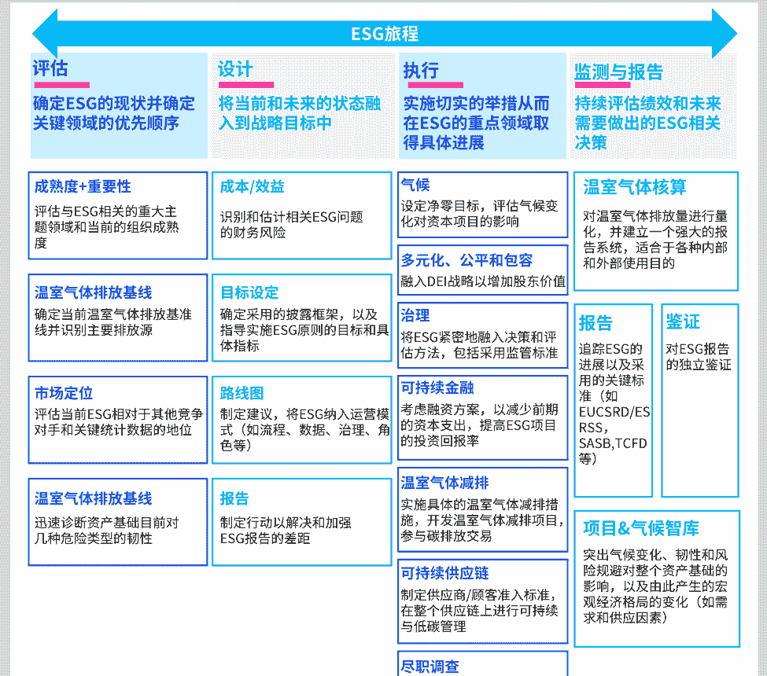

| 评估 | 设计 | 执行 | 监测与报告 |
|---|---|---|---|
| 确定当前的现状并确定关键议题的优先顺序 | 将现在和未来的状态纳入目标中 | 实施切实的措施从ESG领域取得具体措施 | 持续追踪绩效和未来需要的ESG报告 |
| 成本/效益 | 识别和量化ESG问题的财务风险 | 气候设置基准标准，评估绩效量化对目标的影响 | 温室气体监测 |
| 温室气体排放减排 | 确定当前排放量并列出主要排放因素 | 多元化、优化供应链管理增加绩效贡献 | 对温室气体排放进行量化监测 |
| 市场定位 | 目标设定：确定长期的愿景、规划制定实施ESG报告的目标和指标 | 治理：将ESG融入决策和因素，建立良好监控机制 | 审计：对ESG报告的独立审计 |
| 温室气体排放减排 | 制定措施，将ESG融入具体（如数据、治理、举措等） | 可持续性：考虑资源配置，减少短期的资金支出，提高ESG投资回报 | |
| 温室气体减排 | 实施真实的温室气体排放项目，开发与签署 | 可持续供应链：制定供应商/采购，在供应商上进行可持续要求 |
| | | 尽职调查：将ESG风险纳入投资组合和识别 | 项目和绩效管理 |

来源：华诚

## ESG可持续发展

酒店企业可以通过ESG绩效差异服务，对照国际标准和行业标准，以及同行，识别自身在ESG管理方面的优势和改进，建立完善的治理体系。主要咨询包括：

- ESG咨询与策划——管理架构、政策完整性与针对性改进等
- ESG影响分析——环境风险与机遇、业务与战略的影响、潜在影响
- ESG议题重要性评估——利益相关因素识别、财务影响评估
- ESG基线评估——温室气体排放量、产品足迹量化、供应链评估
- ESG目标管理——关键指标、目标达成、路线规划、ESG全景

## ESG报告证书咨询

酒店可以通过定制化的ESG报告和发展报告，参照国际标准和地区强制性要求，满足监管并提升品牌形象。此外，酒店还可以通过ESG报告认证服务，进一步增强信息披露的透明性和可靠性。主要服务包括：

- ESG报告编制与撰写
- ESG报告认证

## 温室气体与环境管理咨询

酒店可以通过华诚的可持续发展服务，聚焦于温室气体及环境管理领域，使用国际标准提升自身发展能力，从而满足未来市场和其他温室气体排放降低的目标。主要服务包括：

- 碳市场交易——包括全球碳排放交易（ETS）
- 碳边界调节机制（CBAM）、碳市场、碳信用
- 温室气体排放管理（LCA和MRV报告）建设及提升
- 环境管理体系审阅及咨询
- 脱碳路线图和战略规划
- 供应链/业务合作伙伴参与

## 4.4 酒店企业的战略咨询 数字化转型及流程咨询服务

在数字化技术快速发展的背景下，酒店业通过部署自助终端、电子房卡、智能机器人等智能化设施，为旅客提供了更便捷、灵活的入住体验。当前，科技已进入深水区，如何用用户旅程为核心，以酒店管理为主，充分发挥数据要素价值，重构酒店运营场景与管理流程，已成为竞争的关键指标。

酒店业正不断深化创新与技术融合的实践，同时在优化酒店运营精细管理，例如在运营及供应链数字化、营销及服务数字化方面深入探索，并积极尝试新技术的应用，以推动业务市场的创新。酒店业可以通过全周期、全系统的数字化咨询服务，围绕住前、住中、住后场景的数字化建设，实现企业转型与业务提升。

## 图65：酒店企业数字化转型解决方案

| 外部部门 | 门店部门 | 移动端 | 自营电商平台 |
| --- | --- | --- | --- |
| 合作门店平台 | 其他客户平台 | 智能终端 | 协同合作平台 |
| 客户服务平台 | | | |
| 酒店服务接入层 | 直餐服务 | 全会中心 | |
| 积分中心 | 交易中心 | API 开放与集成 | |
| 业务运营平台（集团） | 业务运营平台（酒店） | 项目拓展管理平台 | |
| 直渠道管理 | 订票管理 | 前期管理 | 客服管理、质量管理 |
| 销售管理 | 住宿管理 | 绩效管理 | 知识管理 |
| 运营分析平台 | 财务管理平台 | 协同办公平台 | |
| 领导绩效管理 | 财务总监控 | 成本费用管理 | 流程管理 |
| 业务绩效分析 | 资金管理 | 资产管理 | 行政管理、任务管理 |
| 人力资源管理平台 | 战略/会计/预算管理平台 | | |
| 全局管理 | 合规管理 | 组织管理 | 人员管理、战略管理、投资管理 |
| 内控管理 | 计费管理 | | 全面预算平台 |
| 资源共享平台 | 大数据分析 | 统一运营平台 | 单点登录、身份认证 |
| | 统一运营平台 | 私有云平台 | |

来源：华诚

## 会员管理提升服务

各大酒店积极构建数据化营销体系，通过渠道、微信等垂直平台，有效捕捉流量并实现实时互动，提升经营效率和用户满意度。然而，会员管理体系建设面临诸多挑战：数据碎片化、流程不通、会员能力不足。从企业视角来看，构建会员运营体系有助于整合资源、发挥核心战略。通过创新和人工智能技术，满足个性化需求，实现直接对接销售能力，重塑行业价值并驱动业务增长。

## 图66：酒店业会员体系解决方案

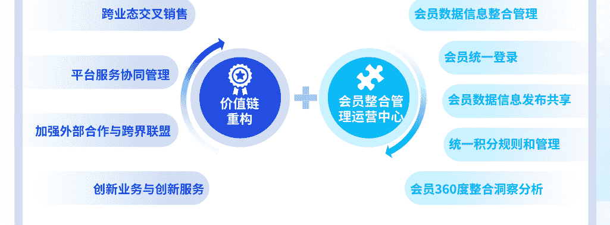

来源：吴马军

## 4.5 酒店企业的并购及财税调优

酒店可以通过专业的物业及财税咨询服务助力全球市场的拓展与精准对接。这些服务涵盖交易前的战略规划与市场布局、交易中期的财务分析与税务优化、以及交易完成后的整合与运营优化，助力酒店企业把握行业转型，实现可持续发展。在住宿服务、租赁运营、工业地产、物流地产、IDC、商业地产及物业管理等领域，酒店可以通过优质资源的整合与市场洞察，推动酒店业创新与模式升级，在激烈的市场竞争中占据优势地位。

## 图67:酒店企业并购及财税调优解决方案

| 1 财务顾问 | 4 国际化支持 | |
|---|---|---|
| 项目管理 | 团队协助企业应对当地的社会、法律、政策、运营环境 | 以实现企业本地国际化的目标 |
| 前期分析评估 | | |
| 价值分析 | | |
| 合同谈判及交易咨询 | | |
| 2 交易支持 | 3 并购后整合 | |
| 财务/税务/商业/运营层决策 | 制定和实施并购后整合计划 | |
| 架构规划 | 业务流程优化 | |
| 交易文件准备 | 绩效管理 | |
| 交易对接及清单 | 风险管理等 | |
| 交割对接和交易调整 | | |

资料来源：华永

## 4.6 酒店业的投、建、运、退全周期税务咨询服务

在企业的不同发展阶段，酒店业可以通过专业的税务咨询服务实现多方面的优化与提升：

- 投资阶段：企业可以通过税务架构模块化服务，设计并调整税务架构，以满足集团融资、内控、上市及未来退出的需求，从而提升整体税务效益。同时，还可以通过安排，评估不同地区的财税政策，选择匹配企业策略的地点，降低税务风险。此外，可以通过房产税务专项规划，降低房产税风险。
- 建设阶段：酒店业可以通过递延税务筹划，应对设计费、工程合同印花税、增值税发票合规及融资安排等方面的税务问题，降低税务风险。此外，可以通过房产税务专项服务，提前进行税务规划，降低未来的房税负担。
- 运营阶段：酒店业可以通过税务服务模块化，合理安排、设计及处理，获取专业服务。同时，还可以通过日常管理流程，部署标准化工具，快速完成合规要求，如税务申报，能够提升管理水平及效率。
- 退出阶段：酒店业可以通过交易咨询服务，评估资产出售，设计合理的架构，确保交易顺利。对于退出需求，企业可以通过专项规划，建立可持续模型，通过资产重组，优化价值链，降低整体成本。

## 业务提升及人力资源服务

当下酒店业面临需求下降、成本上升等挑战，企业需要调整策略和组织架构来驱动增长，并致力于持续提升体验。相关问题包括：

- 面对市场机遇与挑战挑战。
- 通过编制人才梯队，建立标准，提升领导力。
- 通过激励机制，明确目标、愿景和核心影响力，通过战略规划、人才引进。
- 建立共识，激活企业活力，发现差异。
- 建立文化，通过业务学习、跨界。
- 确保关键信息准确传达。
- 通过培训提升未来的表现。
- 追踪，及时提供反馈。

## 图68：酒店企业业务提升及人力资源解决方案

| 激活企业的驱动动机 | 基层企业的软实力 | 后期人才培养 | 战略人才招聘 |
|---|---|---|---|
| 酒店化“驱动动机” | 业务建模 | 文化构建 | 寻找合适 |
| 酒店化“工作力” | 业务学习 | | |
| 准化：绩效服务 | 员工工作标准化 | | |
| 制度化：制定特定行为规范 | | | |
| 体系化：建立体系，形成标准 | | | |

数据来源：华募

| 经营诊断：实现 PDCA循环 团队驱动：价值创造 | 客户建模：以客户为目标进行访谈 | 运营诊断：解决问题 |
| 控根 | 监控：聚焦关注 | 行动闭环：能力匹配，引起结果 |

## 结语

近年来，中国酒店行业正经历深刻的结构性变化，品牌整合与轻资产运营模式成为行业发展的核心动力。通过对接、合作或品牌重组等方式，大型酒店集团迅速崛起，形成了以品牌化、连锁化、专业化为特征的行业趋势。与此同时，轻资产运营模式的普及对于酒店行业提供了新思路，使得企业能够实现快速增长，并将更多资源投入到品牌建设和市场拓展。这些变化改变了行业的格局，也推动了行业集中度的提升，为头部企业创造了更大的发展空间。

展望未来，中国酒店业的发展将更加创新驱动和可持续发展。一方面，数字化技术的应用将成为行业发展的核心动力，通过大数据、人工智能、物联网技术，酒店可以实现精准营销、智能服务和高效管理，提升用户体验和经营效率。另一方面，绿色经营理念成为行业趋势。从建筑设计到运营模式，酒店将更加节能减排和生态保护，推动行业持续发展。此外，随着一代消费者（年轻世代）逐渐成为舞台，酒店业需要更加关注个性化、体验化的需求。主题酒店、智能化体验、场景化社交服务等，将成为年轻消费者的重要手段。在国际化战略方面，中国酒店业正站在3.0平台化时期。未来的新潮流不再是简单的本土扩张、资本出海或经验输出，而是更强的平台化、体系化协同，意味着中国酒店业正从“本土输出”走向“体系输出”。

李丰峰
毕马威国际中国会计师事务所

# 关于毕马威中国研究院

毕马威中国研究院专注于开展宏观、行业、区域和分领域的深入研究。研究院集结了毕马威中国网络的研究力量，结合毕马威全球资源，以国际化视野，为经济和商业领域的研究课题提供深入分析和洞察。

研究院将理论创新与实践相结合，确保研究成果具有理论深度和实践价值。依托数据挖掘与信息追踪的“双轮引擎”，研究院将持续追踪特定行业最新动态，包括宏观经济趋势、国家政策法规、行业领先企业及资本市场态势等，以开发白皮书、专项课题等为客户提供创新和具有前瞻性的解决方案。

研究院致力于与生态合作伙伴共同成长。通过深度化与国家、地方和企业研究机构的合作，积极参与创新、专业、高效的研究体系的建设，推动自身发展，并为合作伙伴的可持续发展提供方位支持。

# 联系我们

黄锋
华东及华西区市场主管合伙人
毕马威中国
邮箱：frank.huang@kpm.com
电话：+8621 2212 2371

邵锋
审计合伙人
毕马威中国
邮箱：tony.shao@kpm.com
电话：+8621 2212 4243

丽琳
美国资本合伙人
毕马威中国
邮箱：linda.gu@kpm.com
电话：+8621 2212 2312

冯李宇
审计合伙人
毕马威中国
邮箱：jane.feng@kpm.com
电话：+8621 2212 2533

裴丽骏
审计高级经理
毕马威中国
邮箱：schumi.fan@kpm.com
电话：+8621 2212 4962

余梦苇
审计经理
毕马威中国
邮箱：elaine.yu@kpm.com
电话：+8621 2212 3738

# 研究团队

毕马威德华会计师事务所（特殊普通合伙）

孟瑞、范嘉怡、连伟、孙旭晖、曾哲怡、吕桂萍、陈涵妤

kpmg.com/cn/socialmedia

如需获取毕马威中国各办公室信息，请扫描二维码或登陆我们的网站：
https://kpmg.com/cn/zh/home/about/office-locations.html

所载资料仅供一般参考，并非针对任何个人或团体的具体情况而提供。虽然我们已尽力提供准确和及时的资料，但我们不能保证这些资料在阅读或日后仍然准确。建议您在决策前考虑咨询或获取所需的专业意见，根据您的需要行事。

© 2025 毕马威会计师事务所（特殊普通会计事务所）— 中国企业咨询（中国）有限公司 — 毕马威会计师事务所（有限公司） 毕马威会计师事务所 — 澳门特别行政区会计师事务所，以及与香港特别行政区会计师事务所，均与毕马威国际有限公司（美国私享报告有限公司）相关的独立的会计师事务所全球组织中的成员有关。版权所有，不得转载。
毕马威的名称和标识均为毕马威全球组织中独立的会计师事务所所经营使用的商标。

二零二五年十月刊
