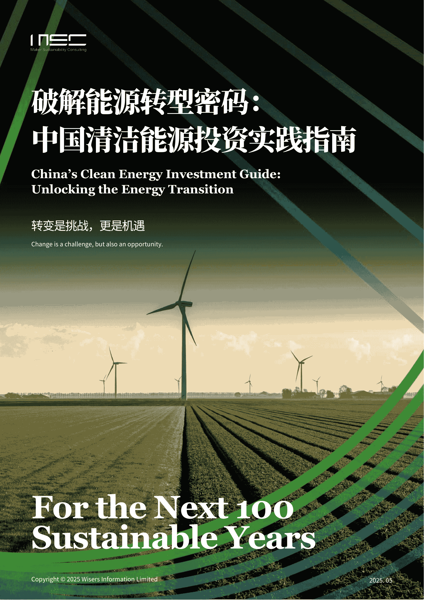
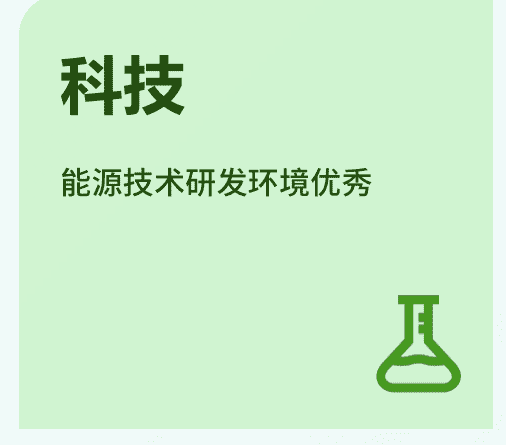
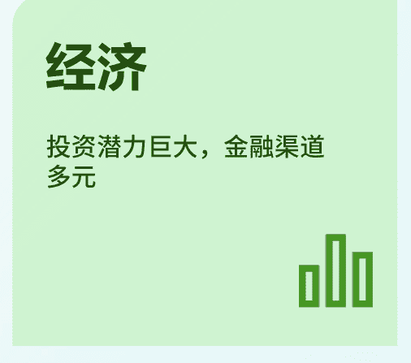
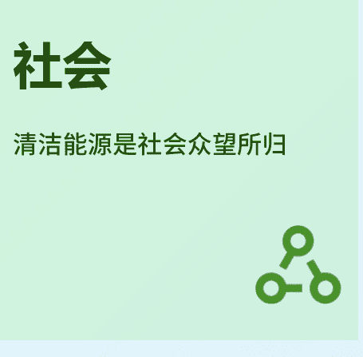
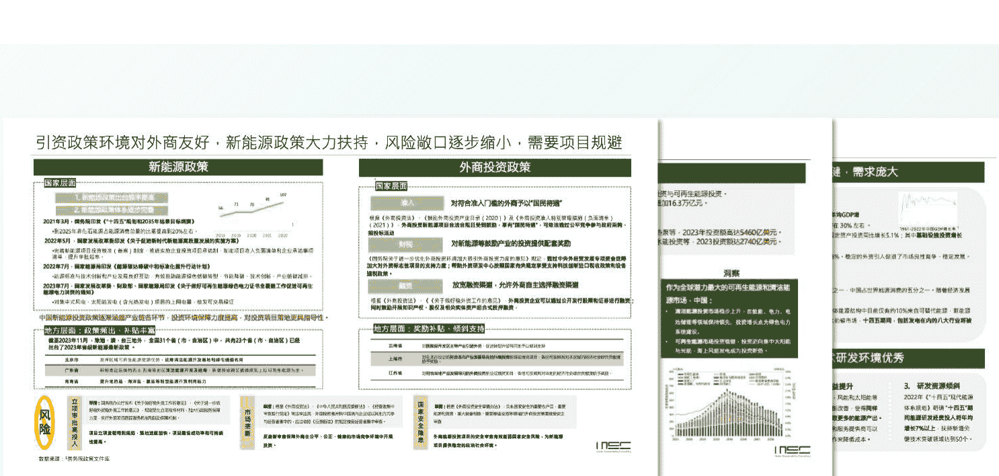
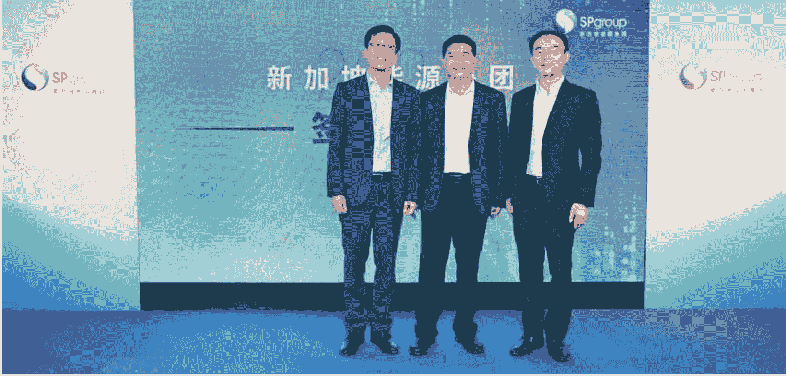
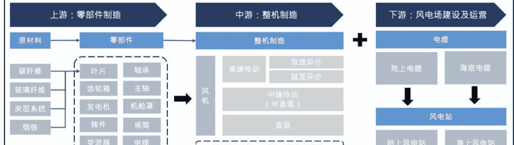
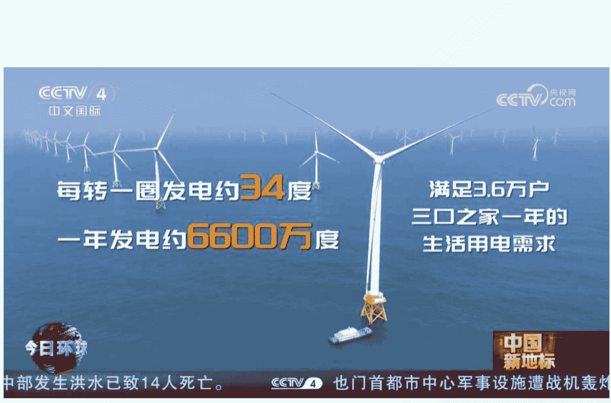
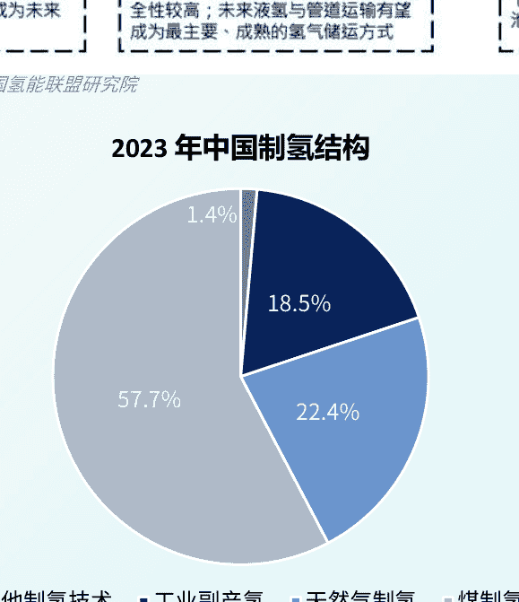
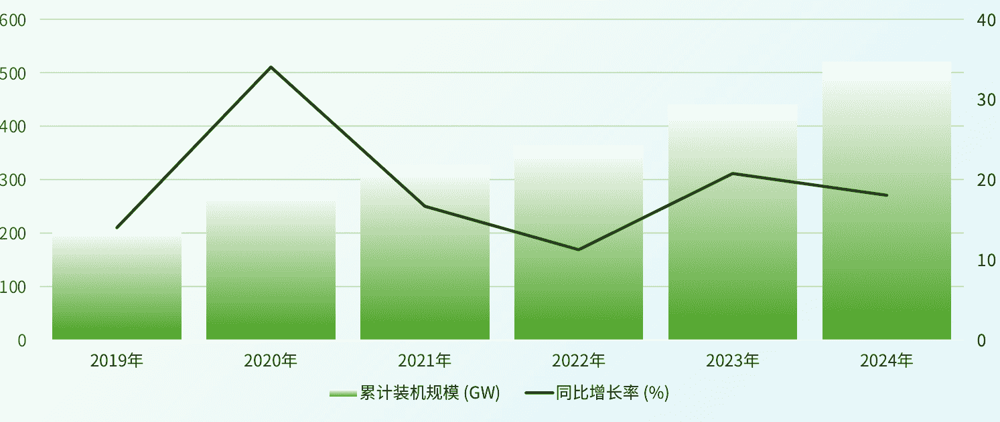

# 破解能源转型密码：中国清洁能源投资实践指南

China’s Clean Energy Investment Guide:
Unlocking the Energy Transition

转变是挑战，更是机遇
Change is a challenge, but also an opportunity.

Copyright © 2025 Wisers Information Limited

# 免费 价值 及时 专注

# 扫码加入 知识星球TOP 免费资源群

- 每日免费获取有价值资源
- 可提供各类资源搜索服务

| ◆热门付费文章 | ◆各行各业报告 |
| :--- | :--- |
| ◆精选图书资源 | ◆副业赚钱方法 |
| ◆职场实用资源 | ◆AI经营自媒体体 |

公众号:知识星球TOP 微信信号:jntsg8 微信信号:jntsg2

分享资料仅供个人学习，请及时删除，切勿商用传播

# 目录

- 前言 3
- 调研目标及范围说明 4
- 清洁能源投资指南：解锁中国市场的新机遇 5
- 中国现有清洁能源投资宏观环境分析 6
- 外商在华清洁能源投资案例 15
- 抢抓风口！清洁能源四大领域投资机会解析 19
- 四类清洁能源项目概况 20
- 四类清洁能源项目市场判断 28
- 总结 34
- 清洁能源新风口：你的项目可行吗？快来算算账 35
- Step1:项目投资方向确定 36
- Step2:项目可行性评估 37
- Step3:难点与风险评估 41
- 结尾 43

# 前言

随着全球绿色、低碳的发展日益关注，清洁能源投资已成为推动能源结构转型、实现可持续发展的关键。在中国，这一趋势尤为明显。

自2021年以来，中央政府在生态环保领域密集台了一系列政策，对污水处理、固废处理等领域设定了明确目标。随后，多地政府也发布了相关政策。在这一背景下，中国清洁能源市场不仅迎来了政策的春风，更吸引了全球投资者的目光。

如今，清洁能源已成为社会关注焦点。能源技术研发环境优秀，清洁能源投资在政策支持下，外资逐渐成为行业热点，无数企业在风口浪尖，是否要进入清洁能源投资？如何开展清洁能源投资?

只有对清洁能源投资谨慎钻析的态度才能得到回报，清洁能源投资新风口正迎接每一个准备的人。

# Research Objectives and Scope
 调研目标及范围说明

随着全球绿色、低碳的日益重视，清洁能源投资已成为推动能源结构转型、实现可持续发展的关键。在中国，这一趋势尤为明显。在这样的背景下，投资者对清洁能源投资市场的关注度也在不断提高。

然而，发现清洁能源背后的市场机会并非易事，投资还需要综合考虑多个因素，如市场需求、政策支持、技术成熟度、经济可行性、环境影响等。因此，对清洁能源投资进行科学的评估和规划显得尤为重要。

- 清洁能源的宏观环境如何?
- 哪些清洁能源具有较高投资价值?
- 清洁能源外部市场如何?
- 环境治理领域的未来趋势怎样?
- 项目落地可行性有多大?
- 项目有什么缺点与风险?
- ......

预备好这些前期问题，企业可以对清洁能源投资进行清晰的解构与创新，一探索清洁能源投资的行业内核。

# 第一部分

## 清洁能源投资指南

### 解锁中国市场的新机会

- 中国现有清洁能源投资宏观环境分析
- 外商在华清洁能源投资案例

# 清洁能源指南：解锁中国市场的新机遇

## 中国现有清洁能源投资宏观环境分析

在决定是否投资某一项目之前，我们通常要看该项目的宏观环境如何。我们通过PESTLE（政治、经济、社会、技术、法律、环境）分析，全方位评估了中国现有清洁能源投资的宏观环境。分析结果显示，中国现有的清洁能源投资宏观环境积极向好态势，新能源项目孵化条件已经成熟，投资机遇尤为突出，值得得广大投资者密切关注并把握。

## 中国现有清洁能源投资分析

### 政治：外商清洁能源政策有利于

引政策环境友好，新能源政策大力支持，风险敞口逐步缩小。

中央层面，双碳目标为我国建设绿色能源道路，在华新能源产业发展进入稳态培育。“十四-五”规划将新新能源产业发展确定为培育重点，中国新能源产业培育环境。

地方层面，各省市地区政策落实到位，鼓励推进清洁生活、完善能源消费总量和双强度控制、实现电力多元化。截至2023年3月，除港台以外，全国31省（市）中共有26省（市）已出台2024年新能源政策，保障提高，项目落地具有指导性。

同时，清洁能源政策十分友好，取消外资限制，提供了多种优惠政策，进一步激发了外商在西部地区加大投资，清洁能源电设备制造。

# 清洁能源投资指南
### 政治环境总体评估

顶层政策大力推动清洁能源市场化发展，清洁能源投资预期良好。地方政策明确因地制宜，引导投资“清洁能源”、“太阳能发电”、“生物质发电”与“新型储能技术”。

## 中国现有清洁能源投资宏观分析

### 经济：投资潜力巨大，金融渠道多元

经济形势保持稳定且持续发展，电力需求不断扩大，政府投入为清洁能源投资带来了新机遇。2023年第一季度，新增外商投资数量增长显著，显示了中国市场的吸引力和外商信心。

在清洁能源领域，中国已成为全球领先之一。可再生发电装机量光伏和风电均处于全球领先地位，市场潜力巨大。此外，中国绿色金融环境显著增强，绿色金融总额预计达17亿美元，2024年项目需求强劲，长期受益于政策支持。多元化的绿色渠道如绿色债券、绿色贷款等，为海外开展清洁能源投资提供了更多选择和可能性。

 经济环境有利于外资投资，金融渠道多元化，为外商开展清洁能源投资提供更多选择和优惠条件。

## 中国现有清洁能源投资宏观分析

### 社会：群众共识，趋势推动发展

随着社会文明水平的提高，健康素养提升，生活已成为共识，低碳理念为主。这一趋势推动了清洁能源关注，企业纷纷进入清洁能源领域，技术应用范围扩大，创造了新的商业机会。

 2024年各省（自治区、直辖市）可再生电力消费权重

| 省(区、市) | 总量消权重 | 非水电消权重 | 省(区、市) | 总量消权重 | 非水电消权重 |
| :--- | :--- | :--- | :--- | :--- | :--- |
| 北京 | 25.3% | 23.8% | 河南 | 33.6% | 28.0% |
| 天津 | 24.2% | 22.2% | 湖北 | 45.3% | 17.5% |
| 北京 | 24.9% | 23.7% | 湖南 | 46.8% | 22.5% |
| 山西 | 27.8% | 26.5% | 重庆 | 37.7% | 9.0% |
| 山东 | 20.0% | 19.5% | 四川 | 70.0% | 9.5% |
| 内蒙古 | 28.0% | 27.0% | 陕西 | 26.2% | 27.5% |
| 辽宁 | 25.4% | 21.0% | 甘肃 | 51.7% | 30.0% |
| 吉林 | 38.5% | 30.0% | 青海 | 70.0% | 30.0% |
| 黑龙江 | 32.6% | 30.0% | 宁宁 | 34.3% | 30.0% |
| 上海 | 31.3% | 8.0% | 新疆 | 22.6% | 13.5% |
| 江苏 | 24.2% | 16.1% | 广东 | 29.5% | 9.0% |
| 浙江 | 23.7% | 12.3% | 广西 | 39.2% | 16.5% |
| 安徽 | 23.3% | 20.3% | 海南 | 21.8% | 17.5% |
| 福建 | 23.4% | 11.5% | 贵州 | 37.0% | 16.5% |
| 江西 | 32.7% | 18.0% | 云南 | 70.0% | 18.1% |

保护资源和节约，生态建设的普及增加了清洁能源消费的权重。智能城市规划提高清洁能源利用比例，人口快速增长使得清洁能源需求波动，清洁能源的散性、再生性和存储有助于平衡电力系统。

# 破解能源转型密码：清洁能源投资实践指南

### 科技：研发环境优秀

在清洁能源方面全球领先，技术运行质量尤其高，风电和光伏发电利用率达到了世界水平。在清洁能源项目的细分中，光伏技术成熟度为显著，取得了巨大的跨越。随着创新，风能和太阳能等技术的不断改善，使得终端能够获取更多的产出。陆上风电也相对成熟，海上风电面临成本的双重挑战，尚待推进。幸运的是，中国政府大力推动海上风电发展，2024年10月，海南首家“5G+海上电岛”建设有望，清洁能源成为新引擎。

### 技术环境总体评估

清洁能源技术全球领先，环境有利于清洁能源项目的开展与运维。在市场上光伏和陆上风电成熟度最高，可以优先布局这两类技术来实现绿电目标。

# 破解能源转型密码：清洁能源投资实践指南

### 法律法规：保障完善

整体法律法规对投资有权益保障，完整性高。中国为外商提供了良好的法律法规，特别是《外商法》的实施，减少了外商限制。同时，对于清洁能源项目的落地，中国的法律法规提出了严格要求，包括核备案、用地和环评等方面的规定。因此，外商在投资清洁能源项目时需要特别关注“经营许可”和“安全审查”等某些合规要求，以确保项目顺利进行。

### 法律法规环境总体评估

| 法律法规环境对投资有权益保障 | 外商投资和清洁能源落地项需要关注的合规点 |
| :--- | :--- |
| 《外商投资法》呈现促进和保护 | 外商应关注“经营许可”和“安全审查” |
| | 清洁能源落地项需关注“备案”、“用地审批”、“环评估” |

# 破解能源转型密码：清洁能源投资实践指南

### 生态：资源丰富可开发

中国拥有丰富的太阳和风能资源，为清洁能源项目提供了天然肥。太阳资源集中在西北地区，适合发展地面光伏发电。风能资源分布在北部和东部沿海地区，分别发展海上风电。要注意的是，在推进清洁能源项目时，中国应避免重蹈“先污染后治理”的窘辙，而全程考虑环境影响。产业链上游的生产可能会产生废物，企业在选择发电厂时需要环境评估，避免选择污染供应商。在下游，电厂的建设和运营对生态环境产生多种影响，包括加剧土地荒化、增加水资源压力和破坏多样性。因此，企业应选择合适的建厂地点，并合理设计输电线路，以最大限地减少对环境的负面影响。

### 生态环境总体评估

我国太阳、风能资源丰富，有利于来华清洁能源项目的落地。清洁能源项目同时对自然环境（土地、水资源、生物多样性）有负面影响。

# 破解能源转型密码：中国清洁能源投资指南

# 清洁能源指南：解锁中国市场的新机遇

## 外商在华清洁能源投资案例

#### 新加坡能源集团

2023年，新加坡能源集团宣布在广东省梅州市集合光伏发电、农业种植为一体的大型绿色能源发电站。总装机容量为78 MW，并配备7 MWp储能系统，预计7月完成全额并网。

- 项目模式：储能系统+地面光伏电站
- 投资方式：独立建设（与政府达成合作）
- 目标：零排放绿色投资
- 项目规模：一期投资45亿元
- 项目点评：新加坡能源集团在中国积极拓展再生能源版图，不断尝试农光互补、渔业光互补等多样化的能源复合利用开发模式。通过光伏发电与农业种植结合的有效形式，实现经济发展、绿色推广和生态平衡的多方共赢

* 新加坡能源集团梅州项目签约仪式。图源：新加坡能源集团官网

破解能源转型密码：清洁能源投资实践指南

# 第二部分

# 抢抓风口!

## 清洁能源四大领域 投资机会解析

- 四类清洁能源项目概况
- 四类清洁能源项目市场判断
- 总结

## 清洁能源投资指南：解锁中国市场的新机遇

## 四类清洁能源项目概况

### 1 光伏发电

光伏项目专注于利用太阳能源进行电转换，是我绿色能源发展的重要组成部分。受益我国太阳能源的丰富性，实现太阳能源主要有两种途径：一种通过太阳能热技术产生工业蒸汽，进而驱动汽轮机进行能量的转换；另一种则是光伏效应，即太阳直接通过太阳电池（半导体光二极管）转化为电流，这种模式被称为光伏发电。

在产业产业链中，光伏元件位于下游，其技术实现高度依赖于上游原材料的供应和核心环节——太阳电池的生产。光伏项目类型分为集中式和分布式两类。

- 集中式光伏项目主要利用荒漠地区丰富且稳定的太阳资源，构建大型光伏电站，容量在50MW-100MW以上，需要接入高压电站并线路远离距离。
- 分布式光伏项目则侧重于用户所在的建筑或厂房的屋顶或附近地面光伏电站，通过用户侧接入电网，在配电系统内平衡调节。这些项目类型规模较小，资源依赖性和设备设施上要求较高：

| 上游：原材料制备 | 中游：光伏发电电设备 | 下游：光伏电站建设和运营 |
| :--- | :--- | :--- |
| 光伏元件 | 光伏组件 | 光伏电池（半导体电池）产生电流 |
| 光伏组件（太阳能电池）、光伏逆变器 | 将光伏组件产生的直流转换成可调节的交流电供给电子设备 |
| 光伏组件由光伏电池/组件进行封装、封装后再安装其组件材料制成 | 光伏电站 | 集中 |
| 单晶硅 | 单晶片 | 单晶电池 | | | |
| 多晶硅 | 多晶片 | 多晶电池 | 硅：多晶硅、硅片、栅极以及封装 | | | |
| | 太阳能电池 | | 分布式 | |
| 实现从光到电的转化： | 光伏组件框架 <-->电站 | | |

> *光伏产业链中游环节图；来源：华能基础设施研究院*

破解能源转型：中国清洁能源投资实践指南

#### 案例：达拉特光发电“骏马电站”

达拉特光发电用能基地位于中国第七大沙漠哈布特沙漠，总投资约 115 亿元，规划光伏机总容量为 13GW，此项目可以每年发“绿电”约 20 亿，将防沙治理与荒漠光伏产业相结合，在实现节点产能大幅提升的同时，也起到防沙治沙的作用

### 风力发电

风力发电是一种利用风力资源进行电转换的可再生能源项目，其流程是风车在风力的吹动作用下产生转动，将风能转化为机械能，再通过风机内部的发电机实现从机械能转化为能的过程。

风力产业链涵盖从风机制造到风电场运营等多个环节。风力发电作为风力产业链的核心部分，位于陆上，其技术实现高度依赖于风机制造和性能。

> *风力产业链上游组件；来源：中国清洁能源研究院*

在风电项目类型上，根据风电场的不同落地区，风力发电主要分为陆上风电和海上风电两种。

### 陆上风电

主要在能源资源丰富的地区开发风电站。例如中国的西北、华北高原和南方地区。这些地区已经形成了成熟的技术和和服务市场。

### 海上风电

由于陆上风电土地的狭窄，并且具有资源丰富稳定、利用小时较少的优势，为了新的发展方向。目前，中国已建成的海上风电项目主要集中在东南沿海的滩涂和近海地区，将来将向远方向发展，技术复杂性增加，成为应对趋势。

转型密码：中国清洁能源投资实践指南

#### 案例：福建闽化湾海上风电场项目

福建闽化湾海上风电场项目位于福建省福市闽化，是中国完全自主研发、设计和制造的全球首台16兆的超大容量海上风机。此项目一项建设59台风电机组、一年发电约6600万度，满足3.6万户三口之家的生活用电需求。目前，中国已成为全球海上风电累计机规模最大的国家，并驱动全球海上风电发展

* 福闽化湾海上风电场项目；图源：央视网*

### 3 生物质发电

生物质发电是一种利用农林废弃物、畜养粪便、生活垃圾以及污水泥等等生物质作为燃料的热力发电形式。它通过燃烧这些物质，将其中含的生物质（化学能）转化为热能，进而生成高温蒸汽。这些高温蒸汽驱动汽轮旋转，从而带动电机产生电力。

| 上游：原材料收集 | 中游：发电工程 | 下游：应用场景 |
| :--- | :--- | :--- |
| 农林生物质资源 | 木材、农林秸秆、生物质副产品、生活废弃物 | 设备供应 | 电力用户 |
| | 锅炉 | 冷凝 | 发电机 | 供热 |
| 农业资源 | 城市生活垃圾 | 运输 | 组装 | | 热渣 | 二次热利用 |
| | 废气 | 焚烧加工 | 大气 | |

> *生物质产业链上下游图；来源：中国能源联合研究院*

基于不同的工作原理，生物质发电技术分为多种类型，主要包括生物质直接燃烧发电、生物质与化石燃料混合发电、生物质气化发电、沼气发电以及垃圾焚烧发电。

### 生物质直接燃烧利用生物质原料直接产生热能

### 生物质混合发电结合生物质与化石燃料，提高燃烧效率。

### 生物质气化发电通过气化过程将生物质转化为气体。

### 沼气发电利用生物质发酵产生的沼气作为燃料。

### 垃圾焚烧发电是对城市生活垃圾进行有效处理。

#### 案例：黑龙江省哈尔滨市污水处理厂

中国首个生物制氢发电一体化项目在黑龙江省哈尔滨市污水处理厂完成试运行。项目利用废秸秆等有机废物，通过发酵产生氢气，同时回收清洁能源，这一示范项目展示了生物质在清洁能源领域的潜力。

### 氢能

氢能产业的主要环节包括氢能制备、储运与发电。氢能是清洁能源，在物理或化学变化过程中释放能量，同时氢能作为能量的一种介质，可以通过再生能源电解获得，因此氢能常以气气的形式参与新型电力系统，即“氢-电”模式。

| 上游：制能材料 | 中游：储运与分销 | 下游：应用场景 |
| :--- | :--- | :--- |
| 炭（化石燃料） | 氢态 | 氢运输方式 | 氢能 加氢站 | 氢能发电 |
| 化石燃料制氢 | 氢储态 | 长管罐 | 燃料电池 | 公交/家用/货运 燃料电池（用汽车/货车/冬季） |
| 氢气（工业氢气） | | 液化天然气 | 工业：钢铁、化工 |
| 化石燃料通过碳捕获与封存技术（CCS）获取的氢气为蓝氢 | | 储罐 | 其他领域 | 建筑：采暖、照明 |
| 氢气（电解氢气） | | | | |
| 水：通过再生能源电解制得氢气为绿氢 | | | | |

* 氢能技术多种，不存在单一模式；
* 储运和可持续发展方面，电解制氢有望成为主流趋势；
* 氢气供应方式多样化

> *3-1 氢能产业链上游图；来源：中国氢能研究院*

### 2023年中国制氢结构

*其他电解氢 · 工业产氢 · 天然气制氢 · 燃料氢*

*2023年中国制氢结构；来源：中国产业研究院*

基于不同的工作原理，生物质能发电可分为多种类型，主要包括生物质直接燃烧发电、生物质与化石燃料混合发电、生物质化发电、沼气发电以及垃圾发电。

### 电解水产氢又称“绿氢”，利用再生能源电解水直接离氧、、无二氧化碳排放是是纯净的清洁能源。目前，碱性电解水技术（AWE）是成熟且应用广泛的电解水技术，而质子膜电解水技术（PEM）仍处于研发和少量应用阶段。

### 工业产氢即“蓝氢”，是通过甲烷或煤炭的转化过程提取氢气，同时积极收集、存储并利用产生的CO2，确保整个生产过程实现二氧化碳零排放。实现较高的清洁性。这种制氢方式的一个重要来源是煤气脱氧，它为行业提供了可持续的氢供应。

## 案例：四川德阳阳氢区项目

项目位于四川德阳响区，总占面积12.39亩，总投资约1亿元。以光伏直连PEM电解水氢系统为源头，以制得绿氢为介质，高效串联下游，实现氢能制氢-储运-氢应用，实现多能互补，为再生能源消耗提供支撑。

## 清洁能源投资指南：解锁中国市场的新机遇

## 四类清洁能源市场判断

### 1 光伏发电已形成规模效应，市场最为成熟，成熟度高。自2013年起，中国连续领跑全球光伏累计装机容量为19.4GW，到2019年已经增长到44.4GW。近年来，2023年，中国光伏累计装机规模608.9GW，中国已成为全球制造中心，硅片、电池、组件等主要环节产能占比高达80%。规模效应带来的优势使得投资空间持续扩大。2024年，光伏投资需求仍增，上游产能释放使得价格下降，下游企业显著回升，光伏发电净利率达到历史水平。

*中国光伏累计装机规模和增长率；来源：生态基金*

### 2 风电产业发展正在形成规模效应，政策加持下持较高增速。风电产业在规模与水平上呈现显著规模效应，累计装机容量连续13年保持世界第一，新增容量连续14年蝉联榜首。2016-2023年，中国风电累计装机规模持续上升，增长保持在10%以上；2024年，中国风电累计装机规模预计达到521GW。展望未来，国家政策的强化支持推动市场保持高速增长。到2030年，中国风电电机容量预计达到800GW，2060年更是有望达到2500GW。超大型风电基地有望成为未来风电市场的引领者，短期内这一发展由国企主导。

### 中国风电累计规模及装机占比

目前，大型风电和光伏基地正在成为国家规划下清洁能源开发的重点模式。根据《沙漠、戈腾、荒漠地区为重点的大型风电光伏基地规划布局方案》，到2030年，计划建设的大型风电总装机容量将达到400GW，占预期装机容量的一半以上，其中外送风电基地的装机容量空间为240GW。在这一过程中，华能、大唐、国家电投等五大电力企业将成为该领域的主力军。

### 3 生物质发电产业占比，增长活力持续下降。在当前规模与水平上，生物质发电的总体发展与其他清洁能源相比有着显著差距，增长相对巨大。从2020年的29.9GW到2024年底的46.0GW，尽管生物质发电装机容量有所增长，但年增量仅2GW，占比4.6%。增长活力的主要原因在于生物质发电对秸秆、垃圾等原料的持续供应依赖性强，且原料成本较高。此外，原料的能量密度低，电能转化效率不高，致使其难以成为大规模发电的主要发电方式。

在市场未来发展，生物质发电市场面临多重挑战。成本高、发电效率低等因素导致市场竞争有限，预计中国生物质市场将持续面临压力。生物质发电作为重资产，前期投入巨大，在补贴退坡的情况下，预计到2030年，生物质发电容量预计超过50GW。技术进步使得生物质发电市场趋于饱和，发展从大型城市向小型城市发展。

*中国生物质累计规模及增长率；来源：国家能源局*

### 氢能产业当前规模较小，但有望迎来亿级市场。氢能市场规模持续，产能稳增长，我国已成为世界上最大的。2023年，氢能产量为68.2万吨，同比增长4.5%。未来，氢能市场有望迎来亿级。根据预测，随着2030年，氢能产量将达到375万吨，在终端需求中占比约为5%。而2060年，氢能产量将增至约13亿吨。

*中国氢能产量及增长率*

### 储能用量预测

中国储能用量预测

*中国储能用量预测；图源：国家能源行业规划*

## 清洁能源投资指南：解锁中国市场的新机遇

## 总结

基于清洁能源投资总体市场情况，并对比产业表现与未来潜力，我们可以得到若干洞察：

- 光伏发电产业成本最低，最成熟且未来增量空间最大，规模效应优势显著，利润空间达历史最优并持续跨越，投资需求稳健，融资手段多元，投资趋势较好。
- 风电产业产业链成熟，但国内资本提前入局形成主导，虽然大型风电基地是发展模式，但该模式由国企垄断，外商投资空间有限；走向深远的海上风电开发态势但开发成本过大，投资盈利空间有限。
- 生物质发电市场长期在清洁能源市场中相对小众，行业投资较为谨慎，发展主要依靠政策推动，难以作为大规模清洁能源，投资优先较低。
- 氢能行业当前规模对比全球而言较小，产能稳定增长，资本流入表明市场表现受到大量关注，战略投资潜力较大。目前无论是狭缝氢能还是广义氢能领域都处于发展早期，有意向的企业可以等待氢能应用场景逐步出手。

## 第三部分

## 清洁能源投资新风口

## 你的项目可行吗？快来算账!

- 项目投资方向确定
- 项目可行性评估
- 难点与风险评估

## 清洁能源投资风险：你的项目可行吗？快来算账!

### Step1 项目投资方向确定

首先，企业需要明确清洁能源投资项目的目标和范围。在选择清洁能源投资项目时，需结合其长远目标、自身实际情况以及市场发展趋势，进行深入的考量。

接下来，我们将假定“绿电消能”为企业清洁能源投资目标，以此种情景作为案例，来探讨如何对清洁能源项目进行可行性评估。

为了大家更好地理解，本文仅提供一般信息，在实际项目推进过程中我们将实际情况进行深度调研和分析，以得到更准确的结论。

### Step2 项目可行性评估

对于清洁能源的投资决策的可行性评估，通常涵盖财务测算评估与自身发展评估两部分。

### 财务预算评估

在确定清洁能源投资方向后，企业需要对拟定的清洁能源项目进行财务测算评估，包括成本测算和收益预测。其中成本测算包括项目投资成本和运营成本，收益预测考虑项目收入、余电上网收入。通过比较不同方案的成本和收益，评估项目的可行性。

### ### 策略路径一：成本对比

企业在规划其能源使用和投资策略时，首先需要进行既定成本预测，这涉及在维持当前运营模式（如延续使用火电并购买绿色电力证书）或直接购买绿色电力以满足环保要求的情况下，预计所需的总成本，包括电费、绿色电力证书的交易成本以及其他可能产生的费用。

接着，还要对潜在的投资项目进行投资成本预测，详细计算投资项目所需的各项成本，如设备购置、安装、日常运行以及未来可能的升级和维护等费用。

最后，企业应对比成本与投资成本，深入分析投资项目的经济性，评估其投资回报率、成本回收期等指标，从而做出更具经济性的决策。

## 策略路径二：是否产生额外收益

在规划能源项目时，企业需要进行一系列的收入预测和比较。

首先，需要预测余电上网收入，基于项目的实际发电量，在计算超出既定节约目标后的余电上网电量后，进一步预测这些余电上网所能带来的收入。

其次，为了评估项目的长期价值，需要预测回收收入，这通常基于项目的资产原值和折旧情况，计算项目清满后能够回收的资产价值。

接下来，将这些余电上网收入和资产收入进行汇总，以计算项目产生的额外收益总额。这一步有助于企业理解项目的潜在经济价值。

最后，企业需要将项目产生的额外收益与不投资时的既定成本进行比较。通过这一比较，企业可以判断该项目是否能够带来额外的经济收益，从而做出明智的投资决策。如果额外收益高于既定成本，那么投资该项目可能是一个有利的选择。

## 自身发展预测

## 战略布局贡献程度

## 行业趋势洞察

此外，企业还要明确与政府、其他企业以及科研机构等合作伙伴的关系，了解自身在产业链中的位置和影响力。同时，分析如何通过合作伙伴系统获取投资优势，并将这些优势转化为自身的竞争力和发展能力。

关注环境治理领域的技术创新和应用方面，企业要特别留意清洁能源、节能减排、水环境治理等领域的最新进展。这些技术的创新和应用，不仅将推动环境治理领域的转型升级，也将对企业的业务模式和市场竞争产生深远影响。

基于以上分析，企业可以关注环境治理领域未来的发展趋势，如清洁能源投资的兴起、分布式能源的发展以及智能化管理的普及等。同时，企业还要评估这些趋势对自身战略制定、投资决策以及运营管理等方面的影响，以便能够调整自己的发展策略，抓住市场机遇，实现可持续发展。

## 业务开展有利程度

在评估清洁能源投资时，企业需考虑是否符合公司的业务战略，并能否为业务带来增长的动力。此外，还要分析能源投资是否有利于公司获取更多合作伙伴和资源，以及是否有利于公司现有主营业务的发展。

## 产业链上下游利益相关方基于政策招募计划、落地绿色转型项目

| 设备及配置材料供应商 | 主要利益相关方 绿色转型基地 |
| :--- | :--- |
| 水管理设备 | VASEN 国国技 商业合作伙伴 |
| 水处理设备 | Maipaker | 主要供应商（如下）： |
| | | 投资业务：整合优质资源和经验开展绿色能源业务，将投资在非洲及撒哈拉以内的基础设施建设 |
| | | 发行债券：开展绿色转型债券，包括绿色能源投资、水资源绿色开发等超长期债券 |
| | | 环保技术：通过与优质合作伙伴引入先进技术，降低绿色成本，实现绿色转型 |
| | | 发行REITs：通过租赁投资公司旗下资产成功募REITs项目 |
| | | 成立公司：通过租赁施工工程建设三个项目由现有成员组成公司，成为成都绿色转型项目的先行者 |
| | | 股权投资：通过收购州级环保集团以股权形式加入绿色集团新能源数据集团，打造一批城市建设绿色领先商 |
| 水质检测 | ThermoFisher Scientific | 政府部门（城建、环保部门） |
| | | 主要客户（如下）： |
| | | 政策支持：当地政府积极鼓励和支持清洁能源投资的政策，如专项计划，计划到2025年完成 |
| | | 下游客户：如：市政、工业、商业对清洁能源的需求增长 |
| 污水处理设备装置及装置 | | |
| | 瑞源 | | |
| | 嘉瑞 | | |
| 中游 | SUNvim | | |
| | 运维维护市场 | | |
| 下游 | 用户 | 市工 | |

Source: MSC (Market Sustainability Consulting), 行动

- 产业链上下游影响，行动

破解绿色转型瓶颈：中国清洁能源投资实践指南

## 清洁能源投资新风口：你的项目可行吗？快来算算吧！

### Step 3 难点与风险评估

在项目可行性分析完成后，企业还需细致识别项目过程中可能遭遇的难点和挑战，并提前制定针对性的应对措施。这涵盖了选项目的合理性、政策变动带来的风险、合作伙伴可靠性等多个环节，通过全面的风险评估和应对措施，企业能够确保项目的顺利实施，降低风险带来的不利影响。

难点评估：综合考虑项目的复杂性和对合作伙伴的依赖性。项目的推进需要前置条件，如确定交易机制、规模、资源可用性，这些都决定了项目能否可行。

同时，由于清洁能源项目高度依赖合作伙伴，特别是政府部门的支持，将直接影响项目申报、建设、投产等环节。因此，在评估难点时，必须充分考虑这些关联的因素，确保项目的稳定推进。

风险评估：企业在评估时全面考量项目过程中可能遇到的各种风险。其中，关键环节的备案、验收等都是严密相关的，任何环节的停滞都导致整个项目的延期。因此，企业需要对关键环节密切关注。

## 分析 业务评估结果

同时，政策变动也不容忽视。这些变化可能对项目产生重大影响，甚至导致项目失败。为了规避风险，企业需要跟踪最新的政策，并根据政策调整方案，确保项目能够适应变化。

通过以上分析和讨论，我们可以看到清洁能源投资可行性是一个全面的、深入的过程。还需要识别项目实施中的难点和风险，制定相应的应对。

## 外部环境分析

### PESTLE分析

| 政策 (P) | 经济 (E) | 法律 (L) |
| :--- | :--- | :--- |
| 政策环境有利于投资？ | 宏观环境有利于投资？ | 宏观环境如何？ |
| 社会环境 (S) | 社会环境有利于投资？ | 相关的市场情况如何？ |
| 技术环境 (T) | 对项目实施的影响？ | 项目在投资上的表现如何？ |
| | 市场是否存在竞争？ | |
| 清洁能源项目总况 | 可持续发展监测 | |
| 清洁能源市场分析 | 自身发展可行性指标 | |
| 项目投资收益 | | |

### 财务预算

| :--- | :--- |
| 评估范围 | 从上述分析，从成本角度分析，评估可行性？ |
| 财务预算（成本章节） | 从上述分析，从收益角度分析，评估可行性？ |
| 现金流评估（收益章节） | 核心因素对项目的影响有多少？ |

### 自身发展

| 基于市场规律的竞争结果，自身发展可行性指标如何？ |
| 基于市场规律的竞争结果，对行动的影响如何？ |

### 项目要点评估

| 项目流程下的关键节点 | 从项目流程出发，评估实施过程中哪些风险？ | 关键环节风险分析 |
| 项目合作对象关键节点 | 核心因素对项目的影响有多大？ | 政策变动引起风险 |

Source: MSC (Market Sustainability Consulting) 分析：MSC咨询

破解能源转型密码：中国清洁能源实践指南

## 结尾

在全球绿色、低碳发展的日益增强的背景下，清洁能源投资已成为推动能源结构转型、实现可持续发展的关键力量。中国市场在政策支持、技术进步和市场需求的共同驱动下，展现出巨大的潜力。

企业和投资者需要具备敏锐的市场洞力和前瞻性的战略规划，从政策解读、市场分析到技术实施，这不仅是企业稳健发展的基石，更是其在清洁能源投资领域的关键。

我们期待在未来的季刊中，继续带来更多关于可持续发展的深度分析和前瞻洞见，共同迈向一个绿色、可持续的未来。

## 参考文献

1. 营誉评级。【信息图表】中国绿色金融[EB/OL]。
https://mp.weixin.qq.com/s/XZlJsSumitfHBQBUEg6MM
2. 环球网。“碳”可持续之路 | 陆屿井、海南“清洁能源岛”建设加速[EB/OL]。
https://news.qq.com/rain/a/20241031A06CFS00
3. 中欧国际金融研究院，金融MBA课程报告。2024年可持续金融与低碳发展报告[R/OL]。
https://repository.ceibs.edu/files/56901483/2024_.pdf
4. 苹果。Apple 发起的7.2亿元人民币投资基金，加速在华启动清洁能源发展[EB/OL]。
https://nr.apple.com/Db1cY5F56
5. 雪球。57亿元池项目落地10家电池厂入驻[EB/OL]。
https://xueqi.com/3760485463/28384528
6. MSC咨询。可持续发展监测[EB/OL]。
https://mp.weixin.qq.com/s/WHMAtpe4
