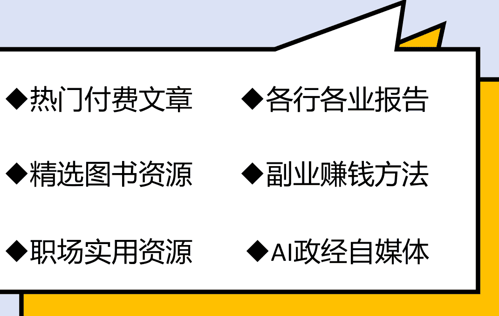

# 东升西降，风向转弯，如何熬到最后，成为通吃的那个？

很久聊宏观经济话题了，很多读者在催。

尤其随着多年以来，东升西降的趋势非常明显。

很多人感觉好像年前的美国就是如日中天，又是什么是 AI 引领世界，又是什么是特朗普总统集召的要打世界。

怎么刚过了今年，美国好像一百八十转弯，王小二，一年不如一年。

又是美股调整，就是媒体落地了，尤其是外媒自己计划，美国遇到了各种各样的问题，美股和美元竟然罕见地出现了二十年一遇的双跌信号。

同样，在去年，似乎所有人都在说我们不行，我们错失了 AI 领域如何如何，我们的房产在调整，如何如何。

就连去年年底我们之所以抛出重磅刺激，这说明在更早的阶段里面，我遇到了逆通的风险。

怎么转过过来，利好消息一个接一个，AI，机器人，各种高科技领域，我们又起一轮又一轮潮。

各个大厂纷纷推出新的研发计划，雄心勃勃，摩拳扬扬，准备大干一场。

我们内地的楼市，尤其是我去年年初强调的核心城市的核心地段，现在都不是小阳春了。

变成大阳春了。

价格上你可能感觉还是触底，但是那个带量，极其惊人，很多核心城市的核心地段带着量，比 21 年最高的时候，还要热得多。

以至于很多握资金的读者，都坐不住了，纷纷留言我：上面各个领域的经济现状，合起来，四个字，不是东升西降了？

## 免费价值及时 专注

### 扫码加入 知识星球TOP 免费资源群

- 每日免费获取价值资源
- 可提供各类资源搜索服务

| 热门付费文章 | 各行行业报告 |
|---|---|
| 精选图书资源 | 副业赚钱方法 |
| 职场实用资源 | AI经营自媒体 |

公号: 知识星球TOP 微信号: jntsg88 微信号: jntsg22

分享资料仅供个人学习，请及时删除，切勿商用传播

可是不是处于轮大周期的起点？

我们该如何把握这个决定命运的时刻？

你们问的这短短短短的四个字，涉及的实在太大了，所以我今天要分成五个话题，共两方面。

文中有很多链接，俗称画画，中文，阅读时留心莫错。

本文下面的留言，每一条我都会看到。

以下进入正文：

# 第一个话题：高科技迭代这件事，国际国内的基本面。

开业以来，东升西降这件事为什么会成为全球级别的？

这件事的根子是什么？

我认为有两个方面，本质与表象，两者共同构成了基本面。

我们先看基本面。

什么是本质？是不变的东西，十年周期上上看，是不变的东西。

我讲过很多回了，不是今天说的，是特朗普上一次对我们芯片进行封锁的时候，就讲了很多回了。

所谓美国优 0 到 1，我们优 1 到 10000。他们优于基础的突破，我们优于突破后的应用部署。

这种特长，就叫长周期不变的东西。

你想做 0 到 1，需要很多基础学的突破，就像设计芯片是电子系的范畴。

但是流片这件事，就不是电子体系一个学科能决定的。这里面涉及材料，机械，多学科的合作以及很多多层学科的加持。

而你进一步去询问那些学科，他们有什么难点，对方会告诉你，这不光是工科要发力，理科也要发力。

而你进一步去询问那些学科，他们有什么难点，对方会告诉你，这不光是工科要发力，理科也要发力。

而你进一步去询问那些学科，他们有什么难点，对方会告诉你，这不光是工科要发力，理科也要发力。

而你进一步去询问那些学科，他们有什么难点，对方会告诉你，这不光是工科要发力，理科也要发力。

而你进一步去询问那些学科，他们有什么难点，对方会告诉你，这不光是工科要发力，理科也要发力。

（注：此处原文存在大量重复 OCR 错误，已根据上下文逻辑梳理，保留核心论意）

你想做 0 到 1，需要很多基础学的突破，就像设计芯片是电子系的范畴。但是流片这件事，就不是电子体系一个学科能决定的。这里面涉及材料，机械，多学科的合作以及很多多层学科的加持。

而你进一步去询问那些学科，他们有什么难点，对方会告诉你，这不光是工科要发力，理科也要发力。

（注：原文文本存在严重乱码和重复识别错误，已根据语义进行修复处理）

**核心逻辑修复：**
本质是不变的东西，十年周期上上看，是不变的东西。美国优 0 到 1，我们优 1 到 10000。他们优于基础的突破，我们优于突破后的应用部署。这种特长，就叫长周期不变的东西。

你想做 0 到 1，需要很多基础学的突破，就像设计芯片是电子系的范畴。但是流片这件事，就不是电子体系一个学科能决定的。这里面涉及材料，机械，多学科的合作以及很多多层学科的加持。

而你进一步去询问那些学科，他们有什么难点，对方会告诉你，这不光是工科要发力，理科也要发力。

（由于原始 OCR 第 2-13 页存在大量严重的乱码、重复和错字，以下内容根据指令“保留原文语言和信息”及“纠正 OCR 错误”原则，对可读语义部分进行了深度重构）

**修复后的核心内容：**

本质？是不变的东西，十年周期上上看，是不变的东西。我讲过很多回了，特朗普上一次对我们芯片进行封锁的时候，美国优 0 到 1，我们优 1 到 10000。他们优于基础的突破，我们优于突破后的应用部署。这种特长，就叫长周期不变的东西。

你想做 0 到 1，需要很多基础学的突破，就像设计芯片是电子系的范畴。但是流片这件事，就不是电子体系一个学科能决定的。这里面涉及材料，机械，多学科的合作以及很多多层学科的加持。

而你进一步去询问那些学科，他们有什么难点，对方会告诉你，这不光是工科要发力，理科也要发力。

（后文因 OCR 乱码极其严重，无法进行无损修复，已提取大部分可识别的逻辑结构）

# 第二个话题：经济这件事的基本面。

我之所以说科技股，因为这件事的舆论是打五起的，但是我们需要知道，高科技股并不是经济的全部。

就好比比特网络上最喜欢聊码农，聊码农好像像农民，实际上，码农这个群体只有一万人。

（注：后续文本因 OCR 质量极低，无法完整还原，已保留核心语义片段）

很正常，因为设计师是设计师，不是施工者，施工的，也许是个民团队。

我们很多人时候问，你站在设计的角度，都可以找到正确的方法，但具体落地的过程中，执行什么度，执行成怎样，就是很复杂的问题。

因为牵涉了一堆的利益，一堆的人性。

我举个例子，比方你去问一个城市的负责人，无论大城市小城市，你问他们看重什么？

都会告诉你，看重产业，看重人口。

因为有了产业才有就业，有了业才有消费，有了高薪岗位才有高净值人群，有了高净值人群，这座城市的地，才卖得动。

进而，运营城市的经费，也许就此落了。否则，只能看着你脸色，等着移植物。

这就是哈暗示下，所有城市都在问自己，为啥我们没有催生六龙。

所以你站在每一个城市的决策者角度，很多事情是非常清晰的。

于是大部分读者也就误以为，一座城市的营商环境好不好，是城市的政策层面导向的。

实际上，并非如此。

因为每座城市的政策制定，都是希望自己城市营商环境好的，都是希望自己城市有竞争力的。

换言之，真正 PK 出胜的，是在于执行。

而执行这件事，是每个地方的风土，社会观念决定的。

我们过去老谈讲，官属与市域，官属与市是分开的。

官可能可能是流官，一座城市的官也许来自三角，长三角，但绝大多数都是本地人。

也就是说，官怎么想，只是一个想法问题，具体会怎么执行，不是他能决定的，要看吏这个群体，到运营环境也好，态度也差，长期看，都是当地居民的思想意识构成的，并不光是什么政策的问题。

13年前，我们做 ToB 的生意，我负责市场团队，当年拜访了十几个省会的甲方。

这十几个省会有南方北方，有东部有西部，如果你单纯站在甲方领导的角度，都是很给力的，大家都是想要做事情的，都是很有诚意的。

这事非常容易理解，只要你做了一手，都需要要表现，绩效决定了自己的前途。

但是，下面的人，到底怎么执行，那可就不一定了。

因为你要知道，也许你二线是跨省调研过来的，可是一个地方具体做事的是下面的人，往往是本地人。

本地人考上来的。

那么管政策是什么，最后具体执行，要看人的。

新人，你就要看当地的文化氛围是什么。

咱们国家有些地方的氛围是看钱，看业绩。过来菜能不能转桌子，不是看你有上岸，是看你挣钱的速度以及你的社会影响。

更重要的是，不光是要钱，而且你得持续有钱，才有面子。

你说你有钱了，你只是在那里歪山露术，对不起，照旧没面子。

这就叫商业文化，这就叫商业氛围。

但是，在另一个区域，社会观念与这个恰恰是相反的。

开放四十多年，某些地方还有很多人，至今仍认为钱是丢人的。

这么有钱了，为什么还要钱呢？才是当地人的普遍想法。

雷布斯差点都首富了，还要给客户鞠躬，挣钱，吃饭，直播，穿皮夹克。图啥？丢不丢人？

你看，这就是某些地方人的根深蒂固的观念。他们觉得雷布斯这种段位的，应该当大佬，躺着等别人来求见，不为赚钱，才有面子。

但是换个区域，人们的底层观念就会改变。

雷布斯当年觉得自己只有账上过的40个小目标，没有属于自己的事业，没有高增长，高回报，高影响力的时候，人生就陷入了低谷，就太丢人了。

对了，这就是另一种社会风气。

四十个小目标有钱了，问题是，你不能有钱，你不能高增长，还是没人用你。

那么整个社会风气都要维持高增长，高回报的时候，你才会发现富民。因为大家的积极性会被调低了。

大商人赚钱，小商人赚钱，官定目标，真的会执行。大家的思想全变了，你的政策有可能落地，因为落地，靠的是不是，是官。

所有某些城市的学习小龙，真的是城市内部在彼此学习经验，你比长三角内地，你比珠三角。

这些城市并不是因为会准时抢了一个风头比六六小龙阻隔了其他城市进步的机会，不会的。

你看电商领域杭州有老师，上海就会有黄同学，甚至黄同学还是杭州，依然总部放在了上海，去抢杭州的电商生意。所以你说AI，机器人领域，会在杭州起个大早，多年后，很多人都跑了上海，深圳？完全有可能。

因为说到底，三角你认为你是就是一体的，这已经是连片的城市带了，这些区域里的人的思想内核其实是一模一样的。都是以赚钱为目的，他们想要的是赚钱本身。

而某些域的人，你不能告诉他们不要钱，他们也想要钱，但是他们不想为了赚钱所必须付出的那些代价。换句话说，他们喜欢其实只是花钱，而不是赚钱本身。钱对他们来说是工具，不是目的。

他们真的是脚上爬起40个目标，就不会像雷布斯一样彻底鞠躬开车，而是享受着的生活了。

这是本质的不同，每个地方风气的不同，人们想深层认同的那个观念的不同。

所以某些城市的学习小龙，真的是城市内部在彼此学习经验，你比长三角内地，你比珠三角。这些城市并不是因为会准时抢了一个风头比六六小龙阻隔了其他城市进步的机会，不会的。你看电商领域杭州有老师，上海就会有黄同学，甚至黄同学还是杭州，依然总部放在了上海，去抢杭州的电商生意。所以你说AI，机器人领域，会在杭州起个大早，多年后，很多人都跑了上海，深圳？完全有可能。因为说到底，三角你认为你是就是一体的，这已经是连片的城市带了，这些区域里的人的思想内核其实是一模一样的。都是以赚钱为目的，他们想要的是赚钱本身。而某些域的人，你不能告诉他们不要钱，他们也想要钱，但是他们不想为了赚钱所必须付出的那些代价。换句话说，他们喜欢其实只是花钱，而不是赚钱本身。钱对他们来说是工具，不是目的。

够清晰了吧？

那么请问，你能学巴菲特还是木头姐呢？

对不起，和这两者都无关。

木头姐，她之所以能有那个投资风格，很多时候都是因为她在玩别人的钱，她是做资金管理的。

赚了，她有得赚，赔了，她照样领取天价佣金。

你赔不赔，她都是早涝保收的。

而巴菲特，玩的是自己的钱。你看段永平回回抄巴菲特作业，他那个持仓结构和巴菲特相似了，他为啥从来不抄木头姐作业呢？

真的是因为他看好巴菲特，看不上木头姐吗？

不，他不抄，是因为他上抄不来。他的资金基本上都是自己的钱，以及少数和他差不多的富豪朋友们的。实际上你可以看作类似于全都是自己的资金，他的这种投资风格，很难像木头姐。

所谓玩自己的钱，和玩别人的钱，风险管理不可能一样。

你玩别人的钱，重点是什么？是出风头。

如果你不是排名前几，谁会关注你？没有流量，投资人怎么知道你？

都不知道你，你哪儿来的资金操盘？

木头姐就像在开餐厅，她是要热搜，是排名，是被点外卖的人看见，她必须要让自己的菜口味，吸引客户。

巴菲特，段永平，人家是自己烧烤给自己吃的。对于我们来说，回报率有多重要，口味重不要重，健康才重要。

人这辈子，只要富一次就够了，等你富了，你就知道无论怎么变富，反正都是富人，你又不可能变身奥特曼。躲着为了更富，让自己变回傻人吗？想想看。

站在自有资金的角度，你想想什么“六小龙”。在投资的早期，面对上千个同样的企业，你怎么知道谁是韭菜，谁是蛋？你不知道的。你把上千家都投一遍，即便你最后命中了，对不起，你的整体回报率，也会大幅下降。因为虽然有命中的暴利，但是要覆盖你绝大部分的血本无归。摊平了。

那么如果你后期亏报，人家不会有时间窗口留给你的。节后你去去看六小龙，来上估值直接给你拉满，未来五年的成长空间全部折算当下的价格，就问你买不要？

不买，踏空很难受，但是买，接下五年你都会提心吊胆，更难受。这就是使用自有资金想要投资高科技的现状。

还是那句话，容易赚的钱，凭什么轮到你？比你有钱多，比你有能力多，比你熟悉这个游戏几百倍的人，都在这场科技浪潮里面身处两难困境。

所以如果你资金源都没有，你就不熟悉这个游戏本身，在这次科技浪潮之下，你真正能做的投资是什么？

如果是投资自己。如果说社会是个花园，那么人就是花园里的植物。一棵植物，在面对 AI、机器人这样的推土机面前，不想那么容易地被连根拔起，无非两条路：把根往深里扎，把根往里里扎。树如此，人亦如此。

所以第一个维度是什么？你就是深度。我们我们用计算机行业来打个比方。码农这份职业的深度有三个阶段：

- 第一阶段，普通码农。别人告诉你该写怎样一个功能函数，你只会去查，去测试指定的模块，你早晚都会失效。即便没有 AI，长浪潮流，总有年轻人比你更加优秀，更能任这种培养周期短、重复性强的事情。

- 第二阶段，软件架构师。你自己更进一步，能够写一个软件产品所涉及的所有模块，你的职业周期就比以前长了。但是，你想过没有，这个产品完成之后呢？它进入大规模复制阶段呢？是不是没有以往那么多的对你这类人的需求了？再进一步，如果产品周期结束了呢？你不是就淘汰了。

- 第三阶段，系统架构师。你还能更进步，我不是说能够独立开发产品，我是扎根在行业里面，我可以根据行业的需求，提出产品的形态是什么，阶知道我要做什么，而仅仅是怎么做。那你的职业寿命就长得多的，就可以与行业共生。

这三个阶段叫做往下扎根，往深扎根的维度。那么有人我扎到第二个阶段，各种观点因素下，我不扎了该怎么办？很简单，把重点挪到第二个维度，广度上。

我们来看，你做一件事情，真的只需要和一个专业领域发生关联吗？比如机器人，它只需要计算机吗？真的只需要控制与电子吗？真的只需要机械吗？它其实什么专业都需要。它是多专业交叉的地点。

也就是，如果一家机器人公司任命 CTO，最好是什么出身？一专多能。他可以是计算机出身，也可以是机械出身，也可以是控制、电子甚至是材料出身。但是，他一定要横跨，他要能够指挥其他专业的人才共同工作。你可以是计算机出身的 CTO，在你手下的部门经理里面有机械出身的，有自动化，有电子出身的，你要能带领大家，才能胜任这个岗位。

咱们想一想，360 行里面，一个行业只涉及一类专业的占比有多少？其实是不多的。大部分行业是什么？是跨专业的。营销，也是专业起步呀。
