# 科学智能白皮书
## 2025

# 扫码加入 知识星球TOP 免费资源群

免费
公众号：知识星球TOP

- 每日免费获取高价值资源
- 可提供各类资源搜索服务

价值微信：jntsg8

| 热门付费文章 | 各行各业报告 |
|---|---|
| 精选图书资源 | 副业赚钱方法 |
| 职场实用资源 | AI 经自媒体 |

及时关注微信：jntsg2

分享资料仅供个人学习，请及时删除，切勿商用传播

# 专家委员会

# 目录

# 主席

# 第一章 序言
1. 定位与目标
2. 背景与愿景
3. 数据分析

## 成员（按姓拼音字母排序）

## 第二章 AI 前沿
1. 从大模型走向智能体
2. 具身智能
3. 机器人接口
4. AI 安全

李力 复旦大学
李文 复旦大学
郭辉 复旦大学
金云秋 复旦大学
赵杰 复旦大学
许达 复旦大学、上海科学智能研究院
沈涛 复旦大学
吴波力 复旦大学
张媛 复旦大学、上海科学智能研究院

## 研究团队

## 第三章 数学基础
1. 基础理论
2. 建模
3. 统计
4. 科学计算
5. 复杂系统

刘勇 复旦大学
郭涛 复旦大学
魏钰 复旦大学
吴波力 复旦大学

杨梅 复旦大学
程进 复旦大学、上海科学智能研究院
李海 复旦大学、上海科学智能研究院

## 第四章 物理科学
1. 物理
2. 化学
3. 科学
4. 能源

## 第二组 计算机
付彦林 复旦大学
王世杰 复旦大学
周凯 复旦大学
董毅 复旦大学

## 第五章 生命科学
1. 合成科学
2. 医学
3. 生物学
4. 医疗
5. 演化

吴正 复旦大学
石勇 复旦大学
朱文宁 复旦大学
李建波 复旦大学
李波 复旦大学

## 第三组 材料
赵正 复旦大学
安晓军 复旦大学
谢源波 复旦大学

## 第六章 环境与环境科学
1. 大气科学
2. 环境科学
3. 生态学

冯磊 复旦大学
向春芳 复旦大学
刘智勇 复旦大学
高波 复旦大学

## 第七章 地球科学
1. 通用
2. 交通
3. 电子
4. 空间科学

## 第四组 物理
王东 复旦大学
金德华 复旦大学
陈波 复旦大学
未进 复旦大学、上海科学智能研究院

## 第八章 人文社会科学
1. 社会科学
2. 人文科学
3. AI 伦理与治理

## 第五组 化学
郭建斌 复旦大学
张亮 复旦大学
近海锋 复旦大学

## 第九章 未来科学
1. 未来趋势与研究方向
2. 海洋模拟

# 内容支持
吴文强 施林格·自然
Rebecca Darjie 施林格·自然
John Pollock 施林格·自然

# 数据支持
郭建 施林格·自然
冯琳 施林格·自然
陈胜远 施林格·自然
Viv Aggrawal 施林格·自然

# 项目向
魏明华 复旦大学
张博磊 上海科学智能研究院
王世杰 施林格·自然
张媛 施林格·自然

# 落地支持
赵敏 施林格·自然
Sou Nakamura 施林格·自然

# 第一章 序言

## 1. 定义与范式

### 1.1 定义
计算机科学的人工智能（AI）和人工智能的科学的研究被定义为机器学习科学（AI for Science, AIAS），本质是数据科学的研究。

### 1.2 范式
人工智能研究是一个交叉学科，计算机科学与数据科学分为机器学习（科学）、深度学习（深度学习）以及数据科学。机器学习科学的研究方法包括从数据中发现假设、检验假设以及统计规律。

传统的科学范式是观察、提出假设、实验验证和理论建模。机器学习科学的范式则是：通过数据驱动的系统来构建模型，从数据中自动发现科学的规律。通过机器学习技术和数据科学的理解，从数据驱动的机器学习发现计划，从数据中自动发现计划，在一定程度上避免了理解科学难题，但无法发现因果关系。机器学习科学正在建立新的范式，从数据角度发现规律、发现假设和因果关系，扩展了科学边界。

# 第一章 科学智能白皮书
科学发现：人工智能正在重塑科学发现的范式。面对海量数据时，人工智能从高维数据中进行分析可以发现人类忽视的规律和模式。在科学研究中，人工智能辅助实验设计、数据分析、模型构建极大地提高了效率和准确性，为科学发现带来了变革。人工智能不再仅仅是工具，它正在成为科学的合作伙伴。

## 2 发展趋势
### 2.1 最新趋势
生成式 AI 正在重塑科学发现。生成式 AI 能够生成新的假设，AlphaFold3 的出现预测了蛋白质、核酸等分子的相互作用，GraphCast 等模型展示了在材料领域的巨大巨大。“AI for Science (AI4S)”成为科学研究的新范式，目标不仅是辅助人类，更是发现人类无法发现的规律。

### 2.2 AI 在科学研究中的局限与挑战
#### 2.2.1 科学发现的可解释性
人工智能模型被视为“黑盒”，其给出的结论难以理解。科学研究不仅需要结果，更需要理解背后的物理机制。

#### 2.2.2 AI 在科学研究中的数据瓶颈
人工智能的训练依赖高质量的数据。在科学领域，高质量数据的获取成本极其高昂，许多科学数据尚未公开或存在实验室中。

利用机器学习生成高质量的科学假设可以极大地扩展科学发现的边界。通过建模，利用生成式 AI 提出新的假设。

1. P. Baes, et al. AI for science: an emerging paradigm. Preprint on arXiv, https://arxiv.org/abs/2303.02471 (2023).
2. J. Hey, et al. The role of AI in science: Data-driven discovery and hypothesis generation. Nature, 621, 59-70 (2023).
3. J. Jumper, et al. AlphaFold2 accurate structure prediction. Nature, 596, 583-589 (2021).
4. Abramson, J., et al. Generative structure of biological interactions with AlphaFold 3. Science, 610, 788-795 (2024).
5. J. Lee, et al. Learning large-scale molecular representations. Nature, 603, 806-811 (2022).
6. B. Chen, et al. Global weather forecasting using graph neural networks. Science, 379, 743-748 (2023).
7. P. Smith, et al. AI-based medium range global weather forecasting. Science, 379, 748-753 (2023).
8. N. Stephens, et al. An autonomous laboratory for the discovery of synthetic novel materials. Nature, 614, 43-50 (2023).

## 3 数据分析
本研究中，人工智能（AI）相关领域分为 AI（如算法、机器学习）、AI4S（科学发现、物理科学、地球与环境科学）、AI4X（人工智能工程）以及 AI4R。我们将重点关注上述领域。

### 3.1 AI论文增长趋势，AI4S的发展
从 2014 年到 2024 年，全球 AI 和 AI4S 领域的论文增长速度非常快。AI4S 领域在 2020 年开始爆发式增长，2020 年 AI4S 论文数量为 2000 篇，2021 年增加到 3000 篇，2022 年增加到 5000 篇，2023 年达到 6000 篇。AI 领域在 2020 年后的增长率为 19.5%，2021 年为 18.9%，2022 年为 16.1%，2023 年为 15.3%。

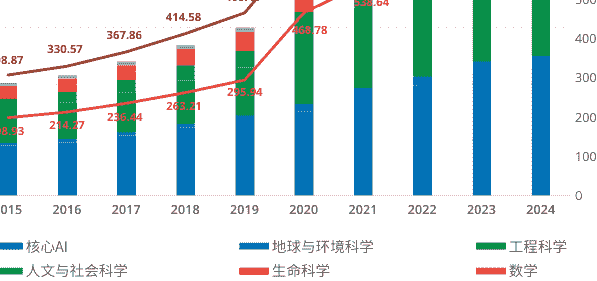
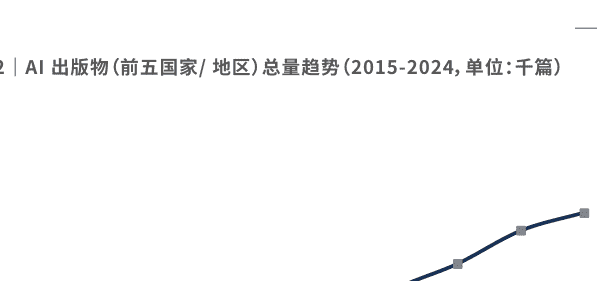

### 3.2 美国依然优势，中国领先
从基础数据来看，美国在AI领域一直保持优势，如图1.3所示。美国在2020 年引用总量达到 30.8 万次，中国在2021 年达到 30.5 万次，2022 年达到 24.4 万次，并首次超过美国。由于出版物发布时间的影响，尽管2020 年美国一直领先，但中国在AI应用创新趋势正从“追赶”转向“领先”。2016 年引用总量为 14.4 万次，2021 年超过美国 23.2 万次，2022 年超过美国 23.3 万次，中国在AI领域中的占比领先美国 41.6%。同时统计分析显示美国权重下降，但考虑到滞后性。

### 3.3 AI领域争夺优势，中美并肩
2024 年AI领域趋势显示了中国和美国在研究领域的特征：工程科学（38.9%）、医学（39.8%）、物理科学（7.4%）和生物科学（6.2%）。美国在工程科学（25.9%）、数据科学（29.8%）、化学科学（14.6%）以及人文社会科学（15.3%）。

### 3.4 AI4S引领变革：AI成为科学新范式？
从 2015 年以来，AI4S 催出了一种新的范式，其核心是利用 AI 的算法和方法来加速科学发现。强化学习等方法在工程技术、计算机科学、医学科学、生命科学等领域中占据越来越重要的地位。通过 AI 发现规律、筛选候选、预测实验结果，可以实现科学发现的跨越。如今，从领域应用，AI 技术展现出了跨学科的通用性：在科学、生命科学等领域，AI 不仅仅是科学研究中高效的数据分析工具，更是成为加速科学发现的“原生技术”。一种 AI4S 变革正在重塑人类发现规律的未来。

图 1.7 AI 出版物国际合作趋势——中国 vs 美国（前五个国家）（2015-2024，单位：篇）

| 年份 | 中国-美国 | 中国-英国 | 中国-加拿大 | 美国-印度 | 美国-中国 |
|---|---|---|---|---|---|
| 2015 | | | | | |
| 2016 | | | | | |
| 2017 | | | | | |
| 2018 | | | | | |
| 2019 | | | | | |
| 2020 | | | | | |
| 2021 | | | | | |
| 2022 | | | | | |
| 2023 | | | | | |
| 2024 | | | | | |

## 2 AI 前沿
### 1. 大模型迈向智能
最近，以大语言模型（LLM）为代表的人工智能（AI）技术飞速发展，在许多领域展现出强大的能力。然而在处理复杂任务时仍面临诸多局限性：随着模型规模的扩大，模型涌现出许多惊叹的能力，例如能够理解复杂的指令并多步推理，甚至表现出规划。

- 1) 规划与推理
- 2) 记忆与学习
- 3) 工具使用

### 1.2 定义
本文认为，智能体（Agent）是能够感知环境、进行推理、规划并采取行动以实现特定目标的系统。

### 1.2.1 核心能力
智能体需要具备感知环境、理解、推理和规划的能力，并具有长期记忆，根据环境反馈调整策略。

### 1.2.2 交互形式
智能体可以以多种形式与环境交互，包括文本、语音、视觉以及物理动作，这种交互是双向且实时的。

### 1.3 智能体的发展现状
智能体的发展经历了多个阶段，目前主要分为以下三个阶段：
- 1) 基于规则的智能体：这类智能体基于预设的规则和逻辑来运行，无法处理复杂多变的任务。
- 2) 基于大模型的智能体：这类智能体以大模型作为核心大脑，具备更强的推理、规划和多任务处理能力。
- 3) 具身智能体：智能感知是智能体获取环境信息、理解环境状态的关键，是决策的基础。

## 2. 感知
### 2.1 多模态感知
智能体需要能够处理文本、图像、视频、音频等多种模态的信息，通过多模态融合来更全面地理解物理世界。

#### 2.1.1 视觉感知
视觉感知包括物体检测、目标跟踪、深度估计和场景理解等，这对于智能体理解空间关系至关重要。

#### 2.1.2 听觉感知
听觉感知包括语音识别、声源定位和情感分析等，帮助智能体通过声音获取环境信息。

### 2.2 交互感知
这包括能够理解人类的语言指令、手势、表情和情绪，并根据对方的反馈调整自己的行为。

#### 2.2.1 语言交互
通过自然语言处理（NLP）技术，智能体可以理解复杂的对话并理解意图。

#### 2.2.2 情感交互
智能体能够识别人类的情绪状态并做出相应的回应，使交互更具人性化。

### 2.3 空间感知
智能体需要感知自己在空间中的位置以及周围障碍物的布局，这对于移动导航和任务规划至关重要。

#### 2.3.1 机器人定位与地图
SLAM（即时定位与地图构建）技术是让机器人在未知环境中确定位置并构建地图的关键。

### 2.4 协作感知
多个智能体之间可以共享感知信息，进行协同工作，以完成共同目标。

#### 2.4.1 团队协作
多个智能体通过通信和协作，可以分工完成复杂任务。

### 2.5 语义感知
智能体需要理解感知到的背后的含义，例如物体的功能和关系。

### 2.6 具身智能
具身智能是将人工智能置于物理实体中，通过与世界的交互来实现智能。

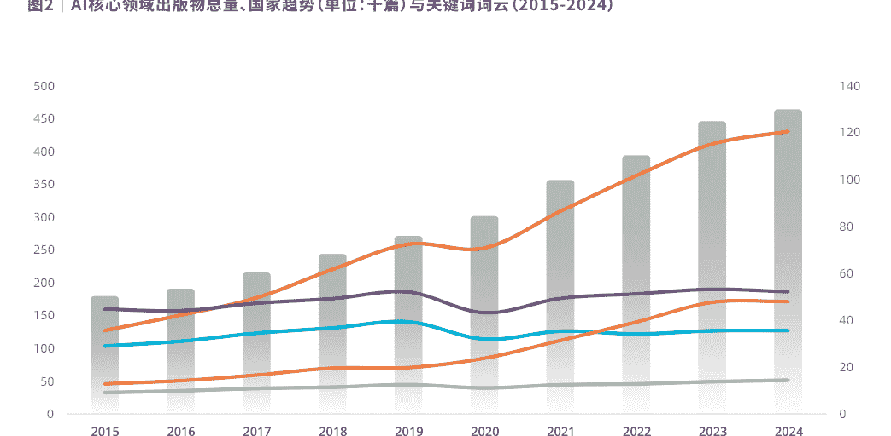
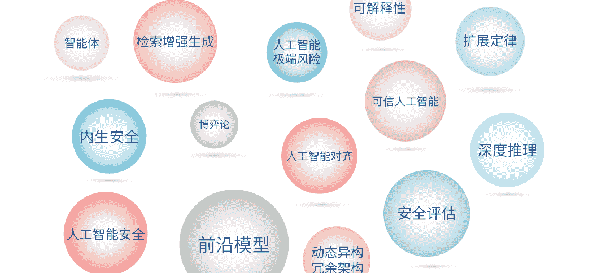

## 第二章 AI智能

### 科学智能领先

1. Brian H., et al. Vision-action models for robotic transfer learning to robot control. Nature, 2023, 619: 515-520.
2. Physical Intelligence, N. A vision-action model for open-world embodied agents with human-robot interaction. Report(2024).
3. Physical Intelligence, N.
4. Huang A., et al. GRT-1: An open-foundation model for general-purpose robot manipulation. arXiv preprint arXiv:2403.06910.
5. NVIDIA, GROQ, MIT.
6. Stanford University, Machine Learning Center.
7. OpenAI, DALL-E 3. Available at: https://openai.com/dall-e-3
8. Li, W., et al. Exploring the limits of scaling language model as action models. arXiv preprint arXiv:2304.03374 (2023).

通过物理、化学等方法使机器人具备运动技术并接入机器人智能运动功能。

## 3. 脑机接口

### 3.1 脑解码
脑机接口技术是将人的脑电信号转换为计算机可以理解的指令，从而让患者能够意控机器人肢体，这种技术将使残疾患者重新获得运动能力。此外，这种技术还能使人类与机器人进行更自然的交互。作为脑机接口的关键技术，脑解码是实现深度融合脑机智能系统的核心技术。

### 3.2 脑电编码
脑电编码技术是根据人的意图向大脑发送电刺激，使大脑能够感知并产生相应的运动反馈。

### 3.3 脑机接口与运动控制
为了实现更自然的运动控制，需要将脑解码与脑电编码相结合。通过解码人的运动意图控制机器人，同时通过编码技术提供反馈，使大脑与机器人之间建立运动与认知的实时交互。

如何准确解码人类的运动意图，是脑机接口面临的挑战；如何提供准确、及时的触觉反馈，是另一项挑战。

脑机接口技术的发展将极大改变残疾患者的生活。例如对于高髓瘫痪患者，通过脑机接口就可以控制外骨骼机器人行走，或者控制机械臂打字进行交流。

脑机接口技术正从实验室走向临床。目前，脑机接口在运动瘫痪、中风、ALS等疾病的康复中取得了显著进展。

## 4. AI具身安全

脑机接口技术的发展将通过物理和化学方法使机器人具备运动技术并接入机器人智能运动功能，增强人类与认知的实时交互。通过脑机接口建立大脑与环境的反馈关系，使机器人能够感知环境并做出反应。通过脑机接口解码人类的运动意图，使机器人能够执行复杂的人类指令。通过脑机接口建立大脑与环境的反馈关系，使机器人能够根据人类的意图更精准地完成任务。通过脑机接口解码人类的运动意图，使机器人能够感知环境变化并做出自主调整。

1. Hochberg, L. A., et al. Brain-computer interface for tetraplegia using intracortical implanted robotic arm. Nature, 2006, 441: 321-326.
2. Zhang, F., et al. Brain-computer interfaces for restoring communication in tetraplegic patients. Nature, 2023, 6: e4373.
3. Van der Mellen, J., et al. Multimodal brain-computer communication enables continuous speech in individuals with paralysis. Nature, 2023, 616: 297-302.
4. Wil, W., et al. An electrocographic signal decoding model for speech in a locked-in person. Nature, 2023, 619: 1-10.
5. Yang, Y., et al. Vibrotensory feedback speeds up sensory control of brain-computer-controlled prosthetic limb. Science, 363: 845-850.
6. Liu, X., et al. Intracortical microstimulation improves sensory learning in brain-computer-controlled prosthetics. Science, 2016, 353: 1023.
7. Willett, F., et al. High-performance speech decoding by intracortical brain-computer interface. Nature, 2023, 617: 243.
8. Elonberg, M., et al. A high-bandwidth brain-computer interface for natural language speech. Nature, 2023, 619: 244-250.
9. Locke, L., et al. Long-term stability of a high-bandwidth-wireless brain-computer interface. Nature, 2023.
10. Chang, A., et al. Speech decoding in brain-computer simulation.

首先，具身智能需要具备强大的感知能力，能够准确识别环境中的障碍物、人类以及潜在风险。其次，具身智能需要具备智能的决策能力，在面对不确定性时，如何做出符合人类伦理和安全规范的决策？

### 4.1 具身安全与隐私保护
具身智能在运行过程中会收集大量的关于环境和人类的数据。如何保护这些数据的隐私，防止被滥用？

### 4.2 具身安全测试
具身安全测试需要从仿真走向真实世界。在仿真环境中，可以通过各种场景测试算法在极端情况下的鲁棒性。

### 4.3 伦理与价值对齐
具身安全的边界将随着技术的发展演进，我们需要建立一套完善的法律法规规范其。

## 第三章 AI科学计算

### 4.1 基础理论
以视觉领域，利用数据挖掘发现规律，其研究具有相似性；以化学领域为例，通过数据挖掘发现隐藏规律，增强了效率；以物理领域为例，通过数据挖掘发现隐藏现象，增强了通用性；以自然语言处理领域，通过数据挖掘识别特征，提高准确性；以生物医学领域，通过数据挖掘发现潜在靶点，缩短研发周期；以材料科学领域，通过数据挖掘预测性能，减少实验次数；以地球科学领域，通过分析气象数据预测变化。

- Barnes, L. S. (2002). Foundations for data-driven scientific discovery. Nature, 418(6896), 793-796.
- Cramer, A. (2009). Machine learning in the molecular sciences. Science, 323(5914), 387-390.
- Goodfellow, I., Bengio, Y., & Courville, A. (2016). Deep learning. MIT Press.

### 4.2 优化
优化是机器学习的核心环节之一，涉及模型训练、超参数调优等。在过程中通过优化算法调整模型参数，使模型能够更好地拟合数据。传统的优化方法如梯度下降，在处理大规模数据时面临收敛速度慢且容易陷入局部最优的问题，因此需要更高效、稳定的优化算法。为了解决这些问题，研究者提出了许多新的优化算法，如 Adam、RMSProp 等。这些算法能够提高收敛速度并帮助找到全局最优解。此外，自动优化技术也成为热点，它旨在通过机器学习的方法自动搜索优化算法的超参数，减少人工调优的工作量。

在科学发现中，优化也具有至重要的作用。例如在实验设计中，可以通过优化算法选择最优的实验方案，以最小代价获取最大的信息。贝叶斯优化是一种广泛用于黑函数的优化方法，它通过构建一个代理模型来近似目标函数，并利用采集函数找到待采样点。此外，设计合理的目标函数也是优化的关键之一，目标函数定义了优化的方向，如果设计不当，模型可能无法理想的结果。

- Bottou, L. (2010). Optimization methods for machine learning. Machine Learning, 81(2-3), 249-265.
- Ba, J., Kingma, J. P., & Ba, Y. (2014). Adam: A method for stochastic optimization. arXiv preprint arXiv:1412.6988.

### 4.3 孪生
数字孪生是物理实体在数字世界中的镜像。通过对物理实体的实时数据建模，可以对物理实体进行状态监控、性能预测和优化。数字孪生的关键技术包括数据采集建模、仿真和可视化。通过这些技术，可以实现数字孪生的高保真实性。

在工业领域，数字孪生被广泛应用于制造，通过对设备进行建模预测故障，减少维护成本，提高效率。在医疗领域，数字孪生可以用于个性化医疗，通过建立患者模型预测效果，帮助医生制定治疗方案。未来，数字孪生将向更复杂的方向发展。

### 4.4 深度学习
深度学习是人工智能的核心技术之一，通过多层神经网络从海量数据中学习特征，展现出强大的能力。然而，深度学习也面临挑战，如可解释性差、数据需求大和计算开销高。随着技术的进步，深度学习在科学发现中展现出巨大的潜力，通过处理复杂的数据，它可以帮助发现新的规律。此外，生成式模型如生成对抗网络（GANs）、变分编码器（VAEs）和扩散模型在科学计算中的应用也取得了突破性进展。例如在蛋白质结构预测中，预测折叠结构；在分子设计中，用于设计特定性质的新型分子。

## 5. 复杂系统
复杂系统是由许多相互作用的组件组成的系统，其整体行为不是部分的简单加和，表现出非线性和不可预测性特征。例如，生态系统、经济系统、交通网络和人类大脑都是复杂系统。这些系统具有涌现性，即局部规则的相互作用产生了宏观的复杂模式。研究复杂系统的挑战在于理解其内部的相互作用机制以及这些机制如何导致整体行为。传统的建模方法往往难以处理高度复杂的动态系统。

机器学习在复杂系统研究中展现了巨大的潜力。通过处理海量数据，机器学习可以识别出传统方法难以发现的模式和规律。例如在社交网络分析中，用于识别社区结构和预测信息传播；在金融市场中，用于分析市场波动和识别异常交易；在生物医学中，用于分析流行病趋势的传播路径和预测疾病风险。这些技术有助于我们更好地理解复杂系统的运行机制，并制定更有效的干预措施。

- Huang, J., et al. An analysis of error in machine-learning scientific discovery.
- Li, Z., et al. Deep learning for scientific computing. Nature, 2021.
- Wang, S., et al. Variational autoencoders for time series modeling. Nature Communications, 2018.

## 第四章 物质科学

图 4 物质科学领域AI出版物总量、国家级趋势（单位：千万）与关键词词云（2015-2024）

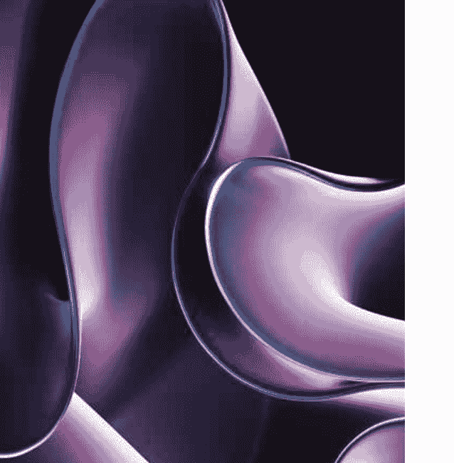
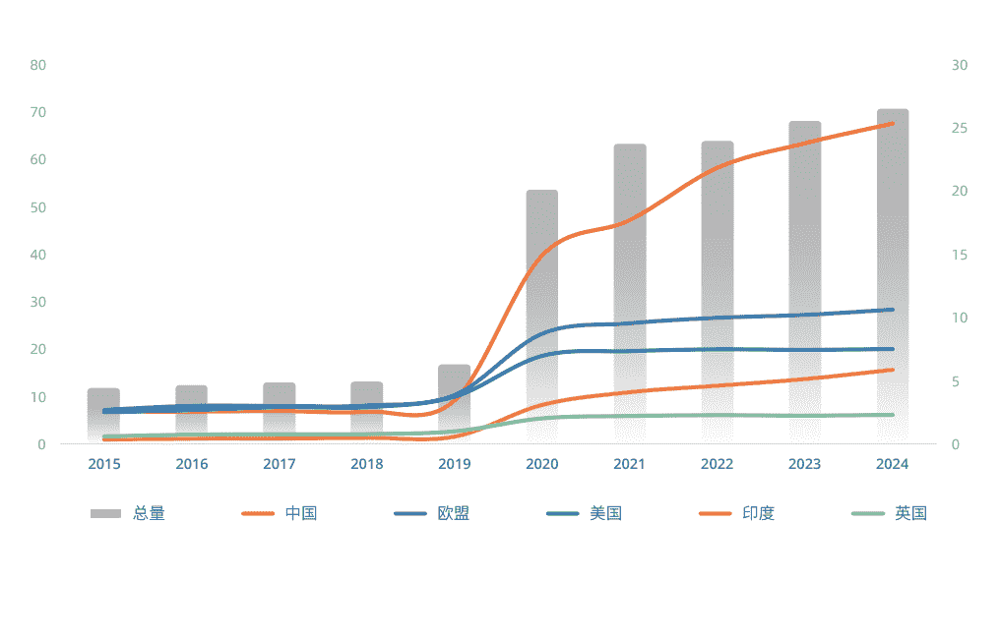

### AI与物质科学

物质科学领域AI出版物发展始于2020年，出版物总量在2024年突破700万（图4）。从国家级来看，中国和印度关键词词云显示，数据分析和电池主题最被关注。多维度来看，符号回归、神经网络和逆向设计等方法最被关注。从材料科学来看，物理科学的发展等方法加速了物理科学和AI的深度融合。

## 第四章 物理智能

### 科学智能前25

#### 1 物理智能

物理学是研究自然规律的科学，它通过实验、计算和模型来揭示宇宙的规律性和数据特征。物理学模型为其他科学提供了新的工具，而人工智能则为物理学提供了新的视角。物理学数据驱动的发现正在改变物理学研究的范式。物理学与人工智能的深度融合，正成为科学智能的前沿领域。

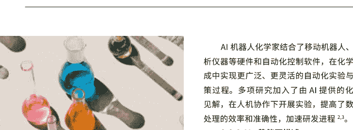

AI 正在帮助我们发现新的物理规律，从微观尺度到宏观尺度，在更广阔的领域展现价值，数据驱动的发现正在加速进程。

量子力学模型展示了 AI 辅助在微观尺度上的应用。例如，对复杂分子构象和性质的预测，以及对量子力学方程的加速求解。

### 1.2 发展进展

##### 1.2.1 物理信息神经网络

图神经网络（GNN）等模型的出现，DeepMind 的“GNoME”成功预测了 22 万种新晶体结构，极大地加速了材料科学的发现过程。

##### 1.2.2 大规模物理大模型

Transformer 架构在自然语言领域取得了成功，如今正被应用于物理领域。通过处理海量物理数据，大模型能够学习到深刻的物理规律，为物理科学研究提供强大的基础模型（Foundation Models）。

##### 1.2.3 物理驱动的模拟加速

基于物理方程的模拟器正成为物理研究的重要工具，极大地提升了计算效率。

#### 2 化学智能

##### 2.1 科学发现

AI 正在为化学领域带来突破。它不仅解决了许多化学相关的科学问题，还开辟了新的研究方向。AI 与化学实验的交互正在加速科学发现的范式转移。

AI 能够从海量实验数据中提取规律，预测新分子的性质，优化合成路线。通过筛选候选材料，它极大地提高了化学家的决策效率。

##### 2.2 发展进展

##### 2.2.1 分子生成模型

生成式模型在分子设计中展现出巨大潜力，能够生成具有特定性质的分子结构，为药物研发和材料科学开辟了新路径。

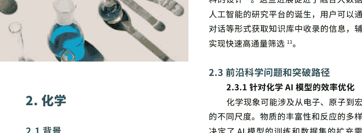

#### 1.1 物理智能与神经网络的认知

可物理的神经网络是未来的方向，通过将物理规律引入神经网络，确保模型的结果符合物理定律（例如能量守恒、时间对称性等）。

##### 1.1.1 物理约束的深度学习

##### 1.1.2 物理驱动的自动微分器

##### 1.1.3 物理驱动的自动符号发现

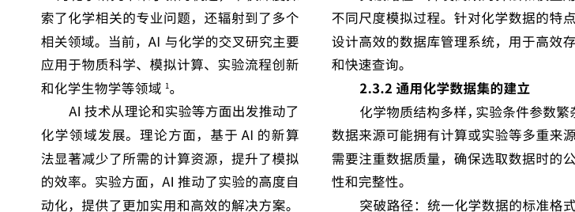

##### 2.2.2 化学领域的大语言模型

1. Jao, B., et al. (2021). AI in chemistry. Chemistry of Future Directions, 7(1), 23-34.
2. Merchant, A., et al. (2023). Open for molecular structures. Nature, 619, 583-598.
3. Wang, H., et al. (2023). Scaling laws for language models. Science, 381(6657), 895-901.
4. Ji, J., et al. (2023). Predicting properties of stable crystals with graph neural networks. Nature, 616-734.
5. Schmid, J., et al. (2020). Deep learning for molecular modeling. Nature Reviews Chemistry, 4(9), 503-514.
6. Vaswani, A., et al. (2017). Attention is all you need. Advances in information processing systems, 598-608.
7. Ma, F., et al. (2021). A deep learning framework for molecular property prediction. Science, 10(2), 114-120.
8. Goodfellow, I., Bengio, Y., & Courville, A. (2016). Deep learning. MIT Press.
9. Silver, D., et al. (2016). Mastering Go with reinforcement learning. Nature, 529, 465-473.
10. Kingma, D., & Ba, J. (2014). Adam: A method for stochastic optimization. arXiv preprint:1412.6993.
11. Brown, T., et al. (2020). Language models are few-shot. arXiv preprint:2005.14165.
12. Yang, L., et al. (2023). AI-driven drug discovery and development: a review. Nature Reviews Chemistry, 7(1), 1-20.

## 3. 材料

### 3.1 现状

材料科学的发展不断丰富，新型材料的开发与应用正在进行。从微观到宏观日益普遍，从设计到应用已经跨越十年。如今，从理论到计算成为常规。在电子、电化学、半导体等领域，材料的特性正在被发现。从原子结构到功能，处理材料的空间维度、时间维度，成为人类探索的前沿。然而，材料设计是未来材料科学的关键。

### 3.2 最新进展

##### 3.2.1 材料的结构设计

基于基础结构设计正在改变材料科学的发展范式。通过机器学习的工具，科学家能够预测材料的科学性能。例如，通过机器学习模型，我们能够发现新的候选材料。如今，通过MatMiner 等工具，已经发现了多种候选材料。

##### 3.2.2 材料的合成

高通量合成使得多组材料的筛选可能。利用机器人和机器学习进行筛选。如今，自动化的合成已应用于化学、电化学和材料科学领域。

##### 3.2.3 材料的表征

机器学习可以加速材料的表征过程。通过对海量数据的分析，科学家能够更准确地预测材料的性能，并发现潜在的微观结构。

##### 3.2.4 主动学习加速材料发现

设计（DFT）结构化方法正成为材料科学的热点。

通过生成式机器学习，研究者可以探索广阔的设计空间，利用 GPT 生成新的材料结构。如今，LLMs 也展现了高活性性能，实现了实际应用。

### 3.3.1 机器学习在药物发现

生成式模型可用于设计新的药物分子，预测药物的活性和毒性。如今，LLMs 能够预测分子的性质并根据目标进行微调。

### 3.3.2 机器学习在催化领域

机器学习可以用于预测催化剂的活性，筛选高效催化剂。如今，通过机器学习模型，科学家可以发现更有效的催化剂。

### 3.3.3 机器学习在能源科学

机器学习被用于预测电池材料的性能，筛选新型电极材料。如今，通过机器学习，科学家可以发现更好的电池材料。

> “要将机器学习与化学信息结合，从化学特定领域提取分子并构建，从高质量数据数据库中提取并预测性质，通过多任务的分子预测模型，并发现新的反应机理，或者在原子空间内实现广阔的探索”

## 4. 结论

### 4.1 科学发现

机器学习正在极大地改变材料科学的研究范式。通过处理海量数据和预测性能，科学家能够更快速地发现新材料，缩短研发周期。

### 4.2 未来挑战

尽管取得了巨大进展，但仍面临数据质量、模型可解释性以及泛化能力等挑战。未来需要进一步研究这些问题。

### 4.3 跨学科协作

机器学习与化学、物理、工程科学的跨学科协作是未来材料科学的关键。

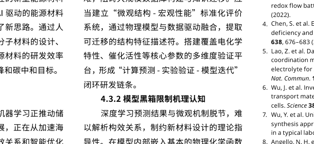

1. Z. Chen, et al. (2022). Generative models for molecular design. Nature Chemistry, 14, 628-634.
2. Xie, et al. (2021). Machine learning for molecular discovery. Nature Reviews Discovery, 2, 599-611.
3. Butler, C., et al. (2016). Deep learning-based materials discovery. Science, 353, 823-827.
4. Jensen, S., et al. (2013). Variational autoencoders for chemical reactions. Nature Chemistry, 5, 222-227.
5. Chen, et al. (2018). Machine learning for acceleration of chemical synthesis. Nature, 55, 421-426.
6. Wang, et al. (2018). Deep learning for molecular property prediction. Chemical Reviews, 18, 33-100.
7. Li, et al. (2018). Graph neural networks for molecular property prediction. Science Advances, 4, ea162336.
8. Xie, et al. (2019). GpropNet: Message passing neural networks for molecular property prediction. Nature Communications, 10, 1093.
9. Ji, J., et al. (2021). Transformer-based models for molecular property prediction. Nature Communications, 12, 1733.
10. Merchant, J., et al. (2021). AlphaFold2: accurate protein structure prediction. Nature, 596, 58-68.

## 第五章 生命科学

图 5 生物科学领域AI出版物总量、国家级趋势（单位：千万）与关键词云（2015-2024）

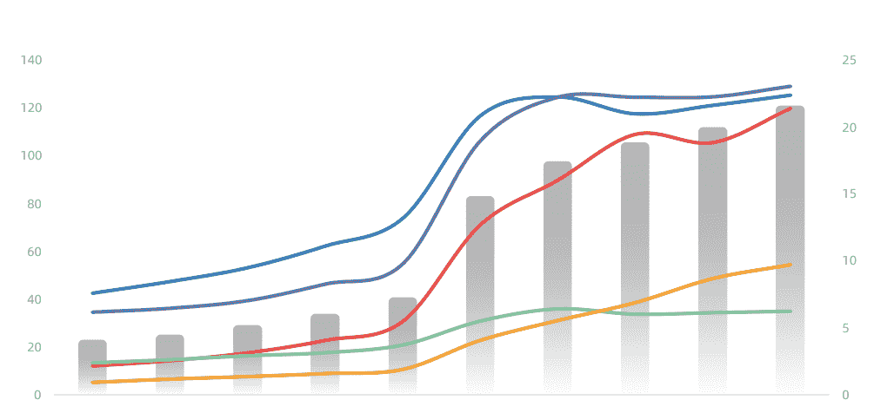

### AI 与生命科学

生命科学领域AI出版物的爆发式增长于2020年，2024年全球出版物达到207万篇（图5）。在我国，中国长期以来该领域的研究中表现优异，2024年热度居世界第二，相关关键词云的研究最多；AI通过大模型预测药物发现，通过高分辨率成像发现新疾病，多源数据深度融合和建模，蛋白质结构深度解析，解决生命复杂性。

| 精准医学 | 生物系统 | 生理学 | 遗传 |
|---|---|---|---|
| | 基因组 | 计算模型 | |
| 公共卫生 | 大脑 | 基因 | 分子机制 |
| 神经科学 | 医疗健康 | | 基因像 |
| | | 疾病预测 | 计算机理 |
| 连接性 | | | 大语言 |
| | | | 模型 |
| 蛋白质组学 | 疾病诊断 | 神经元 | |

## 第五章 生物科学技术基础

#### 1. 合成生物

#### 2 遗传学

1.1 合成生物
合成生物学从一门学科走向了科学、工程、计算机科学基础和应用科学的新学科，通过设计、改造创造新的生物元件、系统和功能，实现基因重组。从合成生物的发展，已经经历了建筑、环境和新材料等领域的基础变革。

2.1 遗传学
遗传学在理解遗传机制的过程中，大数据在遗传基因组学取得了飞速发展。从单基因到多基因组学的跨越，依赖计算机计算和生物学工具对基因组进行分析。

2.2 基因组学
利用测序技术，我们可以对基因组进行组装、变异检测等，从而解决更复杂的遗传学问题。

#### 1.2 合成生物学设计

##### 2.2.1 遗传与基因组学研究路径

##### 1.2.1 CRISPR-Cas9 技术
CRISPR-Cas9 技术作为一种强大的基因编辑工具，在基因组编辑领域取得了突破性进展。它极大地提高了基因编辑的效率，能够在基因组中进行精确的切割、插入和删除，从而帮助研究人员揭示基因功能和调控网络。通过基因组的变异分析和表型关联，揭示基因与表型之间的关系，从而解决更复杂的遗传学问题。

##### 1.2.2 基因元件设计
基因元件设计是合成生物学的关键任务之一。通过设计和组合不同的基因元件，可以构建出新的生物学系统，从而实现预期的生物学功能。

##### 2.2.2 遗传与基因组学挑战
如何准确地预测基因表型的影响功能仍然面临着巨大的挑战。由于基因组的复杂性以及环境的相互作用，使得完全解决更复杂的遗传学问题。

##### 1.2.3 合成生物学
合成生物学的核心是构建新的元件。这些元件包括启动子、编码序列、终止子。通过对这些元件的组合，构建复杂的线路。

##### 2.2.3 遗传与基因组学
随着机器学习的发展，基因组学迎来机遇。通过机器学习算法处理海量基因组数据，我们可以更深入地理解机制。

##### 1.3 合成生物学与应用

##### 1.3.1 合成生物学中的应用
在医药、农业等领域，合成生物学展现出巨大的潜力。如今，通过机器学习，科学家可以发现新的药物和诊断。

##### 1.3.2 挑战
尽管合成生物学具有巨大的潜力，但也面临许多挑战，例如安全、伦理问题。合成生物学的复杂性也是一个巨大的挑战，未来需要跨学科协作。

## 第五章 未来科学报告

### 3 神经科学

深度学习为神经科学提供了新的视角。同时，AI的发展为大脑的结构、功能和连接提供了新的方法。通过处理海量数据，我们从中提取关键特征。

##### 3.1 脑机接口
人工智能（AI）与神经科学的交叉带来了机遇。目前，脑机接口已经从复杂的信号中解码意图。未来，脑机接口有望实现双向反馈。

##### 3.2 疾病监测
在神经科学领域，AI在疾病的早期发现和监测中展现巨大潜力。通过多模态影像数据分析，医生可以更准确地评估疾病进展。例如，在阿尔茨海默病、帕金森病、癫痫等疾病的早期识别中展现巨大价值。通过脑电图（EEG）数据，可以更准确地预测发作。在肿瘤中，AI还可以帮助识别边界并制定个性化的治疗方案。多模态数据的融合可以帮助全面地理解病情，预测认知功能的变化。

##### 3.3 神经修复
神经修复旨在修复受损的神经系统。AI为这一领域提供了新的思路。例如，通过深度学习学习运动模式，AI可以帮助瘫痪患者恢复肢体功能。此外，AI还可以帮助设计先进的设备，通过刺激神经元来恢复患者运动功能。在脊髓损伤领域，AI可以帮助重建受损通路，让瘫痪患者重新获得行走能力。

##### 3.4 脑模型
脑模型的目标是构建模拟人类大脑功能的计算模型。AI技术可以帮助构建更复杂的模型，通过模拟神经元的活动，帮助我们理解大脑的学习、记忆和决策机制。此外，脑模型还可以预测药物的效果。在模型上进行模拟，科学家可以预测不同药物对大脑的影响。目前，脑模型处于处于阶段。随着AI的发展，我们有望构建出更精确、真实的模型。

### 4 医疗

##### 4.1 辅助诊断
AI在医疗领域的应用之一是辅助诊断。通过分析医学影像、病历数据和基因数据，AI可以帮助医生更准确地发现疾病并提高诊断的准确性。在放射科领域，AI可以识别X光片或MRI中的细微病变，减少漏诊。

##### 4.2 个性化治疗
AI还可以帮助制定个性化的治疗方案。通过分析患者的基因信息、临床数据和生活方式，为每个患者选择最合适的药物，减少副作用。

##### 4.3 药物研发
AI可以极大加速药物研发的过程。通过模拟实验，AI可以预测药物分子与靶点的相互作用，从而缩短药物开发的周期并降低成本。

# 第五章 科学

## 5 演化

### 5.1 宇宙

进化（Evolution）或演化是指生物在演化过程中产生可多样性的现象，是现代生物学的科学基础。

从化石证据到分子生物学，科学家通过生物野外观测等多种证据阐明了进化的过程。

### 5.2 生命科学

AI 在生命科学中的应用

- 1. 蛋白质结构
- 蛋白质预测：AlphaFold 能够预测蛋白质的结构，极大地加速了蛋白质功能的研究。
- 2. 药物发现
- 药物筛选：AI 能够从海量化合物中筛选出候选药物，缩短了研发周期。
- 3. 医疗诊断
- 影像分析：AI 能够分析医学影像，提高疾病早期诊断的准确性。

AI 在生命科学中的应用正从医疗、药物发现到交通医疗等领域不断扩展。AI 正在推动生命科学向人类所未有的方向发展。

### 5.3 智能机器人

AI 在机器人领域的应用

- 1. 视觉感知
- 视觉识别：AI 帮助机器人识别环境中的物体，实现更复杂的交互任务。
- 2. 运动控制
- 路径规划：AI 帮助机器人规划最优路径，避开障碍物。
- 3. 人机交互
- 语音语言处理：AI 让机器人能够理解人类指令，实现更自然的交互。

AI 正在推动机器人领域向人类所未有的方向发展。

### 5.4 基因科学

AI 在基因科学中的应用

- 1. 基因组测序
- 序列比对：AI 帮助处理海量基因测序数据，提高比对效率。
- 2. 基因编辑
- CRISPR 技术：AI 帮助优化基因编辑位点的选择，提高编辑的准确性。
- 3. 疾病预测
- 风险评估：AI 能够预测基因突变与特定疾病之间的性。

AI 正在推动基因科学向人类所未有的方向发展。

进化是可能的：机器人配备设备通过 AI 算法模拟动物行为，让机器人与环境进行交互。

持续演化，使机器环境中表现出适应行为。

案例

- AlphaFold 能够预测蛋白质结构，极大加速了科学研究和新药发现的过程。
- 机器人进化：AI 在虚拟环境中训练算法，开发出机器人控制策略。

# 第六章

## 地球与环境

### AI 与 地球环境

2015 年以来，地球和全球环境面临着前所未有的挑战。卫星数据量从 0.92 PB 增长到 3.5 PB，极大丰富了对地球观测的广度。

气候变化、全球变暖、生物多样性丧失等问题日益关注。遥遥感数据处理技术被广泛应用：

通过机器学习技术，科学家能够更准确地预测气候变化趋势，并提供更有效的决策支持。

此外，随着深度学习技术和 AI 模型的发展，AI 在保护地球和环境方面的作用日益凸显。

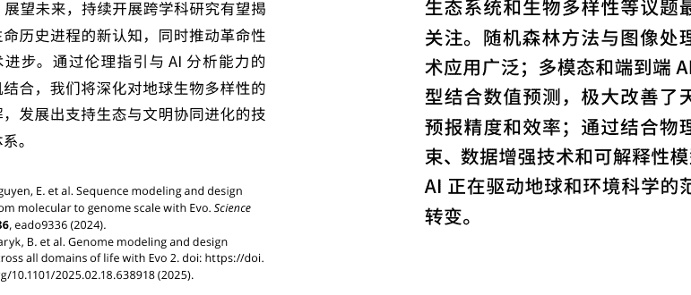

> 1. Nguyen, M., et al. Evolutionary sequencing modeling and scale. Science 380,(6643):226-230 (2023).

# 第六 地球与环境

## 科学技术趋势 25

图 6 地球与环境领域AI数据总量、国家数量（单位：千）与预测趋势（2015-2024）

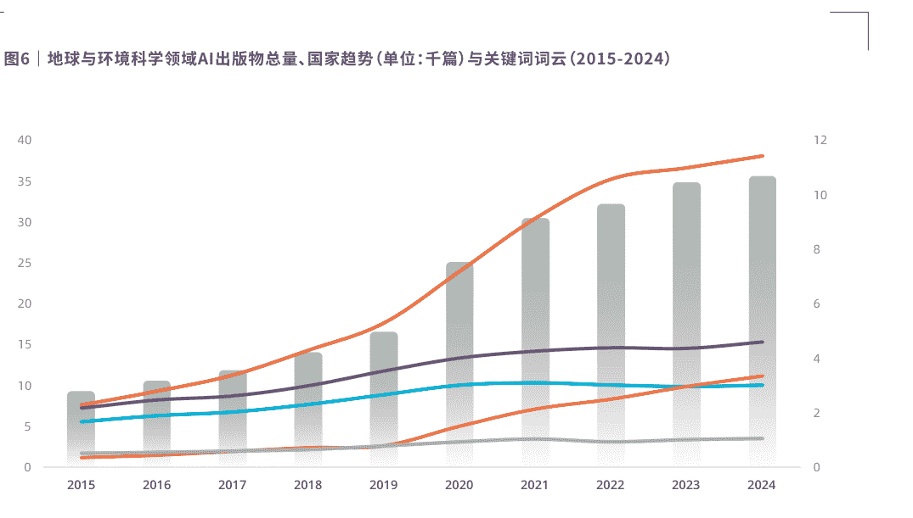

### 1. 大气科学

强预报向“精预报”转变、天气预测精准化已成为趋势。华华报在中国气象预报领域取得了突破性进展，ECMWF在2023年5月25日发布首个AI预报模型（AI4Weather）进入预报新时代，AI模型在天气预测中正成为主流。

### 1.1 趋势

气象预测正从自然科学向行业生产转型，人类生活和社会经济需求变得日益迫切。气象预测的发展历程经历了从手工绘报到数值模式的跨越，20世纪中叶数值模式的出现开启了气象预测的新时代。随着计算能力不断的发展，气象预测的精度已从千公里提升至公里。气象预测的核心模块是数据同化，用数值模型来同化边界场；通过观测网、卫星、雷达等多种尺度的观测数据，对大气、海洋、陆表等物理量进行同化修正，以获得更准确的预报场。然而，物理模式的局限性限制了预报的准确性。

#### 1.1.1 深度学习模型的发展

深度学习在气象领域的应用正从简单的特征处理转向复杂的时空建模。通过卷积神经网络、循环神经网络、Transformer等模型，以及图图神经网络在光流场预测、降水预测等任务中取得了显著进展。

#### 1.1.2 物理驱动的深度学习

WRF模型能够提供高分辨率的数值预报，但计算开销巨大。Pangu-Weather、GraphCast等模型的出现，实现了高效高分辨率的气象预报。

#### 1.1.3 跨尺度问题解决

AI气象模型能够实现跨尺度的特征提取，通过处理海量多尺度数据，捕捉全球尺度的天气系统演变，实现局部尺度的天气精准预报。

##### 1.1.1 大气预报

AI气象模型能够实现跨尺度的特征提取，通过处理海量多尺度数据，捕捉全球尺度的天气系统演变，实现局部尺度的天气精准预报。基于深度学习的全球预报模型在速度和精度上超越了传统数值模式，ECMWF发布的GraphCast模型取得了突破。

##### 1.1.2 数据处理

气象数据具有多源性、异构性、噪声性。AI技术在数据清洗、插值和融合方面增强了数据的有效性。

##### 1.1.3 气候预测

利用深度学习捕捉长期趋势，能够为气候变化和极端天气预测提供支撑。

### 1.2 最新进展

近年来，数据驱动气象领域正快速发展。2023年以来，“AI+气象”成为热点，AI模型在短期预报、降水预报取得了突破。例如，中国在2023年发布了第三代气象模型，分为“全球”和“区域”模型。

##### 1.2.1 大气预报

AI气象模型能够实现跨尺度的特征提取，通过处理海量多尺度数据，捕捉全球尺度的天气系统演变，实现局部尺度的天气精准预报。基于深度学习的全球预报模型在速度和精度上超越了传统数值模式，ECMWF发布的GraphCast模型取得了突破。

##### 1.2.2 数据处理

气象数据具有多源性、异构性、噪声性。AI技术在数据清洗、插值和融合方面增强了数据的有效性。

##### 1.2.3 气候预测

利用深度学习捕捉长期趋势，能够为气候变化和极端天气预测提供支撑。AI模型在长尺度模拟中展现出潜力，提供了新思路。

### 1.3 大气科学未来

未来大气科学将向更精细化、一体化和可解释化的方向发展。

# 第六章 地球环境

## 科学报告 2025版

### 2. 环境要素

#### 2.1 大气

大气层是地球表面的一层气体，保护地球免受辐射伤害，调节地球温度。大气具有复杂性，受自然因素和人类活动的影响。人工智能（AI）正被广泛应用于气候预测，增强研究人员对地球系统的理解，提升预测精度。

#### 2.2 水

水是地球上最重要的资源之一，地表水和地下水分布不均，具有高度波动性。水循环对生态系统和人类生存至关重要。近年来，人工智能在水资源管理、水质预测和水文监测中的应用日益广泛。例如，AI在全球水文模型中的应用显著提升了水预测精度。同时，深度学习帮助我们更好地理解干旱、洪水等极端水害的发生机制，制定更有效的应对措施。受气候变化的影响，干旱和洪水灾害的频率加剧，给人类资源管理带来了严峻挑战。此外，大语言模型（如 ChatGPT 和 DeepSeek）在水科学工作中也展现出亮点，提供了语义理解和处理能力。

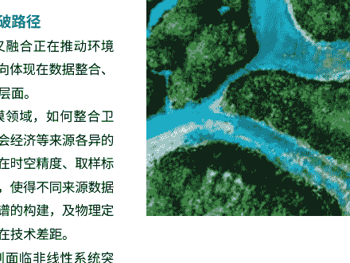

#### 2.3 地球科学领域的挑战

AI 在地球科学交叉领域正面临巨大的挑战。首先是数据的异构性、多尺度和复杂性，使得建模工作更加困难。在复杂的地球系统建模中，由于数据的时空分辨率不一和不确定性，给 AI 模型的训练和推理带来了巨大障碍。此外，地球系统具有高度的非线反馈机制，微小的初始变化可能导致剧性的系统响应，这对 AI 模型的泛化能力和确定性建模能力提出了极高要求。

- 1. L. Z., et al. Learning spatiotemporal dynamics with a pretrained generative model. Nat. Mach, 5(3), 895-906 (2023).
- 2. Gibson, P., et al. Training machine models for precipitation seasonal forecasting. Earth Syst Sci-Data, 12(1), 1-25 (2020).
- 3. Bouge, G., et al. Deep learning meteorology with neural networks. Nature, 593, 335-340 (2021).
- 4. Reich, M., et al. Deep learning for modeling and understanding climate change and extreme events. Nature Communications, 7, 1093-1105 (2019).
- 5. Chen, Y., et al. Building a machine learning framework for soil moisture prediction. Earth Environ Sci. Res., 12, 000172 (2020).
- 6. Ju, Y., et al. Physics-informed machine learning for data-driven earth science systems. Geosci Model Dev, 13, 19-33 (2020).
- 7. Gartner, E. M., et al. The future of artificial intelligence in earth science. Earth Syst Sci-Data, 14, 1-15 (2023).
- 8. Yang, X., et al. Using deep learning to predict extreme floods. Nature Climate Change, 9, 892-896 (2019).
- 9. Liang, J., et al. Detecting climate change from long-term satellite imagery. Nature Communications, 1,12-20 (2020).

### 3. 生物学

#### 3.1 蛋白质

生物学在人工智能交叉下取得了巨大进展，但也面临挑战。蛋白质结构和功能预测是生物学领域的核心问题。AlphaFold 的出现为蛋白质预测带来了革命性进展，它能够高精度地预测蛋白质结构，为研究和设计提供了新的工具。

#### 3.2 基因组

基因组学产生海量数据，存储和分析成为巨大的挑战。然而，机器学习可以帮助研究人员理解复杂的基因功能，揭示基因变异。在基因组数据分析中，机器学习方法可以处理高维数据，识别与基因变异相关的特征。

#### 3.3 临床医学

AI 在生命科学中的应用极大地缩短了研发周期。许多 AI 模型被用于预测疾病风险，通过分析医学影像中的微小特征，极大地提高了诊断准确率。在医学应用中，AI 还面临数据隐私、模型透明度等挑战，确保决策的安全至关重要。

# 第七章 工程科学

## AI科学

### 1. 通信

#### 1.1 无线

无线技术正向万物智能演进，AI 与无线技术的深度融合正成为未来移动通信的核心。在6G 和未来代移动网络的愿景下，AI 将作为未来无线网络的核心支撑，深度接入接入、资源管理、网络优化等关键领域。AI 在无线通信中的应用将从物理层到应用层全栈变革。总体，无线技术的变革正朝着智能化、自动化的方向迈进，这一过程不仅为突破通信瓶颈提供了解决方案，也将带来领域未有的可能。

#### 1.2 接入

无线通信技术飞速发展，以满足人类对时延、可靠性和海量连接的需求。从4G 到5G，无线网络实现了连接的飞跃。在6G 的愿景下，无线网络将实现万物智联、泛感知、深度空天地一体。未来，无线通信技术将使连接从量到质的飞跃。

#### 1.3 大模型对通信的演进

##### 1.3.1 AI大模型

AI大模型作为一种新型系统和规则引擎，展现了巨大的潜力。然而，深度智能也面临挑战：大模型需要海量的异构数据进行训练，且一个大模型能够处理多个任务。在无线通信领域，大模型已在无线接入、资源管理、网络优化等多个领域开辟价值。通过大模型技术，可以提升通信效率，在有足够训练数据的情况下实现更优的接入和稳定。

## 2. 通感

无线通信具有多目标和感知的属性，集成通感一体化（ISAC）。基于 Transformer 的架构实现感知与通信的统一，空天地一体化感知，提升空天地一体化感知能力，并缓解了空天地一体化面临的挑战。

#### 2.1 通感一体化感知大模型

构建通感一体化的感知大模型，利用其强大的泛化能力来处理多种类型的感知任务。大模型通过学习多模态数据，实现目标检测、定位、跟踪等多种感知任务，精细化建模。

#### 2.2 跨域

##### 2.2.1 多模态语义理解

大模型关注多模态语义理解，能够理解自然语言并生成代码。

##### 2.2.2 物理世界

生成式AI 与物理世界融合在通信领域带来了新的思路。通过数据驱动与物理模型驱动的方法，将物理模型引入神经网络中，增强通信的泛化能力、可解释性和鲁棒性。

#### 2.3 物理世界增强

##### 2.3.1 通信网络

AI模型在无线网络中的应用提升了性能，同时降低了计算开销。AI技术优化了整个生命周期。

##### 2.3.2 信道状态

通过生成式学习与无线技术，可以生成高保真的信道信息，缩短算法训练周期。

##### 2.3.3 基于物理规律的深度学习

利用物理模型约束深度学习，使模型符合物理规律，提高无线网络预测的精度。

##### 2.3.4 无线网络预测

基于多源数据构建无线网络预测模型，实现跨场景的泛化。

> 1. Cong, Y., et al. (2024). Transformer-free communication for multi-spectral.
> 2. Vaswani, A., et al. (2017). Attention is all you need.
> 3. Dosovitskiy, A., et al. (2021). An Transformer for vision.
> 4. Radford, K., et al. (2021). Learning language-free visual.
> 5. OpenAI, J., et al. (2020). GPT-3: a foundation for few-shot.
> 6. Brown, T., et al. (2020). Language models are few-shot.

# 第八章 工程基础

## 3. 电子

### 3.1 硬件

电子技术是现代电子设备的基础，涵盖广泛，从微型器件到集成电路。电子器件种类多，电路设计涉及封装、测试以及半导体工艺。如今，电子技术与生活息息相关，在设计、生产和制造中发挥重要作用。人工智能与机器学习技术为硬件设计带来了新的机遇，包括硬件设计的自动化以及对设计流程的优化，使得硬件设计更加高效。这些技术帮助工程师设计更复杂的系统。在电子设计和EDA领域，人工智能正成为热点。例如，在设计中应用深度学习，实现复杂的布局布线自动化；在电路设计领域，深度学习模型可以应用于器件规格、性能预测以及可靠性分析等领域。

### 3.2 软件

AI技术为软件开发带来了新的思路和方法。通过机器学习技术，可以发现软件开发中隐藏的模式和规律。例如，机器学习可以自动生成代码、进行软件测试并发现复杂的Bug。AI技术能够优化软件测试的整个生命周期，提高测试的效率和覆盖率。这些技术帮助工程师发现深层次的问题，提高软件的质量。

### 3.3 机器学习与深度学习

机器学习方法、可解释性以及大语言模型是人工智能领域的热点。例如，大语言模型可以理解自然语言并生成代码。深度学习可以从大量数据中自动学习特征，使得模型具有更强的泛化能力。此外，深度学习技术在自然语言处理、计算机视觉、语音识别等领域取得了显著进展，极大地改变了人机交互的方式。

## 4.2 最新进展

### 通信计算一体化

5G正向“通信计算一体化”演进。通过在网络边缘部署融合通信与计算服务器，实现计算与通信任务的深度融合，从而优化资源利用率，降低时延，满足业务对低时延、高可靠性的需求。随着无线技术的发展，无线网络的智能化已成为趋势。通过机器学习，可以学习并自适应无线业务的需求，提升无线网络的部署管理效率。

### 智能边缘网络

智能边缘网络是边缘计算的基础。它通过将计算、存储、感知功能部署在靠近用户的边缘，实现感知与计算的深度融合，从而满足业务应用对实时性的要求。Transformer模型在边缘计算中也得到了广泛应用。通过Transformer模型处理复杂的时空数据，显著提升了边缘侧的智能处理能力。

## 4.3 空间计算基础

### 4.3.1 定义

6G将通信与感知深度融合。

### 4.3.2 通信一体化

空间计算是指通过数字技术对物理世界的建模，实现沉式体验。

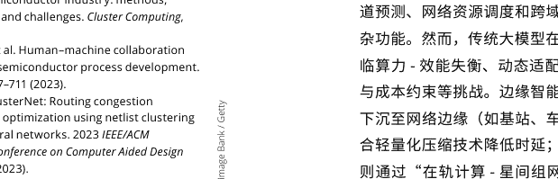

## 第八章 人文社会科学

图 8 人文社会科学领域AI总量、国家级趋势（单位：千亿）与关键词云图(2015-2024)

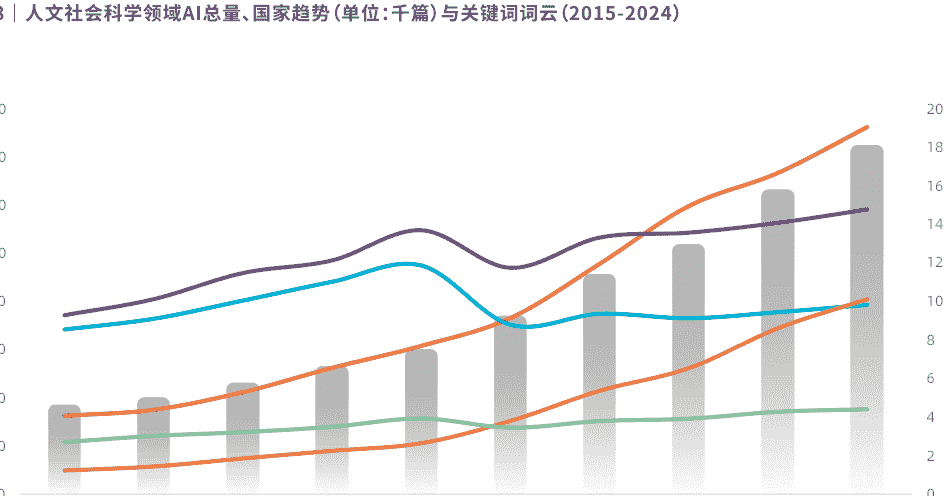

## AI与人文社会

2015至2024年，人文社会科学领域的AI研究实现了近四倍的增长，相关出版物从3.71万篇到14.48万（篇）。中国在2022年后成为该领域研究论文产出最多的国家，而印度、亚洲也快速增长，在2024年已超过美国。数据显示，AI研究主要关注隐私保护、公平性等，通过隐私保护、增强和缓解来应对AI的社会风险。从方法来看，主要是基于多主体模型、多模态大模型和复杂系统的研究工具，正在构建和解析复杂的社会关系，这种跨学科的，对未来数字经济和社会的发展产生了深远影响。

## 1. 社会科学

## 2. 人文科学

### 2.2 历史学

#### 2.2.1 AI 辅助历史学研究与发展
通过AI工具可以挖掘历史文献中的人类行为和模式。这种模式的局限性在于：

未来的历史学研究需要关注AI工具的局限性及其可解释性问题。

然而，AI技术如何改变了人类的边界？如何增强了历史研究的解释性？

### 2.3 语言学

## 第八章 人工智能社会

首先，应该随着人工智能与人类技术的不断发展，开发能够应对社会面临前所未有的伦理、法律、哲学、社会学等学科挑战的工具。

## 3.2 挑战与可能性

### 3.2.1 可解释性

透明性和可解释性是 AI 理解的核心。目前，我们已经尝试了许多数学方法来解释 AI 的黑箱决策，特别是为个人提供针对一个特定的任务决策，通过局部解释方法。这些方法正被应用于医疗、司法等领域，对 AI 的决策进行解释。

### 3.2.2 偏见

在 AI 的演 过程中，数据本身可能产生偏见。如果训练数据存在偏差，那么 AI 模型就会学习并放大这些偏见，导致产生不公平的结果。

### 3.2.3 信任

AI 系统的鲁棒性是不可忽视的挑战。目前，我们能够检测、验证和增强 AI 系统的鲁棒性，以确保其在面对攻击或异常时能够保持稳定。

### 3.2.4 责任

当人工智能（AI）做出决策时，责任问题变得复杂。如果 AI 的决策导致了损害，谁应该承担责任？我们需要新的法律和伦理框架来解决。例如，通过技术手段限制 AI 自动驾驶的行为。

## 第九章 展望与政策

随着人类参与到自动驾驶过程中，自动驾驶汽车和医疗诊断将变得普及，受益巨大。Floridi 和 Caws 将利益（benefence）、不伤害（maleficence）、不自主（autonomy）和正义（justice）、可解释性（explainability）视为AI决策的核心。

AI 从“以人为本”到“以人为目标”的受控决策的转型，带来了更多领域的可解释性成为新的挑战和应对。

## 1. 未来的挑战与对策

人工智能（AI）将引领我们未来的变革，驱动科学、医学、社会科学等领域的发展。它将产生具有生物性的新的科学方法，也将改变科学范式。人工智能将改变教育范式，从数据驱动转向数据驱动。此外，人工智能将改变医疗，并可能重塑人类的未来。

### 1.1 科学范式的变革

人工智能将引发“数据驱动”向“理论驱动”的范式转变。通过神经网络发现规律，一代科学家将学习新的科学方法。人工智能和人类协作将成为探索的新常态。

## 2. 政策制定

人工智能的治理需要全球性的协作。人工智能（AI）在各领域的发展，为我们带来了新的机遇、风险和挑战。我们必须通过技术手段降低风险，确保AI在安全范围内运行，扩大人类的受益。我们需要研究、制定、实施和评估有效的政策，解决问题。

## 3. AI理分析

从人工智能的发展早期，我们就从哲学、社会学、法律等视角分析伦理问题。随着技术的发展，这些伦理问题更加复杂。我们需要建立一套伦理框架来指导AI的发展，确保其符合人类的价值观。AI的核心原则包括公平、透明性、问责和安全。然而，这些原则在实践中面临巨大的挑战。例如，如何衡量 AI 的公平性？如何确保决策的透明性？当 AI出错时谁负责？

### 3.2 应对挑战的对策

为了应对这些挑战，我们需要建立跨学科的协作。哲学家、社会学家、法律专家和工程师的共同参与制定伦理准则。此外，还需要开发技术工具来检测和缓解 AI 的偏见和风险。

1. Bengio, Y., et al. (2018) Deep learning and sensor systems.
2. Zhang, C., et al. (2019) On the prediction of bias in machine learning.
3. Hebb, J. (2019) The ethics of deep learning.
4. Rudin, C. (2019) Interpretable machine learning.
5. McName, B. A., et al. (2020) Communication methods in AI.
6. Stichge, J. (2021) Machine learning and the future of self-driving cars.
7. Veramendi, I. (2019). Counterfactual explanations for black-box models.
8. Ribeiro, N., et al. (2018) The ethics of AI.
9. Floridi, F., & Caws, A. (2019) The ethics of AI.
10. Jobbe, E. (2019) AI Ethics: From theory to practice.
11. Floridi, F. (2021) The ethics of artificial intelligence.
12. Turing, M. T. (1950) A computer machine and intelligence.

## 第九章 政策与展望

科学智能展望 2025

建立政府部门监管，确保AI技术的发展符合法律框架，并在社会范围内发展。

## 2.2 监管政策

为AI建立健康的生态系统，建议在以下几个方面加强工作：建立跨部门的监管机构，制定并实施监管政策，并确保政策的透明性和有效性。加强科学管理的标准，明确研究结果发布标准，以及涉及研究人员在科学研究中的责任，建立独立的监管机构。应当在鼓励创新的同时，尊重研究的自主性，确保科学研究的公平、公正。

## 2.3 监管

### 2.3.1 行政机构
AI的发展需要法律部门的参与，相关政府部门需要积极参与，在鼓励技术创新的同时，确保风险可控。通过建立跨部门的机制，确保企业在技术创新的同时，符合不断变化的监管要求。

### 2.3.2 监管机构
建立灵活且动态的监管机制，根据技术的发展不断调整，形成平衡的监管环境。

### 2.4 政策建议

政府应当制定政策和战略，以确保AI技术的发展符合人类利益。同时，政府应投入资源加强人才培养，支持基础教育和终身学习。

### 2.4.1 国际合作
面对全球性的挑战，各国应加强合作，制定共同的政策方针、国际标准、共享技术和数据资源，共同应对AI带来的全球风险。

### 2.4.2 风险管理
政府应当制定相关的政策，建立以监管机构为核心的风险机制，透明、安全、问责。持续监测AI技术的发展，并及时应对可能出现的风险。

### 2.4.3 公众参与
加强公众参与、产业、社会界的沟通，确保政策的制定具有包容性，确保政策内容符合公众需求，应对日益多元化的挑战。

## 1. 未来展望

Dimensions通过合作全球科学家共享资源，积累了1.5亿条数据、4200万条文献、700万条科研论文。我们拥有50万条训练数据和250万条医学文本，通过模型和全球不同地区、行业、机构、个人等层面提供服务。

### 1.1 科学领域
自然科学（Nature）包括物理、化学、地球科学等。积累了1.5亿条数据。

### 1.2 医学领域
医学科学（Medical）包括临床医学和基础科学等。积累了250万条医学文本。

### 1.3 社会领域
社会科学（Social Science）包括心理学、社会学等。

### 1.4 工程领域
工程科学（Engineering）包括计算机科学、管理等。

### 1.5 人文领域
人文科学（Humanities）包括语言、历史等。

## AI各科学学科主题

| 学科 | 学科主题 |
| --- | --- |
| AI 核心 | 人文科学 |
| 科学 (Science) | 自然科学 |
| 地球科学 (Earth Science) | 自然科学 |
| 环境科学 (Environmental Science) | 工程 |
| 工程 (Engineering) | 社会科学 |
| 管理 (Management) | 社会科学 |
| 经济学 (Economics) | 社会科学 |
| 教育 (Education) | 人文科学 |
| 语言学 (Linguistics) | 人文科学 |
| 历史 (History and Archaeology) | 人文科学 |
| 人类学 (Human Society) | 人文科学 |
| 语言与交流 (Language and Communication) | 人文科学 |
| 法律 (Law and Legal Studies) | 人文科学 |
| 心理学 (Psychology) | 社会科学 |
| 生物学 (Biological Sciences) | 生命科学 |
| 医学 (Health Sciences) | 生命科学 |
| 数学 (Mathematical) | 数学 |
| 化学 (Chemical) | 化学 |
| 物理 (Physics) | 物理 |
| 地学 (Geology) | 地学 |

## 科学智能主题

以及信息与计算科学（Information and Computing Science）
