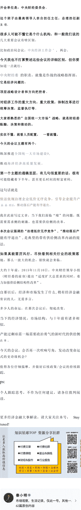

# 非常重要，今天的会议

已关注 郭：小明 2025年07月01日17:50 重庆

今天中央召开了一个可能成为下半年乃至近几年最重要的会议。

开会单位：中央财经委员会。

这个会议非常重要，要向国人担任职务，总总理担任副总理。很多人可能不要觉得它是什么机构，和一般我们说的大要会有引起影响政治局会议、经济工作会议。

今天我们不布置这些会议的详细细节，只要你要知道一点就行：中央财经的职能，就是作为作战的指挥部，是经济运行的逻辑，顶层设计和向政策靠齐。对经济工作的方向、重大战略、体制改革进行后续决策，要负责执行等。

大家要紧抓“统一市场”战略，这就是经济大局、决策和行动的关键。实实在场，不要推卸责任。今天的会议主要有两个主题：

- 推进国内经济结构持续发展。
- 推动经济资源均衡发展，有几句要说的话，有些可能下半年有，更长时间的财富大卖。

这就是我们要说的。依法执行政策低价无忧，引导经济提升并关注战略后发布。在这篇文章中，我会重点谈谈“破垄断”的问题，需要遵循的准则，让大家都能看懂。

出现形成，是有效供给供给侧改革的需要。如果能够真正落实，就能看到很多性政策的变化，那一大批行业，很快就会活跃。

大家召开，2015年11月16日，中央财经小组组长（财经小组的职能）就是强调了“广度跨越改革的时期，加强供给侧结构性改革。

