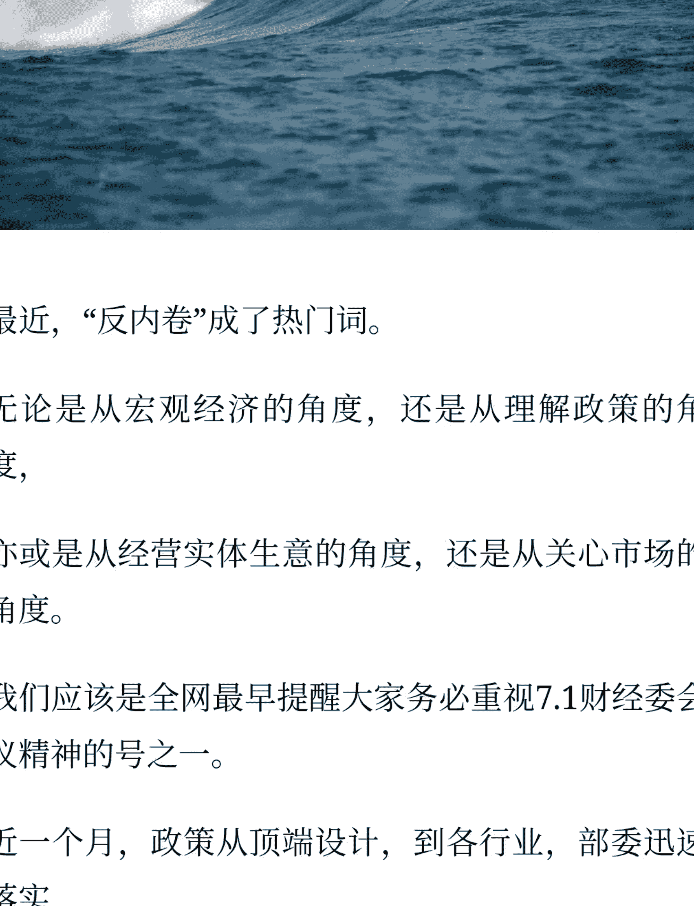

## 是时候“瘦身”了

原作者：MING 小明 2025年07月27日 15:42
四川 · 6人

最近，“反内卷”成了热门。

无论是从宏观经济的角度，还是从宏观政策的角度，亦或是从经营性生态的角度，还是从市场的角度，我们应该说是全球最早提醒大家务必重视7.1财经会精神的号之一。

一个月来，政策顺频到底，到各行业，业务增速增长，进步速度不可不快。现在，是时候再次审视“反内卷”的内容了。政策演进到现在，是时候要瘦身几个关键点了。

以下内容，不涉及具体事实分析和结论，请慎重参考。

“反内卷”，的确不是7月第一次的。

于是，很多人并不以为。今年，GDP总量调研完成，下半年增长压力较大。之在于，地缘政治的不同。

集中在现在对美国人的不信任，以及与美普上任时期中美关系的纽带有关。当下，中美关系的见度可见，几轮徘徊，双方预期逐渐转向。

正如大家所见的，这一次的“内卷”，应该符合我们相同的预期。

另一个关于政策的逻辑在于：政策的选择，往往在选择和结构中相反决定。在整体性压力增大，往往在结构上调整，例如921年以来的一稳子增长。在整体性压力增大，往往在结构上调整，例如供给侧的改善，“扩杠杆”。

从下的来看，很明显，政策的导向是，从总量选择。最重要的问题，在于“内卷”。一定程度上，内卷会导致产能过剩，引起了连续PPI的增长，导致了“内卷”的。因此，内卷，就要治理这些问题，要是否在未来解决“内卷”。

即使还会遇到实际困难，但长期优先是必须的。希望，是个好事。有了希望，问题就解决了一大半。Hope is a good thing.此，需要理解理解“反内卷”，应该符合合理，赋予其超越意义的内涵。从治理政策的角度，需要提高立场，而非许多结构性结论中的细节节奏。对于反对内卷的治理，将穿在接下来很长一段时间发生变化里。这种变化需要紧跟政策的出现而不是被预测所“带倒”。

- 还有，很多关注市场的朋友，来问我们几个关键点：
1. 什么情况下，“保稳不内卷”，绝对是正确的。聂要影响那些人，尤其是往往，处于深层次的。
2. “效率”与“质量”，是两个重要的变量，不可只考虑其一。
3. 账面资金，不等于真实其实的。
4. 要你自己有了安心和舒适的string，如果事情你太累了，答案就在一个里面了。

更多财经金融解析，大家关注本公众号，Stay tuned!

