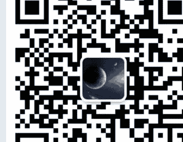
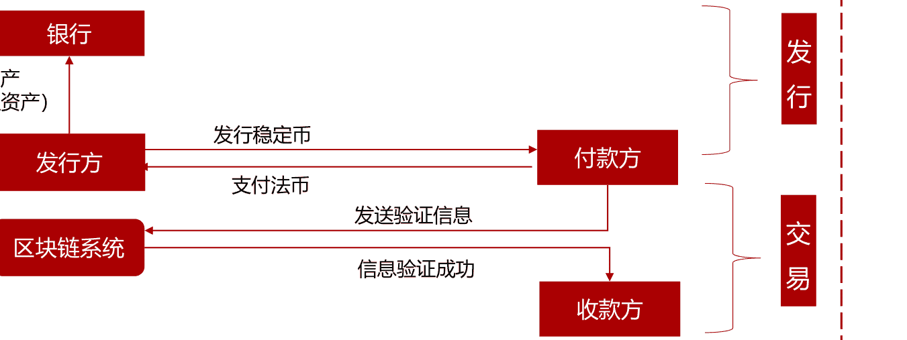
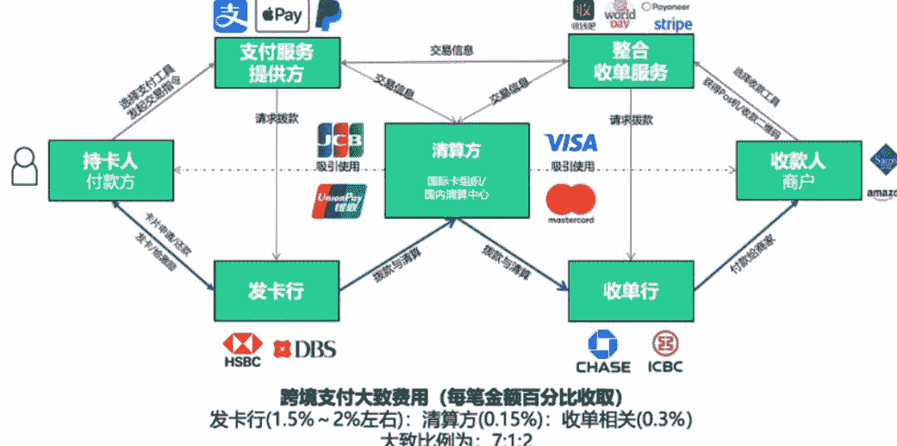
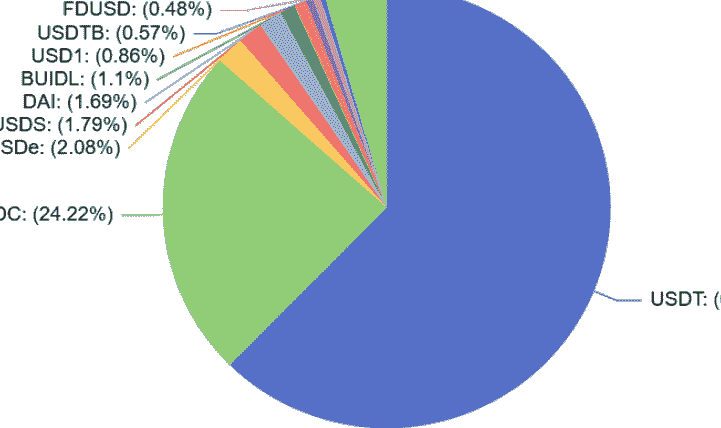
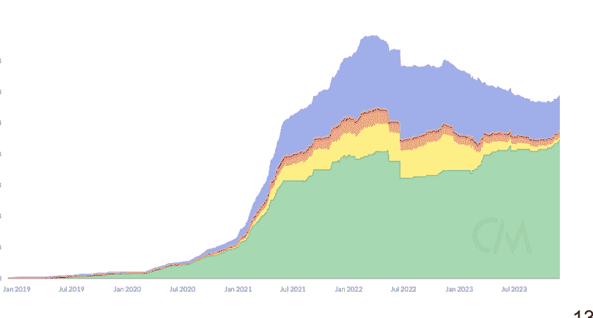

证券研究报告

浙商证券股份有限公司
ZHHESHANG SECURITIES CO.LTD

# 合规时代开启，全球竞赛加速
## 稳定行业深度报告

**行业评级：看好**
**2025 年 7 月 17 日**

| 分析师 | 邮箱 | 证书编号 |
| :--- | :--- | :--- |
| 刘雯 | liuwenshu03@stocke.com.cn | S1230523020002 |
| 章非 | tongfei01@stocke.com.cn | S1230524050005 |
| 张致远 | zhangzhiyuan@stocke.com.cn | |

知识星球TOP 资源分享社群
公众号：知识星球TOP让更多人获取高价值信息
汇聚网付费资源

微信信号：jntsg8

添加微信免费进
- ◆付费文章
- ◆付费社群
- ◆付费课程
- ◆副业&搞钱
- ◆财经&股市
- ◆行业报告

时政·历史·职场·体制·自媒体学习·军事·软件·影音·社会学

微信信号：jntsg2

# 1. 稳定币：市值锚定的数字货币

稳定币是锚定法、商品法或加权数字货币，通过足额抵押或算法调节供给维持价值稳定。相比传统货币，稳定依托区块链实现对对点实时清算，交易成本低（以美元 $ENA 挂钩的资金汇款费率为0.25%，2023 Q3全球平均汇款成本为6.18%），高效（只需几秒到几分钟内，传统方式需要3-5天），门槛低。稳定币已广泛用于交易场景、DeFi、供应链金融及跨境支付，成为数字经济生态的重要基石。

# 2. 监管化进程：香港 美国首推GENIUS法

2025年6月，香港特区政府发布公告，2025年8月1日《稳定币条例》的正式生效，成为全球首个实施稳定币法监管框架。此后，美国参议院以66票赞成32票反对的结果通过了《GENIUS法》的程序投票。

# 3. 全球金融博弈，稳定币合规

稳定币由发行方主导、挂钩美元。USDC与USDT市值占比超过85%。截至2025年6月，全球稳定币市值已突破2000亿美元，较上年增长507倍。东南亚等地的中小型企业通过USDT进行跨境汇，避免银行和SWIFT系统，这种“非正式美元化”加速了美元在发展中国国家的渗透，由于其储备美元，在全球外汇储备中占比约48%，在稳定币市场占比超过10%。

各地积极加强稳定币试点与合规化管理。美国、中国香港、新加坡、欧盟等地均已出台监管框架，例如美国《GENIUS法案》、欧盟MICA、中国香港及全球地区监管强调调整足额储备、独立托管、KYC及AML要求，推动稳定币走向合规化和合法化。

# 4. 未来展望：稳定币+RWA，连接现实与数字世界

稳定币为RWA提供了便捷的支付和结算基础，增强了信心。在香港等地，RWA项目可通过币或美元稳定币结合SPV和链上平台，将不动产、债券、股票等转化为全球交易债券。随着稳定币市值扩大，链上配置需求将持续提升，推动RWA资产高效流动和碎片化，助力资产与全球互联，释放“资产+资金”协同空间。

# 5. 建议路径

- 发行：安众在线、京东银行、京东
- RWA：头部科技、上沿钢铁、新新集团
- 支付：新银、新大付、连连宇宙
- IT服务：长亮科技、四方创新、京北方、天阳科技、宇宙科技、普联软件、优优佳

## 风险提示

- 1、政策不确定性
- 2、市场风险
- 3、技术风险
- 4、需求变化及国际化风险

# 目录
CONTENTS

01 稳定币：币值稳定的数字货币
02 金融竞赛加速，监管日趋明朗
03 产业侧，多方受益
04 未来发展：稳定币+RWA，连接现实世界和加密世界

# 01 稳定币：币值稳定的数字货币

## 稳定币：币值稳定的数字货币

> 金融稳定委员会（Financial Stability Board，简称“FSB”），稳定币是指旨在通过挂钩资产、一种资产或一篮资产来维持价值稳定的加密货币。欧洲央行的加密资产工作组在其报告中将稳定币描述为一种数字货币单位，它依赖于稳定机制来最大限度地减少加密波动，使其价值相对于特定法货币或一组货币挂钩。这表明稳定币通常被视为非政府的一种加密货币，其稳定性依赖于资产量。

> 稳定币主要分为四类：法币为抵押的稳定币、商品为抵押的稳定币、加密货币为抵押的稳定币和弹性稳定币。目前，市场上大部分抵押的稳定币（以法币、黄金或加密货币为抵押）通过算法或智能合约调整供应量的价格相对稳定，占据了市场主要份额。

| 类型 | 产生方式 | 关键特征、功能 | 典型稳定币 |
| :--- | :--- | :--- | :--- |
| 法币为抵押 | 中心化实体背书和法币抵押 | 中心化+交易对手风险；监管；高流动性+锚定 | USDC, USDT, BUSD |
| 商品为抵押 | 由黄金、房地产等商品支持 | 中心化+交易对手风险；监管；高流动性+锚定 | PAXG, XAut |
| 加密货币为抵押 | 以一篮加密货币为抵押 | 去中心化协议；智能合约风险；无交易风险；受波动影响 | DAI, suUSD, Frax |
| 弹性稳定币 | 通过算法和智能合约调整供应量 | 去中心化治理；无交易对手风险；波动性 | AMPL, DSS, BAC |

### 优势：低成本、高效、门槛低

相比传统货币，稳定依托区块链实现对点实时清算，交易成本低（如美元 $ENA 挂钩的资金汇款费率为0.25%，2023 Q3全球平均汇款成本为6.18%），高效（只需几秒到几分钟内，传统方式需要3-5天），门槛低。稳定币与法货币挂钩，便利性，分离了价值波动的数字货币，更适合交易。

### 结算机制与技术对比

| 类型 | 普通支付 | 稳定币 | 比特币 |
| :--- | :--- | :--- | :--- |
| 手续费 | 跨境支付3%-10%（含汇率费）；加密货币转账1%-3% | 跨境支付0%-1%；加密货币转账单笔支付Gas费，部分网络可实现零Gas费 | 灵活选择 |
| 汇率成本 | 承担银行汇差，其中汇率波动的剧烈程度 | 锚定法币（如USDT）无汇率波动（但兑换为法币可能产生差） | |
| 时效 | 3-5天到 | 10秒-2分钟到达 | |
| 波动性 | 法币本身无波动 | 锚定法币，价格 | 波动较大 |
| 透明度 | 需要经过多个机构监控 | 链上交易查询，手续费和进度公开 | |

### 原理：等额储备

工作原理：首先，付款方持有等值的资产，发行方将部分资金存入银行或购买国债，确保形成100%储蓄金；之后，发行方基于这笔储备在区块链上发行并放付款方使用货币在链上支付或交易，区块链记录转账信息，收款方收到后可以选择持有或再次支付；最后，当付款方有需要兑现时，可将稳定币发行，通过银行返还对应的资金。

目前稳定货币需要发行方持有的储备资产监管不同。美国《GENIUS法案》允许发行方将储备资金（现金、短期国债）用于短期投资，赚取利差；但中国香港的《稳定条例》要求100%储蓄托管，不得挪用。

在流通环节中的关键风险在于发行方持有的储备资产透明度，主流稳定币Tether会对其储备资产公布，但历史上USDT的市值一度破美元，反映市场对其兑付信心不足。

资料来源：深蓝TechFlow、美国官方立法信息平台、香港立法会、财经、浙江财经

### 传统跨境支付：链长、环节多

传统跨境支付依赖中心化金融机构和清算网络（如 SWIFT、CHIPS、CIPS 等），链长、环节多。

- 发起阶段：汇款人通过本地银行（汇行）发起支付，提交收款人信息（账号、开户行）、金额及用途，并完成 KYC（身份验证）、反洗钱（AML）审核。
- 中转阶段：汇行通过 SWIFT 等跨境支付系统向收款行发送支付指令，但两家银行间可能无法直接清算，需通过 1-3 家中行（代理行）中转。例如：中国某银行汇款至美国某银行，可能经过纽约分行，再通过美国本地代理行传递指令。中行需逐笔生成支付指令、扣划资金，并收取中转费用，同时考虑时区、工作日限制（非工作日暂停办理）。
- 清算与到账阶段：收款收到指令后，对信息无误后，扣减中行或汇行在行的清算头部，将资金转入收款人账户，并通知收款人。

资料来源：Foresight News、浙商证券研究所

### 区块链跨境支付：简单直接

区块链跨境支付基于分布式账本技术，过去通过中心化或多中心的节点网络实现支付，链路短、环节少。

使用公链进行跨境支付，与非跨境支付链路相同：用户钱包→ 交易上账（公链/Layer2，秒级确认）→ 商户接收稳定币。

区块链跨境支付的特殊之处：只能将稳定币传输到收款方，一般情况下高速公链转账费（Gas费）为大概0.001 USD。

### 不可能三角形：价格稳定、资本效率和去中心化

稳定的“不可能三角形”是加密货币领域的核心框架，指无法同时满足三个特性：价格稳定、资本效率和去中心化。设计者必须从中选择一个并忽略另外两个。通过锚定法资产或储备修正，价格波动、资本效率失效可能导致脱钩；去中心化实现完全去中心化，去中心化程度影响稳定性。

| 类型 | 特性 | 机制 | 案例 |
| :--- | :--- | :--- | :--- |
| 中心稳定币 | 价格稳定+资本效率 | 法币、国债等为100%储备，1:1兑换，依赖发行方（如银行托管、审计） | USDT (Tether), USDC |
| 超额抵押稳定币 | 价格稳定+去中心化 | 用户抵押价值高于借款的加密资产 | DAI (MakerDAO), sUSD (Synthetix) |
| 算法稳定币 | 资本效率+去中心化 | 无需实体，通过供需锚定维持市场下易陷入“死亡螺旋” | UST (Terra) |

### 金融竞赛加速，监管日趋明朗

### 美元稳定币主导地位

全球稳定币市值从2023年的1384亿美元增长到2025年的2463.8亿美元，年增334%。随着各地地区监管逐步明确，合规化浪潮推动市场规模增长，行业整体活跃度和深度持续提升。稳定币锚定美元，已应用于国际贸易、数字结算和方便使用美元。亚洲、非洲等地的中小企业通过USDT进行跨境交易，绕过银行和SWIFT系统，提升了美元在当地的影响。

稳定币市值占比（2025/6）

- PYUSD: (4.49%)
- FDUSD: (3.34%)
- USD1: (0.57%)
- BUIDL: (1.1%)
- DAI: (1.69%)
- USDC: (1.79%)
- USDe: (2.08%)
- USDT: (62.38%)

稳定币总市值变化

资料来源：Foresight News、第一财经、新浪财经、DeFiL、Coin Metrics、浙商证券研究所

# 中融竞赛，香港仅是“试炼场”，更是“防火墙”

稳定币合规落地：2025年6月6日，香港特别区在发布公告后使《稳定币条例》正式生效，成为全球首个实施稳定币监管框架的国家。美国议院以66票赞成、32票反对的结果通过了《GENIUS法案》。

美国将稳定币视作美元的重要数字：美国财长贝任森在白宫首次资产峰会上表示，美国“将保持美元作为全球主导货币的地位”，并且“将利用稳定币来实现这一目标”。美元在全球储备中占比约58%，但在稳定币市场占比近100%，东南亚、非洲等地的中小企业通过USDT跨境汇款，绕银行和SWIFT系统，这种“美元化”加速了美元在发展中国家的渗透。

香港《稳定币条例》解锁港人民币：《稳定币条例》为多种稳定币留出了空间，这为CNH（离岸人民币）铺平了道路。

### 美国和香港的稳定币监管对比

| 类目 | 美国（GENIUS法案，2025年6月通过） | 香港（稳定币条例，2025年8月1日生效） |
| :--- | :--- | :--- |
| 监管机构 | 联邦和州监管机构，根据规定规则和发行主体性质有所不同，如规模超过100亿美元的发行将由稳定币监管机构监管，至少100亿美元的发行方可选择联邦监管机构。 | 香港金管局负责对具有金融类性的虚拟资产包括稳定币进行监管和采取牌照制度 |
| 发行门槛 | 银行、信社或非银行均可发行 | |
| 储备要求 | 允许发行方将储备资金（现金、短期国债）用于短期投资，赚取利差 | 要求100%储蓄托管，不得挪用 |
| 透明度 | | |
| 风险 | | |

资料来源：深蓝TechFlow、美国官方立法信息平台、香港立法会、财经、新浪财经

## 全球稳定币监管加速

## 各国稳定币监管框架

| 地区/国家 | 监管框架核心内容 | 储备要求 | 发行/流通规定 |
| --- | --- | --- | --- |
| 美国 | 主要监管法案（如GENIUS Act），监管重点在于确保储备安全与金融稳定 | 100%高流动性美元资产（如现金、T-Bills），禁止支付利息 | 发行机构需获许可、强调合规 |
| 日本 | 采用信托结构，规范电子支付手段 | 初步要求100%足额储备，后允许信托储蓄、部分投资短期国债 | 银行等金融机构可发行，须申报 |
| 新加坡 | 标签化监管，MAS监管的稳定币有专属储备资产以信托托管，须为现金和高质量信用 | SCS需明确监管，小型发行设有豁免 |
| 中国香港 | 首阶段聚焦锚定币的稳定币发行 | 全额高流动性资产，不得支付利息 | 金管局主导，合规发行和托管 |
| 欧盟 | MiCA法案全面监管 | 必须有足额储备、独立托管 | 发行人需符合审计义务 |

资料来源：GENIUS Act、MiCA法案、新加坡稳定币监管框架、日本《资金制度等》

# 03 产业侧：稳定币产业链完善多方受益

稳定币产业链包括发行方、储备资产建设、区块链开发、下游应用场景等：

- 发行方：Tether (USDT)、Circle (USDC)、DAI (去中心化稳定币)
- 储备资产管理者：银行、信托机构、底层支持（如太坊、Solana、TRON等）
- 区块链开发：智能合约、钱包
- 下游应用场景：加密货币交易、跨境支付工具、供应链、数字经济

盈利方式：
- 发行方：通过稳定币发行赚取利差。
- 储备资产管理：通过短期国债或其他低风险资产获息。
- 交易所：通过交易费、挂单、跨链结算获取收益。
- 综合服务商：作为合规通道，帮助资金流转，满足合规维护。

## 稳定币产业链图

资料来源：华经情报网、Foresight News、比特币、浙商证券研究所

## Tether: 野生长的龙头

- 成立：Tether在2014年是全球第一个大规模商业化的锚定稳定币，首创“1:1美元储备、链上发行”模式，把传统货币搬到链上，解决了加密货币流动性问题。
- 离岸注册：初期依托Bitfinex在英属维尔京群岛（BVI）快速崛起，后期公司将部分业务架构放在离岸。
- 野生生长：由于行业初期缺乏监管，Tether在透明度和资产审计方面长期处于劣势。2017-2021年间，曾因准备金不透明、部分资金高风险债券、甚至被指与Bitfinex的关联交易多次被美国监管机构调查。尽管如此，Tether靠着灵活的全球化离岸运营、对交易所和场外市场的强大优势，占据稳定币市值的绝对头部，市占率超过60%。截至2024年底，USDT发行规模破900亿美元，已成为全球加密市场的“基石”。这种运营模式赢得了相对宽松的管理反而扩大了稳定币发行的影响。
- 底层资产：公司仅透过季度财务数据与报告披露资产情况，且内容相对模糊。即使通过这种半透明的方式，可以看出Tether的底层资产构成较为显著，其中包含了60多亿美元的黄金、70多亿美元的比特质押保障贷款和40多亿美元的其他投资。

## Tether资产结构 (2021)

资料来源：Tether官网、财经网、Tether官方号、DeFi Llama、浙商证券研究所

## Circle:合规性的稳定币标准

- 成立：Circle成立于2013年，最初是一家数字资产公司，后转型成为USDC稳定币的主要发行方，与Coinbase联合推出，定位从一开始就是合规、透明与主流金融市场。
- 美国注册：Circle总部注册在美国波士顿，是全球首家本土建立、面向机构和企业客户发行法币锚定币的公司，发行USDC。不同于Tether的注册模式，Circle从一开始就开始纳入美国州法律及联邦金融监管体系，在传统金融与区块链之间搭建桥梁。
- 合规先行：Circle是少数获得美国州法币转移模式(MSB)、获得FinCEN(金融犯罪执法局)注册且遵循《银行保密法》的稳定币发行机构之一，近年来成为美国特许银行机构（通过与合作信托银行授权）。其储备金完全存放在受监管的美国银行和短期储蓄中，由全球四大会计事务所Grant Thornton LLP审计，定期公布储备金额，信息透明度，成为稳定币合规化的代表性企业。其发的USDC在2022-2023年市场占比接近40%，次于USDT成为全球第二大稳定币。2024年Circle启动在美国交易所上市的计划，有望成为全球首个公开的稳定币，合规与透明吸引更多机构。
- 底层资产：公司每月通过审计报告资产情况，且资金大部分用于购买美国国债，剩余资金以现金形式存在。虽然USDC的收益率远低于USDT，但是彰显了其稳定币特质。

资料来源：Circle官网、MarketsWiki、《财经杂志》、Gecko、浙商研究所

## 长亮科技 - 寻找合作伙伴

长亮科技成立于2014年，是国内领先的金融IT解决方案供应商，拥有数字人民币相关产品，包括钱包以及区块链运行能力，目前已完善了稳定币数字化解决方案，涵盖中国大陆、新加坡、香港等地。

- 2024年，长亮科技实现业务收入17.36亿元，境外收入占比43%。
- 自2016年起持续推进海外业务，在马来西亚、菲律宾、泰国等地落地。
- 与腾讯云联合发布新一代稳定币框架，解决传统银行系统难题。
- 与SCB签约启动核心系统现代化改造，首次承接此类项目。

| 指标 | 2020 | 2021 | 2022 | 2023 | 2024 |
| --- | --- | --- | --- | --- | --- |
| 营业收入（百万元） | | | | | |
| 收入增长率 | | | | | |
| 归属净利润（百万元） | | | | | |
| 净利润增长率 | | | | | |

资料来源：iFind、Wind、长亮科技官网、互动易、浙商研究所

## 四方精创·深耕金融科技，抢滩蓝海

四方精创成立于2003年，国内领先的金融IT解决方案商，专注于银行、证券、保险等金融机构提供核心系统建设、跨境数字结算、区块链技术支持。在Web3.0与分布式账本方面有着深厚积累，在数字资产发行、通证化、交易以及托管等方面积累丰富的领域经验。

- 2024年，公司实现营业收入约7.40亿元，境外营收占比60.3%。
- 自2023年推出并持续发行FINOSSafe平台，该平台支持数字资产的发行、通证化、交易以及托管，能够稳定数字资产发行及市场参与者的业务。
- 多央数字货币（mBridge）项目：涵盖核心服务，参与跨境支付结算基础设施，实现“数字人民币-港币-稳定币”实时兑换网络。其技术方案已有20家商业银行采用，年金额超万亿元。
- 协助香港监管沙盒项目：协助香港监管管理局完成了Project Sandbox项目的实施，成功落地了Tokenized Deposit与Tokenized Asset项目的实施。
- FINOSSafe集成Web3平台：支持各类资产币化、交易以及托管，包括锚定各种法币的稳定币和不同计价货币的RWA（现实资产）。
- 跨境支付结算服务：为金融机构提供基于SWIFT、IPS等传统支付系统的服务，支持稳定币与法币的无缝对接。

资料来源：四方精创官网、公司公告：iFind、证券新闻、同花每日财经、浙江证券研究所

## 京北：依托金融核心能力，接入稳定赛道

京北成立于2004年，是国内领先的金融IT及BPO（业务流程外包）服务商，涵盖各大银行、清算、票务、交易所等提供金融系统开发及运维服务。近年来，京北积极探索区块链、跨境支付、数字货币等新兴金融技术，布局数字货币和跨境支付清算场景，依托强大的银行系统建设及运维能力，与银行、清算机构构建长期合作，稳步切入数字赛道。

- 2024年，京北实现营收46.6亿元，金融科技解决方案占总营收的28.05%。
- 公司与国富量子创新正式签署战略伙伴，聚焦跨境业务及数字货币业务开展合作，共同推动金融场景和金融科技的创新。
- 多央数字货币（mBridge）项目：涵盖核心服务，参与跨境支付结算，实现“数字人民币-港币-稳定币”实时兑换网络。技术方案已有20家商业银行采用，年金额超万亿元。
- 协助香港监管沙盒项目：协助香港监管金融管理局完成了Project Sandbox项目的实施，成功落地了Tokenized Deposit与Tokenized Asset项目的实施。

资料来源：京北官网、公司公告：iFind、新浪财经、浙商研究所

| 指标 | 2020 | 2021 | 2022 | 2023 | 2024 |
| --- | --- | --- | --- | --- | --- |
| 营业收入（百万元） | | | | | |
| 收入增长率 | | | | | |
| 归属净利润（百万元） | | | | | |
| 净利润增长率 | | | | | |

## 朗新集团：数据融合增长，激活实体资产

朗新集团成立于1996年，是国内领先的能源管理平台，涵盖电力、交通、公共服务等领域。拥有区块链数字化解决方案，目前已完善了稳定币与能源数字化转型的能力。

- 2024年，公司营业收入47亿元，其中海外业务占比47.9%。
- 稳定币RWA项目：通过区块链技术将传统现金“切片”并在链上透明、低成本、自动化分配，助力流动性不足资产。
- 核心产品：区块链基础设施日益完善，投资者对资产多样化与高流动性投资类别的需求增加，以及黑石、瑞瑞、富兰克林等金融巨头的积极探索。典型案例包括黑石的BuIDL、富兰克林的FOBXX以及加密普Mint的房地产代币化等。

# 04 未来发展：稳定币+RWA, 连接现实世界和加密世界

## RWA现实资产所有权/收益链化

真实世界代化（RWA, Real World Assets Tokenization）是指通过区块链技术将现实资产（如房地产、黄金、石油、知识产权、股票、债券等）转化为链上数字资产，用于交易或抵押，代表对应资产的所有权或收益，相当于链上的“金融证券化”。RWA能将传统现金切片并在链上透明、低成本、自动化分配。

截至2025年6月，RWA市场规模已升至244亿美元，去年增长约85%。典型案例包括黑石的BuIDL、富兰克林的FOBXX以及加密普Mint的房地产代币化等。从资产结构来看，私人信贷和美国国债类目前占据九成份额，与此同时，市场代码化（如黄金）和房地产份额持有等新领域也在逐步扩展。

## 2019-2025 RWA市场规模

资料来源：PA News, Investax, Franklin Templeton, Gulf News, RWA Inc., Bitget, 浙商研究所

## RWA+稳定币：连接现实世界和加密世界

> 稳定币链上的世界和链下的货币体系连接在一起，作为流动性和支付清算工具，为RWA交易场景提供了合规与价值锚定，从资金在链上形成高效流转，助力资产数字化和证券化落地。稳定币为RWA提供了交易媒介、流动性工具和收益载体，而RWA为稳定币扩展了底层资产类别和真实应用场景，形成了可持续的闭环生态。

> 在实际应用中，越来越多的企业和项目通过稳定币+RWA组合，探索充电桩、光伏电站等场景。

## 风险提示

- 1、政策不确定性：各国及地区监管政策尚未完全明朗。
- 2、市场风险：行业宏观波动和竞品影响，市场份额可能变动。
- 3、技术风险：存在区块链技术漏洞和资产托管透明度不足风险。
- 4、需求变化及国际化风险：应用场景推广和国际化进展可能低于预期。

## 行业评级与免责声明

### 行业的投资评级

以报告日后的6个月内，行业指数相对于沪深300指数的涨跌幅为标准，定义如下：

- 1、好看：行业指数相对于沪深300指数表现 + 10%以上；
- 2、中性：行业指数相对于沪深300指数表现 - 10% ~ +10%以上；
- 3、看淡：行业指数相对于沪深300指数表现 - 10%以下。

我们在此提醒您，不同证券研究机构采用不同的评级术语及评级标准。我们采用的是相对评级体系，表示投资的相对比重。

建议：投资者买入或者卖出证券的决定取决于个人的实际情况，比如当前的持仓结构以及其他需要考虑的因素。投资者不应仅依靠投资评级来推结论。

## 行业评级与免责声明

### 法律声明及风险提示

本报告由浙商证券股份有限公司（已具备中国证监会批复的证券投资咨询业务，经营许可证编号：Z39833000）制作。本报告中的信息源于我们认为可靠的已公开资料，但浙商证券股份有限公司及其关联机构（以下统称“本公司”）对这些信息的真实性、准确性及完整性不作任何保证，也不保证所包含的信息和建议不发生任何变更。本公司没有将变更的信息和建议向报告接收者进行更新的义务。

本报告仅供本公司的客户参考之。本公司不会接受任何人收到本报告而视其本公司的自然客户。

本报告反映报告者出日的观点，在任何情况下，本报告中的信息或所述的意见均不构成对任何人的投资建议，投资者应对本报告的信息和意见进行独立判断，并同时考量各自的投资目的、财务状况和特定需求。对依赖或者使用本报告所造成的一切后果，本公司及其关联人员均不承担任何法律责任。

本公司的交易人员以及其他专业人士可能没有假设和标准，采用不同的分析方法或口头或书面发表与本报告意见及建议一致的市场评论或交易观点。本公司没有将意见及建议报告所有接收者进行更新的义务。本公司的资产管理公司、自营部门以及其他投资业务部门可能做出与本报告中的意见或建议一致的投资决策。

本报告版权均归本公司所有，未经本公司事先授权，任何机构或个人不得以任何形式复制、发布、传播本报告的全部或部分内容。授权刊载、转发本报告或者摘要的，应当注明本报告发布人和发布日期，并提示使用本报告的风险。未经授权或按要求刊载、转发本报告的，应当承担相应的法律责任。本公司将保留向其追究法律责任的权利。

## 联系方式

浙商证券研究所

上海总部地址：杨高南路729号陆家嘴世纪金融广场1号楼25层
北京地址：北京市城区朝阳区阳门大街8号富华大厦E座4层
深圳地址：广东省深圳市福田区广电金融中心33层
邮政编码：200127
电话：(8621)80108518
传真：(8621)80106010
浙商证券研究所：http://research.stocke.com.cn
