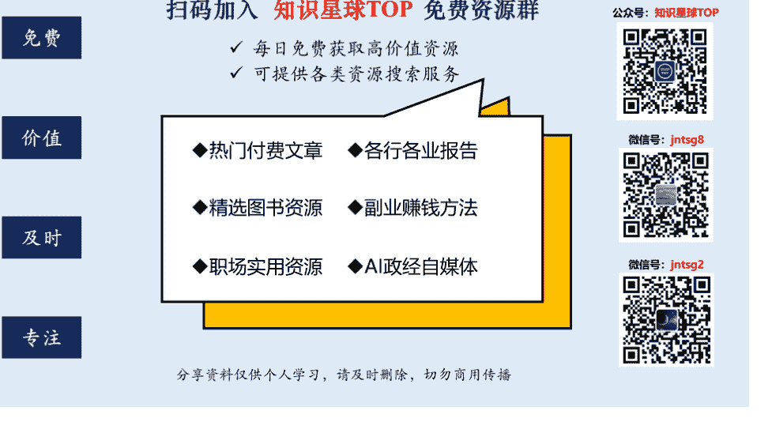

# 【纯净货】近期复盘汇总

250611 端宰斌

本文的目的是给大家介绍一下我近期的复盘成果，

在开始正文之前，我先回答一些读者关心的问题：

问题一：绿叶该不该跑了？已经积累了相当多的盈利，快要拿不稳了

老端：目前创新药板块仍然没有见头的迹象，还可以继续炒下去，如果你拿不稳，你可以换其他还没涨的股，比如中药就没怎么涨，过中药这不是情绪焦点，情绪主要集中在创新药。

问题二：果汁不好啊老端，被套住了。

老端：我觉得你可以重新回去看一遍我那文章《再关注一下只消费股》，文中最后一段是这么写的：再关注一下只..

由于有以上利好，我认为目前的位置非常适合建立一个观察仓，所谓观察仓就是当你发现一只好股出现了买点的时候，无论如何先买一个底仓，然后只要股价涨了，那么回调就继续加仓，即当长期通道向上的时候，每次触碰短期通道的下轨可以加仓。

你在文章第二天可以建立观察仓，就是底仓，今天股价破了长期通道的下轨，就可以加仓，今天是很不错的买点，由于长期通道并没有向上的意思，由于此波加仓就动不了了，你可以考虑反弹后减一些仓，也可以一直等到通道向上。如果持续横盘，那么回到上轨你就减仓。这样操作你是不会赔钱的。

问题三：奶茶杯子还有吗？感觉直在下轨附近啊。

老端：这只短线涨的多了所以回调，长期看好，建议你只在下轨之下补仓，这股不会让你赔钱的，因为半年业绩必然大增。

问题四：永安是不是要开始第三波了？

老端：永安又有游资进去了，他是药物加新消费概念，如果你胆大还可以继续玩。

以下是正文

以前我们介绍了情绪股的玩法，今天我们不谈情绪股，我们谈谈业绩增长但股价没怎么涨的股，本次选股的标准是以下四条：

- 业绩持续增长，特别是今年一季度业绩大增，半年报也有极大概率维持增长；
- 2、业绩涨了，但是股价还没有被爆炒过，爆炒过的股我们不碰
- 3、盘子不能太大，我们不玩大盘股；
- 4、由于一些利空导致股价持续赖在地板上，但这个利空有破解的可能。

经过几天的复盘，以下是我选出来的潜在股名单：

## 诺普信

这家公司有两块业务，分别是农药和蓝莓，蓝莓农药赚不到什么钱，所以股价比年前都低，今年第一季度业绩大爆发，已经超过了去年全年的业绩，为什么一季度业绩那么好呢？因为他们搞出来技术突破，研究出了跨季节种植蓝莓的技术。

焦淼
蓝莓这个东西中产级水果，这些年中产们追捧不是不少水果，如牛油果、车厘子、榴莲、蓝莓等等，按说农业是很很难赚钱的，当年高光的阳光玫瑰从每亩300块元跌至十块三钱，今年车厘子和榴莲价格都大跌，那他冬天卖蓝莓又有什么优势呢？答案是，他能冬天卖给你。

我们知道，蓝莓是夏天才有的水果，冬天是不可能有蓝莓的，并且这种水果非常娇娇，而且用小胶装，因为它压压，压伤了马上就坏掉，小小一盒才125克，就要卖几十块钱。

他研发出了基质栽培+智能温控技术，在春节前就能卖给你蓝莓，其他地区的农民是做不到的，由于冬天只有他一家有蓝莓，且农产品免税，其利润利率非常高，超过了50%，这直接推高了业绩。

蓝莓这个东西，要种到第五年开始大规模结果，公司是从2021年开始搞蓝莓的，今年正好是第五年盛期，其他人如果看到这块赚钱也来搞，起码要等五年之后才会赚钱。

最近该公司股价出现了一波上涨，但并非业务，一季报公布的时候公司股价没怎么涨，这波上涨是因为化工工厂爆炸，所有农药的股票都涨了。但我认为这属于瞎炒，因为真正赚钱的是蓝莓，这块还没有被市场发现。如果你担心他重走阳光玫瑰的路，你可以这样想，中国其他地方能在冬天种蓝莓吗？他能冬天种是因为他在云南的田，而其他农民没有他的技术。

诺普信这家公司可以长期持有，因为早晚会被大家发现他的价值。

## 劲环境

这家公司是生产垃圾处理设备的，比环保卫车，垃圾压缩机等等，公司的盘子极小，业绩尚可，最近出了一个司机驾驶概念的垃圾车，所以股价被炒了一波，但好在目前调整到启动到位了，这个点恰也是薛菲尔通道的下轨，由于这是一只庄股，公司是安徽的公司，炒作他的庄家也是安徽本地的庄。所以他随时随时有可能开启第二波，你可以参考永安的例子。

## 中银电

这家公司前期是广宇发展，原本是搞房产的，但是在2021年经过了资产重组，从房产变成新能源了，当时股价从3块多炒到了近30块，不过经过长达5年的下跌，目前股价只有8块多了。

中银电的业务很简单，就是采购其他开发的新能源发电设备，并组装发电来赚钱，他最强的能力是护底的能力，他大部分新能源设备都是这两两年暴跌之后买的，组装完了今年开始大规模发电，公司一季度业绩大涨52%，第二季度可能比这个数字更高。

公司股价现在是五来的低位，但今年光伏和风能设备全线并网发电的一年，业绩必然会有大幅增长，到时候股价一定会有反应。

## 卫星化学

这是一家化工厂，一季度业绩增长59%，目前市盈率只有9倍，从年初至今还跌了6%。原因也非常简单，他原料几乎全靠美国进口，那就是乙烷。

卫星化学深度绑定老美的乙烷供应，投入了巨大的成本，做到了最高的效率。但万万没想到，川普又来搞贸易战，美国商务部以“军事最终用途”为由，对华乙烷出了出口许可制。中国不卖，老美就不卖。由于乙烷断供的风险，所以股价从3月底的22跌到最低15元，现在反弹到17元。这家公司很简单，目前最大的利就是乙烷还能稳定供应，如果能，那么他就能成本低，股价就能反弹。

根据我对川普的了解，他现在值得操心的事情太多了，可以说没空管乙烷的小事，美国伦烷除了卖给我们也没有别的去处，如果损失了中国这个客户，老美自己的损失也是巨大的。为什么老美卖那么多乙烷呢？因为这是生产页岩油的副产品，如果不卖给中国，他就只能白白烧了，卖给中国他还多赚点。

我认为老美最后一定会卖乙烷中国，实在不行就绕道买，一旦市场发现乙烷的供应并没有中断，那么股价就会恢复。

## 新煤股份

这是A股分红，2024年度分了三次红，每股分别派发0.8元+1.31元+0.76元，这么算起来股率高达7%。基本上把赚到的利润都分掉了，能分这么多钱主要是因为没什么负债，也没有资本开支。他基本业务是收 IPTV的钱，类似于收有线电视费，这块非常稳定。

他的想象空间在于，他的短剧业务也起来了，这块就要靠想象力了，但就算这块起起来，你一年7%的股息还是很不错的，比银行股的分红都多。

以上五只股是我最近的复盘所得，你也可以在评论中推荐你认为的好股，我们共同同研究，一起赚钱。

加微信intg2，进资料分享群
