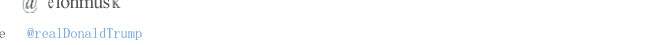

文/端宏斌 2025-06-08

这几天天马斯克和特朗普的矛盾公开化，两人持续发帖互喷垃圾话，像极了离婚中的夫妻。一般在这个时候，双方都会把对方的丑事抖出来，以此来打击对方，这两人也不会例外。

马斯克爆料说：“你知道为什么他不肯解密爱斯坦的黑材料吗？因为他也在萝莉岛的名单上。”吃瓜群众听完大呼过瘾，原来普普不光喜欢长腿金发御姐也是萝莉。

特朗普则反击说：“他是个药物成瘾的毒虫，成天吸氯胺酮，连膀胱都坏掉了。我们知道，所谓氯胺酮就是K粉，长期吸食这类东西的人，膀胱会越来越越小，导致尿频尿急尿尽不禁，一天上厕几十几次，每次只能挤出来一点。”吃瓜群众听完表示满意，希望再多爆一点料。

俗话说得好：秀恩爱，死得快。要知道，在今年2月份，马斯克还发帖调秀恩爱：“我太爱特朗普了，达到了直男对直男爱的极限。”可可惜，感情的保鲜期只有两个月。

他们两人的塑料兄弟情，才维持到5月份就破裂了。当大家都震惊于变化这么快的时候，我们早就已经说过了。在今年4月13日的文章《川普光速认怂，大盘稳稳了》中，我们就说这两人必然分手，他们俩的关系就像项羽和范苍，你把唯一的聪明踢出去，等自己的就只能失败：

## 川普速认侯

我今天看了一篇美国佬写的文章，感觉不错，文章说现在是美国向中国投降的最后机会了。川普如果现在来降的话，尚不失封侯位，将来弄一个北美侯当一当，岂不美哉？等到几个月之后，美债危机爆发，美元变质擦尼胶纸，他跪下纳降顺表都没机会了。我觉得这番话没错。川普就像项羽，总共一个谋士范增都不能用，现在他总共一个靠谱的马斯克都被踢掉了，等待他的就只剩下失败了。

有小机灵鬼说，马斯克和特朗普的情绪就像泡泡那样脆弱易破，这不就是“泡马特”吗哈哈，真是绝妙喻啊。

今天《纽约时报》曝光了两人关系破裂的更多细节，比如4月份的时候，由于财政部长贝森特支持关税战，马斯克反对，两人关系白热化，有两次恰好在白宫的走廊遇到了，贝森特破口大骂：“你就是个骗子，彻头彻尾的骗子。”马斯克二话不说，直接就是一个牛角冲撞，用肩膀撞击对方的肋骨，贝森特也不怂，马上用拳头反击，好在边边的保安上来把两人拉开了。马斯克悻惜离开。

另一件事关于美国国家航空局局长的人选，马斯克提名他的好兄弟艾萨克曼上任，本来都已经经谈妥了，但川普手下某人和马斯克有仇，马上跑跟川普打小小报告，他说艾萨克曼当初曾经给民主党捐过钱，川普一听就火了，这是拜登的人啊，那怎么能用？否决！

加微信jntsg2，进资料分享群

两人关系破裂的直接导火线是最近仓上马的《大漂亮法案》（One Big Beautiful Act），你从这个俗气的名字上就可以看出浓烈的川普风格，这套方案一经公布，马斯克就激烈反对，比当初反对关税战还要强烈。

《大漂亮法案》的本质是大规模减税，那财政赤字怎么办？两个办法，一是再次提高债务上限；二是大大幅削减科教卫和社会福利方面的开支。简单来说，就是劫贫济富，给富人减税的同时给穷人减福利。

为啥川普这么急着的要通过这个法案？我的看法是，他太想赢了。
