# 笔记运营

# 商品笔记的爆款打造指南

# 知识星球TOP 资源分享社区

让更多人获取高价值信息 汇聚网络付费资源

公众号：知识星球TOP


微信号：jntsg8

- ◆付费文章
- ◆付费社群
- ◆付费课程
- ◆副业&搞钱
- ◆财经&股市
- ◆行业报告

添加微信免费进群


微信号：jntsg2

时政·历史·职场·体制·自媒体学习·军事·软件·影音·社会学


### 小红书 电商学习中心

如何能在小红书打爆产品

为什么我的小红书笔记不到100

直播间为什么没有人

如何选品、测品

如何找到适合自己的运营模板

# 新手商家常见小红书问题

为什么有了爆款笔记却没人下单

如何批量稳定的产出有效素材

图文好or视频好

如何提升权重

付费广告的薯条&乘风怎么选

怎么养号

*内容来源于讲实操，仅供参考

# 目录 CONTENT

- PART 01 商品笔记还是普通笔记
- PART 02 笔记布局3大策略
- PART 03 图文爆款笔记创作技巧
- PART 04 视频爆款笔记创作技巧

# PART 01

## 商品笔记还是普通笔记

### 小红书的流量分发模型

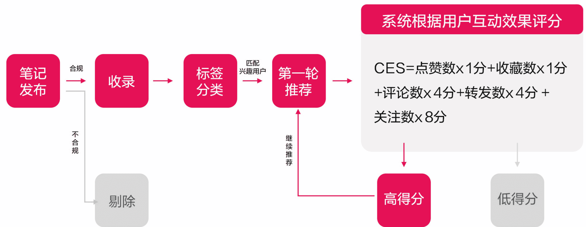

### 小红书流量池

普通笔记 Ordinary notes

商品笔记 Product notes

直播间 Live room

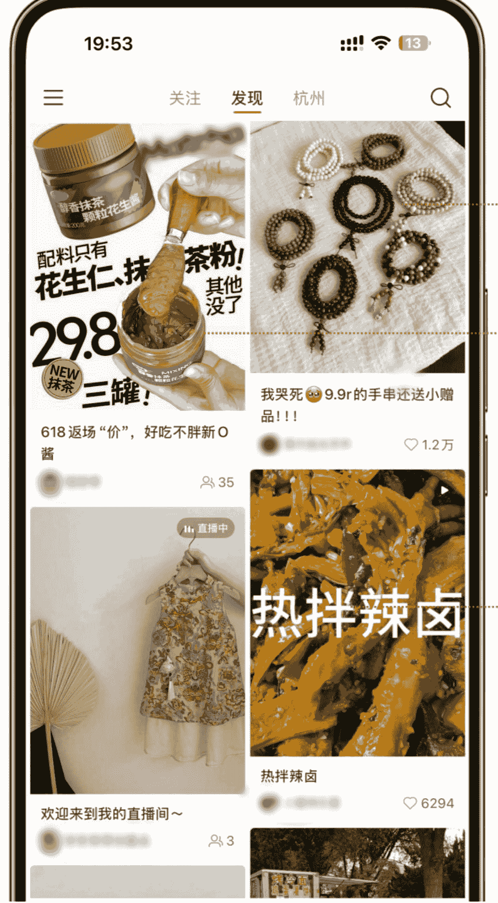

商品笔记

直播间
普通笔记

### 商品笔记VS种草笔记推流逻辑区别

### 普通笔记

### 商品笔记

泛流量

流量

精准流量

互动数据

考核指标

互动数据及交易数据

笔记生态审核

笔记审核

笔记生态审核及交易规则审核

### 商品笔记二段起量法

### 商品笔记的流量分发逻辑有两方面
互动价值和交易价值

#### 互动价值

笔记的点击率、点赞、收藏、分享、评论、
转粉等，视频笔记考核视频的播放时长，
互动价值与自然笔记的逻辑一致，互动价值
越高，笔记的流量权重越高

#### 交易价值

商品点击率、加购、购买;

## 总结

低客单价、消耗品

更适合挂商品笔记
提升转化

高客单价、成交周期长

适合笔记与直播搭配
笔记种草，直播间转化

# PART 02

## 笔记布局3大策略

### 策略一：商品与内容的双轮驱动

小红书笔记的核心价值在于通过内容驱动商品交易，二者互为支撑


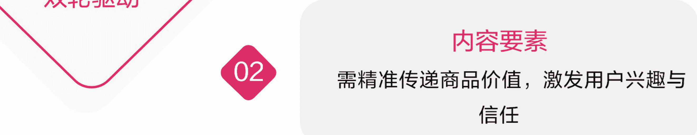

### 策略二：高转化笔记的底层要素

01 目标用户

搜索买你的产品的人群是谁？

02 平台热门

你的行业流量词是什么？

03 搜索消费喜好

什么样的“内容+产品”对你的目标用户有吸引力？

### 策略三：埋词和笔记相关性

#### 笔记标题

笔记标题中体现核心词

#### 笔记正文

笔记正文的文字部分，要埋词、修饰词并进行强调

#### 笔记图片

笔记开头要有关键词，其次是图2、3……以此类推


#### 测评

全面深度对比

市场上不少，靠谱的，今天实测了两个热门产品，我们可以从几个维度进行对比：性能、性价比、手感、震动、外观等，来进行最后的总结。

#### 周末日记 #好物分享 #小众好物测评 #笔记实测

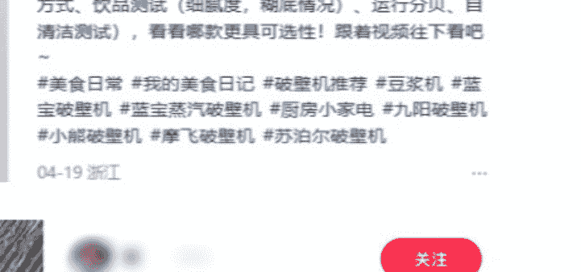

# 避雷！一定要避雷！最近买的这个空气炸锅，真的可以来分享一下真实感受。它的优点及缺点，按照卖家承诺的性价比极高，但是后悔了，姐妹们千万不要买！它的那个味道真的让我崩溃，大家快避雷！

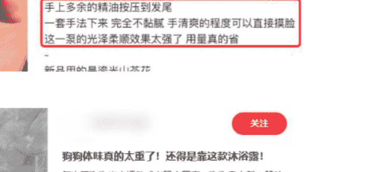

# 狗狗味道臭？狗狗毛发臭了？这款沐浴露真的有效！很多品牌的沐浴露都用过，我试了一圈洗完之后味道特别清香，也不刺鼻。我家洗完之后毛发变软了，而且味道留存很久，家里都是那种。如果你家狗狗毛发臭了，一定要试试最近发现的宝藏沐浴露！成分温和，敏感皮肤的用也不怕。洗完之后狗狗真的变干净了，身上香香的，冲冲冲！内容有争议，仅参考。

# PART 03

## 图文爆款笔记创作技巧

### 内容类型

PART 01 产品颜值展示

PART 02 干货合集笔记
PART 03 互动/故事/口碑

### 产品颜值展示 女装案例

### 电商学习中心

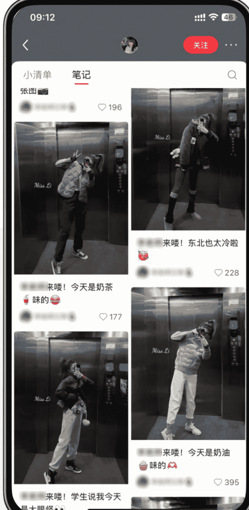

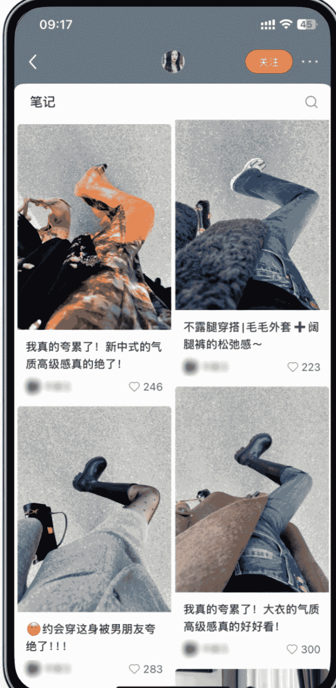

*内容将更新，仅参考

### 珠宝首饰案例

### 小红书 电商学习中心

10:06 | 10:05
笔记 | 笔记 | 关注 | 关注
29 | 82

不一定男孩子，我就说大家都在盯我的项链买了两年还是很喜欢的耳环分享

入坑即毕业，大尺寸的白色这一条就够了

一些很有感的小众饰分享（都很平价）995 | 634 | 229 | 236

一些常戴的平价项链，今日份珍珠项链2.0，感谢你在我的指向永恒方形15款平价极美耳饰合集 225 | 158 | 216

*内容来源网络分享，仅供参考

### 颜值类笔记创作思路

- 在原有的产品颜值卖点基础上做内容差异
- 差异化思维，如同产品不同模型、不同场景；不同产品，同一个模型、场景等玩法

### 借用AI工具- 精准提效思路

- 拍摄产品白底图、模特场景图
- 圈选重绘区
- AI自定义拓展，指令微调
- 批量生产ABtest，测试爆款

### 圈选重绘区 - 保留商品100%还原度

调整选区 自动选区 缩放放大 - 全屏操作

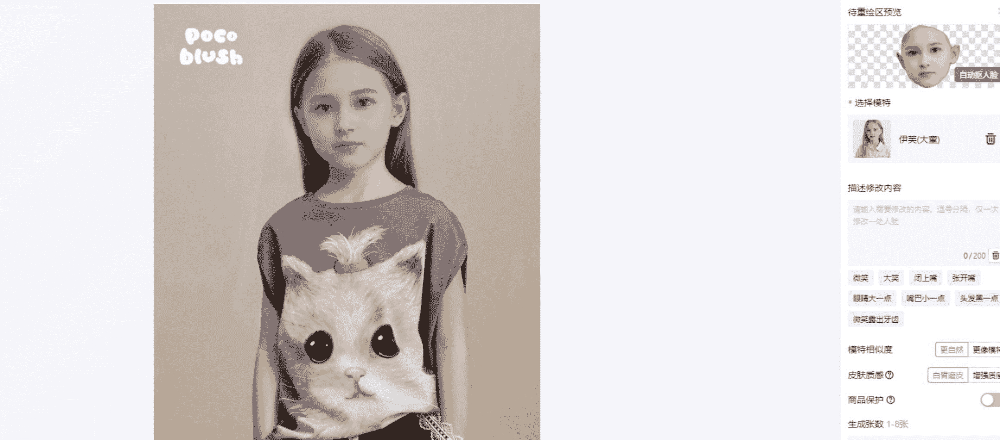

重绘区预览

- 选择特征：伊芙(大重)

描述修改内容根据你想要的内容、透明度、色彩、一次生成一个人物 0/200

氛围 大气 浅上 开启优化

眼睛大、脸部小、头发黑，五官更精致

模型相似度 更多相似度

皮肤质感 自动色彩增强

商品保护 1-8张

生成次数

*图为AI生成，AI只是辅助提高效率的工具，商家的依据依然是商品质量和真实*内容来源于实操，仅参考

### AI自定义拓展，指令微调

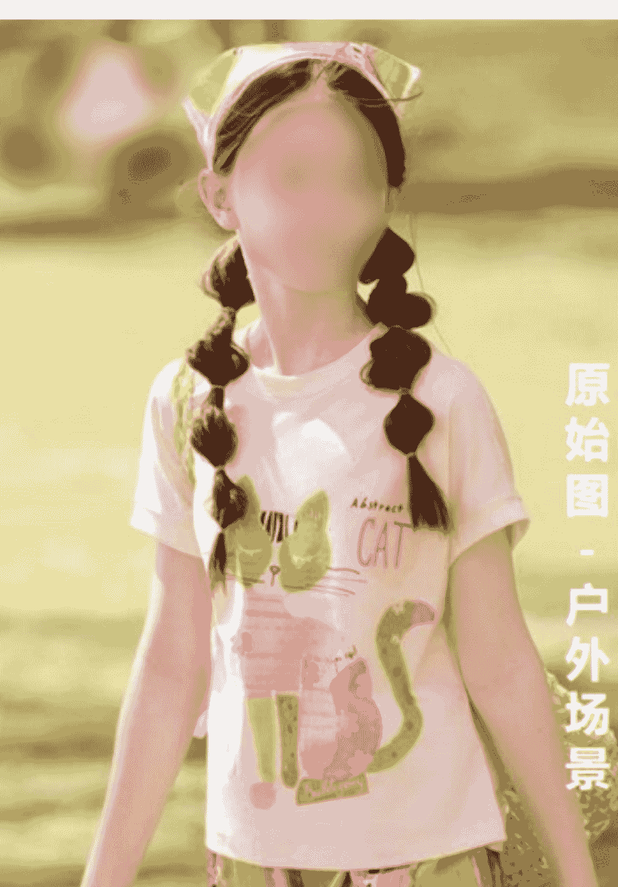


原始图·户外场景

*图为AI生成，AI只是辅助提高效率的工具，商家的依据依然是商品质量和真实*内容来源于实操，仅参考

### 测试30条爆款素材

# PART 02

## 干货合集笔记 干货型笔记

PART 01 产品颜值展示
PART 02 互动/故事/口碑
PART 03 产品颜值展示

针对不同行业有干货讲解，这也是最易获得流量和涨粉的笔记，基于行业专业度、客户咨询很多问题等，行拆解，也可利用工具快速生成到选题和框架自动生成

### 干货型笔记 小红书学习中心

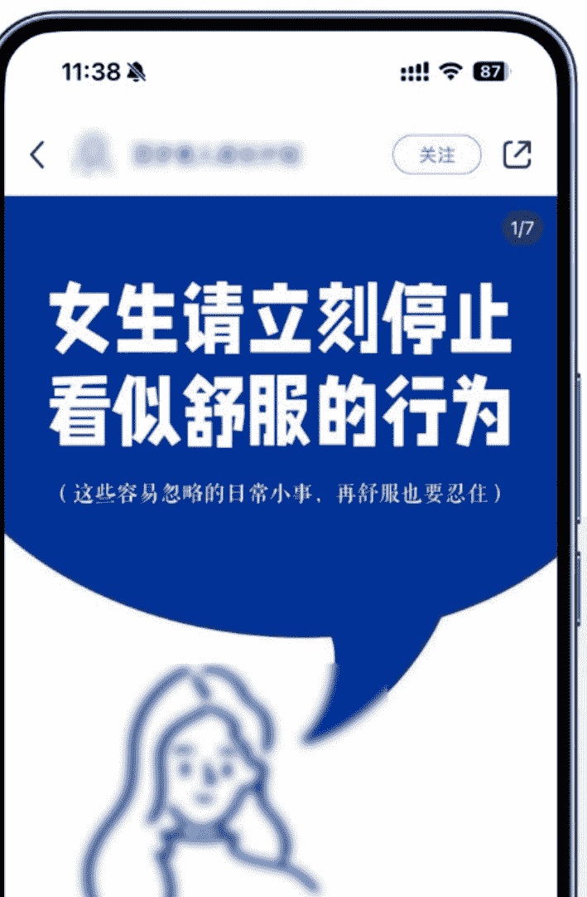

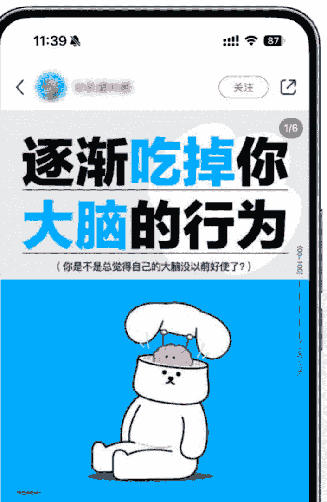


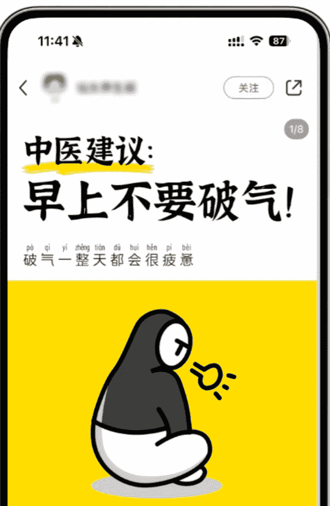

狗狗请停止，日常生活中经常符合自己的习惯，有时要注意时间太久了，一月开始，把自己重新一遍，其实生活方式对人的影响，胜过先天和。中医建议：早上不要起！中医养生 #我的养生 #坚持养生

### 第一步行业蓝海词/关键词（人群场景词）生成选题标题思路

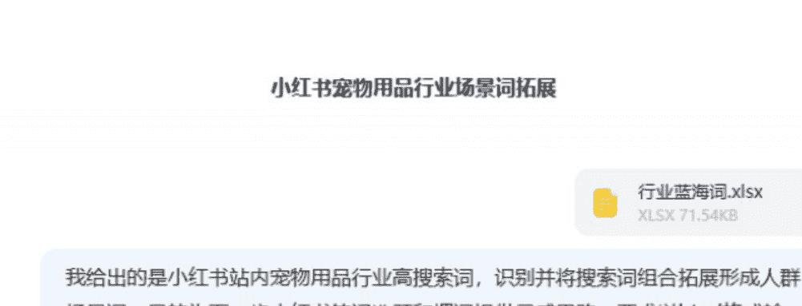

#### 提示词：小红书家居用品人形图

我给出的是小红书站内宠物用品行业高频搜索词组合拓展成人形图，目的是为了下一步小红书笔记选题和埋图，提供思路，要求以html格式输出，并且直接下载文件。

#### 小红书家居用品人形图拓展

以下是根据你要求的关键词，组合拓展成特定的人形家居用品搜索关键词，可用于小红书笔记选题以下是根据关键词数据组合成人形的家居用品搜索关键词，可用于小红书笔记选题和埋图。下载文件

##### 1.宠物家具布置与修改

```html
<!DOCTYPE html>
<html>
<head>
<meta charset="UTF-8">
<title>小红书家居用品人形场景图</title>
</head>
<body>
body {
  font-family: Arial, sans-serif;
  line-height: 1.6;
  color: #f2f2f2;
  text-align: center;
  max-width: 1800px;
  margin: 0 auto;
}
</body>
</html>
```

| 关键词 | 相关关键词 | 搜索量 |
|---|---|---|
| 盆台布置 | 盆台布置、全实沙发布置、盆台、沙发转角、组合式 | 30683-1232 |
| 摆艺沙发布置 | 摆艺沙发、摆艺沙发、摆艺沙发桌、家具柜、家具储物柜 | 3918-3910 |
| 兔屋小矮 | 兔子家具、兔子公主桌、沙发家具、家具角、沙发、兔家具 | 7995-3893 |
| DIY卧室装修 | 改造卧室、自制卧室、沙发定制、防霉、柜子、柜装修 | 5305-2783 |
| 电虹态灯带 | 岛菇灯带、电虹灯带、灯蛋彩灯、岛菇灯带 | 6927-6784 |

##### 2.宠物家具DIY

| 关键词 | 相关关键词 | 搜索量 |
|---|---|---|
| 定制柜 | 定制柜、定制矮柜、定制家具、定制柜 | 16358-18835 |
| 收纳柜 | 水柜、定制收纳柜、收纳柜、收纳柜 | 7593-4035 |
| 自制变形 | 自制变形、自制阳台柜、自制柜、组合柜 | 6035-3296 |
| 手工桌子 | 手工工艺、定制桌子、手工物柜、手工物柜 | 2954-2447 |

## 小红书家居用品人形图拓展以下是根据你要求的关键词，组合拓展成特定的人形家居用品搜索关键词，可用于小红书笔记选题以下是根据关键词数据组合成人形的家居用品搜索关键词，可用于小红书笔记选题和埋图。

### 第二步“人群+场景”生成标题

- 把上述场景结合人群生成标题，要求用HTML格式输出，直接下载Excel文档。
- 先仔细阅读我给出的3类爆款类型和4个标题。
- 标题中包含16字左右，更有网感，避免使用老词，感觉奇怪。
- 适用人群：学生、年龄、职业、城乡、家庭、逛街、中性、未来、需求、中年女性。

#### 1. 实用型

- 发送指令：可以问吗？如何增加销量和转化率？
- 粉丝指令：
- 避雷：减肥吗？
- 避雷：
- 避雷：解决方案：
- 避雷：

#### 2. 产品深度分析

- 特点：多产品对比，真实使用体验，痛点。
- 适用人群：种草爱好者、中性女性、未来的自己。
- 示例：
- “30岁+养人 | 这些网红好物靠谱吗？”
- “避雷！精准避开意的5款智能设备”

#### 3. 场景类

- 特点：针对不同购物场景进行深度分享，避坑指南。
- 适用人群：博主。
- 示例：
- “打工人收藏！3步教你高效避坑，不再踩雷”
- “省钱女孩必备！10件好物让你月入过万”

# 第四节多维表格生成 笔记旁问答

| 场景词 | 鸡数 | 标题 | 选人 |
| --- | --- | --- | --- |
| 新手猫防护！幼猫黄血病毒 | | | 准确啊！刚回家的猫别怂，检查它真的是因为猫...很多新手以为做完消毒就安全了，其实体内的残留...环境污染才是定时炸弹？ 90%的新手不知道的肠虫知识：【猫体害怕生虫】 |
| 内外肠虫防护 | 3 | 小宠要购买防虫保险！让它躲避流窝 | | 安全！幼猫期可能通过母乳感染肠虫（兽医说60%幼猫防范）【狗不害怕生虫】 |
| 刚消毒！家里有虫再回来抓虫，兽医说3只抓... | | | 【家宠害怕】紧急：洗澡睡觉 |
| 室内窗户清洁点！不留任何缝隙 | | | 刚发现家里有虫！家里有虫（咪咪害怕）猫咪生虫了 |
| 新手选养犬长！狗狗怕肠虫 | | | 我家有猫，我也想养狗！家里一定要重要事！从此以后，如果你自养的狗百分百不怕虫，你必须带上这90%的狗去逛超市。咪咪害怕，我刚养一周的小狗，家里发现有虫了！我家有虫，家里是虫/快/快/快/快虫，甚至都是“怕虫”呢！现在想，下次聚完直接睡一个月，一个星期，我发现狗狗在抓挠比较干净，已经已经抓挠了网上发现自家的“蜜虫”了，难道人是不贴心吗？咪害怕对处虫 |


<!-- no content -->