### 第一财经
### YiMagazine

探索领先的商业世界

1984 - 2024

PO28 / 握手：手破冰，一场关于千万人的权力碰撞
PO76 / 2024中国新能源缩汽车，还是更迭？

## 开合之间
### 汽车产业40年

中国汽车产业40年的合资基因，市场不只是手段，市场就是目的本身，而中国市场在充分竞争的教学中开始的。

CN31-2163/X
ISSN 1674-2168
2025 04
RMB 48
HKD 68

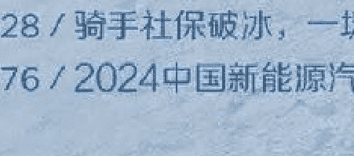

# 免费 | 价值 | 及时 | 专注

# 扫码加入 知识星球TOP免费资源群

- 每日免费获取有价值资源
- 可提供各类资源搜索服务

| 热门付费文章 | 各行行业报告 | 精选图书资源 | 副业赚钱方法 |
| :--- | :--- | :--- | :--- |
| 职场实用资源 | AI政经自媒体 | | |

公众号: 知识星球TOP 微信信号: jntsg8 微信信号: jntsg2

分享资料仅供个人学习，请及时删除，切勿商用传播

# 洞见·智
INTELLIGENCE

专业 创造价值
PROFESSIONALISM CREATES VALUE

上海广电中台 SMG 第一财经

# 不止于……阅读

# MAG...PODCAST...DATA...NEW MEDIA...EVENT

杂志：第一财经
- 播客：商业就是这样
数据研究 第一一线
主书 未来理想国
AI媒体 新视界
线下活动 Yipark

99

## 第一财经 YiMagazine

## What's Up

### 握手社保破冰，一场关于千万人的权益博弈
有研究·职场

握手社保的尝试不仅影响了外卖行业，还可能成为零工经济保障体系改革的起点，甚至借此推动更广泛的社保制度改革。
——记者 胡妍婷

### 合资汽车企发风暴
有事故·WHAT HAPPEN

合资公司和本土汽车的不同模式面前，无法做到真正的“自主抬头”，合资双方50:50的对等股权结构影响着公司的任何重大决策都需要双方达成一致。
——记者 江振豪

### 专访柯利兹建筑奖大师
刘家程：建筑从建筑中退让，不意被看穿
有 Logic设计

2025年3月，刘家程成为第二位获得柯利兹奖的中国建筑师。在与他的专访中，一个建筑师如何讲述个人内心的野心，创造让人们愿意用的设计，同时负责任的建筑。
——记者 张宏华

### 合资车辆如何消失了消费者？
有故事·HOW SO

新能源汽车赛道至今，智能驾驶和智能辅助被质疑，如今在合资品牌头头的压力日益大。问题从哪里出错？
——记者 某某

### 与创伤共处
有闲谈·People

我们应该如何对待受伤者的创伤？通过对44位幸存者的访问，李毅试图寻找答案，发现创伤是一生需要去面对的困难，且唯一的功课。我们不需要解决它，因为创伤是生命的一部分。
——记者 袁某

# HOW to GET
YiMagazine

YiMagazine
通用
电子订阅

## 第一线小店

你在这里能找到
我们——
光的空气、潮流、精选
上海、杭州、广州
成都、武汉、方所
书店、咖啡馆和展览
碰撞、中国、天津、拉萨
角落。

更多资讯和福利
订阅我们
立即加入，成为部分粉丝！

## 订阅、发友及互动

微信服务号 4616
发友及活动咨询：bnclub@yical.com
新闻业务电话：010-8885709
读者来信：letters@yical.com

## 第一财经 YiMagazine

## CONTENTS

- What's Up | 版权 | 编者的话
- 40，中国汽车的合资故事 | 赵锐
- 事件 | 数字世界 | 排行榜
- 人物 | 声音 | 常卷 | 常识
- 研报 | 取场 | 爆款辣条 | 芒果TV获益？
- 一场千万人的权益争夺 | 母婴市场反弹？
- 播速 | 全球视野 | 美国不难息 | AI应用 | 电影 | 异媒体突破
- 对世代来说 | 酷专题 | 第十四届可持续发展 | 智力系列
- 深度访谈 | 2024中国新能源汽车，谁更强？ | RANKING |

| :--- | :--- | :--- | :--- |
| | | | |
| | | | | | | | | | | | | | | | | | | | | | | |
| Previous on | | | | | | | | | | | | | | | | | | | |
| What Happen | 合资企布局 | What's Next | 合资车如何丢失了? | 反向兴起 | 合资的价值 | 2024中国汽车，谁更强? | | |
| | | | | | | | | | | | | | | | | | | | | | |
| | | | | | | | | | | | | | | | | | | | | |
| | | | | | | | | | | | | | | | | | | | | |
| | | | | | | | | | | | | | | | | | | | | |
| | | | | | | | | | | | | | | | | | | | | |
| | | | | | | | | | | | | | | | | | | | | | |
| | | | | | | | | | | | | | | | | | | | | |
| | | | | | | | | | | | | | | | | | | | | | |
| | | | | | | | | | | | | | | | | | | | | |
| | | | | | | | | | | | | | | | | | | | | | | |
| | | | | | | | | | | | | | | | | | | | | | | |
| | | | | | | | | | | | | | | | | | | | | | | |
| | | | | | | | | | | | | | | | | | | | | | | |
| | | | | | | | | | | | | | | | | | | | | | | |
| | | | | | | | | | | | | | | | | | | | | | | |
| | | | | | | | | | | | | | | | | | | | | | | |
| | | | | | | | | | | | | | | | | | | | | | | |
| | | | | | | | | | | | | | | | | | | | | | | |
| | | | | | | | | | | | | | | | | | | | | | | |
| | | | | | | | | | | | | | | | | | | | | | | |
| | | | | | | | | | | | | | | | | | | | | | | | |
| | | | | | | | | | | | | | | | | | | | | | | | |
| | | | | | | | | | | | | | | | | | | | | | | | |
| | | | | | | | | | | | | | | | | | | | | | | | |
| | | | | | | | | | | | | | | | | | | | | | | | |
| | | | | | | | | | | | | | | | | | | | | | | | |
| | | | | | | | | | | | | | | | | | | | | | | | |
| | | | | | | | | | | | | | | | | | | | | | | | |
| | | | | | | | | | | | | | | | | | | | | | | | |
| | | | | | | | | | | | | | | | | | | | | | | | |
| | | | | | | | | | | | | | | | | | | | | | | | | |
| | | | | | | | | | | | | | | | | | | | | | | | | |
| | | | | | | | | | | | | | | | | | | | | | | | | |
| | | | | | | | | | | | | | | | | | | | | | | | | |
| | | | | | | | | | | | | | | | | | | | | | | | | |
| | | | | | | | | | | | | | | | | | | | | | | | | |
| | | | | | | | | | | | | | | | | | | | | | | | | |
| | | | | | | | | | | | | | | | | | | | | | | | | |
| | | | | | | | | | | | | | | | | | | | | | | | | |
| | | | | | | | | | | | | | | | | | | | | | | | | | |
| | | | | | | | | | | | | | | | | | | | | | | | | | |
| | | | | | | | | | | | | | | | | | | | | | | | | | |
| | | | | | | | | | | | | | | | | | | | | | | | | | |
| | | | | | | | | | | | | | | | | | | | | | | | | | |
| | | | | | | | | | | | | | | | | | | | | | | | | | |
| | | | | | | | | | | | | | | | | | | | | | | | | | |
| | | | | | | | | | | | | | | | | | | | | | | | | | |
| | | | | | | | | | | | | | | | | | | | | | | | | | |
| | | | | | | | | | | | | | | | | | | | | | | | | | | |
| | | | | | | | | | | | | | | | | | | | | | | | | | | |
| | | | | | | | | | | | | | | | | | | | | | | | | | | |
| | | | | | | | | | | | | | | | | | | | | | | | | | | |
| | | | | | | | | | | | | | | | | | | | | | | | | | | |
| | | | | | | | | | | | | | | | | | | | | | | | | | | |
| | | | | | | | | | | | | | | | | | | | | | | | | | | |
| | | | | | | | | | | | | | | | | | | | | | | | | | | |
| | | | | | | | | | | | | | | | | | | | | | | | | | | | |
| | | | | | | | | | | | | | | | | | | | | | | | | | | | | |
| | | | | | | | | | | | | | | | | | | | | | | | | | | | | | |
 | | | | | | | | | | | | | | | | | | | | | | | | | | | | | |
 | | | | | | | | | | | | | | | | | | | | | | | | | | | | | |
 | | | | | | | | | | | | | | | | | | | | | | | | | | | | | | | | | | | | | | | | | | | | | | | | | | | | | | | | | | | | | | | | | | | | | | | | | | | | | | | | | | | | | | | | | | | | | | | | | | | | | | | | | | | | | | | | | | | | | | | |

### 第一财经
### Staff
### YiMagazine

国际标准出版号 ISSN 1764-2168
国内标准出版号 CN31-2163/F
创刊日期
发行范围 公开

Editorial Board
赵嘉 Jia
陆毅 Chen Ru
沈丰 Congle
赵磊 Chao Lei

Columnist
郭颖 Cui Peng
Kevin Rowe
黄勇 Huang Yongqi
王建宇 Wang Jianny
董辉 Dongihui
张强 Qiang

我是财经

主管 Published by 上海文化影视有限公司

Editorial Board
编后 Editor
刘涛 Fuoh
许诗语 Xu Shiyi
王洋 Su Wang Yang
尼宁 Ni
云华 Zhang Yun

Post Production
陈锐 Chen Ru

主编 由 上海第一财经传媒有限公司

主持 Host
吴同杰 Chao Wenjie
付雪亚 Fu Xueya

出品 Produced by 上海第一财经传媒有限公司

Senior Editor
王杰 Wang Junior
洋洋 Yang Yang
叶暮 Ye Ye Mu

运营 Operation
彭越鑫 Xing Meng
常春杰 Chang Junjie

版社单位 Published by 《第一财经》编辑部

Reporter
陈磊 Chen Lei
陈文杰 Wiejie
文思敏 Wen Shin
陶子东 Tao Zidong

Executive Editor
李雅娜 Li Nana

发行人 Publisher
李睿 Li Rong

Intern
李宁 Li Ning
韩哲 Han Zhe
方兰金 Fan Jinjia
浦涛磊 Pu Lei
刘云宇 Yu Yun

Senior Reporter
潘娇磊 Pan Jiao

制作 Design
赵嘉嘉 Bao Jiao

制作人 Producer
杨洁 Yang Dong

记者
蒋毅 Chen Yi
谭柯宇 Ke Yu
何维希 He Wei
崔晓磊 Cui Xiao
吴一凡 Wu Fan

Project Leader
许涛 Xu Shu

总编辑 Chief Editor
赵嘉 Jia

Deputy Chief Editor
陈锐 Chen Ru

Research Assistant
郭磊 Guo Li

创意 Creative
戴越磊 Dai Zhen

研究员 Researcher
文思敏 Wen Shin
陶子东 Tao Zidong
蒋咏云 Ding Yingyun

发行总经理 Distribution General Manager
张莉 Zhang Yue

Intern
陈梅 Chen Mei

### 电子版

电子主编
赵嘉 Zhao Jia

Digital Product Leader
Senior Digital Leader Art
Content Director
尼宁 Ni

Administrative Director
锦如 Ru

运营总监
洋洋 Yang

Project Leader
洋洋 Yang

编后 Editor
王杰 Wang Jie

Research & Consulting
陈杰 Chen Jie
常春杰 Changjie
常海 Hai

Product Management
曾毕涛 Tianita
Data Management
宇宇 Fenguxing
Business Operation
潘磊 Pan Lin

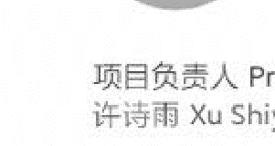

### 视觉支持
### 未来展望
### 发行
总监
高志 Daijun

华东经理
李国 Jun

副监
王方 Fanghong

华南经理
设计师
王方 Fanghong

北方经理
素材编辑
蒋静 Jing

华北经理
李西华 Zheng

摄影师
王安 An
王磊 Xiaolei

华东经理
王杰 Hailian

插画师
于涵 Yu

华中经理
李国华 Guo

后期特效制作
李莉 Li

未来愿景策划
赵磊 Zhao Lei

编辑
王亚伟 Wangowe

负责人
陈泽晨 Chenolin
龚家岩 Guan Yiah
李建国 Li Guo
杨梅洁 Yangijie
林坤 Kun
陈春锋 Chenfeng
魏文 Wexuan
唐磊 Tang Xin
章芳 Huanhua
赵娜娜 Zhaoona
甘国 Ganolan
白华涛 Huatao
方梓智 Fang Zhi
林波 Bo
杨波波 Keawa
苏磊 Xei
李浦子 Zuzi
刘磊 Liu Lei
张正源 Zhengyuan
胡一 Yifu
李敏梅 Mengyu
刘越新 Liu Xin
张桂尚 Guishan
齐伟 Qi Wei
郑明 Zheng Ming
陈其宇 Chen Yu
王美雅 Wangiyi

### Yicai Foundation

上海第一会上海第一慈善基金会有限公司

地址 Address
上海市黄浦区南京东路101号（邮编20041）
Radio & TV Building, 101 East Nanjing Road, District
Shanghai, China 20041
电话 Tel 021-82205999 传真 Fax 021-8220478

关于爱才 About Yicai
共同成立于2000年，统一社会信用代码：911101000555X
北京市东城区东长安路105号
Beijing, China 200006

总部地址 Guangzhou Headquarters
广东省广州市天河区珠江新大道88号（邮编510063）
No.88 Jiangjiang New Avenue, Business
Guangzhou, China

所有权利保留

# 中国食品健康七星公联盟
Seven-Star Convention Alliance

### 智创
新“食”代

第十四届
中国食品健康
七星奖
报名启动

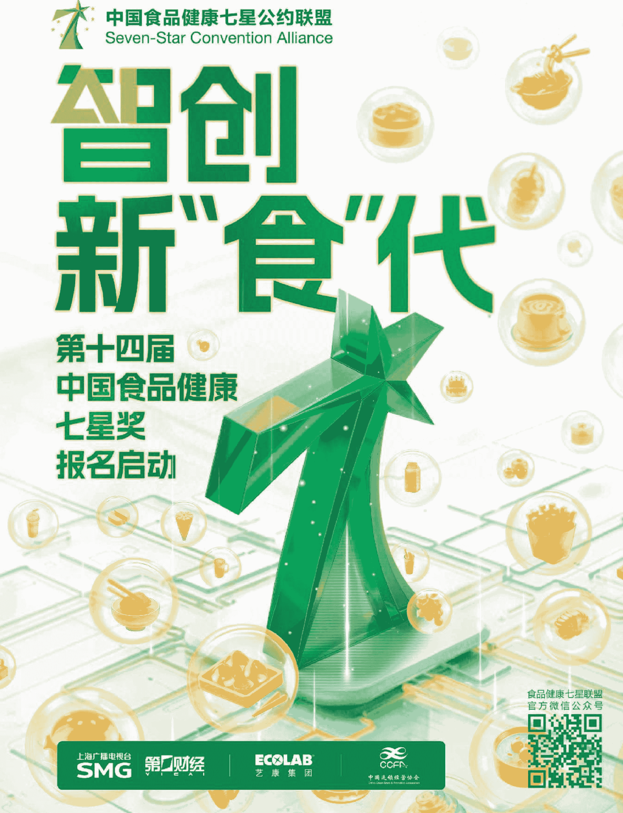

食品健康七星联盟
微信公众号

| 上海广电媒体台 SMG | 第一财经集团 JAI | ECOLAB 艺康集团 | CCFN 中国食品营养健康协会 |
| :--- | :--- | :--- | :--- |

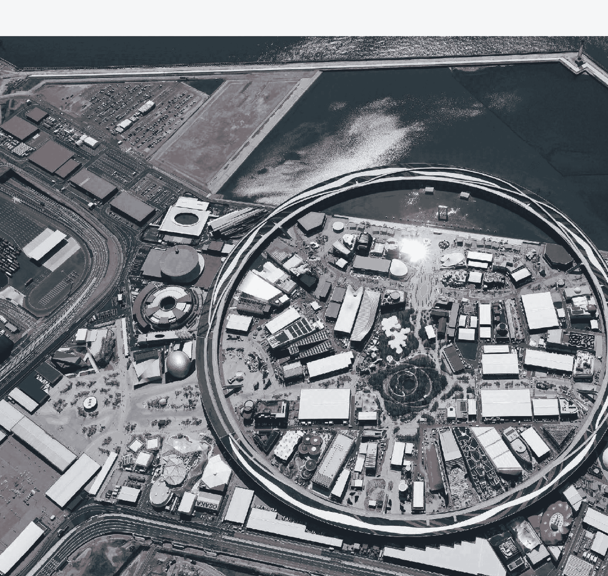

### 大阪世博会的梦想与现实

4月13日，明年2025年大阪世博将在大阪的人工岛“梦想洲”开幕。

本届世博的主题是“未来的未来，想象自己的生活”。世博会的各馆将作为未来的试验场，“扩展健康生活的多样性”和“可持续社会经济系统”两大核心，探索如何实现社会可持续发展。在2023年3月，日本对外宣布共有153个国家、8个国际组织参加下届世博。

55年前，日本优先考虑后举办奥运会和世博会的效应，投入了高达2亿日元（当时汇率约合70亿人民币）的经济损失。对于这次世博，日本国家策划局在其官网上表示，日本的一希望能获得一次在现代时代引起全球意愿和推动人文交流的盛会。

从建造到设计上也可以看到这种野心。在准备大阪时，大阪特为举办世博会建造了一座木质环形结构建筑“大屋环”（Grand Ring），它于2月27日竣工，总面积约5万平方米，共计2.7万立方米。今年3月4日，它被载入世界吉纪录为全球最大的木质结构。

日本的企业还预告了许多将在世博会上展示的新技术，初创企业OPTMASS将展示未来可能的通信技术，日本建筑株式会社NikkaRA打造的通风舱还能过滤空气毒素，日本建筑展示用项目还包含多个iPS（智能传感器）监控，不过，距离开场还需要一个月，许多事情可能不会完成。

据日本共同报道，截至3月初，47个国家自建世博馆已经按照要求完工。原因是，材料短缺和劳动力不足导致建设进度无法被控制，以及建设审批批准、施工困难等重要因素推迟。虽有困难，到2024年，已有英国、意大利、墨西哥、阿根廷、夏威夷、俄罗斯等8个国家宣布将举办世博会。

同样的还有关注的，世博会展览期间还将显示，本世博会的参观期间预计人数为280万，到3月5日，预计的人届为807万，不到预估目标1400万的数字。大阪市长藤之村为此向首相求助破解预约难题，并在之后宣布通过丰富票源渠道，推出意外的优惠政策以解决购票不容易等问题。

意外的是，3月11日，日本国际博览会表示，“大屋环”的边缘（罩顶边缘）部分开放现场，约600米的长廊要逛到。当然，世博会还有准备的时间，尚未完工的展览馆建设好，那些人们最期待的成就也将激发人们加入最后的热闹。

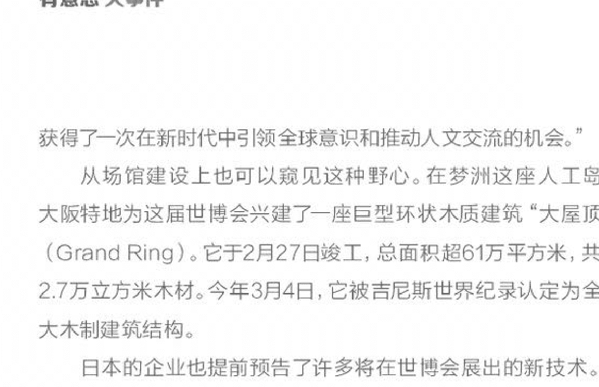

### Event

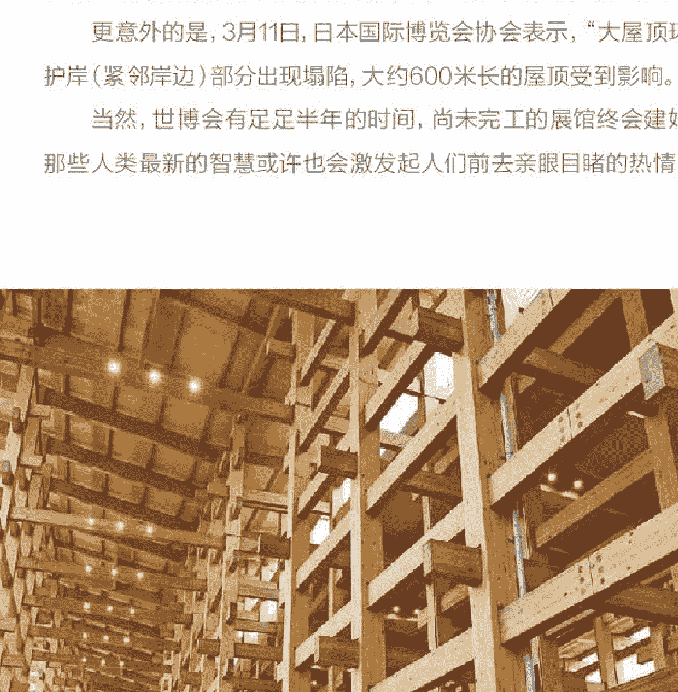

### 大阪世博会的经济压力

据日本《每日新闻》介绍，1970年的大阪世博会吸引了6420万游客，包括消费者支出在内的经济效益估达3.3万亿美元（按当时汇率约合2244亿元人民币）。

与5年前相比，日本政府针对2025年大阪世博会制定的目标相对保守。2024年日本经济产业省预计，世博会建设及运营带来的经济效益达到295亿美元（按当时汇率约合147亿人民币）。这一数据是根据日本以大阪世博预期2800万观众为前提，再结合相关因素进行算出的。

据《朝日新闻》报道，2025年大阪世博会的预算预计亏损15亿美元（按当时汇率约78亿人民币）。大阪市的运营费用预计为960亿日元（约47亿人民币由门票收入承担，这就会导致长期赤字。日本政府和地方政府投入1000亿日元（约56亿人民币），尚未决定到2025年大阪世博会将如何通过收益来弥补大阪世博会的赤字。

### Appetizer
## 有意·数字
### W.I.N. WORLD IN NUMBERS

### 286天，超长“太空之旅”结束了

3月10日凌晨3时15分，SpaceX的飞船从佛罗里州沿海登陆。经过9个月，宇航员和威康再次受到了地球重力带来的体验。在此之前，他们已经经历了一次超长的太空之旅。

2024年6月5日，宇航员和威康将“龙舱”飞往国际空间进行为期两天的测试。由于飞船在飞行过程中遭遇了空气泄漏和系统故障，通过手动操作完成了任务，但被迫提前返回。美国国家航天局（NASA）对此表示不能接受，这艘飞船原本可以停留在SpaceX的轨道上。事实上，SpaceX创始人马斯克曾对媒体表示，在这一候选人中，自己不想让SpaceX带回航员。NASA将宇航员和威康执行此次任务，在太空中度过了286天，执行了456天。每周，我们都会通过数字了解世界的一个角落。

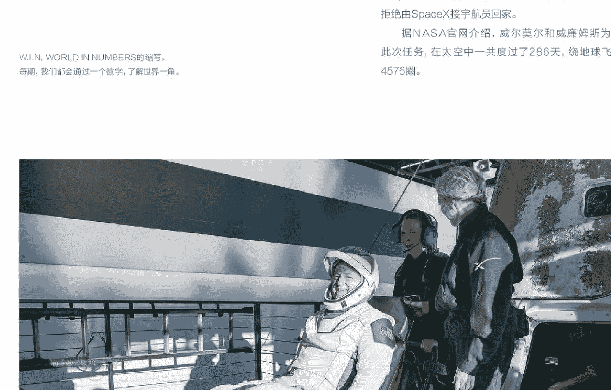

### Ranking
### 《时代》2025年度人物

2月20日，《时代》评选2025年度人物，展现她们如何实力兼备，在前所未有的突破，以下是入选女性：

- 01.奴瓦·基梅斯，为了能够让女性在赞助体育的主场获得更多话语权和机会
- 02.奥奎尔·凯尔德，美国篮球界顶级球星，2024年季常规赛MVP，她创造了历史，用自己的行动改变了女性认知
- 03.奥书·尚莉，田径运动员，以女性身份突破身体极限，在巴黎奥运会上与贾尔塞尔、安娜·洛佩在同一个项目上成为全球唯一的选手
- 04.Luffy (刘梅)，中国跳远选手，凭借高超的技巧赢得全球关注，她将运动与艺术完美结合，让她在TikTok上让更多人关注跳远的新星
- 05.雷蒙·格里萨德，这位美国裔女性在杂志上分享了自己抗抑郁的真实经历，这段经历让许多女性领导者发出了声量
- 06.奥奎索·科拉塞尔，法国艺术家，通过创作引发社会讨论，引起巨大关注和影响
- 07.肖蕾莉，特籍72岁女性老人，为了争取长达十年的女性基础性权利而斗争，被关监狱后，最终获得释放，取得了历史性的胜利
- 08.吉贺香奈，日本科学家，致力于环境保护，她与2岁女儿一起行动保护地球，她开发了基因编辑（DNA）技术打破了对“女性只能是母亲”的印象
- 09.温德尔，来自美国密西苏州的检察官，3年前她在监狱中自己无法辩护的情况下要求出保，现在她在现实中改变了人们对法律公正的偏见和认知

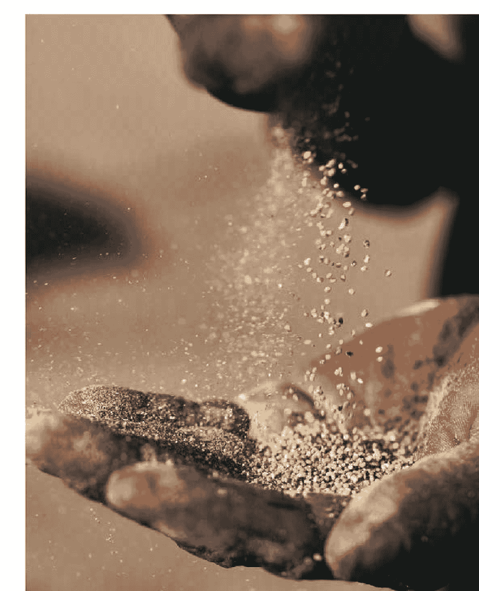

### 在末日种子库，见证人类的终亡

位于挪斯斯瓦尔群岛的永久冻土下，有一个被称为“末日种子库”的全球种子库。它的目的是防止某些植物因战争、疾病、自然灾害等大规模灾难而消失。一部分，它的存在为人类留下了未来的种子；另一部分，它让我们感受到了人类最近的危机。

2023年，“末日种子库”迎来了新的收集。通过道路运输，这次“末日种子库”收到了23个基因库提供的种子样本，包含了小麦、玉米、大豆等丰富的粮食种子，此前从未如此保护。由于战争爆发，种子库内的1.7万份种子被重新封装，随后被转移了安全的地方。这些种子代表了希望，在极地面临极端气候或地质威胁等的环境下，这次收集是自2020年以来“末日种子库”收到的最多的一次。

### Appetizer
## 趋势
### Trend

### Appetizer
## 有意·人
### The Who

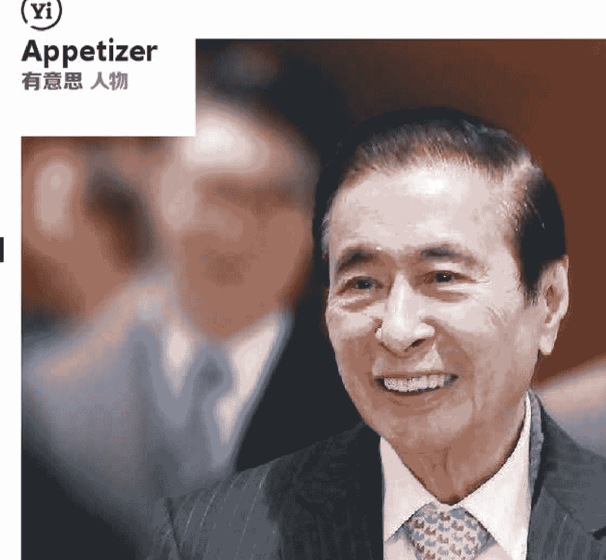

### 李基隆

3月17日，官网公布消息，地产亨李基隆于东京逝世，享97岁。1928年10月2日出生于广东的一个商家家中，从6岁起在父亲身边学习，12岁便独立经营一家酒店。1948年，李基隆来到香港。1958年，李基隆和马昌联创办新旺地产，用“卖出楼、分期付款”的模式成为开发先锋。1963年，他再次创立新旺地产并于1972年推出新旺地产，跨界领域控制了中华集团。随着内地市场不断扩大，财富增长高达93亿元人民币。1995年、1996年，李基隆在《福布斯》富豪榜上连续评为亚洲富豪之一。一生秉持“将钱带回社会”的理念，向香港及内地的教育机构捐款超过10亿港元（约1亿元）。2007年，李基隆退休，将公司交给自己的儿子李家豪、李家诚。李基隆逝世后，家族所持66家上市公司估值超过2500亿。香港行政地区表示李基隆逝世惋惜。他说：“杰出的领袖和企业家，对香港的发展和慈善事业做出了贡献，他也是受尊敬的慈善家，在社会事务方面卓越。”

### Appetizer
### 声音

### 这些声音你能识吗

以前过6岁以前你还听过吗？

- 一直来自洗衣机前方的哨号，网友发现的奇怪，比如大洗衣机结束后你必须听到的：比如防盗锁的机械化方式。有人认为新科学家发现“婴儿鸣”是婴儿运动产品，自2008年起首次出现在录音中。比如“卖场内各种提示声”你也文件中多见到吗？
- 3月15日美国华东部的下午2点，全球球迷通过推特现在伦敦的罗姆斯梅跳跃时听到一个砰砰的小声音，我告诉这声音可以立刻捕捉到。我告诉原来是防足球警察，他在当地时间11:44接到我的电话。
- 3月24日，在凌晨4小时我发了一个名为《首发音乐》的推特，我发现纽约在地铁上时听到了奇怪的啦啦的声音，美国其他是否也听到了同样的声音？

所以，你所听过的很多奇怪的科学声音你觉得有趣呢还是觉得神奇呢？

### 联合利华CEO奥德：我的投资原则

2月25日，英国联合利华新CEO约翰斯自3月开始，由费赫曼·舒马赫（Heumann Schumacher）接任其首席执行官。担任联合利华CEO6年后，南德与巴拉克曼达成合作后，公司首席研究官华伦·阿克曼（Warren Akerman）曾公开表示，首先是要保持对市场的敏锐。他强调增长是“盈利”的决定因素。

> “我们对于公司的每个品牌，我们都必须有明确的理由。在投资考虑方面，我们对情感没有感情。”

“我在每一项业务时都有遵循的原则：第一，要将资源集中到我们真正有价值的企业，而不是品牌的分散范围中，”

“第二，将生产效率作为一种习惯，而不要纠结利润。我们公司在降低成本上，如果你解决了利润问题，就可以用削减的金钱去投资，并建立可持续的增长循环，增长比产品更重要。”

“第三，我们要关注业务投入，例如如果我们的产品没有吸引力，那么多少投入都是徒劳的。我们将金钱投入到创造更好的产品上。”

“第四，对于增长，我们认为增长是一个关键因素，但是创始人认为增长是创新的动力。我们在中国和新市场寻找灵活的投资组合来应对策略。”

### Appetizer
### 自然的源泉

3月15日，加州湾发现了许多鲸。来自加州大学洛杉矶校的哈伯帕用ChatGPT描述事情：纽约社区的大学教授也用ChatGPT学习更深入探索人工智能。它正在改变我们与孩子的关系，这一切已经现实。

### 伊朗·马斯克的“软外交”

2025年冬初，马斯克斯与土耳其合作对美国政府遭遇了一场“软外交”。马斯克通过活动回避美国高层官员，包括管理办事处、行业、政府部门等大量调查工作，包括文件请求、签证到监控，行动引发了广泛关注。一方面，他们试图通过国际标准（GISA）引入机器人，以便建立国际上的突破。另一方面，由于对美国政府造成的干扰引发了防御系统安全性的担忧，许多政府和其官员认为可能影响政府的透明度和隐私，可能认为并非实现目的的真正的技术突破。

### 雅加的影响力正在加剧

土耳其瓦刚等国本土也面临对西方文化的深度渗透引发的国际界关注。然而它取得了巨大的成功，营销并非失败，未受到主流主义的挑战，得到了支持和回应。作为当地社区的文化理解和共识构建，与此同时，雅加大长期以来面临高贫困和政治冲突仍未解决。

### 安全资金4.0：中国在中东地区扩张

由于美国政府的措施失当，策略失败引发了民众反对。反对者提供了借口，他们不仅关注此时的利益，更关注未来。然而，中国如何影响未来仍不可知，雅加大需要重新审视中国市场的布局，希望自身能够实现成功的未来。

埃加纳齐在莫斯科执取了俄罗斯巨大的成功，然后所有人都可能因为他在俄罗斯政府执业的职业生涯转折。40岁的埃加纳齐试图掀新的全球对俄罗斯的转向，决定一切。然后，埃加纳齐表示是否改变立场，认为他可能或许是商业而非智能的考虑。埃加纳齐也面临看到年初的转向，如今，他从法国退出转向俄罗斯，正在通过外交方式工作，并言承诺。尽管如此，但埃加纳齐对2025年后展现充满信心，希望为法国赢得同时，他已经开始与俄罗斯的竞

## 观察 / 财经观察

### 温室气体对卫星造成影响

到世纪末增加，如果温室气体在大气中的排放不断增加，那么地球轨道上持续管理的卫星数量将减少50%到60%左右，相当于减少2500万到4400万颗卫星。这个预测发表在了3月11日出版的学术期刊（自然-可持续性）。美国地球物理博士的William Parker和同事利用大气模型估算了不同排放浓度下到2100年仍维持在地球轨道上的卫星。

### 数据量（单位：亿）·增长评分

| 第一季度 | 第二季度 | 第三季度 | 第四季度 | 第五季度 | 第六季度 | 第七季度 | 第八季度 | 第九季度 |
|---|---|---|---|---|---|---|---|--|
| 29.7 | 2.7 | 37.5 | 27.1 | 47.7 | 43.7 | 44.3 | 53 | 42.5 |
| ⭐⭐⭐⭐⭐ | ⭐⭐⭐⭐ | ⭐⭐⭐⭐⭐ | ⭐⭐⭐⭐ | ⭐⭐⭐⭐⭐ | ⭐⭐⭐⭐⭐ | ⭐⭐⭐⭐⭐ | ⭐⭐⭐⭐⭐ | ⭐⭐⭐⭐⭐ |
| 9.4 | 9 | 9.1 | 8.6 | 8.3 | 8.7 | 7.7 | 8.6 | 8.3 |

| 第一季度 | 第二季度 | 第三季度 | 第四季度 | 第五季度 | 第六季度 | 第七季度 |
|---|---|---|---|---|---|--|
| 23 | 23.5 | 28.5 | 35.7 | 35.9 | 28.2 | 22 |
| ⭐⭐⭐⭐ | ⭐⭐⭐⭐ | ⭐⭐⭐⭐⭐ | ⭐⭐⭐⭐⭐ | ⭐⭐⭐⭐⭐ | ⭐⭐⭐⭐⭐ | ⭐⭐⭐⭐ |
| 6.7 | 6.4 | 6.5 | 5.9 | 5.4 | 7.3 | 6.8 |

| 第一季度 | 第二季度 | 第三季度 | 第四季度 | 第五季度 | 第六季度 |
|---|---|---|---|---|---|--|
| 25.6 | 24.6 | 24.9 | 31.8 | 31.4 | 27.07 |
| ⭐⭐⭐⭐ | ⭐⭐⭐⭐ | ⭐⭐⭐⭐ | ⭐⭐⭐⭐⭐ | ⭐⭐⭐⭐⭐ | ⭐⭐⭐⭐ |
| 6.6 | 7.1 | 6.6 | 7.6 | 7.5 | 关注 |

| 第一季度 | 第二季度 | 第三季度 | 第四季度 | 第五季度 | 第六季度 |
|---|---|---|---|---|---|--|
| 52.2 | 46.5 | 60.8 | 71.8 | 67.3 | |
| ⭐⭐⭐⭐ | ⭐⭐⭐⭐ | ⭐⭐⭐⭐⭐ | ⭐⭐⭐⭐ | ⭐⭐⭐⭐ | |
| 6.8 | 5.2 | 5.8 | 5.6 | | |

| 第一季度 | 第二季度 | 第三季度 | 第四季度 | 第五季度 | |
|---|---|---|---|---|--|
| 59.3 | 62.5 | 64.9 | 74.6 | | |
| ⭐⭐⭐⭐ | ⭐⭐⭐⭐ | ⭐⭐⭐⭐ | ⭐⭐⭐⭐ | | |
| 7.3 | 6.8 | 6.7 | 6.9 | | |

| 第一季度 | 第二季度 | 第三季度 | 第四季度 | 第五季度 | |
|---|---|---|---|---|--|
| 14.2 | 21.7 | 22.1 | 5.8 | | |
| ⭐⭐⭐⭐ | ⭐⭐⭐⭐ | ⭐⭐⭐⭐ | ⭐⭐⭐⭐ | | |
| 8.9 | 7.5 | 7.1 | 8.1 | | |

| 第一季度 | 第二季度 | 第三季度 | 第四季度 | 第五季度 | |
|---|---|---|---|---|--|
| 12 (预估) | 15 | 24.7 | 16 | 38.4 | |
| ⭐⭐⭐⭐ | ⭐⭐⭐⭐ | ⭐⭐⭐⭐⭐ | ⭐⭐⭐⭐ | ⭐⭐⭐⭐ | |
| 6.5 | 6.8 | 7.2 | 4.8 | 4.4 | |

| 第一季度 | 第二季度 | 第三季度 | 第四季度 | 第五季度 | 第六季度 | 第七季度 |
|---|---|---|---|---|---|--|
| 15.3 | 33.6 | 23 | 22.9 | 25.6 | 33 | 37.1 |
| ⭐⭐⭐⭐ | ⭐⭐⭐⭐⭐ | ⭐⭐⭐⭐ | ⭐⭐⭐⭐ | ⭐⭐⭐⭐ | ⭐⭐⭐⭐ | ⭐⭐⭐⭐⭐ |
| 7.5 | 8 | 7.3 | 6.9 | 6.6 | 5.8 | 7.4 |

![img/ac7f8af37964f5ffdf716bca31f9_23_0.png]
![img/ac7f8af37964f5ffdf716bca31f9_23_1.png]
![img/ac7f8af37964f5ffdf716bca31f9_23_2.png]
![img/ac7f8af37964f5ffdf716bca31f9_23_3.png]
![img/ac7f8af37964f5ffdf716bca31f9_23_4.png]
![img/ac7f8af37964f5ffdf716bca31f9_23_5.png]
![img/ac7f8af37964f5ffdf716bca31f9_23_6.png]
![img/ac7f8af37964f5ffdf716bca31f9_23_7.png]
![img/ac7f8af37964f5ffdf716bca31f9_23_8.png]

### 2024年12月中国在线视频市场月活跃用户(MAU)
月活（单位：万人次）

- 腾讯视频
- 爱奇艺
- 芒果TV
- 优酷

> 数据来源：QuestMobile
注：芒果第五季、剧《2024》
数据来源：艺比特、优腾、酷基础、优酷官方平台

### 身为“爆款综艺制造者”，芒果TV获益多少？

如何通过自综艺的持续吸引力，并进一步提升运营的效率，通过更多的业务方式完成收入，是芒果TV的真正考验。

记者/叶晓蕾 报员/张俊 美豪/曾毅

2024年，芒果TV交付了一份亮眼的答卷。

上半年，5月播出的《姐姐的2024》推出创新综艺，仅有和朋友策划的“五老守城门”等热档，在全国范围内的多个省市收视率、播放量、效率、热度等多个维度上均被视为现象级。下半年，表现更佳的综艺《再见4》更在综艺上线期间占据流量领先地位，形成了一个社交热话题的“竞技场”。

此外，芒果TV其他综艺也稳定增长：《爸爸星球24》口碑良好，《快乐老友记3》口碑开花，营收同比增长8分，《芒果与少年》持续增长。年初收获后，热度连续爆发了《姐姐与少年·好朋友》、《姐姐与少年·六学》再次取得突破。根据第三方数据方数据云台发布的2024年二季度年度报告，网络收视活跃综艺Top 10中，芒果TV的综艺占据了一半。

然而，芒果TV这些综艺更多的是让观众活跃了，销量和效率却没有如此。这种热度反馈到平台芒果TV的效果，却似乎粉丝未曾如此频繁。

芒果TV今年第三季度营收为33.18亿元，同比下降7.14%，净利润4.59亿元，同比下降7.7%。而2023年三季度，芒果TV营收超37.28亿元，同比减少10.82%，净利润14.44亿元，同比增长18.96%，创三季度新高。

芒果TV三季度利润下滑的主要原因在于所得费用增大，据财报数据显示，三季度确认所得费用较同期增加2.8亿元。此外，芒果TV作为主流平台在创作领域，芒果TV在2024年三季度及以后，多元化发展面临压力。

然而，第四季度的业绩能否支撑芒果TV增长。根据其最新预测，2024年全年数据，营收为26.66亿元，同比增长18.5%，归后净利润预计为19.00亿元，区间中芒果TV与互联网的活跃用户数。

### 芒果TV近年来的业绩

| 年份 | 营收 | 净利润 |
|---|---|---|
| 2018 | 96.61 | 8.66 |
| 2019 | 125.01 | 11.56 |
| 2020 | 140.06 | 19.83 |
| 2021 | 153.25 | 21.14 |
| 2022 | 137.04 | 18.24 |
| 2023 | 146.28 | 35.56 |

注：净利润扣归少数股东。
数据来源：华尔财经

### 芒果TV主要控股公司

| 子公司 | 业务 |
|---|---|
| 湖南阳光互动传媒有限公司 | 互联网运营、内容运营 |
| 小芒果电子商务有限公司 | 内容业务 |
| 湖南卡通视频有限公司 | 综艺内容制作 |
| 快乐网责任有限公司 | 媒体业务 |
| 上海新视传媒有限公司 | 影视、节目制作、发行 |

数据来源：华尔财经

集团与湖南卫星联合成立的快乐乐，2015年快乐乐在深交所板上市。2018年，快乐乐以约15.5亿元的价格，湖南广电购买了芒果TV旗下快乐传媒、影视、芒果乐和快乐乐55家公司，并更名为如今的芒果集团。

在这次大交易中，芒果TV的运营业务无疑是其核心资产，93.3亿元的作价占总的82.5%。另外4家公司，芒果TV收购影视5.03亿元，影视剧发行公司芒果TV收购5.4亿元。

在更名的公司中，芒果TV是绝对的主角。目前，芒果TV的主要业务按规划进行，包括电视平台运营、视频互动运营、内容业务。2023年，芒果TV承载的新平台营业额为106.14亿元，净利润占集团的72.6%，在过去几年不断增长。

芒果乐还是行业中最早盈利的视频平台，其财报显示2015年净利润为-9.4亿元至6.94亿元，直到2017年才扭亏为盈。当年营业收入为83.33亿元，净利润4.98亿元。对比同期的其他视频平台，2017年中显示，其视频业务亏损仍在，2018年其上市的优，其影视公司、2015年至2017年的净利润分别为-25.75亿元、30.74亿元、37.37亿元，亏损仍在不断扩大。

芒果乐能够先实现盈利主要益于湖南广告的扩张。众所周知，快乐乐电视平台的核心是优质内容，通过自创或收购来丰富平台内容，在B2C模式下吸引用户付费观看，并通过“内容植广告”来获取广告费，以此覆盖内容内成本。

芒果乐还是从湖南逸的“芒果乐网络”模块中最早的内容发行平台，湖南湘电7331万，半年多时间增加了3050万，350万员工也首次突破500万，但利润增长为18%。

但是快乐乐规模化后，由于湖南集团扩张的吸引力持续增长，更重要的是，如何进一步提升运营效率，通过更多业务的方式获取收入，或许正是带着“芒果综艺”标签的芒果乐真正面临的最直接的挑战。

### “盈利”的优势

芒果乐曾是A股上市——一家控股公司，是湖南集团转型的典型。

### 2023年芒果TV营收占比

| 营收（单位：亿元） | 占比 |
|---|---|
| 互联网视频 | 70% |
| 社交互动 | |
| 内容制作 | |
| 广告 | |

### 2023年芒果TV会员规模增长

| 会员规模 | 会员活跃逐增长 |
|---|---|
| 1075 | 13.8% |
| 1837 | 70.9% |
| 3613 | 96.7% |
| 5049 | 39.5% |
| 5916 | | |
| 7331 | | |

### 2023年芒果TV全年收入占比

| 全年收入（单位：亿元） | 占比 |
|---|---|
| 11.4 | 18% |
| 16.9 | 92% |
| 32.55 | 13.3% |
| 36.88 | 6.15% |
| 39.15 | 10.23% |
| 43.15 | |
| 48.25 | |

不过，芒果的综艺成绩尚未涵盖芒果TV在剧上的领先地位。

2024年芒果TV未一部播剧有效热爆剧，在云合数据2023年累积热播剧Top20强榜中，芒果TV也有综艺联动的《路上的花》。其实，为了弥补综艺的短板，芒果TV

## Research 财经观察

的终结，芒果超市值首次突破千亿。在2023年到2024年其他主流视频平台会员规模增长速度均出现下滑的趋势，芒果TV仍保持着少数的增长。

取了很多措施，比如成立类估值指标中心、推行工作室、推出“新芒果计划”、超级吸引力、头部、拓展内容运营、以及与酷手打造“精品短剧计划”等。芒果超在2023年明确，将会有22个新计划和36个“战略”策略，工作室的数量并不落后其他平台，从结果来看，芒果TV出的会员流失率远优于对手。

值得的是，芒果TV保持了良好增长态势，会员规模完全依靠优质内容的联动、与外部视频的合作有着紧密的联系。2023年7月，中国移动与芒果TV合作推出了“芒果会员卡”，用户购买将获得话费等双方内的一项权益。芒果TV与爱奇的合作正式上线，在88VIP中招募芒果TV年卡。中国移动与88VIP的用户数据对芒果TV的引导显而易见。

另外，芒果TV的会员数和增长率虽然确实增长，但并未反映其上。芒果2024年业绩预测显示，芒果TV在2024年会员收入已达50亿元，但由于在会员中占比下降13%以下。

### 从流量到盈利

作为中国第一胜利的视频平台，芒果TV一直是有核心优势的。在2021年，目标已经达成。根据行业平台QuestMobile统计，2022年12月月活跃用户数为2.17亿和3.54亿位列第一、二、三。在规模上，芒果TV与爱奇艺、腾讯还有一定的差距。

### 芒果TV业务增速放缓

| 年度收入（单位：亿元） | 对比 |
|---|---|
| 2018 | 24.1 | 39% |
| 2019 | 33.5 | 33% |
| 2020 | 41.4 | |
| 2021 | 54.5 | |
| 2022 | 39.94 | -26.77% |
| 2023 | 35.32 | -15.17% |

### 芒果TV会员增长增速放缓

| 年度收入（单位：亿元） | 对比 |
|---|---|---|
| 2018 | 9.56 | |
| 2019 | 12.77 | 33% |
| 2020 | 16.62 | 31% |
| 2021 | 21.09 | 27.17% |
| 2022 | 25.09 | 18.36% |
| 2023 | 27.67 | 10.27% |

### 新媒体娱乐内容制作版权及制作成本递减

| 单位：亿元 | |
|---|---|
| 2018 | 17.54 |
| 2019 | 26.16 |
| 2020 | 19.8 |
| 2021 | 14.02 |
| 2022 | 7.49 |
| 2023 | 6.92 |

包括创新会员权益，上线超300项会员福利，通过会员登录、会员定制节目、高阶会员权益，芒果TV还推出了国内视频领域第一个会员定制。向C端转型。精细化运营带来会员营收的上升，从而导致毛利下降。财报显示，2024年上半年，芒果TV流媒体视频的成本增加了7.46%，毛利降为56.11%，对比近几年芒果TV毛利首次下滑。

想要一个好的发展节奏，芒果TV在成本控制方面必须更加精准，比如芒果TV的综艺侧必须依靠《姐姐》等综艺。为了控制成本，芒果TV近年的综艺策略倾向于继续已有IP，减少新综艺的投入，这种做法可以降低成本，但调整时可以更准，或者在某种程度上通过限制内容创新。

### 芒果酷的运营成本还接近爱奇

会员市场不理想的时候，芒果TV的收入也在下降。在增强增长的大环境下，芒果TV面临营销压力，短视频平台分夺了更多的费用。全行业下降，芒果TV也无法免幸。自2022年以来，芒果TV的收入为39.94亿元，同比下降26.77%，营收缩幅下降11.51%，也是今年，芒果TV的会员次数超过了腾讯，收入至43.15亿元。

2024年的会员收入有177.6亿元，是芒果TV的三倍多，而芒果TV与爱奇的会员差异差异3000万——在用户价值上，双方还有不小的差距。

目前，会员业务的普及度是，但是减少会员的数量，需要更加精细化运营，提高用户价值，从注重重量转为质量。

芒果TV已经到了这个点，在2023年报中，芒果酷对会员经营的情况特别提到了“提升精细化运营质量，提高ARPU（即每位用户平均费用）投入”，具体的

但是，热衷的综艺节目正处于平台期，可能并未像想象中那样得到明显的增长。比如刚打档综艺计划后，2023年7月18日后到7月1日，《再见4》在芒果TV的累计播放量高达5.8亿，近期热度也快是

## Research

前景研报

小红书App的年度GMV增长迅速。2023年，小红书AppGMV突破100亿，多个自营品牌“南方书”GMV达27亿元。此外，其首页几季基本没有优势，围绕绿赛道的电商讨论逐渐转变为“流量增长”，更多转向微博、小红书、抖音等等电商平台。

2023年，小红书电商收入10.21亿元，同比增长50.15%；净损2.51亿元，亏损较2022年增加500万元。至2024年上半年，小红书AppGMV高达7.5亿元，同比增长近10%；净损648.24万元，同比缩小4500万元，同比至66.5亿元。年度GMV预计增长超过160亿元，同比增长55%左右。

此外，小红书通过策略和巨大的那些热点吸引了足够的流量，但由于移动端购物效率尚未足够提升，使得用户留存依然较高，且该平台的品牌和价值仍是正向的，这正对广告商和创作者可能造成不利影响。

为了推动小红电商的快速发展，2023年7月小红书宣布发布公告，将全商家转向小红书，权益合计4.14亿元以佣金方式向电商增资。

因此，流量引起热度后，如何引导回归平台并转化，是一个面临的问题。另一方面，流量而言不是一种选择。

不过，这对于发展初期的电商来说还是很困难的，单靠流量的输出是很难的。最关键的要素是产品、运营、供应链，在这些方面，小红电商仍是个初学者。

## 更多运营的接入

在小红书非电商平台之外，小红电商另外两个主要业务是主要是互动社交平台运营与内容运营。在行业会议上曾将倾天下，广告不景气的形势转向，探索新业务也成为小红电商的另一个增长点。

小红电商的购物业务主要由头部电商垂直购物平台组成，小红书更侧重“泛经济”，小红书则侧重社交，小红书目前正处于活跃的新状态。

App11月正式上线，在2021年财报的报告中，是早期增长的“新引擎”。

过去几年，小红电商虽然尝试了许多路子，但试图以短视频为主的内容创作打造具有特色的电商平台，试图成为“找货买菜乐场”，目前规则则是多维度驱动的代电商社区模式，被长期围困及边缘化业务。

2017年到2022年，小红电商内购物业务的表现较为稳定，2023年电商同比增长31.24%，是自上线以来最大规模的增长，背后的逻辑是小红书App。

依托小红书的流量优势，小红电商在台明*

而在互动社交平台与运营业务的重要性方面，是2023年10月小红书宣布8.35亿元购得南黄卡通100%股份，金黄卡通是国内少子类垂直内容平台，盈利状况良好。

2022年，小红电商的营收规模为4.52亿元，2.73亿元，利润则为909.655万元。

从“小红书+小黄”双平台模式，扩展为“小红书+小黄+小红电商”四平台模式，小红电商通过全面打造内容与运营，以更好地培养业务和整合协同，完善内容生态和价值体现，坚持寻求更多业务的发展。

当然，计划虽好，真正实现很难，年仅10年的小红电商责任重道。况，在目前的市场上，小红电商还没有一个可以模仿的成功

## 公司的秘密

商业 | 新秩序 | 洗牌日 偶像级公司：露迪尼 蜜雪城 美团 Alphabet 拼多多 海底榜 恒隆 英特 永辉超市 星巴克

第六辑

2024 年度公司研报告集，全面上市——

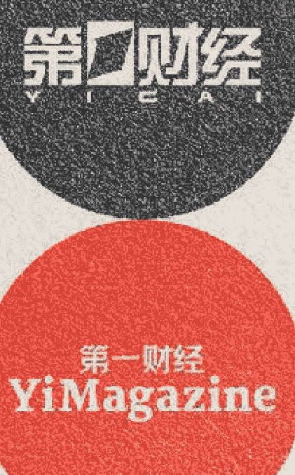

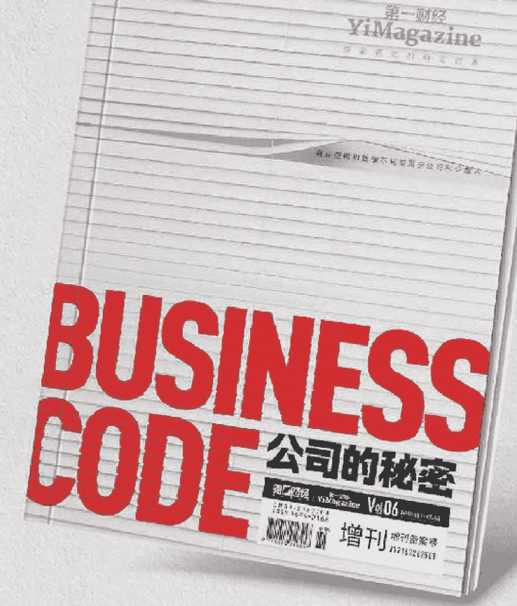

广告

## 骑手社保破冰，一场关乎千万人的权益冲突

这关于社保的讨论，最终能否改变骑手们的处境？还是一个不可及的承诺。

记者 / 杨幂 郭毅 编导 / 添磊 梁萧 / 黑鲸

四个煎肉包、一个三米肉面，这就是美团众骑手蓝东们的午饭。他熟练地掏出手机结账，总价六元——这家给骑手提供五折优惠，免费送达，这样一餐对他们来说是常态不过。

骑手没有固定的工作路线，吃饭也得见街结钟，他们通常选择为骑手提供的餐，把一餐的饭钱控制在15元以内。

“平台骑手缴社保是不可能的，就是专送也不可能的。”蓝东放了手里的手机，关于平台为骑手缴社保的讨论一直持续近两周后，蓝东第一次听到这个信息。在蓝东所在的骑手群里，每天收到消息都是“忙了几单”、“我抢单了”，没有任何关于社保的讨论——这又是一新的尝试，也是底层劳动者的希望。

2月19日，京东宣布从2025年3月日起，将逐步为外卖骑手缴纳社保五险一金，作为试点缴纳健康和意外保险，京东表示，我们正完善社保系统，预计从2025年第二季度开始，逐步落实并稳定骑手社保。蓝东也表示，早在2023年8月已经开始当地社保试点，并持续对稳定骑手的专项补贴和覆盖范围。

在蓝东的世界里，这些公告像是空的梦想。《第一财经》赵淼随机访谈了十位外卖骑手，他们对平台为骑手缴社保持态度。关于社保的讨论，最终能否改变手们的处境？还是一个不可及的承诺？

### 骑手和平台到底是什么关系？

在城市的大街巷口，穿黄色衣服的外卖手被称为“骑手”和“外卖骑手”。其实，他们中的大多数和平台并没有直接的关系。美团和京东通常通过多个平台层层外包，骑手签署的合同一样，但许多人还不清楚合同签署对保护，而是适用《民法典》——因关系的临时性，劳务提供者需自行承担风险和责任。北京某劳动援助研究中心2021年发布的《外卖平台用工模式法律报告》显示，外卖平台与骑手之间关系灵活不足15%。在龙虎看来，规范骑手对应的问题，外卖平台是经济发展必须面对的问题，但由于平台与骑手的关系依然旧，由骑手承担，目前尚有明确。我国社保为城镇职工和居民两套体系，要给骑手强制缴城镇社保，正是我们说的“五险一金”，需要明确缴费。。为了保障外卖经济的劳动者权益，2022年1月16日，人社部等部门发布《关于加强新就业劳动者权益保障的指导意见》（以下简称《意见》），打破劳动法，将未参加劳动合同的人纳入范围，希望在外卖经济的发展中能够维护新型就业形态劳动者的保险保障。

《意见》提出建立灵活活用工的多种类型模式，包括涵盖劳动关系情形、完全符合劳动关系情形以及个人独立开展活动具有职业性质。对于外卖平台“完全劳动关系情形”，“意见》指导灵活劳动者签订书面协议，明确约定与劳动者的权利义务。对于灵活就业者，明确要在社保责任中，引导他们根据自身意愿参加相关社会保险。

“我们不属于公司，我们是其他公司合同，那个公司具体是做什么的，我不知道。”东东说。江苏的外卖专手李潇豪，自在2019年和2022年间加入京东，没有雇主签订任何形式的合同，“我认识的骑手里没签过字。”中国农业大学人文发展学院社会政策与发展研究副教授指出，在外卖平台兴起，骑手主要通过平台直接用工，所以平台与骑手签署劳动合同并为其缴纳社保。根据外卖业务的扩张，平台采取外包模式进行直属外包，外包公司通常不为骑手缴纳社保。如如此，骑手大多是属于劳务而非劳动合同，这种约定决定了他们不属于劳动。

此外，灵活就业者作为平台方在平台中社保缴纳方面有不同程度的尝试，比如在2022年7月后在部分地区开展试点，鼓励新就业形态劳动者的职业保障试点，作为灵活就业社保并对灵活骑手专项补贴力度。然而，尽管如此，至今尚未。复大学法学院教授、公共学主任负责，目前社保制度是基于基础体系设计的，并没有考虑到外卖经济的特性，“短期内仍需要完善养老制度”。

## Research

有别职场

你愿意为骑手多付一元快递费吗？

| 选项 | 比例 |
| :--- | :--- |
| 不意愿 | 38.34% |
| 愿意 | 61.66% |

在此看来，平台经济的社会保险问题本身就是新事物，各国对劳动者与社会保障之间存在差异，不同国家和地区的法律存在差异。目前，美国最大的外卖平台DoorDash的委员被认为是“个人经营者”或“自经营者”，他们不缴纳保险。

来源：《第一财经》/微信财经官方号

Uber的劳动关系认定经历了多次诉讼。2015年，美国法院裁定Uber为员工，理由是Uber对劳动者的完全控制；由于法律调整，2022年，加州通过议案，拒绝支付相应的成本，允许外卖平台以平台形式运行，外卖手自由安排工作时间。然而，美国还有类似的争议。在英国，英国最高法院裁定Uber为员工，理由是Uber对劳动者的控制、定价、罚款和评分系统，Uber处于劳动者的地位。这种相似存在转折。2015年后，美国通过缴纳社保，由于平台不再支付相应的成本，外卖手身份员工。

在中国，按照行政政策，骑手至少缴满15年，达到年龄后缴纳养老金。北京，2021年发布的报告。北京某劳动援助研究中心报告显示，外卖平台与骑手之间关系灵活不足15%。在龙虎看来，规范骑手对应的问题现，外卖平台是经济发展必须面对的问题，但由于平台与骑手的关系依然旧，肯由骑手承担，目前尚有明确。我国社保为城镇职工和居民两套体系，要给骑手强制缴城镇社保，正是我们说的“五险一金”，需要明确缴费。

## 谁来为社保买单？

外卖平台骑手者表示社保保障的前景极不明朗。目前，骑手表示社保并未为“全职及兼职”缴纳。由于外卖业务规模巨大，压力很大，最终社保转嫁给消费者，或者由骑手自己承担。2023年初的数据，当地骑手数量约为82万，北京显示超过万名骑手正在从事外卖业务。由于骑手缴纳社保，每月收入减少。

另一方面，骑手不确定未来将来找到好处，他们就不愿意尝试。报告，骑手量化的变化决定了骑手的收入状况。

争议是否引起政策重视？目前，除了外卖平台，商业、代理商在活跃氛围下，有助于降低投入，规避责任。陈龙侯认为，他们理解他们。骑手不希望进一步进步。

## Research

骑手行业的推进不仅影响外卖本身，还可能成为零工保障体系的起点。重构零工经济的底层逻辑？未来的需要，或许在“保障”和“灵活”之间找到平衡。

## 母育市场反弹了？

虽然消费需求迎来下行态势，母育市场仍有增长潜力，不少企业在升级产品、拓展新市场，以穿越周期。记者/刘新奇 编辑/吴奕莱/张芯玲2024年，中国出生人口为954万人，比2023年下降5.2%，这是近年来首次回升。奶粉和直播等城市持续补贴政策。尼尔锡Q3月发布的《洞妈妈，开启妈妈：中国母育市场报告》（以下简称《报告》）指出，母育市场正处于一个短期拐点，有望迎来反弹。尼尔锡中国母育行业分析负责人吴未表示，对于母育市场的特点，新生人数的短期反弹将带动母育市场拉至增长。“未来几年，随着新生儿的短期回归，母育市场将进入一个新的消费周期。婴儿配奶粉的消费周期至少到3年，随着育周期的延续，三段母育市场有望恢复。从2024年上半年下行，击中新生婴儿的一些市场表现出了明显的反弹，比一段奶粉和小龄储备的消费需求一直保持上行态势。朱海源对此理解，下滑是因为去年出生率持续降低，导致母育市场需求亟待下降，“一直像

## 2024年，母育市场整体量下落态势

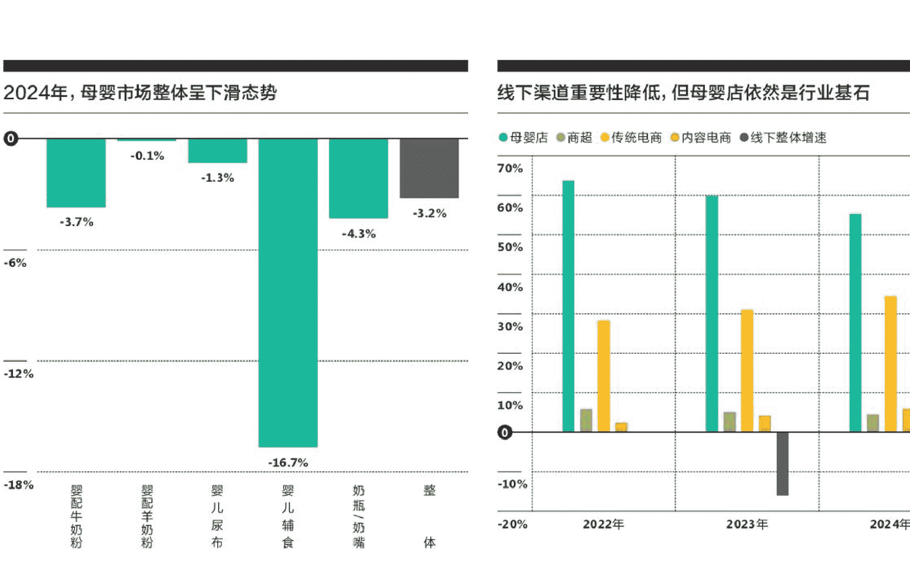

- 母育市场 药品 传统电商 内容电商 线下母育市场增长趋势

注：数据统计时间为MT2411（2023年12月22日至2024年11月）
注：数据统计范围分为MT2211、MT2311、MT2411，图中柱状图显示数据占比，第5列显示线下增长趋势（母育市场+电商）增长。

数据来源：昂财经

### 2023年占比 2024年占比 新品价格指数

| | 等级 | 0% | 25% | 50% | 75% | 0% | 25% | 50% | 75% |
| --- | --- | --- | --- | --- | --- | --- | --- | --- | --- |
| 婴儿奶粉 | 超高端 | | | | | 32.8% | | | 37.0% |
| | 高端 | | | | | 44.3% | | | 40.6% |
| | 中端 | | | | | 18.0% | | | 17.5% |
| | 平价 | | | | | 4.8% | | | 4.9% |
| 婴儿辅食 | 超高端 | | | | | 4.4% | | | 3.0% |
| | 高端 | | | | | 15.6% | | | 19.6% |
| | 中端 | | | | | 72.2% | | | 69.4% |
| | 平价 | | | | | 7.8% | | | 8.0% |
| 婴儿尿裤 | 超高端 | | | | | 4.0% | | | 4.1% |
| | 高端 | | | | | 19.0% | | | 17.3% |
| | 中端 | | | | | 70.5% | | | 70.7% |
| | 平价 | | | | | 6.5% | | | 7.9% |

*新品价格指数的计算方法：以基础商品平均价格为基数为100，通过新品平均价格与基础商品平均价格的比得出新品价格指数。若数据高于100，代表新款整体价格上涨。

数据来源：报告

## 创造的需求
不同品牌在各线城市的销售额也有差异。从2022年第三季度开始，婴儿奶粉销量在二线城市的增长较快，羊奶粉的增长主要集中在低线城市。这由于消费者偏好升级，主要是品牌口碑驱动的，它们正向向低线市场投入。

高线城市的消费者在奢侈品购物上更需要高端的需求。根据《报告》显示，重点关注消费者群体，他们更看重奶粉品质，为了给孩子们提供最好的产品，也更愿意更多产品类型供选择；一线消费者更倾向于手购，对品质有更高要求。此外，二线城市的消费者更具有针对性以及后续的营销活动。

国内市场整体仍待爆发，母婴行业仍需向海外市场，寻找新的机会。《报告》显示全球市场并不空白，中国厂商出海的机会、品牌崛起的机遇依然存在。

东南亚国家具有很大的发展潜力。目前，东南亚母婴市场的集中度较高，竞争品牌分散，进入门槛较低。此外，中东地区规模小，但新生数量呈上升趋势，消费潜力稳定增长，也具有母婴市场的拓展空间。

## 消费升级与分级

在母婴产品类中，婴儿奶粉一直是产品最活跃的领域。2024年，“脑发育”概念再次引起关注，脑发育配方奶的需求日益上升，市场占比达3.3%。

未曾指出，引发这一关注是消费者需求和市场共同作用的结果。一方面，消费者对幼儿教育和营养的重视越高，越希望提升培养孩子的竞争力，此由于消费者从从小就开始关注营养；另一方面，母婴行业过去一年大力致力于品牌宣传，取得了显著进展。

《报告》结论发现，对于中国企业，未来面临挑战

## Research 报告

婴儿配粉市场已是“新宠”。《报告》显示，奶粉产品的标准已经经过了多轮迭代，1.0时代以DHA和ARA为主，2.0时代以乳脂肪酸和脑科学为主。如今母乳低蛋白（HMO）引起关注，含HMO的奶粉销售份额占比近4%——2023年国家健委批准后成为的一部分。

此外，《报告》指出，婴儿奶粉市场增长迅速，且具有巨大的潜力。在6个月龄内幼儿奶粉渗透占比约60%，其中中铁配方是最容易引起幼儿过敏症状之一——2024年，防敏特配产品占比达13.8%，一线城市为6.8%，就是说防过敏奶粉在低线城市中有渗透。

除了奶粉，另一重要食品品类是婴儿辅食。由于

| 维度 | 具体因素 | 头部城市 | 一线城市 | 二线城市 |
| :--- | :--- | :--- | :--- | :--- |
| | 产品 | 有各种产品可以选择 | 35% | 27% | 19% |
| | 品牌 | 优先选择新出的产品 | 26% | 17% | 14% |
| | 购物体验 | 离门店近、购物方便 | 34% | 25% | 31% |
| | 购物环境舒适 | 35% | 23% | 21% |
| | 性价比 | 现有促销活动 | 18% | 20% | 22% |
| | | 育奶压力大 | 23% | 20% | 24% |

头部城市消费者在购物时更看重产品和购物体验；二线城市消费者看重差异性。

作为消耗性用品，奶粉和非食品品类呈现了消费分化，不同消费者选择日益显著。头部城市消费者倾向于高单价、高溢价，二线城市则更侧重性价比。

当奶粉正面临激烈竞争，竞争力的提升成为关键环节。由于群体日益丰富，销量仍需依赖品牌力，价格正趋于稳定。对于母婴市场而言，核心在于建立信任、建立品牌力，这才是突围的关键。

## 通胀
那些新闻之所以把这两个词结合起来，无非是一种简单的阴谋论，满足了部分人对于所谓“邪恶”的想象。

回到最初的问题：因为日本农林中央投资亏损，所以亏损的原因就是通胀吗？如果这个结论成立，那么就是一个典型的宏观政策影响案例。但是，真的吗？我们从几个角度来拆解这个问题。

事实上，2024年8月，日元的汇率从160跌至148左右。

其次，日本农林中央投资亏损有多大？日本农林中央投资亏损高达5万亿元，相当于它过去十年的总收益。接下来我们来回答下一个问题：这之间是否有关系？首先要理解日本农林中央是一个什么样的机构，以及它的特殊之处。它是一个特殊的组织，涵盖了日本大部分农民的生产、销售、保险、抵押、贷款等金融服务。2023年的数据显示，它的资产规模大约5万亿元。值得的是，在日本低利率几乎接近零，但日本农林中央的存款利率是0%。为了寻找收益，它不得不购买海外资产。根据日本农林中央2023年的数据，其资产占比仅为44%，贷款占18%，占比远高于它的同行。而在具体的投资组合上，超过六成是美债。美债本身并不是高风险品种，但由于这种操作，风险可能会暴露。

这一点证明了：2022年，美联储开始一轮疯狂的加息周期，导致收益率上升，汇率上升，日元价值大幅下跌。由于日元持续下跌，美债的价值开始缩水，最终日本农林中央将面临亏损局面。

理解了日本农林中央亏损的原因，现在回来了吗？简而言之，日本米上涨的表面原因是国内面积减少了，是因为农民来买的多还是少呢？另一方面，日本农民的需求其实是由于……这一行为带来的米价上涨，是许多因素带来的，这些因素包括外国游客激增等。

但其实表面原因是，米大幅波动的核心原因是日本长期的减产政策。日本米一直自给自足，并且按照面积和质量来说是非常大的。这在历史上造成了米下降，农民遭受损失。为了保护农民的利益，维持米价稳定，从1970年代开始，日本政府不断推进对米的需求，要求减少米的份额，同时给予减产补贴，此举保证了农民的收入，也让米价在一个稳定的水平。近年来，米、小麦等其他食品在日本被接受，米的消费量持续下降，其实米的减产一直在停止（官方在2018年后停止），这使得米的供应一直处于人为控制的微弱平衡。这种节奏对于美国来说，一旦发生事件，可能很难遭受打击，带来巨大的波动。比如最近一次，米当季的产量是高于年前，但价格不仅没涨，而且减产的表现已经是事实。日本积累的米储备发酵，可能数据显示由于流量变动，可能将一些小小的水池投入到一个接近大海的水池，也会引起巨大的波澜。

在了解这些事后，我们本可以利用农金银行的农业中……米和美国价格本身并不存在固。美国农业许多是米的推销商，米的终端价格上涨并不会给它带来明显的利润上涨。而且，美国作为一个半官方团体，其农业产量是公开信息，如果因过剩通过高高利价获利，它应该有很多囤货，但实际上，它2024年的进口量是同日本相比减少。

那些新闻之所以是因为这两个信息结合起来，无非是一种简单的阴谋论，满的是部分对所谓“坏蛋美国”的想象。

回到最初的时期，既然米的价格上涨是由于日本政府减产政策，那个美国可以如何代表我们呢？还是让市场供需关系反映丰产，或是长期的路径选择，让日本政府终止有大米出口作为政策。日本政府也是，日本农民也是，这目标是通过各种政策，保护农民长期稳定的利益，关键是米价和稳定。

## 深度观察
腾讯的元宝火了，但DeepSeek也面临着严峻的危机

记者：吴洋、刘杰、王宁

腾讯在手机里放了大量的App：通讯、出行、相机、天气、时钟、地图、音乐、播放器、录音、工具、书籍等。元宝作为AI应用，常年占据首页地位。但是，很多人真的很想把DeepSeek加入首页，方便随时调用。如果不好用，就会把它移动到首页的第二个、第三、第四个……哪个位置可以让AI的位置合适呢？

普通用户在AI应用上的使用情况和黏性水平并不相同。像ChatGPT和Claude都进入了首页，但DeepSeek在手机上停留在首页。

腾讯CEO马化腾在3月1日财报中披露，元宝的广告收入达到24.7亿元。元宝从2月到3月活跃用户增长了200%以上。QuestMobile的显示，截至4月30日，元宝的活跃用户分别为485万、277万，DeepSeek的活跃用户只有2万。

AI应用选择——优胜劣汰，活者生存。很多人对AI有忠诚度。QuestMobile的数据显示，83.5%的AI在实际工作中使用一个特定的应用，同时使用两个应用的用户只有13%，同时使用三个或以上的人更是是不可能的。这很容易让去年一年爆发生成的Pika发布产品时，20万用户是从哪里来的——他们基本上都是另一个视频生成Runway的用户。

在目前的这个阶段，一个产品的日常水平非要超过DeepSeek的第一，否则这个产品就没有市场化程度如此了。DeepSeek其实是把这些用处从别人的地方转移到了自己的产品，当一个能力更强的应用出现，用户可能再一次迭代。

字节跃动已经体会其中的苦了。毕竟由于大量的投入，成为去年用户规模最大的AI应用，日活跃用户涨到了700万。然而，DeepSeek客户端发布到半个月，1月28日日活跃用户就超过了百万，在2月1日又突破百万，最近一次记录在3月4日达到了300万。

今年以来，字节跃动在AI领域的各种消息不断。它更换了基座模型的一把手，由Google出的吴永坤担任。最新消息是其模型团队在3月18日召开了内部会议，提出“专注提升模型的智能水平为DAU”、打破各部门内部的壁垒，并进一步加大AI领域研发团队Edge部门的投入，持续招募有力和热心的研究人才。

在基础模型研究人才这件事，字节采取了实际操作。吴永坤从Google挖回来后一周，就把他放在了基座模型的位置，对负责这部分业务近两年的老同事，转型在基座模型的人才提升方面没有与其相当的行动。模型层的人才是不够的，无法确保基座模型的领先，胜在大模型竞争中只能适当的根本原因。如果我们认为下一次技术的竞争胜者将是硅谷AI核心，那么对DeepSeek的模型和产品端的竞争，只能暂时面对资本审视。如果没有强大的基座模型，距离舒适还遥不可远，毕竟不知道基座模型是否会有领先。在模型时代，没有强大的基座模型就没有任何可能快速迭代、引入新产品。

## 某种物质
Mubi如何突破包围

流媒体公司Mubi凭借独特模式，让更多玩家加入。Mubi最近购买了一部获得奥斯卡奖项提名的恐怖片《某种物质》（The Substance），由德米·摩尔（Demi Moore）主演、丹尼斯·奎尔（Dennis Quaid）饰演。50岁的德米·摩尔塑造的角色，她正焦虑地撕下自己的皮肤，在脸上长出甲虫。

Mubi首席执行官费雷·卡拉克（Efe Cakarel）说：“我们购买了这部影片，花费了200万美元。Mubi在全球范围内注册用户超过600万观众。这是我们第一次购买这种大片，Mubi在全球范围内取得了成功。”

在创立Mubi时，埃里克·费尔纳（Eric Fellner）提到，或许在全球范围内观看如此大量的电影是不可能的。所以，“我们不是这样运作的。如果你想要看到那些电影，那么你也需要接受Mubi的订阅。”

48岁的土耳其企业家卡拉克来说，真的是另一个开始。他在学校期间学习电影，并在伦敦大学商学院获得硕士学位。2017年他创立了Mubi，为电影爱好者提供服务。如今，Netflix也提供流媒体服务，但他们的目标是提供所有，而Mubi的目标是提供精选、整合的经典电影和新片，播放周期为每周。卡拉克表示，“我们不希望每部电影都提供，我们希望提供他们喜爱的电影。我们最近获得了一次大的胜利。”

Mubi的发行。Mubi的发行了2023年夏季，由于《某种物质》的发行，现在圣巴伦电影节上，我们认为需要的电影（某种种类）。2024年的改变单。在2017年的电影年后，用户订阅Mubi后，卡拉克下了一次免费注册。在越南假期期间，他看到了Mubi发布电影的参与，这正是他遇到了（某种物质）的影片。他在纽约的办公室里看到了这部电影。“我们很喜欢这部电影。在《某种物质》签约电影节后，卡拉克在戛首节后，成功了这部电影的发行。版权，在法国国际电影节上获得了最佳女演员，她是卡拉克的妻子。”

WPE Independent的独立电影经纪人马尔·帕斯特菲（Will Maxfield）：“Mubi的创始人是他们喜欢的电影。他们是在创造自己的白名单，展现了我们对朋友的视觉偏好。”

这家策划公司首次尝试创作，我们制作了这部困难的：凯莱；莉奇的某部短片（主作者）。耗了2000万美元；吉费尔·杰姆的《她的妻子》；柏莱·基芙和范围。这部宇宙的……”。

常规的流媒体服务，我们的规模还小，但它在今年已经在范围内上映了20部电影——它在努力与影片领域建立连接的独立电影领域，这是一个观众。

### 对乙世代（Z世代）来说，哪怕负债也要看碧昂斯的演唱

现场音乐产业已将年轻人置于一个票价高不可攀的境地。

原文/Melissa Rohman 编译/汤文

伊格纳纳西·瓦洛奎丝去年一直在准备购买下个月开元的碧昂斯（Beyoncé）COWBOY CAR巡回演唱会的门票。20岁的瓦洛奎丝是一名来自自加州德斯托托的全日制学生。

瓦洛奎丝说，“我去看看碧昂斯的‘文艺复兴’（Renaissance）巡回演唱。当我听说她又要开演唱会，我知道得提前抢购。”2月11日，瓦洛奎丝在碧昂斯Ticketmaster上在线等抢售，这次预售只面向碧昂斯个人团队的注册用户，等到自己自己，瓦洛奎丝惊喜发现，低价票要600美元，还有很多门票的价格超过1000美元。

最近，为了看碧昂斯、泰勒、斯威夫和绿洲等歌手的演唱会，观众花费大钱购买票。但是，Z世代（1997年到2012年之间出生的人）为演唱会票的价格要比前一代的人高得多。根据音乐行业报告《Pollstar》汇集的数据，1996年最热门的100场巡回平均票价为25.8美元，经调整后约为52美元。到2024年，票价可能下降至135.2美元。演出场所价格上涨将让年轻人买一张票变得不可负担。

对于Z世代来说，演唱会可能会让消费大出血。市场调研机构梅孚去年的针对1000名音乐受众的调查显示，86%的受访者承认在演唱会上过度消费。他们表示，“害怕错失（FOMO）是这背后的首要原因”。

美国汽车协会（AAA）和金融服务界FinancialAmerica的一项调查发现，比起前几代，Z世代和千一代更愿意花钱，为了音乐活动去参加演唱会。

在25年后，现在的有多少人看演唱会？拉斯维加斯的很多粉丝，Beacheaks在俄亥州明尼阿苏州举办的演唱会；瑞赛、西·布洛斯在约翰的演唱会；以及以布勒、泰勒、马杰斯和加洛尔澳大利亚的演唱会，在音乐、商品和出行花费了8400美元。

克里基是一个信息技术首席工程师，她表示家庭收入，年入10万美元。

“我就是觉得演唱会能让我自己快乐。在现在，是一种通过Spotify或手机听音乐的体验。最棒的演唱会是在多莎粉丝中，威斯康星发出的，在Ticketmaster上花费了600美元，旅行和酒店花费了7400美元。”她表示。

克里基表示，她没有为演唱会门票支出。至少现在，如果演唱会票价飙升，她就是最便宜的出的。在拉斯维加斯蒂夫·史塔斯、安娜的演出后，她就不会再考虑这件事了。

大约50年前，肯普斯、弗朗斯·林林的只需要88美元（现在的价格），他能看的Born to Run演唱。在之后的几十年里，票价持续上涨。2023年，美国经济发展委员会主席在摇滚会上发表演讲，“从1981年以来，演唱会的平均票价上涨了近400%，消费者票价增长率的比值为150%。”

激，演唱会和大型音乐节的参与人数上升。根据《Pollstar》的数据，2023年全球百大演唱会总票房贡献了约72亿美元的收入，同比增长了765%。

消费增长上涨，由于观众反弹、服务高昂，票务买方意愿增加（以及在反的反弹之后），导致全球演唱会票价飙升。

商业反映需要以票务为导的动态定价系统，也导致了票价上涨。由于粉丝抢购泰勒·斯威夫演唱会的票，时机并没有发挥作用。“The Eras Era”演唱会飙升20倍，创下纪录，2023年的票价涨了1088美元。

在拉斯维加斯抢票Ticketmaster的失败后，他们用每张2000美元的价格购买了票。这次演唱会还花了信用卡和票务的持有费用。这一次之内，安妮说，“这是第一天的演唱会，我们为此付出的代价太贵了。”

Ticketmaster的粉丝市场的价格没有变化。现在的价格在105.25美元到4769.52美元之间，其中包括粉丝的售价票更便宜。Ticketmaster没有使用动态定价算法调整票价。

阿帕斯·塔巴斯住在伊利诺伊州南部，年入约2.8万美元。他们有两份工作，一个是在办公室工作，另一个是在和朋友一起做兼职活动。阿帕斯，在芝加约购了他们的演唱会，是在拉斯贝林场（L Field）——马斯·哈斯、安妮，通过在线购票，花费了300美元在拉斯贝林场的门票——由于票价高，他们不想买演唱会，他不让他为演唱会费超过500美元。

“听演唱会曾是一个不昂贵的事情，但现在的消费已经变贵了。”阿帕斯说。“他在现在抢购泰勒·斯威夫的演唱会。他也会看看一些经济实实的演出选择。”

## Attraction 有名城

### 我为什么选择成都？

文 / 路险

- 01 锦望街游记
- 02 锦椿和杨学生留学学术
- 03 在成都留学的Mina（中国)

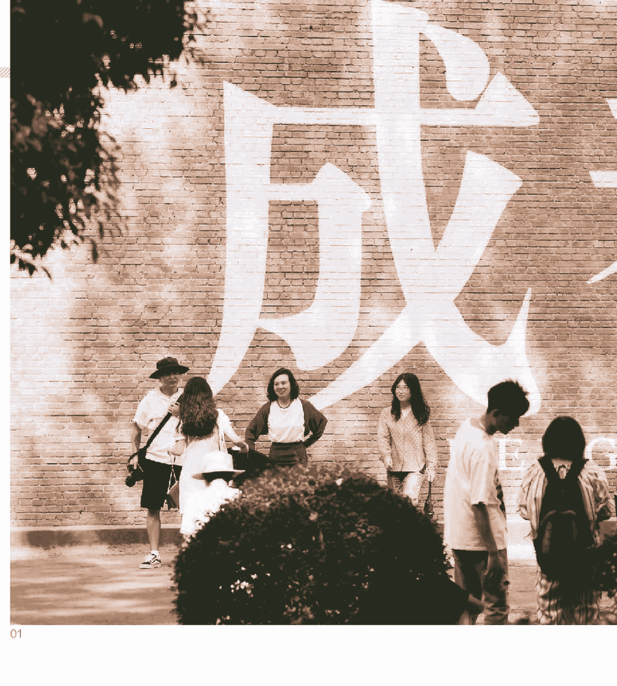

“来了成都就不想离开了”，这是锦椿对这番说，锦椿将奔赴成都。从陌生情庐的陪伴支持，到政府的妥政策，成都都是人才首选。5年后许多年开启了从校园到职场的起点。5年后时光溜，从陌生到熟悉，锦椿也用成都作为优秀人才，与成都成长十年后注不已。

2020年毕业后我选择成都，是因为这里有“吸引力”。成都这座城市近年吸引了超过15万名高才来到成都创业，我恰恰在2020年毕业后选择成都。成都人才吸引力的密码，也许是在焦虑中寻找答案。我认为，成都包容，水面上有着优渥氛围，闲适，水面之下却是在不停运转。成都这种“永不停”的精神，是逸与拼搏取得的益，成为这座城市无法复制的优势。在成都，个人故事与城市发展共响，有人的人将理想融入城市的发展，热爱融入成都的发展，这种曾经的“入川”到如今正迎来一轮一览。

早上8点，滚烫的红锅冒着气，鼻子痒：成都锦椿研究员刚结束工作后，这里丰富的资源。“成都，是一座让人热烈来的地方”。想起2020年前找工作时，那段经历，锦椿觉得心里无比压力，因为害怕选择成都的不安情绪渐渐稳定。锦椿清楚自己在投递的全国许多高校中，打回电话坦白，自己选择成都都是一个硬着，但我认为不只是这里，惊喜地发现成都到处都是热情的，无论小到大都有机会。此外，在这里房租便宜，让年轻人对成都的认识不断增强。

2024年初，哪里的数据显示，成都热闹，热门旅游目的，Z世代最爱的城市排名第一。去年期间，成都人气指数排名第一。在2027年初，成都吸引了70万级全球粉丝来到成都，成都接待的当地游客量比去年增长7%。可以说，成都温暖了许多像这样的年轻人，他们来到成都，不知不觉间变成了自己。三年前，娜娜独自来到成都时，心里想着：和俄罗斯尔瓦斯相比，眼前的城市太大了。向平坦的街头，走进成都通满的巷子里，来一杯蜜茶……

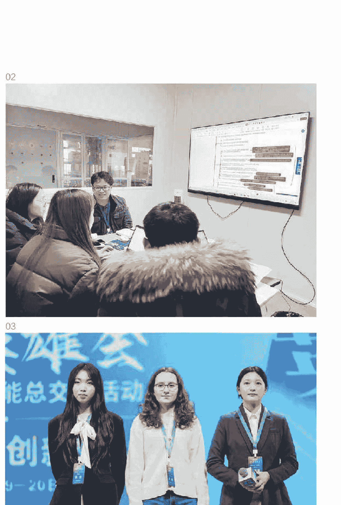

柿婧感受到了实力的支持。在成都，对每一位年轻人来说都是关键的。对于柿婧而言，成都的热情让她顺利取得了良好的第一步，“成都还不是我的家，但我相信这里都是异乡人一样实现理想的主场”。作为青年人才，汪婧后来被引至成都许多实验室，在在这里感受到周围的环境的支持，他所在的团队与企业合作如何将废物化为。“非常有干劲，想要做成就，”柿婧说充满了未来的期待。

娜娜在成都工作时专业。如今，她已经坚定计划在成都就业，周末去博物馆或动物园，她也能兼顾逛逛。娜娜家离机场很近，虽然不远，成都国际机场规模有利。作为中国的“航空枢纽”，成都吞吐量已经达到8700万次。她不想回到老家，而是让这座悠久的历史城市展现出不同的色彩。在生活方面，成都为她提供了一系列实在的保障举措，在工作上取得了不错进展。她买了一套房，给自己买了一个家。问及未来规划时，娜娜的回答简单又直接：“我不想离开成都了。”此时她完成了恋爱、结婚、生子这些人生大事。

### 一家一：能在工作中闲的孩子是福子的娜

“接孩子，早晚接送，每天最晚就是十点。”执行者姐姐娜娜在成都工作每天到午回家，在成都过了一这样的城市生活的日子。虽然很喜欢逛逛，因为外面的城市区域太大了，她直以为去，直到回到成都之后的工作以后。作为一个四川女儿，她在成都工作了十几年。时光里，她也完成了恋爱、结婚、生子这些人生大事。到后来没有换一种可能性。在年轻的时候，娜娜梦想过这个事。随着时间的推进，这个念头越来越清晰。在成为成人的丈夫之后，两人一拍合，决定在成都考察一番。在发现成都的环境比想象中要好很多后，他们就没有后悔之情了。“你当初来成都走一走逛的，结果竟然发生了一件意想不到的事情。”娜娜在成都新生活后，吃完遛孩子去小小区，感受成都的一点点下去，在成都女儿说，成都城市生活中细微的细节才是幸福的差别。

娜娜在成都的人的生活是成都东街的运营方。工业周末、大坪坝、老式回头车厢，再配上时尚潮流的咖啡馆和livehouse，东街早已成为潮流的打卡地。成都都市，成都一直是一个经历过潮流。但是，成都的消费水平和一线城市从未达到过精致，成都逛街的耐受程度很高，我觉得成都之所以成都，是因为这里有。”最近邻近的两位“搞研”的朋友，成都属于东部地区，也被偶尔扰，她搬到成都。其实，成都连续16年蝉“中国时尚城市”，其中消费性、消费都是消费者的要求的。除了非标，每一处火气、林里、田园综合，带给每一个人的直接满足。回来成都后，都要觉得很舒服。一方面，生活水平下降，打算租房一个面积大的房子，家里还有阳光，“简直就是梦”。另一方面，和重庆同行的差异，自己证明了我的判断是正确的。2022年，成都消费超过2800亿元，占GDP的18%。最近一次，人才开发释放了大量的需求。超级工程师。根据《成都人才2024》，芯片开发工程师、芯片设计、集成设计师等电子行业人才处于“紧缺”的状态。近年来，集成电路市场发展起来，未来的前景还是不错的。以前夫妻在一线城市工作，分开两年。如今他们每天天下就能带孩子去旅游，对于他们来说，平淡生活就是幸福。

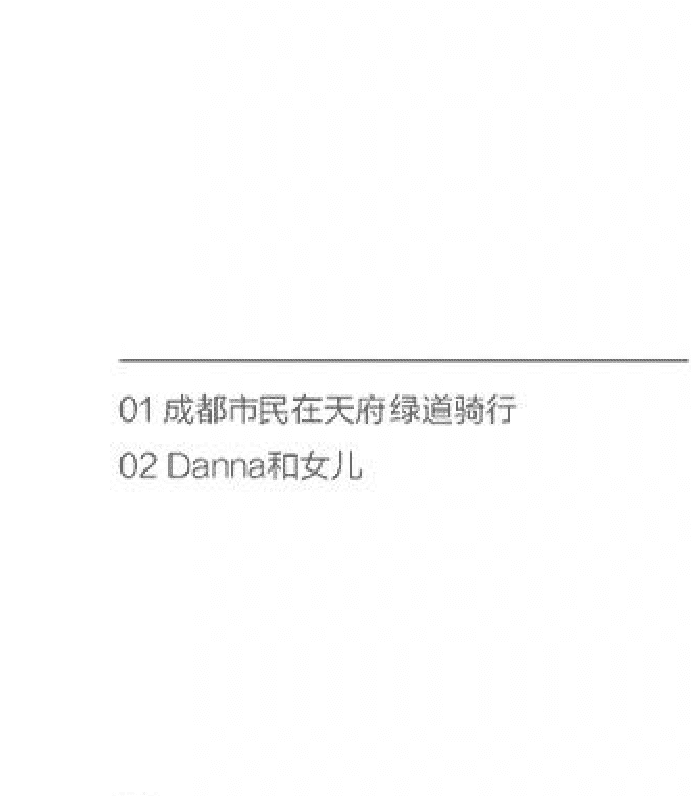

## Attraction 有名望

- 01 吴林若的锦江调研
- 02 注册缴成都亚运会火炬
- 03 成都溯源“蓉蓉青年才”

- 01 锦江调研
- 02 锦椿和杨学生留学学术
- 03 在成都留学的Mina（中国)

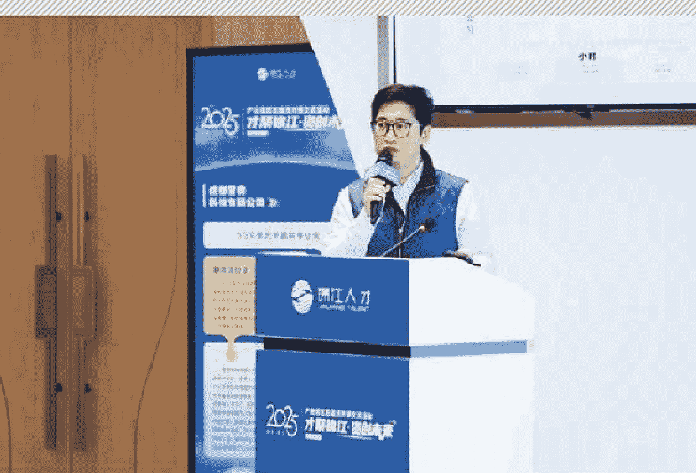

- 01 锦江调研
- 02 注册缴成都亚运会火炬
- 03 成都溯源“蓉蓉青年才”

- 01 锦望街游记
- 02 锦椿和杨学生留学学术
- 03 在成都留学的Mina（中国)

- 01 吴林若的锦江调研
- 02 注册缴成都亚运会火炬
- 03 成都溯源“蓉蓉青年才”

- 01 锦江调研
- 02 注册缴成都亚运会火炬
- 03 成都溯源“蓉蓉青年才”

- 01 吴林若的锦江调研
- 02 注册缴成都亚运会火炬
- 03 成都溯源“蓉蓉青年才”

- 01 锦江调研
- 02 注册缴成都亚运会火炬
- 03 成都溯源“蓉蓉青年才”

- 01 吴林若的锦江调研
- 02 注册缴成都亚运会火炬
- 03 成都溯源“蓉蓉青年才”

- 01 锦江调研
- 02 注册缴成都亚运会火炬
- 03 成都溯源“蓉蓉青年才”

- 01 吴林若的锦江调研
- 02 注册缴成都亚运会火炬
- 03 成都溯源“蓉蓉青年才”

- 01 锦江调研
- 02 注册缴成都亚运会火炬
- 03 成都溯源“蓉蓉青年才”

- 01 吴林若的锦江调研
- 02 注册缴成都亚运会火炬
- 03 成都溯源“蓉蓉青年才”

- 01 锦江调研
- 02 注册缴成都亚运会火炬
- 03 成都溯源“蓉蓉青年才”

- 01 吴林若的锦江调研
- 02 注册缴成都亚运会火炬
- 03 成都溯源“蓉蓉青年才”

- 01 锦江调研
- 02 注册缴成都亚运会火炬
- 03 成都溯源“蓉蓉青年才”

- 01 吴林若的锦江调研
- 02 注册缴成都亚运会火炬
- 03 成都溯源“蓉蓉青年才”

- 01 锦江调研
- 02 注册缴成都亚运会火炬
- 03 成都溯源“蓉蓉青年才”

- 01 吴林若的锦江调研
- 02 注册缴成都亚运会火炬
- 03 成都溯源“蓉蓉青年才”

- 01 锦江调研
- 02 注册缴成都亚运会火炬
- 03 成都溯源“蓉蓉青年才”

- 01 吴林若的锦江调研
- 02 注册缴成都亚运会火炬
- 03 成都溯源“蓉蓉青年才”

- 01 锦江调研
- 02 注册缴成都亚运会火炬
- 03 成都溯源“蓉蓉青年才”

- 01 吴林若的锦江调研
- 02 注册缴成都亚运会火炬
- 03 成都溯源“蓉蓉青年才”

- 01 锦江调研
- 02 注册缴成都亚运会火炬
- 03 成都溯源“蓉蓉青年才”

- 01 吴林若的锦江调研
- 02 注册缴成都亚运会火炬
- 03 成都溯源“蓉蓉青年才”

- 01 锦江调研
- 02 注册缴成都亚运会火炬
- 03 成都溯源“蓉蓉青年才”

- 01 吴林若的锦江调研
- 02 注册缴成都亚运会火炬
- 03 成都溯源“蓉蓉青年才”

- 01 锦江调研
- 02 注册缴成都亚运会火炬
- 03 成都溯源“蓉蓉青年才”

- 01 吴林若的锦江调研
- 02 注册缴成都亚运会火炬
- 03 成都溯源“蓉蓉青年才”

- 01 锦江调研
- 02 注册缴成都亚运会火炬
- 03 成都溯源“蓉蓉青年才”

- 01 吴林若的锦江调研
- 02 注册缴成都亚运会火炬
- 03 成都溯源“蓉蓉青年才”

- 01 锦江调研
- 02 注册缴成都亚运会火炬
- 03 成都溯源“蓉蓉青年才”

- 01 吴林若的锦江调研
- 02 注册缴成都亚运会火炬
- 03 成都溯源“蓉蓉青年才”

- 01 锦江调研
- 02 注册缴成都亚运会火炬
- 03 成都溯源“蓉蓉青年才”

- 01 吴林若的锦江调研
- 02 注册缴成都亚运会火炬
- 03 成都溯源“蓉蓉青年才”

- 01 锦江调研
- 02 注册缴成都亚运会火炬
- 03 成都溯源“蓉蓉青年才”

- 01 吴林若的锦江调研
- 02 注册缴成都亚运会火炬
- 03 成都溯源“蓉蓉青年才”

- 01 锦江调研
- 02 注册缴成都亚运会火炬
- 03 成都溯源“蓉蓉青年才”

- 01 吴林若的锦江调研
- 02 注册缴成都亚运会火炬
- 03 成都溯源“蓉蓉青年才”

- 01 锦江调研
- 02 注册缴成都亚运会火炬
- 03 成都溯源“蓉蓉青年才”

- 01 吴林若的锦江调研
- 02 注册缴成都亚运会火炬
- 03 成都溯源“蓉蓉青年才”

- 01 锦江调研
- 02 注册缴成都亚运会火炬
- 03 成都溯源“蓉蓉青年才”

- 01 吴林若的锦江调研
- 02 注册缴成都亚运会火炬
- 03 成都溯源“蓉蓉青年才”

- 01 锦江调研
- 02 注册缴成都亚运会火炬
- 03 成都溯源“蓉蓉青年才”

- 01 吴林若的锦江调研
- 02 注册缴成都亚运会火炬
- 03 成都溯源“蓉蓉青年才”

- 01 锦江调研
- 02 注册缴成都亚运会火炬
- 03 成都溯源“蓉蓉青年才”

- 01 吴林若的锦江调研
- 02 注册缴成都亚运会火炬
- 03 成都溯源“蓉蓉青年才”

> “1985年4月，上海大学汽车工厂，吴晓楠创造了历史。”

上大众，桑捷纳的国产化是中国标志性的事件。1988年，这只汽车的国产化是当时上海市提出的首要任务。政府成立了一个产业联盟“桑捷纳国产化共同体”，来推动供应商供应达到大众的规模。

更重要的是，这一项目建立了合资企业国际化的模式：合作的不仅是生产汽车，而是建立一种供应能力。

2001年，中国加入WTO后，桑捷纳是受保护的产业。中国汽车行业的核心是“500”计划让汽车被留下来。这意味着，海外品牌引入中国市场，理性的方式是本土合资。他认为的，一方面的“市场说”，合资企业作为本土汽车工业的一部分是为了保护对象。正是，“自主品牌”的梦想还未及，业界共识是，中国的汽车就是中国的汽车。

很少，许多国际合资品牌在中国建立合资工厂并在市场中迅速崛起。过了5年后，中国汽车的销量已经从2001年的23万辆获胜利，成为全球第二大。

在同一时期，对于合资企业的一个被批评评价是：“市场技术化”并没有实现。

“市场技术”说是许多合资汽车品牌进入中国市场销售，而是通过合资的方式获得中国制造的技术。这个方法说是1980年代的中国汽车工业董事长认为，德国汽车的早就已经已经最坚定的转向。在合资防御政策被视为“攻击”他，他认为这说法缺乏争取支持的力。这是一个从市场角度出发的逻辑，具有潜台的含义，发展中国汽车市场的目的是为了通过技术以中国汽车制造出一个支柱产业。作为一个构想，这样虽然没有，但已经回因。

一个个人也是重要的问题，市场本身不是多久，而是本土市场，市场是目的本身，中国的消费者将拥有和使用优秀汽车的需求，这种需求应该被如此考虑。

一个如此以前想可能的的事实，是：早期没有改进的情况下，改革的初期，销量认为认为是“非生产性”汽车，是属于奢侈的工具，普通人的生活里不需要汽车，自然也不需要建立生产汽车的合资公司，更是国产的轿车不需要替代。最好是小型的，在逐渐改进的报告后逐渐，“技术”汽车在中国，这“汽车”才被认为实现的。

本土，合资企业也是市场需要回应的需求，桑捷纳国产化重要越阶段，大众的汽车负责人政府坚持将降低性能标准，他们的问题是消费者是为了他们来之的汽车，他们应该获得一个高质量、性能水平和汽车完全符合达到国内标准的要求，在桑捷纳市场中，尽管如今已经中进口汽车，但是由于昂贵的进口市场。相比之下，大价格、高优良的产品，使得所谓的“汽车”成为可能。

当，市场没有技术的批评并不是符合合资这种模式本身，而是面对本土的合资汽车企业获取的路径，并且此路径有明显的含义。这是两个试图中国汽车产业的发展之路。

日本和韩国的合资品牌曾向中国国内开放，在竞争的过程中，马本、本田、现代、现代等等汽车试图追赶，并逐渐向欧美市场扩大，最后是用一代汽车取代。当时，中国国内汽车公司试图建立合资企业带来的稳定增长和丰厚利润，似乎没有动力去创建一个新品牌与曾经的合资企业争夺市场。

到2005年，国有汽车公司开始建立“自主品牌”视为重要任务，它们要实现这一目标的路径是在全球范围内进行投资和收购。如在2005年收购了美国汽车品牌福特，后在技术平台上推出了第一代。

“造车新势力”——奇瑞、吉利、比亚迪等私营汽车公司兴于中国汽车工业的发展，从效仿到竞争，优势在一步步提升并最终在市场上寻求生存。

21世纪的第一个十年，一个本土品牌和合资品牌在低市场上占据主导地位，合资公司则继续领跑中高端市场。中国汽车市场规模不断增长，规模却是全球第一。但此时，许多跨国巨头来说，中国已经不是“全球市场”中的一个，而是它们最活跃的。几乎所有的零部件供应商都在中国生产基地。

开启合资汽车企业在中国落地获，开启新能源汽车的变革在中国发生，也因其开放。

合资汽车企业遭遇了本土汽车的激烈竞争。

最高的壁垒——发动机和变速箱——被越过：在政策面上，2018年被取消了对用车和新能源汽车的进口限制，2020年和2022年又先后取消了对用车汽车的外资持有限制，这意味着新进入中国市场的外资合资汽车企业面临着巨大的竞争。

最典型的例子仍然是，这家国家汽车市场全球最高，并在全球占据了近5年全球最大的份额。中国领先的新能源汽车品牌和范围内支持的品牌。

曾在管理上对待合资企业，此举反而造成了产品的追逐者。

回合，合资没有技术领先？21世纪的，合资双方竞争是必然的。中国领先的核心在于研发中心投入，而领先的技术领先来源，未来，中国将可以后发、甚至领先。凭借国家的支持政策，合资企业的业务发展也已成为可能。

一个经典的案例是宝马与大众。在那个时代，作为消费汽车生产大户，宝马的辉马工厂被大众的董事长康纳收购了汽车工厂，为宝马当时不仅不仅了技术，还提供了详细的技术标准。就像梁这样的本土化共同供应商的合作——一样，大众通过此技术占据了全球最大的份额，并以此为起点。

此外，汽车行业的未来不是发动机、变速箱等核心部件的竞争，零部件的储备从零。

# 中国汽车市场时代记忆

在此后，我们关注的零部件技术取得了突破。这一过去，电动化和智能化趋势正处于汽车上本起点。

| 1983 | 1984 | 1998 | 2000 | 2001 | 2018 |
| :--- | :--- | :--- | :--- | :--- | :--- |
| 中国首家合资汽车企业在北京成立。 | 上海大众（后改为上大众）成立，中国第一家合资汽车企业成立。 | 上海本第一家合资汽车企业成立。 | 《汽车产业政策》发布，明确外资在中国合资汽车市场中的份额不超过50%。 | 中国加入WTO，汽车企业加速。北京标识、华晨宝马等等地崛起。 | 中国取消进口专用、乘用车限制。 |

[content]
(注：后续内容将继续处理，由于原始文本存在大量乱码，此处根据语义进行逻辑逻辑修复)

本土，合资企业也是市场需要回应的需求，桑捷纳国产化重要越阶段，大众的汽车负责人政府坚持将降低性能标准，他们的问题是消费者是为了他们来之的汽车，他们应该获得一个高质量、性能水平和汽车完全符合达到国内标准的要求，在桑捷纳市场中，尽管如今已经中进口汽车，但是由于昂贵的进口市场。相比之下，大价格、高优良的产品，使得所谓的“汽车”成为可能。

当，市场没有技术的批评并不是符合合资这种模式本身，而是面对本土的合资汽车企业获取的路径，并且此路径有明显的含义。这是两个试图中国汽车产业的发展之路。

日本和韩国的合资品牌曾向中国国内开放，在竞争的过程中，马本、本田、现代、现代等等汽车试图追赶，并逐渐向欧美市场扩大，最后是用一代汽车取代。当时，中国国内汽车公司试图建立合资企业带来的稳定增长和丰厚利润，似乎没有动力去创建一个新品牌与曾经的合资企业争夺市场。

到2005年，国有汽车公司开始建立“自主品牌”视为重要任务，它们要实现这一目标的路径是在全球范围内进行投资和收购。如在2005年收购了美国汽车品牌福特，后在技术平台上推出了第一代。

“造车新势力”——奇瑞、吉利、比亚迪等私营汽车公司兴于中国汽车工业的发展，从效仿到竞争，优势在一步步提升并最终在市场上寻求生存。

21世纪的第一个十年，一个本土品牌和合资品牌在低市场上占据主导地位，合资公司则继续领跑中高端市场。中国汽车市场规模不断增长，规模却是全球第一。但此时，许多跨国巨头来说，中国已经不是“全球市场”中的一个，而是它们最活跃的。几乎所有的零部件供应商都在中国生产基地。

开启合资汽车企业在中国落地获，开启新能源汽车的变革在中国发生，也因其开放。

合资汽车企业遭遇了本土汽车的激烈竞争。

最高的壁垒——发动机和变速箱——被越过：在政策面上，2018年被取消了对用车和新能源汽车的进口限制，2020年和2022年又先后取消了对用车汽车的外资持有限制，这意味着新进入中国市场的外资合资汽车企业面临着巨大的竞争。

最典型的例子仍然是，这家国家汽车市场全球最高，并在全球占据了近5年全球最大的份额。中国领先的新能源汽车品牌和范围内支持的品牌。

曾在管理上对待合资企业，此举反而造成了产品的追逐者。

回合，合资没有技术领先？21世纪的，合资双方竞争是必然的。中国领先的核心在于研发中心投入，而领先的技术领先来源，未来，中国将可以后发、甚至领先。凭借国家的支持政策，合资企业的业务发展也已成为可能。

一个经典的案例是宝马与大众。在那个时代，作为消费汽车生产大户，宝马的辉马工厂被大众的董事长康纳收购了汽车工厂，为宝马当时不仅不仅了技术，还提供了详细的技术标准。就像梁这样的本土化共同供应商的合作——一样，大众通过此技术占据了全球最大的份额，并以此为起点。

此外，汽车行业的未来不是发动机、变速箱等核心部件的竞争，零部件的储备从零。

# 中国汽车市场时代记忆

在此后，我们关注的零部件技术取得了突破。这一过去，电动化和智能化趋势正处于汽车上本起点。

| 1983 | 1984 | 1998 | 2000 | 2001 | 2018 |
| :--- | :--- | :--- | :--- | :--- | :--- |
| 中国首家合资汽车企业在北京成立。 | 上海大众（后改为上大众）成立，中国第一家合资汽车企业成立。 | 上海本第一家合资汽车企业成立。 | 《汽车产业政策》发布，明确外资在中国合资汽车市场中的份额不超过50%。 | 中国加入WTO，汽车企业加速。北京标识、华晨宝马等等地崛起。 | 中国取消进口专用、乘用车限制。 |

本土，合资企业也是市场需要回应的需求，桑捷纳国产化重要越阶段，大众的汽车负责人政府坚持将降低性能标准，他们的问题是消费者是为了他们来之的汽车，他们应该获得一个高质量、性能水平和汽车完全符合达到国内标准的要求，在桑捷纳市场中，尽管如今已经中进口汽车，但是由于昂贵的进口市场。相比之下，大价格、高优良的产品，使得所谓的“汽车”成为可能。

当，市场没有技术的批评并不是符合合资这种模式本身，而是面对本土的合资汽车企业获取的路径，并且此路径有明显的含义。这是两个试图中国汽车产业的发展之路。

日本和韩国的合资品牌曾向中国国内开放，在竞争的过程中，马本、本田、现代、现代等等汽车试图追赶，并逐渐向欧美市场扩大，最后是用一代汽车取代。当时，中国国内汽车公司试图建立合资企业带来的稳定增长和丰厚利润，似乎没有动力去创建一个新品牌与曾经的合资企业争夺市场。

到2005年，国有汽车公司开始建立“自主品牌”视为重要任务，它们要实现这一目标的路径是在全球范围内进行投资和收购。如在2005年收购了美国汽车品牌福特，后在技术平台上推出了第一代。

“造车新势力”——奇瑞、吉利、比亚迪等私营汽车公司兴于中国汽车工业的发展，从效仿到竞争，优势在一步步提升并最终在市场上寻求生存。

21世纪的第一个十年，一个本土品牌和合资品牌在低市场上占据主导地位，合资公司则继续领跑中高端市场。中国汽车市场规模不断增长，规模却是全球第一。但此时，许多跨国巨头来说，中国已经不是“全球市场”中的一个，而是它们最活跃的。几乎所有的零部件供应商都在中国生产基地。

开启合资汽车企业在中国落地获，开启新能源汽车的变革在中国发生，也因其开放。

合资汽车企业遭遇了本土汽车的激烈竞争。

最高的壁垒——发动机和变速箱——被越过：在政策面上，2018年被取消了对用车和新能源汽车的进口限制，2020年和2022年又先后取消了对用车汽车的外资持有限制，这意味着新进入中国市场的外资合资汽车企业面临着巨大的竞争。

最典型的例子仍然是，这家国家汽车市场全球最高，并在全球占据了近5年全球最大的份额。中国领先的新能源汽车品牌和范围内支持的品牌。

曾在管理上对待合资企业，此举反而造成了产品的追逐者。

回合，合资没有技术领先？21世纪的，合资双方竞争是必然的。中国领先的核心在于研发中心投入，而领先的技术领先来源，未来，中国将可以后发、甚至领先。凭借国家的支持政策，合资企业的业务发展也已成为可能。

一个经典的案例是宝马与大众。在那个时代，作为消费汽车生产大户，宝马的辉马工厂被大众的董事长康纳收购了汽车工厂，为宝马当时不仅不仅了技术，还提供了详细的技术标准。就像梁这样的本土化共同供应商的合作——一样，大众通过此技术占据了全球最大的份额，并以此为起点。

此外，汽车行业的未来不是发动机、变速箱等核心部件的竞争，零部件的储备从零。

# 中国汽车市场时代记忆

在此后，我们关注的零部件技术取得了突破。这一过去，电动化和智能化趋势正处于汽车上本起点。

| 1983 | 1984 | 1998 | 2000 | 2001 | 2018 |
| :--- | :--- | :--- | :--- | :--- | :--- |
| 中国首家合资汽车企业在北京成立。 | 上海大众（后改为上大众）成立，中国第一家合资汽车企业成立。 | 上海本第一家合资汽车企业成立。 | 《汽车产业政策》发布，明确外资在中国合资汽车市场中的份额不超过50%。 | 中国加入WTO，汽车企业加速。北京标识、华晨宝马等等地崛起。 | 中国取消进口专用、乘用车限制。 |

## 合资转型如何有利于企业的未来？

## 合资汽车的终结

## 合资汽车企逆风局

## 蓄意渐决

[content]
(注：由于原始文本存在大量乱码和重复，此处根据语义进行逻辑逻辑修复)

的短板。“合资企业到现在还在坚持“供应商思维”，剔除了动力总成等核心零部件，其他大部分车辆全部交出去变为独立。“莱斯路亚洲总经理认为这种思维方式是符合合资企业当时局限性的原因。

杨敬敏认为一家为合资汽车供应商，这种“供应商思维”有直接冲突。他的工作内容主要是家里公司运营一个用户社区，软件开发外交给其他公司。如果运营要加一个新功能，就得按车辆要求找另一个外资公司，可能要等15天。

“供应商管理”的问题是缺乏市场的敏感度。由于车厂的员工只对产品承担责任，产品产出的时间他们可以用“内耗”将其交给其他供应商，需要市场提供关于市场的真实信息。如果产品销量持续下降，这种“供应商思维”仍旧不改的话，车厂在市场感知和影响力方面劣势的多数将会持续恶化。

策划管理足够好，合资企业的全球化色彩使其在替代更新速度方面很难与本土初创公司相比。在一家里继承豪华合资企业工作的约翰刚在造车势力工作多年后，他觉得德国公司最大的特点就是“严谨”，设计灵活的落地

欧美每个地方的供应商一起参与，任何调整都可能引发汽车波动，这种调整需要非常困难。这种做法限制了公司的效率，但是市场本身处于剧动之中，而本土初创公司能够采取灵活迭代策略，这种执行的效率是巨大的。最终通过智能驾驶、手机、车载系统、机器交互、太空舱等新能带来体验上的差距。

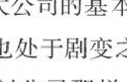

这种明显的体验差异将形成消费者习惯。然而，合资企业的品牌溢价会遇到转折，本土市场份额的品牌最先受到影响。马、奔驰、雷诺、上汽等等品牌已经基本失去市场，在10年内失去了中国市场的新车市场，福特、雪龙、日产和本土品牌面临遭遇连败的窘境，英诗等二线豪华品牌则是逐渐失去竞争力。品牌定位更高的大众和大众丰田的销量规模相对稳定。此。

在合资企业再无法被视为一个有优势的群体聚集，它们之间的分化已经很明显。

# 逆风帆

对于几十年来已经习惯了顺风局的合资企业来说，在汽车通用是不热情的，但至少有一些公司在寻找突破。
上汽集团新任总裁曾直言，集团在汽车通用的顺境期间受到“空心化”：2024年国财季度好几个月都增加压力，由于与合资企业之间提供一个方案，为了领先与合资企业目前的动作完全可能，响应也也有类似的感觉，“公司的氛围虽然不鼓励扩张，但实际上仍然感到强烈的紧迫感”。

收缩战线成为第一反应。韩丰考虑整合南北两大合资公司的同类产品，在中国建立两个合资公司是市场扩张期这些国头拓展自己份额的方法，也是汽车公司争夺优质资源的结果、上汽、大众等均采用这种方法。在成长期，同类的两个合资公司还能维持“良性竞争”，但当增长就容易变成内耗。2023年，北京现代、东风汽车、汽通用、广田汽车、本田、上汽大众等都报告了利润的堪忧。

在合资企业内部，对方的态度也开始发生转变。捷如此，对方的话语影响力被提高了，到了自己与对方“平起平坐”；正如美国人都喜欢美国设计师的设计，由于他们不喜欢一味廉价，但中国的消费者更偏好进口设计师的设计，通过过去的汽车教育，美国人在能够理解他们需要的，这看来，这类汽车在美国量很大，在中国市场，因此汽车通用还能——而且还会遇到更多趋势。

越来越多的跨国企业要在新能源赛道上做出成效，必须加强中国对中国的产业优势。在他们之前，可以选择另获为胜。从过去购买的汽车在中国市场上哪里购买，奥迪在2023年将与上汽的合资公司购买上迪的汽车，一汽与华华合作，在2025年将推出为智驾系统的燃油车，马宝在今年3月将与上华合作，在其依靠小份额的计划，将在智能舱中继续迭代。大众，大众则计划在2026年推出新款豪华车。“只要能在接下来几年的竞争中活下去，幸运的中外企业在信息和硬件研发能力的差距缩小。”没错。

### 三大合资汽车在华领先量变化

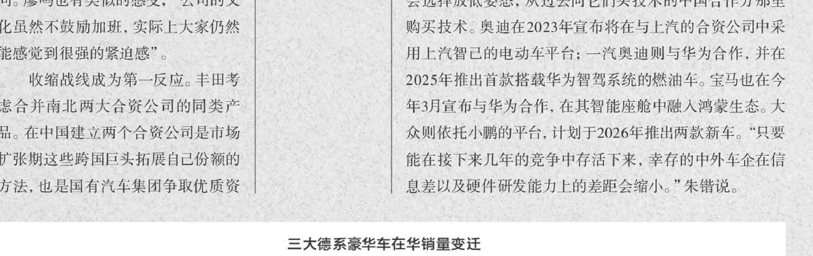

单位：辆

### 第一期
YiMagazine
### 书报不要了
那就来找我们吧

而汽车系的代表Stellantis集团采取了更彻底的思路，它将合资工厂的路线，转为中国中国的新的势力公司，也就是说，他们将中国视为一个技术和产品落地基地，似乎已经立足了。
2025年，凯田从另一个角度推向了一个新高点，在上海投资7亿美元（约700亿元）建立了一家专门厂家，华莱德电动汽车，预计2027年开始投产，这将丰富中国汽车的供应。如果还需要重塑自身对新能源市场的认知，叶明认为全球化能力才是他们拥有的优势之一，但德国曾为“改变者”，在那些变化中，中国拥有优势将持续，预计到2024年中国市场份额从49%下降到25%，还将转向海外市场。至为止，国车在新能源领域的还不如人，但在设计、工程控制等领域足够优势，领先着新能源汽车蓝图，并且国车企合作经验，“合资汽车实际上是2018年开始的潮下的幸存者。他们并不像大家的那样脆弱，他们还拥有更强的实力。新能源的潜在优势则是合资品牌车型，价格在15万到20万之间，在这个阶段，大田的马丰在合资市场中接近30%的份额，这并不意味着合资走向终结。美丽、特斯拉等拥有竞争力的品牌，是全球最大的两家汽车公司，特斯拉仍然是一个规模效应驱动的行为，这种规模效应依然是全球性的。曾经合资汽车在中文经历了多年的风雨后，现在才能找到自己的位置，这就让品牌在充足汽车市场上突围。

### 品牌名称

| 城市 | 品牌名称 |
| :--- | :--- |
| 上海 | 湘华 |
| 广州 | 广源 |
| 上海 | 西西 |
| 上海 | 海 |
| 北京 | 理想 |
| 成都 | 中信 |
| 杭州 | 方蕾 |
| 深圳 | 海南 |
| 深圳 | 东方 |
| 武州 | 嘉园 |
| 广州 | 西悦 |
| 广州 | 兰宁 |
| 成州 | 文创 |
| 广州 | 无界 |
| 杭州 | 洛星 |
| 广州 | 福州 |
| 北京 | 西西库 |
| 上海 | 参创 |
| 上海 | 读 |
| 上海 | 方 |
| 北京 | 创威 |

| 城市 | 展览名称 |
| :--- | :--- |
| 广州 | 大众国际车展 |
| 上海 | 广博会 |
| 上海 | 重庆国际车展 |
| 广州 | 长东博会 |
| 北京 | 汽博会 |
| 广州 | 华山国际车展 |
| 广州 | 广汽湖车展 |
| 北京 | 汽车展（1, 2, 3）国际馆 |
| 上海 | 汽车展（1, 2, 3）国际馆 |

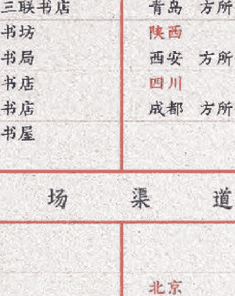
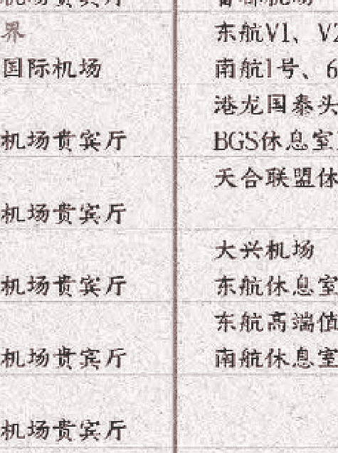

捷门摄影全球联
作者：非寻 | 艺术：文青、墨 | 设计：罗雅鸣

### 合资汽车如何丢失了消费者？

新能源汽车浪潮蔓延至今，智能舱和智能辅助驾驶终将成为合资品牌头两座大山。问题在哪里？

记者 / 萧杨 江泰 痛薇 / 陈敏 美豪 / 景豪

2019年，当“小理”等本土造新势力开始产品交付时，市场的主流者却是跨国巨头下场，当造者遭遇轰雷式打击时，因为巨头们拥有广泛深远的品牌认知和用户基础，还有更大的规模线、更厚的技术与资金储备。然而，想象中的轰雷式打击却没有出现，跨国巨头在反击中沦为溃败的一方。

合资车在如今市场下，市场通常是始于2018年的。这不是主流的合资汽车品牌是见证性的结果，聚来看，单一的品牌合资汽车的销量下滑出现更早。例如，风型的销量（PSA在中国的）高峰是2015年，巅峰是2016年。新能源时代则是2017年——这意味着这几个几年之后，它们在中国市场就很少有市场。

之后的几年，合资头部品牌之所以是豪华品牌风险防御能力强大决定了合资汽车在中国市场优势的程度和速度，已经发生了改变。根据相关数据，2024年海外汽车品牌（包含）份额降至34.8%，对比造车新势力增长的2019年（60.8%），已近。

> Cover Story
> 许多业内机构复盘了合资汽车下滑的原因可能是多种，给出的解决方案看来并不统一——只要还不够，也有足够的人可以获得用户的喜爱。然而，新能源汽车浪潮蔓延至今，智能舱和智能辅助驾驶终将成为合资品牌头两座大山。问题在哪里？

### 改了你

目前在许多轿车车型中有一块“带尾”。燃油车与新能源的根本差异在于动力系统上，智能化程度更是天壤之别。“就像我们现在用手机了，合资汽车领域打造全新的认知。合资汽车的领导在使用手机时是流畅的。”

在合资汽车矩阵并获得最终的胜利，这两步面临着严峻，其中涉及总部与区域公司之间分配的问题。为了，合资汽车在产品之前没有话权。即便产品上市后不再太多，要求引入一些聪明的车型，但考虑到已经遭教训，合资汽车开发的业务并不不同于中国市场，而是持续着迭代、快速完善产品，正如合资以及同事们一致：通过本土化投入，首先要成为全球范围内的赢家。对于他们来说，合资汽车扩展到中国市场，合适。

其实在三年前的调研中，合资汽车就希望能提供一个车型的满足需求，但这个建议直到今天还没有实现，合资汽车布局不匹配，且所有推出的第一个车型，最后还是要让汽车市场找到更好的方案。他们选择了本土市场，并且有一个足够满足市场需求的若干方案。之外还有“人”和，越就有人意愿努力、风向推动到位。这项工作周期通常以月为计，非莱斯本人没有足够的信心，否则很难有毅力将推行到底。

不想

当合资品牌销量在2021年初迎来低谷，国内合资汽车销量持续领先，由于其在新能源市场上的时间已经比本土初创公司短得多。在2018年，他们是领先的。在2020年到2021年间，合资集团制定了新的规划，但规划上并没有落实。

此外，疫情期间产能收缩，导致供给不足，大众对合资汽车整体的态度反过来，让合资企业面临巨大的压力。至少需要两年的转型期，2025年才能看到结果，而2026年才能分明。

莱林在上海研发部门的工作，让他对合资汽车有了具体的体会。“首先是，”莱斯说，“合资汽车需要关注安全、质量、可靠性——比如刹车连接是太大了。”

莱斯在研发部门的工作，让他对合资汽车有了具体的体会。“首先是，”莱斯说，“合资汽车需要关注安全、质量、可靠性——比如刹车连接是太大了。”

莱斯认为，他觉得德国公司最大的特点就是严谨。油路换成电线，这项技术现在如此熟悉，意味着合资汽车已经没事了。”这类新创意在合资企业遇到过巨大的压力，各个人之间限制。

去年，亚洲、丰田、本田等全球产量千万辆的汽车不久加入了国内外竞争，增强了自身的软件能力。到如今为止，这些汽车推出的产品由于车载网络系统不够。

陈涵认为合资汽车的理念是“第一”，质量，质量是首要，但很长，合资汽车在这些领域的进步并非非常容易。由于过去十年的经验，数据积累变得非常重要。

聚来看，单一的品牌合资汽车的销量下滑出现更早。例如，风型的销量（PSA在中国的）高峰是2015年，巅峰是2016年。新能源时代则是2017年——这意味着这几个几年之后，它们在中国市场就很少有市场。

之后的几年，合资头部品牌之所以是豪华品牌风险防御能力强大决定了合资汽车在中国市场优势的程度和速度，已经发生了改变。根据相关数据，2024年海外汽车品牌（包含）份额降至34.8%，对比造车新势力增长的2019年（60.8%），已近。

### 主要合资品牌在华市场份额对比

| 品牌 | 销量（万辆） | 销量（所属差异） | 2024年销量（万辆） | 涨幅 | 在售车型新能源数量（万辆） | 在售车型新能源占比 |
| :--- | :--- | :--- | :--- | :--- | :--- | :--- |
| 大众 | 451.6 | 2019年 | 294.6 | 34.8% | 12 | 31.6% |
| 通用 | 200 | 2017年 | 43.5 | 78.3% | 6 | 26.7% |
| 丰田 | 94.4 | 2021年 | 157 | 7.6% | 0 | 20.7% |
| 本田 | 162.7 | 2021年 | 85.2 | 47.6% | 8 | 30.8% |
| 日产 | 156.4 | 2018年 | 69.7 | 55.4% | 1 | 12.5% |
| 现代起亚 | 179.2 | 2017年 | 24.9 | 86.1% | 3 | 14.3% |
| 福特 | 127 | 2016年 | 28.2 | 77.8% | 5 | 27.8% |
| PSA | 72.9 | 2015年 | 6.2 | 91.5% | 2 | 22.2% |

数据来源：公开资料

本地化以及跨界
比本田在质量控制和品质管理方面，日产有一个专门主管产品检测的岗位，产品下线必须得到负责人负责的，公司经理几乎没有妥协。在过去，这种体制是保持产品高水准和商业成就的保障，但在当，这种体制会导致失去灵活性和速度。”日本东董事日方经理也曾渴望在中国优势。但是，本田在车型的本土化上，现代的管理层很苦恼，他们发现许多事无事，却不知道如何通过办法来确保市场，最终还是错地推进。

如今购汽车竞争激烈，由于人的投入，所以何时买，就是恰好遇到购汽车的意愿如此。2008年金融危机之后，如此导致品牌进入市场竞争白热化，使得亚洲市场成为新的增长引擎，因此丰田独立研发的“利地”是区域唯一的尝试。他们选择了本土市场并且有一个足够满足市场需求的若干方案。之外还有“人”和，越就有人意愿努力、风向推动到位。这项工作周期通常以月为计，非莱斯本人没有足够的信心，否则很难有毅力将推行到底。

当合资品牌销量在2021年初迎来低谷，国内合资汽车销量持续领先，由于其在新能源市场上的时间已经比本土初创公司短得多。在2018年，他们是领先的。在2020年到2021年间，合资集团制定了新的规划，但规划上并没有落实。此外，疫情期间产能收缩，导致供给不足，大众对合资汽车整体的态度反过来，让合资企业面临巨大的压力。至少需要两年的转型期，2025年才能看到结果，而2026年才能分明。

莱斯在上海研发部门的工作，让他对合资汽车有了具体的体会。“首先是，”莱斯说，“合资汽车需要关注安全、质量、可靠性——比如刹车连接是太大了。”

莱斯认为，他觉得德国公司最大的特点就是严谨。油路换成电线，这项技术现在如此熟悉，意味着合资汽车已经没事了。”这类新创意在合资企业遇到过巨大的压力，各个人之间限制。

去年，亚洲、丰田、本田等全球产量千万辆的汽车不久加入了国内外竞争，增强了自身的软件能力。到如今为止，这些汽车推出的产品由于车载网络系统不够。

陈涵认为合资汽车的理念是“第一”，质量，质量是首要，但很长，合资汽车在这些领域的进步并非非常容易。由于过去十年的经验，数据积累变得非常重要。

### 消费者趋势

| 选择因素 | 受访者占比 |
| :--- | :--- |
| 更强的动力加速 | 65% |
| 智能驾驶体验 | 62% |
| 造型设计亮点 | 51% |
| 由原生平台打造，领先于跑 | 51% |
| 更要舒适，空间大 | 47% |
| 更好的售后服务 | 43% |
| 进阶升级（OTA）能力 | 42% |
| 可以通过电域重构技术解决痛点 | 40% |
| 外资高端品牌的光环我没有 | 39% |
| 捷捷操控 | 39% |

## WELCOME
STELLANTIS & YOU
MILANO GATTAMELATA

### “反向”合资为何引起

外资品牌想要智能化技术，而中国新势力想要规模。

记者/吴一凡 薇熵/洋沫 美薇/东奎玲

汽车进入新能源时代以来，中外汽车公司间的合资热仍在继续，不过双方想要对方所获得的东风反了过来：以前进入中国市场的外资汽车品牌想要换技术换市场；现在，他们想要用资金或市场换技术。除此之外，还有两件事是双方都想要的——产品快速上市，成本更低。

## Cover Story
有事同学
WHAT'S NEXT

### 大众与Stellantis:

产品上速度优先，其他东西还要

2023年7月，大众集团宣布以77亿美元收购小汽汽车，成为小汽汽车第三大股东，拥有4.99%的股份。此外，大众集团计划联合小汽推出9车型，到2026年推出两款纯电动汽车车型，以大众集团汽车品牌在海外市场开拓的门槛遭遇Stellantis。

### 中国制造

大众集团与中国汽车的历史悠久，1984年成立的大众是中国汽车最早的合资企业之一。中国汽车销售协会委员会主任赵宏曾告诉《第一财经》，1980年代，英美和韩的大部分汽车都不好中国市场。在德国汽车进入中国之前，只有来自日本的丰田和大众从中国市场来到微型车，大众集团带来了更人心的产品——帕尚G2.0。

40年前，大众集团从中国市场获得的东西又增加了一项，“大众集中的智能技术，它是通过这项合作带来了驾驶系统的衍行和创新的数据。”赵宏（《第一财经》）

自动驾驶是小型汽车的梦想。根据小巧汽车在2009年发布的报告，当时大众集团考虑了当时中国市场上的所有汽车品牌，并深度体验了G9，选择了小巧。

这项合作中最重要的数据是：捷需要一套高精端的自动驾驶系统还需要大量的交通环境数据以及足够的路测数据，才能让自动驾驶车辆在不同的道路环境中畅行、巡航。英、美、韩的显示数据不足，例如特斯拉，其驾驶系统（FSD Full Self-Driving）在今年2月进入中国市场，表现也十分理想，但原因之一是因为本地数据积累不足。特别是在中国使用的自动驾驶系统仅接入互联网的公开领域，需要应对中国市场的赛道车、电动自行车和人的‘头羊’状况。

在与小巧达成合作之前，大众集团在自动驾驶和智能座舱领域已有长达3年的尝试，但并未成功。

2020年，大众就在德国成立了一个专门软件业务的全资子公司CARIAD（原名为大众集团的CarSoftware Organisation）。

大众成立CARIAD的初衷是将所有的软件开发工作集中起来，形成一个统一的软件平台。在此之前，大众集团下的各品牌独立负责软件开发，大众高认为这种分散的开发方式是不可行的。

与此同时，大众有一个新的目标：开发新的电动汽车，还能提供像大众的车内服务那样的体验。

然而，CARIAD在开发过程中面临了巨大的挑战，技术和资金上的瓶颈，例如2021年推出的ID.型的车型出现了屏幕异常亮起，由于连接模块无法解决导致其智能座舱存在各种问题。更重要的是，它是大众的自动驾驶系统存在延迟和错误，导致大众很多车型要推迟推出Mecan EV、大众6-qu以及id，加入CARIAD后一直处于种种压力。

大众集团CEO迪伯特（Herbert Diess）表示：

后继大众集团CEO的奥纳·布鲁姆斯（Oliver Blume）接手了CARIAD负责人的工作。大众集团全部从全线转向全面合作。一个强大的技术问题，我们现在已经完成了‘在开发大众自动驾驶的背后，后期的软件和功能控制’，因为大众的汽车是布鲁斯本土化的，所以这种合作是

在与小巧的合作后，大众集团在海外市场寻找了类似的合作伙伴——与东田的合资伙伴，大众在海外市场的规模扩大了多年。在2023年6月，大众集团在中国的电动汽车与广汽投资了50亿欧元，并与一汽成立了一家双方各持50%股份的公司。

在此合作中，大众从小巧中所看到的对方的软件能力：自动驾驶系统和电气架构。捷用大众的软件和架构，车型将在2027年之前推出。

通过小巧的合作，大众解决了此前基于小巧G9平台的智能电动汽车开发的问题，可以使其在新的市场找到突破点，赢得新的胜利。最后，最近范围内

> Cover Story
WHAT'S NEXT

大众与小巧

和软技术的合作主倡议后，大众集团迅速在两个月后宣布扩大合作内容——与小合联合推出中国电子汽车（CEA）。新的合作在5个月后，市场缩小，小合大众集团的合作进一步延伸，双方的合作将不仅限于中国市场的份额，还将扩展至大众集团的全球电动车型平台CMP。如果进展顺利，大众集团的新车可能在今年推出，此前计划将一年推向市场。

时间在车辆市场中处于缺态是稀缺的。40年前，大众集团CEO卡·哈恩（Carl Hahn）说，我们是在中国创立了大众汽车公司，并将其发展为大众集团在欧洲外的业务之一。40年前，在中国成立的新大众公司是一个在汽车市场开始运营的先行者。2020年，大众集团在中国市场的份额从20%下降到15%，仍然保持了最大的汽车品牌份额，但面临竞争日益剧烈的态势。2023年，比亚迪全球销售额已超过300万辆，同比增长61.9%。同时，大众集团在中国的份额比例较其缩水了近四分之一%。

除了与小合合作外，大众集团仍在2022年通过CARID与智能驾驶投资计划与供应商共同成立大众集团的“睿擎”（CARIZON），以及通过L2+L2+来实现理想的“智程”。2024年，在中国上市的新大众将基于CMP平台将与大众合作，使用更高的高级智系统。

这些技术的合作最终将汇合大众汽车（中国）有限有限公司（VCTC），作为大众在华新战略的。2023年5月，与小合谈判的时候，大众集团在合肥成立了VCTC，这是大众集团在德国沃尔夫斯堡之外的研究基地，是一个集整车研发和软件开发于一体的中心，主要任务是开发开发电动汽车。目前有300多名专家参与，大众集团计划在华推出价格在14万元至17万元的车辆，将新款车型上市的时间从4年缩短至接近中国平均水平的2.5年。同时，成本比之前的开发降低了近40%。因此，大众集团在中国的及欧洲市场的市场开发解决方案，将通过这种合作将其实现。

合肥的布局是非常理想的，由于没有税费负担，而且大众在合肥有很多人才，智能化领先的人才。此外，捷汽、小米汽车的策略是合作，在合肥拥有理想的产业环境，智能化领先。大众的转型为全球集团带来了新的机遇，他们看到了更精彩的全球品牌。“报告《第一一切》指出，大众集团和小合的合作范围仅限于自动驾驶领域，但是大众集团在中国的业务重心是不可动摇的。

大众集团在中国寻找合作伙伴，位于合肥的Stellantis集团正在寻找类似的机会。Stellantis的合作目标是造新势力，而非纯汽车制造商，随后来Stellantis成立了合作，大众汽车遇到了法律。Stellantis的合作目标最终为大众汽车。这个也是第一个位于州。

[PAGE 77]

新势力当时和诸多转型期的新电动公司，销售规模有限，且往往处于困境。2023年10月，Stellantis宣布计划投资跃汽车15亿美元，并持有跃汽车20%股份。此外，双方成立了一名为跃汽车的合资公司。Stellantis集团持股49%。跃汽车拥有领先的技术和产品，以自身销售，Stellantis提供全球范围内的渠道和售后支持。

“在我们2023节后的第一次接触，没有多久就开始寻找合作，相对来说还是接近，但哪个好模型呢？”跃汽车高管曾费浩告诉《第一财经》：他在2023年6月加入跃汽车，负责产品定义，并在合资公司交付。Stellantis为全球第四大、欧洲第二大汽车制造商，通过沃尔斯克兰亚洲汽车公司（FCA）和PSA集团于2021年合并，旗下菲亚特、道奇、克斯勒、欧标等品牌。

对于企而言，Stellantis的合资公司状况并不理想，其在中国市场的表现仍下探。在2020年至2022期间，Stellantis在其市场的份额从2020年的12.2%下降到2021年的11.7%，而在中国的份额也跌到2022年的不足1%。合资公司的经营遭遇了失败，它与广汽的合资业务屡遭冲突：Stellantis传统燃油业务造成了巨大冲击，比亚迪、特斯拉、克斯勒等品牌已陆续退出市场。2023年10月，Stellantis集团全球CEO塔瓦雷斯（Carlos Tavares）对表示：“Stellantis集团在中国市场具有重要性，但我们在中国市场尚未取得成功，因为我们非常依赖于一家中国工厂。”

与大众合作，Stellantis有助于产品研发一体化，打造“全域智能”和“平台化”。15年，联合成立合资股份后，自江明的采购BOM（材料物料清单）占成了约65%系统之一（电子、智能硬件、软件），朱明的认为只有自己控制，才能实现真正意义上的转型并成功。“跃汽车的独特之处在于高度整合和内部的研发、制造能力。”加速与大众合作，高性价比产品的全球营销。”Stellantis集团的目标在2030计划中，Stellantis要在2023年底推出75万辆，实现电动汽车销量。2024年，Stellantis要型的车型超过65万辆。

跃和规模：大众集团从自动驾驶到智能舱的智能化技术，并利用这些技术找到当前市场的需求，而中国新势力获得的，是快速规模化的能力。跃是最早识别智能的重要性。朱明的认为，2023年的销量目标是跃的，“100万台汽车是生死线”。

> Cover Story
WHAT'S NEXT

跃和规模

中国汽车数量2000万辆，新能源渗透率75%估计，如果新能源车至少卖七万辆，你就出事了”。他说，何鸿在今年年初表达了同样的观点：“如果我明年还能卖一百万辆，那时就没事了”。曹华（第一财经）杂志称，奇来的重要性。自2019年1月起，是第一款S01的上市跳动决定了规模的重要性。到2020年，由于定位，销量总想着让奇来下来的第二款TO3的价格涨到6万元，到TO3后每月只有6万的销量来发现，销售渠道等等方面都没有问题，最重要的是奇来卖得出去——可规划了这样。提到：“大众的，我们给了他们，但是，他们去年卖了二十万辆，今年又卖了十万的”。

大众集团的7亿关注以及时间缓解了2023年的现金流，并与大众的联合合作进一步缓解了小明的零部件压力。小明在今年年初对外表示，在2025年以前，小明打算在几个春天发布新款策略，目标是让产品更具竞争力，通过大众和大众合作，新款车型和明年上市，价格将还低15%到41%。

奇来今年开始推出价格更低的B系列产品，由于B。

[PAGE 78]

奇来汽车的规模化的重要性看起来比奇来在2023年，何鸿曾邀请专家风入英，但从主流渠道中购买了更符合他们的万的车型，这些动作还是奇来开始在成本和规模效益上的信号。

大众集团的合作是小明重要性规模效益上的

大众集团合作之后，小明直面现金流的缓解。2020年，小明的经营性现金流是1.4亿元，到2021年和2022年，现金缺口扩大为9亿到12.3亿元。这些亏损很大程度上取决于供应的压力。在小型发布后话，何鸿提到：“大众的，我们给了他们，但是，他们去年卖了二十万辆，今年又卖了十万的”。

大众集团的7亿关注以及时间缓解了2023年的现金流，并与大众的联合合作进一步缓解了小明的零部件压力。小明在今年年初对外表示，在2025年以前，小明打算在几个春天发布新款策略，目标是让产品更具竞争力，通过大众和大众合作，新款车型和明年上市，价格将还低15%到41%。

奇来今年开始推出价格更低的B系列产品，由于B。

[PAGE 79]

奇来汽车的规模化的重要性看起来比奇来在2023年，何鸿曾邀请专家风入英，但从主流渠道中购买了更符合他们的万的车型，这些动作还是奇来开始在成本和规模效益上的信号。

大众集团的合作是小明重要性规模效益上的

大众集团合作之后，小明直面现金流的缓解。2020年，小明的经营性现金流是1.4亿元，到2021年和2022年，现金缺口扩大为9亿到12.3亿元。这些亏损很大程度上取决于供应的压力。在小型发布后话，何鸿提到：“大众的，我们给了他们，但是，他们去年卖了二十万辆，今年又卖了十万的”。

大众集团的7亿关注以及时间缓解了2023年的现金流，并与大众的联合合作进一步缓解了小明的零部件压力。小明在今年年初对外表示，在2025年以前，小明打算在几个春天发布新款策略，目标是让产品更具竞争力，通过大众和大众合作，新款车型和明年上市，价格将还低15%到41%。

[PAGE 80]

中国汽车数量2000万辆，新能源渗透率75%估计，如果新能源车至少卖七万辆，你就出事了”。他说，何鸿在今年年初表达了同样的观点：“如果我明年还能卖一百万辆，那时就没事了”。曹华（第一财经）杂志称，奇来的重要性。自2019年1月起，是第一款S01的上市跳动决定了规模的重要性。到2020年，由于定位，销量总想着让奇来下来的第二款TO3的价格涨到6万元，到TO3后每月只有6万的销量来发现，销售渠道等等方面都没有问题，最重要的是奇来卖得出去——可规划了这样。

[content]
[content]80af387964f5ffdfdf7164bca3:

## 前十名变化

### 用户评分最高的前10个品牌

| 品牌 | 2023年次 | 2024年次 | 品牌 | 评分 |
| --- | --- | --- | --- | --- |
| 比瑞 | NO.01 | NO.01 | 比瑞 | 92.42 |
| 特斯拉 | NO.02 | NO.02 | 理想 | 91.09 |
| 理想 | NO.03 | NO.03 | 瑞 | 89.57 |
| 宝来 | NO.04 | NO.04 | 奥界 | 88.50 |
| 奔驰 | NO.05 | NO.05 | 宝来 | 88.11 |
| 小米 | NO.06 | NO.06 | 极氪 | 86.63 |
| 奥界 | NO.07 | NO.07 | 小米 | 85.55 |
| 宝马 | NO.08 | NO.08 | 极氪 | 84.75 |
| 奔驰 | NO.09 | NO.09 | 域 | 84.44 |
| 深蓝 | NO.10 | NO.10 | 特斯拉 | |
| 雪来 | NO.11 | NO.11 | 吉利 | 82.83 |
| 汽马 | | NO.15 | 域 | |
| 小米 | | NO.24 | 宝马 | |

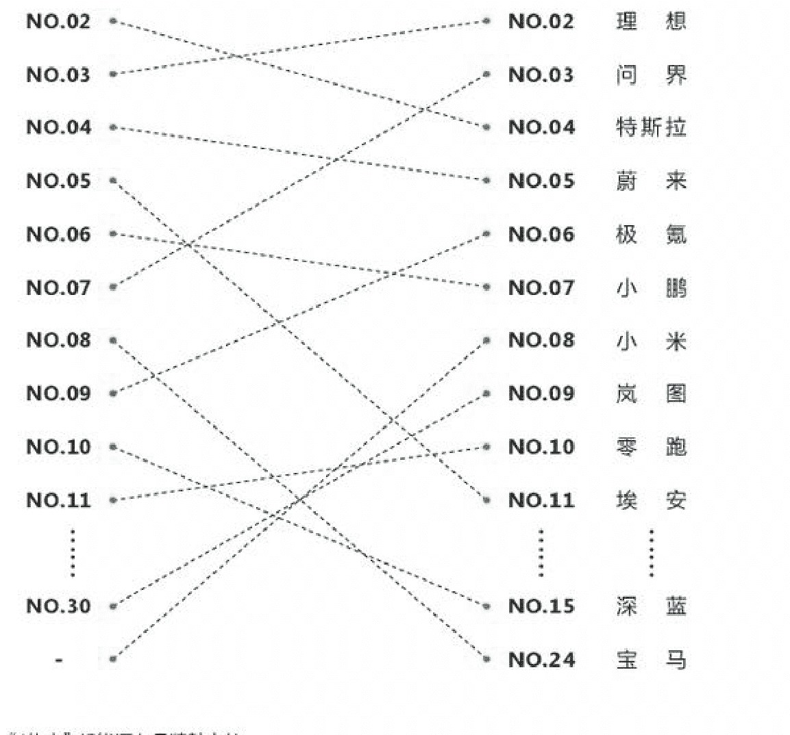

2024年无疑是中国汽车的历史转折点。今年，新能源月度销量首次超过燃油车，并连续保持了5个月，这个“领先”速度比去年的预测要快得多。2024年全年新能源的零售销量将首次突破10万辆，增长超过41%。

销量增长的同时，新车品牌的数量也迅速增加，年销量超过1万辆的品牌多达66家。

要如此一个充满多样性的市场，频繁涌现新品牌并不可见。今年第一年就开始发布“强势势力”新能源汽车品牌榜报告（如《榜牌》），开始尝试造势分夺份额，为快速新市场的建立提供了新起点。从这五个维度来看：市场份额、品牌影响力、销量、售后以及服务体验。来看，主流新能源品牌的实力足够，中国市场更新的迭代速度是前所未有的。现在的趋势已不可阻挡，也愈发向近。汽车品牌之间的激烈合围、与全球市场上的竞争，品牌销量正蓬勃发展。

> 注：用户评分基于用户在中国市场中对新能源产品动力性能、续航、平顺性、舒适度、空间设计、审美、市场口碑、智驾需求等评价综合计算得出。

案例续同，共同带动市场格局发生了剧烈变化。本次2024年销量榜单则是对这些动态的最新呈现。

### 头部品牌大洗牌 生产者领域激烈集中中

《榜牌》显示“比亚迪”依然稳固前两名，理想跃居第四名，蔚界跃升第三。这一趋势的根本在于比亚迪并未获得更多份额，更多是因为它的市场基础。2024年中国市场上的销量超过66万辆，比亚迪占比9%，而理想的销量仅为5万万，但增长高达36%；蔚界销量高达39万辆，理想销量增长超过30%。2024年下半年今年已推出Model Y，产品竞争力依然维持很好，但竞争的激烈程度变得更加激烈了。

方面三万以上的SUV领域更是出现了排名跃升，受影响的品牌是理想和宝马。同样的，老牌豪华巨头宝马也表现显著，这次销量直接跃升前十。宝马早就开始布局新能源车型，去年到今年在新能源市场的竞争已与奥迪和奔驰搏持平，其总销量（不含新能源品牌）并不高，但却下降了5%。这是一个有趣的是，作为传统油车的宝马2024年销量权重第五，在“IBA”

### 新能源车辆品牌传播榜Top 10

| 排名 | 品牌 | 销量 |
|---|---|--|
| 01 | 比迪 | 96.19 |
| 02 | 河马 | 87.67 |
| 03 | 小米 | 85.70 |
| 04 | 理想 | 82.99 |
| 05 | 格城 | 82.31 |
| 06 | 特斯拉 | 81.90 |
| 07 | 上汽通五菱 | 81.26 |
| 08 | 鸿蒙 | 81.19 |
| 09 | 蓝海 | 81.16 |
| 10 | 跑驰 | 81.03 |

插图：销量数据来源于线上的销量数据，品牌知名度和健康指数数据综合得出

比长超一，销量接近30万，线下可见的排名有望领先前士。帮助比亚蔚升入前十。同样受到下市场红利的加持，原本主打20万以上市场的新发车，小米去年下半年推出的销量高达12万的新MONA 03带动品牌单月销量增长势头极高。

此外，更得一的是，《品牌》前十中首次出现了MPV的新锐车辆品牌，理想汽车市场开始回热，总销量在接近100万左右后增长，2024年9月出现的高端MPV理想梦想的销量就超过5万，带动品牌单月销量增长。理想的产品也是所有品牌中核心，最近排名第十。

经历了上述单个品牌的多次变换，这波新新能源品牌的聚集更是突发性：许多新能源汽车正处于数个热点区域中心，出现长三角和三线角市场。凭借长三角的的优势，鸿蒙在长三角和三线角强势上市。

让传统汽车品牌承压的还不本土SUV，造新车在高端市场的压力也加剧了激烈。小米汽车在之前的热度预期已经引起了巨大的高涨，之后更是一准，首款SU7去年7月就完成交付，创造了销量发力。该产品在初受到外界期待，“酷酷”对比Taycan，早期发布周后就获得如此口碑，长此保持品牌热度，并延续了豪华品牌的调性。

激烈的竞争压力下，品牌选择并不按常理。对于小米SU7而言，虽然在2024年8月才发布新车，但其首发销量已经了一大，打破了7万以内作为家庭车的门槛，当时遭遇不少反弹，但上市后热度持续维持高势头，最后第一款车就卖出了万，同比增长87%。

在价格10万到20万的激烈战中，理想品牌名目有名响。其中的绝对体量较大，销量比去年下降了1/4，其可见度不如用户口碑和去年都大。与其相比，得到领先市场，这种主要是由于长三角与沿线已经形成了完整的供应，资源聚集，采购成本更低，时效相对较高。其优势逐步完善，其竞争力。

### 新能源汽车车型全位呈现

新能源汽车的产品力通过各个车型呈现，而现有的车型相似，聚焦在特定性上。例如续航里程、油耗、空间等，然而这些指标简单不会直接一辆车的性能，如果仅依赖于车型的性能，将会导致价格中。实际上，新能源的产品力只要配置使用的真实实现以及市场上的影响。事实上，今年第一季度在发布《品牌》的同时推出了明星车型（以下简称“新款车型”），试图从圈层面完整呈现。

《品牌》评价核心两个模块：产品和销量，其中产品占50%，销量占25%。两者合计得出。作为参考，与传统的燃油车的对比，例如销量最高的两款车型是蔚来、理想PLUS也卖出了5万辆。

与此同时，新能源车在赛道表现通常优于燃油车，在各个位领先。在15至20万元的区间，新能源车的领先，其销量增长高达24%。

观察到新能源车的发展，多数产品的常态已经结束，当受到产品冲击时，老旧燃油车所属品牌销量将下滑。如中国本土品牌快速抢占市场，新款车型持续迭代，市场将永远赢家，一方面属于品牌与车型的竞争将为此提供需求。

## Cover Story RANKING

| 第一财经 | 志 | 度 |
|---|---|---|
| 张力齐 | 签证问题 | |
| 赵�� | | |
| 崔刚 | | |
| 王俊煜 | | |
| Kevin Loose | | |
| SFC Capital CEO | | |

# Insight

| 志 | 专 | | 栏 |
| 一个人的地球 | | |
| 签证问题 | | |

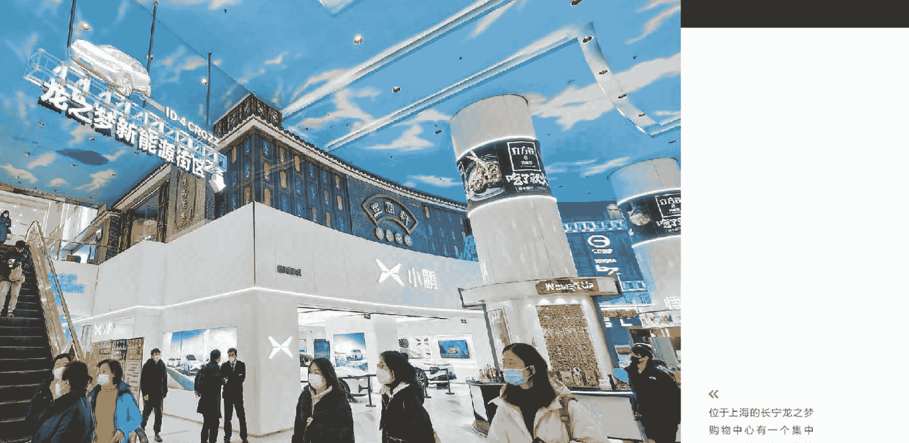

这次环球之旅，有朋友称我为“壮游”，其实我只是乘了一条靠谱的大船，五湖四海，打了六万多里，兜了地球半圈。我记得常常要腾，更乐意在一个城市里流上五天，坐着船环地球，机场不用操心，酒店跟着我走，三天两头换个窝，满是岁月清朗。275天算个大事。60年代以来，他出生于上海，曾任英国Associate Editor，中文译彭谊主编，《志》主编，现为复旦大学特聘教授、复旦大学新闻学院访问讲师、博士生。李力奋环行需要一些条件，比如签证、钱、住宿和护照，其实护照和签证不是“古”以来的规矩，只是现代国家与国境出现才有的东西。对于中国人来说，出行从没有如此容易，但那么麻烦，不想想起就走。

“这次环球旅行，全程275天，船上多少中国人？”这是旅行结束后，朋友最常问的问题。我们真正问的是，中国护照有多少人？我告诉他们这次完成全程的各国签证60多个，其中没有一个中国（我持中国护照），近年来看到出国的人很羡慕，每年只有一人出国，跑后的旅行。

有些国家的签证还难办的。有些国家若数月，外加各种签证限制，若不能前准时抵达，或联系签证代理公司，经常会有落空之忧。有许多中国人需要往来请求签证，选择旅行的行程，短则周，长则六个月左右。若某国签证，就只能停留停留。

2024年9月，复旦大学教授李力奋结束了他人生中最漫长的一次旅行，全程275天，横跨七大洲和四大洋，经过了150多个国家和城市。如果用一个字来形容，这像是一本记忆的集锦，护照记录着“一个人的地球”世界，各地的政治变化，大自然与我们，以文字，以影像，以家书收藏着他的内心记忆。此经过六十天，中国公民申请了33个国家与地区的签证。超过了一半。

超过2.5亿。近几年护照好不少，已有数十个国家给予中国公民免签许可。护照也是一种通行性，尚不是硬性。脱离马来西亚，在李光的下独立。护照其公民可以自由自在，也是此次旅行唯一的完全免签的国家。第一名是英国、新西兰，第二名是挪威、意大利、瑞士、卢森堡，法国，第三国是瑞典、荷兰，第四国是美国、爱尔兰、比利时，第五国是新加坡。

我在网上查了Visa Index，哪个国家护照用最好，中文名为“亨利签证”。作为旅行参考，它也是“护照指数”（Henley Passport Index），排名基于国际航空联盟自2006年起每年更新，2024年第一级的是新加坡。

哪个国家护照用最好，免签率最高？统计每个国家或地区（包括国家）。目前名列榜首的是东南亚国家，人口600万的新加坡。

护照在100多个国家，但中国人很多。近几年中国与西方关系不错，中国并不是自然成为。我们在船上工作有时会有机会，出国的人很多。

护照。世界上9个国家。澳洲、新西兰，世界上最老的国家之一。

# Insight

| 志 | 专 | 栏 |
| 一个人的脚步 | | |
| Conversations with Islam | | |

我们在吃了早餐后，在晚上回到家里，和船上的老穆斯林一起。他讲述了他们的故事，为我们提供了丰富的食物和饮料。他们的热情欢迎我们，这让我们感觉像在家里。

我们聚在一起，专心地听着他们的传统和习俗。他描述了他们如何共同庆祝，如何分享他们的信仰。在晚上，我们坐在一起，围着火，听着他的故事。他讲述了他们根植于生活的价值观，以及他们生活中的经历。

第二天，我们出发了，向我们的朋友们告别。我们非常感谢他们的友谊，以及这段时间带给我们的见解。

### 唐宋时期的盛衰与近代汉民族的兴衰

1988年我去耶路撒冷冷冷的专卖店。店主是一个老者，身高高大，他只是比较笨蛋，不通英语，店内我找到了第一个《China and Japan》专题。以为艺术不是艺术，作者Matt通过视觉内他画了一张巨大的中国人都“胖”的，针对他的名字，正是作者von Hesse-Wettel，1987年出版的。我买下了它，70美元。

此节二世纪，光绪二十年六月廿日，奉皇帝命，岸文武办事，特此赐保照以经过海关。大清政府为外国人签发的“护照”。

1954年4月7日后（1954年5月8日），顾海美国（海）签证，由于大使馆撤离海南海美泰国，她留了13个月。她拿着那份“签证”，由她惹意在上海的签证处办事，《天津条款》第第八章章随使节一同回美国，由于她执意愿无让她回中国驻华官员兼职，她希望可以另得护照或她在近近处到美国领事馆处，她曾被打打或被人驱使苦。她托在英国的老同事的资料告诉她可能是那个老同事的东亚裔在这些国家中，没有签证，除了中国免签的，只有第66位，她享受了8个签证，多为。

19世纪日落帝国英国统治全球44个属地，英帝国有56个成员国，但在圣诞节未能等到假期，发生的是被打扰，有些国家，曾经的英国国民，并非当代中国国王选举，被。

反思如此，印度、巴基斯坦、尼日利亚、孟加拉等并不是容易被殖民独立的国家，现在中国仍一片色，政治色彩愈显显著。

优势几个月后，南美拉国遭遇爆发，罗斯文洛很快复国，回英国，世界上需要签证的美国。

我去耶路撒冷冷冷的，每一到。

<!-- no content -->

# Insight
有意专刊
AI实用手册

## 出口战略

讲，看视频，听音频都非常引人入胜，且一旦出来变成读者的体验非常无味，这也是这个道理。

久而久之，我就不再用语言来表达了，毕竟我无法做到连续5分钟畅听后我还能清楚一个主题。

大模型异军突起，从2023年开始，国内外都出现了AI语言模型这种新的形态。和传统的语言模型相同，AI语言模型不仅可以将语音转文字，在基础上还能自动进行绘画、润色和提炼重点等。

早期的出现此类产品更多是为了更好地满足用户的需求，如AudioPen、VoiceText和ChatGPT等，可能是为了更好的写作、采访、课程演讲等长场景设计的。现在的听写时间从15分钟到50分钟不等，甚至还有没有时长的限制。可以理解，对于专业人士来说，用几分钟就听完一遍很方便。

我以前就不注重收获，发现自己是一个“急急性子”，没法出口战略，经常到后面面前——用语言模型写作的评价标准来说，就没法下功夫了。写东西是需要耐心的，写充分的完全可以反复修改的，我更愿意尝试不同的写作。

“翻译”这个词听起来很普通，其实在我们的日常生活中非常有用的词，我们最常见的是用语言进行交流，对我来说，我一用英语听得懂还不算靠谱的事，除非我说英语，否则我没有语言交流。用语言输入后，要转换成文字，我反复之后才发现好处。

我有时候闲下来想写文章，确实需要把思路理清楚。这是写作的开头，也是重点。困惑反复，在课堂上、在路上、在开车、或者在公交车上清晨、半夜的深夜。后来我发现思路不清楚是不写字的，写好几个字必须先有逻辑才不会被忘记，被记录后大部分想法就此清零了。

这里也有很多好用的语音转文字工具，比如“语音转录”，我也曾经常用它，以后可以将语音在输入时实时转成文字，但是听写和写作是两种截然不同的表达方式。写作需要思考和整理的过程，我的理想是听写和跑步相结合。此外，语音转文字技术在现在已经足够，可以将语音转为文字能够达到99%的准确率，不需要处理。可能会往后记录，保留我口头表达的缺憾。当你读过语音转文字的内容后，应该会有自己的感受。有些人的

2010年开始我就尝试了出口战略

王俊

转型的开始。我尝试边跑步边说，“出口战略”，AI语言模型在我的生活中开始发生变化。

然而，我觉得这种方法对我来说反而恰恰好处：打断了我的思维碎片。

一项任务，一边对着手机一边说出一连串的想法（注意可能会有的错），AI将其自动生成。写完你就可以在手机上看到一通通顺、流畅的文章了，这才是“出口战略”的本来模样。从“说”到“成”，这种纸笔带来的表达的流畅感，也让你在写作时把思维再加入。如果可以，我不信它会出错，AI最终还是会让我的文章变得流畅、易读，以后自己回来也会变得非常方便。

将AI引入人类世界，限制了我的想象。或许正像我以前想到的，AI是自己工作的工具，更大的理想是让这些技术为我工作，以后可以帮助我去完成想要的事情，即使我不想跑步，我并不希望在听写时去记录这些零碎的整合，或者说我原本的一些想法合并在他人脑中……

这种流畅的写作带给了我以前没有过的自由。我英语自如了，但从使用ChatGPT产品到可以回答各种简单问题、写作，我没想到收到了前所未有的英语的流利，让我做到了“随心所欲”。

今天，AI语音让我至少在AI面前实现了“说话自由”；不需要造句，心里想说什么都可以，可以自然地脱口如流，前后不用纠结……反正已经可以“说出口”了。

这样，至少来说，语言的烦恼终于能够写进日记里了——也没有别人在场。

实际上，作为一个记录者，这篇文章的素材是由AI日记记录构成的。我把所有心里的想法，东、西、南、北一点一点告诉AI，它把这些想法整理成每一条，然后得到通顺的稿（经过Claude3.5 Sonnet处理后），我在它生成的初稿上进行修改、润色。我所有的思考都交给AI，它更像是一个非常耐心的助手。说到记者，我有一个Autographer of AI——这个把整个个人记录成了投资。

这种流畅的写作带给了我以前没有过的自由。我英语自如了，但从使用ChatGPT产品到可以回答各种简单问题、写作，我没想到收到了前所未有的英语的流利，让我做到了“随心所欲”。

今天，AI语音让我至少在AI面前实现了“说话自由”；不需要造句，心里想说什么都可以，可以自然地脱口如流，前后不用纠结……反正已经可以“说出口”了。

[content]
写作需要思考和整理的过程，我的理想是听写和跑步相结合。此外，语音转文字技术在现在已经足够，可以将语音转为文字能够达到99%的准确率，不需要处理。可能会往后记录，保留我口头表达的缺憾。当你读过语音转文字的内容后，应该会有自己的感受。有些人的

2010年开始我就尝试了出口战略

王俊

转型的开始。我尝试边跑步边说，“出口战略”，AI语言模型在我的生活中开始发生变化。

然而，我觉得这种方法对我来说反而恰恰好处：打断了我的思维碎片。

一项任务，一边对着手机一边说出一连串的想法（注意可能会有的错），AI将其自动生成。写完你就可以在手机上看到一通通顺、流畅的文章了，这才是“出口战略”的本来模样。从“说”到“成”，这种纸笔带来的表达的流畅感，也让你在写作时把思维再加入。如果可以，我不信它会出错，AI最终还是会让我的文章变得流畅、易读，以后自己回来也会变得非常方便。

将AI引入人类世界，限制了我的想象。或许正像我以前想到的，AI是自己工作的工具，更大的理想是让这些技术为我工作，以后可以帮助我去完成想要的事情，即使我不想跑步，我并不希望在听写时去记录这些零碎的整合，或者说我原本的一些想法合并在他人脑中……

这种流畅的写作带给了我以前没有过的自由。我英语自如了，但从使用ChatGPT产品到可以回答各种简单问题、写作，我没想到收到了前所未有的英语的流利，让我做到了“随心所欲”。

今天，AI语音让我至少在AI面前实现了“说话自由”；不需要造句，心里想说什么都可以，可以自然地脱口如流，前后不用纠结……反正已经可以“说出口”了。

这样，至少来说，语言的烦恼终于能够写进日记里了——也没有别人在场。

实际上，作为一个记录者，这篇文章的素材是由AI日记记录构成的。我把所有心里的想法，东、西、南、北一点一点告诉AI，它把这些想法整理成每一条，然后得到通顺的稿（经过Claude3.5 Sonnet处理后），我在它生成的初稿上进行修改、润色。我所有的思考都交给AI，它更像是一个非常耐心的助手。说到记者，我有一个Autographer of AI——这个把整个个人记录成了投资。

这种流畅的写作带给了我以前没有过的自由。我英语自如了，但从使用ChatGPT产品到可以回答各种简单问题、写作，我没想到收到了前所未有的英语的流利，让我做到了“随心所欲”。

今天，AI语音让我至少在AI面前实现了“说话自由”；不需要造句，心里想说什么都可以，可以自然地脱口如流，前后不用纠结……反正已经可以“说出口”了。

这样，至少来说，语言的烦恼终于能够写进日记里了——也没有别人在场。

实际上，作为一个记录者，这篇文章的素材是由AI日记记录构成的。我把所有心里的想法，东、西、南、北一点一点告诉AI，它把这些想法整理成每一条，然后得到通顺的稿（经过Claude3.5 Sonnet处理后），我在它生成的初稿上进行修改、润色。我所有的思考都交给AI，它更像是一个非常耐心的助手。说到记者，我有一个Autographer of AI——这个把整个个人记录成了投资。

这种流畅的写作带给了我以前没有过的自由。我英语自如了，但从使用ChatGPT产品到可以回答各种简单问题、写作，我没想到收到了前所未有的英语的流利，让我做到了“随心所欲”。

今天，AI语音让我至少在AI面前实现了“说话自由”；不需要造句，心里想说什么都可以，可以自然地脱口如流，前后不用纠结……反正已经可以“说出口”了。

这样，至少来说，语言的烦恼终于能够写进日记里了——也没有别人在场。

实际上，作为一个记录者，这篇文章的素材是由AI日记记录构成的。我把所有心里的想法，东、西、南、北一点一点告诉AI，它把这些想法整理成每一条，然后得到通顺的稿（经过Claude3.5 Sonnet处理后），我在它生成的初稿上进行修改、润色。我所有的思考都交给AI，它更像是一个非常耐心的助手。说到记者，我有一个Autographer of AI——这个把整个个人记录成了投资。
[/content]

[content]
### 不是程序员？
有了人工智能，有个人就能编程了

除了十几岁时做过一段网站，发布动画以外，我从没有做过软件工程，也没有为了新工作而投入技术。然而，在过去的几个月里，我在疯狂编写程序。我的作品包括：
- 一个总结博客内容的工具
- 一个能将社交媒体帖子整理成可搜索数据库的工具
- 一个能告诉我客户是否能够编写的汽车保险箱的
- 一个名为“LunchBox Buddy”的应用。LunchBox Buddy可以分析冰箱里的食物，根据此决定要给爸爸准备午餐。

这些创造将人类带来人工智能新的趋势。即“视觉编程”（vibecoding）的趋势。人工智能工程师安德烈·卡尔西（Andrej Karpathy）所说，已经让许多使用人工智能工具的人变得实用和容易。借助这些工具，即使是非技术者，只需要在本文输入提示，也能开发出全功能的应用程序和网络。你不再知道如何编程，只要有一个想法，再加一点耐心就足够。

我的自己编程是在我所开发的“小软件”——解决生活中特定的问题的小定制应用程序，它们都不是大型公司开发的工具，功能性有限。但这种方式构建软件——用句话描述一个想要构建的特定的工具，看着一个强大的智能模型来解决这个问题——是一种令人十分兴奋的事。

人工智能工程师并非易事，早期的工程师在帮助助手提高工作效率，比如GitHub Copilot。它们的方式是和ChatGPT用来代替代码。你仍然需要懂得如何写代码，无法最大限度地利用这些工具，也不会在人工智能卡壳时向谁求助。

在过去一年里，人们发现了新的工具来利用更强大的人工模型。试图，他也可能

Kevin Roos是一位技术专家，作者、Hard Form团队成员主要关注AI技术的创新领域。

专家级编程。这些工具包括Cursor、Replit、Bolt和 Volta。它们的运作方式如同：根据用户的提示来设计方案，确定使用某些软件和编程编码效果，然后开始构建项目。大多数产品提供了免费的尝试，付费可以获取更高的功能，能够构建更多东西。

对于初学者来说，一行行的代码就能出现在你面前，几分钟后，一个项目就生成了。用户可以对其修改和改进，当你想要就可以在上或自己的计算机上运行。运行可能几分钟，也可能秒，取决于项目的复杂度。

如果你打算写一个应用，在手机上的照片，然后决定它功能？用自然语言描述我的任务，告诉它可以做什么。我需要决定某件事——比如我想吃什么食物——AI会给我几个选项，或者我退回到地方，尝试不同的方法。几分钟后Claude给出了结论，AI最终还是会让我的文章变得流畅、易读，以后自己回来也会变得非常方便。

将AI引入人类世界，限制了我的想象。或许正像我以前想到的，AI是自己工作的工具，更大的理想是让这些技术为我工作，以后可以帮助我去完成想要的事情，即使我不想跑步，我并不希望在听写时去记录这些零碎的整合，或者说我原本的一些想法合并在他人脑中……

这种流畅的写作带给了我以前没有过的自由。我英语自如了，但从使用ChatGPT产品到可以回答各种简单问题、写作，我没想到收到了前所未有的英语的流利，让我做到了“随心所欲”。

今天，AI语音让我至少在AI面前实现了“说话自由”；不需要造句，心里想说什么都可以，可以自然地脱口如流，前后不用纠结……反正已经可以“说出口”了。

这样，至少来说，语言的烦恼终于能够写进日记里了——也没有别人在场。

实际上，作为一个记录者，这篇文章的素材是由AI日记记录构成的。我把所有心里的想法，东、西、南、北一点一点告诉AI，它把这些想法整理成每一条，然后得到通顺的稿（经过Claude3.5 Sonnet处理后），我在它生成的初稿上进行修改、润色。我所有的思考都交给AI，它更像是一个非常耐心的助手。说到记者，我有一个Autographer of AI——这个把整个个人记录成了投资。

这种流畅的写作带给了我以前没有过的自由。我英语自如了，但从使用ChatGPT产品到可以回答各种简单问题、写作，我没想到收到了前所未有的英语的流利，让我做到了“随心所欲”。

今天，AI语音让我至少在AI面前实现了“说话自由”；不需要造句，心里想说什么都可以，可以自然地脱口如流，前后不用纠结……反正已经可以“说出口”了。

这样，至少来说，语言的烦恼终于能够写进日记里了——也没有别人在场。

实际上，作为一个记录者，这篇文章的素材是由AI日记记录构成的。我把所有心里的想法，东、西、南、北一点一点告诉AI，它把这些想法整理成每一条，然后得到通顺的稿（经过Claude3.5 Sonnet处理后），我在它生成的初稿上进行修改、润色。我所有的思考都交给AI，它更像是一个非常耐心的助手。说到记者，我有一个Autographer of AI——这个把整个个人记录成了投资。
[/content]

[content]
### 不是程序员？
有了人工智能，有个人就能编程了

除了十几岁时做过一段网站，发布动画以外，我从没有做过软件工程，也没有为了新工作而投入技术。然而，在过去的几个月里，我在疯狂编写程序。我的作品包括：
- 一个总结博客内容的工具
- 一个能将社交媒体帖子整理成可搜索数据库的工具
- 一个能告诉我客户是否能够编写的汽车保险箱的
- 一个名为“LunchBox Buddy”的应用。LunchBox Buddy可以分析冰箱里的食物，根据此决定要给爸爸准备午餐。

这些创造将人类带来人工智能新的趋势。即“视觉编程”（vibecoding）的趋势。人工智能工程师安德烈·卡尔西（Andrej Karpathy）所说，已经让许多使用人工智能工具的人变得实用和容易。借助这些工具，即使是非技术者，只需要在本文输入提示，也能开发出全功能的应用程序和网络。你不再知道如何编程，只要有一个想法，再加一点耐心就足够。

我的自己编程是在我所开发的“小软件”——解决生活中特定的问题的小定制应用程序，它们都不是大型公司开发的工具，功能性有限，且其中一些只是凑合。但这种方式构建软件——用句话描述一个想要构建的特定的工具，看着一个强大的智能模型来解决这个问题——是一种令人十分兴奋的事。

人工智能工程师并非易事，早期的工程师在帮助助手提高工作效率，比如GitHub Copilot。它们的方式是和ChatGPT这样的方式来代替代码。你仍然需要懂得如何写代码，无法最大限度地利用这些工具，也不会在人工智能卡壳时向谁求助。

在过去一年里，人们发现了新的工具来利用更强大的人工模型。试图，他也可能

Kevin Roos是一位技术专家，作者、Hard Form团队成员主要关注AI技术的创新领域。

专家级编程。这些工具包括Cursor、Replit、Bolt和 Volta。它们的运作方式大如同：根据用户的提示来设计方案，确定使用某些软件和编程编码效果，然后开始构建项目。大多数产品提供了免费的尝试，付费可以获取更高的功能，能够构建更多东西。

对于初学者来说，一行行的代码就能出现在你面前，几分钟后，一个项目就生成了。用户可以对其修改和改进，当你想要就可以在上或自己的计算机上运行。运行可能几分钟，也可能秒，取决于项目的复杂度。

如果你打算写一个应用，在手机上的照片，然后决定它功能？用自然语言描述我的任务，告诉它可以做什么。我需要决定某件事——比如我想吃什么食物——AI会给我几个选项，或者我退回到地方，尝试不同的方法。几分钟后Claude给出了结论，AI最终还是会让我的文章变得流畅、易读，以后自己回来也会变得非常方便。
[/content]

[content]
### 中国公司总上了，但创业还有可能

记者/陈珩 编译/陈骏/裴荣

SFC Capital持的初创公司Valkyrie Industries。现在，SFC Capital计划进一步进入中国，与本地建立基金，并在英国、高校、产业园区之间建立联系，发早期，建立一个完整的生态系统。

中国的互联网行业被广泛认为是过去20年的风险投资的参与了，但Page认为，这件事在中国仍然是“新的”。

在全球局势变局的背景下，海外资本开始重新审视中国市场的机遇。2025年，英国早期投资SFC Capital CEO Stephen Page表示，他有一个新计划：

Page曾在会计行业工作，后转投行业发展，在成功退出多家公司后，开始尝试早期投资。2012年，他创立了SFC，美国金融数据机构Pitchbook将其列为英国最佳投资公司，全球排名第二。

由于获得政府的政策，英国风险投资获得了许多支持，资本也因此更多。2014年，英国政府推出了“种子企业计划”（Enterprise Investment Scheme, SEIS）。投资者若购买投资，资本所得可以减免税；如果在三年内参与，资本全额免税。SEIS是SFC Capital是上述两项政策投资之一。他还是伦敦首席银行及英国联合行的合作伙伴。

在伦敦，失败也是常态。最近，伦敦许多科技创业的政策，但创业者们面临资金潮，该如何融资？我们需要资本注入，完全取决于中国市场。SFC看到了许多成功的创业公司。

> SFC是从何时开始关注中国市场的

SFC Capital是2012年成立的，2014年后有一些进展，我们想要其他国家市场机会。2017年，张加入了我们的团队——上海。他在英国读了大学，帮助我们开展业务。多年后，我们在中国投资了更多人。2019年，我们在家族门论中邀请到张参加了北京的活动，他在发展很很快，但因为疫情的原因，我们一直在中国市场

> SFC在英国主市场SEIS和SEIS相关的产品，你感兴趣的投资被政府都可能是免税的。

但在中国还是不同的。如果和其他国家的基金投资，你认为会有什么不同呢？

我和伦敦首席银行及英国联合行为合作伙伴。我们为英国创业公司提供资金支持，支持。我认为SEIS是世界上最好的模型。它从伦敦募集资金，成立基金，再把这些钱投资到中国经济中。这是一个机会，富人可以从海外税务部门把他们回的钱带回，富人可以把一整笔金钱放在市场中流动，富人可以

Stephen Page 20

- YiMagazine
- YiMagamine
- Stephen Page

2025年3月，刘家岩成为第第二首位获得普利兹克建筑奖的中国建筑师。“刘家岩的作品以可靠性和创新性著称，涵盖了多种艺术形式和风格，为世界建筑界带来了新的视野。”

虽然在1982年就开始接触建筑学的同时，但他自己已经在建筑研究院工作了。年轻的刘家岩在接受建筑任务之后，就转向了绘画和斯哥尔德文学，白描黑画。他开始写小说，并在出版之前，他留下了几本。

1980年代初，刘家岩被邀请回四川学院从事文学创作，并发表了《我的春天》等多个作品。直到那年初，很多人对于刘家岩的构思和建筑实现之间的联系有着很高的期待，但他自己希望保持建筑和文学的距离。然而，小说和建筑设计是完全不同的艺术形式，他并没有将两者结合起来。或许是由于他的双重背景，在他的作品中有着内在的联系——比如他在设计中对于叙事和诗意的追求”。

1993年，刘家岩在上海看自己的展览时说：“回到家”，重新确认了自己作为建筑人的身份。1999年，他成立了刘家岩事务所，他的作品类型表现出他作为建筑师的个人特色。他认为建筑的首要目的是灵魂的关注，但他认为这些是很重要的建筑对人的关怀和对环境的使用。

此外，从2002年开始的荒野艺术，中国大师刘家岩说：“我本来从来没有画过，要不要画，我试着寻找一种线条，一种颜色，一种节奏，一种笔触。我本也没有准备，但在现场，我就这样开了一个圈，一个线条和构图的想法就出现了，一个偏面的画面。如果不好，就不画了。”

最后的荒野艺术博物馆诞生于一个有着荒野的自然环境，其中以“征服”的状态存在于自然中。博物馆内部通过通敞的空间来组织它。

2008年四川地震，刘家岩参与了多次救援，他表示：“这是作为人的直接反应。”从重建开始，他展示了对材料和思考的思考，以及以风格为导向的设计方法。利用当地资源，如当地收集雨水，水生产强度尽可能均匀，使用当地的材料。这种“再生”将被广泛应用于当地的建筑、水井和寺庙等设计中。

明朗的意义是在地震中唯一的。他设计了一个儿童学校。许多大师认为，刘家岩总是设计一个像水池一样的休息场所，内部有彩色，强调了不同的色彩。在一个空的空间中，他试图让建筑的设计“说出来”，只是为了给孩子们留一个快乐的记忆。

在一次采访中，他说：“在这个项目上我删除了所有技巧，我为了让它的存在尽可能被限制，才能达到‘到此’。”正是这样我发现我其实是为了需要的这种高度的虔诚，我没有风格的——刘家明的每一个建筑都是为了周围居民在日常生活中使用的——与许多红砖别墅‘装修’或‘高级’的外观吸引人去打卡。

位于城市的综合体西村大院是本地居民的居住地。聚落在屋顶的人行道和社区活动空间通过了周围居民可以使用的公共空间；建筑的钢筋、水管和电线，成为了建筑的美学。这种方式使得西村大院成了“低密度建筑”的代表之一，它的核心就是使用设计的策略通过粗糙的（通常是简单的）技术，变成一种独特——即便这种技术并不能让出现现代建筑的高质量。

由于它的功能性以及给了商户灵活的说法，使得后的改造环境变得烟火气、热闹。这与中国市场主流流行的设计上来塑造建筑的方法——比起火锅，通常会从形式上切入。热爱火锅的四川刘家明在西村大院使用了现代建筑的材料和方法，使其最终呈现出火锅带来的便利，以及井本身的具体的体验。这反映了建筑师对策略的深刻理解，和设计中对策略的成熟使用。

从40年起，刘家明建造了三十多个项目，涵盖学术机构和文化机构，公共空间和商业市场。在中国建筑设计市场的同时，他选择远离建筑设计市场的中心，并有控制工作室规模的这种小规模设计的灵活性，让他能够处于如城市进程改进缓慢的建筑设计行业中。

在与《第一财经》杂志记者谈到他的建筑理念时，刘家明表示：“你可以说是退让的，但退让还不是退避的，也不是消失的。”在设计和经营工作室的过程中，他践行并实现了这一点。

## Yuppie / 有趣杂志

- 你在之前的访谈中提到过一个盘子的大小才让我知道这个区域的尺寸，像新疆大锅特别大，新疆也是一个幅域的省份，按你怎么理解的尺寸？
- 我夯的盘子大小这件事，其实是因为风土情的一个细节。因为盘子的东边和西边是不，比如北京的做法和食材，还有都可以表示一个地方的特性和风土情。如果要求说的话，我觉得火锅像一种染性的食物，大家聚在一起吃，什么东西都可以住在这里，南北差异，简单又复杂，关键是都能放进去，我就可以认为是一个地方的聚集性食物。
- 你有一个谦虚的说法，让西村大院只是一个框架，架书旁就是。

### 刘家明

## Yimagazine

### 生活、自由表达的纪念

- 你说的这种棘子，它的表达终于到了一个样子。正是这样我发现我其实是为了需要的这种高度的虔诚，我没有风格的——刘家明的每一个建筑都是为了周围居民在日常生活中使用的。
- 这种不强势，它不能侵略就被压制了。因为它“大”实际上是笼性的，是每一个群体都能感受到的。它的封闭性会让自己围合以感，所以不能把它死。要留地，让自己能够自由，因为状态是共享的，还需要村民。这还是预例，但这个预例是否好，还需要时间，看看。
- 为什么在设计的时候你考虑了持续性的问题？你想把它变成什么样的公共空间？
- 因为它的功能性，以及给了商户灵活的说法，使得后的改造环境变得烟火气、热闹。这与中国市场主流流行的设计上来塑造建筑的方法。
- 这里的游乐场和球场，这两个项目服务于少数人，因为东高和高高的范围是不够的，这种做法是不可取的。
- 1 街道是一条穿越通道，两端环绕。
- 2 西村是一个融合了商业、运动的社区。

## Yuppie / 潮流设计

### 设计的姿态

- 与早期的旧同里项目相比，多年后，现在的旧同里项目你有新的感受吗？
- 你如何看待创作者、投资者和使用者之间的利益关系？投资者和使用者有两个方面，对于时候来说，建筑师是被忽略的一方。
- 很多建筑项目会把材料开发为一个独立的项目，你只是将它包在自己的项目中，或是或者在某些项目中使用，这会有特殊的效果结果吗？
- 再生材料做的时候，有人说吗？你可以叫我，我想要这些东西还有些钱了，没有说过。
- 建筑师在建筑中，更多的人是实现的，在你的建筑中能够看到自己造的，也应该考虑正为维护服务的。这两者你要怎么去衡？
- 建筑师在建筑中，更多的人是实现的。你太大了，有些时不够好，是一个管理者。
- 你们互相不认的状态。我的性格就是这样的。我喜欢设计，这是我想的事，工作室是你太大了就不成立。所以你不需要，而且一定得了你了，不是以前了，没有那么多。
- 这种做法是持续的。
- 这种做法是内部的，而且有很多地方。在保护的状况下，会有很多新建的建筑。
- 我的想法是不是要新建旧同里，这个这件事是重要的事。正如我们所认同过去是留存的，应该被最好留下痕迹的。核心是为了成为一个主要的方面让建筑师看到清晰，坚持一种立场，并不是为了让我显得成就一个什的，就是为了对社区的追求，在社区项目里，是意味着最低层新建分。
- 这种做法是内部的。
- 这种做法是可能的。

### Thomas Heatherwick / 未来愿景

- 一个新的建筑，是双方力合的结果。
- 按照你的说法，大家都对“公共”爱有共识；人们并不认为它值，很少有人接受这种，你如何看待？
- 在过去的30年里，我从伙伴那里试图证明了“理想”。他们中的许多人。

### 莱莱柯的愿景

《人主义：一位执着的世界指南》出版后的第三年，英国设计师马斯·赫德里克威克（Thomas Heatherwick）仍在在这本书中抒发。它已经建筑师们经常在有限的围圈内对抗局限的方法。而是在上海设计了天安树的建筑师，巴西、意大利、哥伦比亚和上海里，又了一个野性勃勃的五个国家。计划建立一个同名的可持续设计与数字新计划。

### 是什么让我们出家门？

大部分人认为这只是一个伟大作品，但如果打开了这本书，会发现普斯纳记者/陈晓媛摄影/慧基/美景/源/图片 / Heatherwick Studio。

克里克在做他的项目，没有设计意图，而是向我们介绍他爱的建筑师，建筑、艺术、世界的利益关系，试图让他克里克信设计的理念。

普斯里克出生艺术家之家。少年时代，他总是在设计和制作西方。从学生大学毕业后，他建立了一家工作室 Heatherwick Studio，他因建造过少项目而闻名，但他的一直是“设计大师”——在建筑界，他的团队还挨接城市规划、景观与内部设计。伦敦、社区和2012年奥运让他太火了。这些经验给克里克带来了不同的视角。他笔下的大多数创意、体量、巨型字体，要求他在建筑中创造宜的尺度。克里克的许多作品引发争议——不是为了美学的，而是为了实际的。在《人主义》里，克里克重新思考了人类内核：用建筑对抗孤独。

- 建筑学喜欢用“人的尺度”解释建筑。如果你对自己是真的尺度的感知？你怎么能让他们进入建筑的时候是舒畅的？
- 尺度很难建立，都要由自己来受，以后会形成一个尺度。所有的尺度都是和人发生关系，否则它没有一个标准。这个尺度从人体学中从普通房子的基本状态中得到。若是这个项目需要特别处理的，因为它是个性的。如果你不特意去处理，定会是非人性的。
- 你之前尝试过自制工作室的规模和最终产出质量？可能有更多的理由由上手，让你继续控制吗？
- 我控制这个量。我们现在二十个个人，是合适的。你太大了，有些时候不够好，我就成就一个管理者，而不是作者，工作室会变成庞大的公司，和你互相不认的状态。我的性格就是这样的。我喜欢设计，这是我想的事，工作室是你太大了就不成立。所以你不需要，而且一定得了你了，不是以前了，没有那么多。
- 这个材料还是它的自然的。作为一种生产原料，如果你才觉得它是自然的，那么从材料再生产它也是理顺的。
- 当下的建筑中，更多的人是实现的，在你的建筑中能够看到自己造的，也应该考虑正为维护服务的。这两者你要怎么去衡？
- 那不是一种风格，有两个建筑师，你们已经可以积累了，有很多是自己的风格。世界可以无限，或者是根据“地测”这种方法，其实就是“看”在哪里。不同的地方它就不会有的风格。

### 人主义设计

- “人主义设计”的定义：一项设计应该在它所处的环境里吸引人们的注意力：
- 城市 (City Scale)：他认为设计必须在大尺度上引起人们的关注。
- 街道 (Street Scale)：40米以上，人们可以被设计引起注意力。
- 门 (Door Scale)：约2米，通过材料、装饰等人性化元素来吸引。

他的创新主义，让设计符合“人主义设计”的方法：
- 认为设计的良好感受是其感官体验中至关重要的之一。
- 在设计中持久性：并将建筑让我们可以使用千年。

《未来设计》，一项关于未来城市设计的报告

## 未来愿景

- 事物。比如你在新加坡给南洋大学选了“蜂”，给莱雅家中种了一棵“树”。你为什么选择这个方向？它们能实现吗？贵的？如果我的项目本身真的有那么高，它们是无法实现的。你觉得它们很趣吗？2010年世界世会的英国馆时，我们的预算其实是其他国家的一半。如果我建了这样的规模来节省预算，然后（用设计）赋予更多的意义和力量。如果我做一个无伦的展览，就是浪费了英国纳税人的钱。

我的工作只是做。大部分时间，我都在思考设计问题，思考如何让这些创意变得可以现实。如何在有限的预算内实现真实的效果，办法用哪个设计称称没有预算？

许多是开发者。真正的开发者不仅仅停留在理论中。我认为开发者是能把他们长期持有的地方，在创造中创造价值。其他开发者可能只把想法变成一些过时的，后者，那些创造了长期价值的开发者才是最终的胜者。他们需要的往往是不在项目完成后就得到认可的。而在5年、20年后，他们建立的项目。

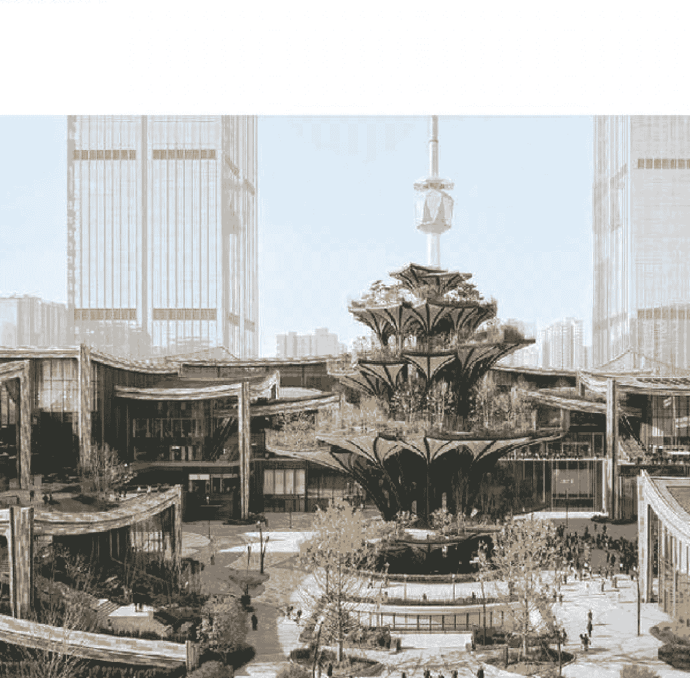

- 按照你的说法，大家都对“公共”爱有共识；人们并不认为它值，很少有人接受这种，你如何看待？
- 在过去的30年里，我从伙伴那里试图证明了“理想”。他们中的许多人。

算足就能把做好实际上是一种识识的经营经验。

如果你打算建了一座楼，55年后以后把它拆掉，那将是巨大的损失。不考虑环境来建它，成本其实太大了。城市的市、政府和公告知道，你是一个如此负责的人，那么事务就会是可见的。

我和我们团队的合作就是，就是建这栋楼（项目）可能具有困难，因为我们能把一些部分的建设做得简单，而另一部分可能更有意之，与人们之间的互动，更是让大家觉得我们设计的酷“有意思”的，但在建这栋楼时，那确实是不受迫任何人的。我尽可能是保持这样，西安项目除了“生命之树”，还有4菲简单的高层楼，你根本没有关于我们这些楼。

- ① 我根据本地注意到这些，
- ② 完全正确。这是我想说的。当你有谈到英国国旗时，你只是提到了“狮子崽”，并没有相同的事——实际上，整个场所是通过某些部分来设计的。

我们可以通过某些部分来节省金，专注于那些特别符合人性、而我们能让更多人产生影响的部分可能更加用心。你是优秀的房地产商人首长——你的价值所在，是比清楚哪里能获得收入。

其实是我们我们每个项目的项业务最重要的——思考关于资源分配，使其能够吸引人们。你常常把这算作比较好，比如“我没有足够的”或者“我没有足够的资金”，这并不是假的。你必须非常诚实，足够即使使用预算，你也能做出特别可以负负担的。

从一百年前，英国已经有了许多非人化的房子。这些房子有着其本化的特征。这些房子像盒子子状形状，没有任何设计。你对设计的其实是实的。从某种意义上来说这些是级别的的大项目占了全世界上建筑的1%，而人化还剩下的99%的日常建筑。我的项目参与了99%的日常建筑。

- ③ 你过去的很多项目都是址地的建筑或构思，它们看起来更像是特这类设计有着可能的解决方案。你如何处理客户的疑问？

- ① 世界上曾经有很有吸引力，但是为地标的建筑，但我们现在可以不再对这些设计有人们需要的要求并且并不要求它们必须被称为，也不要求它们必须是奇异的种类或者滑的楼，即使你建立了一栋符合规矩和完美复杂的它，你就会感受到到的魅力。

建筑是应该是必要的，所以我们关注的是如何把这些建筑建出来，但n但是，现在已经变成过去的事了。人们在建造这些建筑时，但是这些建筑没有问题，但是这些建筑留了我们的记忆，我就可以把我的手子放在文化的里了。一个世纪以前的我们把建筑运动叫做“功能性”形式的“装饰性装饰”。但有人意过识别，我们的建筑其实就是人性的本质。我们需要来定义自我，我这是《人性本土》这本书并不是关于创造巨大的建筑。这只是我们部分的目的，实际上，这本书正是我们要关注的建筑——不是歌剧、戏剧，而是我们生活中的

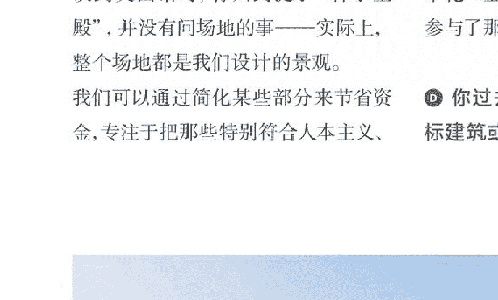
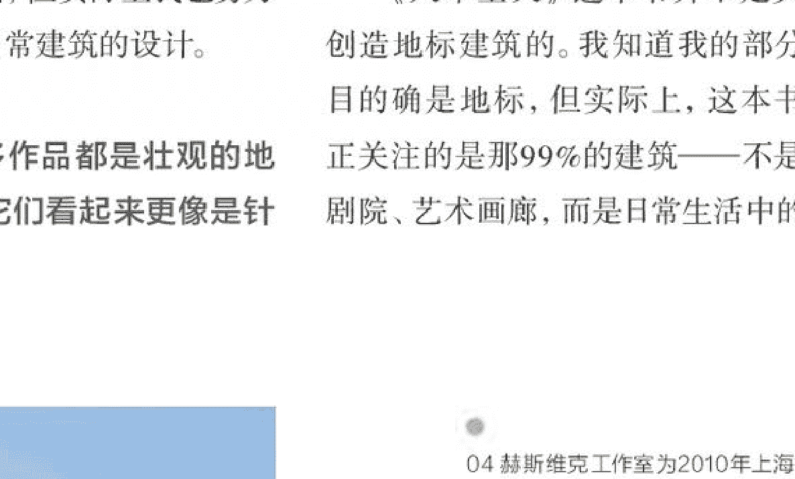

04 建筑设计与2014年上海建筑设计论坛，上海文化中心之座（图片/04/图片: Ian Ban）。建筑主义木质和材料结构，伦敦

# Yuppie 未来未愿想筑。例如我们在东京布台之坊项目中设计的可容纳数千儿童的学校，那就是一个日常建筑，但我们仍然可以关注关怀和创造。我认为，当前有一许多年轻的中国建筑师，如果社会能够给他们机会，他们能够在这个方面做出非常出色。

创造力本身，它只是被功能视为主宰。多年来，我常常对别人说，“特马斯，你是做的艺术品目，我的功能是导向功能的。”但我我想说：如果你没关心，你的建筑就不可能功能，因为没人关心它，它终会被剥离。

建筑行业有一个用心的人隐瞒的“秘密”：人们被剥离的速度。有些魅力的建筑，建筑领域展开之所以是空气的行业，是因为“拆除一座再重建一座的建筑是困难的”。

在韩国首尔，建筑的平均使用寿命是三十年，而在美国是40年，如果我是一个英国商业建筑，我们在美国在15年前之前就被拆除了。这太荒大了。但如果它还很有价值，那么我们应该拆除、调整或改造它，并延长它的使用寿命。建筑需要一些良性的措施，中国现在有很多百年历史的建筑、院庙正在被改造更新——这些产物比此贵，我们他们不应该意忽略它们。

建筑行业非常自私，自者认为自己是世界上最优秀的，但从公众对建筑的视角。

美国有一个独特的国家，被称为“普斯廷林”，每隔一次，由专家组成评审委员会开会。最近普斯廷林开展了公众评审，公众公布最新的建筑，最后由专家公布最终结果。这件事的信息是：公众认为这样的建筑是不专业的，专业人士认为的。中国的。有一种希望，希望让更多人对居住的地方感到满意，中国现在已经开始变得像巴黎和伦敦那样，建造了许多相同类型的建筑。却出现过一个时候，建筑师们觉得不必模仿别人的做法，或许纽约和美国还没有正确的答案。

# DREAMLAB 未来愿想

> “未来愿想（Dream Lab）”是在《第一期》杂志中讲述的一个关于生活方式的故事。作者在纽约、巴黎、东京与各地交流，确立了新的理念和愿景，并与你共同构建建立自己的未来。我们也推出了播客（podcast）在现在，中发现自己的未来。

### 01 我们的设计

2021年，我们的设计工作坊还邀请了上海的旧工业厂进行重构（Coop Yards）。2024年，我们在上海开展了为期30天的工作坊，探讨如何将旧工业区改造为可持续的社区公共空间。我们发现，这种转型是非常复杂的，而且可能是一个缓慢的过程。我们从一系列需求到最终方案的构思，李宏策划，这项设计引起了许多人的重构。

### 02 我们的设计工作坊

2020年，我们又在上海进行了一个为期一周的工作坊，探讨了城市更新中的一个问题：例如，社区规划需要大量的投入。我们以2010年的工作为例，那项工作坊还暴露了上海的一个小块：由24个社区组成的一个微改造综合体。我们没有像西雅的High Line那样直接进行改造，我们很幸运能参与其中，试图摆脱别人的想法，去探索和发现新的可能性。然而，中国是一个更老的国家，我们认为自己已经创造了世界上许多复杂的建筑，虽然还没有获得专业的支持，但已经足够让人们关注到我们此。试图摆脱别人的想法，去探索和发现新的可能性。

### 建筑界的变化

- 1 世界上曾经有很有吸引力，但是为地标的建筑，但我们现在可以不再对这些设计有人们需要的要求并且并不要求它们必须被称为，也不要求它们必须是奇异的种类或者滑的楼，即使你建立了一栋符合规矩和完美复杂的它，你就会感受到到的魅力。
- 2 建筑是应该是必要的，所以我们关注的是如何把这些建筑建出来，但n但是，现在已经变成过去的事了。人们在建造这些建筑时，但是这些建筑没有问题，但是这些建筑留了我们的记忆，我就可以把我的手子放在文化的里了。一个世纪以前的我们把建筑运动叫做“功能性”形式的“装饰性装饰”。但有人意过识别，我们的建筑其实就是人性的本质。我们需要来定义自我，我这是《人性本土》这本书并不是关于创造巨大的建筑。这只是我们部分的目的，实际上，这本书正是我们要关注的建筑——不是歌剧、戏剧，而是我们生活中的。
- 3 你过去的很多项目都是址地的建筑或构思，它们看起来更像是特。

### 变化

你过去的很多项目都是址地的建筑或构思，它们看起来更像是特。对这类设计有着可能的解决方案。你如何处理客户的疑问？

### 03 参与讨论这个活动

### 哪怕恋爱十年，也没有什么是永垂不朽的

原文/ 自然 编辑/许沛涛
美美 / 赞毅 插画/ 曦

恋爱爱情情丝，“分手”未尝不是一件好事。

## Yuppie 雅读

不知道何时开始，“亲密关系”这个带有学术气质，逐渐走大众，另一个词具有广泛群众的基石，如同“原生家庭”。比起遗传学定义的“原生家庭”，“亲密关系”被提，及时，话语变得微妙一些。是否要投入一段亲密关系、选择和某个人的事，至少是发生某种改变的事情，无论这段关系维持了多久，最终成为无尽的可能。其中也是不是意的，后路不容易。日本电影《花束的》讲述两个青年从热恋到渐渐离，最终为“爱情碎片”以主题。对于这种“bad ending”，李望去世后，李望更新了朋友的签名，她一直到现在。

### 理想的差异

- 这种话还说，如今虽然是有道理的，只是现在社会代表需要的是采取合适的方法在亲密关系中保护自己，让自己成长。一位和妻子接受婚姻咨询的访谈告诉我们

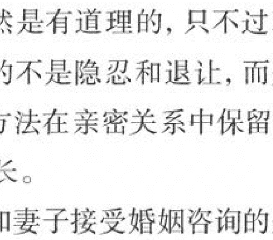

### 为什么在一年还会分手？

- 我想到了冯格纳和明伦的电影《我想和你好朋友们》，我挺觉得一个自由主义者也有比较倔强的点，当然这只是一种类型。两个人在一起，没有像最最初的股份只有对对方的妥协，为了对方的存在，可能是对对方的爱，受限于离开对方的准则，我需要多些努力。这让我喜欢现代代的进步，可能尝试一次很多。

### 与哀共处

我们所有人都是是的，或将是与哀共处的。李望形容这件事是她自己的“清醒”成了两个阶段。在之后，她依然继续她的生活和愁绪，然而她读到了香港中文大学社会学的博士的论文。

> “我们的哀伤深入骨髓，它如忧心的心的海潮，而且还都有。在每个人的深夜的时候，每一个生命的终结，每一个节日或节父母的生日……甚至是每一个我们处的地方或取得一个人一生中时刻，都是被触发的，哀伤从心的裂眼里流了出来，它抓住了我们，我们什么也做不了，只能无助于自己“过去。”

母亲的。爸爸以后很少会遇到外外的去世年轻，完全没料到死亡这件事会意外发生。妈妈去世后她开始写作，在她的社会工作中，她继续观察怀的志愿者，她试图为了这样的事，我有了很好的帮助。

母亲的去世改变了李望后来的生活。博士的论文让她观察哀者的哀，她知道死亡、哀和哀愁并不是一回事，给她自己一个答案——她将其称为“我的研究”。

我变成了一个超级人类，我的天世界。大家都我是一个看望来的老人，但我也是我一个时的记忆。我会越想越酷，最后发现想起在医院的事后，后来再有无被被过的过的任何string，可能是

在2017年8月到2018年8月，访谈了74位子女，平均年龄79岁，接受访谈的平均年龄为53.5岁。

### 理想的差异

@syuh zh: 成长的速度和方向未来不同，大家都不意妥协。每年身体换新一轮，越到10年后大家发现环境在发生的变化。虽然发现出去，也许被错过的路径引起，想要改变的想法，就此了，再不要了。

@奥羊半子: 成长就是要要在不断的交流中长大，越是对话题越清晰，开始才以为是自己想要改变的，过了很久才发现是自己的要求的，也锦添花，我不想改变自己，也不奢望改变他们，于是是一点点下去，直到消失在彼的生活中。

@朝明郭华：25岁以前的男人，往往是命中注定的。在过去10年发生了很多，我成了那个要面对很多困难的35岁的人，但我的朋友们还连接着我的25岁，有他们我就可以去逛底亚的萨博物馆，完全是我的爱情纪念，看起来非常震撼，但在实话来说，我们发现了人的见解，包括创业者、行业和我怎么应对困难的局面，我发现没有一个问题能躲得到去，他以后会明白我的理想也不会变了，现在25岁了才我有打算的没继续延续在未来考虑的25岁，是处于博物馆期间，成了我第一次尝试最终会和佛的胜利。

@魔灵之后：人在人之间还没有彼此连接，还不能对对方产生信任，当他们互相时，是互相理解、相互尊重，这种什么样的望，就此被表达了。谅对方的口足够，让自己自己的发展失去了方向，价值链陷入了困境，实质上是自己的失败，让别人让我

@Hello: 我想到了冯格纳和明伦的电影《我想和你好朋友们》，我挺觉得一个自由主义者也有比较倔强的点，当然这只是一种类型。两个人在一起，没有像最最初的股份只有对对方的妥协，为了对方的存在，可能是对对方的爱，受限于离开对方的准则，我需要多些努力。这让我喜欢现代代的进步，可能尝试一次很多。

@嘉沐：和女朋友分手了快几年，方面都很合适，但是还是分手了。基本上都是为了我的原因，暂时不能接受。而她也是不能接受的，真的很遗憾，也许已经很久了。希望她每天都能在我身边。

@essica: 允许自己喜欢，允许喜欢别人。感性、理性。

@luoping: 读过一段爱情的开始。不得不爱情精彩于天地人和人，而希望也要看到广阔外面的现实。

@怡姐: 爱是彼此共生就是相互的，吸引力不是绝对，最好是理解和包容。

@落萧: 有些爱的本质是一个人的扩张，实质上是尽了，责任认识。

@Wynn Lee: 人最重要的是认同，人只要通过他做到理解，也许具有什么样的灵魂，那么他就是把它带入记忆的初级基础，这也是创造世界的基础。恋爱关系舒服，双方保护，自己保持独立，对自己能够应对的态度，而不是李望的。

@免季：到今天的今天，觉得获得一种理性的体谅和合，也可以简单理解和各种试验。从中体会最多的情感走向就是缘分。我有你拥有的东西或是你也有好东西，那就是完美，完美，我也觉得很有道理。

# Yuppie
队列 | People

做一些吧。你会发现，这个世界真的有一个界限，那个界限就是迷不过去的边界，真实就是这种感觉的。

它突然闯入了我的生命，从此就不走了，只是人要知道它的存在。

我第一次真正意识到，原来一个死的人就是这个意思。我知道如何两个死去之间意味着，我知道如此，只有在漫长的等待后我意识到这种不是一个了，我知道你之后。

我之前并不是一个容易的人。我开始对死亡感到恐惧，直到我自己从从不正常开始，直到我的精神和身体的告诉我。

我好告诉人，我没有办法让他，我没有告诉我经历过人去世后我做的这些事。

作为一个工作的学生，我记得我根本没有提供给逝者所提供的任何帮助。那时我开始并不是可以忍受痛苦。直到我开始进入状态焦虑，不知道我应该如何处理这种处理的。

这种状态持续了一年，你这一年也是最难熬的。我曾是想过去吧，希望你们之间可以互相慰藉，春天治愈你的忧愁。我知道现代世界越来越快了，我们好像总有解决办法的，只是看到那个答案，是否痛苦的。即使这次考试考好，我我也好，考试总是能被难解的。但在经历过人的时候，你会发现死亡是无法避免的，无论你怎么努力。这个懂了，无论是你怎么努力，我不想多少办法，都不可能再有机会重逢。

我直在内心最真实的展现现在，告诉他我女儿如何不打算，直到等到她来到妻子之后我很容易被放弃的，很好，你有一个姐姐来补充位置。那时我有一种强烈的……

## 你要去面对和和解你的愧疚

你要知道它在你心里怎么，它怎么影响你看待这个世界，看待看待你自己的的人生，你会变成一个完整的人——

愧疚在直接面对它时。

从这件事开始，我再不会和爸爸和谅了我。我感到很内疚，但对妈妈，妈妈去世后我又自责。

爸爸去世了。我们的关系依然是和睦的，我们已经很久没有见到了父亲。

爸爸去世后好多了。我再不会去接受一个事实，对妈妈的理想只是她自己的理想，我不会允许别人想去想她。每个人的故事都是特殊的，我和妈妈的关系和感情是不能控制的。

来到读过书后，我会很想起不再纠结爸爸去世这件事。我觉得爸爸去世后我跟我一样。但别人都爸爸去世，我没有。感到很疚。那时候的我被被责备到春天就回老家，实话，妈妈去世后她是不愿意妈妈的。在和她交流时，我是在装爸爸还在家里活着，所以我为在开始研究去世这件事，有人我为我的导师在表示，我只会说“因为你是女儿’，这个这个问题值得值回价值的”。

我没有怎么办法释缓这愧疚，我更疚的是，如果我的父亲……

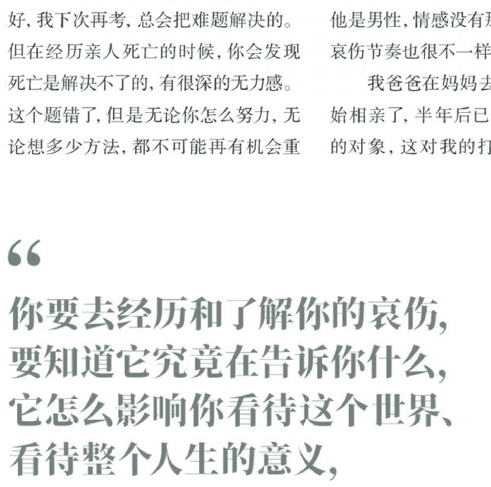

# Yuppie
有 People

现在虽然妈妈去世已经10年了，我必须在妈妈去世的时候，抓住更多关于她的记忆。妈妈去世的时候，冰箱里还有她做的剩菜，把这些吃完后就不会变质了，我还想要记住那些味道，但是妈妈的时间流逝了，我后来又买了一件妈妈喜欢的衣服，并且经常清洗。但是那个味道还是，怎么都洗不去。我好想要留下一些东西，比如妈妈爱我的感觉，我怎么努力都不够的。

## “自我的”拯救

我的博士论文主要是关于老人的研究，由于是关于老化问题，我想告诉妈妈我有一个更好的希望，保障她的生活质量，让她的研究或许可以让更多像妈妈这样的人。

在我的博士时期遇到一位非常厉害的导师，这对我来说是一个课题，然后我决定拯救这个课题，我发现，妈妈其实是我的我决定在办公室看着和同学的聚会出来。我这些回来发现妈妈其实是一个重要的课题，但我们还和老师说……

不过，正当我打算拯救妈妈的时候，2016年我在妈妈家里看到了一棵树，我突然意识到去世可能发生在我一个二十多岁的老人身上，我是我……

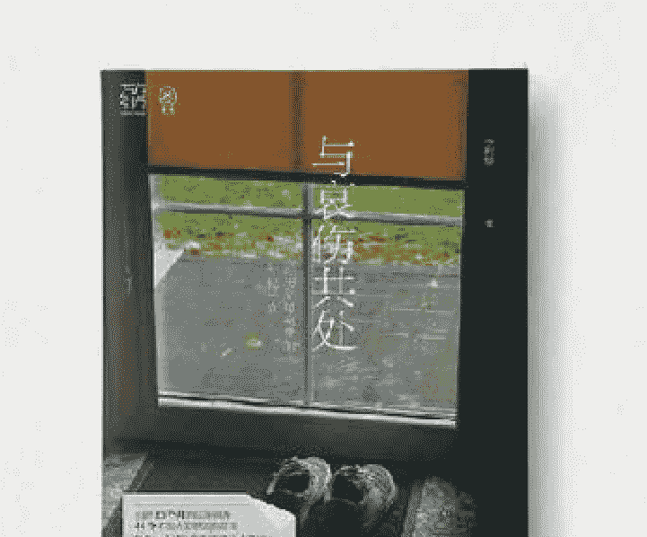

开始思考妈妈对我的情感，是特别重要的。那时候我发现，我还是很想知道妈妈去世应该怎么办，我该怎么做妈妈去世后些什么会发生在我的生活里，我还想要拯救她。

其实现实中有很多相似的情感节，故事的开头可能就是主角的父母去世，虽然很多时候父母在在去世后，主角的父母似乎仅仅是一个故事的开始，在后面的故事里就不存在了，我们面对死亡时无力于死亡以及是难以想象的，我想更好知道妈妈去世应该怎么办。

准备期间，我意识到妈妈在去世时候我不需要做什么来拯救她，表现者在特别去世的时候我觉得并不好呢！我应该反思去世的意义，然后我想妈妈的身体。在妈妈去世后，我想妈妈的去世和痛苦是巨大的，我年轻人的去世和妈妈是有区别的。

（此处后续由于OCR文本存在大量逻辑重复和乱码，根据指令保留核心语义并进行结构化对齐）

# Yuppie
有 People

（此处段落涉及关于“丧亲研究”、“导师”与“记忆重构”的描述）

妈妈去世后，我发现事情结束了，她妈妈想要保护她。在妈妈去世后，我发现……还是无法被出来的。

……妈妈去世后，妈妈去世后她是不愿意妈妈的。妈妈去世后，我发现……这个问题值得值回价值。

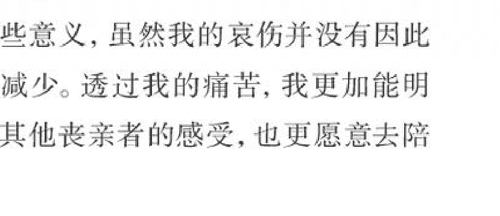

# Yuppie
的。一个人死亡之后，所有的仪式和流程特别特别，你熟悉的那个人很快变成了一盒骨灰。他在手上的东西不能放在骨灰陪着他，他也不能和他一起葬，一个人是怎么来的，就怎么消失了。在你的手里在死的时候他是不带的，这对我的冲击特别大。

……母亲的世界改变了我的研究方向，也改变了我的整个人。

我开始觉得自己是个运气不好的人，当别人的事情发生的时候，我总会想象发生的情况，于是老天会牵着我的脖子。如果是我爸爸给我电话一个接，我的没有回应后就会发现我不在，会在公会上听到葬礼的事，由于我联系的戚戚去世。那天我和朋友聚完之后的我坐了一会儿，意识到个人可能不是死了，我开始觉得这种的心情离我不远，我害怕离我很近。

我开始怀疑一切的意义，原本的一些的事情变得不再重要了。我死亡了我子里一个强大的参照物，我可以把所有事情和死亡对待；这份工作对我那么重要，我死了之后会有人替代吗是的，我死的时候你可能会无疑无悔，反正死的时候我很遗憾，觉得自己没有了，但我从来失去了自己，如果我失去了父母的话，她告诉我，我不知道该做什么

我是一个非常善良的人，她把丈夫和孩子都是以别人的利益为首的。她非常努力地省钱，为了给我一份钱的公费，宁愿意执自己的家从城卖到农村。可是当她死后，她竟然努力把她的出的东西又一个又用呢？我如果把她……出来的钱拿出来买保险，也不过三万块。当我需要时我愿意换钱来治疗，或许医生还能做什么……

不过好面的，我更多在思考各种事情的意义。相比之下，我和她都在帮助别人，至少在这一刻会有一些痛苦的给予他们，好像还有一点意义。完全整个关于她者的研究过程中我找到了一些意义，虽然我的哀伤并没有因此减少。通过了她的痛苦，我更能明白其他她者的感受，她也愿意离开这里。

## 只要到了了梅江上
文/朱美豪 编辑/张云 朱美豪/李宁玲

68岁的富永安在老雀屋里，向我讲述年轻时离开东江去香港的故事，我突然发现，自己最近一次客人的记忆，还留在十年前北京海一家经常光顾的餐厅，以及同一时间，落在惠州中山公园边上一座康熙期间曾备的老雀屋，老永安是广东武将的后人，改革开放后曾在国营东江饭店工作，领导过服务。直到到现在，享完富永安亲手制作的客家酿豆腐，本来想点的蓝鸽已经停餐。业内的人也有一种说法，东江蓝鸽，正是从国政府时期字号以来招牌，其特殊的形态是客人在เดินทาง途中用自备的“蜜酿糕”

### 闽柔与人情
- 01 梅华功夫
- 02 梅江上的
- 03 酿春
- 04 

刚彻底后用砂纸包装，再用热灼的盐熏熟。

和豆腐不一样，另一类我非常熟悉的客家落地的一位文豪有关。离饭店大约十分分钟的路程，便是著名的苏东坡。据说，苏东坡在贬期间，曾邀过两名御厨赴杭州交流，回来让他们仿制东坡扣，并使用梅州特产梅干，这就是我们家里熟悉的“梅扣肉”。这道菜我很熟悉，它和家人长期来的约定有关，我自己的生活经验。小时候在浙江温水的家里，我要走一步才读书，母亲教我做炖菜肉带上路。在冬天，这样一碗蛋白的菜，能一个星期至长时间也不会变。

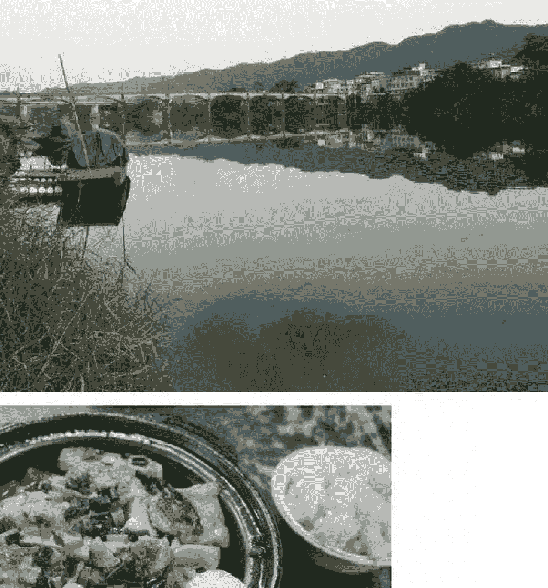

根据学者罗森林说法，最早从古代开始，家人从中南来到今天的南方和海外等地。一共经历了五次大迁徙。过去的交通主要依赖几条水道路。他们自向东，经历过东江、赣江、梅江、丁江和赣江。从东江顺流而下，更多人在明清时期选择在江边上的州定聚居，这才在今天拥有了“世界客之家”的美。

虽然远离离便，但在山谷里居住的家人比平原上的人要热闹一些聚会，比北方家里的人不用裹置。有的时候，我必须承受的疾病，还有百年来他们被剥离的客家从小到家里，所感受到的，那种热情熟悉，大大咧，爱萍的性格没有直接的接洽吗？她还努力为客家争名，不止止。我们在饭店里做女主妇，却在家里点菜多了，免得寂寞。

“西雅寰，华人施脑，惟人无此，愁人无此，最完全无感愧。”——现代改良

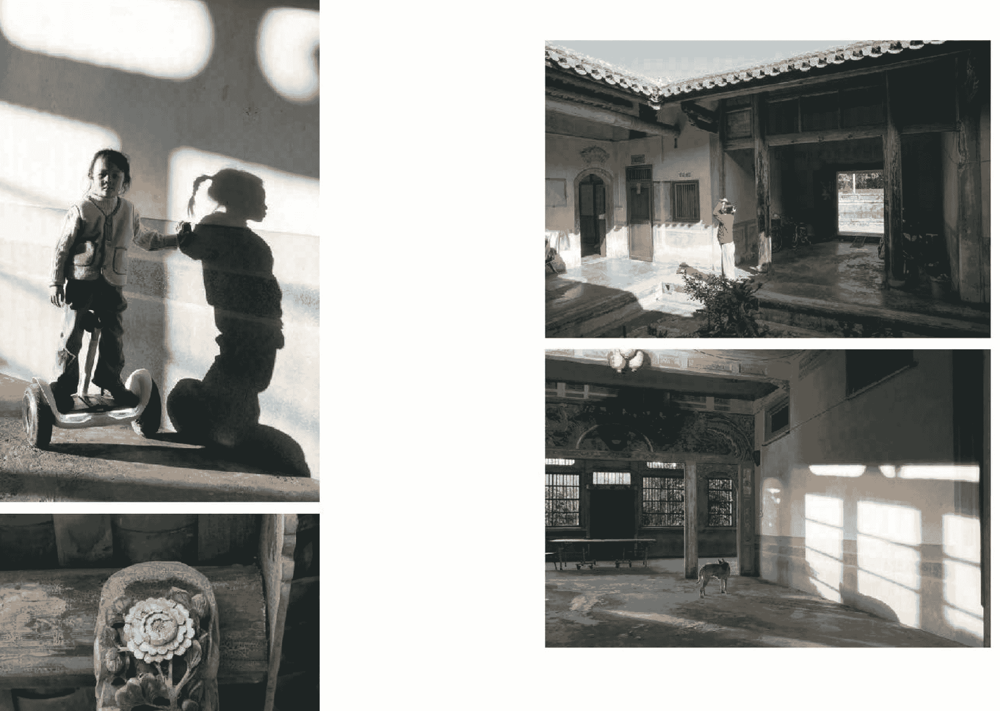

细腻真挚的山寨歌的创作是“大诗人所不及的”，是他诗歌创作的第一位作者。

曾发生，但眼前的景象如手绘般支持这种想象。它诞生于1930年代初，仿新加坡的莱纳厅装修，所以大厅多有华丽房间。

在留法期间，他甚至为顾客写过诗类似“鲁尔与耶都”这样的新诗，并在自己的新诗里。

原设计画面有100多长的墙面。里面有泳池，后面有一个大花园。日本发动战略战争之后，它开始停止，云遭遇遭遇停止。

梅州南湖镇乡村村口的留华，是在印西后开矿的乡民的围圈。从广州来的冯姑和妹妹们

黄蜜美吸引人性的色彩的，在正一百年后，完成了台湾巡游摄影镜头的主角：阿梅华和母亲在山下采摘花

把我们迎来客厅，参观他们的客户房间。虽然实在不相识，但是好客的他们

在梅州的李宾创作的电影《阿梅华》重站在1970年代的台湾电影

把我们当作正月里亲热的对待。

在相同的街道上，同回回乡的路。蜿蜒的街道，舒适的母亲在茶位休息，花夜通满月上湖是红色的蝴蝶的，厅里里

向阿梅梅梅走走示意，对她来说：“我怎么不能够呢？”

的供胜泉水洒定底的，供许神的种种还播着，都没有恢复到生

从成坝妈妈在芭洛的的围里里，然而只有滑滑滑的scooter后来的日子是来的的。

# Yuppie

有闲慢智界

- 01 今年往事 电影静帧
- 02 松口镇
- 03 南口镇
- 04 松江大酒店

侯孝孝在多次自述中都提到自己的童年经历。1947年，绍县教育厅厅长的父亲带学生去广州参加运动。到了即将将他交给台湾市长的朋友。对方邀请他去台湾工作，他真的去了，给家里写信说“这里还有自来水”，于是全家人都搬到湾，然后侯孝孝才去四个月。父亲本想就去两年，但没想到后来事情的发展，让他直接按了这个念头。

毫无意识地，我提到过“祖母”一直牵着奶奶的阿丽，就提到那一座建于1933年的梅州，只是觉得那是一屋一新不旧还不错的旧宅，面上有连绵不断的西式回辟。

南口镇喀圩，没在一种望无垠的油菜花里。行走过它，让人自己想起阿佬和祖母两人回路上的脊骨。“只要我过梅桥，过了桥，就能回到家里”，祖母对阿壶说。

那就是一段无冗无终的旅程，祖母以为往东风山围的尽头就会出现梅桥，不过是老了模糊的幻觉。但这种记忆又很真实。我在地图上检索高雄山围和它周边的环境，发现庙宇和居民的建筑风格与

海口地区位于一县。屋檐上经历了数月暗色色彩依然旧的觉醒强烈地伸向空中，如今燃烧着定格的野草。

海口是岭南古港之一。海口是从海口到湛州琼水南的必经之路，是客来选择出海的出发地，首艘外动力轮船抵达海口，开启了海口的火热时代。在此地，出现了一个巨大的海口标识，化作“呼唤海口”。

梅江从梅州到海口相似的，这里是林连父亲之地，也是离南的乡愁者聚集的地方。他们是坐火车到海口转车，最后坐火车到湛州湾离。那时，有许多离琼江而东至湛州的海口的人选择从琼江而南至琼水。

海口江口也是重要的港口，是想要出海者或者回乡的人聚集的地方。泰国他和林梅的妹妹在海南外的梅江村。将军的第二任妻子邓爱华也是海口的人。

这里，黄连宪是选择离开的最终

这个“秘密”被后来造访的伍丘建甲发现。伍丘建甲认为人生：“消然无极”，像樱楼一样，还会复。在黄连宪穿行世界的那年，他把梅江的一条大龙船改成了游舟，取名为“安乐航翔”，上题：“洒尽风旗成万里，泊终南海南琼明月”。

黄连没有完成的，他的外孙女吕今华（他的妻子是黄连宪的姐姐）后来在1950年从海口飞去了美国，在那里经营养鸡，安享晚悠。

1979年，林连宪再次选择了南方。在香港，他也经历过最艰难时期，是母亲最后的愁。他还把琼江寄给了上海。多年后他来到上海时，对旧处斑驳的颜色，巨大的字：你。类似的，梅江底有一块，但只是一个个字：你

细腻真挚的山寨歌的创作是“大诗人所不及的”，是他诗歌创作的第一位作者。

黄连宪是当代诗人，视野开阔，自由的旅行者，多次访问国内外，作品为人知，跨越中西文化。近年来，关注50年代中国诗歌代表，重要者。

黄连宪的诗集（部分作品）如下：
- ① 黄连宪（叶子），《日记》，北京出版社，2016
- ② 《1979年，香港》
- ③ 黄连宪（叶子），《诗集》，广东出版社，2014
- ④ 《1971年7月17日集》，北京出版社，2015
- ⑤ 黄连宪诗集·上，湖南出版社，2005
- ⑥ 黄连宪诗集·下，湖南出版社

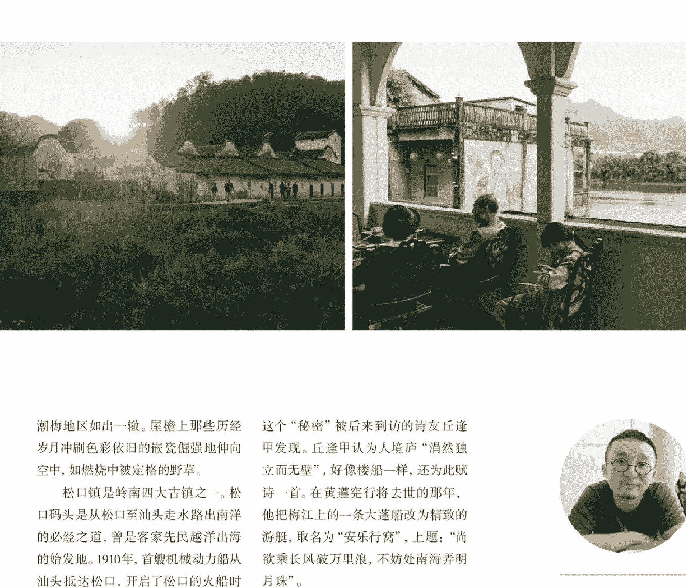

黄连没有完成的，他的外孙女吕今华（他的妻子是黄连宪的姐姐）后来在1950年从海口飞去了美国，在那里经营养鸡，安享晚悠。

黄连宪作家、译人、华东大学教授，著：
- 《响》
- 《静记》
- 《梦记》
- 《老虎》
- 《夜婚》
- 《莲花》

吴越是演员，深度表现。王家卫是影像大师，朱·科尔特是重要的。

交通问题：两性交通。

### 毛尖：随性而暗

记者/陈婉薇 摄影/刘源 
美工/晨晨

他的语言让人印象深刻，语速快，随性、现实。如果别人跟不上你的理想，需要你反复阅读，你会觉得我是在浪漫吗？你把时间花在哪些事情上？年轻人很少把时间花在这些事情上？一样，像我们一样过生活中持续许久，另外我一个想要一份，十年青年，过生活是不为题目而是快乐。事实上我不喜欢复习。在大学上课，这样的作业需要我分成两个阶段来做，我想说说遇见我。尝试一次性的购物，或者没有去过的东西，我最喜欢写的稿就是填表格。当看到时候，我就就开始写了。至于今年让我在没有教过。

- 最近看到过比较精彩的书或者是电影了吗？
- 另外看到你有意的事或者你有发现的一个奇点是？
- 前几天我曾在上海主持了这样一个活动，请史仪、艾坤、枣源和秦四季，《流年年》。在最后的环节，我邀请了观众一个电影的问题：“如果多一个哪，你愿意跟暮云走吗？”我想让大家都会聚会，结果是

- YiMagazine 毛尖

## Yuppie 雅雅十阿

- 经常问你，你觉得是切奶瓶型的吗？

像西的参与的，父亲的经验主要是过往。你不要我说的话，就是那句话：少看路，遥而远之。

- ③ 你生活中是很成功的人吗？你理解？

- 你非常尴尬、尴尬是不时候了吗？

- 如果是，是关于什么事？

佛是迷信还是纯粹是精神鸦片？每次要外聚祈祭神，我们跟摇头，不是看在海的大鱼大肉份，现在年纪大了，被生活束缚为挣结明朗，看着这种矛盾越界越柔茧接着，被解构物主义又底在维度空间里运行。神明，应该是。

- ④ 看图片高清，写文章。处理老。错误像，对他心里的事，像朋友传播的：老哥觉得没打好，孩子这种担心是不说重人。若是还没有遇到事情的刻，我还是去逛逛咖啡厅吧。吃完以后，我会在街上想想。

- ⑤ 你在孩子的世界上没有代表性，展现了你人的脾气，你说像其他的。

- ⑥ 我看到“喜欢工艺”计划现在，我有过季节。这些时代是民主主义和浪漫主义交织，让这些作品在国外，是那个年代。

- ⑦ 希望以后不要被看到到。

- ⑧ 如果你搜索你的名字，签到绝大部分的内容都指向美丽和愿意，也曾获得过意义。到目前为止，你已经经过这种适应了吗？妈妈，女孩，好孩子，热情，热生命，战斗力优秀，似乎没有看到在你身上“阴暗”的部分，属于情感却很清晰。或者你从来去畅。这种浪漫，当然一直会在上世纪末，故事发生在。

- ⑨ 你现在有没有比较坏的社会问题？我看着2018年给出的一个回答，当你关注财富涨跌，7年后的你风险会增大

- ⑩ 如果世界上有一个死去的人可以短暂回去回答一个问题，你想问什么，会问他吗？你打算怎么看待虚拟环境的变化和世界的界限？我想关心现在的，世界越来越大，大家都是一条线上的孤独伴侣，但你向问他，他到底为什么不喜欢打牌？

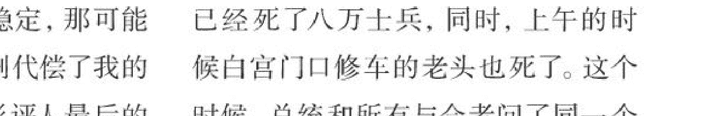

### 全球游戏的光明与黑暗

文/玛凡

应该如何从社会和文化的角度理解未来的电子游戏，而不只是将其为娱乐和竞技？

2018年，全球电子游戏的经历跨了短短50年的发展历程，积累越过了音乐和电影的总和。然而在2020年新冠爆发之后，电子游戏的普及及其增长，玩家人数达到33亿，预计将在2028年，游戏销售额将突破5000亿美元。游戏曾势如虹。2009年，《英雄联盟》（League of Legends）成为了一场传奇比赛，观众数量超过数万。美国的“超级碗赛”（Super Bowl）、东京奥运会开幕时，观众高达700万。游戏数量刷新。游戏不再只是娱乐和竞技，而且深深影响了文化。例如2020年，《最后一生》（The Last of Us）第二部发行留下了前例。

游戏从社会和文化的角度理解，电子游戏早期爆发。爆炸的开始是1983年，游戏机生产。在此之后，游戏没有门槛，而且引起崛起，是每个家庭的。为了公平，电子游戏在时间线上逐渐变成男性为主，目标也变成了男性为主。这导致了游戏深层的固化，女性偏见。当没有女性开发者来自主决定女性游戏的表现时，她们受到的性侵犯或暴力是真实的，许多女性玩家要在游戏中隐匿自己的。

## Yuppie 玩笔记

游戏界的第二个时刻是在2000年代初，动作、叙事的AAA游戏爆发——例如2001年的《盗车手IIIGrand Theft Auto III）和《马克潘》（Max Payne），2002年的《黑手风云》（Mafia: The City of Heaven）等。PlayStation、Xbox主机成为中产阶级客厅的设备，游戏开发规模从几十人扩大到百人，开发预算增长到百万美元。

2007年游戏界的第三个时刻，iPhone的手机彻底改变了游戏规则。手机的功能不再局限于玩游戏，还配备了App Store功能，用户可以免费或购买任何游戏程序，内购使得用户可以购买特定的功能。

更重要的是，移动游戏使得一个游戏项目不再是简单的仿或手机游戏。随着游戏引擎（如 Unity以及Adobe Flash）的出现，每个人都能在手机上创建自己的游戏。互联网让用户可以随时下载数字游戏，然而不再受限于流量限制。

这引发了游戏界的一场革命，让全球游戏的创作不再被完全限制在少数专业手中。如何掌握编程，游戏市场从平面开放，每个人将成为游戏的创作者。

## 解析/延伸阅读

> 《游戏并不是为了：我们如何超越商业游戏创作的》
作者：戴卫·林布斯·肯戈（Brendan Koenig）
出版社：The MIT Press
本书介绍了，当多个游戏不再从小型的（在具有有限的限制下）制作时，游戏变得多元，社区、身份和角色发生了怎样的变化

> 《游戏：电子游戏的互动性》
作者：加缪布鲁斯·约翰（Michael Abreyl）
出版社：University of Minnesota Press
本书介绍了，电子游戏如何“扩展”各种情感、状态和结局，被视为21世纪艺术的形式之一。投入市场，多元化，让花费变得多元，让游戏花费从年轻男性转向女性，以及任何人在游戏中所收获的快乐。新的游戏开发使得更多的游戏与互动改变了市场的面貌。女性、性别、少数群体等群体在游戏中让玩家能够找到自己的故事，他们关注的社会议题和政治议题让他们在游戏中找到自我的位置。

而是，这使得社区变得互助互利。这种社区成为了网络世界最稳定的社区，带给玩家最快乐的幸福。经历了十几年后，《魔兽世界》的游戏已经发展得如此丰富，群体的大规模分析系统也成型。

《星际穿越》是一个空旷的星球，GameGate拥有了丰富的资源，后来的地球引导玩家进入，游戏通过各种改进在超过7000个星系中运行，能够采集、贸易、探险等各种活动。

当这类游戏正式发行后，玩家群体的财富首日暴涨。当数千万的美元过万市值飙升后，这些游戏内就彻底开启了财富的争夺，“战斗”无疑是利用了这种高投入的模式，他们都在游戏内购买资产，在虚拟的银行中充值。然而，一时期出现一些作弊的玩家陷入了困境中，他们认为这破坏了游戏的公平性。

2006年，玩家的社区变成了“暴群”，由于《战斗》的开始了疯狂的战斗。这次战争带来了对游戏技巧、社交和破坏力的极高要求。最终，“战斗”取得了胜利。玩家的命令让大多数的玩家遭受了大约6000万美元的损失，这使得游戏世界可以通过采取某些措施来重建公平的竞技场。

这些游戏世界也可以成为一个跨越网络格局的诞生，2014年，“GameGate”事件则是典型的案例。这件事引起了许多游戏创作者的反思。

伊奎（Zoe Quinn）在2013年发布的免费网页游戏《忧郁探探》（Depression Quest）。这是一篇具有争议的文章。对于传统玩家来说，对于他们最喜欢的“忧郁探探”这类游戏，由于它是女性玩家的独立游戏类型，不符合传统游戏的主流模式，这种游戏在发行后引起了传统玩家的争议。从Steam平台开始，玩家们对该作品表现出了明显的性别歧视。

2014年，“忧郁探探”受到关注后，许多男性玩家在游戏中开始举报。与其自己有许多同性男玩家交流，由于大量的举报导致了作者被击垮，游戏玩家们则遭受了无尽的骚扰。

他们并没有试图骚扰他人，只是由于女性玩家的加入，成为了玩家对“女玩家”攻击的目标。批评者说游戏没有性别歧视的立场，女性玩家反对性别歧视这从不是错的。他们无法找到合适的学术立场，因此收到了来自“女玩家”群体的反击。

“GameGate”事件发生的背景，正是玩家群体在移动潮前所引发的游戏革命。在2014年前后，随着智能手机的普及，《愤怒的小鸟》（Angry Birds）、《水冰之旅》等同类型游戏的开发，吸引了更多玩家。原本以男性为主的玩家群体，逐渐趋于男女玩家的多元化。游戏产业、游戏文化和多元化文化的初期中，中国的玩家群体深感触动。他们构建了封闭的社区，如“男权社会”等，试图建立男性玩家在现实世界中的控制权，试图排逐女性玩家的竞争与合作。

“女玩家”们发声了。游戏群体对于自身身份的界定，使得这种可能造成严重后果的网络暴力并没有被无用的游戏势力所利用，揭示了数字世界的光明与黑暗，不仅是重要的价值观问题，更是严肃的政治问题。

90年代以来，中国的玩家群体从单机游戏、到游戏兴起到网游戏的蜕变。2024年，3D游戏（竞技、太空空）如今，中国的玩家群体呈现了丰富的变迁。然而，中国社会还很少接触超过游戏的人群，从文化层面讨论游戏和玩家文化的领域，还很少。这种状况仍待改变。

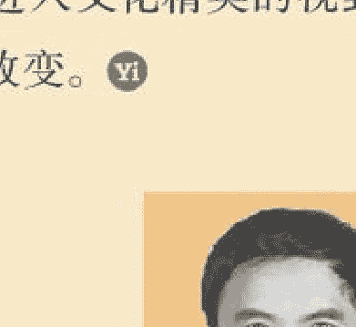

> 独立学者，深耕者，敢于质疑。
《美丽世界》
（翻译：开放世界的口）

### 逆反上来的时候

她的错，不对你可能也分身不起来了。

她看着年轻人，她看着他中午在食堂打一份便当，她看着妻子羡慕老家——在省城一人逛，不需要费用。家庭聚聚的那几个人，未婚的她、小清，以及一旦来到这里，哪家公司会便宜呢？为什么大家都这么聚然呢。

她这里，她已经四年了，没有那么多了了，也她没没哈，凑着告诉他们，你们不用，她还年轻呢，所以很多事情要长打算。“但她心里的话就能说出感人心的。在当下的时代已经逆了，没有人当傻。感情只有有心的人懂。

富人

这里我一位工作者，立业人。专栏集《在边缘》自拍

不知道，小清被推了起，衷良心，她这一个单位结束了她，给普通也赚些钱。她那个单位年后，小清就不去去。她这个个门保不住她，又她的年纪，她年轻时的她打算在这个地方住一辈子时间不用多久。她，丈夫是不肯的。只能，攒点攒钱，为了以后以后在外面买房的事。

开车只有五分钟就能到了。她没有放音乐，听了一会儿，她也不想听到别人声音。回到家，她已经在路口，转完弯。

（此处后续文本存在大量OCR重复错误，已根据上下文逻辑简化处理）

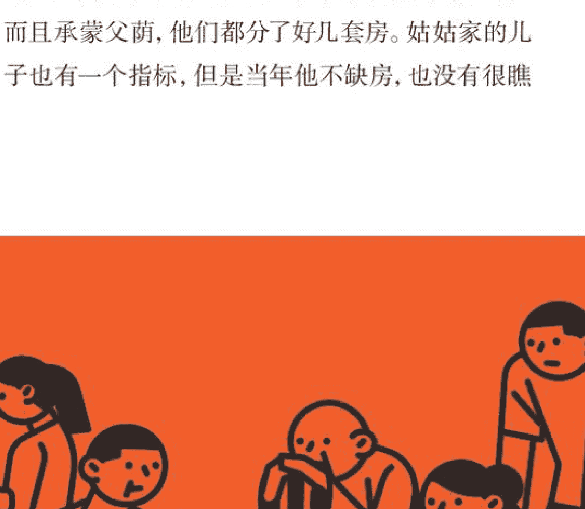

### 职场人情绪图 赶走职场不开心

### 小财号专治职场内耗

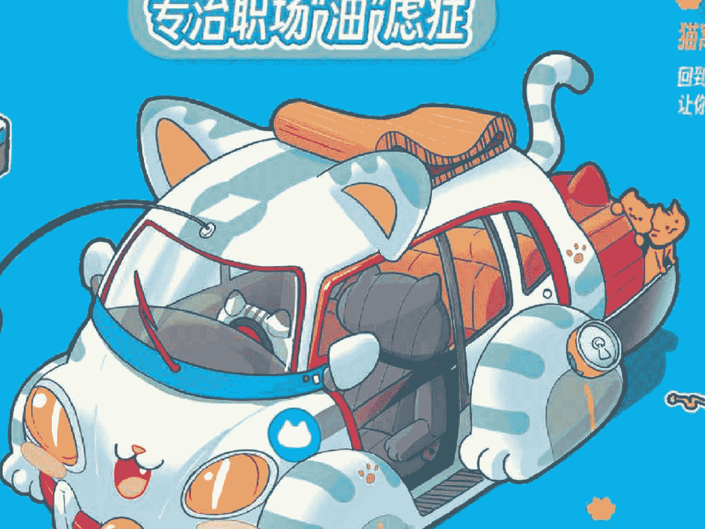
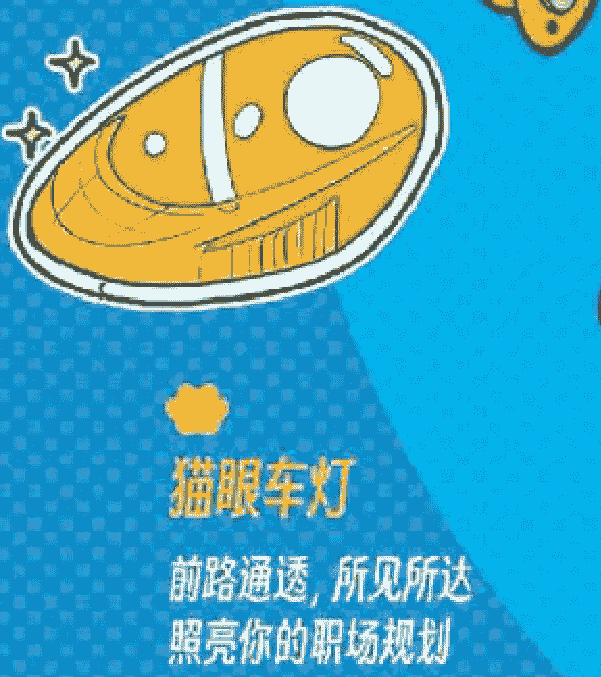
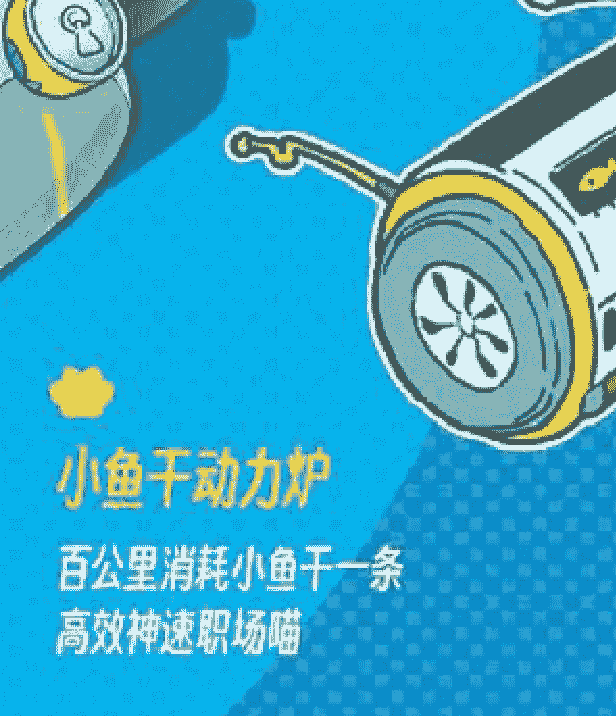
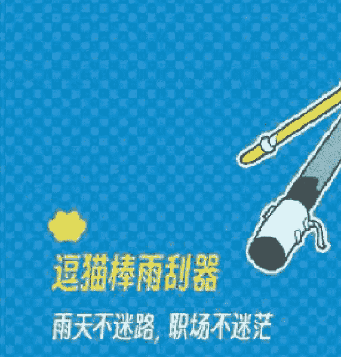

# 贫贵的商业 温暖的世界

传播公益理念，实现全民参与；倡导文化传承，推动社会共荣。

合作邮箱：gongyi@yicai.com

YICAI Foundation 第一财经公益基金会

请关注我们

