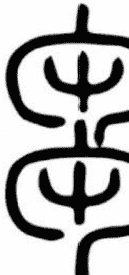
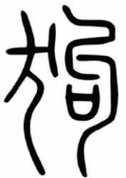

# 再鞭覆下对《道德经》的认知——熵狗！

原创：第三只眼睛 公众号：第三只眼睛 25年5月19日

道德经约800个模型，诸如“狗”这些都是主要模型，把主要的形态搞清楚了，体系基本就出来了，后面自己就能解读翻译了！

无非乎一阴一阳，一诺而已，只是组合关系有主辅之分。

还是开篇先啰铺垫，每次都得铺垫一下，不然不带感不好入进来。

- 1、破形。
- 2、破结构。

## 破形

就是看《道德经》的时候不要留在形上，老子讲的都是“气”的层面，是看不见的层面。

例如：

本文“以万物为狗”的“狗”字，不能当成形的汪汪，也不要加个“熵”字就当成什么草杂狗，这种停留在形的层面解读老子肯定是不对的。

加微信jntsg2，进料分享群

## 破结构

是从静态结构思维跳出来，这个在之前文章反复唾过关系 VS 结构。

不说结构不好，之前也敲敲过的东西，只要理解老子一定要通过关系思维。

昨天在星球回答小伙伴，引用一个“谷堆悖论”，一粒谷子不能叫谷堆，然后后加成谷堆，那么具体到哪一粒是谷堆呢？

这时候数学语言或者结构思维就不够了，很难处理动态存在的边界。

> 所以认识事物不能仅凭一种语言，道经是一种关系性语言，道家叫做——一象。

它处理哈呢？连续变化的存在形式，这玩意不能像数学一样精确。

不要一听到“模糊的”就猥夷，模糊要比精准更近事实，事实是动态的，佛家叫无常，易变易。所以道家叫象同参，两种思维都要兼具，一点也不冲突。

在上一篇《幻》里面敲过：使用即存在，存在即思维。

我们现在是“倒着”来的，是前人已经使用出来的结果，产生了现在的语言，我们倒着通过语言进入，用语言引导思维，来领悟老子怎么使用！

开始正文......

### 当狗是什么？

这是训字，根据开篇铺垫，要观察“连续运动”的形态态。

哈意思呢？当是有节奏的运化生长。（两个阴，阴形成）

定义再长点：有节奏的、无差运行的、等分的运化生长。

字典都是错的......

例如是草，这就不对了，因为停留在“形”上面的了，要不要开为哈两个铺垫呢？

咋个包结构呢？

说外面那个包围结构像个镰刀，然后割里面的中，傻乎乎的…带这个包围结构的字多了去了，还都是大镰刀？

再如果非要体现镰刀割割，那只需要上半部分就能表达了，非要上下两部分结合干嘛呢？显着咱镰刀很多是吗？

之所以不能留在形上，中文是“象-形”文字，先有象这才是根本，可以用形去喻而方便理解，但不能说这就是XX形。

例如康熙字典草是喂牛马的草，跟大镰刀一路的，更傻乎乎的，大镰刀起码还动脑子有点逻辑呢。

比如说草，不是草中有个否的种类，而是“用草来否”，或者按照中文左右阳阴的规律，是通过草运动（阳）来使用草（阴）。

加微信jntsg2，进料分享群

这个“韵”和“仁”在运动模式上是共振的，到了本文后面就知道了。

这是狗字，这造型像汪汪？看见狗就画个汪汪，这种停留在形上的字，这种造字岂不累成狗…这个字稍有点麻烦，左边是狗。

为什么哈呢？无、犬、无、万、无，这种造字岂不累成狗…这个字稍有点麻烦，左边是狗。

为什么哈呢？无、犬、无、万、无，这种造字岂不累成狗…这个字稍有点麻烦，左边是狗。

为什么哈呢？无、犬、无、万、无，这种造字岂不累成狗…这个字稍有点麻烦，左边是狗。

（注：此处OCR文本存在大量重复和乱码，已根据语义进行逻辑清理）

这个“韵”和“仁”在运动模式上是共振的汪汪汪

加微信jntsg2，进料分享群

拿出“关系本身”来讲了。

即: 嵩瀹——虚而不屈——动而愈出。

万物都是尸..
