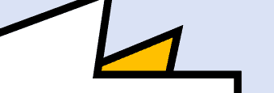
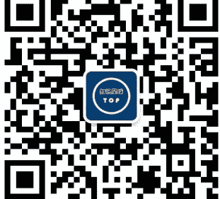
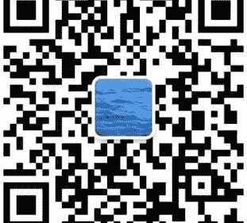
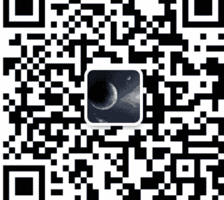

# 从一个字开启全面认知——幻

原创：第三只眼观 公众号：第三只眼观 25年4月18日

这个幻字跟个外星似的…

所谓打通就是能“跳出来”看，不跳出来如何能进入呢？

道家叫做——以出为入!

佛家叫做——知幻即离!

什么是幻？

我们看到的都是幻相，从未见过真相，或者说从未见过世界真实的样子。

## 什么是幻相？

不是不存在的意思，而是以幻的形式存在。

当人如何去使用世界，这个世界就以何种幻有形式而存在着...

这里使用一词特别关键，是贯通全文的关键词，相当于导师的实践论。

## 什么是使用？

主要有两种：关系与结构。

当利用关系去使用世界，世界就以关系形式存在着，例如阴和矛盾。

当利用结构去使用世界，世界就以结构形式存在着，例如物理和数学。

即：一切事物的存在形式以及人的思维方式，都是人使用出来的！

世界真真实的样子是什么？我们压根就不知道..

以上都集成到“幻”字模型来解读啊！

所以按照老子法则就分成有和无两件事：

1. 学幻术。属于有为法！即学习、研究、体验和运用各种幻有，这叫——大幻师。这代号可不是瞎的，佛的另一个名字就叫大幻师……

2. 见实相。属于无为法！即如何见到世界真实的本质，一切圣贤皆以无为法而有差嘛。1+2=人活着的全部工作任务了，要想找人意义都在这里面呢……

什么是学幻呢？

虽然幻有一词佛家的普及最广，但出处是道家《列子》书。

老成子学于尹文先生：

昔老聃之祖西也，顾而告曰：有生之气，有形之状，尽幻也！

造化之所始，阴阳之所变者，谓之生，谓之死。

穷数达变，因形移易者，谓之化，谓之幻，造物者其巧妙，其功深，固难穷终。

因形者其浅，其功浅，故随起随灭。

知幻化之异生死，始可与学幻矣！

吾与汝亦幻也，孰须学哉？

这段文字把人的思维都讲透了！

翻译一下啊，翻译很长尽量挑的聊……

老成子是关伊子的徒，徒弟跟着师父学。老关对徒弟说，想当年咱们师祖向西出关，被我生拉硬拽黏黏糊糊的，师祖才告诉我我学幻的道理。

幻有分成两种形式：

气不是什么物质或实质性的东西，更近于今天所说的场，场里面不停地波动，现代话就叫运动关系啦，叫作震荡关系也行，是这个意思即可，正所谓气场嘛。

其二，有形之状。这个形状换作现代话就是——结构。

物质到底是什么其实我们并不知道，我们只能以结构形式去捕捉和识别它，物质是物质，结构是结构，这是两码事！

然后老关头继续说：造化之所始，阴阳之所变。之”就是表达显现的意思，这些模型回头再细画，之者也其实是非常关键的思维模型，只是我们现代中文都给忽略了。

造化前面并没有主语，不能说有个造物主啊，客观规律之类的来造化万物，都是人脑思维的逻辑误区，没有这些主宰存在。

那怎么造化呢?

道家叫做自造自化，就好比佛陀所说的“无主宰非自然”一样，并没有个造物主来捏造万物，而是万物自己造化出自己来，自然这可不是随机的，是阴阳之所变的。

这里的自造可能不太好理解，这么简单寻思即可：宇宙里幻化万物，那谁造出宇宙呢？所以宇宙及其里面的万物肯定是自造自化的呀！所以佛道经常让人回归到“吾即宇宙”的视角上来，这才能从更根本的视角上去认识事物的存在形式。

那么从老关头上这句话里就看出，道家认为关系要比结构更加趋于本质存在，是先产生关系后产生结构，这叫作气聚成形。

换作现代话描述：就是先有气场的震波动，观察这个层面的存在形式就是运动关系；然而随后振荡凝聚才产生了具体的物质结构，结构形式产生出来之后，这个世界就显现出质了。

谓之生，谓之死。这里的生死不是指人或生命的出生和死亡，而是佛家的生灭无常，即万事万物都是无常运动着的，事物刚出生就灭掉了，事物是以生灭震荡的形式存在本质。

例如禅宗那个过去心、现在心和未来都不不可得，说的就是时空就是场幻有，其本质是不不停生灭的。

量子就是动态关系网络，是追着猎物跑，猎物怎么动关系就怎么生成！

老子说：天网恢恢而不失嘛。

关系动态不是刻意雕琢出来的，而是时时刻刻刻都在运动着的。

所以老子又说：不言而善应。不招而自来。（这里的不属于不是，就是还没有的意思）

例如：

西医属于结构思维，人要得已经设定好的病，千人一方，比喻管老的少的男的女的都叫血糖高，吃的是一种药。

中医属于关系思维，是追着的运动关系跑，不是给病治病而是给人治病，从千人千方。极端点用的话，比如这个气候是A方子，下一个气候就变成B方子了。

不是说哪个哪个坏啊，结构与关系都是使用方式，人怎么选择使用就会怎么存在。

## 什么是学的重点？
使用它>相信它！

就是有一个“抓”东西的感觉，这个感觉要远远比学到什么具体结构或关系重要得多。

## 为什么>是什么！

这样在实际运用上就不容易认死理，规避导致的不灵活，或者更直白点就是不能听风就是是雨，不能说啥就信啥，而是要看它要干啥...

例如：

阅读到一条经济信息或政策信息，第一反应就是它要“抓”你，要把你抓进它所要设定的结构或关系里，好比把你关进笼子里方便使用、控制和收割啥的。有了这个思维的主动能力后，你就可以研究如何不被抓，甚至如何再次利用这条信息去抓人...

很多人什么样呢？
压根就没有思维的主动之力，只有选择相信vs不相信，脑瓜子里被灌满了各种设定好的结构陷阱，结构套结构最后致幻了！

例如：
在现代社会中，媒体是最重要的管理手段，一个结构都是通过它灌输出来的，叫做意识形态结构嘛，所以1%的人可能的控制金融+媒体。

当人被灌输什么结构了，那么在社会层面就会逐渐形成什么社会结构了，社会结构也是由个体而规定性扮演出来的嘛。

例如资本主义和主义就是两种结构设定，通过它们使用人们，从而产生出自身的社会结构和矛盾关系演化。

学的重点就是不能直接认为是真实的、理所应当的，而是研究它们如何在抓取或者说如何在使用

## 免费 价值 及时 专注

## 扫码加入 知识星球TOP 免费资源群

- 每日免费获取价值资源
- 可提供各类资源搜索服务

| 热门付费文章 | 各行各业报告 | 副业赚钱方法 |
| :--- | :--- | :--- |
| 精选图书资源 | AI财经自媒体 | 职场实用资源 |

公众号: 知识星球TOP | 微信号: jntsg8 | 微信号: jntsg2

分享资料仅供个人学习，请及时删除，切勿商用传播
