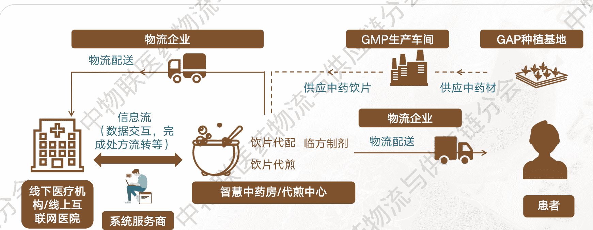
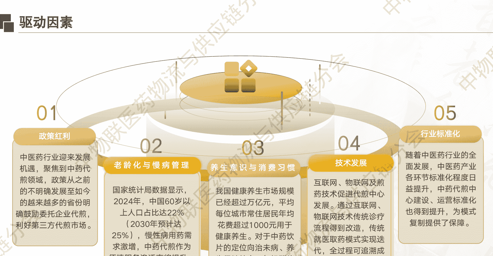
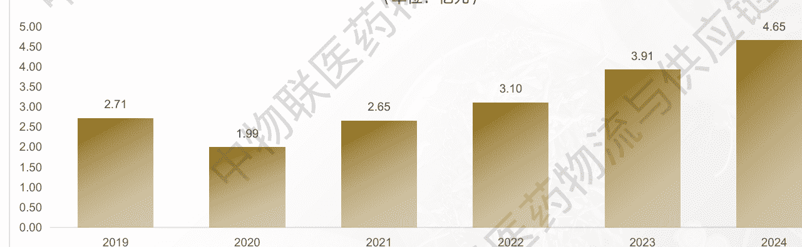
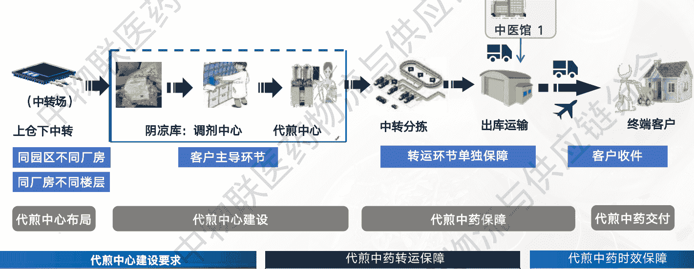
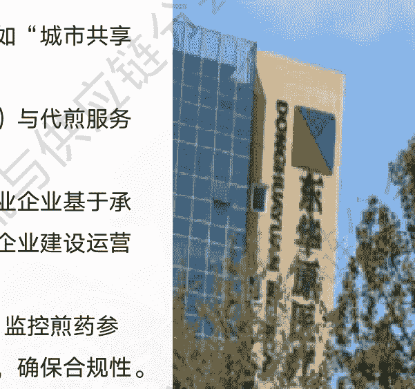
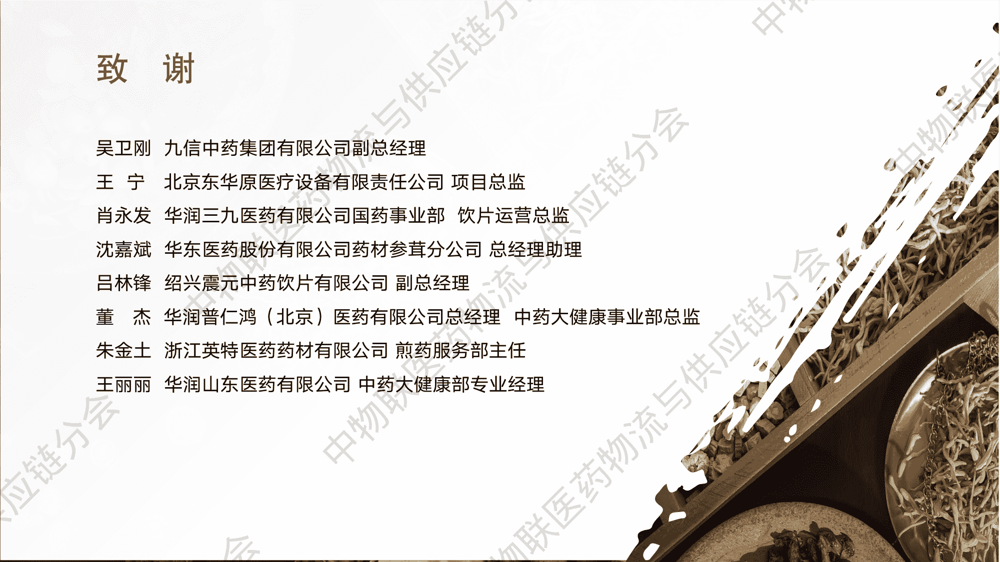

# 第三方中药煎剂市场分析报告 (2025)

发布机构：中国物流与采购联合会 医药物流与供应链分会 CPLF 九信中药 东华原医疗

发布时间：2025年4月

## 知识星球TOP 资源分享群

让更多人获取高价值信息

汇聚网付费资源

公众号：知识星球TOP

微信号：jntsg8

添加微信免费进

微信号：jntsg2

- ◆付费文章
- ◆付费社群
- ◆付费课程
- ◆ 副业&搞钱
- ◆ 财经&股市
- ◆行业报告

时政·历史·职场·体制·自媒体
学习·军事·软件·影音·社会学

## 编制说明

近年来，国家连续出台《中药发展战略纲要（2016-2030年）》、《“十四五”中药发展规划》等政策文件，不断支持鼓励医药全行业、全产业高质量发展。第三方中药代煎由于其集约、高效的特点，初期作为中药饮片销售的“新业态”在浙江、广东、上海等地开展，近年来越越多的企业进入该领域，市场规模增长迅速。

在此背景下，中物联物流与供应链分会发布《第三方中药代煎市场分析报告（2025）》，聚焦第三方中药代煎领先领域，对行业内近60家企业及医疗机构深入调研，采用定量与定性相结合的研究方法，对该领域的政策背景、市场情况、行业现状与发展趋势等重点进行梳理总结，旨在还原市场格局，预判发展趋势，为行业企业提供参考。

本报告为分会首次研究该领域的阶段性成果，受到样本数量、样本类型、资料有限等因素影响，可能存在一定偏差，如有不同意见欢迎与分会联系，互通无。

本报告内容撰写过程中，得到了中国中药、九信中药、康美药业、广州采芝林、华润山东东药、华润嘉仁（北京）、东华原医药、顺丰等许多企业的支持，仅在此表示衷心的感谢！

中物联物流与供应链分会
2025年4月

## 目录

- 01 行业概述
- 02 市场环境
- 03 现状趋势
- 04 附录内容

# 行业概述

行业定义、行业流程示意图

## 行业定义

中药煎药行业是指专门从事中药汤剂剂、销售和配送服务的行业。根据服务类型和业务模式，中药煎药行业分为传统煎药和现代煎药两类。

本报告研究对象为接受医疗机构委托的第三方代煎中心，是专门为医疗机构或患者提供中药煎煮服务的独立机构。它们接受医疗机构或患者的委托，按照方便要求，使用专业设备和技术，将中药饮片煎煮成汤剂或方剂，并提供配送服务。该中心通常具备专业资质，严格遵循煎药标准，确保药效和安全性，旨在为患者提供便利、高效的中药煎煮解决方案。医疗机构以及零售药店内的代理室不属于本报告研究范围。

## 行业流程示意图

### 第三方中药代煎中心行业端到端流程示意图

## 行业流程示意图

### 代煎中心内部流程图

医疗机构代煎中心分会执业药师审核，自动生成一个条码作为处方的“身份证”。调剂员扫描处方，调剂员将饮片加适量水浸泡，执业药师复核煎煮好的药液是否有误，调剂员通过专门的管道配送到医院/患者家里。煎煮好的药液通过机器自动打印处方的标签（含有患者姓名、年龄、性别等信息），将标签贴每一药液上。煎煮好的药液保留若干天，通过设备进行匹配。

## 行业基本属性

- 服务属性：中药代煎行业属于医药服务，需要提供专业的服务，且根据客户的需求及时调整，满足客户的要求。
- 区域属性：中药代煎行业具有较强的地域性，主要在人口多、经济发达的地区，代煎服务辐射范围内。
- 文化属性：与中医药文化相关，是中医药传承和发展的载体延伸。

# 02 市场环境

### 政策环境、驱动因素

### 政策演变过程

智慧中药建设、丰富医药服务等背景下，第三方合力快速发展，逐步迎来支持性政策，具体见下文。

2007年，卫生部发了《中医药诊所管理办法和基本标准（试行）》，许可中医药诊所，设置中药零售店，中药代煎服务也被带到了外，经营越来越多。

2009年，国家医药管理局发布《关于印发医疗机构中药煎室管理规范的通知》（3），首个中药煎室规范出台，从设备、人员、管理、操作四个方面详细阐述了中药煎剂的要求，确保中药代煎质量。

卫生部发布的《医院中药煎片管理规范》第五章提到中药煎片煎煮工作，医院可以成为医疗机构开展的一种便民服务。

### 部分核心国家层面支持政策

| 发文时间 | 发文机构 | 文件名称 | 相关内容 |
| :--- | :--- | :--- | :--- |
| 2018年4月 | 国务院办公厅 | 关于促进“互联网+医疗健康”发展的意见 | 推广“智慧中药房”，提高中药饮片、煎剂等药房服务水平。 |
| 2018年7月 | 国家卫生健委、国家中医药管理局 | 关于深入开展“互联网+医疗健康”便民惠民活动的通知 | 鼓励有条件的医疗机构推广“智慧中药房”。解决处方系统与药房系统对接，方便群众取药。线上处方经医师审核后，医疗机构、药品经营企业可委托符合条件的第三方药房对接。提供中药服务的各类医疗机构要建立信息技术实现药品快速、解决排队困难、取药不便等问题。 |
| 2018年1月 | 国家卫生健委、国家中医药管理局 | 关于加快服务高质量发展的意见 | 推进医院“智慧药房”。充分利用信息化手段，实现处方系统与药房配药系统对接，缩短患者取药时间。 |
| 2019年7月 | 中医药管理局、国家卫生健委 | 关于在医疗联合体内加强中医药工作的通知 | 县医院要参与乡镇卫生院、社区卫生服务中心中医药综合服务（中枢、县域）。鼓励有条件的地区在县级医院建立中药饮片供应中心和共享中药房，统一中药饮片采购、调配、炮制、煎煮和配送服务。 |

| 发文时间 | 发文机构 | 文件名称 | 相关内容 |
| :--- | :--- | :--- | :--- |
| 2022年11月 | 国家中医药管理局 | “十四五”中医药信息化发展规划 | 鼓励各地开展智慧中医药建设，鼓励各地推广智慧中药房等服务模式；鼓励医体牵头中医药发挥技术辐射带动作用，探索构建远程医疗中心、共享中药房，提供远程医疗服务和统一规范的中药学服务 |
| 2023年12月 | 国家卫生委、国家发改委等部门 | 关于全面推进紧密型县域医疗卫生共同体的指导意见 | 鼓励依托县域医共同体建设县域中药房，建立缺药登记和配送制度，解决农村居民用药问题 |
| 2024年8月 | 国家中医药局、国家人社部、国家卫委等部门 | 关于快速推进县域医药高质量发展的意见 | 健全县域医共同体建设县域中药房，设置中药煎室，鼓励非营利性企业托管中药房，医院在2小时内提供急救服务。 |

### 地方领先性支持政策

| 发文时间 | 发文机构 | 文件名称 | 相关内容 |
| :--- | :--- | :--- | :--- |
| 2018年4月 | 云南省人民政府 | 关于推进中医药产业发展的若干意见 | 建立完善中医药体系，提到开展中药饮片煎煮（含处方）与企业合作等方面积极探索。 |
| 2022年3月 | 广东省人民政府 | 中医药综合改革示范方案 | 鼓励有条件的医疗机构推广“智慧药房”建设，实现处方系统与药房无缝对接，方便群众取药。药品经营企业可通过委托第三方进行煎服务。 |
| 2022年7月 | 江西省人民政府 | “十四五”中医药发展规划 | 鼓励建立“智慧药房”等站式模式。 |
| 2023年8月 | 山东省医保局、财政厅、卫健委、市场监督管理局、药监局 | 进一步加强“互联网+医药”创新措施 | 到2025年每市至少建设1个共享药房，中药饮片采购、调配、煎煮、集中配送一体化，提高基层卫生服务能力。 |

| 地区 | 文件名称 | 发文主体 | 相同点 | 差异点 |
| :--- | :--- | :--- | :--- | :--- |
| 浙江 | 2016年3月河南省中药饮片代煎工作规范（试行） | 浙江中药质量控制 | 允许企业开展药品经营、储备储存区域，煎液冷却后应在室内保持2-8℃ | |
| 上海 | 最新版：2022年修订版（2017年发布）上海中药质量规范 | 上海中药协会 | 允许企业承接医疗机构代理生产，明确责任主体为医疗机构，确保药品质量；涉及药品储存、存储以及后期处理 | 企业类型：仅允许药品生产或经营且正常经营；场地要求：应当企业拥有中药专用许可，须执行行业标准，经营环境符合GMP的最低要求。园区内生产企业面积小于100平方米。连锁企业参与经营的场所以许可证明为准。不允许在城区外进行中药生产和储存。药场场地生产企业不小于100平方米，零售面积不小于100平方米。 |
| 重庆 | 2023年12月重庆医疗机构委托中药饮片生产经营企业提供中药代煎质量管理规范（试行） | 重庆市卫生委员会 中医药管理局 | 允许企业开展药品经营用车辆、设备、仓库等。受托医疗机构同意，可委托符合条件的企业配送。场地、设备和设施符合要求进行标准化生产；具有行业标准的设备设施，生产环境温度高于30℃时，应采取必要的降温措施。被委托企业应使用消毒车辆。医疗机构委托不得使用处方医生信息、患者信息、饮用水等信息，不得擅自使用或向第三方提供处方数据信息及资料 | |
| 北京 | 2024年8月北京医疗机构委托中药饮片生产经营企业提供中药代煎、配送服务规范（试行） | 北京市卫生委员会 中医药管理局 | 企业可协助医疗机构进行药品代理服务的，应当签订合同，约定双方权利和义务并合法执行。医疗机构可以委托符合条件的企业进入医疗机构 | |
| 江苏 | 2024年10月关于进一步加强全省中药饮片代煎生产经营规范的通知 | 江苏省卫生委员会 中医药管理局 | 企业不得以任何形式参与医疗机构的药品经营工作。对于具有条件的县，可以在区内设立中药饮片服务中心和中药超市，在区域内统一开展中药饮片采购、零售、服务 | |

### 部分地区发布地方标准规范智慧药服务

| 地区 | 时间 | 文件名称 | 发文主体 |
| :--- | :--- | :--- | :--- |
| 深圳 | 2017年12月26日发布，2018年2月1日实施 | 智慧中药(SZDB/B 283-2017) | 康美药业有限公司牵起草，由深圳市卫健委提交 |
| 广东 | 2022年1月15日发布，实施 | 智慧中药房规范(DB44/T356-2022) | 广东省医药管理局 |

| 地区 | 时间 | 文件名称 | 发文单位 | 部分核心内容 |
| :--- | :--- | :--- | :--- | :--- |
| 宁波 | 2023年12月发布，2024年1月实施 | 中药代煎服务规范(DB33/T149-2023) | 宁波市市场监督管理局、宁波市卫生委员会 | 服务要求：实用面积不小于100 m²。设备设施：中药煎机（含煎服）符合GB/T3021的要求，且数量不少于50台。服务要求：处理时限不超过24h，准确率达100%，总量误差不超过2%。 |
| 荆州 | 2023年12月发布，2024年1月实施 | 中药代煎服务(DB42/T63-2024) | 湖北医药有限公司、荆州市卫生委员会 | 服务场所：取得药品经营许可证以上，面积符合≥100平方米。设备设施：中药煎机（含煎服）符合GB/T3021的要求，且数量不少于50台。服务要求：处理时限不超过24h，准确率达100%，总量误差不超过2%。 |
| 深圳 | 2024年10月发布 | 中药代煎质量规范(T/SZ 01-2024) | 深圳中医药协会 | 服务场所：场地面积符合（≥100平方米）。设备设施：中药煎机（含煎服）符合GB/T3021的要求，且数量不少于50台。服务要求：处理时限不超过24h，准确率达100%，总量误差不超过2%。 |

| 地区 | 时间 | 文件名称 | 发文主体 | 核心要求 |
| :--- | :--- | :--- | :--- | :--- |
| 广东 | 2022年1月发布 | 智慧中药房与规范(DB44/T356-2022) | 广东省医药管理局 | 针对智慧药房的编写，其中涉及的药链环节进行了规范；场所要求：设有与业务适应的设备、仓储区域、煎煮区、包装区、物流区、公共区域。仓储符合《药品管理规范》，具备操作台、防尘、防霉、温度湿度监测。技术要求：具有处方识别、自动化物流输送系统、智能化配送系统、视频监控系统。质量体系：明确处方审核、煎煮、包装等具体要求，符合GSP标准。 |

# 03 现状趋势

特点与规模、问题与挑战、发展趋势

### 驱动因素

- 01 政策红利：中医药行业迎来发展机遇，聚焦到中药代煎领域，政策从越来越多的省份明确鼓励企业代煎，利好第三方代煎市场。
- 02 老龄化与慢病管理：国家统计局数据显示，2024年，中国60岁以上人口占比达22%（2030年预计达25%），慢性病用药需求增大，中医药作为便捷性服务渗透率将提升。
- 03 养意识与消费习惯：我国健康养生市场已经超过亿元，平均每个城市常住居民年花费超过1000元用于健康养生。中医药片剂针对未治疾病、保健转变。年轻群体对“免煎、便捷化”中医药接受度高。
- 04 技术发展：互联网、物联网及医药技术促进中心发展。通过互联网、物流链得到改造，传统诊医取药模式实现替代，全过程可追溯为。
- 05 行业标准化：随着中医药行业的发展，中医药产业各环节标准化程度提升，中药代煎建设、运营标准化得到提升，为模式复制提供了保障。

## 特点与规模

### 第三方代煎中心增长快速且具有地域特性

据调查调研及业内人士推测：

- 目前国内范围内代代中心总量总量约为40个个近近3年每年每年增长60个年平均增长率约为155%，全国代中心单日总体订单量处于108w-162w区间内。
- 第三方代煎中心受到经济发展、人口密度、人均消费水平以及中医药资源分布和监管政策开放程度等等因素影响呈现为明显的地域特点，全国代煎中心集中在华东、华北地区，两个地区数量占总量60%以上，具体参考下表。
- 上海、南京、杭州、广州、深圳代表的江苏和广东是第三方代煎发展较早的地区，这些地区医疗机构委托第三方的比例已占医院业务量的80%以上。

全国各地第三方中心数量占比（截止2024年）

| 地区 | 华东 | 华北 | 华南 | 华中 | 西南 | 东北 |
| :--- | :--- | :--- | :--- | :--- | :--- | :--- |
| 第三方中心数量占比 | 36% | 28% | 10% | 8% | 7% | 5% |

数据来源：北京华原医疗设备有限公司，中物医药物与供应链分会

## 特点与规模

在会议调研及业内人士介绍的基础上，拆分基准推算（综合考量中药饮片规模、第三方渗透率等因素）:

- 2024年我国第三方中药代煎规模超172亿元。自2019年起，除2020年疫情情况下就诊量大幅下降影响外，其他年份第三方中药代煎市场呈现连续增长态势。
- 利润方面，第三方中药中心根据业务量和运营能力，毛利率在15%-40%区间，相比于饮片产品和饮片商业业务的毛利率，较为可见，但由于投入成本、收费标准较低等因素影响，净利润指标并不理想。在日均处方量上，智能化水平较高的第三方中心，需要3-5年才能扭亏为正。

## 特点与规模

中药代业业务作为饮片销售的增值延伸在企业中开展

| 医疗机构 | 第三方代煎中心 | 配送企业 |
|---|---|---|
| 开具中药处方，对开具的处方质量负责，是代煎业务的责任主体，审核处方合法性、提供药品服务和承担管理责任。 | 受医疗机构委托进行中药代煎煎服务，需具备相应资质和条件，对饮片质量和煎药质量负责。 | 快递企业：负责将代煎中药配送到患者指定地点。 |

- 目前承接代煎业务的企业主体有饮片生产企业、饮片经营企业以及其他三种类型，占比分别为80%、15%、5%
- 生产企业以及饮片经营企业承接代煎业务的核心价值点在于完善本业务的服务体系，提高企业的饮片经营规模。
- 通常承接方也是第三方代煎中心的建设方，但建设方可能为多方出资共建，合作方式灵活。

80% 饮片生产企业
15% 饮片经营企业
5% 其他类型企业

## 特点与规模

全国范围布局最大的三大企业（排序不分先后）

#### 九津中药

为九州集团旗下中医药产业平台公司，发始于2000年、整合于2011年，总部位于中国武汉。截至2025年3月底，在北京、上海、武汉等地建有16家中药第三方代理中心，与许多省、3个县级医院合作开设“智慧药房”。拥有近5000台设备，日均处理3万处方。并依托九州通全国领先的医药物流网络，实现“一日两配”极速达，服务覆盖全国96%区域。

#### 华华九

2020年启动代煎服务。2024年1月10日，华华九中药传承创新中心（广州基地）智能药房（代煎中心）正式揭牌启用。在四川凉山，华华三星凉州中医药全产业供应链项目正在建设中，其中包括新建医院制剂中心及中药饮片智能代煎中心，预计2026年底投入生产。参与起《中药代煎质量管理规范 T/SZCTM01—2024》。

#### 康美中药

2015年开始提供代煎业务的企业，目前在全国拥有9个第三方中药代煎中心，覆盖深圳、成都、上海、北京、重庆、普宁、昆明、江门等众多城市，形成了紧密的医疗机构及药剂终端局和服务网络。服务对象从中医药医院拓展至综合医院，在全国已服务约1300家医疗机构，服务门诊医生累计14.4万余，服务患者超过1500万人。

信息来源：北京华源医药设备责任有限公司、中医药物流与供应链分公司调研

## 特点与规模

在分会调研及业内专业人士介绍的基础上，据分会推算：

- 2024年我国第三方中药代煎规模近5亿元，但未来，随着第三方中药市场规模的增长，该市场空间将持续释放。
- 相比物流通道，代煎配送更加注重药品质量的稳定性和服务满意度，这也是目前第三方代煎中心将对配送企业的核心要求。

目前，配送环节代表企业有顺丰、邮政、京东、三一通达等企业，拥有专业的第三方药物物流企业，也有快递通公司参与其中。

### 2019-2024年第三方中药代煎规模
（单位：亿元）

数据来源：中物联医药物流与供应链分会调研

## 特点与规模

代煎配送服务模式持续迭代——智能仓配一体模式

进入中场进行转运保障的代中药，充分发挥网络优势和多频次中转，整合园区资源，仓内生产波次与配送无缝衔接，端到端履约时效提升至区内、省内、航空高时效为主，实现当日日达、次日达时效为主。

## 特点与规模

技术赋能下的代煎中心发展演进

### 早期萌芽阶段

主要以患者自行煎药为主，但是一些诊所或药店也会为患者提供代煎服务，但并不普遍，多是基于患者的特殊需求与药师的特殊关系。当时的代煎完全依靠人工经验，在传统的炉灶上用砂锅等器具进行煎煮，对药师的技能要求极高。

### 医院与药店代煎兴起

20世纪后期，医院和药店开始较为普遍地开展代煎服务。主要是基础药煎，能够实现自动控制、定时等功能。代煎服务主要在医院内的药煎室或药店的后场进行，患者在就诊或买药后，将药方交给相关部门，等待煎完成后取。

### 中央药房与智慧药房出现

2015年起，以康美药房为代表，开启了城市智慧药房模式，利用网络及物联网技术，中药煎煎与配送等一系列服务，患者可以在家中等药房完成服务。

### 智能化与信息化深入发展

大数据、物联网等数字技术在中药代煎领域得到了广泛应用。能够自动识别药方等功能，通过建立全流程信息追溯体系，实现了代煎服务的智能化、信息化。

## 特点与规模

技术服务代表性企业及案例

- 煎设备是第三方中药煎煎的重要组成部分，主要涉及煎设备、包装设备等。
- 根据调研，目前市场上较多的是东源、厚实等品牌，东源最早进入代煎领域，国内市场占有率95%，同时引领中医药布局市场。
- 煎设备也从传统煎壶向智能煎机迭代，甚至不少中药中心已经实现了自动煎、自动包装等。

康桥智慧药房配备了多套标签、500余台药包一体机，应用自动加水系统、自动化运输设备等。目前主要对接阳光医院、光明医院、人民医院等，日处方峰值达5000方。全流程追踪：采用智能煎药系统，实现标准化管理、调剂、包装、全流程追溯。自动化生产：配备全自动煎煮机、智能调剂系统，支持一人定制化煎煮。安全认证：由东源提供的智能煎药系统获得三级信息安全保护认证，有力证明了现代化煎药中心管理系统的有效性。

## 问题与挑战

第三方代煎中心面临的问题与挑战

### 质量控制难题

受到中药材质差异的影响，代煎质量受到影响。同时，部分代煎中心的操作存在不规范的情况，对质量产生影响。

### 行业标准与监管不完善

缺乏全国统一的代煎服务标准。目前仅部分省份出台要求，地方管理存在差异。

### 竞争激烈与盈利压力大

代煎中心投入成本低，很多省份对代煎定价有限，盈利压力大。智能化设备差异性下降，代煎服务差异性，同质化严重，竞争激烈。医药聚集也为行业增加了不确定性。

### 患者信任与市场教育不足

部分传统观念认为“自煎更放心”，其老年群体对代煎接受度较低。代煎中心向患者放药过程可视化，一定程度改善此问题。

### 三废处理合规与成本的平衡

中药代煎中心面临水、废气和固体废物处理与生态环境、生活环境的矛盾，配套专业环保设备并承担额外成本，中小型机构存在合规风险。

## 发展趋势

行业规模和数量持续增长但同时盈利压力增加

- 短期内，医药发展的国家战略定位不变，鼓励中药服务一直是政策主流，加之患者对于中药代煎的需求持续增加，医疗机构希望减轻成本压力等因素影响，第三方中药代煎中心建设将持续增长也是大势所趋，代煎中心数量将保持两位数增长。网络布局将向县级、社区卫生站等市场倾斜，一方面由于目前市场还有空间，另一方面是随着载体的推进，县域的共享代煎中心建设是政策支持的重点。
- 受到医院运营压力、饮片集采等因素影响，第三方代煎中心的盈利压力短期内依旧不能缓解，需要监管部门如何考虑承接代煎业务的企业模式，需要监管部门规范流程、配送服务费用的定价和支付方式。

## 行业整合加速，向“专业化+规模化”集中

- 行业监管日益严格，经营、环保相关成本增加，代煎过程复杂化成为行业准入门槛，整体有利于具备实力的大型企业并购将会出现。运作不规范、资金实力不够的小型企业逐步退出舞台，龙头领先格局形成，行业集中度持续提高。

## 发展趋势

模式创新：从分化到智能化、区域化

- 第三方专业服务崛起：集约化的大型中心（如“城市共享药房”）将取代小型作坊，处理量从千剂转向万。
- 互联网融合：中医煎诊平台（如微医、平安好）与医药服务无缝衔接，形成“开方-煎药-配送闭环”。
- 市场聚集：此背景下，承接的品种丰富、销售网络完善等具优势。
- 技术赋能：数字化、物联网（IoT）技术在中药代煎领域得到了广泛应用。能够自动识别药方等功能，通过建立全流程信息追溯体系，实现了代煎服务的智能化、信息化。
- 自动化：煎药到药袋的自动化生产线，提升煎药效率。利用大数据、人工智能等技术，实现煎药精准预测。
- 溯源：中药材来源、煎、温度、包装等全过程的可控和可追溯，实现代煎服务的智能化、管理，以及对患者需求的精准响应。

## 发展趋势

服务升级：从基础代煎到“精准化+增值服务”

- 质量与透明度提升：全程可视化、通过APP实时查看煎药进度、记录，甚至提供核验。
- 个性化定制：针对不同病症（如术后、慢性病）推出差异化煎药方案，拓展附加值业务。
- 配送服务：更为强调安全性、时效性。随着线上线下融合，当日达/次日达的标准将会延续。
- 代煎中心网络下沉：促进代煎中心网络下沉，邮政优势突出。
- 质量把控：在医疗机构委托煎药服务，配送企业的要求更高，对消费者满意等方面。

# 附录内容

部分省份文件核心内容

## 附录内容——部分省份规范要求

2022年3月，上海中药行业协会发布《上海中药行业煎药质量管理规范》（2022年版），2022年5月1日起实施

- 适用于本市医疗机构委托煎药服务，且取得药品生产或经营许可证以上的上海中药生产和零售企业。
- 企业设置独立的煎药区域，开展中药煎药以及集中煎药服务的连锁企业，应当设置中药煎药专用仓库。仓库面积应与业务量相适应（煎药生产面积不小于100平方米，实行煎药服务的连锁企业参照执行）。
- 企业应当设有与业务量相适应的煎药调配场所（煎药调配区域不小于100平方米，实行煎药服务的连锁企业参照执行），零售药经营场所和面积应以药品许可认定为准，在许可区域外调配和存储煎药。煎药面积应与业务规模相适应，实行集中煎药服务的连锁企业不小于100平方米，零售药面积不小于20平方米。
- 加快推进煎药服务过程的信息化、智能化管理，实现线上查询，煎药煎源及煎药服务全过程的可控和可追溯。
- 接受医疗机构委托煎药业务的，应使用自煎药，不得外购中药煎药产品或成品。医疗机构委托煎药业务的，其购买的中药可委托该企业开展验收、养护等，存放在符合GSP条件的企业评价合格的仓库，不得改变经营方式，不得向医疗机构销售煎药。
- 医疗机构向中药经营企业进药的需求，可由供应企业开展业务。生产企业开展煎药服务。受托的煎药生产企业必须具备煎药资质，并按规定使用自煎药。

## 附录内容——部分省份代理规范要求

2023年12月，重庆卫生委员会中医药管理局市药局发布《重庆医疗机构委托中药生产经营企业提供中药片代煎、配送服务质量规范（试行）》

- 医疗机构应按照要求，建立中药饮片调剂室、中药药室，开展中药代理服务。医疗机构服务不能满足患者用药需求的，可委托企业（中药生产或经营企业）提供中药代煎、配送服务。受委托企业同意后，可委托符合条件的快递企业提供配送服务。
- 受委托企业应当在本市依法取得《药品生产许可证》或《药品经营许可证》，具有中药生产或经营能力，其标准及管理应当符合国家或地方规定。受委托企业应具有有效的经营许可证，且经营范围包含中药代煎、配送业务除外（此处原文逻辑应为经营范围涵盖重庆）。
- 医疗机构具备代煎、配送的能力，与受托企业签订合同，约定双方权利、义务。受委托企业开展中药代煎、配送场所、设备，符合环保、消防等有关。中药代煎中心管理规范。
- 许多中药代煎中心已经实现了自动煎、自动包装等全过程自动化。
- 煎药煎煎的有效性。
- 按照规定，采取相应的冷藏、防虫、防霉等措施，环境保持在30℃以下。

## 附录内容——部分省份代理要求

2024年8月，北京市卫健委、医药管理局联合发布《北京市医疗机构委托中药生产经营企业提供煎药代理服务规范（试行）》

- 北京：医疗机构委托中药生产经营企业提供煎药代理服务的，医疗机构承担质量责任。
- 医疗机构可以委托具备煎药配送能力的快捷企业，遵循自愿原则，为其提供煎药配送至患者地址。
- 一级及以上医疗机构建立中药调剂室，并在机构内开展相应服务。医疗机构服务能力不能满足患者用需求的，可委托。
- 社区卫生机构委托符合条件的企业提供煎药代理服务。
- 提供代理服务的药品经营企业，其服务场所均合理设置。
- 医疗机构与受托企业通过信息化手段明确该机构代理服务。
- 快捷企业负责配送，采取必要的冷藏、防潮、防鼠等措施。

## 附录内容——部分省份代煎规范

2024年10月，江苏省卫生健康委、省医药管理局、省药品管理局发布《关于进一步加强全省医疗机构中药饮片代煎服务的通知》

- 医疗机构在中药饮片服务增加且自身代煎能力相对不足时，可委托相应条件的其他医疗机构或企业提供中药饮片代煎服务。公立医疗机构应坚持药房的公益性，不得承担、出租，，向营利性企业委托药房，企业以任何形式参与医疗机构的药事管理。鼓励有条件的县级及以上医院建立中药饮片供应中心和共享药房，在区域内统一开展中药饮片采购、调配、煎和配送服务。
- 医疗机构委托有关单位提供中药饮片代煎服务时，医疗机构与受托单位签订服务协议，明确双方职责，做好患者告知。受托单位应按照双方约定开展服务，并依照相关要求，完善场地、设施设备及人员配备，强化人员培训，规范开展代煎服务。
- 涉及麻醉药品、精神类药品管理的处方，不得委托企业代煎。

## 致谢

吴卫刚 九信中药集团有限公司副总经理
王宁 北京京东华原医疗设备有限责任公司 项目总监
肖永发 华润三九医药有限公司国药事业部运营总监
沈嘉斌 华东医药股份有限公司药材参分公司 总经理助理
吕锦锋 绍兴霞元中药有限公司 副总经理
董杰 华润普仁鸿（北京）医药有限公司总经理 中药大健康部总监
朱金士 浙江英特医药药材有限公司煎药服务部主任
王丽丽 华润山东医药有限公司 中药大健康部专业经理

## 感谢观看！

如有问题，可微信扫码与我们取得联系。

商务合作 报告交流

