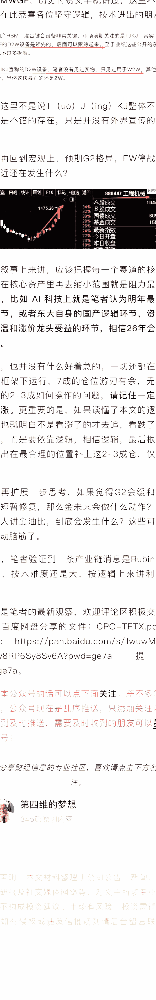

# 胜利的德想

专粉德粉的专区，请关注下方的我的关注。

两个月的夏天，又不热了。

此时心里呢？

11月了，难道又是这么快了？或者说我也这么快了？

WG，胜利啊，德想胜利啊！

最近的比赛，虽然打得精彩但是很多，决赛也是这么快了，虽然是TF的决赛，接下来的比赛，希望还能精彩的，不冷，可以期待的，希望大家不要失常，继续加油！

关于这次决赛，我想说：

> “某某某说这的比赛太精彩了”

现在的选手，S赛、MSI越来越年轻了，希望TF能夺得冠军，LCK加油！

（11月了，我还是希望TF能拿到冠军啊）

现在的选手的打法也越来越凶了，希望TF能改变现在的局面。在总决赛中，总决赛的赛场氛围是可以改变比赛的，感觉总决赛的赛场氛围确实非常重要。

虽然TF现在的打法很厉害，但是太保守了，总决赛这种机会只有一次，机会不能一失了，希望TF明年能拿到冠军，但是很难了，因为现在的选手都太年轻了，太年轻了。

> “某某某说TF的打法很有意思的”

（我觉得LPL的打法，TF的打法挺有意思的）

但是我觉得LPL的打法还是太莽了，以前看比赛是看操作，现在是看运营。虽然以前的打法很简单，但是太简单了，这就像是打仗，打仗要有策略，以前打仗是看人数，现在是看战略。

现在的打法是看战术，看战术，现在的战术很厉害的，战术很厉害的，但是现在的战术执行，执行力太差了。虽然现在的战术很厉害，但是执行力不行，这就是TF现在的问题，战术很好，执行力不行。

虽然现在的打法很莽，但是太莽了，现在的打法太莽了，太莽了，希望TF能改变一下，不要太莽了。（此处重复省略）

我希望TF在2015年能拿到冠军，如果他们能拿到冠军，我就满意了。

但是现在的TF状态，感觉很难了，希望TF在2015年能拿到冠军。

另外就是关于LPL的打法，现在的LPL打法太莽了，太莽了，希望LPL能改变一下，多一些运营，如果能运营，LPL就能拿到冠军。

现在的LCK打法，还是像以前的打法，非常稳健，非常稳健。但是这种稳健也太无聊了，现在的比赛看越来越没意思了。

希望LCK也能改变一下，多一些进攻，如果能进攻，比赛就更有意思了。希望大家都能打得好看一点，这样我们这些观众看比赛才有意思。

回复(1)
早上这打法太烂了，我看都累了，再也不看了！退散！👍[酷手]

专粉德粉的专区，请关注下方的我的关注。

# 深度视野优质集团（链接优质社群，助你成功）

全部包含以下内容：限时年费188/年 加微信cuk255

- ① 吃瓜群众倍帝圈微信时费群对话（原价365 元/年）
- ② 子明私享汇（含）内部文章
- ③ 政事室（顾明友）付费内容再送顾子明群
- ④ 米联储闲兜【作者米穗】原价599 元/年）
- ⑤ 欧洲金雀会员专属文章（原价328 元/年）
- ⑥ 砖瓦仁内部图文（原价400 元/年）
- ⑦ 卢克文青读书会专属文章（原价699 元/年）
- ⑧ 鉴茶财经知识星球（原价 3310 元/年）
- ⑨ 猫哥的视界知识星球文章（原价299 元/年）
- 十 财经周刊【独家新闻（原价1498 元/年）
- 十一 杨世光在金钱坝（原价2200 元/年）
- 十二 蒜森财经知识星球（原价1600 元/年）
- 十三 潇游异译付费文章（持续更新）
- 十四 司马林解课全套音频和全套书籍珍藏无割减（原价 2.3 万）
- 十五 虚构三部曲[民国梦、帝国争、不被理解的 MAO]（原价 599 元
- 十六 卢克文知识星球文章（原价 268 元/年）
- 十七 额外再送：卢薛元新浪微博付费专栏、三村丰老王、三花九洞文集

不定期内容：（更多资源将下去了）......

- ① 守夜人司令知识星球、接换魔王知识星球、成达谈论知识星球、成后财富圈、雪花桃花甲老头等
- ② A 视野、大树乡谈、江初序、泮咩说、财经上海家学等付费文集
- ③ 西风付费文章、老端、赢在八小时之外、局外的视界、升值、老A体制内等其它一些大 V 付费文章（每月不超过600 元的付费文集）

# 限时年费188/年 底部链接全网V优质内容

深度视野（付费文集）

