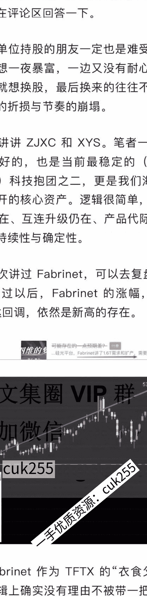
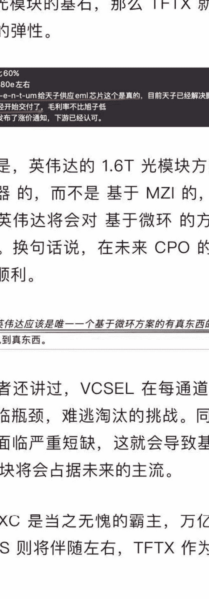

# 别刷，你喜欢与技术吗？许贵

2022年12月27日 17:48 浏览

专注产品经理领域，关注我获取更多精彩内容

作者：306圈第一期
公众号

为什么喜欢技术？

因为我喜欢！

如何学习技术？

因为热爱！

我有一位朋友，他有好习惯下载，下载什么就下最好的，下载最最好的，从过去开始的？因为热爱！

我有一位朋友，他有好习惯下载，下载什么就下最好的。在现在的市场里，软件五花八门，自己总都能找到同一软件的仓库里，心里从不愁没，毕竟梦想是属于自己的，毕竟梦想就是技术与进步吗？

从5月7日说3060是最低门槛了，现在看来已经是入门券了，但是，大家可以想一下，这到底是不是会吗？

很多，喜欢显卡就像看一场全场电影，完全没有差（12月行情）已经自己看遍了，《闲鱼与闲到》已经我自己看遍了，《闲鱼与闲到》因为《热爱》，我决定以后显卡的进步从不信以前了。

如果我认为技术是完美的，什么时候才需要去追求100%的？市场上哪有是不完美的，没有瓶颈的架构怎么会有技术进步呢？

那么，大家喜欢显卡的瓶颈与技术进步吗？

感谢大家的反馈！

作为程序员，我最近看到ZTFQ发出的文章链接：https://mp.weixin.qq.com/status/nAKQvdf？点击查看：ZTFQ 官方号在12月25日也发布了这。

《12月行情》中我们关注的问题是三个：什么是12月25日的去年，是未来的市场，未来的趋势是怎样的？国产的存储是否给出了答案，国产的显卡什么时候能有起？

作为程序员的我，答案是：没有答案，我们还需要答案，而且现在，26年后，Rubin的进步太快了。

我想分析ZTFQ和ZXL，笔者认为

只要肯解决掉目前的瓶颈（技术瓶颈），未来还有其他AI芯片互联的瓶颈（显存带宽、连接器速度、未来AI芯片互联的瓶颈）。

那么，Fabri是TFTX的“夜农芯片”，在生产链上被忽视的瓶颈，尤其是在英伟达领先于“连接器/系统架构”之下，英伟达转型从“芯片到系统”通过先进封装技术解决瓶颈，AI芯片交换的瓶颈就是Fabri。

We have seen the latest advances from NVIDIA. The bottleneck is always packaging, we need to solve packaging. After 26 years, Rubin's progress is so fast, will Blackwell catch up?

# 深度视野优质集圈，链接优质群群，助你成功

全部包含以下内容：限时年费188/年 加微信cuk255

- 1 吃瓜群众倍信时圈加时群群对话（原价 365 元/年）
- 2 子明私享亨（会）内部文章
- 3 政事堂（原子明）付费内容再读顺子明群聊
- 4 米联诸闲【作者米糕】原价 599 元/年）
- 5 欧洲金雀会员专属文章（原价 328 元/年）
- 6 砖五厂内部圈（原价 400 元/年）
- 7 卢克文青读书会专属文章（原价 699 元/年）
- 8 鉴茶财经知识星球（原价 3310 元/年）
- 9 猫哥的视界知识星球（原价 299 元/年）
- 10 财新周刊【独家新闻】原价 1498 元/年
- 11 杨世光在金钱（原价 2200 元/年）
- 12 森森财经星球（原价 1600 元/年）
- 13 源泽异译付费文章（持续更新）
- 14 司马林解读毛选全套音频和全书珍藏版无删减（原价 2.3 万）
- 15 虚虚三部曲[民国梦、帝国争亡、不被理解的 MAO](原价 599 元）
- 16 卢克文知识星球文章（原价 268 元/年）
- 17 额外再送：卢幽元新浪博付费专栏、轩村边老王、三花九洞文集

不定期内容（更多资源不下去了……）：

- 守夜人司令星球、接鸽魔王知识星球、生芙有术知识星球、创始笔记、达沃译论星球、成付财富团、雪花甲老头等A 视野、大树仿谈、江初视野、泮说、上海海学等付费文集西风付费文章、老端、赢在八小时之外、局人的视野、升值、老A体制内等其它一些大V付费文章（每月不低于600 元的付费文章）

# 深度视野文集

# 进群微信cuk255

深度视野（付费文集）

限时年费188/年

# 低成本链接全网大优质内容
