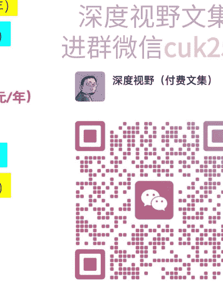

# 米联储闻251104——桂州横烟不可涉(荷兰对安世半导体制裁事件仍在持续)

你好，我是米藕

荷兰对安世半导体制裁事件仍在持续，按商务部的说法，荷兰方应承担全部责任。现在的问题是，中国有什么办法可以打崩荷兰，别指望荷兰通理，实际上，如果中国不能有效地强势反击，中资控股的海外企业都将无例外被掠夺的风险，这就是弱肉强强的现实，盗强出身的欧美国家本身根本没有所谓诚信可信，更何况现在的美国，连造都懒得装了。

注意一下商务部原文：荷兰政府9月30日发布令，不当干预安世半导体企业内部事务，之后荷兰企业法院作出中国企业股权错误裁决，严重侵害中国企业权益。此后，政府不顾多方多次在磋商中提出的合理诉求，没有展现出建设态度和行动升级供应链危机。安世（荷兰）10月26日宣布停止安世（中国）供应晶圆，导致者无法正常生产，造成了全球半导体供应链的动荡和混乱。对此，荷兰方承担全部责任。中方面对全球半导体供应链稳定与安全的责任态度，11月1日宣布将对符合条件的出口予以限制，并努力推进安世（中国）恢复修复。但荷兰继续坚持，且无解决问题实际行动，这将加剧对全球半导体供应链的不良影响。这是中方和全球视野愿到的。

文中提到，中方多次磋商，但荷兰方面并未给予理会，态度强硬。且在中方意愿恢复供货的情况下下，荷兰方面不但没有给予相应的退让，反而变加厉，这就涉及了我们昨天所说的问题，中美之间的暂时休战反而成了中国进行反制的阻碍，为了所谓稳定的中美关系，不得不对美做出妥协，而美国回过头来这些这些对中国进行围噬，所以，如何能够打痛这些狗腿，并起到杀一百的效果很重要。

荷兰政府这次强制夺取中国上市公司润泰科技境外资产为半导体操作，可谓是下欧美美国家最后的伪善，露出强盗本色，数据显示，2008年以来，全球贸易总额GDP比重趋于稳定，供应链在逻辑上已从效率优先转变为安全与弹性为主。特别是2020年新冠后，全球供应链加速区域化、本土化重心，2024年欧洲、亚洲、北美三大经济圈内贸易占比已提升至56%，欧洲61%，北美39%，亚洲59%，其圈间贸易增长显著乏力。

根据对全球化、地缘政治以及跨国生产的长期追踪研究，跨国生产的空间连续性被打破，全球供应链已经不再是企业级别的单一成本优化的工具，而是分裂为战略性供应链与企业供应链双轨并行体系，而战略性供应链务必成为国家的竞争。企业供应链主要面向普通消费、非核心部件的生产环节，仍由企业根据市场需求自主调配，强调效率优先；而战略供应链则是涉及国家安全、产业命脉的关键领域，必须从企业主导升为国家管控，强调安全优先。

2017年，美国正式将供应链纳入国家安全战略(National Security Strategy)。特朗普1.0政府时期，当时的美国国防部发布报告《Assessing and Strengthening the Manufacturing and Defense Industrial Base》，首次使用战略关键供应链(strategic and critical supply chains)这一表述。大佬集团报告指出，美国在关键原材料、半导体、医药原料等方面对国外尤其是中国的依赖，已形成战略性脆弱。自此，战略性供应链从企业概念转为国家战略概念。在战略性供应链方面，美国主要强调的是三点：韧性和独立性(resilience & independence)、国家安全(national security)、战略竞争(strategic competition)。战略性供应链因及国家间的竞争，必须由国家管理，其运行逻辑服务于国家利益，由于强调的是更高层次的国家利益，战略供应链将由各国政府重点去抓，设置法律、部门、官员，进行具体管理。

目前各国都将战略供应链纳入顶层设计，通过立法、设定机构、设定规则，实现从被动应对到主动控制的转变。实际上，我的稀土措施和步骤完美展示了稀土如何从普通商品转化为战略物资到最终成为核心战略物资的过程。

美国方案，对高端芯片的限制是国家安全战略级别的，先后台《芯片与科学法案》《供应链百日评估报告》，明确将半导体、新能源电池、关键矿物等16领域列为战略范畴，成立跨部门的供应链韧性委员会，直接主导供应链的布局和调整；欧盟推出《关键原材料法案》《欧盟芯片法案》等系列政策，要求到2030年实现储镁、稀土等关键矿物本土开采循环利用占比40%，并建立供应链预警机制；中国则通过双循环战略，强化粮食、能源、芯片等领域的自主可控能力，将战略供应链管理纳入国家安全体系。所以，也觉得荷兰的操作有多么逆天，当中国稀土死砸在自己手里的时候，几乎所有在擂台上的国家都会开始盘点自己家里有些东西可以压制别人。

此外，不同于过去的产业布局，战略性供应链呈现出分布形态，这种产业布局形态通过核心环节本土化、配套环节多元化、区域布局靠近岸，打破对单一国家地区的依赖，构建可控、弹性供应链，包括政治风险在内的综合成本。其中核心本土化是产业链中最关键的技术、制造掌握在手中，避免被卡脖子。通过国内政策扶持，拓展原材料、零部件多元化供应，确保安全。

最后，通过区域布局近岸化，联合日本、澳洲、印度等组建联盟，近岸化成为重要补充。大佬文件调查显示，美国在半导体领域执行近岸外包，在墨西哥、东南亚等产能基地，形成以本土为主、周围为辅的布局。战略性供应链远超一般企业的出口经济稳定和繁荣，这次荷兰的操作只是开始，本质上是对中国海外利益的武器化。这一全球范围内的贸易保护，美国发布《关键矿物清单》，支持国内锂、石墨、镁等关键矿产开采和加工；欧盟成立欧洲联盟，旨在减少对单一国家关键材料上的依赖；中国也在全球范围内积极收购和投资，强化战略性供应链全球主导地位与话语权，面对此类问题能够采取措施保护中资海外利益才是关键。

整体来说，目前的国际格局是一个错位竞争的局面，用新冷战或者G2都足以描述当下的现实。战略性供应链已经超越贸易工具属性，成为国家稳定的战略筹码，甚至是武器化的达到极点。客观来说，在美国视野下的全球秩序，博弈的俄罗斯依旧是地缘威胁，崛起的中国就是经济对手，也是合作伙伴，衰落的欧洲已经老了，但在国际格局中仍有权威。政治上，中欧都是威胁，经济上，中欧都是对手，所以美国自身并没有绝对的敌人和朋友，大家在不同领域需要解决的问题一样的，各种利益紧密嵌入，导致当下表面上打架，实际上世界注定属于世界的，吃饭的和菜永远会有相同的利益冲突。中美矛盾大，利益关系优于矛盾交集，但基本事实也很明确，现在的美国还想牢牢单极优势不容易，这个世界终归是大游戏，中俄各自存在分量；俄罗斯无法在经济领域实现实力却拥有核武器与实战能力，中国不愿与美国产生地缘争，但经济遏肋是无法避免的。美国把G2的高帽子送给中国，相当于给欧洲日韩印度至南方国家。坚持追求多极化，中国也要谨慎避免将全球浓缩成G2为主划定的利益集团，限制国家的空间。对中国来说，会被美国定义，拒绝来自自国的身份标签，才能确立以中国为基点的全球视野。

米糯视各位晚安

# 深度视野优质集团（链接优质群，助你成功）

全部包含以下内容：限时188/年 加微信微k255

- 吃众群信专属文档加限时群聊对话
- 子梓明佑（会）内部文档（原价 568 元/年）
- 露事堂（诸子明）付费后再送诸明蝶
- 米联健闻（作者：米彦）
- 欧洲金钻会员专享文章（原价 328 元/年）
- 巨瓦幻内部文档（原价 400 元/年）
- 广众云读全书哲学（原价 699 元/年）
- 盖森财经识星球（原价 3310 元/年）
- 甜猫的知识界星球（原价 299 元/年）
- 十财富刘【独家新闻》（原价 149 元/年）
- 杨世无金钱（原价 2200 元/年）
- 森赛财经识星球（原价 1600 元/年）
- 滴源译付费文章（持续更新）

- 14 可马林斌畅读全会音视频和全书锦藏版无割（原价2.3 万）
- 15 虚虚卢陈民国、帝国治、不理解的MAO（价599 元/年）
- 16 老克宇宙星球（原价268 元/年）

另外获：许麟源微信付费群书。末西老汉、三九八热门文集不定期更新；

（更多资源没这里了……）
