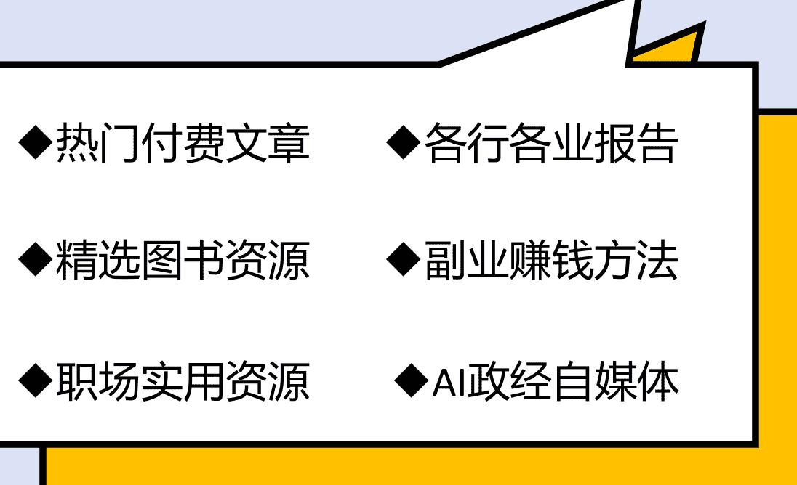

## 米联储闻250423 南京君宰荒(川普认怂，关税战再而无声)

黄金大跌，昨天我也在文章说了，黄金大涨不符合中美利益，所以中美之间只要有一定的缓解迹象，黄金就会立刻做出反应。现在的黄金就是一面照镜映，也是一个温度计，黄金价格的暴涨本身涵盖了巨大的信息量。过去十天，黄金价格几乎上涨了500美元，而过去黄金从2500美元涨到3000美元用了210天，事出反常有妖。黄金现在是美元本质的照镜，混乱一直是暂时的，黄金的保障已经经历了这种混乱，而在短期内，美元在世界货币体系中依然据配套。后工业时代，世界回到本位可能是不可能的，东亚和美国虽有教盾，主权货币体系，债务经济的本质不会改变。随着美国制造业回流的趋势越发清晰，中国的矛盾也会趋于缓解，因为美国从来不会打无把握之战，以前的状况来看，新的平衡已经逐渐实现。

在未来一段时间内，美元仍是主要货币，其它货币和支付工具的地位和份额都会得到一定的提升，人民币、欧元、日元、英镑还包括黄金和目前尚未得到普遍认可的比特币都会在国际储蓄和支付中占据一方之地。地缘政治的多极化，必然会导致货币体系的多元化，世界的多元化可能会从政治和经济领域延伸到渗透方面，包括最基础的货币金融领域。

这一波黄金短期内暴涨的逻辑主要是受川普关税政策刺激，美股债汇三杀，导致市场产生了强烈避险情绪。实际上对黄金、美元、人民币等指数曲线可以发现，从整体趋势看，从2020年疫情以来，作为一种避险工具，黄金一直在不断攀升，但趋势都比较平稳。2022年俄乌战争爆发以来，世界各国无一不在黄金。2022年一年就增长了1136吨，破了过去55年的记录。同时，一些和美国有摩擦的国家，比如兔子，开始为减持美元资产。还有一些国家，开始拿着或者把美国储备银行的黄金运回国内储备。

还有一个意外的情况就是，在川普上任之前，市场对美国优先川普交易是看的，因为相信川普的政策有利于美国经济，让美元走强。实际的结果是，川普的一顿操作猛如虎，但不有利于美国经济，反而推着拉拉，快速暴露美国漏洞。当意识到川普在政策操作面上非常化的问题和策略后，市场和机构开始快速做空美元，做多黄金。川普的操作从根本上动摇了二战及战后形成的国际经济、政治、贸易秩序与理念。而二战及冷战后形成的这一系列国际秩序，是美国和美元占据地位的结构性制度支撑，失去了这些，必将让全球的经济秩序回到二战前，所以自然骨子里对黄金的崇拜就血脉觉醒了。

兔子为了增加对美压力，除了正面面对美国的关税政策，主动做空美国，甚至包括资本投资，包括中投、中金内的多个国家基金，已于近期停止对美国私募股权基金的新投资，并将资金转向其他国家，进行投资组合多元化。过去数十年来，兔子通过黑市、TPG、凯瑞集团等大型私募基金的投资，成功将资金流入西方企业及经济体。如今这些资金正在被撤回或中止，显示兔子正在全面调整对美的金融策略。

亿，目前已人民币央企，其投资横跨全球逾100个国家和地区，涵盖能源、科技、金融等领域，包括澳洲电网、巴基斯坦与南亚科技企业等。与其相对，兔子本土私募股权市场呈现回缓趋势，2025年3月，北京地区引导基金与国资计缴人民币1436.9亿元，较2月增长约58%。

俄乌冲突期间，为了打击俄罗斯，拜登政府将俄罗斯彻底赶出了Swift系统，但事实证明，失去Swift的俄罗斯没有崩溃，反而成为了其他支付系统的大客户。如今美国继续通过操作来打散贸易，其结果是人民币结算已经不再选项，而是必选项。过去一周，人民币单日交易额突破12.8万人民币，已经超过单日Swift的交易量，这估计也是川普政府未触及的。

根据国际货币基金（IMF）发布的《人民币观察》，2024年第四季度成果展示：

| 类别 | 跨境人民币结算份额 |
| :--- | :--- |
| 访谈企业 | 约68% |
| 访谈企业 | 约50% |
| 访谈企业 | 约50% |
| 访谈企业 | 约77% |
| 访谈企业 | 约68% |
| 访谈企业 | 约68% |
| 访谈企业 | 约70% |

根据环球金融协会（SWIFT）数据，今年3月，人民币保持全球大支付地位，占比3%。同时，美元占最大份额49%，而占全球外汇储备57%。其中在货币权重方面的差异还是大的，这意味着美国并不稳定，也不是根本性的，兔子跑推趋势，但短期内依然还是小，所以概率还是坐下来好好谈，这是客观决定因素。特朗普反复质疑政策连贯性，另一个关键因素是市场对美国联储（Fed）货币政策转向的预期。美元指数从年初以来下跌，显示数据持续低于预期，美国核心PCE物价上涨2%，创2023年以来新高。这种利率维持更久的立场本应支撑美元，但现实却相反。原因在于，市场对美国经济衰退的担忧正在加剧，美元指数从年初的104.5骤至99.5。

美国的两难之处在于，如果在压力下选择降息，会导致美元下跌，外国投资者可能大举抛售资产。如果降息，可能加剧通胀；如果不降息，经济可能硬陆。这种不确定性让美国资产风险溢价大幅上升。所以，面对终极压迫，川普不得不表现。昨天，川普在白宫椭圆形宣布在关税期间他不会对兔子采取强硬手段，而是能够相当速度地达成一项协议，大幅调整对兔子进口商品加征45%巨额关税。他表示：“我们将非常友好的态度对待他们，他们也会友好相待，然后以待发生什么。”美国财政部长桑森表示，下中美关税对峙难以为继，并预计短时间内出现缓解态势。这是一段时间以来，川普不断向兔子抛橄榄枝之后，再度释放降温信号。川普政府现在之所以冷静下来好说话，跟兔子政府的强硬回击此关关系，这一丝和气毕竟正靠拳手打出来的。相比于兔子的始终敏感，川普似乎还不够，担心川普反复无常，毕竟从上一次开始，这就是常规操作。其实关税战真正的反击还没来，但川普已经开始放气了。到目前为止，川普还没有确定任何一个国家的关税协议，90天内他也太可能完成这项任务。加拿大这素来视为对美国政策亦步跟随的国家，这次却强度强硬地实施了关税限制措施；而一贯对美国配合的日本，也没有表现出顺从的姿态。欧盟方面正积极行动，致力于捍卫市场高达87%的贸易份额。总体来看，即便部分国家最终选择妥协退让，也没有让美国达到目的。兔子坚定表示将奉到底，并明确已经做好了所有的准备。立足于打，绝不让步，反而让川普陷入了被动。说白了，这些兔子是信奉林规则和弱肉强食，好好功夫是不行的，还是拳脚教育才会真的学会好说话。所以这次第一次交锋未能解决所有问题，但已经让美国冷静下来了。

# 免费 价值 及时 专注

# 扫码加入知识星球TOP 免费资源群

- 每日免费获取价值资源
- 可提供各类资源搜索服务

| 热门付费文章 | 各行行业报告 |
| :--- | :--- |
| 精选图书资源 | 副业赚钱方法 |
| 职场实用资源 | AI政经自媒体 |

公众号: 知识星球TOP 微信号: jntsg8 微信号: jntsg2

分享资料仅供个人学习，请及时删除，切勿商用传播
